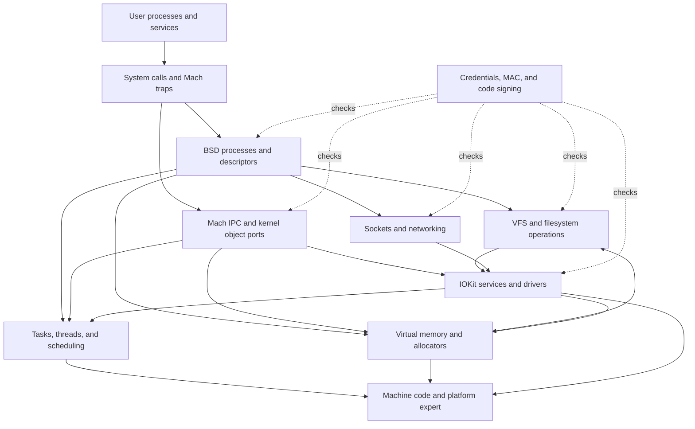
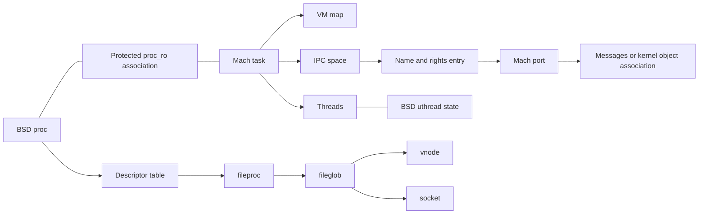

# Architecture and object relationships

[Guide index](README.md)

## One kernel, several object models

XNU combines Mach execution, IPC, and virtual memory with BSD process/filesystem/network semantics and the IOKit driver model. These components normally execute in the same kernel address space and call each other directly. “Mach subsystem” does not mean that every BSD operation becomes a message to a separate server. For example, BSD's process-creation code calls Mach task/thread creation, and filesystem-backed paging calls into the vnode pager. See [fork implementation](../xnu/bsd/kern/kern_fork.c), [task creation](../xnu/osfmk/kern/task.c), and [vnode pager](../xnu/bsd/vm/vnode_pager.c).

This is a dependency map, not a strict stack. For example, a device interrupt enters through machine code and can eventually wake a BSD thread; memory pressure can make VM ask BSD's process policy to reclaim a process. Networking's interface KPI also permits driver implementations outside this source tree. These reverse paths matter as much as calls originating in a syscall.

## The objects to learn first

The [key-structures section](structures/README.md) follows these declarations into allocation, accessors, checked updates and final release. Its process/task route includes ordinary creation, kernel bootstrap and corpse differences. Continue with [thread storage and protected associations](structures/thread-and-thread-ro.md), [credentials](structures/credentials-and-credential-storage.md), [MAC labels](structures/mac-label-storage.md), [IPC spaces and entries](structures/ipc-spaces-and-entries.md), and [ports and kobjects](structures/ipc-ports-and-kobjects.md) to connect execution identity and capability lookup to their concrete representations.

For memory, follow [map and entry storage](structures/vm-maps-and-entries.md), [object backing](structures/vm-objects-and-backing.md), [resident-page metadata](structures/vm-pages-and-resident-storage.md) and [pmap/table storage](structures/pmap-and-translation-storage.md). The [memory-entry and copy companion](structures/memory-entries-and-vm-copies.md) connects those ownership rules to exported capabilities and transfer containers. A live range, a retained object, a resident frame and an installed translation are distinct states.

For files, follow the [descriptor table](structures/file-descriptor-tables.md) into [fileproc/fileglob storage](structures/fileprocs-and-fileglobs.md), then [vnode identity](structures/vnodes-and-vnode-identity.md), [UBC/pager associations](structures/ubc-and-vnode-pagers.md) and [signature storage](structures/code-signature-blob-storage.md). Slot publication, shared open-file references, filesystem identity and signed-file backing each have their own lifetime.

For messages and networking, follow [kmsg storage](structures/ipc-kmsgs-and-message-storage.md), [sockets](structures/sockets-and-protocol-attachments.md), [socket-buffer records](structures/socket-buffers-and-record-queues.md), [Internet PCBs](structures/internet-pcbs-and-transport-storage.md) and [mbuf backing](structures/mbufs-and-external-storage.md). A queue header, protocol attachment, retained capability and shared packet-byte view have separate allocation and ownership rules.

| Object | Responsibility | Principal source |
| --- | --- | --- |
| `proc` | BSD process identity, lifecycle, descriptor state, signal state, process relationships | [proc_internal.h](../xnu/bsd/sys/proc_internal.h) |
| `proc_ro` | Protected process/task association and selected process state | [proc_ro.h](../xnu/bsd/sys/proc_ro.h) |
| `task` | Mach resource container: VM map, IPC space, threads, policy, accounting | [task.h](../xnu/osfmk/kern/task.h#L266) |
| `thread`, `thread_ro`, `uthread` | Schedulable execution, protected associations, and per-thread BSD state | [thread.h](../xnu/osfmk/kern/thread.h), [user.h](../xnu/bsd/sys/user.h) |
| `ucred`, `posix_cred`, `ucred_rw` | Shared identity value, embedded POSIX fields, and separate writable lifetime/hash bookkeeping | [ucred.h](../xnu/bsd/sys/ucred.h#L146-L180), [kern_credential.c](../xnu/bsd/kern/kern_credential.c#L3295-L3305) |
| MAC `label` | Protected owner/slot representation for policy-specific values | [_label.h](../xnu/security/_label.h#L72-L92) |
| `processor`, `processor_set` | CPU execution and scheduling domains | [processor.h](../xnu/osfmk/kern/processor.h) |
| `vm_map`, `vm_map_entry` | Virtual-address ranges, protections, backing relationships | [vm_map_xnu.h](../xnu/osfmk/vm/vm_map_xnu.h) |
| `vm_object`, `vm_page` | Backing-store identity and resident physical-page metadata | [vm_object_xnu.h](../xnu/osfmk/vm/vm_object_xnu.h), [vm_page.h](../xnu/osfmk/vm/vm_page.h) |
| `ipc_space`, `ipc_entry`, `ipc_port` | Task-local names and rights, and the kernel endpoints they designate | [ipc_space.h](../xnu/osfmk/ipc/ipc_space.h), [ipc_entry.h](../xnu/osfmk/ipc/ipc_entry.h), [ipc_port.h](../xnu/osfmk/ipc/ipc_port.h) |
| `fileproc`, `fileglob` | Descriptor-level state and shared open-file state | [file_internal.h](../xnu/bsd/sys/file_internal.h) |
| `vnode`, `mount` | A filesystem object and a mounted filesystem instance | [vnode_internal.h](../xnu/bsd/sys/vnode_internal.h), [mount_internal.h](../xnu/bsd/sys/mount_internal.h) |
| `socket`, `protosw`, `ifnet`, `mbuf` | Socket state, protocol dispatch, network interface state, packet storage | [socketvar.h](../xnu/bsd/sys/socketvar.h), [protosw.h](../xnu/bsd/sys/protosw.h), [if_var_private.h](../xnu/bsd/net/if_var_private.h), [mbuf.h](../xnu/bsd/sys/mbuf.h) |
| `IORegistryEntry`, `IOService`, `IOUserClient` | Device/service graph, driver lifecycle, and controlled user access | [IORegistryEntry.h](../xnu/iokit/IOKit/IORegistryEntry.h), [IOService.h](../xnu/iokit/IOKit/IOService.h), [IOUserClient.h](../xnu/iokit/IOKit/IOUserClient.h) |

The familiar phrase “a process has a task” is useful but incomplete for this version. The process and task participate in a combined allocation and share protected association state; Mach and BSD lifetimes still have distinct reference rules. Likewise, thread/BSD state must be reached through the current accessors, not an assumed historical `bsd_info` field. Read the [process lifecycle guide](subsystems/processes/README.md) before interpreting an old debugger script or copying an older XNU diagram. The actual accessors include `proc_task()`, `get_threadtask()`, and `get_bsdthread_info()` in [kern_proc.c](../xnu/bsd/kern/kern_proc.c#L2003), [thread.h](../xnu/osfmk/kern/thread.h), and their implementations.

Edges indicate associations rather than C field names, exact pointer direction, or ownership. In particular, the diagram does not assert that a process owns every referenced vnode or that an IPC name is a pointer.

## Three routes from user space

**BSD system calls** provide operations such as file access, sockets, process control, and `kevent`. The declarative entry list is [syscalls.master](../xnu/bsd/kern/syscalls.master). Architecture dispatchers decode the call and invoke an entry in the generated `sysent` table; per-thread `uthread` state carries syscall-related information. Start at [ARM syscall dispatch](../xnu/bsd/dev/arm/systemcalls.c) or [x86-64 dispatch](../xnu/bsd/dev/i386/systemcalls.c).

**Mach traps** provide selected direct kernel entries, including message operations and selected VM/port operations. Their table is [syscall_sw.c](../xnu/osfmk/kern/syscall_sw.c). A trap is not the same thing as an arbitrary Mach RPC: many APIs use a message to a port. [libsyscall/mach](../xnu/libsyscall/mach/) and [libsyscall/wrappers](../xnu/libsyscall/wrappers/) expose parts of the user side; some wrappers select a trap and then fall back to an RPC.

**Messages to kernel objects** arrive through Mach IPC and are dispatched to a kernel implementation. [Mach `.defs` interfaces](../xnu/osfmk/mach/) describe many RPCs; [ipc_kobject.c](../xnu/osfmk/kern/ipc_kobject.c) and [ipc_mig.c](../xnu/osfmk/kern/ipc_mig.c) provide dispatch support. IOKit also exposes objects and user clients through this machinery; see [IOUserClient.cpp](../xnu/iokit/Kernel/IOUserClient.cpp) and [iokit_rpc.c](../xnu/osfmk/device/iokit_rpc.c). Possession of an appropriate port right and the operation's additional policy checks determine what the caller may do.

All three routes converge on shared objects. A BSD `mmap` and a Mach VM API manipulate VM; a BSD workqueue and a Mach-created thread are scheduled by the same execution machinery. Different entry conventions do not create independent kernels.

## Interfaces between subsystems

| Boundary | What crosses it | Why it matters |
| --- | --- | --- |
| BSD ↔ Mach execution | Process/task association, thread creation, exit, policy and exception handling | PID identity, task lifetime, and thread scheduling answer different questions |
| VFS ↔ VM | Vnode pager, memory-object control, UBC state, UPL page lists | File contents can be accessed through `read`/`write` and virtual mappings |
| IPC ↔ VM | Out-of-line message memory and memory-entry objects | Message transfer includes ownership and mapping work, not just bytes in a queue |
| IPC ↔ scheduler | Wait queues, turnstiles, importance and message delivery | A receive can block; dependencies can affect effective priority |
| IOKit ↔ IPC | Object ports and user-client RPCs | A C++ driver object needs an access-controlled user interface |
| IOKit ↔ VM/platform | Memory descriptors, mappings, DMA commands, interrupts | CPU virtual addresses, physical pages, and device addresses are distinct |
| Networking ↔ event/runtime | Socket wakeups, readiness filters, thread blocking | Data arrival changes both buffer state and a waiting thread's eligibility to run |
| Security ↔ all public operations | Credentials, labels, signatures, entitlements, audit context | Authorization is distributed across operation-specific checks |

The [execution-path guide](cross-cutting/execution-paths.md) follows these boundaries with concrete source entry points. The [ownership guide](cross-cutting/ownership-and-locking.md) explains the reference and lock questions to ask at each crossing.

## Platform and configuration are part of the design

`osfmk/arm64`, `osfmk/arm`, `osfmk/i386`, and `osfmk/x86_64` contain machine-dependent execution and memory code. Directory names retain history: `i386` includes code used for x86-64, and shared ARM code remains under `arm`. `pexpert` handles platform discovery and callbacks; IOKit consumes platform information and discovers services. See the [platform guide](subsystems/platform/README.md).

The compiled kernel is selected from a larger tree. [config/MASTER](../xnu/config/MASTER), architecture-specific configurations, subsystem `conf/files*` lists, and `#if` branches determine what exists in a particular build. In particular, scheduler policy, memory-pressure behavior, Skywalk features, Exclaves, and SPTM-related integration must not be assumed identical on all targets. Use the [build guide](development/build-and-tests.md) before deciding that two apparent implementations both run on the same device.

<!-- BEGIN PLATYDOC DOCUMENTATION LICENSE -->
Original Platydoc text and diagrams are licensed under [CC BY 4.0](https://creativecommons.org/licenses/by/4.0/). Quoted source code and third-party material retain their respective licenses.
<!-- END PLATYDOC DOCUMENTATION LICENSE -->
