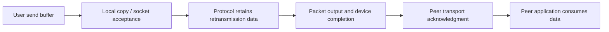
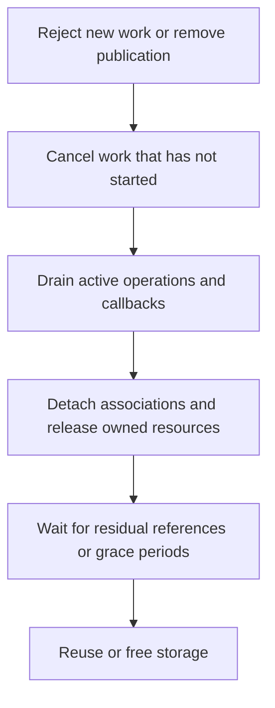

# Completion, cancellation and partial failure across subsystems

[Guide index](../README.md) · [Execution paths](execution-paths.md) · [Ownership rules](ownership-and-locking.md) · [SMR](smr-and-publication.md)

An operation can have several completion boundaries: input accepted, ownership transferred, work executed, result published, user copyout finished, and final references released. These boundaries often occur in different threads. An error at a later boundary does not necessarily undo an earlier one.

This chapter connects the concrete protocols in the subsystem guides. Each example names the point that actually changes ownership or state, so that a return value, wakeup or cancellation can be interpreted without assuming an all-or-nothing operation.

## The questions to ask at every handoff

For the concurrent execution behind selected completion boundaries, follow the [VM, IPC and workqueue walkthroughs](concurrent-operation-walkthroughs.md). They distinguish partial copy progress, a grower's successful return into a failed allocation retry, and cancellation from callback completion.

| Question | Concrete examples |
| --- | --- |
| Has the caller surrendered ownership? | Socket `pru_send` consumes mbufs; a successfully sent Mach kmsg belongs to delivery; a UPL completion flag transfers page-release work. |
| Has work merely become eligible? | A waitq wake makes a thread runnable; a delayed thread call enters a pending queue; a socket listener makes a child available to accept. |
| Has execution finished but cleanup not finished? | A device buffer completes before clustered UPL cleanup; AIO moves to the completed list before notification and final reference drops. |
| Can the result still fail to reach userspace? | Mach receive byte copyout, socket ancillary-data copyout, `wait4` status/rusage copyout. Their rollback rules differ. |
| Is storage still needed by another participant? | An active timer callback, an SMR reader/callback, a route cache reference, an interface data-movement operation. |

These are separate axes. A reference protects a specific allocation or association; a completion counter covers a particular unit of work. Neither should be assigned a broader meaning than the body implementing it.

## Mach RPC: a receive retry must not resend the request

A combined Mach send/receive call contains two phases. After successful send, a receive interruption does not mean the server never received or executed the request. The userspace library retries only the receive portion:

[Source: mach_msg.c, lines 133–144](../../xnu/libsyscall/mach/mach_msg.c#L133-L144)

<!-- source-excerpt: ../../xnu/libsyscall/mach/mach_msg.c#L133-L144 -->
```c
	if ((option64 & MACH64_RCV_INTERRUPT) == 0) {
		while (mr == MACH_RCV_INTERRUPTED) {
			mr = mach_msg2_trap(data,
			    mach_msg_options_after_interruption(option64),
			    msgh_bits_and_send_size & 0xffffffffull, /* zero send size */
			    msgh_remote_and_local_port,
			    msgh_voucher_and_id,
			    desc_count_and_rcv_name,
			    rcv_size_and_priority,
			    timeout);
		}
	}
```

[`mach_msg_options_after_interruption`](../../xnu/libsyscall/mach/mach_msg.c#L76) removes send and synchronous-receive linkage as appropriate. This prevents a receive retry from accidentally creating another request. Send interruption has a separate retry branch using the send arguments.

The kernel has further phase-specific error rules:

* Partial copyin cleans the resources acquired so far.
* A send failure after full copyin still leaves an unsent resource-owning kmsg. Pseudo-copyout attempts to return its rights and OOL memory to the sender; names or addresses need not be identical afterward.
* After message selection, receive copyout can install some rights or mappings and then encounter a descriptor or byte-copy error. It does not generally roll back every already-installed result.
* A port dying after successful right translation can result in successful send followed by message destruction. Successful send therefore does not universally promise server execution.

See [message transfer and phase-specific errors](../subsystems/ipc/message-send-receive.md), [`mach_msg_trap_send`](../../xnu/osfmk/ipc/mach_msg.c#L652), [`ipc_kmsg_copyout_pseudo`](../../xnu/osfmk/ipc/ipc_kmsg.c#L4293), and [`ipc_kmsg_put_to_user`](../../xnu/osfmk/ipc/ipc_kmsg.c#L4740). Application-level exactly-once execution is not supplied by treating the combined trap as a transaction.

## Socket I/O: local acceptance, remote acknowledgment and copyout

The socket send path clears its local `top` and `control` pointers after calling the protocol's `pru_send`, even when the protocol returns an error. The protocol/filter ownership contract determines who releases them. Retrying with the same kernel mbuf pointers would be invalid once ownership has crossed that boundary. See [`sosend` handoff](../../xnu/bsd/kern/uipc_socket.c#L2445) and [socket I/O ownership](../subsystems/networking/socket-lifecycle-and-io.md).

For TCP, accepted stream bytes can remain in the send buffer for retransmission. Interface enqueue, device completion, peer ACK and peer application consumption are subsequent, distinct events. A successful socket write reports local progress. See [TCP state, retransmission and close](../subsystems/networking/tcp-connections-and-timers.md).

Receive can remove data from the queue before every output copy finishes. The payload may be consumed before sender-address or ancillary-data copyout fails. `SCM_RIGHTS` also has a domain-specific externalization step that creates receiving descriptors; it is not just a byte string. Conversely, `MSG_PEEK` preserves queue ownership and sanitizes internal rights representation. See [`recvit`](../../xnu/bsd/kern/uipc_syscalls.c#L2195), [`soreceive_ctl`](../../xnu/bsd/kern/uipc_socket.c#L2971), and [ancillary-data handling](../subsystems/networking/socket-lifecycle-and-io.md#ancillary-data-can-carry-references-not-just-bytes).



This is a TCP reading route, not a universal ordered list of callbacks: packet loss can repeat output, filters can delay acceptance, and buffering can overlap several stages.

## A copyout failure sometimes preserves the result

`wait4_nocancel` provides a useful contrast within the same kernel. It claims a zombie using `P_LIST_WAITING`, performs policy checks and copies status/rusage, and only then calls `reap_child_locked`. A copyout error takes the release path without consuming the zombie's status through reaping:

[Source: kern_exit.c, lines 3110–3120](../../xnu/bsd/kern/kern_exit.c#L3110-L3120)

<!-- source-excerpt: ../../xnu/bsd/kern/kern_exit.c#L3110-L3120 -->
```c
			retval[0] = proc_getpid(p);
			if (uap->status) {
				/* Legacy apps expect only 8 bits of status */
				status = 0xffff & p->p_xstat;   /* convert to int */
				error = copyout((caddr_t)&status,
				    uap->status,
				    sizeof(status));
				if (error) {
					goto out;
				}
			}
```

See [the complete wait/reap ordering](../../xnu/bsd/kern/kern_exit.c#L3043) and [process transition details](../subsystems/processes/process-transitions.md#7-wait-consumes-status-then-reaping-releases-the-identity). This behavior must be established from this caller's code; it cannot be inferred from a general rule that all syscall errors roll back state.

Exec has the opposite kind of irreversible boundary. It constructs a shadow proc/task, prepares the image, replaces PID-visible process state, enables task IPC and releases return gates at separate points. Late image-activation failure cannot necessarily resume the original executable as an ordinary failed syscall. The old task's `DID_EXEC` state participates in deciding termination. See [exec publication and failure](../subsystems/processes/process-transitions.md#4-exec-replace-the-proctask-pair-while-preserving-identity), [`proc_exec_switch_task`](../../xnu/bsd/kern/kern_exec.c#L5795), and [late failure](../../xnu/bsd/kern/kern_exec.c#L2865).

## Writeback: the device result is not the last cleanup step

The buffered writer commits its initial UPL dirty and releases it before taking the write-behind lock. Later writeback obtains a copy-out UPL, maps file extents, constructs buffer transactions and submits device work. This separation preserves new mapped-page modifications and avoids busy-page/write-behind-lock cycles.

`buf_biodone` updates per-buffer completion and outstanding-vnode-write accounting before invoking a clustered callback. `cluster_iodone` waits until a complete transaction's buffers are all done. Its finish routine aggregates errors, performs applicable callbacks/verification, updates stream byte accounting, commits or aborts UPL ranges, frees buffers and possibly completes an original buffer. These are multiple nested completion protocols, not synonyms for one event.

In particular, `clios.io_completed` advances before the main UPL commit/free work later in `cluster_iodone_finish`. Waiting on that stream condition establishes the condition the stream caller requires; it is not a universal callback-return barrier. Likewise, a dirty-range map being empty does not prove all dirty pages were written successfully. Selected failed ranges can remain dirty in VM after tracking storage changes.

See [clustered writeback](../subsystems/vfs/clustered-writeback.md), [`buf_biodone`](../../xnu/bsd/vfs/vfs_bio.c#L4343), [`cluster_iodone_finish`](../../xnu/bsd/vfs/vfs_cluster.c#L1109), and [`cluster_push_err`](../../xnu/bsd/vfs/vfs_cluster.c#L6545). Filesystem/device durability requires the relevant synchronization and storage contract beyond these generic buffer events.

## DMA and channels: publishing addresses is not completing their use

The [user-buffer DMA walkthrough](user-buffer-to-dma-completion.md) separates a descriptor's prepared pages from a command's prepared subrange, mapper state and returned segments. The [Skywalk walkthrough](skywalk-channel-operation.md) follows a pipe whose packet attachments move through an IOKit-backed task mapping. Both expose memory, but they have different consumers and completion rules:

| Observation | What it establishes in the worked operation | What it does not establish |
| --- | --- | --- |
| Descriptor preparation succeeds | VM backing for the selected descriptor is prepared for the requested direction | A device has been programmed or has stopped accessing that backing. |
| DMA segment generation succeeds | The bounded output call emitted its selected addresses and lengths | The output array necessarily describes the entire requested interval, or any device transfer occurred. |
| DMA completion method is called | The local command/descriptor cleanup path is invoked | Generic code independently observed physical-device quiescence; the driver must establish the applicable device contract. |
| Pipe TX sync succeeds | Validated pending work was processed subject to receiver capacity | At least one packet moved, or the receiver's mapped view already reflects internal transfer. |
| Pipe RX sync follows consumed slots | Capacity can be reclaimed and already-validated peer work pulled | The sender's mapped free-slot count has already been refreshed. |
| A readiness event is delivered | The filter observed its selected condition and threshold | A particular consumer owns the packet or has completed processing it. |

The two walkthroughs cite the concrete operations and failure cleanup behind these distinctions. They also show why retaining a C++ object, retaining an arena, wiring a page and keeping an IOVA valid are separate obligations.

## Cancellation removes a particular kind of pending work

| Interface/path | What cancellation establishes | What still needs separate reasoning |
| --- | --- | --- |
| `timer_call_cancel` | Removal from a timer queue when the cancel wins | A callback already detached for execution can still be using its arguments. |
| `thread_call_cancel` | Removal of queued work or ONCE rearm intent | Current invocations and external callback-context lifetime. |
| `thread_call_cancel_wait`, allocated ONCE call | Cancel pending/rearm state and wait for the current invocation | Preventing new submissions/rearms after the operation and retaining external context. |
| `thread_call_cancel_wait`, ordinary call | If nothing was canceled, wait for the submitted-count snapshot; if pending work was canceled, this body returns without that wait | An earlier overlapping invocation can remain active in the successful-cancel branch. |
| AIO cancellation | Successfully removing the request from its execution queue produces an `ECANCELED` completion | Work already claimed by a worker is not canceled by this helper; close/exit can need to wait. |

Sources: [`timer_call_cancel`](../../xnu/osfmk/kern/timer_call.c#L780), [`thread_call_cancel_wait`](../../xnu/osfmk/kern/thread_call.c#L1413), [`do_aio_cancel_locked`](../../xnu/bsd/kern/kern_aio.c#L1036). Follow the complete [timer/thread-call protocol](../subsystems/runtime/timer-and-thread-call-lifetime.md) and [AIO cancellation/draining](../subsystems/processes/async-io.md).

The ordinary thread-call case is especially easy to misread from its name. The implementation's successful queued cancellation can coexist with an older running invocation. `thread_call_free` can also release the client's call-object reference while an invocation reference keeps that object alive. Neither fact automatically retains or releases the external object stored in a callback argument.

For IOKit callbacks, compare [notifier selection, disable and removal](../subsystems/drivers/service-notifications-and-arbitration.md) with the [shared-queue notification protocols](../subsystems/drivers/shared-data-queues-and-notifications.md). A retained selected notifier can still be disabled before invocation. Queue publication, notification acceptance and consumer progress likewise establish different conditions; the actual cancellation body determines whether callbacks are drained.

AIO exit adds admission control and a full active-request drain. Process exit marks the workqueue exiting, drains AIO, invalidates descriptors and their event objects, then tears down remaining workqueue state. The ordering lets detach/completion code use the structures it still depends on. See [`proc_exit`](../../xnu/bsd/kern/kern_exit.c#L2371) and [pthread/workqueue lifetime](../subsystems/processes/pthread-workqueue-lifecycle.md).

## Teardown closes discovery, drains users and releases storage

The following diagram is a comparison framework; each subsystem implements its own ordering and exceptions:



| Example | The important distinction |
| --- | --- |
| Vnode reclamation | Draining I/O counts, calling inactive/reclaim, invalidating `v_id`, and making storage reusable are separate stages. |
| Unmount | Busy exclusion, iteration drain, ordinary-reference drain, covered-vnode cross-references and SMR allocation release are separate obligations. Failed unmount can reopen admission after already flushing or reclaiming some state. |
| Network interface detach | Object references differ from I/O references and data-movement barriers; retained storage is not proof the interface still accepts traffic. |
| Route removal | Removal/down state can coexist with remaining references; a cache-held route pointer must also pass validity checks. |
| SMR client retirement | Unlink prevents new discovery; a grace period covers prior readers; `smr_barrier` additionally waits for prior deferred callbacks. |

Follow [vnode/cache lifetime](../subsystems/vfs/name-cache-and-vnode-reclaim.md), [mount teardown](../subsystems/vfs/mount-lifecycle.md), [route/interface lifetime](../subsystems/networking/packets-routes-and-interfaces.md), and [SMR barriers](smr-and-publication.md#synchronize-and-barrier-answer-different-questions).

The practical source-reading method is to identify the last participant that can still touch each resource, then locate its actual completion or reference-release path. A queue length, return code, cancellation result or wakeup is evidence only for the condition its implementation establishes.

<!-- BEGIN PLATYDOC DOCUMENTATION LICENSE -->
Original Platydoc text and diagrams are licensed under [CC BY 4.0](https://creativecommons.org/licenses/by/4.0/). Quoted source code and third-party material retain their respective licenses.
<!-- END PLATYDOC DOCUMENTATION LICENSE -->
