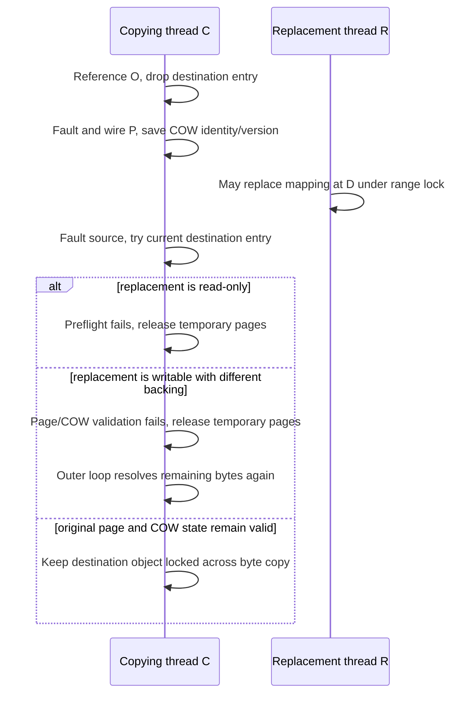
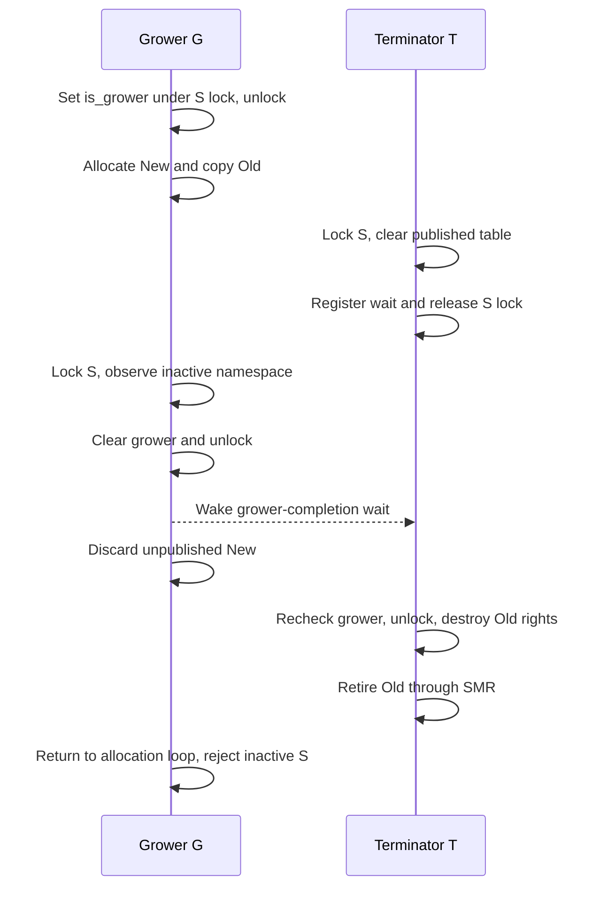
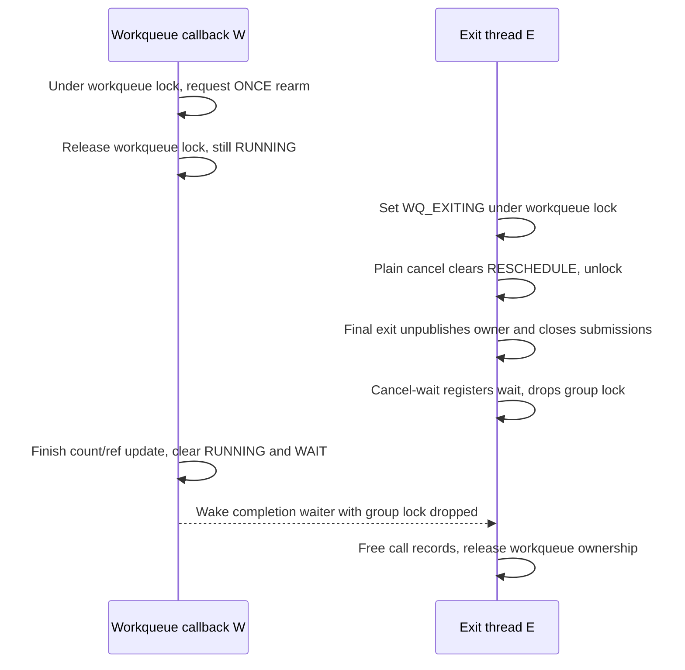

# Concurrent operations: revalidation, namespace death and callback teardown

[Guide index](../README.md) · [Ownership and locking](ownership-and-locking.md) · [Completion and failure](completion-and-failure.md) · [Execution paths](execution-paths.md)

Two kernel operations can overlap even when each uses locks correctly: one operation may deliberately release protection to fault in memory, allocate a larger table, or wait for a callback. The resulting protocol needs a precise answer to two questions: which storage survives that interval, and which earlier decisions must be checked again? This chapter follows three such protocols in `xnu-12377.121.6` with two-participant schedules derived from the implementation.

The schedules select possible event orders; they are not recorded executions. Each starts after the relevant interface admission and states the configuration and representation it uses. Existing chapters provide the wider paths: [VM copying](../subsystems/vm/copy-overwrite-and-remap.md), [IPC namespaces](../subsystems/ipc/names-and-rights.md), [thread calls](../subsystems/runtime/timer-and-thread-call-lifetime.md), and [BSD workqueues](../subsystems/processes/pthread-workqueue-lifecycle.md).

## 1. A physical VM copy meets a replacement destination mapping

### Select the operation and keep its coordinates separate

Participant **C** executes `mach_vm_read_overwrite`: copy bytes from the supplied source map into the current thread's map. The handler first obtains a `vm_map_copy_t` with `vm_map_copyin`, then calls `vm_map_copy_overwrite`. Successful overwrite consumes the copy and publishes the full size; failure makes the handler discard the surviving copy. The compatibility `vm_read_overwrite` wrapper reaches the same handler. [Public handler and wrapper](../../xnu/osfmk/vm/vm_user.c#L544-L603).

Select an ordinary, untagged ARM64 destination, equal source/destination map granules and an **entry-list** copy. Choose a length above the small-buffer strategy's threshold and an unaligned destination so the inner overwrite uses `vm_map_entry_copy_overwrite_slow_copy`. A `VM_MAP_COPY_KERNEL_BUFFER` instead takes `copyout` and is outside this schedule. No numeric page size is needed: `D` denotes a CPU virtual address, `O` a backing object, `o` an object-relative byte offset, and `P` the resident `vm_page` holding those bytes. [Copyin strategy](../../xnu/osfmk/vm/vm_map.c#L11387-L11408), [representation dispatch](../../xnu/osfmk/vm/vm_map.c#L9869-L9895), [alignment and slow-copy selection](../../xnu/osfmk/vm/vm_map.c#L9938-L9968).

Participant **R** replaces the mapping covering `D` using fixed `vm_map` with `VM_FLAGS_OVERWRITE`. Fixed placement removes/reserves the old interval before installing the replacement; its range locking must coordinate with C's current entry lock. The schedule places the replacement during an interval where C has deliberately dropped that entry. [Fixed-map placement](../../xnu/osfmk/vm/vm_map.c#L3449-L3478), [removal and reservation](../../xnu/osfmk/vm/vm_map.c#L2870-L2919).

| State carried by C | What it protects or identifies | What it does not establish |
| --- | --- | --- |
| Source copy entries and their object references | The source representation owned by this operation | Continued identity of any destination mapping |
| Explicit reference on destination object `O` | Object storage while the entry lock is dropped | That `D` still maps `O` |
| Wire on destination page `P`, with paging ownership | Page residency and the fault operation's object lifetime requirements | Current WRITE permission or unchanged copy-on-write state |
| Saved `vo_copy` and `vo_copy_version` | The COW relationship observed when `P` was obtained | An immutable snapshot without a later comparison |
| Streaming range-lock context | Destination cursor, reacquisition and per-entry preflight | An exclusive lock over the entire transfer for its duration |

The slow helper takes the explicit object reference before calling `vm_fault_copy` and drops it afterward. The latter's entry contract requires references on both source and destination objects, with no object lock held. [Reference acquisition and release](../../xnu/osfmk/vm/vm_map.c#L9485-L9529), [fault-copy contract](../../xnu/osfmk/vm/vm_fault.c#L8099-L8133).

### Replace the mapping while the old page remains resident

Overwrite installs `vm_map_copy_overwrite_preflight` on a `VMRL_EX_STREAM_NO_HOLES` context. That preflight runs again when an entry is reacquired, so a new entry must independently satisfy overwrite admission. For the selected ordinary mapping this includes WRITE permission; JIT, TPRO, permanent and tagged-object restrictions have additional branches. [Streaming setup](../../xnu/osfmk/vm/vm_map.c#L9905-L9926), [preflight](../../xnu/osfmk/vm/vm_map.c#L9311-L9340), [admission predicates](../../xnu/osfmk/vm/vm_map.c#L9252-L9303).

| Step | C: copying thread | R: mapping-replacement thread | State at the boundary |
| --- | --- | --- | --- |
| 1 | Locks the current destination entry, resolves required COW/backing and references `O`. | Has not acquired the affected range. | `D` currently resolves through this entry to `O` at `o`. |
| 2 | Drops the entry without advancing the stream; faults the destination for READ and WRITE. | Can acquire the range after the entry is dropped. | The reference keeps `O` valid while map structure can change. |
| 3 | Saves `O.vo_copy` and its version, wires `P`, clears its busy state and unlocks `O`. | Installs a different object/protection at `D`, then releases map protection. | Old page `P` is still resident but is no longer sufficient evidence for writing `D`. |
| 4 | Faults the source for READ, retaining the normal source result's busy/paging ownership. | Has completed replacement. | Source acquisition can block without retaining the destination entry lock. |
| 5 | Tries to reacquire the destination entry; preflight examines the current entry. | May still hold the entry if replacement has not finished. | Contention takes the cleanup/reacquire route described below. |
| 6 | If admission succeeds, compares the current resident page and COW identity/version with the saved state. | No longer changes this entry while C holds it. | Changed backing fails revalidation even if the replacement is writable. |
| 7 | Releases temporary source/page state and reports the completed prefix to the outer loop. | Continues independently. | The outer loop retries the remaining bytes against current mapping state. |

Steps 2–4 follow [destination fault and saved copy state](../../xnu/osfmk/vm/vm_fault.c#L8178-L8276) and [source acquisition](../../xnu/osfmk/vm/vm_fault.c#L8286-L8355). Steps 5–7 follow [reacquisition and validation](../../xnu/osfmk/vm/vm_fault.c#L8357-L8427) and [progress accounting](../../xnu/osfmk/vm/vm_map.c#L9969-L10007).



The third branch describes the unchanged-state alternative to replacement, not a guarantee that a replacement preserves page identity. The checks do not merely compare virtual addresses. After resolving new COW/backing requirements and checking the entry's object-offset interval, the helper compares the actual resident page and the copy relationship. [Exact final checks in `vm_map_copy_overwrite_can_page_copy`](../../xnu/osfmk/vm/vm_map.c#L9403-L9421):

<!-- source-excerpt: ../../xnu/osfmk/vm/vm_map.c#L9403-L9421 -->
```c
	vm_object_lock(object);
	entry_page = vm_page_lookup(object, vm_object_trunc_page(offset));

	/* Make sure the page is the same one */
	if (entry_page != old_page) {
		vm_object_unlock(object);
		return false;
	}

	/* And verify the CoW status of the object is unchanged */
	if (object->vo_copy != old_copy_object ||
	    object->vo_copy_version != old_copy_version) {
		vm_object_unlock(object);
		return false;
	}

	/* Return with the object locked so that the caller can safely do the copy. */
	return true;
}
```

A true return leaves the current object locked exclusively for the physical write. If another operation made `P` busy after C originally cleared its busy state, C drops the object lock, cleans up and retries the same position. The successful copy uses `vm_page_part_copy`, updates dirty state and releases the object lock before page cleanup. [Busy-page retry](../../xnu/osfmk/vm/vm_fault.c#L8412-L8427), [write and cleanup](../../xnu/osfmk/vm/vm_fault.c#L8490-L8577).

### Avoid blocking on an entry while retaining a source busy page

The try-lock in step 5 is a lock-order decision. A competing entry owner may itself need the busy source page. On `VMRL_ERR_LOCK_ALREADY_HELD`, C first releases source busy/paging state and unwires the destination, then performs blocking entry reacquisition. The outer overwrite loop performs any remaining copy from the updated context. [Cleanup before blocking reacquisition](../../xnu/osfmk/vm/vm_fault.c#L8375-L8395):

<!-- source-excerpt: ../../xnu/osfmk/vm/vm_fault.c#L8375-L8395 -->
```c
		if (new_entry == VM_MAP_ENTRY_NULL) {
			if (result_page != VM_PAGE_NULL && src_page != dst_page) {
				vm_fault_copy_cleanup(result_page, src_top_page);
			}
			vm_fault_copy_dst_cleanup(dst_page);

			/* kr is error */
			assert(kr != KERN_SUCCESS);
			if (kr == VMRL_ERR_LOCK_ALREADY_HELD) {
				vm_lock_contention_event(dst_map, &vm_fault_copy_busy_retry_count,
				    VMLP_EVENT_LC_VM_FAULT_COPY_BUSY_RETRY, ctx->vmlc_req_start, ctx->vmlc_req_end);
				/*
				 * Now that we've released the busy bit, actually
				 * lock the relevant entry.
				 * Let the caller of this function retry if
				 * there is more to be copied.
				 */
				new_entry = vm_map_range_stream_next_with_error(ctx, &kr);
				*dst_entry_p = new_entry;
			}
			goto done;
```

The outcomes remain distinct. A current read-only entry fails preflight with a protection error. An eligible entry whose page/COW identity changed can return `KERN_SUCCESS` from `vm_fault_copy` with zero or partial bytes, allowing the outer helper to retry. A missing/invalid mapping or a fault error can end the operation. Earlier completed writes are not rolled back by a later error, and the public size output is set only on complete success. Cleanup ends page wiring/paging ownership; it does not restore previous bytes. [Fault-copy exit](../../xnu/osfmk/vm/vm_fault.c#L8579-L8586), [public result handling](../../xnu/osfmk/vm/vm_user.c#L565-L580), [cleanup helpers](../../xnu/osfmk/vm/vm_fault.c#L8064-L8098).

## 2. IPC table growth meets namespace termination

### A referenced space can become inactive

Participant **G** is an already admitted receive-right allocation in another task's space: `mach_port_allocate` reaches `mach_port_allocate_full`, `ipc_port_alloc`, `ipc_object_alloc_entry`, then `ipc_entry_alloc`. Select a full table below its configured maximum so `ipc_entries_hold` asks for growth. The target-space conversion takes a reference under the task port lock, before `ipc_task_disable` can finish disabling that association. This reference keeps the `ipc_space` allocation alive; it does not keep the namespace active. The MIG type declaration specifies the matching space-reference destructor. [Allocation dispatch](../../xnu/osfmk/ipc/mach_port.c#L588-L645), [port allocation and failure cleanup](../../xnu/osfmk/ipc/ipc_port.c#L905-L944), [entry wrapper](../../xnu/osfmk/ipc/ipc_object.c#L418-L442), [space conversion](../../xnu/osfmk/kern/ipc_tt.c#L2739-L2783), [MIG conversion/destructor](../../xnu/osfmk/mach/mach_types.defs#L261-L268).

Participant **T** terminates the target task. `task_terminate_internal` disables task IPC before calling `ipc_space_terminate`; new conversions and an operation that already holds a space reference are therefore different cases. The task's termination path retains the space through this cleanup, and `ipc_space_terminate` releases the separate active reference only after namespace teardown. [Task disable ordering](../../xnu/osfmk/kern/task.c#L3066-L3080), [space termination call](../../xnu/osfmk/kern/task.c#L3134-L3139), [active-reference release](../../xnu/osfmk/ipc/ipc_space.c#L471-L477).

Three objects must be distinguished: the space allocation `S`, its published entry table `Old`, and G's unpublished replacement table `New`. Copying entries into `New` does not manufacture another set of port rights or references. It constructs a replacement representation of the same namespace. [Growth copying](../../xnu/osfmk/ipc/ipc_entry.c#L706-L745), [successful table publication](../../xnu/osfmk/ipc/ipc_entry.c#L820-L838).

### Termination removes visibility before reclaiming the table

| Step | G: allocation and growth | T: task/space termination | Lifetime and lock consequence |
| --- | --- | --- | --- |
| 1 | Under the space lock, records `is_grower = current_thread()`, resets modified-index bounds and saves `Old`. | Has not cleared the table. | One grower owns replacement work; entry operations can later record changes. |
| 2 | Unlocks S, allocates `New` and copies provisional entry snapshots from `Old`. | Locks S. | G cannot keep the ticket lock across allocation and copying. |
| 3 | Continues copying. | Saves `Old`, clears published `is_table`, then waits while `is_grower` is non-null. | S is inactive immediately, but T has not destroyed entries or retired `Old`. |
| 4 | Locks S after the copy and observes inactive state. | Sleeps with the space lock released. | T's wait preserves the old table for the grower. |
| 5 | Clears `is_grower`, unlocks and wakes waiters, frees unpublished `New`, then relocks S and returns `KERN_SUCCESS`. | Wakes and reacquires S; after no grower remains it unlocks. | No replacement table is published into the dead space. |
| 6 | `ipc_entry_alloc` loops, finds S inactive, unlocks and returns `KERN_INVALID_TASK`; port allocation frees its unpublished port. | Terminates receive rights, then remaining rights; retires `Old` through IPC SMR. | Allocation failure cleanup and namespace-right destruction have different owners. |

[Grower registration/allocation](../../xnu/osfmk/ipc/ipc_entry.c#L590-L705), [grower completion/wakeup](../../xnu/osfmk/ipc/ipc_entry.c#L597-L604), [allocation retry](../../xnu/osfmk/ipc/ipc_entry.c#L318-L344), and [two-pass namespace cleanup](../../xnu/osfmk/ipc/ipc_space.c#L428-L477) implement these steps.

Termination's publication and wait are compact. `is_active` tests whether the published table pointer is nonzero; clearing it changes lookup/admission state before final storage release. [Activity predicate](../../xnu/osfmk/ipc/ipc_space.h#L211-L212), [termination handoff](../../xnu/osfmk/ipc/ipc_space.c#L413-L425):

<!-- source-excerpt: ../../xnu/osfmk/ipc/ipc_space.c#L413-L425 -->
```c
	table = smr_serialized_load(&space->is_table);
	smr_clear_store(&space->is_table);

	/*
	 *	If somebody is trying to grow the table,
	 *	we must wait until they finish and figure
	 *	out the space died.
	 */
	while (is_growing(space)) {
		is_write_sleep(space);
	}

	is_write_unlock(space);
```

`is_write_sleep` uses ticket-lock sleep with the grower as inheritor. It releases the space lock so G can reach its final check and returns with lock protection restored; the `while` condition checks the state again. G's completion clears its identity under the same lock, unlocks and wakes the waiters. [Sleep implementation](../../xnu/osfmk/ipc/ipc_space.c#L173-L180), [completion implementation](../../xnu/osfmk/ipc/ipc_entry.c#L597-L604).



After the wake, T's cleanup and G's relock/retry can occur in either order. G no longer reads `Old` once it clears its grower state. T therefore need not wait for G's entire syscall to return, only for the table-copy activity to stop. The grower's dead-space branch deliberately returns success with the space relocked so its caller can perform that retry. [Exact branch](../../xnu/osfmk/ipc/ipc_entry.c#L780-L789):

<!-- source-excerpt: ../../xnu/osfmk/ipc/ipc_entry.c#L780-L789 -->
```c
	if (!is_active(space)) {
		/*
		 *	The space died while it was unlocked.
		 */

		ipc_space_done_growing_and_unlock(space);
		ipc_entry_table_free(&ntable);
		is_write_lock(space);
		return KERN_SUCCESS;
	}
```

### Publication, rights destruction and storage reclamation are separate

If T does not win this interval, G checks `is_low_mod`/`is_high_mod` under the lock and rescans changed entries until it can publish a consistent replacement. Another grower waits instead of allocating a competing replacement. The old table's pointer samples are provisional; copying them is not permission to dereference port bodies. [Modification tracking](../../xnu/osfmk/ipc/ipc_entry.c#L549-L580), [other-grower wait](../../xnu/osfmk/ipc/ipc_entry.c#L639-L647), [rescan and publication](../../xnu/osfmk/ipc/ipc_entry.c#L791-L838).

Following successful growth, retirement only frees the superseded table storage. Following termination, the rights are first destroyed with `ipc_right_terminate`, then the table storage is retired. `ipc_space_retire_table` stores the table pointer in reserved slot zero and queues an IPC SMR callback. This protects readers of an old published table; the grower-versus-terminator wait separately protects the unfinished copy. Neither is replaced by the caller's reference to S. [Retirement and deferred free](../../xnu/osfmk/ipc/ipc_space.c#L121-L142), [right termination](../../xnu/osfmk/ipc/ipc_space.c#L435-L469).

Allocation failure has another lock contract: if `New` cannot be allocated, G clears its grower state and returns `KERN_RESOURCE_SHORTAGE` **unlocked**. A configured maximum returns `KERN_NO_SPACE` unlocked. Successful growth—including the dead-space case—returns locked. The caller's loop observes these distinctions; a generic extra unlock on every return would not describe the implementation. [Allocation failure](../../xnu/osfmk/ipc/ipc_entry.c#L694-L700), [maximum-size failure](../../xnu/osfmk/ipc/ipc_entry.c#L840-L844), [caller loop](../../xnu/osfmk/ipc/ipc_entry.c#L318-L344).

## 3. A workqueue call rearms while its owner begins exit

### Select an allocated ONCE worker call with a real owner

The BSD workqueue owns three allocated `THREAD_CALL_OPTIONS_ONCE` calls. The delayed/immediate creation calls receive the process as `param0`; the idle-thread retirement call, `wq_death_call`, receives the `workqueue` itself. Select that last call and its ordinary worker context, excluding interrupt-context `THREAD_CALL_OPTIONS_SIGNAL`. [Allocation and parameter ownership](../../xnu/bsd/pthread/pthread_workqueue.c#L2153-L2165).

Participant **W** is the worker executing `workq_kill_old_threads_call`; participant **E** is the process exit path. W takes the workqueue spinlock, clears `WQ_DEATH_CALL_SCHEDULED`, evaluates idle-thread retirement and unlocks. When an eligible idle thread should be considered later, `workq_death_policy_evaluate` calls `workq_death_call_schedule`. That helper refuses scheduling after `WQ_EXITING`, otherwise sets the scheduled bit and submits a delayed call. [Callback](../../xnu/bsd/pthread/pthread_workqueue.c#L984-L996), [policy and scheduling](../../xnu/bsd/pthread/pthread_workqueue.c#L893-L950).

The generic worker takes an invocation reference on allocated call storage and sets `THREAD_CALL_RUNNING` before dropping its group lock and invoking the callback. The reference protects the `thread_call` allocation, not the workqueue passed as an argument. The workqueue's own exit protocol retains its storage until these callbacks have been drained and its own reference is released. [Worker handoff](../../xnu/osfmk/kern/thread_call.c#L1759-L1808), [workqueue final cleanup](../../xnu/bsd/pthread/pthread_workqueue.c#L2289-L2313), [workqueue refcount and final storage release](../../xnu/bsd/pthread/pthread_workqueue.c#L2033-L2075).

### A deferred rearm can exist without queue membership

For ONCE calls, a rearm during execution sets `THREAD_CALL_RESCHEDULE` and records the new deadline while `tc_queue` stays null. It does not start a simultaneous second invocation. Finishing the current callback converts surviving rearm intent into delayed/pending work. Thus an empty queue link alone does not mean that either execution or future work has finished. [Delayed rearm](../../xnu/osfmk/kern/thread_call.c#L754-L781), [finish/requeue](../../xnu/osfmk/kern/thread_call.c#L1576-L1621).

Choose the event order where W has a rearm pending, then is descheduled after releasing the workqueue lock but before the generic `thread_call_finish`. E can now acquire the workqueue lock. The intervening process-exit work is omitted from the two-participant schedule, but it is material to the final no-new-submission condition: `proc_exit` marks the workqueue exiting, drains AIO and invalidates descriptors, then calls `workq_exit` after knotes, kqueues and workloops have been destroyed. [Process cleanup order](../../xnu/bsd/kern/kern_exit.c#L2366-L2390).

| Step | W: callback/worker | E: process exit | Protected state and result |
| --- | --- | --- | --- |
| 1 | Under the workqueue lock, records a future retirement deadline; ONCE rearm sets `RESCHEDULE` under the thread-call group lock. | Has not marked the workqueue exiting. | The running call owns a worker reference and has no queued second invocation. |
| 2 | Drops the workqueue lock; current invocation has not reached generic finish. | Acquires the workqueue lock, sets `WQ_EXITING`, then attempts plain cancellation of scheduled calls. | Cancellation clears the deferred rearm; it does not wait for W. |
| 3 | May resume or remain descheduled. | Releases the workqueue lock and completes the surrounding exit cleanup. | No callback-completion wait holds the workqueue lock W needs. |
| 4 | Is still counted running if finish has not executed. | In `workq_exit`, unpublishes `p_wqptr`, disables the current workqueue thread's scheduler callback if applicable, then calls cancel-wait. | The final exit phase excludes further submissions; ONCE cancel-wait registers a completion wait if W is running. |
| 5 | Under the group lock, increments finish count, drops its call-storage reference and clears RUNNING/WAIT; no rearm remains. | Blocks with the group lock released. | Finish wakes completion waiters after dropping the group lock. |
| 6 | No longer uses the workqueue argument. | Returns from waits, frees the three call records, cleans remaining thread references and releases the workqueue reference. | Callback completion precedes owner cleanup; final workqueue storage release still depends on its refcount. |

E's initial admission change and opportunistic cancellation are explicit. [Exit flag and cancellation in `workq_mark_exiting`](../../xnu/bsd/pthread/pthread_workqueue.c#L2199-L2218):

<!-- source-excerpt: ../../xnu/bsd/pthread/pthread_workqueue.c#L2199-L2218 -->
```c
	workq_lock_spin(wq);

	wq_flags = os_atomic_or_orig(&wq->wq_flags, WQ_EXITING, relaxed);
	if (__improbable(wq_flags & WQ_EXITING)) {
		panic("workq_mark_exiting called twice");
	}

	/*
	 * Opportunistically try to cancel thread calls that are likely in flight.
	 * workq_exit() will do the proper cleanup.
	 */
	if (wq_flags & WQ_IMMEDIATE_CALL_SCHEDULED) {
		thread_call_cancel(wq->wq_immediate_call);
	}
	if (wq_flags & WQ_DELAYED_CALL_SCHEDULED) {
		thread_call_cancel(wq->wq_delayed_call);
	}
	if (wq_flags & WQ_DEATH_CALL_SCHEDULED) {
		thread_call_cancel(wq->wq_death_call);
	}
```

If W instead reaches the workqueue lock after this flag is set, its retirement scheduling helper rejects rearm. The creation-call admission helper also checks `WQ_EXITING` in its atomic state-update loop. At final exit the code additionally relies on the process having no other threads left that can submit; the exit thread disables its scheduler callback before it can block in cancel-wait. These are client-side admission/lifetime rules beyond the generic call API. [Retirement admission](../../xnu/bsd/pthread/pthread_workqueue.c#L893-L912), [creation admission](../../xnu/bsd/pthread/pthread_workqueue.c#L1768-L1787), [final exit preconditions and drain](../../xnu/bsd/pthread/pthread_workqueue.c#L2251-L2295).



The diagram selects W finishing after E registers its wait. If W finishes first, cancel-wait observes that RUNNING is already clear and returns without sleeping. Testing RUNNING and registering the wait occur under the same group lock used by finish. [Wait registration](../../xnu/osfmk/kern/thread_call.c#L2212-L2242), [finish and wake](../../xnu/osfmk/kern/thread_call.c#L1564-L1666).

### Interpret cancellation and freeing at their actual boundaries

The ONCE branch cancels pending/rearm work and then waits for an in-flight invocation. Its Boolean result still reports whether work was canceled, not whether it slept. In the schedule above, the earlier plain cancel may have removed all rearm intent, so the final cancel-wait can return **false after waiting**. [ONCE branch of `thread_call_cancel_wait`](../../xnu/osfmk/kern/thread_call.c#L1437-L1446):

<!-- source-excerpt: ../../xnu/osfmk/kern/thread_call.c#L1437-L1446 -->
```c
	boolean_t canceled = thread_call_cancel_locked(call);

	if ((call->tc_flags & THREAD_CALL_ONCE) == THREAD_CALL_ONCE) {
		/*
		 * A cancel-wait on a 'once' call will both cancel
		 * the pending call and wait for the in-flight call
		 */

		thread_call_wait_once_locked(call, s);
		/* thread call lock unlocked */
```

For a simple count ledger, suppose this is the call's first execution and no other client references exist. While W runs, `tc_submit_count = 1`, `tc_finish_count = 0` and `tc_refs = 2`: one allocation-owner reference and one worker reference. An ONCE rearm records intent without incrementing submit count yet. Clearing that rearm preserves these counts; W's finish produces `1/1` and one remaining reference. E's later free removes that final call-storage reference. If rearm survives instead, finish enqueues it and adds the next submission. [Initial reference](../../xnu/osfmk/kern/thread_call.c#L1013-L1027), [rearm/count rules](../../xnu/osfmk/kern/thread_call.c#L754-L781), [finish accounting](../../xnu/osfmk/kern/thread_call.c#L1576-L1621), [free](../../xnu/osfmk/kern/thread_call.c#L1098-L1153).

`thread_call_free` rejects queued or deferred-rearm work. For an allocated ordinary worker call it can defer storage release until worker references disappear, but that does not authorize freeing callback arguments. Cancel-wait rejects unallocated storage, disabled interrupts and waiting on the same current callback. Ordinary non-ONCE calls have a different branch: canceling pending work can return without waiting for an earlier overlapping invocation. The workqueue's ONCE allocations are therefore part of the argument for this specific teardown sequence. [Free checks](../../xnu/osfmk/kern/thread_call.c#L1098-L1149), [cancel-wait admission and ordinary branch](../../xnu/osfmk/kern/thread_call.c#L1413-L1464).

## 4. What the local tests establish, and what this chapter leaves open

| Selected source test | Assertion or event order present in its body | Relationship to the schedules |
| --- | --- | --- |
| [`vm_unaligned_copy_switch_race.c`](../../xnu/tests/vm/vm_unaligned_copy_switch_race.c#L25-L73) and [result checks](../../xnu/tests/vm/vm_unaligned_copy_switch_race.c#L250-L275) | A second thread alternates fixed RW/RO mappings while unaligned read-overwrite runs; the test accepts success/protection failure and checks the original read-only backing byte remains unchanged. | Exercises the replacement/admission boundary; it does not force every individual fault-copy window shown above. |
| [`vm_unaligned_copy_protection_race.c`](../../xnu/tests/vm/vm_unaligned_copy_protection_race.c#L140-L168) | Checks that an earlier COW view preserves its original contents while protection changes race with copying. | Connects mapping permission to the separate COW revalidation obligation. |
| [`test_once_thread_call`](../../xnu/osfmk/tests/test_thread_call.c#L83-L147) | Holds one callback waiting, attempts rearm/cancel/free, verifies free rejects pending rearm, then cancel-waits and frees successfully. | Isolates ONCE serialization and cancellation/free behavior. Its parameters are scalar test values, so it does not itself test workqueue-owner destruction. |

These bodies were inspected, not executed. The thread-call test explicitly requires DEVELOPMENT or DEBUG and is registered in the kernel POST suite. No targeted test forcing the IPC grower/terminator handoff was established by this review; that schedule is supported by the implementation and caller cleanup, not a claimed stress-test result. [Test configuration](../../xnu/osfmk/tests/test_thread_call.c#L29-L31), [POST registration](../../xnu/osfmk/tests/kernel_tests.c#L153-L164).

The VM schedule excludes small kernel-buffer copies, overlapping source/destination page aliases and tagged/executable destinations; `CONFIG_SPTM` adds executable-frame retyping and error branches before physical writing. The IPC schedule follows the local converter and MIG declarations without reconstructing absent generated stubs, and does not promise bounded growth latency under repeated mutations. The callback schedule covers allocated ONCE worker calls with BSD workqueue exit admission; it does not apply to SIGNAL callbacks, arbitrary IOKit owners or every workqueue scheduling interleaving. [SPTM copy branch](../../xnu/osfmk/vm/vm_fault.c#L8429-L8488), [timer variants](../subsystems/runtime/timer-and-thread-call-lifetime.md#9-signal-and-continuous-time-boundaries).

Across these examples, storage protection ends at a different point from permission, publication or execution. The VM copy keeps an old page resident but revalidates its use; IPC termination withdraws a namespace before old-table reclamation; workqueue exit stops submissions before waiting and releasing callback-owner storage. The per-step locks, references and completion checks are the implementation of those boundaries.

<!-- BEGIN PLATYDOC DOCUMENTATION LICENSE -->
Original Platydoc text and diagrams are licensed under [CC BY 4.0](https://creativecommons.org/licenses/by/4.0/). Quoted source code and third-party material retain their respective licenses.
<!-- END PLATYDOC DOCUMENTATION LICENSE -->
