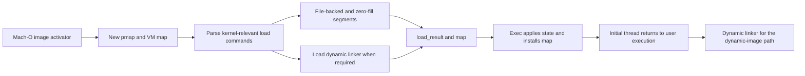

# From a Mach-O executable to a runnable image

[Guide index](../README.md) · [Process lifecycle](../subsystems/processes/lifecycle.md) · [VM](../subsystems/vm/README.md) · [Security](../subsystems/security/README.md)

The process lifecycle guide explains exec's shadow-proc replacement. This page follows the image-building work inside that transition: reading the executable, parsing the kernel-relevant load commands, constructing mappings, loading the dynamic linker, and supplying the initial machine state.

The dedicated [executable signing policy](../subsystems/security/executable-signature-policy.md) chapter expands signature reuse, initial-buffer checks, process flags, detached-signature lookup and executable-map association. [Vnode attachment](../subsystems/security/vnode-signature-lifecycle.md) explains the stored signature's ownership; [page integrity](../subsystems/security/page-signature-validation.md) follows subsequent file-page faults and mapping enforcement.

## The input and result contracts

[`exec_mach_imgact()`](../../xnu/bsd/kern/kern_exec.c#L1923) is the Mach-O image activator. It calls [`load_machfile()`](../../xnu/bsd/kern/mach_loader.c#L726) with `image_params`, the selected Mach header, target thread, output map, and a `load_result_t`. The image parameters identify the vnode and selected architecture slice; the returned map and result describe the image being built rather than a process already running it.

[`load_result_t`](../../xnu/bsd/kern/mach_loader.h#L63) carries several distinct categories:

| Fields | Role |
| --- | --- |
| `mach_header`, `min_vm_addr`, `max_vm_addr` | Main image location and mapped extent |
| `entry_point`, `threadstate`, `threadstate_sz`, `validentry` | State needed to initialize execution |
| `user_stack`, `user_stack_size`, `user_stack_alloc`, `user_stack_alloc_size` | Usable stack versus allocation/guard extent |
| `needs_dynlinker`, `dynlinker`, `using_lcmain` | Which entry convention and loader path apply |
| `csflags`, `platform_binary`, `cs_end_offset`, hardened-process fields | Signature-derived and security-related state |
| `all_image_info_addr`, `dynlinker_*` | Dynamic-linker metadata and mappings |

Do not reduce this result to a single entry address. It contains both mapping state and decisions that later exec code must apply to the task/thread.

## Build a new map before publishing it

[`load_machfile()`](../../xnu/bsd/kern/mach_loader.c#L726) first checks that the selected slice's offset plus size fits the vnode's file size without overflow. It creates a pmap associated with the appropriate task ledger, selects map page-size behavior, creates the VM map, applies executable-data policy where configured, and computes separate ASLR offsets for the main image and dynamic linker when randomization is enabled.

Architecture, mixed page-size, pointer-authentication, and translation branches affect these choices. In particular, this code distinguishes address bitness from data bitness. Do not infer a universal page size or all enabled architecture modes from a single branch.

After parsing, `load_machfile()` performs further entitlement/security and map checks before returning the map through `mapp`. Failure paths commonly set `imgp->ip_free_map` so the enclosing exec cleanup owns disposal. The enclosing activator later applies task/map setup and swaps the map onto the target task; parsing success alone is not completion of exec. See [`exec_mach_imgact()` around load/map installation](../../xnu/bsd/kern/kern_exec.c#L2078).

## Parse load commands in four passes

[`parse_machfile()`](../../xnu/bsd/kern/mach_loader.c#L1238) checks recursion depth, CPU type/subtype suitability, and executable/dynamic-linker file-type constraints. It obtains the vnode's UBC control, bounds-checks the header plus command region, allocates kernel storage, and reads that region through `vn_rdwr()`.

The loop runs with `pass = 0` through `pass = 3`. Its nearby historical comment says “three passes,” but enumerates four; the loop is the implementation to follow.

| Pass | Main responsibilities |
| --- | --- |
| 0 | Inspect layout/alignment and platform/version information needed by later decisions |
| 1 | Process initial thread/entry convention, UUID, and code-signature material |
| 2 | Construct segment mappings |
| 3 | Handle dynamic-linker/encryption-related commands and entry validation |

Each scan checks that a minimal command header fits, that adding `cmdsize` cannot overflow, that `cmdsize` is at least the generic header size, and that the command remains within the declared region. Each specific command handler must also validate its own larger structure. These checks are visible in the [command loop](../../xnu/bsd/kern/mach_loader.c#L1524).

The kernel processes commands that require its intervention. This is not the full user-space dynamic-linking implementation. After parsing the main image, a required but absent dynamic-linker command is an error; when present, `load_dylinker()` runs after the command scans.

## Segments connect the executable to VM

[`load_segment()`](../../xnu/bsd/kern/mach_loader.c#L2389) normalizes 32-bit segment descriptions when necessary, validates the command/section storage, checks file extents and arithmetic, enforces applicable alignment, computes slid VM addresses, and records mapping bounds. It separates bytes supplied by the file from an additional zero-fill virtual extent.

[`map_segment()`](../../xnu/bsd/kern/mach_loader.c#L2294) performs the core mapping dispatch:

- With a file memory-object control, it calls `vm_map_enter_mem_object_control()` with copy semantics and the requested initial/maximum protections.
- Without that control, it uses `mach_vm_map_kernel()` for the anonymous portion.
- It checks map/page alignment; a comment explicitly notes that the former `fourk_pager` misalignment fallback is gone.

This establishes VM relationships. It does not eagerly read every instruction/data page into physical memory. Later faults use the vnode-backed pager and COW machinery described in [maps/faults](../subsystems/vm/maps-and-faults.md) and [pagers/UPL](../subsystems/vm/pagers-and-upl.md).

A special no-access segment starting at address zero can raise the map's minimum address, keeping that range unavailable. Its slide handling and mixed-page-size exceptions need their own branch reading; treating it as ordinary file bytes mapped at zero would be incorrect. Segments marked `SG_READ_ONLY` also record ranges intended to become read-only after fixups. See [page-zero handling](../../xnu/bsd/kern/mach_loader.c#L2559) and [segment mapping/zero-fill](../../xnu/bsd/kern/mach_loader.c#L2720).

## Signature handling precedes decisions based on it

[`load_code_signature()`](../../xnu/bsd/kern/mach_loader.c#L3765) looks for a cached UBC signature blob matching the vnode/slice/CPU context. A suitable current blob can be reused; a stale blob can require revalidation or rereading. The uncached path bounds-checks the signature command's offset and size before allocating and reading it. Later UBC/security logic attaches and evaluates that signature data.

The parsing loop also validates the initially read header/command pages after signature handling, and global code-signing enforcement changes which failures are tolerated. `load_machfile()` explicitly marks the post-parse point at which vnode entitlement queries are safe. The [code-signing guide](../subsystems/security/code-signing.md) explains the wider blob, policy, and page-validation boundaries; parsing a signature command is not the complete trust decision.

## The first user instruction may belong to dyld

[`load_main()`](../../xnu/bsd/kern/mach_loader.c#L2989) handles `LC_MAIN`: it establishes stack requirements/default location, marks that a dynamic linker is needed, and initializes thread state. The implementation explicitly says the kernel does **not** use `LC_MAIN.entryoff`; dyld uses it. This is a useful correction to the assumption that the kernel always jumps directly to the application's `main` entry.

[`load_dylinker()`](../../xnu/bsd/kern/mach_loader.c#L3390) validates the command's path offset and terminating string, resolves the dyld vnode, and recursively calls `parse_machfile()` into the new map with the independent slide. On success it replaces the app-provided thread-state result with the dynamic linker's state and entry point, and records dyld metadata. Architecture/translation and development alternate-dyld branches add special behavior; they are not the default contract for every build.

[`activate_exec_state()`](../../xnu/bsd/kern/kern_exec.c#L877) updates task bitness/header state, initializes the thread, applies saved thread-state flavors with `thread_setstatus()`, and sets the entry point. The surrounding activator invokes `create_unix_stack()` and `exec_copyout_strings()` to prepare stack contents and arguments. Final execution still depends on the process/task handoff and return gates described in [lifecycle](../subsystems/processes/lifecycle.md).

## Reading and verification limits

The inspected path includes map creation, parser bounds/pass dispatch, segment mapping, page-zero/zero-fill handling, `LC_MAIN`, dynamic-linker result transfer, signature-cache entry handling, and activation entry. It does not audit every Mach-O command, encrypted-image path, architecture grading rule, Rosetta branch, signature parser, or dynamic linker implementation. No executable was loaded or kernel booted as part of this documentation work.
