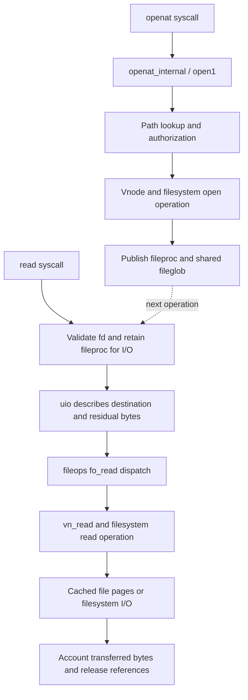
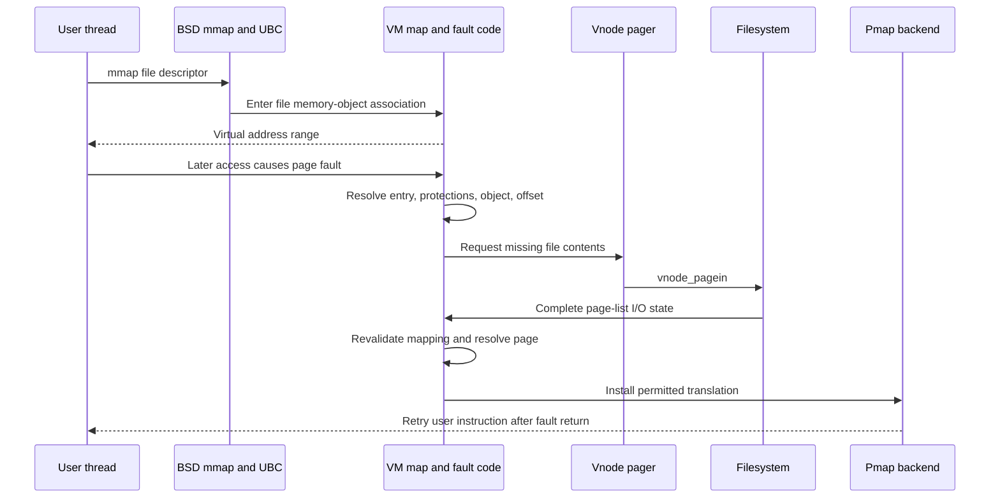
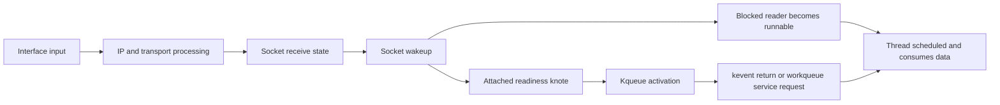

# Operations across subsystem boundaries

[Guide index](../README.md) · [Architecture](../architecture.md) · [Ownership and locking](ownership-and-locking.md)

The paths below connect the subsystem guides. They show selected operations and boundary calls, with helpers and error branches omitted. An arrow may represent an indirect operation-vector call or a later wakeup, rather than a direct C call. Use the linked detailed guide when exact lock, reference, and branch ordering matters.

## 1. Open a file, then read it

Opening is mainly a namespace and object-publication operation; reading follows an already-established descriptor to a concrete object.

Start at [openat_internal()/open1()](../../xnu/bsd/vfs/vfs_syscalls.c), then follow [namei](../../xnu/bsd/vfs/vfs_lookup.c), vnode authorization and operation dispatch. On read, [sys_generic.c](../../xnu/bsd/kern/sys_generic.c#L264) constructs/uses a `uio`, acquires an I/O reference, and reaches [fo_read()](../../xnu/bsd/kern/kern_descrip.c#L6262). The file operation table selects the implementation; a socket descriptor would take a different branch from a vnode descriptor.

The persistent connection is `proc.p_fd → fileproc → fileglob → vnode`. `fileglob` holds shared offset/status/credentials and operations; the descriptor's I/O reference protects an active call against close. Vnode lifetime and filesystem operation ownership add their own contracts. See [descriptors](../subsystems/processes/descriptors-ipc.md) and [VFS](../subsystems/vfs/README.md).

**Questions to follow:** Is the failure from path lookup, authorization, opening the object, or data transfer? Did bytes transfer before an interruption? Does the shared offset need serialization? Which filesystem actually implements the final operation?

## 2. Map a file and fault its contents

`mmap` establishes an address-space relationship. A later CPU access may require the file's contents to become resident.

The last return represents the surrounding exception-return path; pmap itself does not return directly to user code. Likewise, the filesystem's storage read can involve components outside this tree.

BSD [kern_mman.c](../../xnu/bsd/kern/kern_mman.c) obtains the vnode's UBC association and calls VM. [ubc_info_init_internal()](../../xnu/bsd/kern/ubc_subr.c#L1096) connects vnode, pager, and named memory object. [vm_fault.c](../../xnu/osfmk/vm/vm_fault.c) handles entry/object/page resolution; [memory_object_data_request()](../../xnu/osfmk/vm/memory_object.c#L1971) dispatches through pager operations. The vnode pager in [bsd_vm.c](../../xnu/osfmk/vm/bsd_vm.c) reaches [vnode_pagein](../../xnu/bsd/vm/vnode_pager.c).

The direct operation-table dispatch matters: the pager boundary here is not necessarily a message to a user-space pager. UPL commit/abort completes page-state obligations, and the fault can have to revalidate the map after dropping locks. See [the file-mapping walkthrough](../subsystems/vm/mapping-walkthroughs.md), [fault revalidation](../subsystems/vm/fault-resolution.md), [pagers/UPL](../subsystems/vm/pagers-and-upl.md), and [VFS](../subsystems/vfs/README.md). Once a physical page is ready, [pmap installation](../subsystems/vm/pmap-mapping-lifecycle.md) establishes the hardware mapping; [TLB completion](../subsystems/vm/pmap-tlb-and-cache.md) constrains later replacement and removal.

**Questions to follow:** Is the fault a missing page or a protection failure? Is the backing shared or private COW? Is the page busy, compressed, dirty, or absent? What changed while the fault dropped map protection?

## 3. Fork and then exec

Fork crosses BSD identity/descriptor state, Mach task/thread initialization, VM inheritance, and machine thread state. In this checkout, [fork1()](../../xnu/bsd/kern/kern_fork.c) reaches `cloneproc()`, `forkproc()`, and `fork_create_child()`. These initialize the combined proc/task allocation, establish descriptor sharing, call `task_create_internal()`, and create the initial thread behind return gates. For fork, VM inheritance invokes [vm_map_fork()](../../xnu/osfmk/vm/vm_map.c), and the child receives the calling thread's machine state. The other parent threads are not each cloned.

Exec is a separate replacement operation. [__mac_execve()](../../xnu/bsd/kern/kern_exec.c) creates a shadow proc/task pair; image activation resolves the executable through VFS, dispatches format activators, and loads the Mach-O image. [proc_exec_switch_task()](../../xnu/bsd/kern/kern_exec.c#L5795) transfers process state and replaces the process-hash entry while preserving logical PID identity. Credential/code-signing policy and task/thread return setup surround this handoff.

For the parser and image-building details, read [executable loading](executable-loading.md). Read [process lifecycle](../subsystems/processes/lifecycle.md) with [runtime lifecycle](../subsystems/runtime/objects-and-lifecycle.md), [VM copy-on-write](../subsystems/vm/maps-and-faults.md), and [security](../subsystems/security/README.md). An important invariant is that being visible in an allocation or list is not equivalent to being allowed to run user code.

**Questions to follow:** Which identity survives exec? Which descriptor flags affect inheritance? Has exec crossed its point of no return? Which references must drain before replacing the proc?

## 4. Send and receive a Mach message

[mach_msg2_trap()](../../xnu/osfmk/ipc/mach_msg.c#L927) unpacks arguments, checks message options, and performs selected send/receive work. The send side imports message data and rights into an `ipc_kmsg`; queueing or kernel-object dispatch then determines the destination path. Receiving makes a message available to a receiving thread and exports rights/data into its IPC space and address map. Follow [ipc_kmsg.c](../../xnu/osfmk/ipc/ipc_kmsg.c), [ipc_mqueue.c](../../xnu/osfmk/ipc/ipc_mqueue.c), and the [IPC guide](../subsystems/ipc/README.md).

Three boundaries are easy to miss:

- Port names are translated in the caller's IPC space. Transfer dispositions determine what happens to the underlying rights; copying the integer name alone would not transfer authority.
- Out-of-line descriptors invoke VM copy/mapping machinery, with cleanup obligations on both successful and failed transfer.
- A blocking send/receive uses runtime waiting, and direct message delivery to a waiting receiver is distinct from immediately scheduling that receiver on the CPU.

The combined send/receive API is also not an all-or-nothing transaction. The `mach_msg2_trap()` vector path explicitly validates send-related arguments before sending, then validates receive-related arguments for receiving; an invalid receive argument can therefore be reported after a successful send. Read the return code in the context of the completed phase.

For kernel-object messages, [ipc_kobject.c](../../xnu/osfmk/kern/ipc_kobject.c) and generated server dispatch connect a port to a specific implementation. For user-server messages, queue and receiver state remain central. Mach exceptions and IOKit user-client requests reuse parts of this infrastructure but have different higher-level contracts.

The detailed route is [port names and rights](../subsystems/ipc/names-and-rights.md) → [message layouts and trap arguments](../subsystems/ipc/message-path.md) → [send, delivery, receive, and reply](../subsystems/ipc/message-send-receive.md). Each phase identifies the structures, held resources, receiver-visible names, and cleanup obligations.

### A fault becomes an exception RPC and returns to execution

A user data abort first enters the [ARM64 vector and saved-state path](../subsystems/platform/arm64-exception-entry.md). A fault that VM resolves can retry the instruction without sending a Mach exception. For a fault requiring an exception handler, `exception_triage` searches the thread, task, and host exception actions and performs the selected exception RPC. The kernel waits for a reply using its own reply-port machinery. A successful handler may provide updated thread state; the Unix kobject handler instead arranges BSD signal handling for supported exceptions. These are separate from ordinary application request/reply conventions.

Read [Mach exception delivery](../subsystems/ipc/exception-delivery.md) for action structures, behaviors, fallback, reply ownership, and signal conversion. Then read [ARM64 exception return](../subsystems/platform/arm64-exception-return.md) for AST processing, persistent user PCB recovery after a continuation, saved-state authentication, register restoration, and `eret`. [EL2/protected execution](../subsystems/platform/exception-levels-and-monitors.md) documents the distinct hypervisor/monitor transitions; a Mach exception message does not itself switch the CPU to EL2.

## 5. Receive data and deliver readiness

A traditional network packet moves from interface input through protocol processing to a socket's receive state. For TCP, the input path updates `inpcb`/`tcpcb` state, acknowledges/sequences data, and makes accepted bytes available through socket buffers. Socket wakeups notify blocked readers and event filters; a later `read`/`recv` consumes available data. Follow [networking](../subsystems/networking/README.md), [tcp_input.c](../../xnu/bsd/netinet/tcp_input.c), [uipc_socket2.c](../../xnu/bsd/kern/uipc_socket2.c), and [uipc_socket.c](../../xnu/bsd/kern/uipc_socket.c).

The event path is not a second copy of every packet. [knote_post()](../../xnu/bsd/kern/kern_event.c) invokes a filter to decide whether the registration should be active. Delivery can represent current readiness or accumulated state. Workloop/workqueue servicing can also affect requested QoS and priority dependencies. See [events and threads](../subsystems/processes/events-threads.md).

Skywalk introduces channel/ring/nexus/packet-pool paths alongside traditional socket/mbuf processing. Do not force every packet through the exact diagram above; the [networking guide](../subsystems/networking/README.md) distinguishes the representative paths and their integration points.

**Questions to follow:** Was a packet dropped before socket delivery? Is data present but a different thread consumed it? Is the event enabled and active? Is the service thread runnable, admitted by the workqueue, or blocked on another dependency?

## 6. A user process asks a driver to operate on memory

The IOKit route connects an IPC-visible service/user-client object, method validation, driver lifecycle/serialization, and memory preparation. [IOUserClient.cpp](../../xnu/iokit/Kernel/IOUserClient.cpp) implements connection-facing operations and method dispatch support. [iokit_rpc.c](../../xnu/osfmk/device/iokit_rpc.c) bridges Mach object conversions. The driver's implementation decides what a particular request means and which additional policy checks and work-loop rules apply.

If the operation exposes or transfers memory, [IOMemoryDescriptor.cpp](../../xnu/iokit/Kernel/IOMemoryDescriptor.cpp) describes ranges, prepares pages, and supports mappings; [IODMACommand.cpp](../../xnu/iokit/Kernel/IODMACommand.cpp) supplies DMA-related mapping/segment machinery. CPU virtual mappings, physical page ownership, and addresses visible to a device are distinct. The concrete hardware driver and mapper may be external to this checkout.

For pageable backing, the descriptor's `prepare()` acquires the pages needed by the transfer. The DMA command's `prepare()` establishes device mapping and segment state; it does not replace descriptor preparation. Complete device use and the command's preparation interval before completing the descriptor's interval. The [memory and DMA guide](../subsystems/drivers/memory-and-dma.md) follows these separate lifetimes.

Follow [drivers](../subsystems/drivers/README.md), [VM pager/UPL boundaries](../subsystems/vm/pagers-and-upl.md), and [security](../subsystems/security/README.md). Track the object's retained lifetime, the memory preparation/completion pair, outstanding asynchronous work, and connection/service termination together.

## 7. Memory pressure crosses from pages to processes

VM tries to recover pages through queues, discardable clean contents, file writeback, compression, and configured swap behavior. These mechanisms operate on objects/pages and backing storage. BSD memorystatus adds process-level priorities, limits, pressure notification, and configured termination/freezing decisions. [vm_pageout.c](../../xnu/osfmk/vm/vm_pageout.c), [vm_compressor.c](../../xnu/osfmk/vm/vm_compressor.c), and [kern_memorystatus.c](../../xnu/bsd/kern/kern_memorystatus.c) occupy different parts of this path.

Process termination then returns to task/thread lifecycle and VM/IPC/resource teardown. This is why memory-pressure debugging cannot stop at a page queue, and why a process kill should not be described as the ordinary implementation of every pageout. Configuration and policy determine which mechanisms are present and when they act. See [reclamation and pressure](../subsystems/vm/reclaim-and-pressure.md) and [process lifecycle](../subsystems/processes/lifecycle.md).

<!-- BEGIN PLATYDOC DOCUMENTATION LICENSE -->
Original Platydoc text and diagrams are licensed under [CC BY 4.0](https://creativecommons.org/licenses/by/4.0/). Quoted source code and third-party material retain their respective licenses.
<!-- END PLATYDOC DOCUMENTATION LICENSE -->
