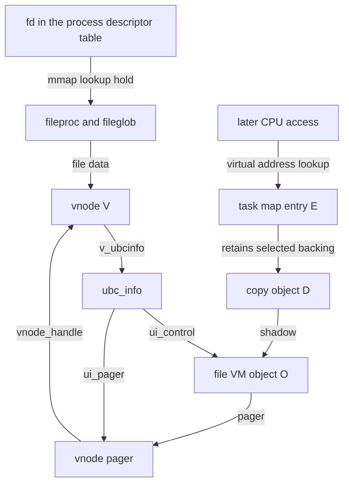
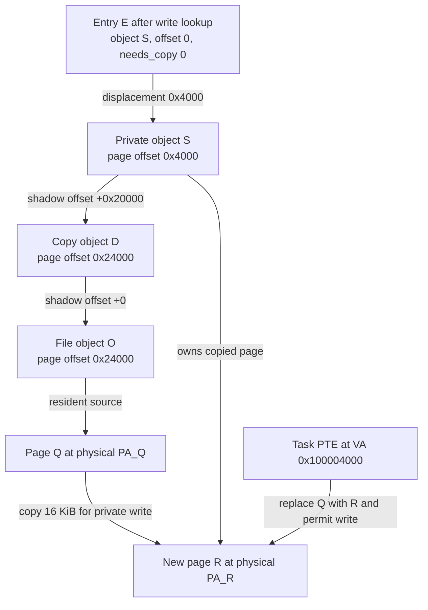

# A mapped file from descriptor lookup to an ARM64 private write

[Execution paths](execution-paths.md) · [Completion and failure](completion-and-failure.md) · [VM mapping walkthroughs](../subsystems/vm/mapping-walkthroughs.md) · [File cache](../subsystems/vfs/README.md)

This worked operation follows one byte through BSD descriptor lookup, vnode/UBC identity, delayed-copy VM objects, pager I/O, ARM64 fault handling, pmap insertion and unmapping. The subsystem chapters explain each algorithm; here the important question is whether the **same logical byte** still names the **same contents** after every handoff.

The trace is source-derived for `xnu-12377.121.6`, not a recorded execution. It selects an ordinary, untagged, nonexecutable regular file mapping, a native ARM64 task with **16 KiB map pages, VM pages and stage-1 translation granules**, and `CONFIG_SPTM` for the final pmap example. PPL and unprotected pmap use different insertion implementations. No shared-region pager, submap, JIT, resilient-media option, compressed file, or concurrent truncate is assumed in the successful trace. These choices isolate a path; they are not universal platform defaults.

## 1. Fix the addresses before following the code

Use this illustrative application operation, with successful calls and a file large enough to cover the interval:

```c
/* Illustrative userspace code, not a verbatim source excerpt. */
int fd = open("data.bin", O_RDONLY);
unsigned char *p = mmap(NULL, 0x8000, PROT_READ | PROT_WRITE,
                       MAP_PRIVATE, fd, 0x20000);
close(fd);
unsigned char before = p[0x4123];
p[0x4123] = before ^ 1;
munmap(p, 0x8000);
```

Suppose `mmap` chooses `A = 0x100000000`. The addresses and offsets are:

| Quantity | Value | Meaning |
| --- | --- | --- |
| Page size `P` | `0x4000` | Selected 16 KiB regime |
| File offset `F` | `0x20000` | Start of the mapped file interval |
| Mapping length | `0x8000` | Two pages |
| Access displacement `d` | `0x4123` | Second page, byte `0x123` |
| User virtual byte address | `A + d = 0x100004123` | Address in this task's map |
| User virtual page address | `0x100004000` | Address at which this trace installs a leaf translation |
| Logical file byte | `F + d = 0x24123` | File coordinate before any private change |
| File-object page offset | `0x24000` | Resident page lookup/pager coordinate |

The calculation is based on the mapping's object offset and displacement, not on the file descriptor's current seek position. The BSD mapper passes the explicit `file_pos`, rounded to its map-page boundary, into VM; the fault lookup obtains its object coordinate from the entry context. [`kern_mman.c:899–906`](../../xnu/bsd/kern/kern_mman.c#L899-L906), [`vm_fault.c:4558–4559`](../../xnu/osfmk/vm/vm_fault.c#L4558-L4559), [`vm_fault.c:4731–4738`](../../xnu/osfmk/vm/vm_fault.c#L4731-L4738).

`O_RDONLY` does not prohibit this private writable view. The shared-mapping branch checks `FWRITE` and immutable-file policy; the private branch adds `VM_PROT_WRITE` to maximum protection and strips write from the filesystem's `VNOP_MMAP_CHECK` request. MAC policy and other admission checks still apply. Writing this view changes private memory, rather than requesting a write through the read-only file descriptor. [`permission branches`](../../xnu/bsd/kern/kern_mman.c#L610-L692).

## 2. The fd disappears from the fault path

During `mmap`, `fp_lookup()` acquires a `fileproc` reference, the fileglob type must identify a vnode-backed file, and `fp_get_data()` obtains the vnode. `vnode_getwithref()` adds the vnode I/O hold used during mapping setup. Neither the integer fd nor the `fileproc` is retained as the lookup key for future CPU faults. [`descriptor/vnode lookup`](../../xnu/bsd/kern/kern_mman.c#L560-L588).

The vnode's `v_ubcinfo` is the bridge to cached file contents. UBC initialization obtains a vnode pager, creates a named VM association with `memory_object_create_named()`, and saves its control as `ui_control`. The pager contains the generic `memory_object` header, a pager operations pointer, a control and its `vnode_handle`. `ubc_getobject()` supplies the control to the mapper; this is a kernel object association, not a newly allocated task-local Mach port name. [`UBC association`](../../xnu/bsd/kern/ubc_subr.c#L1121-L1176), [`vnode pager representation`](../../xnu/osfmk/vm/bsd_vm.c#L75-L100), [`pager initialization`](../../xnu/osfmk/vm/bsd_vm.c#L925-L948), [`control retrieval`](../../xnu/bsd/kern/kern_mman.c#L821-L850).



This diagram distinguishes reference-bearing backing relationships from lookup fields; it does not assert that every arrow has an identical reference-count protocol. UBC's named reference and the VM copy/shadow references are separate lifetime mechanisms. The mapping function takes an object reference, then transfers the selected backing into `vm_map_enter()`; unsuccessful insertion drops that reference. On leaving the syscall, BSD releases its vnode I/O hold and fileproc lookup hold. Closing `fd` afterward does not remove `E`. [`VM reference and insertion`](../../xnu/osfmk/vm/vm_map.c#L5511-L5628), [`BSD cleanup`](../../xnu/bsd/kern/kern_mman.c#L919-L950).

The diagram already introduces copy object `D`. Its creation is a consequence of the vnode pager's selected copy strategy, explained next; it is not the file's UBC object renamed.

## 3. `MAP_PRIVATE` establishes two distinct COW obligations

BSD sets `docow` for a nonanonymous mapping without `MAP_SHARED` and passes that Boolean with the file memory-object control into `vm_map_enter_mem_object_control()`. That function converts the control to `O`, retains it, and notifies a named pager of a mapping with write removed from `pager_prot` when copy semantics apply. [`BSD COW decision`](../../xnu/bsd/kern/kern_mman.c#L850-L855), [`mapping notification`](../../xnu/osfmk/vm/vm_map.c#L5523-L5559).

The vnode pager selects `MEMORY_OBJECT_COPY_DELAY`. For the chosen successful delayed-copy branch, `vm_object_copy_strategically()` returns a copy object `D`, preserves the file offset as the returned offset, and requests entry-level `needs_copy`:

[Source: vm_object.c, lines 4228–4235](../../xnu/osfmk/vm/vm_object.c#L4228-L4235)

<!-- source-excerpt: ../../xnu/osfmk/vm/vm_object.c#L4228-L4235 -->
```c
	case MEMORY_OBJECT_COPY_DELAY:
		*dst_object = vm_object_copy_delayed(src_object,
		    src_offset, size, object_lock_shared);
		if (*dst_object != VM_OBJECT_NULL) {
			*dst_offset = src_offset;
			*dst_needs_copy = TRUE;
			result = KERN_SUCCESS;
			break;
```

`D->shadow = O`, `D->vo_shadow_offset = 0`, and `O->vo_copy = D` establish different directions of responsibility. Shadow traversal finds original contents in `O`; the delayed-copy relationship makes writes to `O` preserve the version needed by `D`. `D` has the symmetric copy strategy and is marked shadowed. It may be reused by compatible copies. A private mapping therefore still needs the entry's `needs_copy` protection before writing directly into that potentially shared copy object. [`vnode copy strategy`](../../xnu/osfmk/vm/bsd_vm.c#L420-L434), [`delayed-copy reuse`](../../xnu/osfmk/vm/vm_object.c#L3990-L4018), [`new copy linkage`](../../xnu/osfmk/vm/vm_object.c#L4132-L4147).

For our trace, choose a newly allocated delayed copy whose size covers `F + length = 0x28000`; assume its pages are initially absent and there are no competing writers. After `mmap`:

```text
E: [A, A+0x8000), protection=RW, object=D, offset=0x20000, needs_copy=1
D: internal delayed-copy destination, shadow=O, shadow_offset=0
O: external file object, pager=vnode pager, copy=D
```

This notation is illustrative state, not a structure dump. Delayed copy can fall back to copying contents immediately when its requirements cannot be met, including wired source pages that cannot safely lose write access. That branch returns a different object/offset arrangement. The example deliberately follows the successful delayed-copy branch. [`wired-page refusal`](../../xnu/osfmk/vm/vm_object.c#L4068-L4108), [`strategy fallback`](../../xnu/osfmk/vm/vm_object.c#L4237-L4251).

## 4. The first read: user VA becomes an object request

An absent stage-1 translation for `0x100004123` produces an ARM64 lower-EL data abort. The vector/saved-state code preserves the faulting instruction and register state before the synchronous handler classifies the abort. `handle_user_abort()` obtains `thread->map` and its pmap. For a data access it strips the user top-byte tag before VM lookup. A translation fault skips `arm_fast_fault()`; common `vm_fault()` must resolve the mapping. These are EL0-to-EL1 exception mechanics, not a Mach message sent by the user application. [`abort classification`](../../xnu/osfmk/arm64/sleh.c#L932-L951), [`map and pmap selection`](../../xnu/osfmk/arm64/sleh.c#L1920-L1974), [ARM64 entry](../subsystems/platform/arm64-exception-entry.md).

The common lookup truncates the virtual address to `0x100004000`. Because this is a read, it does not request COW resolution. It finds `E`, checks read permission and withholds write while `needs_copy` remains set. It returns top object `D` and page offset `0x24000`. A missing page in `D` leads to `D->shadow`, adding zero to the offset; the file object lookup is therefore `(O, 0x24000)`. [`lookup and COW flags`](../../xnu/osfmk/vm/vm_fault.c#L4558-L4570), [`read permission restriction`](../../xnu/osfmk/vm/vm_fault.c#L4698-L4738), [`shadow descent`](../../xnu/osfmk/vm/vm_fault.c#L6463-L6487).

If `O` already contains a usable page `Q`, no filesystem I/O is required. If the page is busy, the fault waits/retries under the page/object protocol. For the cold-page example, the slow path requests missing contents from `O->pager`, using the page-aligned object offset plus `O->paging_offset`:

[Source: vm_fault.c, lines 2022–2027](../../xnu/osfmk/vm/vm_fault.c#L2022-L2027)

<!-- source-excerpt: ../../xnu/osfmk/vm/vm_fault.c#L2022-L2027 -->
```c
			rc = memory_object_data_request(
				pager,
				vm_object_trunc_page(offset) + object->paging_offset,
				PAGE_SIZE,
				access_required | wants_copy_flag,
				(memory_object_fault_info_t)fault_info);
```

The file-object case here has zero paging displacement, so the request identifies file page `0x24000`. The object lock, paging references, busy page/placeholder and retry state are what preserve the operation across blocking work; the map entry is not simply held untouched until storage completes. See [fault resolution](../subsystems/vm/fault-resolution.md) for those exact lock transitions.

## 5. Pager dispatch and filesystem completion preserve the file coordinate

`memory_object_data_request()` directly invokes `mo_pager_ops->memory_object_data_request`. For this object the operation table selects `vnode_pager_data_request()`. There is no userspace pager RPC in this path. The vnode pager chooses a clustered interval containing the required page, then calls `vnode_pagein(vnode, NULL, required_offset - base_offset, base_offset, size, ...)`. [`operation dispatch`](../../xnu/osfmk/vm/memory_object.c#L1971-L1986), [`cluster selection`](../../xnu/osfmk/vm/bsd_vm.c#L647-L675), [`VFS handoff`](../../xnu/osfmk/vm/bsd_vm.c#L855-L879).

For illustration, if the selected cluster begins at `0x20000` and spans `0x10000`, the required page remains `0x20000 + 0x4000 = 0x24000`. Those cluster values are hypothetical; readahead state and the implementation choose the actual interval. `vnode_pagein()` supports two relevant filesystem contracts:

| Branch | Who obtains the UPL? | Coordinate reaching `VNOP_PAGEIN` |
| --- | --- | --- |
| `VFC_VFSVNOP_PAGEINV2` | Filesystem obtains the UPL after taking its own locks | Null UPL, cluster file offset and size, and required-page displacement; the filesystem may trim while retaining that page |
| Ordinary branch | Vnode layer obtains a UPL with `UPL_UBC_PAGEIN | UPL_RET_ONLY_ABSENT` | Present invalid runs are submitted using file offset plus run displacement and UPL-relative run offset |

The vnode layer acquires a pager-safe vnode I/O hold, with paging-in-progress synchronization providing the prerequisite against reclaim. It drops that hold on exit. Its ordinary UPL branch preserves already valid portions, submits missing portions, and handles selected `EAGAIN`/`EPERM` failures with restart/error abort flags. [`vnode lifetime and UPL creation`](../../xnu/bsd/vm/vnode_pager.c#L631-L719), [`run submission and errors`](../../xnu/bsd/vm/vnode_pager.c#L768-L852).

The UPL is a page-state/completion obligation. It is not a copy of the fd, a CPU mapping, or a controller command. A lower cluster/storage path can complete and unblock pages later; a successful pager call is not itself proof that every requested page is now usable. VM's page state remains authoritative when the fault retries. The outer vnode pager even translates only its specific `PAGER_ABSENT` case into `KERN_FAILURE` at this return boundary, while other outcomes are represented through page/UPL state. [`pager return handling`](../../xnu/osfmk/vm/bsd_vm.c#L880-L919), [`fault retry after request`](../../xnu/osfmk/vm/vm_fault.c#L2040-L2095).

This source tree supplies the generic VFS, pager and clustered-I/O machinery. It does not supply a complete APFS-to-controller implementation for this hypothetical file. No arrow here asserts a physical disk read, particular encryption pipeline, DMA submission, or interrupt handler. Continue with [cached file I/O](../subsystems/vfs/io-and-cache.md) and [pagers/UPLs](../subsystems/vm/pagers-and-upl.md) for the available lower-level contracts.

## 6. Revalidation precedes the first CPU translation

Suppose the filesystem path supplies `Q` in `O` at offset `0x24000`, backed by illustrative physical page address `PA_Q = 0x84000000`. The bytes needed are at `PA_Q + 0x123`. That physical address is unrelated to `A` or the file offset; the selected page size explains only the within-page displacement.

While the slow fault waited, another thread could have unmapped the interval, replaced it, or lowered its protection. The fault therefore tries a new map-entry lookup and compares **both object and offset** with its saved top-level request. In this example that saved request is `(D, 0x24000)`, even though the selected resident page belongs to lower object `O`. Comparing only `Q` or the original fd would miss the mapping change. It also intersects permissions and rechecks the page owner's copy pointer/version before granting writes. [`try-lookup without lock inversion`](../../xnu/osfmk/vm/vm_fault.c#L6735-L6744), [`identity comparison and cleanup`](../../xnu/osfmk/vm/vm_fault.c#L6794-L6827), [`protection and copy revalidation`](../../xnu/osfmk/vm/vm_fault.c#L6829-L6878).

The successful common handoff carries:

| Input to translation work | Value/role in this example |
| --- | --- |
| Pmap | The task map's stage-1 translation context |
| Virtual page | `0x100004000` |
| Physical page | `PA_Q = 0x84000000` |
| Allowed installed protection | Read, with write withheld by COW |
| Requested access | Read |
| Wired | False for this ordinary pageable fault |
| Mapping/accounting options | File-backed/external-page accounting, cache policy and backend-specific checks |

`vm_fault_enter()` prepares page state and invokes the pmap wrapper. `PMAP_OPTIONS_NOWAIT` prevents sleeping for translation resources while object locks are held. A shortage requests a full fault retry after appropriate cleanup and resource expansion; it does not authorize installing an old page after dropping the lock. [`VM insertion`](../../xnu/osfmk/vm/vm_fault.c#L4158-L4222), [`nonblocking pmap contract`](../../xnu/osfmk/vm/vm_fault.c#L3876-L3930).

In the selected SPTM backend, `pmap_enter_options_addr()` reaches the internal insertion path, which coordinates table availability, physical-page reverse mappings and protected PTE publication. `pmap_enter_pte()` enters its epoch and invokes `sptm_map_page(pmap->ttep, v, new_pte, 0)`; previous-PTE output and the returned status determine further accounting/retry work. The monitor implementation is outside this checkout. [`SPTM public wrapper`](../../xnu/osfmk/arm64/sptm/pmap/pmap.c#L7009-L7032), [`protected insertion boundary`](../../xnu/osfmk/arm64/sptm/pmap/pmap.c#L6428-L6485), [mapping lifecycle](../subsystems/vm/pmap-mapping-lifecycle.md).

The call returns through VM and the exception handler. The ARM64 return path performs applicable AST work, restores/authenticates saved state and uses `eret`; the original load is retried and reads byte `0x123` in `Q`. Pmap does not return directly to EL0. [`VM success at abort handler`](../../xnu/osfmk/arm64/sleh.c#L1976-L1981), [exception return](../subsystems/platform/arm64-exception-return.md).

## 7. The private write changes the top object and the physical page

The store to the same virtual byte encounters the read-only COW translation. The architecture first has the opportunity to repair a permitted reference/modified tracking fault. It cannot make a shared original page privately writable merely by changing a PTE: unresolved COW returns to common VM. The write lookup requests `VMRL_SH_RESOLVE_COW_AND_OBJ`, and range-lock resolution calls `VME_OBJECT_SHADOW()` before clearing `needs_copy`. [`architecture fallback`](../../xnu/osfmk/arm64/sleh.c#L1961-L1974), [`write lookup flags`](../../xnu/osfmk/vm/vm_fault.c#L4561-L4570), [`entry COW resolution`](../../xnu/osfmk/vm/vm_map_lock.c#L165-L186).

For the chosen object sizes, shadow creation cannot use the single-object optimization: `D` covers at least `0x28000`, whereas `E` covers `0x8000`. VM creates a private top object `S`, moves the entry's former `0x20000` offset into `S->vo_shadow_offset`, and rebases `E` to offset zero. [`optimization conditions`](../../xnu/osfmk/vm/vm_object.c#L4301-L4351), [`shadow/reference transfer`](../../xnu/osfmk/vm/vm_object.c#L4365-L4412), [`entry fields updated`](../../xnu/osfmk/vm/vm_map_internal.h#L480-L501).



The same logical byte now has different coordinates at different levels:

```text
user byte                         A + 0x4123
private S byte                    0x4123
through S.shadow into D           0x4123 + 0x20000 = 0x24123
through D.shadow into file O      0x24123 + 0       = 0x24123
```

With a resident original page and no competing changes, the fast COW path allocates a destination page `R`, copies `Q` and inserts it into `S` at page offset `0x4000`:

[Source: vm_fault.c, lines 5805–5811](../../xnu/osfmk/vm/vm_fault.c#L5805-L5811)

<!-- source-excerpt: ../../xnu/osfmk/vm/vm_fault.c#L5805-L5811 -->
```c
			vm_page_copy(cur_m, m);
			vm_page_insert(m, object, vm_object_trunc_page(offset));
			if (VM_MAP_PAGE_MASK(map) != PAGE_MASK) {
				DEBUG4K_FAULT("map %p vaddr 0x%llx page %p [%p 0x%llx] copied to %p [%p 0x%llx]\n", map, (uint64_t)vaddr, cur_m, VM_PAGE_OBJECT(cur_m), cur_m->vmp_offset, m, VM_PAGE_OBJECT(m), m->vmp_offset);
			}
			m_object = object;
			SET_PAGE_DIRTY(m, FALSE);
```

`SET_PAGE_DIRTY` marks the private page dirty. For illustration, if `PA_R = 0x91004000`, the retried store reaches `0x91004123`. Other mappings can continue to use `Q`; the backing file's byte is not changed by this private store. A later unmodified page can still come from the shadow chain. Object collapse can subsequently shorten that chain, so the diagram describes this checkpoint, not a permanent shape. [`COW copying and disconnection`](../../xnu/osfmk/vm/vm_fault.c#L5762-L5852), [objects and pages](../subsystems/vm/objects-and-pages.md).

There is also a race between a read of `Q` and a private write that installs `R`. The read path retains the top object lock through insertion when using a lower shadow page. Otherwise an old reader could overwrite the newly installed private translation with `Q`. This is a direct connection between VM object locking and the correctness of the final pmap state. [`explicit race and retained top lock`](../../xnu/osfmk/vm/vm_fault.c#L5559-L5585).

## 8. Checkpoints distinguish failure, cleanup and persistence

| Checkpoint | What has happened | What failure or teardown means |
| --- | --- | --- |
| fd/vnode lookup | Temporary syscall holds acquired | Validation failure releases those holds; no successful mapping is implied |
| VM entry published | Address range and backing relationship exist | Closing fd releases descriptor state, not this map entry |
| Pager request issued | Object/page state protects an in-progress fill | Interrupt/retry can leave useful cached contents even without a translation |
| Page ready, map unlocked | `Q` is available but the virtual relationship may have changed | Relookup must validate top object, offset and allowed access |
| Pmap insertion shortage | Data page can exist without a usable leaf translation | Clean up held state, expand/retry; do not bypass COW revalidation |
| Private page copied | `R` belongs to private backing | A later insertion failure does not imply the copy never occurred; cleanup must clear busy/hash obligations |
| `munmap` completes | This virtual relationship and its translations are removed | File cache pages or objects referenced elsewhere can remain |

BSD `munmap()` sanitizes the user interval and calls `mach_vm_deallocate_kernel()`, which routes removal through `vm_map_remove_guard()`. Common removal handles entry/reference teardown while the selected pmap backend removes translations with the required TLB and table-lifetime ordering. Removing this mapping does not discard all of `O`, write `R` into the file, or revoke unrelated mappings. [`BSD unmap`](../../xnu/bsd/kern/kern_mman.c#L1091-L1120), [`VM deallocation`](../../xnu/osfmk/vm/vm_kern.c#L1509-L1534), [range removal](../subsystems/vm/virtual-address-maps.md), [translation invalidation](../subsystems/vm/pmap-tlb-and-cache.md).

The vnode pager's `memory_object_last_unmap` callback reaches `ubc_unmap()` when the named-object mapping protocol determines that its mappings are gone. That notification is not the same event as closing the original fd, freeing every resident page or final vnode reclaim. [`mapping notification contract`](../../xnu/osfmk/vm/vm_map.c#L5527-L5534), [`last-unmap callback`](../../xnu/osfmk/vm/bsd_vm.c#L755-L765).

## 9. Reuse this trace when investigating a fault

Record the tuple **task map, virtual page, top object, top offset, actual page owner, page offset, physical page and pmap** at each boundary. When the top object changes, recompute the offset rather than carrying the old number forward. When the map lock is absent, distinguish an object reference from permission to insert into a particular virtual address.

The companion [user-buffer DMA operation](user-buffer-to-dma-completion.md) starts from a user virtual interval too, but its purpose is to hold pages and produce device addresses. Its UPL/I/O preparation can resolve COW before any device runs; that does not make an IOVA a CPU pmap address. The shared concepts are backing identity and lifetime, while the final access domains and completion contracts differ.

The successful path, offset arithmetic, selected delayed-copy branch, vnode pager dispatch, revalidation, resident COW, SPTM publication boundary and unmap entry were reviewed against the linked source. No file workload, kernel boot, page-fault experiment or storage-driver trace was run. MTE faults, executable validation, resilient recovery, truncation races, every shadow-collapse variant and filesystem-specific storage completion remain in their dedicated chapters or outside the available implementation.

<!-- BEGIN PLATYDOC DOCUMENTATION LICENSE -->
Original Platydoc text and diagrams are licensed under [CC BY 4.0](https://creativecommons.org/licenses/by/4.0/). Quoted source code and third-party material retain their respective licenses.
<!-- END PLATYDOC DOCUMENTATION LICENSE -->
