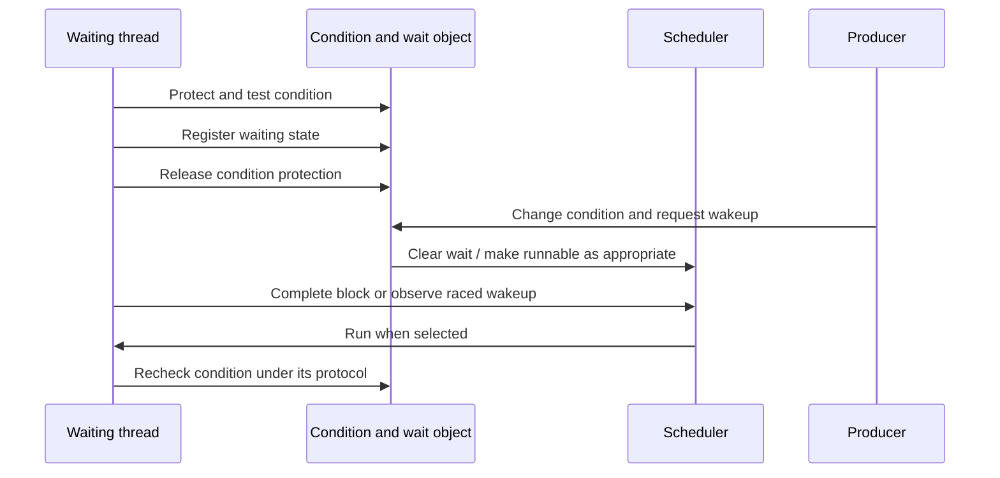

# Ownership, synchronization, and execution context

[Guide index](../README.md) · [Architecture](../architecture.md)

The hardest part of an XNU path is often what must remain true while it runs: the object still exists, its identity has not changed, a field is protected, a condition and wait registration cannot miss each other, and the current context permits blocking. Read these contracts alongside the call graph.

## Four different guarantees

The [concurrent-operation walkthroughs](concurrent-operation-walkthroughs.md) apply these distinctions to VM copying during mapping replacement, IPC table growth during namespace termination, and BSD workqueue callback teardown. Each carries the locks, references and state checks through a concrete two-participant schedule.

| Guarantee | Question | Example |
| --- | --- | --- |
| Storage lifetime | Can this pointer still be dereferenced? | Task/thread references; `fileglob.fg_count`; an IOKit object's retained reference |
| Identity | Does this handle still refer to the same logical object? | PID plus unique identity; vnode pointer plus `v_id`; IPC name generation |
| State consistency | Can another thread change the fields being inspected? | Task lock, socket lock, VM entry/object locks, vnode field-specific locks |
| Permission | May this caller perform this operation? | A Mach port right, credential/authorization checks, MAC hook, user-client method checks |

These guarantees are related but not equivalent. Holding a reference does not grant permission or protect every field. Holding a lock does not necessarily keep an object alive after unlocking. A numerical handle is not an ownership reference.

Concrete definitions illustrate the distinction: [`fileproc`/`fileglob`](../../xnu/bsd/sys/file_internal.h#L120) have separate I/O and shared-object counts; [`vnode`](../../xnu/bsd/sys/vnode_internal.h#L158) has use count, I/O count, and identity; [`thread_ro`](../../xnu/osfmk/kern/thread.h#L176) documents the relationship between thread lifetime and protected association state. The [IPC guide](../subsystems/ipc/README.md) explains name entries and right ownership.

## References are subsystem-specific protocols

Do not infer a function's ownership contract from a suffix alone. Read whether it returns a borrowed or retained object, consumes the input, or converts one representation while preserving the original reference.

The runtime's [task/thread lifecycle](../subsystems/runtime/objects-and-lifecycle.md) separates active membership, termination requests, reaping, and final deallocation. A terminated thread can remain allocated while references or inspection require it. BSD's [process lifecycle](../subsystems/processes/lifecycle.md) adds process lookup, exec replacement, zombie state, and reaping; these stages must not be collapsed into “exit frees everything.”

Descriptors provide another clear example. `fileproc.fp_iocount` protects an in-progress descriptor operation, while `fileglob.fg_count` tracks the shared open-file object. The latter stores `fg_ops`, `fg_offset`, `fg_data`, and `fg_cred`. Closing one descriptor need not destroy the shared object or underlying vnode/socket, and a concurrent close must coordinate with active operations. See [descriptor lifetimes](../subsystems/processes/descriptors-ipc.md) and [file_internal.h](../../xnu/bsd/sys/file_internal.h#L178).

An IPC port's association with a kernel object has its own lifetime rules. For example, task ports do not simply each own a task reference; task IPC disable and conversion paths coordinate object availability and acquired task references. Read [ipc_task_disable()](../../xnu/osfmk/kern/ipc_tt.c) and the [kernel-object IPC discussion](../subsystems/ipc/README.md) before treating a port reference as a task reference.

## A handle may be recycled

An integer PID can be reused. The tracing owner code in [kern_ktrace.c](../../xnu/bsd/kern/kern_ktrace.c#L301) finds the PID and then compares its process unique identifier before continuing to treat it as the owner. This is a concrete example of a lookup that needs more than the small integer name.

A vnode's storage can also outlive a particular filesystem identity. `v_id` and APIs such as `vnode_getwithvid()` participate in checking that a saved pointer still names the expected vnode instance. Use count and I/O count have different purposes, and reclaim changes which operations are valid. The [VFS guide](../subsystems/vfs/README.md) traces this rather than applying a generic “one refcount per vnode” model.

Mach names are interpreted inside an IPC space; rights and generation information belong to the entry. The same numerical name in another task need not denote the same port. A name received from user space must go through the right translation and validation path, not a cast to a pointer. See [ipc_entry.h](../../xnu/osfmk/ipc/ipc_entry.h), [ipc_space.h](../../xnu/osfmk/ipc/ipc_space.h), and [IPC](../subsystems/ipc/README.md).

## Locks often protect fields, not entire objects

For the primitives behind those field contracts, read [reader/writer locks](../subsystems/runtime/reader-writer-locks.md) and [ticket and pointer locks](../subsystems/runtime/ticket-and-pointer-locks.md). They distinguish lock admission and memory ordering from object lifetime, and show why an unsuccessful upgrade or a reserved ticket cannot be treated as an ordinary failed try-lock.

The comment above [`struct vnode`](../../xnu/bsd/sys/vnode_internal.h#L149) assigns different fields to the vnode, vnode-list, mount, name-cache, and buffer locks. Knowing only that “the vnode is locked” is insufficient to justify inspecting every list link.

The [`thread` runqueue contract](../../xnu/osfmk/kern/thread.h#L406) is even more state-dependent: a null runqueue pointer is protected by the thread lock, a non-null pointer by the corresponding runqueue lock, and publication requires both. Clearing has its own rule. Helpers encode these transitions; copying an ordinary pointer assignment from elsewhere can violate the protocol.

VM now uses a map interlock together with entry/range locking. The map's structural state, a particular entry's stable mapping, a backing object's contents, and physical-page replacement queues have distinct synchronization domains. A shared range-lock operation can still prepare backing or copy-on-write state before presenting the locked entry. See [VM range locking](../subsystems/vm/virtual-address-maps.md#range-locks-stabilize-operations-beyond-the-interlock) and [vm_map_lock_internal.h](../../xnu/osfmk/vm/vm_map_lock_internal.h).

Below VM, the selected pmap backend has another lifetime protocol. SPTM combines physical-page PV-head ownership, short per-CPU epochs, and leaf-table pins; the legacy ARM and x86 implementations also use pmap reader/writer locks. These mechanisms protect software metadata and table storage. Translation invalidation and completion separately establish when CPUs stop using old hardware mappings. See [pmap synchronization](../subsystems/vm/pmap-mapping-lifecycle.md#locking-rules-that-make-these-paths-fit-together), [TLB completion](../subsystems/vm/pmap-tlb-and-cache.md), and [x86 pmap](../subsystems/vm/pmap-x86.md).

Use assertions as executable documentation: `lck_mtx_assert`, spin-lock assertions, interrupt/preemption assertions, and object-state checks identify entry assumptions. Do not turn a lock order observed in one function into a universal order for the whole kernel.

## Registering a wait is a state transition

This conceptual sequence captures the problem a blocking primitive must solve:

The exact ordering is encoded by each primitive; this is not pseudocode to copy into a new kernel routine. The [waitq and scheduler path](../subsystems/runtime/waits-and-locks.md) shows how registration, thread state, wakeup, and blocking cooperate so that a wakeup before the final block is not lost. Wakeup is an eligibility transition, not a promise of immediate CPU execution.

Turnstiles add dependency tracking and priority inheritance to selected waits. A waiter may donate urgency to an owner or another inheritor so the dependency can finish. The [mutex and turnstile trace](../subsystems/runtime/waits-and-locks.md) follows the update/propagation/completion protocol. Not every wait queue implies a priority-inheritance relationship.

## Dropping a lock creates a revalidation obligation

A slow operation may need to allocate, fault, call a pager, or sleep. Retaining every original lock while doing so may be invalid. VM's [fault slow path](../../xnu/osfmk/vm/vm_fault.c) retains suitable object/paging state, releases map protection, performs slower work, then looks up and validates the mapping again. While it slept, another thread could unmap or replace the entry. See [fault revalidation](../subsystems/vm/fault-resolution.md#slow-faults-release-and-revalidate-the-mapping) for the object/offset and delayed-copy checks, and why entry-lock contention must release the busy page before retrying.

The general reading question is: **what bridges the unlocked interval?** It may be a retained reference, a busy page, a generation/identity check, a teardown barrier, or a restart from lookup. If no such mechanism is visible, widen the reading window to the caller and cleanup labels before drawing a conclusion.

## Execution context constrains the path

User syscall work normally starts in a schedulable thread context; interrupt handling, early boot, scheduler internals, and debugger capture have different available services. Disabling preemption stabilizes the current CPU association but does not by itself exclude another CPU. Disabling local interrupts is also not global mutual exclusion.

The [timer and thread-call guide](../subsystems/runtime/time-and-accounting.md) distinguishes timer callbacks from deferred worker execution, including exceptions and cancellation semantics. Cancellation is not automatically a join: when teardown requires that a callback has finished, use the API's documented synchronization rather than merely observing that it is no longer queued.

IOKit work loops and command gates serialize participating driver work, while BSD event workloops connect event delivery to workqueue threads. They have different object models and contracts. Follow [drivers](../subsystems/drivers/README.md) and [events/threads](../subsystems/processes/events-threads.md) separately.

## Atomics, sequence counters, and deferred reclamation

An atomic field provides only the ordering requested by its operation. The repository's [atomics guide](../../xnu/doc/primitives/atomics.md) explains `os_atomic_*`, compiler barriers, and memory fences. Trace publication and consumption together; “atomic” alone is not a proof that neighboring non-atomic fields are visible.

[Recount](../development/observability.md) supplies a concrete multi-field example: readers copy usage between sequence-counter checks and retry if a writer changed it. This protects the consistency of the sampled metrics without requiring every reader to exclude the writer with a mutex.

Other structures use safe memory reclamation (SMR). The detailed [SMR and publication chapter](smr-and-publication.md) follows reader entry/leave, sequence scans, sleepable-reader scheduler/turnstile integration, deferred callback queues and barriers in [smr.h](../../xnu/osfmk/kern/smr.h) and [smr.c](../../xnu/osfmk/kern/smr.c). Read-side participation is different from acquiring a permanent object reference. The [hash-table companion](smr-hash-tables.md) explains the simple and scalable tables in [smr_hash.h](../../xnu/osfmk/kern/smr_hash.h), including duplicate acquisition, resizing/reseeding and storage retirement. Every hash/client interleaving and a formal memory-order proof remain outside these selected traces.

The companion [completion, cancellation and partial-failure chapter](completion-and-failure.md) compares the concrete Mach RPC, socket, process, clustered-I/O, timer, AIO and teardown contracts. A completed queue operation does not necessarily mean all callbacks, output copyouts or resource releases have finished.

## A useful final check

For each arrow in a subsystem diagram, ask what crosses it: a borrowed pointer, retained object, copied value, user address, right, callback, queued work item, or wakeup. Then locate where that obligation ends. The diagrams explain the route; the acquisition, transfer, and cleanup code establish whether the route is safe.

<!-- BEGIN PLATYDOC DOCUMENTATION LICENSE -->
Original Platydoc text and diagrams are licensed under [CC BY 4.0](https://creativecommons.org/licenses/by/4.0/). Quoted source code and third-party material retain their respective licenses.
<!-- END PLATYDOC DOCUMENTATION LICENSE -->
