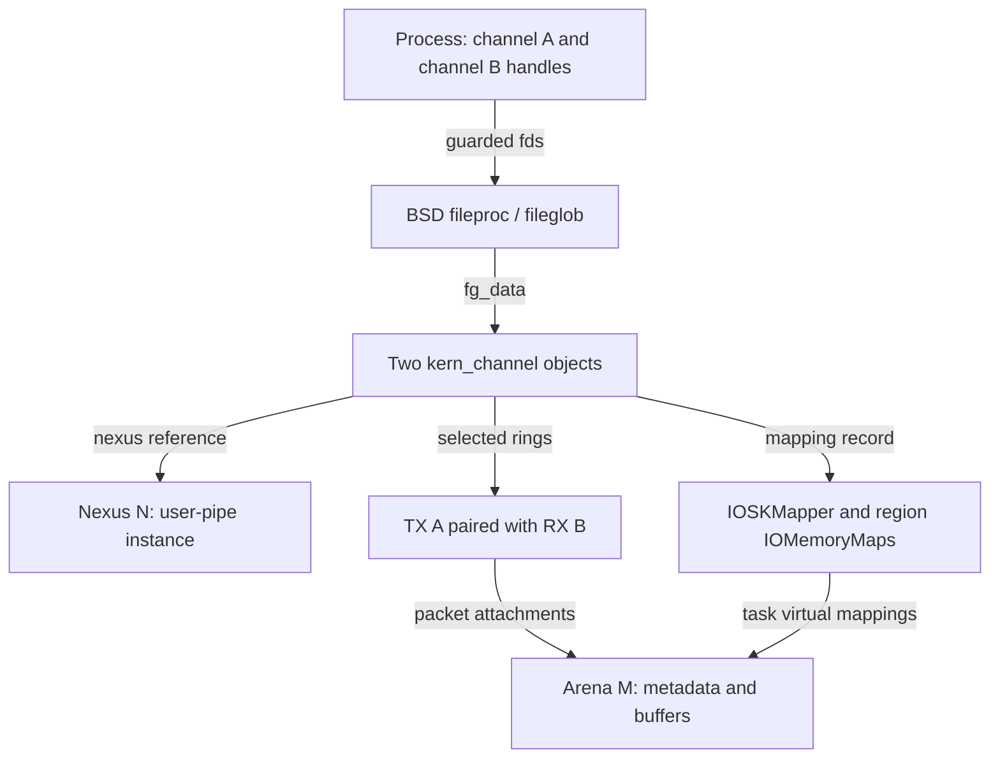
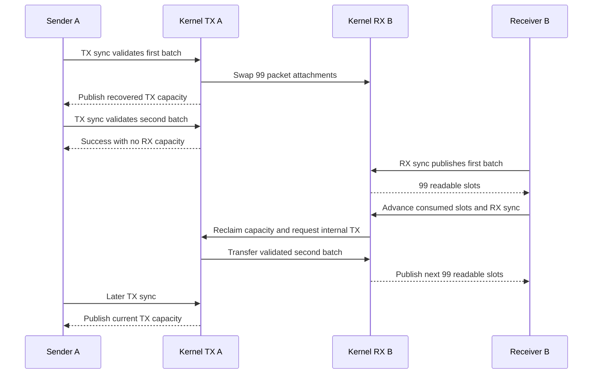
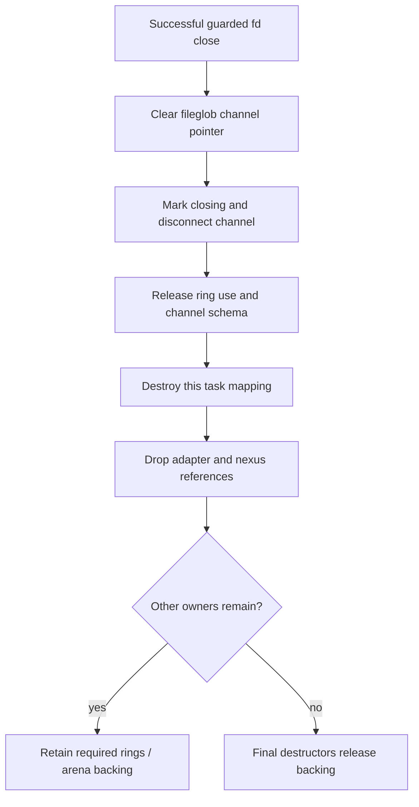

# One Skywalk channel operation: descriptors, mappings, packets and readiness

[Execution paths](execution-paths.md) · [Completion and failure](completion-and-failure.md) · [Networking](../subsystems/networking/README.md) · [IOKit](../subsystems/drivers/README.md)

A channel operation crosses BSD descriptor allocation, Skywalk topology, IOKit memory mapping, shared packet metadata and event delivery. This walkthrough follows one concrete user-pipe scenario through those boundaries, keeping the same objects visible throughout. The [pipe implementation chapter](../subsystems/networking/skywalk-user-and-kernel-pipes.md) supplies the full peer-reference and ring algorithms; this chapter explains how a caller reaches them and which result each boundary establishes.

The source example is `skt_fullupipe_main()` in `xnu-12377.121.6`. It opens both endpoints in the same test process, fills the sender twice, and demonstrates receiver-driven progress after backpressure. Its initialization selects an anonymous user-pipe nexus, one TX and one RX ring per endpoint, **100 slots per ring**, and reject-on-close. It exercises slot movement rather than checking a meaningful network payload. No NIC, IP route, TCP connection or device DMA is involved in this selected transport. [Configuration](../../xnu/tests/skywalk/skt_fullupipe.c#L45-L63), [endpoint creation](../../xnu/tests/skywalk/skt_fullupipe.c#L72-L97).

## 1. Name every identity before tracing the first packet

| Name used here | Actual representation | What it identifies |
| --- | --- | --- |
| Controller C | Userspace `nexus_controller_t`, backed by its controller fd | A control session that registers the provider and allocates the nexus. |
| Provider P and nexus N | Separate UUIDs; kernel provider and `kern_nexus` objects | P supplies parameters/type; N is the instantiated pipe that channels connect to. |
| Endpoint A and B | Nexus ports 0 and 1 | Client/slave and server/master roles within N. These are not Mach port names or fd numbers. |
| Channel A and B | Userspace `channel_t`, guarded fd, kernel `kern_channel` | Each open's schema, ring selection, task mapping and nexus/adapter references. |
| Arena M | Parent adapter's retained Skywalk arena and IOKit mapping objects | Shared backing for both endpoints' rings, metadata and buffers. |
| TX A and RX B | Separate user rings and `__kern_channel_ring` objects | Paired via kernel `ckr_pipe` pointers; indices remain distinct. |
| Packet Q | Packet metadata/buffer attached to a slot | The attachment moves between rings. Its payload storage remains in M. |

The test helper creates C, registers P, allocates N and reads back negotiated geometry; it passes N's UUID to the channel test. The provider registration and instance allocation are separate operations, and their errors precede any channel transfer. Anonymous mode changes binding admission; it does not remove controller/channel policy checks. See [setup](../../xnu/tests/skywalk/skywalk_test_common.c#L143-L247), [provider construction](../../xnu/tests/skywalk/skywalk_test_utils.c#L85-L249), [controller wrappers](../../xnu/libsyscall/wrappers/skywalk/os_nexus.c#L88-L159), and [controller authority](../subsystems/networking/skywalk-controller-provider-and-port-lifetime.md).



The diagram shows relationships, not a reference-count equation. The channel, adapter, parent and arena own different references. Use the [pipe object graph](../subsystems/networking/skywalk-user-and-kernel-pipes.md#1-endpoints-rings-and-memory-are-different-objects) when following their exact release counts.

## 2. Open publishes several things before the application gets a handle

`os_channel_create_extended()` constructs `ch_init` with N's UUID, endpoint port, ring selection and requested modes. It calls `__channel_open()`, then `__channel_get_info()`, and finally allocates/initializes its userspace handle. Consequently a successful kernel open can still be followed by a failed userspace construction. On that failure the wrapper attempts to close the already-opened guarded fd and discards the close result. [Wrapper construction](../../xnu/libsyscall/wrappers/skywalk/os_channel.c#L441-L562), [wrapper cleanup](../../xnu/libsyscall/wrappers/skywalk/os_channel.c#L717-L740).

Inside the open syscall:

1. Copy/validate `ch_init`, including version, nexus UUID and consistency of the optional key pointer/length pair.
2. Reserve a guarded fd using `falloc_guarded()`. The guard restricts close, duplication, socket IPC, fileport and write operations. Only afterward does the body check the key-length limit, allocate temporary key storage and copy the key bytes.
3. `ch_open()` resolves N and the endpoint, admits the requested ring selection, obtains an adapter and connects the channel. The first pipe endpoint constructs its peer and the parent arena.
4. Common adapter connection maps the arena into `proc_task(p)` and sets the schema's `CSM_ACTIVE`.
5. Copy the generated guard and normalized initialization record back to userspace.
6. Install `channel_ops`, attach the channel to the fileglob, release the fd reservation and return the fd.

[Guard allocation and key copying](../../xnu/bsd/skywalk/channel/channel_syscalls.c#L193-L224), [open/copyout/publication](../../xnu/bsd/skywalk/channel/channel_syscalls.c#L227-L265), [adapter map/active publication](../../xnu/bsd/skywalk/nexus/nexus_adapter.c#L2662-L2670), [pipe construction](../../xnu/bsd/skywalk/nexus/upipe/nx_user_pipe.c#L1497-L1652).

The fd has channel-specific operations: ordinary `read`, `write` and `ioctl` do not perform packet transfer. `select` and kqueue filtering do have channel implementations. Transfer enters through the channel synchronization syscall and mapped ring fields. [Operation table](../../xnu/bsd/skywalk/channel/channel_syscalls.c#L46-L55).

If initialization copyout fails, the syscall destroys the provisional channel and frees the reserved fileproc. Thus the task mapping and active schema may have existed before the open ultimately reports failure. This cleanup differs from the later wrapper failure, which closes an already-published fd. [Kernel rollback](../../xnu/bsd/skywalk/channel/channel_syscalls.c#L267-L283).

## 3. Skywalk reaches VM through an actual IOKit mapping implementation

`skmem_arena_mmap()` holds the arena lock, checks that it is active and not defunct, calls `IOSKMapperCreate(ar->ar_ar, proc_task(p))`, obtains the mapped base/extent and records the mapping in the arena's list. The successful record retains the arena and increments its map count. This is a CPU task mapping; the word “mapper” here does not imply an IOMMU device-address mapping. [Arena mapping](../../xnu/bsd/skywalk/mem/skmem_arena.c#L1496-L1556).

The implementation is present in `iokit/bsddev/skywalk/IOSkywalkSupport.cpp`. `IOSKMapper` reserves a task virtual interval with `mach_vm_map_kernel()`, `VM_PROT_NONE` and `VM_INHERIT_NONE`. Region mappers overlay populated segment buffers with `createMappingInTask()` and `kIOMapOverwrite`; buffers marked not user-writable add `kIOMapReadOnly`. An arena's total reserved extent therefore need not be populated or uniformly writable. [Reservation](../../xnu/iokit/bsddev/skywalk/IOSkywalkSupport.cpp#L534-L565), [segment mapping](../../xnu/iokit/bsddev/skywalk/IOSkywalkSupport.cpp#L365-L408).

The address conversion is explicit in the region mapper. [Exact source, `IOSkywalkSupport.cpp` lines 387–396](../../xnu/iokit/bsddev/skywalk/IOSkywalkSupport.cpp#L387-L396):

<!-- source-excerpt: ../../xnu/iokit/bsddev/skywalk/IOSkywalkSupport.cpp#L387-L396 -->
```cpp
	if (buffer->fSpec.user_writable == FALSE) {
		options |= kIOMapReadOnly;
	}

	offset = fRegionOffset + (segIndex * fRegion->getSegmentSize());
	assert((offset + fRegion->getSegmentSize()) <= fMapper->fMapSize);
	addr = fMapper->fMapAddr + offset;

	map = buffer->createMappingInTask(fMapper->fTask, addr, options);
	fMemoryMaps[segIndex] = map;
```

Userspace receives `cinfo_mem_base` and `cinfo_schema_offset`; their sum locates this channel's schema. Ring and slot-table offsets are relative to that **schema**. Buffer/metadata offsets in a ring are relative to the **ring**. These bases must not be interchanged. [Schema construction](../../xnu/libsyscall/wrappers/skywalk/os_channel.c#L516-L529), [ring initialization](../../xnu/libsyscall/wrappers/skywalk/os_channel.c#L266-L315).

For an illustrative address calculation, let mapping base `B = 0x100000000`, schema offset `S = 0x4000`, and a schema-relative ring offset `R = 0x8000`. The schema is at `0x100004000` and that ring at `0x10000c000`. A ring-relative buffer-base offset `D = 0x20000` gives `0x10002c000`. These are chosen virtual byte addresses, not reported test values or physical addresses; no PTE/page-size calculation is implied. Another mapping of M can have a different B and a different channel schema. Packet identities/offsets, rather than a pointer copied from A, establish the receiver's view.

For page and descriptor ownership below this bridge, continue with [Skywalk arena mapping](../subsystems/networking/skywalk-memory-arenas-and-mapping.md) and [IOKit CPU mappings](../subsystems/drivers/memory-descriptors-and-cpu-mappings.md). The separate [DMA operation](user-buffer-to-dma-completion.md) follows device-visible addresses.

## 4. Publishing the user head does not yet transfer a slot

The test iterates TX A's 99 initially available slots, obtains/sets slot properties, and advances through the final slot. `os_channel_advance_slot()` writes only the mapped `ring_head`. It does not execute the kernel TX prologue. [Test preparation](../../xnu/tests/skywalk/skt_fullupipe.c#L98-L126), [head update](../../xnu/libsyscall/wrappers/skywalk/os_channel.c#L966-L981).

`os_channel_available_slot_count()` calculates TX availability using the mapped `ring_head`, published `ring_khead` and `ring_num_slots`; RX availability uses `ring_tail - ring_head`, modulo the slot count. It returns zero for a defunct schema. The same zero result therefore needs context: full TX, empty RX and defunct operation are different conditions. [Actual calculations](../../xnu/libsyscall/wrappers/skywalk/os_channel.c#L943-L962).

`os_channel_sync(A, CHANNEL_SYNC_TX)` enters `__channel_sync()`. The kernel takes the ring synchronization right, validates/imports user submissions, invokes `ckr_na_sync`, and finalizes the mapped TX state only on callback success. The pipe callback sees validated `ckr_rhead`, not arbitrary newly written user state. [Wrapper](../../xnu/libsyscall/wrappers/skywalk/os_channel.c#L820-L831), [TX dispatch](../../xnu/bsd/skywalk/channel/channel_syscalls.c#L443-L489).

For this pipe, the callback bounds transfer by pending TX slots and free RX capacity. It swaps the kernel/user slot descriptors and fixes packet back-pointers through `SD_SWAP`; bytes remain in existing arena buffers. A memory fence orders those attachment updates before publishing the kernel RX tail. [Capacity and transfer](../../xnu/bsd/skywalk/nexus/upipe/nx_user_pipe.c#L878-L969), [actual swap macro](../../xnu/bsd/skywalk/channel/channel_var.h#L653-L661).

The publication boundary is visible in this excerpt. [Exact source, `nx_user_pipe.c` lines 956–964](../../xnu/bsd/skywalk/nexus/upipe/nx_user_pipe.c#L956-L964):

<!-- source-excerpt: ../../xnu/bsd/skywalk/nexus/upipe/nx_user_pipe.c#L956-L964 -->
```c
	/*
	 * Make sure the slots are updated before ckr_ktail reach global
	 * visibility, since we are not holding rx ring's kr_enter().
	 */
	os_atomic_thread_fence(seq_cst);

	rxkring->ckr_ktail = j;
	txkring->ckr_khead = k;
	txkring->ckr_ktail = SLOT_PREV(k, lim_tx);
```

This moves Q from TX A's attachment to RX B's attachment, with the prior RX packet becoming reusable TX storage. It does not instantly refresh every userspace ring view. Generic RX synchronization later publishes B's readable tail and externalizes the metadata. See [RX finalize](../../xnu/bsd/skywalk/channel/channel_ring.c#L1395-L1416) and the [pipe publication stages](../subsystems/networking/skywalk-user-and-kernel-pipes.md#4-submission-transfer-and-user-visible-completion-occur-separately).

## 5. Follow the test's two batches through backpressure

The table follows the source's assertions with `N = 100` and usable capacity `N - 1 = 99`. “Visible” means what the userspace helper returns at that point, not a count read directly from kernel krings.

| Completed action | TX A visible free slots | RX B visible packets | What has actually happened |
| --- | ---: | ---: | --- |
| Open A and B | 99 | 0 | Both views start empty of submitted traffic. |
| A advances 99 slots; B performs RX sync | 0 | 0 | A's submissions have not passed TX prologue. B cannot import the raw user head on A's behalf. |
| A performs first TX sync | 99 | 0 | First batch transferred internally; B's published tail is still old. |
| A advances a second 99 slots and performs TX sync | 0 | 0 | Second batch is validated, but B's internal RX ring is full. Zero transfers is a successful callback outcome. |
| B performs RX sync | 0 | 99 | First batch becomes user-visible. |
| B consumes/advances the first batch, then RX syncs | 0 | 99 | B reclaims capacity and pulls A's already-validated second batch. A's mapped completion state is still old. |
| B consumes/advances the second batch | 0 | 0 | Application consumption changes B's head; A still has stale published free capacity. |
| A performs TX sync | 99 | 0 | A's mapped TX completion view catches up. |

[First submission and RX-before-TX](../../xnu/tests/skywalk/skt_fullupipe.c#L98-L151), [second submission and full receiver](../../xnu/tests/skywalk/skt_fullupipe.c#L153-L202), [receiver-driven transfer and final TX view](../../xnu/tests/skywalk/skt_fullupipe.c#L204-L258).

The RX callback first reclaims released slots, computes free capacity and reads the peer's **validated** pending count. With both pending work and space, it takes the peer TX synchronization right and calls `nx_upipe_na_txsync_locked()` itself. [Reclaim and pending check](../../xnu/bsd/skywalk/nexus/upipe/nx_user_pipe.c#L1004-L1028), [internal TX call and notification](../../xnu/bsd/skywalk/nexus/upipe/nx_user_pipe.c#L1053-L1086).



The test's comment after the first TX sync calls the RX queue “full,” while its assertion still expects zero **visible** RX slots. Those statements refer to different representations. Reading the comment alone loses the central point of the test. [Exact assertions, `skt_fullupipe.c` lines 142–146](../../xnu/tests/skywalk/skt_fullupipe.c#L142-L146):

<!-- source-excerpt: ../../xnu/tests/skywalk/skt_fullupipe.c#L142-L146 -->
```c
	/* The txqueue is now empty and the rx queue is full */
	txavail0 = os_channel_available_slot_count(txring0);
	assert(txavail0 == NSLOTS - 1);
	rxavail1 = os_channel_available_slot_count(rxring1);
	assert(rxavail1 == 0);
```

## 6. Readiness can perform synchronization

The explicit-sync test above does not register a kqueue. A caller using readiness reaches the same ring machinery through the descriptor's `chop_select()` or `chop_kqfilter()` instead. This is a separate source trace, not an extra assertion attributed to `skt_fullupipe`. [BSD dispatch](../../xnu/bsd/skywalk/channel/channel_syscalls.c#L76-L134).

`ch_event()` can run RX prologue, the domain sync callback and finalize while checking readiness. If nothing is found, the select/poll path registers its wait interest and retries the scan to cover the intervening arrival. Consequently checking readiness can publish newly arrived slots, reclaim released capacity and trigger the receiver-driven transfer above. A wait registration by itself does not copy packets. [RX scan and retry](../../xnu/bsd/skywalk/channel/channel.c#L1342-L1424).

Notification reaches `csi_selwakeup()`: it wakes select waiters when requested and posts knotes when present, avoiding a recursive knote post when already inside kevent handling. The kqueue process callback then runs `ch_event()` under the channel lock and applies the effective slot/byte low-water mark. Error readiness is reported using `EV_EOF` in this callback. [Wake/post](../../xnu/bsd/skywalk/channel/channel.c#L330-L345), [process and threshold](../../xnu/bsd/skywalk/channel/channel.c#L677-L749).

A readable event therefore reports an observed condition after synchronization; it does not reserve Q for the notified thread or prove that thread has run. Track scheduler admission separately using [wait/wakeup protocols](../subsystems/runtime/wait-and-turnstile-protocols.md) and [kqueue processing](../subsystems/processes/kqueue-and-workloops.md).

## 7. Close unwinds the fd, mapping and peer graph separately

`os_channel_destroy()` attempts guarded close, ignores its result and frees its userspace handle/metadata. Its `void` return is not a report of guarded-close success. On the successful kernel close route, `chop_close()` clears the fileglob's data pointer before invoking `ch_dtor()`. [Wrapper](../../xnu/libsyscall/wrappers/skywalk/os_channel.c#L834-L846), [fileglob handoff](../../xnu/bsd/skywalk/channel/channel_syscalls.c#L112-L126).

Channel destruction marks `CHANF_CLOSING`, clears its fd identity and disconnects it. Common adapter unbinding decrements channel users and relinquishes ring-use rights. It invokes adapter teardown on the last channel, frees this channel's schema, destroys its task mapping and releases its adapter reference. The pipe-specific ring teardown decides whether peer-held rings must survive; it cannot be replaced with an unconditional “close frees the arena.” [Channel close](../../xnu/bsd/skywalk/channel/channel.c#L1803-L1856), [unbind ordering](../../xnu/bsd/skywalk/nexus/nexus_adapter.c#L625-L691), [peer retention and ring teardown](../../xnu/bsd/skywalk/nexus/upipe/nx_user_pipe.c#L1352-L1447).

Mapping destruction crosses back into IOKit: `IOSKMapperDestroy()` removes the mapper from its arena and releases the object; `IOSKMapper::free()` releases region mappings and calls `mach_vm_deallocate()` for the reserved task virtual interval. It discards that call's result before clearing its bookkeeping, so destruction supplies no separate successful-unmap acknowledgment. The remaining endpoint and parent/arena references have their own lifetime. [Mapper destroy](../../xnu/iokit/bsddev/skywalk/IOSkywalkSupport.cpp#L1762-L1772), [mapper free](../../xnu/iokit/bsddev/skywalk/IOSkywalkSupport.cpp#L577-L602), [Skywalk map-count/reference removal](../../xnu/bsd/skywalk/mem/skmem_arena.c#L1559-L1616).



This is a resource summary; domain teardown is called during unbind before the final mapping/reference drops. The common and pipe-specific bodies cited above determine the exact interleaving.

The test closes both channel handles; its separate cleanup then frees N, deregisters P and destroys C. The peer-closure variant checks a rejected later sync when reject-on-close is selected. Logical rejection, mapping removal and final storage release are therefore separate observations. [Test close](../../xnu/tests/skywalk/skt_fullupipe.c#L255-L263), [peer-closure case](../../xnu/tests/skywalk/skt_fullupipe.c#L328-L348), [control cleanup](../../xnu/tests/skywalk/skywalk_test_common.c#L250-L272).

## 8. Failure checkpoints and evidence limits

| Boundary | Possible observation | State to inspect next |
| --- | --- | --- |
| Provider or nexus setup | Registration/allocation error | No channel was admitted; distinguish P from N and clean up the successful earlier control phase. |
| Kernel open copyout | Syscall failure after mapping | Provisional channel/fd rollback, not a published handle to retry using. |
| Wrapper construction | NULL after kernel fd success | Guarded close of that fd and userspace allocations. |
| Advance without TX sync | TX appears full; RX remains empty | Raw user head versus validated `ckr_rhead`. |
| TX sync with full RX | Success without moving pending packets | RX capacity and the validated pending TX interval. |
| Transfer before RX finalize | Internal packets exist; userspace count remains zero | Receiver synchronization/publication. |
| Readiness notification | Event or wakeup | Current low-water condition and actual consumer scheduling. |
| Invalid shared metadata | Validation error and possible abort-signal request | The [diagnostic/enforcement path](../subsystems/networking/skywalk-diagnostics-configuration-and-tests.md#10-invalid-shared-state-the-diagnostic-is-part-of-enforcement); notification logging is not what enforces validity. |
| Peer or controller closes | Rejection or retained storage | Selected reject/defunct policy, peer references, nexus close state and remaining mappings. |

The example joins actual local test, wrapper, syscall, IOKit and pipe bodies. Numeric virtual addresses are illustrative; the 100-slot count and visible-availability sequence come from source assertions. No test was executed. `SKYWALK`/`CONFIG_NEXUS_USER_PIPE`, admission policy and the Darwin test environment remain prerequisites. This operation does not establish NIC/DMA behavior, flowswitch/IP delivery, cross-process memory isolation, payload integrity or all teardown races. Use the [diagnostics/test chapter](../subsystems/networking/skywalk-diagnostics-configuration-and-tests.md) for harness limits, and compare the [mapped-file operation](mapped-file-to-arm64-fault.md) and [DMA operation](user-buffer-to-dma-completion.md) for different VM and completion contracts.

<!-- BEGIN PLATYDOC DOCUMENTATION LICENSE -->
Original Platydoc text and diagrams are licensed under [CC BY 4.0](https://creativecommons.org/licenses/by/4.0/). Quoted source code and third-party material retain their respective licenses.
<!-- END PLATYDOC DOCUMENTATION LICENSE -->
