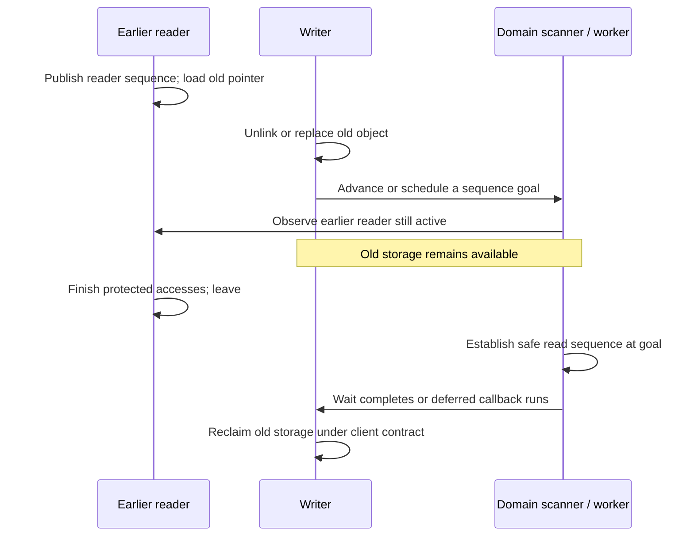

# SMR, pointer publication and deferred reclamation

[Guide index](../README.md) · [Ownership and synchronization](ownership-and-locking.md) · [Vnode cache example](../subsystems/vfs/name-cache-and-vnode-reclaim.md)

Safe memory reclamation (SMR) lets a reader traverse selected shared pointers without taking the writer's lock for every access. A writer removes or replaces an object, then waits for a sufficient grace period before reclaiming storage that an earlier reader could still be using. XNU combines domain sequence numbers, per-CPU reader state, asynchronous callback queues and scheduler integration for sleepable sections.

SMR supplies a lifetime/ordering protocol. It does not make all fields immutable, grant authorization, or automatically turn a pointer into an object reference. The VFS name cache combines SMR with entry counters, vnode holds and generation-checked I/O references for precisely these reasons.

## Domain, reader and callback state

| Structure | Important state |
| --- | --- |
| `smr` | Global read/write sequence pair, per-CPU state, flags and domain name. |
| `smr_pcpu` | Active reader sequence; current/aging/old callback-list boundaries; sequence goals; stalled sleepable readers and their turnstile. |
| `smr_worker` | Per-CPU worker thread, domains with queued work, active sleepable trackers and barrier jobs. It services multiple domains. |
| `smr_node` | Intrusive next pointer and callback used to defer client cleanup. Its storage must remain valid until the callback consumes it. |
| `smr_tracker` | A caller-supplied sleepable-section record: domain, sequence, thread stack linkage, stalled-list linkage and CPU/thread identity. |

Definitions: [`smr` and sequence types](../../platydoc-data/xnu/osfmk/kern/smr.h#L799), [`smr_pcpu`](../../platydoc-data/xnu/osfmk/kern/smr.c#L306), [`smr_worker`](../../platydoc-data/xnu/osfmk/kern/smr.c#L237), [`smr_node`](../../platydoc-data/xnu/osfmk/kern/smr_types.h#L73), [`smr_tracker`](../../platydoc-data/xnu/osfmk/kern/smr.h#L981).

`SMR_SEQ_INVALID` is zero. The sequence increment leaves low bits available for flags; `SMR_SEQ_SLEEPABLE` marks a CPU reader witness. Comparisons use signed sequence deltas rather than ordinary unsigned ordering. [`smr_domain_create`](../../platydoc-data/xnu/osfmk/kern/smr.c#L559) allocates a domain and per-CPU state; static domains use startup registration and an early-boot representation.

Domain names need not imply independent clocks. In this checkout `smr_ipc`, `smr_proc_task` and `smr_iokit` are aliases of `smr_system`. Recursive entry through two aliases therefore does not create two independent protected sections. See [the subsystem aliases](../../platydoc-data/xnu/osfmk/kern/smr.h#L1045). VFS uses its own wrapper around `VFS_SMR()`; see [the wrapper definitions](../../platydoc-data/xnu/bsd/sys/vnode_internal.h#L707).

## Entering and leaving a non-preemptible reader

The public non-sleepable pair pins execution to the current CPU:

[Source: smr.c, lines 674–688](../../platydoc-data/xnu/osfmk/kern/smr.c#L674-L688)

<!-- source-excerpt: ../../platydoc-data/xnu/osfmk/kern/smr.c#L674-L688 -->
```c
__attribute__((always_inline))
void
smr_enter(smr_t smr)
{
	disable_preemption();
	__smr_enter(smr, __smr_pcpu(smr), 0);
}

__attribute__((always_inline))
void
smr_leave(smr_t smr)
{
	__smr_leave(__smr_pcpu(smr));
	enable_preemption();
}
```

[`__smr_enter`](../../platydoc-data/xnu/osfmk/kern/smr.c#L631) snapshots the domain's write sequence and publishes it in the CPU's reader slot. The entry barrier prevents the protected accesses from being reordered before publication:

[Source: smr.c, lines 651–660](../../platydoc-data/xnu/osfmk/kern/smr.c#L651-L660)

<!-- source-excerpt: ../../platydoc-data/xnu/osfmk/kern/smr.c#L651-L660 -->
```c
	s_wr_seq = os_atomic_load(&smr->smr_clock.s_wr_seq, relaxed);
#if __x86_64__
	/* [R1] */
	old_seq = os_atomic_add_orig(&pcpu->c_rd_seq, s_wr_seq | sleepable, seq_cst);
#else
	old_seq = pcpu->c_rd_seq;
	os_atomic_store(&pcpu->c_rd_seq, s_wr_seq | sleepable, relaxed);
	os_atomic_thread_fence(seq_cst); /* [R1] */
#endif
	assert(old_seq == SMR_SEQ_INVALID);
```

On ARM this is a relaxed store followed by a sequentially consistent fence. The x86 path uses an atomic read/modify/write operation for its required ordering. The old reader slot must be invalid, enforcing nonrecursive entry in assertion-enabled builds. Interrupt-context entry is rejected.

Leaving stores the invalid sequence with release ordering, then restores preemption. It does not drop an arbitrary reference acquired by the client inside the section. Conversely, a raw pointer obtained in the section cannot generally be retained after leaving unless the client has established another lifetime guarantee.

The VFS example shows that conversion concretely: `cache_lookup_ext` obtains a vnode hold while still under SMR, leaves the domain, then obtains an I/O reference with an identity-generation check. SMR alone cannot establish that a vnode still represents the same filesystem object. See [cache snapshot to vnode reference](../subsystems/vfs/name-cache-and-vnode-reclaim.md#a-single-component-cache-lookup).

## Pointer publication and list removal

The pointer accessors encode distinct contexts: entered reader, externally serialized writer, and unpublished/retired storage. They are not interchangeable ways to silence a type wrapper.

The normal serialized publication macro places a release fence before storing the pointer:

[Source: smr.h, lines 168–172](../../platydoc-data/xnu/osfmk/kern/smr.h#L168-L172)

<!-- source-excerpt: ../../platydoc-data/xnu/osfmk/kern/smr.h#L168-L172 -->
```c
#define smr_serialized_store_assert(ptr, value, held_cond)  ({ \
	assertf(held_cond, "smr_serialized_store: lock not held"); \
	os_atomic_thread_fence(release); \
	(ptr)->__smr_ptr = value; \
})
```

`smr_entered_load` is a plain load through the wrapper; a separate acquire variant exists. The complete ordering comes from the domain entry, pointer-publication contract, dependency rules and the selected accessor. Describing every SMR load as an acquire atomic would be inaccurate. See [reader accessors](../../platydoc-data/xnu/osfmk/kern/smr.h#L77) and [the atomics guide](../../platydoc-data/xnu/doc/primitives/atomics.md).

In a linked queue, inserting a new element initializes its outgoing link before publishing the incoming pointer. Removing an existing element rewires the predecessor to the already-published successor. The removal helper deliberately preserves the removed element's forward link:

[Source: smr.h, lines 1324–1341](../../platydoc-data/xnu/osfmk/kern/smr.h#L1324-L1341)

<!-- source-excerpt: ../../platydoc-data/xnu/osfmk/kern/smr.h#L1324-L1341 -->
```c
	struct smrq_slink *next;

	/*
	 * Removal "skips" a link this way:
	 *
	 *     e1 ---> e2 ---> e3  becomes e1 -----------> e3
	 *
	 * When e3 was inserted, a release barrier was issued
	 * by smr_serialized_store().  We do not need to issue
	 * a release barrier upon removal because `next` carries
	 * a dependency on that smr_serialized_store()d value.
	 */
	next = smr_serialized_load(&elem->next);
	smr_serialized_store_relaxed(prev, next);
	if (next == NULL && lastp) {
		*lastp = prev;
	}
}
```

A reader that already reached the removed element can still need that link. Removal does not itself authorize freeing or reusing the element. The writer must also prevent new relevant discovery and arrange a grace period before the old storage becomes unsafe to inspect. For multiwriter structures, SMR does not replace the writer-side lock or the structure's own atomic update algorithm.

## How a grace period is detected

The domain's global write sequence records progress requested by writers. Its global read sequence records progress known safe after considering readers. A reader's published sequence can prevent the read sequence from advancing past that reader's relevant interval.

[`smr_advance`](../../platydoc-data/xnu/osfmk/kern/smr.c#L1203) advances the write sequence with release ordering and returns a goal. [`smr_poll`](../../platydoc-data/xnu/osfmk/kern/smr.c#L1238) asks whether the safe read sequence has reached that goal. [`smr_wait`](../../platydoc-data/xnu/osfmk/kern/smr.c#L1245) waits until it has. Callers must not wait for their own entered domain.

The common fast path loads the read sequence with acquire ordering and compares it to the goal. If insufficient, [`__smr_scan`](../../platydoc-data/xnu/osfmk/kern/smr.c#L1036) orders its observations, scans per-CPU reader witnesses and computes a conservative minimum:

* An inactive slot does not constrain this scan.
* A section at or beyond the requested goal need not finish for this grace period.
* An older active section holds progress back. A poll may fail; a wait waits for it to advance or leave.
* Entry can be delayed after loading the write sequence. If the observed slot is older than the scan's known read sequence, the code clamps the observation conservatively rather than interpreting the stale value as ordinary progress.
* A sleepable domain additionally scans stalled-reader sequences after a fence that pairs with transferring readers off CPU.

The result advances the safe read sequence monotonically through [`__smr_rd_advance`](../../platydoc-data/xnu/osfmk/kern/smr.c#L893). This is not a requirement that all CPUs simultaneously be outside the domain; readers that begin after the relevant update need not postpone reclamation of the removed object.



[`smr_deferred_advance`](../../platydoc-data/xnu/osfmk/kern/smr.c#L1219) creates a goal one increment ahead without immediately modifying the global write clock. A later commit or waiting scan drives that sequence forward; merely manufacturing such a goal does not guarantee progress.

`smr_synchronize` performs its own deferred-advance-style scan. For sleepable domains, its body and `smr_wait` explicitly require preemption enabled. The older general `smr_wait` header comment about never explicitly blocking must not be extended to sleepable domains, whose current implementation can block.

The large opening algorithm comment is useful rationale, but its statement about all updates modifying an entire 128-bit clock does not describe the current helper bodies: [`__smr_wr_advance`](../../platydoc-data/xnu/osfmk/kern/smr.c#L885) updates the write member, while `__smr_rd_advance` updates the read member. This guide follows those bodies and does not claim to provide a formal memory-model proof.

## Sleepable readers become scheduler-visible dependencies

A sleepable section uses `smr_enter_sleepable` with an explicit tracker. It briefly suppresses preemption while publishing reader state and linking the tracker into both the current worker's active-section queue and the thread's SMR stack, then restores the lock-preemption state. The section also contributes to the thread's RW-lock count used by scheduler resource handling. See [entry](../../platydoc-data/xnu/osfmk/kern/smr.c#L691).

When the thread switches away, [`thread_dispatch`](../../platydoc-data/xnu/osfmk/kern/sched_prim.c#L3554) calls `smr_mark_active_trackers_stalled` where applicable. The tracker moves to the originating CPU/domain's stalled list. Its oldest stalled sequence is published before the active CPU witness is cleared, so a scanner cannot miss both representations:

[Source: smr.c, lines 765–781](../../platydoc-data/xnu/osfmk/kern/smr.c#L765-L781)

<!-- source-excerpt: ../../platydoc-data/xnu/osfmk/kern/smr.c#L765-L781 -->
```c

		/*
		 * Transfer the section to the stalled queue,
		 * and _then_ leave the regular one.
		 *
		 * A store-release is sufficient to order these stores,
		 * and guarantee that __smr_scan() can't fail to observe
		 * both the @c rd_seq and @c stall_rd_seq during a transfer
		 * of a stalled section that was active when it started.
		 */
		if (smrq_empty(&pcpu->stall_queue)) {
			os_atomic_store(&pcpu->stall_rd_seq, t->smrt_seq, relaxed);
		}
		os_atomic_store(&pcpu->c_rd_seq, SMR_SEQ_INVALID, release);

		smrq_serialized_insert_tail_relaxed(&pcpu->stall_queue, &t->smrt_link);

```

The tracker records the departing thread and CPU. A later leave can therefore remove it from the correct stalled queue even after the thread resumes elsewhere. If removing the oldest tracker permits progress, the leave path updates the oldest sequence and either wakes grace-period waiters or changes their turnstile inheritor to the next blocking reader. See [`__smr_leave_stalled`](../../platydoc-data/xnu/osfmk/kern/smr.c#L793).

Waiting for a still-running sleepable reader first spins for a bounded interval, then can register a wait and send a maintenance IPI. The IPI/leave protocol ensures a waiter is awakened when the remote active-tracker queue clears. Waiting for an already stalled reader uses a turnstile whose inheritor is the thread owning the oldest blocking tracker. This can propagate urgency to the thread preventing reclamation. See [`__smr_wait_for_oncore`](../../platydoc-data/xnu/osfmk/kern/smr.c#L963), [`__smr_wait_for_stalled`](../../platydoc-data/xnu/osfmk/kern/smr.c#L911), and [turnstile protocols](../subsystems/runtime/wait-and-turnstile-protocols.md).

Sleepable does not mean arbitrary indefinite waits are safe. The [interface contract](../../platydoc-data/xnu/osfmk/kern/smr.h#L1000) forbids unbounded waits such as waiting for network packets or a hardware event: a long-lived reader can stall reclamation and the shared workers. These constraints are part of using the API, not a performance hint.

## Deferred callbacks are batched separately from reader progress

[`smr_call`](../../platydoc-data/xnu/osfmk/kern/smr.c#L1449) installs a callback into an intrusive node and appends it to the current CPU/domain callback queue. The client supplies an approximate retained-memory size. Count and size thresholds decide when to advance a batch and dispatch the domain to a worker.

The queue has three logical portions:

| Portion | Meaning |
| --- | --- |
| Current | Recently queued callbacks, with size/count accounting and no completed grace-period claim. |
| Aging | Callbacks assigned a sequence goal, possibly still awaiting write-clock commitment. |
| Old | Callbacks with a committed goal that the worker must establish as safe before invoking them. |

The worker uses a corresponding pipeline of domains. Scheduler ticks, idle transitions and worker activity help move dispatched work through it. The worker detaches a batch, reconstructs the remaining queues, releases its drain lock, waits for the batch's sequence goal and then invokes callbacks:

[Source: smr.c, lines 1789–1795](../../platydoc-data/xnu/osfmk/kern/smr.c#L1789-L1795)

<!-- source-excerpt: ../../platydoc-data/xnu/osfmk/kern/smr.c#L1789-L1795 -->
```c
	__smr_worker_check_invariants(smrw);
	__smr_worker_drain_unlock(smrw);

	__smr_poll(smr, seq, true);
	__smr_call_drain(head);

	__smr_worker_drain_lock(smrw);
```

The callback runner saves the next node and clears the current node's link before calling it, allowing the callback to free its containing allocation. See [`__smr_call_drain`](../../platydoc-data/xnu/osfmk/kern/smr.c#L521).

Ordinary `smr_call` has **no guaranteed forward progress for a small undispatched batch**. The interface exposes `SMR_CALL_EXPEDITE` to force threshold behavior. An arbitrary elapsed time is not a documented reclamation deadline. Before `STARTUP_SUB_EARLY_BOOT`, the implementation calls the callback inline, another reason not to assume every call necessarily schedules a later worker invocation. See [the API contract](../../platydoc-data/xnu/osfmk/kern/smr.h#L725) and [threshold/dispatch code](../../platydoc-data/xnu/osfmk/kern/smr.c#L1390).

## `synchronize` and `barrier` answer different questions

`smr_synchronize` establishes reader progress for preceding updates. It does not promise that every previously queued cleanup callback has run.

`smr_barrier` first synchronizes readers, then posts barrier jobs to each CPU worker. Those jobs append callbacks after the relevant existing callbacks, force batch advancement and decrement a shared pending count as they execute. The caller deliberately blocks so its barrier context remains valid until the final callback's wakeup. See [barrier implementation](../../platydoc-data/xnu/osfmk/kern/smr.c#L1538) and [barrier callback](../../platydoc-data/xnu/osfmk/kern/smr.c#L1489).

This distinction matters if deferred callbacks themselves access a structure being retired. Waiting for readers alone is insufficient; the old callbacks can still need that structure. [`smr_domain_free`](../../platydoc-data/xnu/osfmk/kern/smr.c#L581) uses `smr_barrier`, verifies empty callback queues, destroys per-CPU stalled-state locks and frees domain storage. Its caller must already have stopped new domain users.

Allocator-integrated SMR clients need not enqueue one `smr_call` per free. VFS enables SMR on vnode/name/string zones and uses `zfree_smr`; the zone allocator has its own batching and reuse protocol. See [VFS zone setup](../../platydoc-data/xnu/bsd/vfs/vfs_subr.c#L444), [name-cache zones](../../platydoc-data/xnu/bsd/vfs/vfs_cache.c#L3115), and [SMR zones](../subsystems/vm/read-only-and-special-zones.md). Avoid replacing that protocol in a diagram with a nonexistent direct callback.

This chapter covers domain entry/leave, publication, grace-period scanning, sleepable-reader transfer, callback batching and barriers. Continue with [SMR hash tables](smr-hash-tables.md) for serialized-writer grow/shrink, scalable bucket migration/reseeding, acquisition callbacks and array retirement, then [symbol interning](../subsystems/drivers/symbol-interning.md) for a concrete client. Every CPU-offline/worker-retargeting interleaving, all SMR allocator clients and a formal ordering proof remain outside these selected paths.

<!-- BEGIN PLATYDOC DOCUMENTATION LICENSE -->
Original Platydoc text and diagrams are licensed under [CC BY 4.0](https://creativecommons.org/licenses/by/4.0/). Quoted source code and third-party material retain their respective licenses.
<!-- END PLATYDOC DOCUMENTATION LICENSE -->
