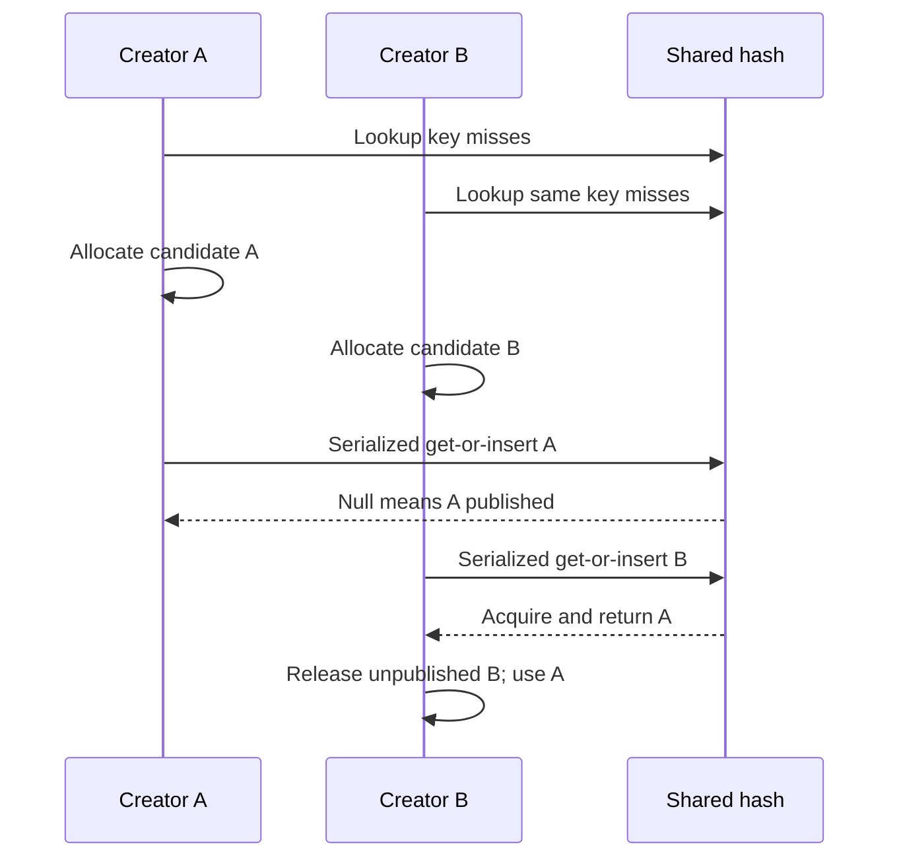
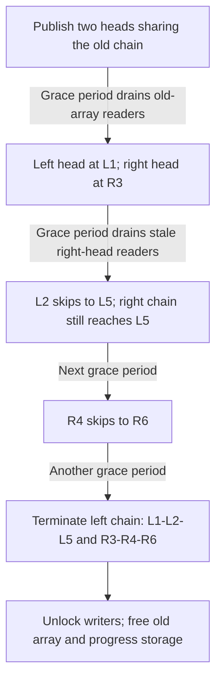
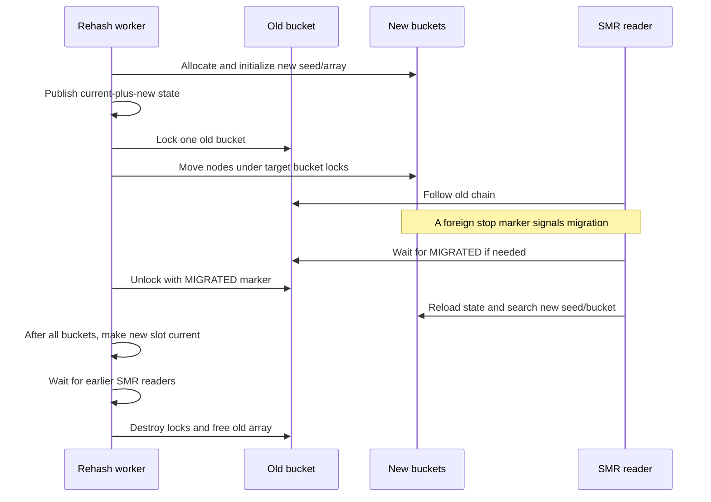

# SMR hash tables: lookup, migration and storage retirement

[SMR foundations](smr-and-publication.md) · [Ownership and locking](ownership-and-locking.md) · [Symbol interning](../subsystems/drivers/symbol-interning.md) · [Credential lifetime](../subsystems/security/credential-and-policy-lifetimes.md)

An SMR hash lookup must solve two separate problems: find the right object while bucket chains change, and establish whether the object can still be acquired. Resizing adds a third: an earlier reader may still hold a pointer into the old bucket array. This chapter follows both local implementations in `xnu-12377.121.6`: `smr_hash`, with externally serialized writers, and `smr_shash`, with per-bucket writer locks. The SMR domain and grace-period machinery are explained in the parent chapter; neither table supplies application authorization or an automatic owning reference for every lookup.

## 1. Keys, intrusive links and client-defined lifetime

The table does not allocate a wrapper for each object. A client embeds `smrq_slink`, whose `next` participates in one hash chain, and supplies static traits. `link_offset` converts a link back to the containing object. `smrh_key_t` carries either a scalar or a pointer plus length; the pointed-to key bytes are borrowed for the operation. [Key and traits declarations](../../platydoc-data/xnu/osfmk/kern/smr_hash.h#L45-L102), [link conversion](../../platydoc-data/xnu/osfmk/kern/smr_hash.h#L1604-L1613).

| Trait | What the table needs from the client |
| --- | --- |
| `domain` | The SMR domain protecting elements and retired arrays. |
| `key_hash(key, seed)` | Select a bucket from the lookup representation. |
| `obj_hash(link, seed)` | Hash a stored object during removal, replacement or migration. It must agree with the key representation. |
| `obj_equ(link, key)` | Compare actual identity after a hash collision; a bucket index is insufficient. |
| `obj_try_get(object)` | Validate/acquire an object that is still alive. Failure means the matching storage cannot be returned as an acquired object. |
| `key_equ` | A reusable key-equality operation in the trait interface; do not confuse it with the `obj_equ` calls used by the shown chain walkers. |

The typed `SMRH_TRAITS_DEFINE_*` macros put these callbacks and an object type into constant metadata. String/memory/scalar helpers define different hashing and equality rules; the string helper uses the explicit key length rather than requiring the lookup copy to contain a terminator. [Trait construction](../../platydoc-data/xnu/osfmk/kern/smr_hash.h#L233-L261), [memory/string hash and equality](../../platydoc-data/xnu/osfmk/kern/smr_hash.h#L165-L222).

The common `get` pattern is visible in the simple table:

[smr_hash.h:1692–1700](../../platydoc-data/xnu/osfmk/kern/smr_hash.h#L1692-L1700):

<!-- source-excerpt: ../../platydoc-data/xnu/osfmk/kern/smr_hash.h#L1692-L1700 -->
```c
	smr_enter(smrht->domain);
	head = __smr_hash_bucket(smrh, key, smrht);
	obj  = __smr_hash_entered_find(head, key, smrht);
	if (obj && !smrht->obj_try_get(obj)) {
		obj = NULL;
	}
	smr_leave(smrht->domain);

	return obj;
```

SMR keeps the object inspectable until `obj_try_get` finishes. A successful client retain then keeps it alive after leaving SMR. `entered_find` instead returns a borrowed match inside an already-entered section, potentially stale or being deleted; `contains` also does not call `obj_try_get`. The search returns the first matching key, and `get` returns null if that object's acquisition fails; it does not search for an older match. [Lookup contracts](../../platydoc-data/xnu/osfmk/kern/smr_hash.h#L555-L660), [walkers and acquisition](../../platydoc-data/xnu/osfmk/kern/smr_hash.h#L1651-L1701).

The ordinary enter/leave wrappers disable/enable preemption. Key hashing, equality and try-retain must fit that execution context: potentially faulting key storage must be dealt with before entry. `OSSymbolPool::findSymbol()` explicitly copies such a key first. The table itself does not make pageable memory safe or keep the caller's key alive. [SMR entry](../../platydoc-data/xnu/osfmk/kern/smr.c#L674-L688), [symbol key preparation](../../platydoc-data/xnu/libkern/c++/OSSymbol.cpp#L199-L240).

## 2. Two table layouts and synchronization contracts

| Property | `smr_hash` | `smr_shash` |
| --- | --- | --- |
| Array selection | One pointer packed with size order. | Two array/seed slots and one atomic current/new state. |
| Bucket | `smrq_slist_head`, ending in null. | `hw_lck_ptr_t`, combining bucket head with writer-lock state; chain ends in a bucket-specific tagged stop value. |
| Writers | Client serialization, normally one mutex. | Per-bucket pointer locks, including during migration. |
| Growth policy | Client chooses whether/when to call resize helpers. | Count/depth heuristics schedule a built-in thread call. |
| Hash selection | Seed zero, low hash bits. | Randomized seed, high hash bits. |
| Enumeration | Serialized iterator, with iterator-specific erase. | No public whole-table enumeration interface. |
| Object reclamation | Client must retire removed objects through the appropriate lifetime protocol. | Same requirement; bucket locking alone is insufficient for readers. |

Definitions: [simple table](../../platydoc-data/xnu/osfmk/kern/smr_hash.h#L385-L416), [scalable state and table](../../platydoc-data/xnu/osfmk/kern/smr_hash.h#L1067-L1177), [simple bucket selection](../../platydoc-data/xnu/osfmk/kern/smr_hash.h#L1618-L1649), [scalable bucket selection](../../platydoc-data/xnu/osfmk/kern/smr_hash.h#L1815-L1849), [serialized iteration](../../platydoc-data/xnu/osfmk/kern/smr_hash.h#L911-L1065).

For the simple table, `smrh_array` stores pointer and order atomically together. On the kernel path, decode restores the pointer's upper bits after extracting the order; `bucket_count = 1UL << (64 - order)`, and the bucket mask is `~0UL >> order`. For example, four buckets use order 62 and mask 3. The order is a bucket-array encoding, not a VM page size or address-translation level. [Encoding](../../platydoc-data/xnu/osfmk/kern/smr.c#L2264-L2274), [decoding and size](../../platydoc-data/xnu/osfmk/kern/smr_hash.h#L486-L534).

`smr_hash_init_empty()` installs a shared two-head sentinel usable for misses but not insertion. `smr_hash_init()` rounds the requested size upward to a power of two; after lockdown it asserts that the initial allocation fits `KALLOC_SAFE_ALLOC_SIZE`. Replacing the empty sentinel uses a release store, allowing existing readers. Growing a populated table is a different operation with explicit allocation-failure returns. [Initialization](../../platydoc-data/xnu/osfmk/kern/smr.c#L2278-L2320), [initialization contract](../../platydoc-data/xnu/osfmk/kern/smr_hash.h#L418-L455).

## 3. Insertion, duplicate races and removal

For a simple table the caller holds its writer serialization outside SMR. `serialized_get_or_insert()` checks the first equal object and calls `obj_try_get`. A live match is returned; the proposed link is not inserted. If absent or no longer acquirable, it increments the count and inserts the proposed link at the bucket head, returning null. **Null means insertion succeeded**, not allocation failure: allocation belongs to the caller. [Implementation](../../platydoc-data/xnu/osfmk/kern/smr_hash.h#L1703-L1722).

That rule permits a new live object and a dying equal object to be linked temporarily. The new one goes first, and old matches are stale. The dying object is later removed by link identity. A client must release its unpublished candidate when another creator wins, and must not mistake the returned already-acquired object for a borrowed pointer. The [symbol chapter](../subsystems/drivers/symbol-interning.md) follows that exact race.

Plain insert requires the client to establish uniqueness. Remove decrements count and unlinks a specific node without freeing it. Replace keeps the count and requires the same key. Previous readers can still hold the removed object or its chain link, so neither operation authorizes immediate reuse. [Mutation contracts and bodies](../../platydoc-data/xnu/osfmk/kern/smr_hash.h#L663-L774).



The diagram assumes that A remains acquirable when B checks it. If A has begun final release, B may publish its own candidate instead. Publication, logical death, unlink and physical reclamation are separate events.

## 4. Shrinking a simple table joins existing chains

Both `smr_hash_shrink_and_unlock()` and `smr_hash_grow_and_unlock()` require the supplied mutex held on entry and return with it unlocked, including errors. They check `smrh_resizing` to elect one resizer, set it, drop the mutex to allocate, then reacquire before editing chains. Other mutations may proceed during allocation; another resize is refused. Allocation failure clears the resizing flag and returns `KERN_RESOURCE_SHORTAGE`; an already-running resize yields `KERN_FAILURE`. The helpers do not decide whether the requested density/minimum size is sensible. [Contracts](../../platydoc-data/xnu/osfmk/kern/smr_hash.h#L853-L908), [shrink setup](../../platydoc-data/xnu/osfmk/kern/smr.c#L2358-L2385), [grow allocations](../../platydoc-data/xnu/osfmk/kern/smr.c#L2417-L2452).

When halving from eight to four buckets, old buckets `i` and `i + 4` become one new bucket `i`. The implementation copies the lower head and appends the upper chain, then publishes the new pointer/order. An old lower-bucket reader may now traverse extra objects, but full key equality still decides the match. An old upper-bucket reader still has its old starting head. This operation reuses object links; it does not copy every object. [Pair concatenation and publication](../../platydoc-data/xnu/osfmk/kern/smr.c#L2387-L2405).

After publication it clears the resize flag and unlocks, then waits for `smr_synchronize()` before freeing the old array. Writers can therefore resume before the old-array storage is reclaimed. The synchronization covers obsolete array observations; it is not a reference-count decrement for all objects in the table. [Retirement](../../platydoc-data/xnu/osfmk/kern/smr.c#L2400-L2413).

## 5. Growing a simple table needs repeated reader grace periods

Doubling cannot immediately cut one chain into two: a reader that entered through an old head could lose the suffix containing its key. The implementation first copies all heads twice into a new double-sized array. Both new buckets for an old bucket initially lead through the same chain. It publishes the new pointer/order and waits for old-array readers **while holding the writer mutex**. [Publication and first synchronization](../../platydoc-data/xnu/osfmk/kern/smr.c#L2452-L2469).

[smr.c:2459–2469](../../platydoc-data/xnu/osfmk/kern/smr.c#L2459-L2469):

<!-- source-excerpt: ../../platydoc-data/xnu/osfmk/kern/smr.c#L2459-L2469 -->
```c
	memcpy(newarray, oldarray, oldsize * sizeof(newarray[0]));
	memcpy(newarray + oldsize, oldarray, oldsize * sizeof(newarray[0]));

	/*
	 * Step 2: Publish the new array, and wait for readers to observe it
	 *         before we do any change.
	 */
	os_atomic_store(&smrh->smrh_array,
	    smr_hash_array_encode(newarray, neworder), release);

	smr_synchronize(smrht->domain);
```

The new bit `obj_hash(link, 0) & oldsize` selects left or right. A temporary `prevarray` records link locations to rewrite; the old array is reused as progress storage after its readers have drained. The first pass identifies the initial same-side run and moves the other head to its first appropriate element. Later passes skip alternating runs only after another grace period has made the preceding head/link changes safe. [First split pass](../../platydoc-data/xnu/osfmk/kern/smr.c#L2498-L2529), [subsequent split loop](../../platydoc-data/xnu/osfmk/kern/smr.c#L2554-L2604).

A worked four-to-eight-bucket example uses low-bit hashes `1, 9, 5, 13, 17, 21`, all formerly in bucket 1. The first, second and fifth entries belong in new bucket 1; the others belong in bucket 5. The initial chain is `L1 → L2 → R3 → R4 → L5 → R6`. Immediately cutting `L2.next` to `L5` would make a reader that still starts right-bucket lookup at `L1` skip `R3/R4`. Moving the right head first, then waiting, prevents that particular missed-key path.



This is the source's alternating-run example rendered as phases; unrelated buckets are omitted. Readers can temporarily traverse entries for the other destination. The number of split rounds depends on chain layout, not simply the number of new buckets. Writers remain excluded during publication/splitting and its grace periods; this is not a fully concurrent-writer resize. At completion no extra old-array grace period is needed because the algorithm already performed one before reusing that array. [Source rationale](../../platydoc-data/xnu/osfmk/kern/smr.c#L2476-L2496), [stale-head hazard](../../platydoc-data/xnu/osfmk/kern/smr.c#L2531-L2552), [completion](../../platydoc-data/xnu/osfmk/kern/smr.c#L2606-L2615).

## 6. Scalable lookups detect a chain that migrated

`smr_shash` stores `curidx/curshift/newidx/newshift` together. The selected index chooses both seed and array, and `hash >> shift` chooses the bucket. With 16 buckets, shift is 28; a hypothetical hash `0xA1234567` selects bucket 10. A reseed changes the hash itself, so an object can move even without changing bucket count. [State](../../platydoc-data/xnu/osfmk/kern/smr_hash.h#L1067-L1090), [selection helpers](../../platydoc-data/xnu/osfmk/kern/smr_hash.h#L1749-L1837).

Each bucket's normal end marker is `(uintptr_t)head | 1`. The distinct `SMRSH_MIGRATED` value is just the stop bit. These are tagged sentinel values, never dereferenced as objects. A reader follows links without acquiring the bucket writer lock. Finding the expected end marker proves an ordinary miss; a different stop marker means the chain may have been redirected during migration. [Sentinels and reader](../../platydoc-data/xnu/osfmk/kern/smr_hash.h#L1839-L1884), [migrated marker](../../platydoc-data/xnu/osfmk/kern/smr.c#L2620-L2621).

[smr_hash.h:1880–1883](../../platydoc-data/xnu/osfmk/kern/smr_hash.h#L1880-L1883):

<!-- source-excerpt: ../../platydoc-data/xnu/osfmk/kern/smr_hash.h#L1880-L1883 -->
```c
	if (__probable(link == __smr_shash_bucket_stop(head))) {
		return NULL;
	}
	return __smr_shash_entered_find_slow(smrh, key, head, traits);
```

On that slow path, `hw_lck_ptr_wait_for_value()` waits for the **original** bucket to publish `SMRSH_MIGRATED`, then the reader reloads table state and searches the new array with its new seed. It does not declare a miss halfway through migration. This is a spin-based pointer-value wait with the hardware lock's timeout policy, not a scheduler sleep or a lock-free progress guarantee. [Slow lookup](../../platydoc-data/xnu/osfmk/kern/smr.c#L2653-L2682), [pointer-value wait](../../platydoc-data/xnu/osfmk/kern/lock_ptr.c#L348-L395).

The index/array/seed dependency is intentional: helper bodies hide enough optimizer knowledge to retain a data dependency rather than reduce the index choice to a control dependency. Read this with the actual atomic ordering and domain protocol; the presence of `relaxed` fields alone is not proof of unprotected access. This chapter explains the implemented sequence, not a formal ARM memory-model proof. [Dependency rationale](../../platydoc-data/xnu/osfmk/kern/smr_hash.h#L1749-L1791).

## 7. Scalable mutations lock one bucket, then follow migration

Get-or-insert enters SMR, computes the current bucket and takes its pointer lock. If the locked value is `SMRSH_MIGRATED`, it unlocks without restoring preemption, reloads the new selection and takes the new bucket lock with the no-preemption variant. It then performs equality/try-acquire or prepends the candidate, increments the scalable count and publishes through the unlocking head update. The outer SMR scope remains active throughout. [Public wrappers](../../platydoc-data/xnu/osfmk/kern/smr_hash.h#L1302-L1367), [mutation body](../../platydoc-data/xnu/osfmk/kern/smr.c#L2764-L2819), [lock/preemption operations](../../platydoc-data/xnu/osfmk/kern/lock_ptr.c#L240-L271), [release publication](../../platydoc-data/xnu/osfmk/kern/lock_ptr.c#L294-L343).

The advanced mutation cursor locates an already-owned object's exact link while holding its bucket. It can erase, replace with the same-key object, or abort. Head erasure updates the pointer-lock value; interior erasure updates the predecessor link. Replacement preserves the successor chain and count. The caller must finish the cursor and retire any removed object separately; a missing link is a kernel invariant failure, not a recoverable “key absent” result. [Cursor contract](../../platydoc-data/xnu/osfmk/kern/smr_hash.h#L1483-L1596), [locate/erase/replace/abort](../../platydoc-data/xnu/osfmk/kern/smr.c#L2821-L2924).

Different buckets can accept mutations concurrently. Migration holds one old bucket while acquiring destination bucket locks, so this does not imply that every insertion is wait-free or that lookup results survive after SMR without acquisition.

## 8. Growth, shrink and reseed are scheduled policy decisions

The scalable table uses a sampled scalable count; the implementation clamps a negative sampled count to zero because concurrent component readings can be stale. The policies differ:

| Policy | Grow when `count > ratio × buckets` | Shrink predicate, also above recorded minimum | Reseed trigger from observed chain depth |
| --- | --- | --- | --- |
| `COMPACT` | ratio 6 | `buckets > count` | depth greater than 60 |
| `BALANCED` | ratio 4 | `buckets > 2 × count` | depth greater than 40 |
| `BALANCED_NOSHRINK` | ratio 4 | Never | depth greater than 40 |
| `FASTEST` | ratio 2 | Never | depth greater than 20 |

[Policy constants and predicates](../../platydoc-data/xnu/osfmk/kern/smr.c#L2684-L2742).

Those predicates do not run as an unconditional full-table maintenance pass on every operation. A successful insertion tests excessive observed chain depth first; otherwise it considers global growth only when the observed depth is at least half the growth ratio. Erasure schedules shrink when it empties its bucket. Reason bits coalesce requests into a once-only thread call. Consequently exceeding a density threshold is not a synchronous promise that the operation returns with a resized table. [Trigger sites](../../platydoc-data/xnu/osfmk/kern/smr.c#L2808-L2818), [empty-bucket shrink](../../platydoc-data/xnu/osfmk/kern/smr.c#L2880-L2896), [coalescing](../../platydoc-data/xnu/osfmk/kern/smr.c#L2744-L2762).

Initialization also distinguishes initial allocation from shrink floor. `COMPACT` starts with two buckets and balanced policies with 16, even when a larger `min_size` was requested. The recorded minimum is rounded separately; `FASTEST` starts from its requested minimum subject to the initial safe-allocation cap. Do not infer that `maxproc / 4` passed by the credential client is its initial bucket count. [Initializer](../../platydoc-data/xnu/osfmk/kern/smr.c#L3115-L3173), [credential setup](../../platydoc-data/xnu/bsd/kern/kern_credential.c#L3405-L3417).

## 9. Scalable rehash moves nodes before retiring the array

The thread call rechecks count/state rather than blindly following an old request: grow takes precedence, then shrink, then a pending reseed. Each rehash allocates a new array and random seed, initializes bucket stop values, and release-publishes state identifying the new slot. Allocation failure occurs before publication. [Worker selection](../../platydoc-data/xnu/osfmk/kern/smr.c#L3072-L3100), [target setup](../../platydoc-data/xnu/osfmk/kern/smr.c#L2926-L2980).

For each old bucket it holds the old lock, records links in a 256-entry temporary array, and moves them from tail toward head into newly hashed destinations. Each move locks the destination, rewrites `link.next`, and publishes it as that destination's head. Reverse traversal preserves the order of same-key nodes from that old chain. Long chains require repeated flattening passes; the source explicitly identifies the over-256 path's quadratic cost. Only after all objects in an old bucket have moved does its head become `SMRSH_MIGRATED`. [Migration loop and long-chain fallback](../../platydoc-data/xnu/osfmk/kern/smr.c#L3000-L3050).



The final state update makes the new slot current. The worker then synchronizes the domain before clearing the old array slot and freeing its bucket locks/storage:

[smr.c:3057–3067](../../platydoc-data/xnu/osfmk/kern/smr.c#L3057-L3067):

<!-- source-excerpt: ../../platydoc-data/xnu/osfmk/kern/smr.c#L3057-L3067 -->
```c
	state.curshift = state.newshift;
	state.curidx   = state.newidx;
	os_atomic_store(&smrh->smrsh_state, state, release);

	smr_synchronize(traits->domain);

	os_atomic_store(&smrh->smrsh_array[oldidx], NULL, relaxed);
	for (size_t i = 0; i < oldsize; i++) {
		__smr_shash_bucket_destroy(&oldarray[i]);
	}
	smr_hash_free_array((struct smrq_slist_head *)oldarray, oldsize);
```

That grace period also prevents a subsequent rehash from reusing a slot while an earlier reader still needs its seed/array pairing. The once-only callout serializes rehash execution, but ordinary operations use the per-bucket protocol. If allocation fails, the worker restores pending reasons and schedules a retry with a one-millisecond deadline; that is a requested retry time, not a guaranteed completion deadline. New reason bits accumulated during work cause another worker iteration. [Retry and completion exchange](../../platydoc-data/xnu/osfmk/kern/smr.c#L3102-L3113).

## 10. Real clients and teardown obligations

`OSSymbolPool` uses the simple table because it already serializes pool mutations and sometimes enumerates symbols. Its own thread call chooses grow/shrink and delegates to the unlock-on-return helpers. The [symbol companion](../subsystems/drivers/symbol-interning.md) follows duplicate creation, caller key preparation, no-copy strings and allocator-delayed cleanup.

Credentials use `smr_shash`. The embedded link belongs to `ucred_rw`, which points to the read-only `ucred`; equality includes POSIX credentials, audit-session state and applicable MAC-label identity, not just UID. The try-get callback verifies the reciprocal allocation relationship and tries the writable companion reference. [Credential layout/traits](../../platydoc-data/xnu/bsd/kern/kern_credential.c#L3295-L3316), [hash/equality/acquisition](../../platydoc-data/xnu/bsd/kern/kern_credential.c#L4506-L4593).

A creator first searches, allocates/seals an unpublished credential if needed, then races get-or-insert. A loser releases its label, audit association and both allocations immediately because its candidate was never exposed. A published credential instead unlinks on retirement, releases the audit association under its own SMR contract and schedules `kauth_cred_free()` after a grace period. [Creation and losing-race cleanup](../../platydoc-data/xnu/bsd/kern/kern_credential.c#L3672-L3758), [retirement](../../platydoc-data/xnu/bsd/kern/kern_credential.c#L3788-L3823). This is a concrete example of two different cleanup rules for identical-looking allocated objects.

Destroying the **table** has stronger caller obligations than removing an element. `smr_hash_destroy()` frees the array immediately and does not visit remaining elements or synchronize readers. Its clear helper visits client objects before clearing heads; the next iteration reads the previous node's `next` field, so the callback must leave that linkage readable. It is not an immediate-free loop or a universal safe concurrent-destruction API. The scalable destroy cancels/waits for its internal thread call, optionally visits elements, destroys locks, frees counters/arrays and zeroes the table. It does not itself admit or drain arbitrary external users. Callers must establish that no such operations can continue before storage teardown. [Simple destroy/clear](../../platydoc-data/xnu/osfmk/kern/smr.c#L2322-L2355), [scalable destroy](../../platydoc-data/xnu/osfmk/kern/smr.c#L3175-L3213).

## 11. Local checks and limits

The in-kernel simple-table test inserts selected unique keys, checks membership and enumeration, performs two grows followed by two shrinks, then destroys the array. The scalable test inserts/removes thousands of objects while scheduled rehash can run and repeatedly verifies present/absent keys. These are useful test-to-invariant routes, not evidence that every interleaving was tested here. [Simple test](../../platydoc-data/xnu/osfmk/kern/test_lock.c#L186-L278), [scalable test](../../platydoc-data/xnu/osfmk/kern/test_lock.c#L281-L367).

This trace inspected both table bodies, their typed wrappers, pointer-lock publication/wait helpers, and symbol/credential client lifetimes. It does not prove collision resistance, bound worst-case scheduling delay, audit every pointer-lock contention path, or establish a formal ordering proof. No kernel tests were executed. Array retirement, client object retirement and asynchronous callback completion retain the separate meanings explained in [SMR foundations](smr-and-publication.md).

<!-- BEGIN PLATYDOC DOCUMENTATION LICENSE -->
Original Platydoc text and diagrams are licensed under [CC BY 4.0](https://creativecommons.org/licenses/by/4.0/). Quoted source code and third-party material retain their respective licenses.
<!-- END PLATYDOC DOCUMENTATION LICENSE -->
