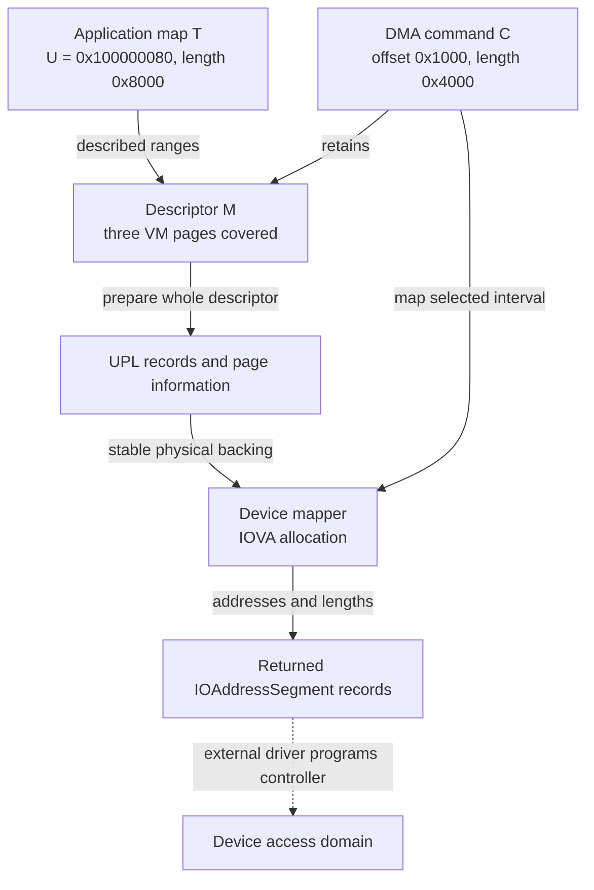
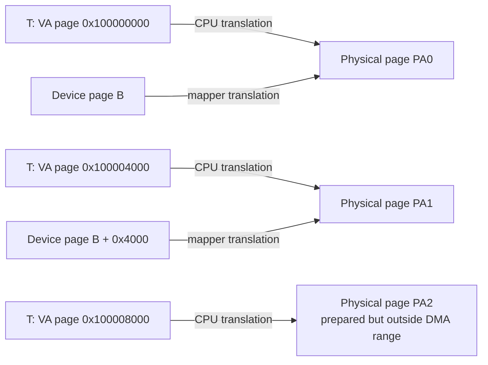
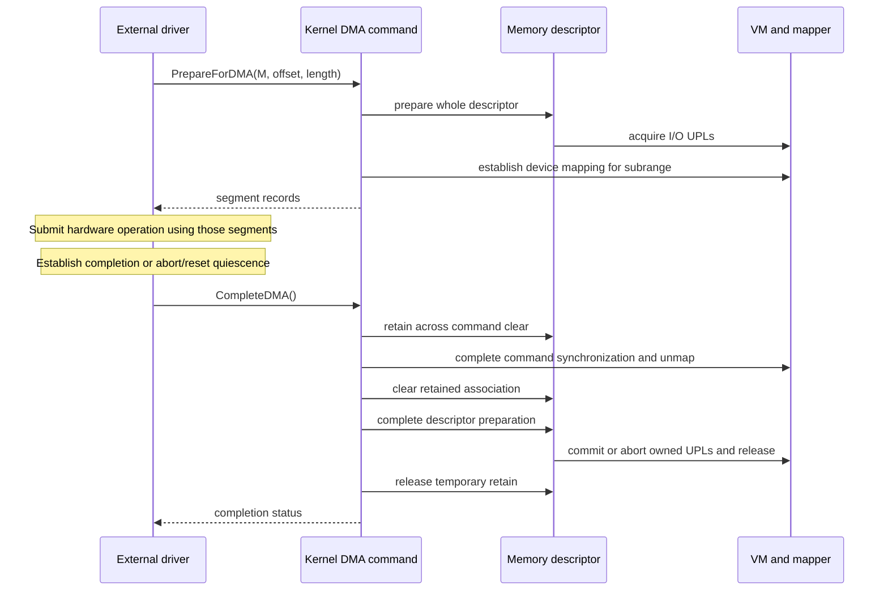

# A user buffer from virtual memory to DMA completion

[Execution paths](execution-paths.md) · [Completion and failure](completion-and-failure.md) · [Driver memory and DMA](../subsystems/drivers/memory-and-dma.md) · [Mapped-file operation](mapped-file-to-arm64-fault.md)

This chapter follows the state carried across a DriverKit memory request, VM I/O wiring, descriptor-to-command association, mapper allocation, segment generation and final release. The in-tree `IOUserServer.cpp` implementations provide a concrete caller of the generic memory and DMA APIs. They stop at returning DMA addresses; a controller's command submission, interrupt interpretation and hardware stop protocol are not implemented by these wrappers.

The numeric example is illustrative, using **16 KiB native ARM64 VM/map pages**, ordinary untagged read/write user memory and a mapper whose **device translation page size is also selected as 16 KiB**. Equal page sizes simplify this one calculation; the generic code explicitly supports different VM and mapper geometry. No concrete device address, mapper backend or completed transfer is claimed to have been observed.

Use [descriptor construction and CPU mappings](../subsystems/drivers/memory-descriptors-and-cpu-mappings.md), [preparation and mapping ownership](../subsystems/drivers/dma-preparation-and-mapping.md) and [segment generation](../subsystems/drivers/dma-segment-walkthrough.md) for the detailed algorithms. This worked operation keeps one interval and its ownership obligations visible across those chapters.

## 1. Select the client address space before interpreting an address

There are at least three participants: the application task owning the buffer, the userspace DriverKit server receiving its request, and the kernel objects backing the server's APIs. The number `0x100000080` is meaningful only with the application task's map. The driver's own virtual address space and the device's DMA address domain need not contain the same address.

`IOUserClient::CreateMemoryDescriptorFromClient_Impl()` requires an `IOUserUserClient` and an existing `me->fTask`. It builds descriptor options, interprets the supplied `IOAddressSegment` array as `IOAddressRange` records, and passes **that task** into `IOMemoryDescriptor::withAddressRanges()`. It does not substitute `current_task()` for the application's address-space identity. [`client-memory wrapper`](../../xnu/iokit/Kernel/IOUserServer.cpp#L842-L889).

[Source: IOUserServer.cpp, lines 874–879](../../xnu/iokit/Kernel/IOUserServer.cpp#L874-L879)

<!-- source-excerpt: ../../xnu/iokit/Kernel/IOUserServer.cpp#L874-L879 -->
```cpp
	static_assert(sizeof(IOAddressRange) == sizeof(IOAddressSegment));
	ranges = __DECONST(IOAddressRange *, &segments[0]);

	iomd = IOMemoryDescriptor::withAddressRanges(
		ranges, segmentsCount,
		mdOptions, me->fTask);
```

With a nonnull task, the constructor selects `kIOMemoryTypeVirtual64`; a null task instead selects physical-address interpretation. The virtual constructor records ranges and their total length, checks arithmetic and allocates bookkeeping. The wrapper does not request `kIOMemoryAutoPrepare`, so successful descriptor creation alone has not acquired the later I/O-wiring interval. [`virtual/physical constructor choice`](../../xnu/iokit/Kernel/IOMemoryDescriptor.cpp#L1815-L1833), [`length and preparation setup`](../../xnu/iokit/Kernel/IOMemoryDescriptor.cpp#L2395-L2468).

The client wrapper adds `kIOMemoryThreadSafe`, direction bits, and by default `kIOMemoryMapCopyOnWrite` unless `kIOMemoryDisableCopyOnWrite` was requested. The latter is a **CPU mapping/memory-reference option**; it is not proof that construction has immediately copied the application buffer or wired it. Its mapping preflight can create a COW named memory reference later. In the selected operation, do not create an intervening CPU `IOMemoryMap`, so the initial preparation follows the source task's map rather than a previously established `_memRef`. [`option construction`](../../xnu/iokit/Kernel/IOUserServer.cpp#L863-L872), [`CPU mapping preflight`](../../xnu/iokit/Kernel/IOMemoryDescriptor.cpp#L5208-L5238), [`prepare map selection`](../../xnu/iokit/Kernel/IOMemoryDescriptor.cpp#L4526-L4553).

The RPC/object-conversion and external-method admission layers are covered by [user clients and DriverKit](../subsystems/drivers/user-clients-and-driverkit.md) and [dispatch/actions](../subsystems/drivers/driverkit-dispatch-and-actions.md). The wrapper's source task selection does not replace the driver-specific policy governing which request may create a descriptor or operate a device. Generated `.iig` dispatch bodies and a particular external driver are not reconstructed here.

## 2. One unaligned descriptor, one smaller DMA interval

Let descriptor `M` cover one application range:

```text
application task             T
descriptor virtual start     U = 0x100000080
descriptor length            L = 0x8000       (32 KiB)
requested DMA offset         d = 0x1000
requested DMA length         n = 0x4000       (16 KiB)
direction                    kIOMemoryDirectionOutIn
```

The descriptor interval is `[U, U + L) = [0x100000080, 0x100008080)`. It crosses three 16 KiB pages:

| VM page in `T` | Useful descriptor bytes | Descriptor offset interval |
| --- | --- | --- |
| `0x100000000` | From byte `0x80` through page end: `0x3f80` bytes | `[0, 0x3f80)` |
| `0x100004000` | Entire `0x4000`-byte page | `[0x3f80, 0x7f80)` |
| `0x100008000` | First `0x80` bytes | `[0x7f80, 0x8000)` |

The DMA request is only `[U + d, U + d + n) = [0x100001080, 0x100005080)`. It uses `0x2f80` bytes from the first page and `0x1080` bytes from the second. The last VM page belongs to the descriptor's prepared backing but is outside this command's requested transfer.

This distinction follows the actual wrapper: it first calls `memory->prepare()` with no offset/length, then calls command `prepare(offset, length)`. Preparation of `M` and preparation of a selected interval in command `C` are not the same operation. [`PrepareForDMA ordering`](../../xnu/iokit/Kernel/IOUserServer.cpp#L1032-L1052).



The dotted edge is a required external integration step, not an in-tree call made by `genIOVMSegments()`. A segment array contains numeric addresses and lengths; it does not retain `M`, `C`, UPLs or mapper allocations.

## 3. Descriptor preparation resolves VM ownership before device use

The DriverKit wrapper serializes its preparation operation with the command's `fDextLock`. The memory descriptor's separate optional `_prepareLock` serializes its own preparation count/state; `kIOMemoryThreadSafe` is relevant to that descriptor-level behavior. Successful first preparation records `_wireCount = 1`; nested successful preparations extend the held interval. Physical, remote and externally supplied-UPL descriptors take other branches. [`wrapper lock`](../../xnu/iokit/Kernel/IOUserServer.cpp#L1032-L1038), [`descriptor preparation`](../../xnu/iokit/Kernel/IOMemoryDescriptor.cpp#L5023-L5071).

For the selected bidirectional descriptor, `wireVirtual()` requests both device read and write access and does **not** set `UPL_COPYOUT_FROM`. It adds `UPL_SET_IO_WIRE | UPL_SET_LITE`, walks all source ranges and obtains UPL/page information through `vm_map_create_upl()` when using the task map. For output-only DMA, `kIODirectionOut` means the device reads host memory: it sets `UPL_COPYOUT_FROM` and read-only DMA preparation. Direction is relative to host memory, not to the name of a CPU copy helper. [`direction and UPL flags`](../../xnu/iokit/Kernel/IOMemoryDescriptor.cpp#L4449-L4487), [`UPL API selection`](../../xnu/iokit/Kernel/IOMemoryDescriptor.cpp#L4638-L4680).

VM's `vm_map_create_upl()` must establish a stable, shareable backing relationship before extracting physical pages. Its range-lock preflight uses `VMRL_SH_RESOLVE_COW_AND_OBJ` and requests preparation for sharing when needed. It then checks the requested UPL read/write permission, may shorten the request to the current range or maximum UPL size, and obtains an explicit object reference before releasing map protection and calling `vm_object_iopl_request()`. [`sharing/COW preflight`](../../xnu/osfmk/vm/vm_pageout.c#L7563-L7626), [`range and permissions`](../../xnu/osfmk/vm/vm_pageout.c#L7628-L7663), [`object handoff`](../../xnu/osfmk/vm/vm_pageout.c#L7776-L7838).

For an output-only request addressing executable memory, [Executable pages and UPL I/O](../subsystems/vm/executable-pages-and-upl-io.md) follows the policy branch that substitutes copied kernel backing. Its numeric example shows why the returned UPL's data offset, rather than the source address's page displacement, controls the later descriptor walk.

This is where the [mapped-file COW example](mapped-file-to-arm64-fault.md) connects to DMA. A source mapping can owe a private copy even though its CPU translation still reads an original page. For a writable I/O UPL, VM must not give the device a shared original page and wait for a future CPU store fault to repair ownership. UPL creation resolves the relevant mapping relationship and faults/holds the selected object's pages before the DMA command receives addresses. The I/O-paging routine derives initial protection from `UPL_COPYOUT_FROM`; its general gather passes `prot | VM_PROT_WRITE` to `vm_fault_page()` to obtain suitable top-object backing even for output. Direction, fault protection and the eventual I/O wire are distinct decisions; see [UPL gathering and completion](../subsystems/vm/upl-gather-and-completion.md). [`IOPL fault permissions`](../../xnu/osfmk/vm/vm_pageout.c#L8702-L8709), [`page fault-in`](../../xnu/osfmk/vm/vm_pageout.c#L9020-L9032), [`I/O wiring`](../../xnu/osfmk/vm/vm_pageout.c#L9221-L9236).

[Source: vm_pageout.c, lines 7824–7838](../../xnu/osfmk/vm/vm_pageout.c#L7824-L7838)

<!-- source-excerpt: ../../xnu/osfmk/vm/vm_pageout.c#L7824-L7838 -->
```c
	vm_object_reference_locked(local_object);
	vm_object_unlock(local_object);

	vm_map_range_sh_unlock(ctx, &original_map);

	ret = vm_object_iopl_request(local_object,
	    ((vm_object_offset_t)
	    ((offset - local_start) + local_offset)),
	    *upl_size,
	    upl,
	    page_list,
	    count,
	    caller_flags,
	    tag);
	vm_object_deallocate(local_object);
```

The descriptor records each UPL in an `ioPLBlock`, including its handle, starting page-information index, descriptor-relative offset and leading-page displacement. In our selected single-UPL case, the first useful byte is `0x80` into the first page. Real requests can require several UPLs if map boundaries or limits split them. If a newly created UPL cannot be recorded, it is aborted/deallocated; the common failure path also releases previously recorded UPLs. [`UPL record fields and partial progress`](../../xnu/iokit/Kernel/IOMemoryDescriptor.cpp#L4718-L4749), [`rollback`](../../xnu/iokit/Kernel/IOMemoryDescriptor.cpp#L4774-L4808).

The wire is a page-lifetime obligation, not exclusive ownership of every byte. This path does not generally set `UPL_BLOCK_ACCESS` to suspend application access. Application/driver synchronization must prevent conflicting use during an operation. VM explicitly treats block-access busy state and removal of CPU mappings as a separate requested behavior. [`block-access branch`](../../xnu/osfmk/vm/vm_pageout.c#L9239-L9248). Conversely, tagged or executable backing can be rejected or redirected through security-related branches; the example does not bypass them. [`MTE admission`](../../xnu/osfmk/vm/vm_pageout.c#L7780-L7788), [`executable-page copy branch`](../../xnu/osfmk/vm/vm_pageout.c#L7665-L7708).

## 4. Command association adds a separate resource interval

`IODMACommand::Create_Impl()` chooses a mapper with `IOMapper::copyMapperForDevice(device)`, configures host-format 64-bit segment output, the requested address width, mapped mode and Dext ownership. Its configured alignments are one byte and the wrapper supplies no explicit segment/transfer maximum beyond the underlying implementation's interpretation of zero. The command's Dext-owner option allocates `fDextLock`. [`command creation`](../../xnu/iokit/Kernel/IOUserServer.cpp#L959-L1003), [`Dext lock creation`](../../xnu/iokit/Kernel/IODMACommand.cpp#L340-L344).

The successful `PrepareForDMA` sequence is literal:

1. Prepare descriptor `M` and its backing.
2. `setMemoryDescriptor(M, false)` retains `M` and obtains its characteristics.
3. Command `prepare(d, n)` establishes the command's active/prepared range, optional copy resources and mapper allocation.
4. Generate segments using a relative cursor initially zero.
5. Return direction flags and emitted segment count, retaining preparation for subsequent device use.

These operations are visible together in [`IOUserServer.cpp:1035–1075`](../../xnu/iokit/Kernel/IOUserServer.cpp#L1035-L1075). `fActive` is not `_wireCount`, and `fPrepared` is not simply an alias of either counter. In particular, command preparation increments activity before certain errors, whereas descriptor preparation increments its count only after successful wiring. See [failure cleanup](../subsystems/drivers/dma-preparation-and-mapping.md#4-attaching-a-descriptor-to-a-reusable-command).

In this example, `M` is prepared for `L = 0x8000`, while `C` records `fPreparedOffset = 0x1000` and `fPreparedLength = 0x4000`. The command retains `M`; mapper mapping records contribute `_dmaReferences` on `M`. Without a mapper, association records DMA-active usage through a separate operation instead. None of these references is a proof that the external device has finished using memory. [`descriptor association`](../../xnu/iokit/Kernel/IODMACommand.cpp#L397-L448), [`prepared fields`](../../xnu/iokit/Kernel/IODMACommand.cpp#L855-L881), [`DMA-reference accounting`](../../xnu/iokit/Kernel/IOMemoryDescriptor.cpp#L4865-L4891).

## 5. From three VM pages to addresses in a device domain

Suppose I/O preparation resolves the three VM pages to physical bases `PA0`, `PA1` and `PA2`. Their physical adjacency is unspecified. The DMA command asks the descriptor's `kIOMDDMAMap` operation to map `(offset=0x1000, length=0x4000)`, carrying alignment and address-width requirements. Because this is a subrange, the descriptor's full-range/system-mapper cache condition is false. This chosen request therefore does not transfer allocation ownership into that full-range cache. [`command map request`](../../xnu/iokit/Kernel/IODMACommand.cpp#L909-L926), [`cache admission`](../../xnu/iokit/Kernel/IOMemoryDescriptor.cpp#L3284-L3307).

The general descriptor uses its base `dmaMap()` for subranges. That routine calls `mapper->iovmMapMemory()` with the descriptor and requested interval, passes the map specification and command, and records successful DMA use. The optimized full-descriptor branch instead builds an `IODMAMapPageList` from prepared page information, including leading offset, page count and access flags. These are alternatives; the example's subrange does not literally take the full-descriptor page-list call. [`subrange dispatch`](../../xnu/iokit/Kernel/IOMemoryDescriptor.cpp#L4961-L4964), [`base map call`](../../xnu/iokit/Kernel/IOMemoryDescriptor.cpp#L4835-L4861), [`full-range page list`](../../xnu/iokit/Kernel/IOMemoryDescriptor.cpp#L4964-L5006).

Assume the selected mapper supplies two adjacent 16 KiB device pages starting at illustrative IOVA `B = 0x60000000`, mapping the portions needed from `PA0` and `PA1`. Then:

| Representation | First transferred byte | Second VM-page boundary | Last transferred byte |
| --- | --- | --- | --- |
| Descriptor coordinate | `0x1000` | `0x3f80` | `0x4fff` |
| Application VA in `T` | `0x100001080` | `0x100004000` | `0x10000507f` |
| Physical coordinate | `PA0 + 0x1080` | `PA1` | `PA1 + 0x107f` |
| Selected device IOVA | `B + 0x1080` | `B + 0x4000` | `B + 0x507f` |

The requested interval can appear as one continuous device segment `(B + 0x1080, 0x4000)` even when `PA0` and `PA1` are physically discontiguous. This is conditional arithmetic for a mapper supplying that layout, not a promise of every `IOMapper`. It demonstrates why the returned segment must not be cast to a CPU pointer or treated as a task VA. Mapper allocation padding and differing page geometry can require a command-side segment table rather than one linear run. [`padding/segment-table construction`](../../xnu/iokit/Kernel/IODMACommand.cpp#L928-L1032).



CPU pmap and device translation are distinct mappings of prepared backing. The diagram shows chosen translations, not a guarantee that CPU PTEs remain present throughout every wired interval. A mapper-less branch, constrained-address copy path or another mapper granule changes the device-address construction; use the [segment walkthrough](../subsystems/drivers/dma-segment-walkthrough.md) for those variants.

## 6. `genIOVMSegments` advances a prepared-range cursor

The name in this implementation is `genIOVMSegments()`. The wrapper calls it with `genOffset = 0`, because the iterator's public offset is relative to the command's prepared interval. Internally it adds `fPreparedOffset`, giving descriptor offset `0x1000` for the first output. It may use the local mapper allocation, a mapping segment table, copy storage or the descriptor's prepared segment walker. [`relative-to-descriptor conversion`](../../xnu/iokit/Kernel/IODMACommand.cpp#L1288-L1324), [`mapped and descriptor segment sources`](../../xnu/iokit/Kernel/IODMACommand.cpp#L1340-L1465).

On success the iterator publishes the updated relative cursor and count:

[Source: IODMACommand.cpp, lines 1626–1631](../../xnu/iokit/Kernel/IODMACommand.cpp#L1626-L1631)

<!-- source-excerpt: ../../xnu/iokit/Kernel/IODMACommand.cpp#L1626-L1631 -->
```cpp
	if (kIOReturnSuccess == ret) {
		state->fOffset = offset;
		*offsetP       = offset - internalState->fPreparedOffset;
		*numSegmentsP  = segIndex;
	}
	return ret;
```

For the single-segment illustrative mapping above, full enumeration would advance the relative cursor from `0` to `0x4000`. A general kernel caller can repeatedly call the iterator with a small output array and the returned cursor. The DriverKit wrapper shown here calls it once, returns count and flags, and **does not check that its local `genOffset` reached the prepared length**. That wrapper also does not return `genOffset` as an API output. A successful return therefore cannot be interpreted from this local body alone as proof that an insufficient-capacity array describes all requested bytes. [`wrapper generation and publication`](../../xnu/iokit/Kernel/IOUserServer.cpp#L1054-L1075), [bounded enumeration example](../subsystems/drivers/dma-segment-walkthrough.md).

The declaration's array capacity is 32 segment records. This is an interface declaration, not evidence that every physical/mapper layout can be represented completely in that number. A useful caller-level consistency condition is that the sum of the returned segment lengths covers the intended interval before programming a transfer; the actual external driver's enforcement must be inspected separately. [`DriverKit declaration`](../../xnu/iokit/DriverKit/IODMACommand.iig#L119-L142).

## 7. Hardware completion is an external prerequisite to memory release

The returned segment array makes it possible for a driver to program hardware, but neither `PrepareForDMA_Impl()` nor `genIOVMSegments()` submits a device command. The successful ownership protocol is:



The notes are explicit external obligations. An interrupt merely entering an IOKit event source, a workloop callback being queued, or a timeout firing does not by itself prove that the device can no longer read/write the IOVAs. The controller's status/ordering/reset protocol must establish that fact before the generic release shown here. These generic methods have no controller-specific stop operation. [`PrepareForDMA body`](../../xnu/iokit/Kernel/IOUserServer.cpp#L1009-L1080), [`CompleteDMA body`](../../xnu/iokit/Kernel/IOUserServer.cpp#L1084-L1120), [interrupt/workloop boundaries](../subsystems/drivers/interrupt-routing-and-command-queues.md).

`CompleteDMA_Impl()` holds the Dext lock and requires `fPrepared`. It temporarily retains the descriptor before clearing the command, because command clearing releases `fMemory`. It then completes the descriptor and releases that temporary hold:

[Source: IOUserServer.cpp, lines 1103–1116](../../xnu/iokit/Kernel/IOUserServer.cpp#L1103-L1116)

<!-- source-excerpt: ../../xnu/iokit/Kernel/IOUserServer.cpp#L1103-L1116 -->
```cpp
	md = __DECONST(IOMemoryDescriptor *, fMemory);
	if (md) {
		md->retain();
	}

	ret = clearMemoryDescriptor(true);

	if (md) {
		completeRet = md->complete();
		OSSafeReleaseNULL(md);
		if (kIOReturnSuccess == ret) {
			ret = completeRet;
		}
	}
```

Command clearing drains command activity through `complete()`. At final activity, common completion performs applicable noncoherent maintenance, optional copy-back/resource release, mapper unmap and segment-table cleanup, then clears `fPrepared`. The selected mapped DriverKit example does not imply that every noncoherent/bounce branch ran; those are conditional paths in the common command class. [`clear semantics`](../../xnu/iokit/Kernel/IODMACommand.cpp#L455-L472), [`command completion`](../../xnu/iokit/Kernel/IODMACommand.cpp#L1057-L1117).

Descriptor completion is later. On final `_wireCount`, outstanding `_dmaReferences` cause a **panic**, not a recoverable refusal to complete. The successful path releases any descriptor-owned cached mapping, commits or aborts the UPLs it created according to its completion-error state, deallocates them and resets temporary preparation metadata. An external-UPL descriptor has a different ownership rule. In the example's successful bidirectional interval, normal completion commits the owned virtual-memory UPLs; no independent device error code is passed as an argument to `CompleteDMA()` here. [`final descriptor invariant and cleanup`](../../xnu/iokit/Kernel/IOMemoryDescriptor.cpp#L5083-L5185).

A full-range request through the system mapper can leave mapping allocation ownership with the descriptor until its final completion. Then command `dmaUnmap()` can decrement `_dmaReferences` even when its allocation length is zero. Our subrange deliberately avoids that cache case, but the distinction is necessary when comparing traces with the same class names. [`cache ownership transfer`](../../xnu/iokit/Kernel/IOMemoryDescriptor.cpp#L3284-L3307), [`unmap reference-before-length ordering`](../../xnu/iokit/Kernel/IOMemoryDescriptor.cpp#L4907-L4923).

## 8. Keep a resource ledger at each return

| Stage in the selected successful trace | Descriptor `M` | Command `C` | What the external caller may infer |
| --- | --- | --- | --- |
| Construction | Owns range description; no successful local preparation yet | Created with mapper/specification | Object exists, not that all pages are ready |
| `M.prepare()` succeeds | `_wireCount = 1`; UPLs hold all three covered pages | No completed command preparation yet | Backing has an I/O preparation hold |
| Association succeeds | Retained by `C` | `fMemory = M` | Descriptor storage remains available |
| `C.prepare(d,n)` succeeds | Active DMA accounting for mapped use | Active/prepared subrange and local mapping state | Device addresses can be enumerated |
| Segment generation succeeds | Holds unchanged | Prepared state remains active | Returned records are valid within this preparation; inspect represented length |
| External device quiesces | Still prepared | Still prepared | Generic cleanup is now permissible |
| Command clear | DMA-use accounting released | Activity drained, mapping resources handled, `fMemory` released | Numeric segments no longer carry a usable lifetime guarantee |
| Final `M.complete()` | UPL/preparation state released | No retained association | The application/driver ownership protocol can finish |

This is a selected one-preparation ledger. Nested preparation, multiple commands, cached mappings, physical/UPL descriptors and concurrent client teardown require their corresponding additional holds. A CPU `IOMemoryMap` is also a separate object with a separate unmap lifecycle; removing it neither drains DMA activity nor releases a command's preparation. [`CPU map teardown`](../../xnu/iokit/Kernel/IOMemoryDescriptor.cpp#L5800-L5891).

Failure paths demonstrate why the ledger is necessary:

- **Descriptor preparation fails:** `wireVirtual()` rolls back created UPLs and the outer prepare does not increment `_wireCount`. The DriverKit wrapper exits before association.
- **Association fails:** the wrapper completes the descriptor preparation it just obtained.
- **Command preparation fails:** the wrapper attempts `clearMemoryDescriptor(false)` and then descriptor completion. The low-level command can already have incremented `fActive`; clearing with `false` returns `NotReady` when active, and the wrapper does not inspect that clear result. This is not evidence of complete rollback.
- **Segment generation fails:** the wrapper calls `clearMemoryDescriptor(true)` before descriptor completion, so this branch explicitly requests activity draining.
- **Completion status is narrower than all cleanup results:** the generic `clearMemoryDescriptor(true)` loop discards each `complete()` return value and itself returns success. Thus the wrapper's final return normally reflects descriptor completion, not every command-completion or mapper error. Its conditional status selection does not recover those discarded failures. Resources may already have changed before a reported error.

The exact branches are in [`wrapper errors`](../../xnu/iokit/Kernel/IOUserServer.cpp#L1035-L1064), [`command activity increment`](../../xnu/iokit/Kernel/IODMACommand.cpp#L847-L881), [`clear refusal`](../../xnu/iokit/Kernel/IODMACommand.cpp#L455-L459), and [`completion return selection`](../../xnu/iokit/Kernel/IOUserServer.cpp#L1108-L1116). The deeper preparation chapter documents the partial-progress cases without prescribing recovery that an absent external driver might not implement.

## 9. What this operation establishes

The concrete in-tree chain proves the transitions from a client-task address range to a virtual descriptor, from descriptor preparation to VM I/O UPLs, from the retained descriptor to command/mapper state, and from segment generation to completion cleanup. It explains why **user VA, descriptor offset, physical page, mapper allocation and returned device address** must be tracked separately.

The external driver still determines request admission, application-buffer ownership, the hardware descriptor format, device ordering, cancellation/reset, and the proof of quiescence. The concrete `IOMapper` backend determines actual device page-table publication and invalidation. No external controller implementation, generated DriverKit dispatch body, hardware DMA test or IOMMU experiment was inspected as part of this worked trace.

For a release update, recheck the wrappers and their error ordering together with descriptor preparation, VM UPL preflight, command activity, map ownership and final completion. A stable method name does not establish a stable ownership contract across these boundaries.

<!-- BEGIN PLATYDOC DOCUMENTATION LICENSE -->
Original Platydoc text and diagrams are licensed under [CC BY 4.0](https://creativecommons.org/licenses/by/4.0/). Quoted source code and third-party material retain their respective licenses.
<!-- END PLATYDOC DOCUMENTATION LICENSE -->
