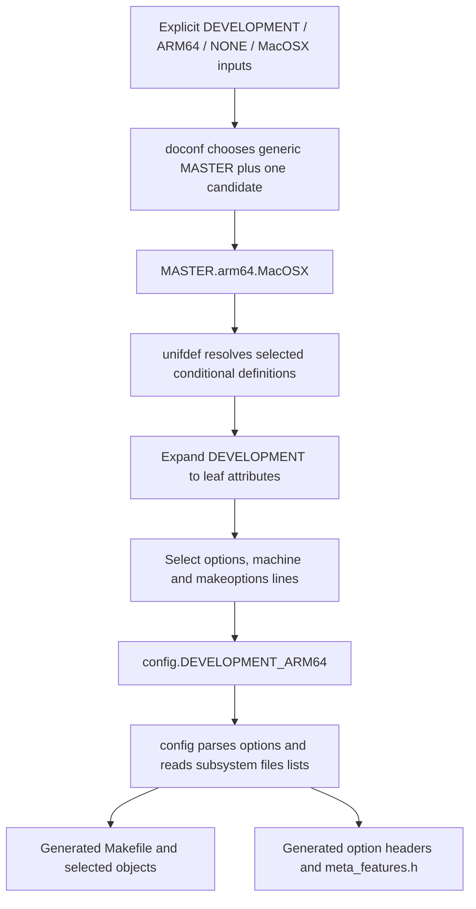
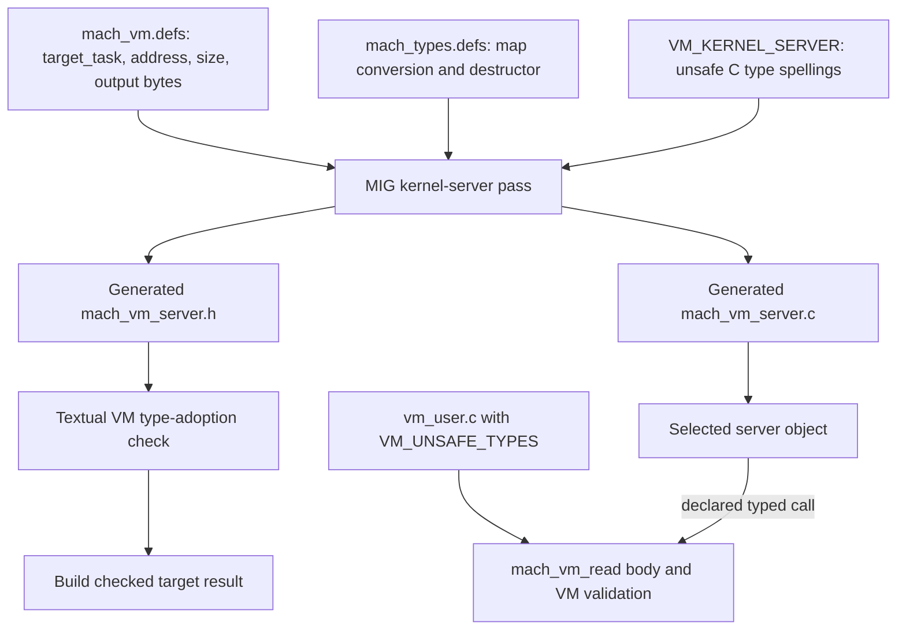
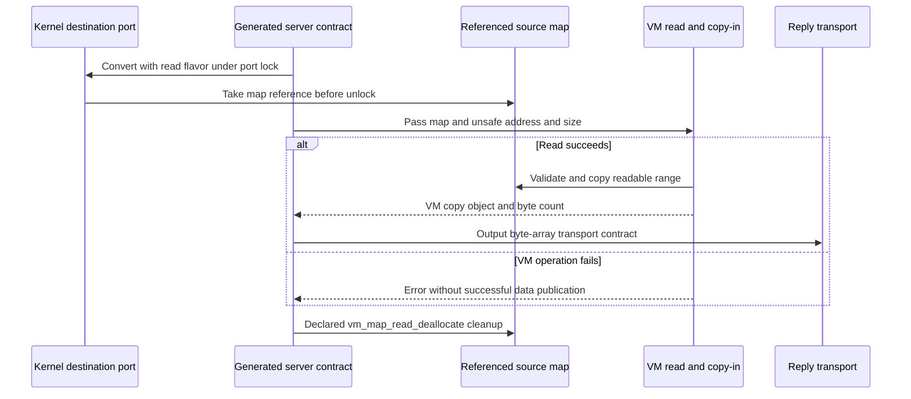

# An ARM64 configuration and MIG contract walkthrough

The same XNU source file can be selected, excluded, or compiled with different declarations depending on configuration. This chapter works through one explicitly chosen ARM64 configuration and then follows `mach_vm_read` from its MIG declaration to capability conversion, VM validation, and cleanup in `xnu-12377.121.6`.

Read [build selection and tests](build-and-tests.md) first. Related explanations are [Mach message declarations](../interfaces/mach-messages/README.md), [kernel RPC and MIG](../subsystems/ipc/kernel-rpc-and-exceptions.md), [VM argument validation](../subsystems/vm/api-argument-validation.md), and [work-interval policy](../subsystems/runtime/work-interval-policy-and-thread-groups.md). The example below is a derivation from checked-in build rules. It is not an invocation, a supported-device claim, or a captured product build.

## 1. Fix the inputs before interpreting a guard

Use these illustrative resolved inputs:

| Input | Selected value and meaning |
| --- | --- |
| Kernel configuration | `DEVELOPMENT` |
| Architecture configuration | `ARM64`; the `doconf` CPU argument is lowercase `arm64` |
| Machine configuration | Explicit `NONE`; the `doconf` SoC argument is lowercase `none`, rather than requesting the build's `DEFAULT` expansion |
| Configuration platform | `PLATFORM_FOR_CONFIG=MacOSX` |
| Optional `doconf` switches | No `-sptm`, `-exclaves`, or `-tag` |
| Input/output locations | `SRCROOT` is the selected XNU source; configuration/template inputs come from that tree; all hypothetical object/generated output is outside it |

[`MakeInc.top`](../../platydoc-data/xnu/makedefs/MakeInc.top#L104-L122) accepts `TARGET_CONFIGS` as triples of kernel, architecture, and machine configuration. It uppercases them, then uses [the expansion functions](../../platydoc-data/xnu/makedefs/MakeInc.cmd#L393-L444) to produce caret-separated build configurations. For the explicit triple `DEVELOPMENT ARM64 NONE`, the logical tuple is `DEVELOPMENT^ARM64^NONE`; none of these fields requests `DEFAULT` substitution. This says how the selector is represented, not that all later SDK and linker requirements for that tuple are satisfied.

The platform is another input. [`MakeInc.cmd`](../../platydoc-data/xnu/makedefs/MakeInc.cmd#L146-L163) usually derives it from the SDK and defaults `PLATFORM_FOR_CONFIG` to `PLATFORM`, but allows configuration-platform differences for unit tests. The ARM64 source selector is also distinct from the compiler architecture string: [the device-map lookup/fallback](../../platydoc-data/xnu/makedefs/MakeInc.def#L345-L381) can choose `arm64e` for `-arch` even while configuration files use `arm64`. Do not infer the compiler ABI solely from the MASTER filename.

[`osfmk/conf/Makefile`](../../platydoc-data/xnu/osfmk/conf/Makefile#L9-L26) passes the resolved values to `doconf`, including `-c`, source/template directory, output directory, and master directory. With the selected inputs its significant arguments are:

```text
Illustrative arguments, not an executed command:
-c -cpu arm64 -soc none -platform MacOSX
-d <external object directory>/DEVELOPMENT
-s <SRCROOT>/osfmk/conf -m <SRCROOT>/config
DEVELOPMENT
```

No command in this chapter runs that configuration machinery. In particular, the source checkout is not an output directory.

## 2. `doconf` selects one architecture master, then expands attributes

The script does not concatenate every architecture and platform overlay. It always reads the generic `MASTER`, then chooses the first existing candidate from an ordered list. See [`doconf:189–194`](../../platydoc-data/xnu/SETUP/config/doconf#L189-L194):

<!-- source-excerpt: ../../platydoc-data/xnu/SETUP/config/doconf#L189-L194 -->
```sh
foreach master_file (${MASTER}.${cpu}.${SOC_CONFIG}.${PLATFORM} ${MASTER}.${cpu}.${SOC_CONFIG} ${MASTER}.${cpu}.${PLATFORM} ${MASTER}.${cpu})
    if (-f $master_file) then
        set MASTER_CPU = $master_file
        break
    endif
end
```

For this checkout and selected `arm64/none/MacOSX`, the first two candidate files are absent; `config/MASTER.arm64.MacOSX` is selected before `config/MASTER.arm64`. Consequently this example combines generic [`MASTER`](../../platydoc-data/xnu/config/MASTER) with the [MacOSX architecture master](../../platydoc-data/xnu/config/MASTER.arm64.MacOSX), not with both architecture masters.

The [preprocessing pipeline](../../platydoc-data/xnu/SETUP/config/doconf#L200-L281) reads the files twice around a `+DEVELOPMENT` selector. `unifdef -t` handles platform/CPU/SoC/system definitions and optional master switches; `sed` and `awk` then expand named attribute groups and select configuration lines. Comma-separated selectors are alternatives; a negated selector matches when none of its attributes is selected. These are the rules documented in [`MASTER`](../../platydoc-data/xnu/config/MASTER#L21-L40), implemented by the script's selector loop.

For example, the MacOSX definition of `DEVELOPMENT` includes `KERNEL_DEV` and `SCHED_DEV`. `KERNEL_DEV` includes `development`, `mach_assert`, and `config_xnupost`. `SCHED_DEV` includes `SCHED_BASE`, whose members include `config_clutch`, `config_sched_auto_join`, and `config_preadopt_tg`. See [kernel attributes](../../platydoc-data/xnu/config/MASTER.arm64.MacOSX#L24-L27), [scheduler attributes](../../platydoc-data/xnu/config/MASTER.arm64.MacOSX#L80-L83), and [the configuration root](../../platydoc-data/xnu/config/MASTER.arm64.MacOSX#L103-L108).



Selected consequences are small enough to derive individually:

| Attribute or condition | Selected configuration consequence | Evidence |
| --- | --- | --- |
| `development` | `options DEVELOPMENT` | [Generic definition](../../platydoc-data/xnu/config/MASTER#L642-L649) |
| `mach_assert` | `options MACH_ASSERT` before the configurator moves this option to a header | [Generic definition](../../platydoc-data/xnu/config/MASTER#L594-L598) |
| `config_xnupost` | `options CONFIG_XNUPOST` and eligible POST source entries | [Option](../../platydoc-data/xnu/config/MASTER#L709-L709), [files](../../platydoc-data/xnu/osfmk/conf/files#L249-L258) |
| `config_clutch` | `options CONFIG_CLUTCH` and eligible `sched_clutch.c` | [Option](../../platydoc-data/xnu/config/MASTER#L677-L680), [file](../../platydoc-data/xnu/osfmk/conf/files#L180-L180) |
| `config_sched_auto_join` | `options CONFIG_SCHED_AUTO_JOIN`; guarded auto-join code in the standard work-interval translation unit is selected | [Option](../../platydoc-data/xnu/config/MASTER#L679-L679), [file](../../platydoc-data/xnu/osfmk/conf/files#L214-L214), [guarded code](../../platydoc-data/xnu/osfmk/kern/work_interval.c#L397-L413) |
| No SPTM/Exclaves switches | The selected architecture master's `ARM_EXTRAS_BASE` takes its `config_pmap_ppl` branch | [Conditional attributes](../../platydoc-data/xnu/config/MASTER.arm64.MacOSX#L17-L24), [switch defaults](../../platydoc-data/xnu/SETUP/config/doconf#L76-L80) |

For a mobile counterpart, keep `DEVELOPMENT/ARM64/NONE` and the absent optional switches, but set `PLATFORM_FOR_CONFIG=iPhoneOS`. The first two candidates are again absent, while **`MASTER.arm64.iPhoneOS` exists** and wins before the generic ARM64 fallback. Its [`SCHED_DEV`](../../platydoc-data/xnu/config/MASTER.arm64.iPhoneOS#L80-L83) expands to a `SCHED_BASE` containing neither `config_sched_auto_join` nor `config_sched_rt_allow`. The same `doconf` and configurator mechanisms apply; this remains a source-derived configuration example, not a claim about a shipping iPhone or a valid machine-library selection.

The separate generic [`MASTER.arm64` scheduler groups](../../platydoc-data/xnu/config/MASTER.arm64#L65-L68) include `config_sched_rt_allow` in development/debug but omit auto join. They apply only if no earlier candidate wins. Thus the selected MacOSX example includes auto join, the selected iPhoneOS example includes neither of these two options, and the generic fallback has its own development RT-admission selection. A source-level `#if CONFIG_SCHED_AUTO_JOIN` cannot by itself establish behavior for “all ARM64.”

The script appends `builddir`, `objectdir`, and `sourcedir`, rotates the previous configuration file, then invokes the built `config` tool when `-c` was supplied. See [output handling](../../platydoc-data/xnu/SETUP/config/doconf#L305-L325). Its historical comments mentioning additional local masters should not replace the current candidate-selection body as evidence for what gets read.

## 3. Source selection and header generation take different routes

The `config` program parses the selected configuration, then runs `mkioconf()`, `makefile()`, and `headers()`. Its [main path](../../platydoc-data/xnu/SETUP/config/main.c#L125-L140) is local source; the executable is a build artifact. [`read_files()`](../../platydoc-data/xnu/SETUP/config/mkmakefile.c#L298-L321) reads `osfmk/conf/files` followed by `files.arm64`, based on the parsed machine name.

`standard` entries enter the source list directly. `optional` entries test their dependencies against configured devices/options; an unsatisfied entry is marked `INVISIBLE`. The generator skips invisible entries when producing object lists. `Makefile.template` placeholders such as `%OBJS`, `%CFILES`, and `%MACHDEP` are replaced with selected lists and the architecture make fragment. See [entry parsing](../../platydoc-data/xnu/SETUP/config/mkmakefile.c#L336-L371), [dependency matching](../../platydoc-data/xnu/SETUP/config/mkmakefile.c#L431-L514), [template replacement](../../platydoc-data/xnu/SETUP/config/mkmakefile.c#L244-L261), and [object filtering](../../platydoc-data/xnu/SETUP/config/mkmakefile.c#L663-L676).

| Selected entry | What follows from the checked-in rules |
| --- | --- |
| `osfmk/vm/vm_user.c standard` | The VM API implementation translation unit is selected independently of a VM-specific optional dependency |
| `./mach/mach_vm_server.c standard` | A generated server translation unit is selected; its absence as a checked-in C file does not mean the VM RPCs are absent |
| `osfmk/kern/sched_clutch.c optional config_clutch` | The chosen scheduler attribute satisfies this source dependency |
| `osfmk/tests/kernel_tests.c optional config_xnupost` | This selected development configuration includes the POST driver; a release selection must be derived separately |
| `OPTIONS/mach_assert optional mach_assert` | An instruction to make a configuration header, not a C file to compile |

The first four entries are in [`osfmk/conf/files`](../../platydoc-data/xnu/osfmk/conf/files#L180-L180), [the generated-source list](../../platydoc-data/xnu/osfmk/conf/files#L240-L249), and [the VM list](../../platydoc-data/xnu/osfmk/conf/files#L320-L322). The header instruction is [line 33](../../platydoc-data/xnu/osfmk/conf/files#L30-L43).

`OPTIONS/` handling deserves separate attention. It creates an internal pseudo-device with value zero, searches the option list for the corresponding uppercase name, changes the value to one when present, and removes that option from the ordinary list. The resulting file entry stays invisible to compilation. See [the conversion](../../platydoc-data/xnu/SETUP/config/mkmakefile.c#L438-L479) and [invisible output classification](../../platydoc-data/xnu/SETUP/config/mkmakefile.c#L614-L626).

Thus the selected `MACH_ASSERT` becomes a generated `mach_assert.h` definition of one and an include in `meta_features.h`. An absent corresponding option would produce zero. The [header writer](../../platydoc-data/xnu/SETUP/config/mkheaders.c#L87-L104) recognizes the internal pseudo-device and [writes the macro/include](../../platydoc-data/xnu/SETUP/config/mkheaders.c#L129-L149). Its [macro construction](../../platydoc-data/xnu/SETUP/config/mkheaders.c#L223-L238) and internal-device handling omit the normal device-count `N` prefix.

Other selected options remain in the list and become compiler definitions. This is the relevant emission in [`mkmakefile.c:201–208`](../../platydoc-data/xnu/SETUP/config/mkmakefile.c#L201-L208):

<!-- source-excerpt: ../../platydoc-data/xnu/SETUP/config/mkmakefile.c#L201-L208 -->
```c
	for (op = opt; op; op = op->op_next) {
		if (op->op_value) {
			fprintf(ofp, " -D%s=\"%s\"", op->op_name, op->op_value);
		} else {
			fprintf(ofp, " -D%s", op->op_name);
		}
	}
	fprintf(ofp, "\n");
```

For this example, `CONFIG_SCHED_AUTO_JOIN` follows that ordinary `CONFIG_DEFINES` path; it has no matching `OPTIONS/` entry in the selected osfmk lists. [`MakeInc.def`](../../platydoc-data/xnu/makedefs/MakeInc.def#L151-L160) incorporates `CONFIG_DEFINES` into `DEFINES`, while the [osfmk template](../../platydoc-data/xnu/osfmk/conf/Makefile.template#L19-L20) forces `meta_features.h` into C/assembly compilation. A generated header and a `-D` option can therefore enable neighboring guards through different mechanisms.

These are predicted selected definitions, not byte-for-byte copies of generated files. Source selection also does not eliminate the need to read guards inside a selected translation unit or the compiler's actual target flags.

## 4. The selected VM server is generated from a declaration

`mach_vm_server.c` and `mach_vm_server.h` are listed in [`MIG_KSSRC` and `MIG_KSHDRS`](../../platydoc-data/xnu/osfmk/mach/Makefile#L373-L416). The server rule runs MIG on the matching `.defs`, discards the user-side outputs, and requests those two server outputs. See [`mach/Makefile:450–458`](../../platydoc-data/xnu/osfmk/mach/Makefile#L450-L458):

<!-- source-excerpt: ../../platydoc-data/xnu/osfmk/mach/Makefile#L450-L458 -->
```make
${MIG_KSSRC}: \
	%_server.c : %.defs
	@$(LOG_MIG) $@
	$(_v)${MIG} ${MIGFLAGS} ${MIGKSFLAGS}        \
		-user    /dev/null              \
		-header  /dev/null              \
		-server  $*_server.c		\
		-sheader $*_server.h		\
		$<
```

The common [`MIGFLAGS`](../../platydoc-data/xnu/makedefs/MakeInc.def#L1240-L1251) include normal definitions, include paths, architecture flags and deployment flags; `MIGKSFLAGS` adds `MACH_KERNEL_PRIVATE`, `KERNEL_SERVER=1`, and `-mach_msg2`. The [tool resolver](../../platydoc-data/xnu/makedefs/MakeInc.cmd#L233-L240) gets `mig` and `migcom` through the selected SDK's `xcrun`. Their generated output and compiler implementation are not supplied by a same-name C service body in the checkout.

The rule for installed/exported headers is [separate from internal server generation](../../platydoc-data/xnu/osfmk/mach/Makefile#L301-L320). The Makefile explicitly notes that generated headers with the same name can differ between export/install and internal use. Do not substitute a public SDK header for the internally generated server header when checking its conversion or C types. See [the build comment](../../platydoc-data/xnu/osfmk/mach/Makefile#L418-L425).

`mach_vm.defs` defines subsystem base 4800, selects `KernelServer`, and sets `VM_KERNEL_SERVER` for this kernel-server pass. Its prefix macros distinguish the user library's `_kernelrpc_` name from the kernel service name. For this pass, `KERNEL` is set by the common definitions and `_MACH_VM_PUBLISH_AS_LOCAL_` is not selected. See [the preamble](../../platydoc-data/xnu/osfmk/mach/mach_vm.defs#L64-L94).

The selected operation is [`mach_vm_read`](../../platydoc-data/xnu/osfmk/mach/mach_vm.defs#L216-L224):

<!-- source-excerpt: ../../platydoc-data/xnu/osfmk/mach/mach_vm.defs#L216-L224 -->
```c
#if !defined(_MACH_VM_PUBLISH_AS_LOCAL_)
routine PREFIX(mach_vm_read) (
#else
routine PREFIX(vm_read) (
#endif
		target_task	: vm_map_read_t;
		address		: mach_vm_address_t;
		size		: mach_vm_size_t;
	out	data		: pointer_t);
```

It occupies slot 4804 after allocate, deallocate, protect and inherit; [the catalog entry](../interfaces/mach-messages/mach_vm.md#4804-mach_vm_read) records profile-dependent naming. The first argument's name `target_task` is descriptive. Its type `vm_map_read_t` determines a narrower map-conversion contract than a task-control-only API.

## 5. MIG types express capability and untrusted-data contracts

The port converter and destructor are declared together in [`mach_types.defs`](../../platydoc-data/xnu/osfmk/mach/mach_types.defs#L248-L253):

<!-- source-excerpt: ../../platydoc-data/xnu/osfmk/mach/mach_types.defs#L248-L253 -->
```c
type vm_map_read_t = mach_port_t
#if	KERNEL_SERVER
		intran: vm_map_read_t convert_port_to_map_read(mach_port_t)
		destructor: vm_map_read_deallocate(vm_map_read_t)
#endif	/* KERNEL_SERVER */
		;
```

The declaration directs generated kernel-server code to translate a Mach port into a read-map reference, then apply `vm_map_read_deallocate` to that converted value under the generated cleanup contract. This is evidence for the required conversion/destruction pairing. It does not reveal the exact generated validation branches, C structure padding, or order of every stub error label; those require the actual MIG version and generated artifacts.

The address and size have another transformation. In [`machine_types.defs`](../../platydoc-data/xnu/osfmk/mach/machine/machine_types.defs#L46-L54), `VM_KERNEL_SERVER` changes the C type spelling used by MIG:

<!-- source-excerpt: ../../platydoc-data/xnu/osfmk/mach/machine/machine_types.defs#L46-L54 -->
```c
#if VM_KERNEL_SERVER
#define VM_ADD_CTYPE(type) ctype: type
#define VM_TYPE_SAFE_UNSAFE(_safe_type, _unsafe_type) ctype: _unsafe_type
#else /* VM_KERNEL_SERVER */
#define VM_ADD_CTYPE(type)
#define VM_TYPE_SAFE_UNSAFE(_safe_type, _unsafe_type) ctype: _safe_type
#endif /* VM_KERNEL_SERVER */

#define VM_UNSAFE_TYPE(_unsafe_type) VM_ADD_CTYPE(_unsafe_type)
```

[`mach_vm_address_t` and `mach_vm_size_t`](../../platydoc-data/xnu/osfmk/mach/machine/machine_types.defs#L110-L117) still describe 64-bit integer values, but the server C types become `mach_vm_address_ut` and `mach_vm_size_ut`. The output [`pointer_t`](../../platydoc-data/xnu/osfmk/mach/std_types.defs#L98-L99) is an out-of-line byte array whose C type becomes `pointer_ut`; the service additionally receives the array count output. These type mappings change the C contract without inventing a new user-visible wire integer width.

A second layer acts when compiling VM implementation C files. The [osfmk template](../../platydoc-data/xnu/osfmk/conf/Makefile.template#L131-L142) applies `VM_UNSAFE_TYPES` to object names derived from `osfmk/vm/*.c`. [`vm_types_unsafe.h`](../../platydoc-data/xnu/osfmk/mach/vm_types_unsafe.h#L52-L78) then uses transparent-union wrappers for C, with size/alignment assertions for the relevant representations. Without that selection, [the aliases reduce to the ordinary types](../../platydoc-data/xnu/osfmk/mach/vm_types_unsafe.h#L139-L162). The MIG C-type mapping and VM translation-unit wrapper selection are distinct build decisions.



The diagram shows dependencies and contracts, not the contents of a generated stub. The runtime [kobject registry](../../platydoc-data/xnu/osfmk/kern/ipc_kobject.c#L171-L198) includes `mach_vm_subsystem`; startup uses generated descriptors, and the [dispatcher calls the selected stub](../../platydoc-data/xnu/osfmk/kern/ipc_kobject.c#L560-L582) after applicable policy filtering. The registry entry, declaration, generated routine, and service body are four different pieces of evidence.

## 6. The build-time adoption check has a precise limit

The [`checked` target](../../platydoc-data/xnu/osfmk/mach/Makefile#L460-L465) depends on all listed kernel-server C outputs and invokes `tools/vm_sanitize_enforcement.py` before touching its stamp. Despite receiving `.c` filenames, the script replaces the final character with `h` and scans the paired headers. It uses a list of ordinary VM type spellings, an exact-filename ignore list for non-VM interfaces, and a special exemption for one generated reserved field. See [type list and exceptions](../../platydoc-data/xnu/tools/vm_sanitize_enforcement.py#L13-L86).

This is a textual adoption check, not C type analysis or verification that sanitization is correct. It replaces selected punctuation, splits the line, and looks for exact tokens. It cannot establish the runtime address-range rules, map authority, object lifetime, or generated message layout.

There is also a result-aggregation limit in this snapshot. The loop assigns `are_safe_types_used` afresh for each nonignored input and tests it after the loop. An earlier header can produce diagnostics while a later clean header determines a success return. The body, not the target's intention comment, establishes that limitation. See [`vm_sanitize_enforcement.py:105–120`](../../platydoc-data/xnu/tools/vm_sanitize_enforcement.py#L105-L120):

<!-- source-excerpt: ../../platydoc-data/xnu/tools/vm_sanitize_enforcement.py#L105-L120 -->
```python
	are_safe_types_used = False
	for filename in sys.argv[1:]:
		if filename in file_ignorelist:
			continue

		if not (filename.endswith(".c") or filename.endswith(".h")):
			print_error("File should be a .c or .h file:", filename)
			return ERROR
		header = filename[:-1] + "h"

		are_safe_types_used = are_safe_types_used_in_file(header)

	if are_safe_types_used:
		print_error("{}: {}".format(sys.argv[0], error_help_message))
		return ERROR
	return SUCCESS
```

No checker or generated server was executed here, and the read-only XNU source was not changed. A successful documentation catalog generation would establish something different again: Platydoc's [MIG catalog generator](../tools/build_mig_catalog.py#L1-L6) uses explicit preprocessor profiles, omits type includes, and does not run MIG or a kernel build. Its declaration inventory is not a substitute for this generated-header check.

## 7. A `mach_vm_read` request reaches three independent checks

For the runtime example, assume a 64-bit caller has a valid send right that can resolve to a live task read map and requests a nonzero readable range. No particular page size is needed: the implementation uses the source map's page mask. The checked-in user wrapper [`mach_vm_read()`](../../platydoc-data/xnu/libsyscall/mach/mach_vm.c#L257-L276) calls `_kernelrpc_mach_vm_read`; the generated client stub and server stub remain artifact boundaries.

| Stage | Object/value after the stage | Admission, synchronization and result |
| --- | --- | --- |
| IPC and generated dispatch | Kernel port object and selected VM routine | IPC translates the sender's local name; the selected registered routine supplies the generated contract |
| `convert_port_to_map_read()` | Referenced `vm_map_t` or null | Requires read-flavor-compatible task port and task-conversion policy; takes the map reference under the port lock |
| `mach_vm_read()` | Unsafe address/size plus output slots | Rejects null map and size not representable by `mach_msg_type_number_t`, then delegates range/copy work |
| `vm_map_copyin()` chain | `vm_map_copy_t` on success | Validates range and copying permissions; the source-destroy argument is false |
| Reply and cleanup contract | Caller mapping/count; released converted-map reference | VM copy transport and map-reference destruction are different ownership operations |

The converter is not a direct cast from a task-local port name. [`convert_port_to_map_read()`](../../platydoc-data/xnu/osfmk/kern/ipc_tt.c#L2880-L2885) requests `TASK_FLAVOR_READ` with `PORT_INTRANS_ALLOW_CORPSE_TASK`. The [flavor predicate](../../platydoc-data/xnu/osfmk/kern/ipc_tt.c#L2393-L2424) accepts task-read or task-control ports for that flavor; task-name and task-inspect are insufficient. The [locked task conversion](../../platydoc-data/xnu/osfmk/kern/ipc_tt.c#L2438-L2474) still applies `task_conversion_eval()`; allowing corpse tasks does not mean every corpse map passes the rest of conversion.

[`convert_port_to_map_with_flavor()`](../../platydoc-data/xnu/osfmk/kern/ipc_tt.c#L2822-L2869) locks an active port, resolves a task without taking a task reference, and, if the task is active, checks the map's pmap and takes a map reference before dropping the port lock. Its comment explains the task-disable ordering that keeps reference acquisition valid during termination. It does not return with the map locked, and it does not consume the port reference. If conversion yields null, the service's explicit null-map check remains relevant.

The service does not trust the fact that MIG supplied 64-bit integers. Its core validation and result publication are in [`vm_user.c:368–387`](../../platydoc-data/xnu/osfmk/vm/vm_user.c#L368-L387):

<!-- source-excerpt: ../../platydoc-data/xnu/osfmk/vm/vm_user.c#L368-L387 -->
```c
	if (map == VM_MAP_NULL) {
		return KERN_INVALID_ARGUMENT;
	}

	/*
	 * mach_msg_type_number_t is a signed int,
	 * make sure we do not overflow it.
	 */
	if (!VM_SANITIZE_UNSAFE_FITS(size, mach_msg_type_number_t)) {
		return KERN_INVALID_ARGUMENT;
	}

	error = vm_map_copyin(map, addr, size, FALSE, &ipc_address);

	if (KERN_SUCCESS == error) {
		VM_SANITIZE_UT_SET(*data, (pointer_t) ipc_address);
		/* On success we know size was validated by vm_map_copyin. */
		*data_size =
		    (mach_msg_type_number_t)VM_SANITIZE_UNSAFE_UNWRAP(size);
	}
```

The nearby comment calls `mach_msg_type_number_t` a signed int; the actual [typedef is `natural_t`](../../platydoc-data/xnu/osfmk/mach/message.h#L988-L988), which is unsigned in the selected [ARM type chain](../../platydoc-data/xnu/osfmk/mach/arm/vm_types.h#L79-L97), [underlying definition](../../platydoc-data/xnu/bsd/arm/_types.h#L45-L51). The implemented representability check uses [cast-and-compare](../../platydoc-data/xnu/osfmk/vm/vm_sanitize_internal.h#L369-L372), so derive its bound from those types rather than the comment.

The copy-in wrapper passes `src_destroy=false` and `use_maxprot=false`; [`vm_map_copyin_common()`](../../platydoc-data/xnu/osfmk/vm/vm_map.c#L11155-L11211) turns those choices into flags and adds the `HAS_MTE` destination-unknown flag when selected. [`vm_map_copyin_internal()`](../../platydoc-data/xnu/osfmk/vm/vm_map.c#L11894-L11928) returns a null copy immediately for zero length before general range sanitization. For nonzero requests, [`vm_map_copyin_sanitize()`](../../platydoc-data/xnu/osfmk/vm/vm_map.c#L11216-L11250) validates address/size using the source map, preserves unaligned values, then derives page-aligned bounds.

Thus the older `.defs` comment requiring a page-aligned input range does not describe the full current implementation. Sanitization and map traversal determine the accepted range; nonzero reads can begin at unaligned addresses. A successful service publishes a VM copy object through the output pointer representation and the original validated byte count. It is not returning a kernel buffer address for userspace to dereference.

## 8. Map cleanup and copy transport end different lifetimes

The typed destructor [`vm_map_read_deallocate()`](../../platydoc-data/xnu/osfmk/vm/vm_map.c#L19339-L19344) drops the converter's map reference by calling `vm_map_deallocate()`. The latter destroys the map only if that reference release reaches zero. This is independent of the VM copy returned by the service and independent of the IPC request's port-right cleanup.



This sequence selects successful map conversion and service entry; earlier IPC/stub rejection can end the request before that point, and a null conversion result reaches the service without acquiring a map reference. It deliberately does not draw uninspected generated error labels. The [service comment](../../platydoc-data/xnu/osfmk/vm/vm_user.c#L344-L351) states that IPC chooses the destination address when the reply is received; direct kernel callers instead receive a `vm_map_copy_t` and must handle it themselves. [The copy-in contract](../../platydoc-data/xnu/osfmk/vm/vm_map.c#L11169-L11182) requires discarding an unused copy. Continue with [OOL copies](../subsystems/ipc/complex-message-copyin-and-copyout.md#3-ool-memory-crosses-through-an-owned-vm-copy) for transport and copy ownership, and [concurrent operations](../cross-cutting/concurrent-operation-walkthroughs.md) for map replacement and revalidation during copying.

An error at a later copy step is not a general rollback guarantee for every source-map side effect. The [copy-in implementation contract](../../platydoc-data/xnu/osfmk/vm/vm_map.c#L11860-L11866) explicitly allows some symmetric-copy entries to have been prepared for copy-on-write even on failure. That is separate from the service only assigning its data/count outputs after success.

## 9. What local tests and missing artifacts establish

The [VM parameter-validation wrapper](../../platydoc-data/xnu/tests/vm/vm_parameter_validation.c#L434-L461) checks that a successful read returns the requested size and that zero-size success returns address zero, then deallocates successful returned mappings. It does not assert that failed calls leave both output slots unchanged. The [allocation test's null destination case](../../platydoc-data/xnu/tests/vm/vm_allocation.c#L2234-L2248) expects `MACH_SEND_INVALID_DEST`, illustrating how IPC can reject a user request before the service's `KERN_INVALID_ARGUMENT` null-map branch.

The [read-offset test](../../platydoc-data/xnu/tests/vm/vm_allocation.c#L2209-L2231) distinguishes small/aligned results from the selected larger unaligned case and asserts a one-byte boundary offset there. These are assertions in checked-in Darwin tests, not tests run for this chapter. They do not validate an SDK's generated stub or establish all VM-copy strategies.

| Evidence available here | Boundary retained |
| --- | --- |
| MASTER files, `doconf`, configurator parser/generators and source lists | No captured configuration output or complete product compile command |
| MIG rules, `.defs`, unsafe-type mapping and adoption checker | No checked-in `mach_vm_server.c/.h`, MIG compiler build, or generated wire-layout verification |
| Port converter, VM service, sanitizer and deallocator bodies | Typed generated cleanup is a declaration contract; exact stub branches are not reconstructed |
| SDK/tool and device-map selection rules | SDK, KDK, external machine libraries and product metadata are environment inputs, not supplied by the selected tuple |
| Local test bodies | No Darwin runtime, kernel POST, boot, or hardware behavior was exercised |

The build rules locate [SDK paths through `xcrun`](../../platydoc-data/xnu/makedefs/MakeInc.cmd#L120-L148), and [kernel linking](../../platydoc-data/xnu/makedefs/MakeInc.def#L1154-L1155) can require a machine library from the KDK for non-`NONE` configurations. These dependencies explain why a source derivation, successful Markdown checks, and a runnable product kernel are different results. No configuration generator, MIG process, kernel compilation, test run, or HTML rebuild was performed.

<!-- BEGIN PLATYDOC DOCUMENTATION LICENSE -->
Original Platydoc text and diagrams are licensed under [CC BY 4.0](https://creativecommons.org/licenses/by/4.0/). Quoted source code and third-party material retain their respective licenses.
<!-- END PLATYDOC DOCUMENTATION LICENSE -->
