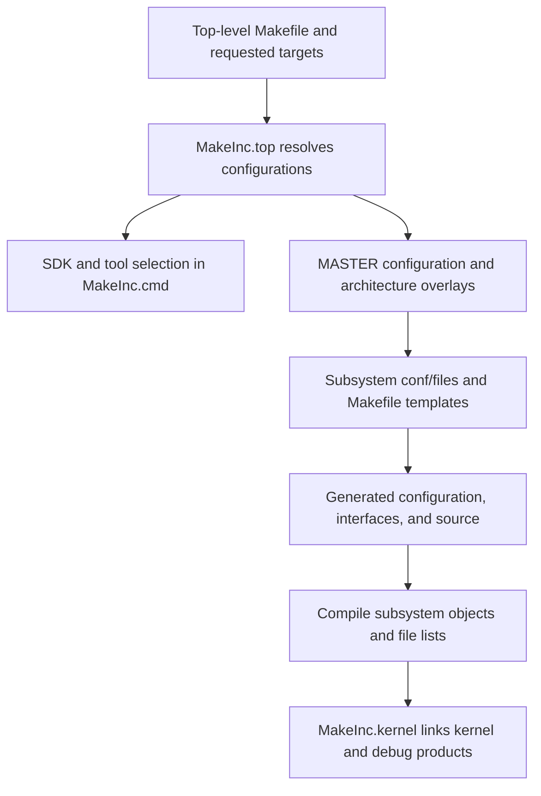

# Build selection, generated code, and tests

[Guide index](../README.md) · [Source map](../source-map.md)

This chapter describes XNU's own build and tests under Platydoc's `xnu/` input. Its kernel source paths and references to the root Makefile are relative to that directory. Building the documentation is a separate operation from the Platydoc project root; see the [HTML build guide](building-html.md).

For instrumentation, continue with [sanitizer runtime and reporting](sanitizer-runtime-and-reporting.md) and [coverage instrumentation lifecycle](coverage-instrumentation-lifecycle.md). These connect source selection to actual runtime hooks, storage, report disposition and checked-in test assertions.

The [worked ARM64 build and MIG trace](arm64-build-and-mig-walkthrough.md) applies the selection rules to one illustrative configuration and follows a Mach VM read from its declaration through typed port conversion and the local receiver. Generated contracts and missing build/tool artifacts remain explicit.

## A source tree is larger than one kernel

Before following a surprising branch, determine whether it belongs to the target you are studying. The main dimensions are the kernel variant (`RELEASE`, `DEVELOPMENT`, `DEBUG`, and instrumentation variants), architecture, machine/platform configuration, and individual feature options. The build resolves these dimensions before selecting source files and producing generated headers and stubs.

[MakeInc.top](../../xnu/makedefs/MakeInc.top) normalizes high-level target requests and launches individual builds. `TARGET_CONFIGS` describes groups of kernel, architecture, and machine settings; it takes precedence over the separate configuration variables. The final values are also affected by SDK/platform and build-project settings, so a default quoted in isolation can be misleading.

The diagram summarizes the build's responsibilities, rather than claiming a literal single serial make dependency chain. Read [osfmk/conf/Makefile](../../xnu/osfmk/conf/Makefile) to see `doconf` receive CPU, SoC, platform, master configuration, and template inputs; read [MakeInc.kernel](../../xnu/makedefs/MakeInc.kernel) for final outputs.

## How to decide whether a file is present

1. Find the feature in [config/MASTER](../../xnu/config/MASTER) and the relevant architecture/platform configurations.
2. Find the source in the subsystem's `conf/files` and `conf/files.<architecture>` lists. Entries may be `standard` or `optional`, with a feature condition.
3. Inspect guards inside the source and its headers. A compiled translation unit can still omit a function or use a different structure layout.
4. Inspect the generated configuration and compile command for an actual build before making a target-specific assertion.

For example, [bsd/conf/files](../../xnu/bsd/conf/files) selects DTrace and networking implementation files; [san/conf/files](../../xnu/san/conf/files) selects KASAN, UBSAN, and coverage components. [osfmk/conf/files](../../xnu/osfmk/conf/files) includes IPC, VM, debugger, and runtime files. Architecture backends may be selected elsewhere in the corresponding architecture list.

Definitions such as `CONFIG_EXCLAVES`, `CONFIG_SPTM`, `CONFIG_SKYWALK`, `DEVELOPMENT`, and `DEBUG` are semantic conditions, not decorative build annotations. A guide that combines every guarded branch into one imagined runtime gives a false picture of the kernel.

## Generated source is part of the interface

### BSD syscalls

[syscalls.master](../../xnu/bsd/kern/syscalls.master) describes syscall numbers, return types, argument types, audit events, and configuration-dependent availability. [makesyscalls.sh](../../xnu/bsd/kern/makesyscalls.sh) generates dispatch, naming, prototype/argument, audit, and tracing material as requested by build rules. The [BSD make template](../../xnu/bsd/conf/Makefile.template#L619) explicitly generates `init_sysent.c`, `syscalls.c`, `audit_kevents.c`, and `systrace_args.c` from the prepared syscall master file.

If `rg` cannot find a checked-in `sysent` initializer, inspect the master and generator before assuming the dispatcher has no implementation. The architecture syscall handlers consume the generated tables; the subsystem function body usually remains a normal C function elsewhere in `bsd`.

### Mach interfaces

[osfmk/mach](../../xnu/osfmk/mach/) contains `.defs` RPC descriptions; [osfmk/device/device.defs](../../xnu/osfmk/device/device.defs) includes IOKit-facing operations. MIG generates client/server interface code. The interface declaration is therefore essential evidence when reading a conversion from a user-visible port name to a kernel object, even if the generated server function is absent from this checkout. See the [IPC guide](../subsystems/ipc/README.md).

### Driver interfaces and exported headers

DriverKit interfaces include `.iig` definitions under [iokit/DriverKit](../../xnu/iokit/DriverKit/). Header installation is also a transformation: `KERNEL_PRIVATE`, `XNU_KERNEL_PRIVATE`, `BSD_KERNEL_PRIVATE`, `MACH_KERNEL_PRIVATE`, `PRIVATE`, and related guards expose different interfaces to different consumers. The upstream [README](../../xnu/README.md) describes the installation/export lists; [MakeInc.rule](../../xnu/makedefs/MakeInc.rule) implements shared rules. A public SDK header and an internal source header with the same basename need not expose identical declarations.

VM additionally separates `*_internal.h` for VM implementation, `*_xnu.h` for other XNU code, exported headers, and dedicated IOKit/UBC interfaces. Follow the actual include in the caller instead of treating all VM headers as interchangeable.

## Build products and environment boundary

The root [Makefile](../../xnu/Makefile) defaults object, install, and symbol output locations under `BUILD`. [MakeInc.kernel](../../xnu/makedefs/MakeInc.kernel) defines kernel, unstripped kernel, dSYM/CTF-related outputs, static-library variants, and compilation-database production. Different aliases in the root Makefile dispatch separate builds, including libsyscall, tests, and library products.

The tool setup explicitly resolves SDKs and tools through `xcrun` in [MakeInc.cmd](../../xnu/makedefs/MakeInc.cmd#L106). The upstream [build instructions](../../xnu/README.md) describe Xcode, SDK/KDK, and other dependencies. This source analysis was performed without an Apple kernel build environment; it did not build a kernel or test a kernelcache. A Linux C compiler successfully parsing an isolated header would not validate the actual target configuration.

For version identity, use [doc/building/xnu_version.md](../../xnu/doc/building/xnu_version.md). The build can derive the version from the SDK/KDK's `System.kext`, with `RC_DARWIN_KERNEL_VERSION` as an override; the enclosing source folder name is not a generated build result.

## Five useful test layers

| Layer | What it exercises | Where to start | Limitation |
| --- | --- | --- | --- |
| User-space Darwin tests | Observable syscall/kernel behavior, often including races, limits, or entitlement conditions | [tests/Makefile](../../xnu/tests/Makefile), subsystem folders under [tests](../../xnu/tests/) | Depends on Darwin test tooling, target behavior, and often special configuration |
| Kernel POST tests | Kernel APIs during boot, including assertions and selected panic paths | [osfmk/tests/README.md](../../xnu/osfmk/tests/README.md), [kernel_tests.c](../../xnu/osfmk/tests/kernel_tests.c), [bsd_tests.c](../../xnu/bsd/tests/bsd_tests.c) | Boot-time test environment; not a general user-space test runner |
| XNU user-space unit tests | Kernel code linked as a library and exercised in a user process | [tests/unit/README.md](../../xnu/tests/unit/README.md) | Uses mocks/emulation and an internal SDK-based harness; not an ordinary Linux build |
| Scheduler harness | Deterministic Clutch/Edge runqueue and migration-policy scenarios | [scheduler harness README](../../xnu/tests/sched/sched_test_harness/README.md) | Replaces machine and other dependencies; does not emulate all hardware scheduling behavior |
| Debugger tooling tests | Python helper logic and LLDB integration against test targets | [LLDB test README](../../xnu/tools/lldbmacros/tests/README.md) | Tests the inspection tools, not kernel semantics themselves |

The user-space test makefile includes `AppleInternal/Makefiles/darwintest/Makefile.common`; this is a concrete dependency, not a promise that all tests run from a public checkout alone. Kernel POST's README states that these tests are compiled out of release kernels and describes their boot controls. Treat internal lab commands in upstream docs as descriptions of that environment.

The unit-test documentation also describes simulated preemption, sanitizers, and fuzzing support. The scheduler harness is especially helpful for learning because a small test can construct runnable threads and assert a selection order without requiring a complete boot.

## Tests as executable explanations

The [Skywalk diagnostics and test companion](../subsystems/networking/skywalk-diagnostics-configuration-and-tests.md) applies this method to channel, packet, flow and provider paths. It maps selected test bodies and injection controls to actual state transitions, alongside the configuration and authority needed to reach their diagnostic exporters.

Use a test to identify the intended observable contract, then trace the implementation. Look for the operation under test, the deliberately invalid input or race, expected return values, and cleanup. Do not infer that every path is covered merely because a test file shares the subsystem's name. A test may be excluded by platform/configuration, require an entitlement, or focus on a historical regression.

Formal models under [tools/tla](../../xnu/tools/tla/) provide another level of explanation. The [TLA README](../../xnu/tools/tla/README.md) explicitly says its reader/writer lock model omits hardware memory ordering and some fast paths. A model can clarify an invariant without being a proof of every implementation detail.

## Sources inspected and limits

This page inspected the root build dispatch, target normalization, SDK/tool selection, `doconf` invocation, selected source-list entries, BSD generated-source rules, final kernel-output rules, and the test-harness documentation/makefile entries linked above. It did not expand all target configurations, regenerate interfaces, build artifacts, run kernel tests, or validate installation on hardware.

<!-- BEGIN PLATYDOC DOCUMENTATION LICENSE -->
Original Platydoc text and diagrams are licensed under [CC BY 4.0](https://creativecommons.org/licenses/by/4.0/). Quoted source code and third-party material retain their respective licenses.
<!-- END PLATYDOC DOCUMENTATION LICENSE -->
