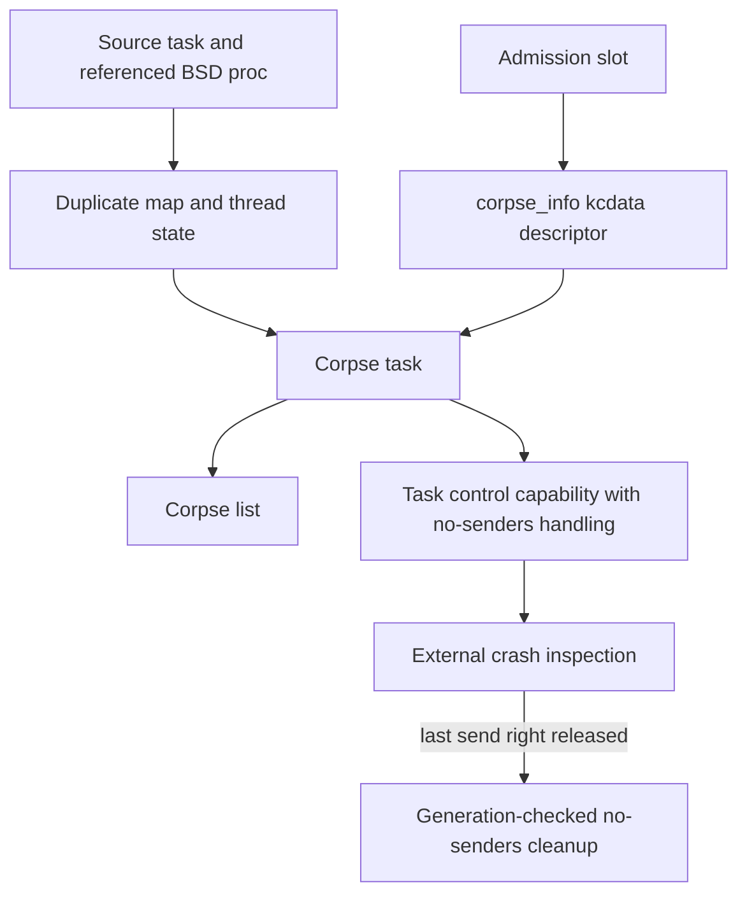

# Corpses, crash information and process core files

[Observability overview](observability.md) · [Stackshot and kcdata](stackshot-and-kcdata.md) · [Process lifecycle](../subsystems/processes/lifecycle.md) · [Exception delivery](../subsystems/ipc/exception-delivery.md)

A corpse preserves inspectable state and exposes kernel objects through Mach rights. A process core file serializes selected mappings and thread state into a file through VFS. Both may describe a failing process, but their storage, permissions, cleanup and output formats differ. This chapter covers the common/ARM64-relevant implementation and does not cover kernel core dumps or KDP.

## 1. Separate the artifact from the event that produced it

| Artifact | Representation and consumer boundary |
| --- | --- |
| Full corpse | A task marked as a corpse, duplicated map/thread state and a kcdata crash-information descriptor |
| Lightweight corpse | Backtrace/crash information wrapped in a `kcdata_object`; no equivalent full task/map clone in this branch |
| Process core | Mach-O header, segment/thread commands, notes and selected bytes written to a regular file |
| User crash report | A later interpretation of captured state by external reporting software |

The explicit Mach entry [`task_generate_corpse`](../../platydoc-data/xnu/osfmk/corpses/corpse.c#L440-L491) rejects null, kernel and already corpse-fork tasks, calls the internal creation path, waits for the new task's threads to terminate, resets applicable thread ports, and converts the task reference to a port with a no-senders request. The exception path [`task_enqueue_exception_with_corpse`](../../platydoc-data/xnu/osfmk/corpses/corpse.c#L571-L644) can instead choose lightweight capture when the registered exception behavior permits it.

## 2. Corpse admission reserves resources before building objects

`inflight_corpses` is an atomic gate containing total corpse and user-fault counts. `task_crashinfo_get_ref` updates the coupled counters with compare-exchange and rejects configured limits. It does not allocate a task merely because a crash occurred. `CORPSE_CRASHINFO_HAS_REF` records responsibility for returning this admission slot; a user-fault flag adds its separate accounting. [`gate and limits`](../../platydoc-data/xnu/osfmk/corpses/corpse.c#L152-L180), [`reservation`](../../platydoc-data/xnu/osfmk/corpses/corpse.c#L222-L252), [`release`](../../platydoc-data/xnu/osfmk/corpses/corpse.c#L261-L285).

`task_generate_corpse_internal` additionally checks global enablement and per-task corpse-fork policy. A task reference does not guarantee a BSD process reference: it separately performs `proc_find` and holds that process while gathering process-derived information. A source task can therefore fail corpse creation even after the caller obtained a valid task reference. [`admission and process hold`](../../platydoc-data/xnu/osfmk/corpses/corpse.c#L685-L720).

## 3. Full corpse construction transfers several kinds of ownership

The internal sequence is:

1. Allocate the combined process/task backing storage and initialize a task with `TF_CORPSE_FORK`, `TF_PENDING_CORPSE` and `TFRO_CORPSE`.
2. Set up its map and enable its task IPC interfaces.
3. Duplicate the source map and threads through `task_duplicate_map_and_threads`; retain the exception-thread result and temporary user-data buffer as applicable.
4. Create crash-information storage and transfer the admission accounting flags into its descriptor.
5. Begin halting the new task and terminate its IPC namespace.
6. Populate the crash-information blob using the original process's identity and exception/reason information.
7. Publish the corpse in the global corpse-task list and return owned task/thread references.

The body and error path are in [`task_generate_corpse_internal`](../../platydoc-data/xnu/osfmk/corpses/corpse.c#L735-L855). This is a diagnostic clone, not a new process that returns from `fork` and runs application code. Terminating its IPC namespace also does not mean destroying the external task inspection right.

The admission-reference transfer prevents successful creation and failure cleanup from both releasing the same slot. [`transfer and halt`](../../platydoc-data/xnu/osfmk/corpses/corpse.c#L786-L797):

<!-- source-excerpt: ../../platydoc-data/xnu/osfmk/corpses/corpse.c#L786-L797 -->
```c
	new_task->corpse_info->kcd_user_flags = kc_u_flags;
	kc_u_flags = 0;

	kr = task_start_halt(new_task);
	if (kr != KERN_SUCCESS) {
		os_log(OS_LOG_DEFAULT, "Failed to generate corpse for %s[%d]: \
			task_start_halt returned %#x\n", proc_name, pid, kr);
		goto error_task_generate_corpse;
	}

	/* terminate the ipc space */
	ipc_space_terminate(new_task->itk_space);
```



`convert_corpse_to_port_and_nsrequest()` uses the corpse's task **control** port, makes its send right under `itk_lock`, and consumes the caller's task reference. The type registers `task_port_no_senders` as its kobject callback; the helper's historical name does not mean its current body installs an ordinary userspace notification port. [Conversion](../../platydoc-data/xnu/osfmk/kern/ipc_tt.c#L3644-L3657), [kobject operation registration](../../platydoc-data/xnu/osfmk/kern/task.c#L244-L247).

No-senders processing must revalidate the make-send generation. The callback first checks the port/object and retains the corpse task, then acquires `itk_lock` and the port lock for the decisive second check. A task-identity-token operation may have minted another send right meanwhile. Only if the generation is still current does it disable the kobject, remove the corpse from its list, clear corpse state/source-map bookkeeping and terminate the task. Releasing one observer's right is therefore insufficient when other rights remain, and a stale queued no-senders event must not destroy a revived capability generation. [Callback and race handling](../../platydoc-data/xnu/osfmk/kern/task.c#L2618-L2683), [generation predicate](../../platydoc-data/xnu/osfmk/kern/ipc_kobject.c#L984-L999), [port lifetime](../subsystems/ipc/ports-and-rights-lifecycle.md).

On construction failure, the routine releases its process and label references, frees still-unadopted task storage, terminates/waits for any partially created threads, clears corpse state, terminates/releases the task, returns any still-owned admission slot, and frees the temporary user-data buffer. Merely jumping to the error label is not sufficient: cleanup depends on which ownership transfers already happened. [`failure unwind`](../../platydoc-data/xnu/osfmk/corpses/corpse.c#L813-L855).

## 4. Lightweight capture owns a data object and exception rights

[`task_should_generate_lightweight_corpse`](../../platydoc-data/xnu/osfmk/corpses/corpse.c#L500-L554) examines thread, task and host exception registration for `EXC_CORPSE_NOTIFY` with the expected backtrace behavior, retaining send rights for later delivery. It applies to the current task and a configured lightweight mode.

The selected branch reserves a lightweight-object throttle slot, collects current-thread backtrace information, creates a `kcdata_object`, and enqueues it with the captured exception ports. Object creation adopts the descriptor and throttle responsibility; successful enqueue consumes the object reference and send rights. On an earlier failure, the branch returns the throttle slot when appropriate and releases retained exception rights. [`lightweight ownership`](../../platydoc-data/xnu/osfmk/corpses/corpse.c#L588-L623).

This distinction matters when interpreting a report: a backtrace notification is not evidence that a complete frozen address space remains available. The full branch instead invokes corpse creation and queues a corpse/thread exception. The observer's registration and the kernel's admission policy affect which artifact can exist.

## 5. Process core creation starts with the current execution context

[`coredump`](../../platydoc-data/xnu/bsd/kern/kern_core.c#L376-L428) explicitly obtains `vfs_context_current()`, `current_map()` and `current_task()`. Its `core_proc` argument must be understood with those assumptions; it is not a general API for dumping an arbitrary task solely by passing another `proc_t`.

After the eligibility check, it chooses the data-model-dependent Mach-O sizes, selects the output naming policy, checks the map size against `RLIMIT_CORE` unless the internal ignore flag is set, and requests task suspension. This call explicitly discards `task_suspend_internal()`'s return value; the description should not turn that invocation into a separately checked successful barrier. MTE-enabled capture has an explicit tag-checking adjustment before reading process memory. [`limits and suspension`](../../platydoc-data/xnu/bsd/kern/kern_core.c#L461-L492).

It opens the destination with no-follow semantics and checks that it is a regular file with one link. It prepares file attributes, considers free-space reserve, calculates header/command sizes with overflow checks, and allocates a kernel header buffer. A driver task can use different naming and IOKit-memory inclusion rules. [`file creation and layout sizing`](../../platydoc-data/xnu/bsd/kern/kern_core.c#L494-L606).

These gates precede much of the output, but later failure can leave a file created, truncated or partially populated. The operation is not an atomic “all mappings or no file” transaction.

## 6. VM regions become segment commands and file bytes

The writer recursively walks submaps with `mach_vm_region_recurse`. For each leaf region it records virtual-address geometry and protections, skips entirely inaccessible regions, and may attempt to add read permission. Eligibility to write contents also checks maximum read permission, the IOKit-memory policy and `coredumpok`. A segment can describe virtual memory without including all of its bytes in the file. [`region selection`](../../platydoc-data/xnu/bsd/kern/kern_core.c#L641-L705).

The transfer uses `vn_rdwr_64` with `UIO_USERSPACE64` for a 64-bit source process. The source address is still a process virtual address; `foffset` is a file byte offset. The VFS/uio path performs the actual read from user memory while writing file data. [`segment transfer`](../../platydoc-data/xnu/bsd/kern/kern_core.c#L706-L733):

<!-- source-excerpt: ../../platydoc-data/xnu/bsd/kern/kern_core.c#L706-L734 -->
```c
		if (fsize) {
			int64_t resid = 0;
			const enum uio_seg sflg = IS_64BIT_PROCESS(core_proc) ?
			    UIO_USERSPACE64 : UIO_USERSPACE32;

			error = vn_rdwr_64(UIO_WRITE, vp, vmoffset, fsize,
			    foffset, sflg, IO_NODELOCKED | IO_UNIT,
			    cred, &resid, core_proc);

			if (error) {
				/*
				 * Mark segment as empty
				 */
				fsize = 0;
				COREDUMPLOG("failed to write segment %llx->%llx: error %d", vmoffset, vmoffset + vmsize, error);
			} else if (resid) {
				/*
				 * Partial write. Extend the file size so
				 * that the segment command contains a valid
				 * range of offsets, possibly creating a hole.
				 */
				VATTR_INIT(vap);
				VATTR_SET(vap, va_data_size, foffset + fsize);
				vnode_setattr(vp, vap, ctx);
				COREDUMPLOG("partially wrote segment %llx->%llx, resid %lld", vmoffset, vmoffset + vmsize, resid);
			}
		} else {
			COREDUMPLOG("skipping unreadable segment %llx->%llx", vmoffset, vmoffset + vmsize);
		}
```

On a write error, the segment's file size is marked zero. A residual byte count without an error can cause the file to be extended so the segment's declared range remains within the file, potentially with a hole. Later writes and the final header affect the returned error: do not infer that a successful final return proves every mapped byte was captured.

Illustrative mapping:

```text
process VA 0x100000000..0x100003fff
    -> LC_SEGMENT_64: vmaddr/vmsize describe that virtual range
    -> fileoff/filesize describe its retained payload in the core file
process thread saved state
    -> LC_THREAD records with architecture state flavors
addressability metadata
    -> LC_NOTE command and separately written payload
```

These values are hypothetical. Actual file offsets depend on the header, notes and earlier included segments. The writer gathers thread state through `task_act_iterate_wth_args`, then writes the Mach-O header at file offset zero. Notes have callbacks and their payloads are written separately from note commands. [`notes`](../../platydoc-data/xnu/bsd/kern/kern_core.c#L306-L353), [`thread/header completion`](../../platydoc-data/xnu/bsd/kern/kern_core.c#L800-L815).

## 7. Completion is not identical to persistence or crash reporting

`COREDUMP_FULLFSYNC` requests a final `F_FULLFSYNC` only after successful header output. Cleanup frees header/attribute/name storage, closes the vnode, records the audit outcome and preserves a close error if no earlier error remains. It does not convert the result into a symbolic crash report or repair omitted mappings. [`completion`](../../platydoc-data/xnu/bsd/kern/kern_core.c#L810-L853).

A useful source-reading exercise is to follow a failed second-segment write through `fsize = 0`, command creation, later header output and vnode close. Compare that with a corpse-construction failure after the admission slot moved into `corpse_info`. The former manages a partially written external file; the latter unwinds a graph of kernel objects and transferred references.

## Inspection boundary

The creation, admission, lightweight selection, principal ownership transfers and process-core writer were inspected. Detailed map/thread duplication internals, every crash-information field and all exception consumer policies are broader mechanisms. Filesystem persistence, external crash reporters and symbolication are separate implementations. No crash was induced or core file collected.

<!-- BEGIN PLATYDOC DOCUMENTATION LICENSE -->
Original Platydoc text and diagrams are licensed under [CC BY 4.0](https://creativecommons.org/licenses/by/4.0/). Quoted source code and third-party material retain their respective licenses.
<!-- END PLATYDOC DOCUMENTATION LICENSE -->
