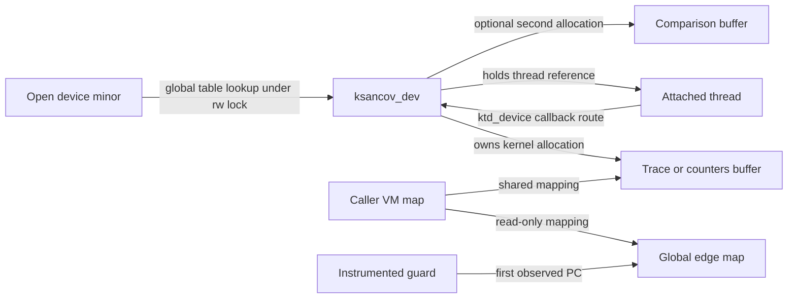
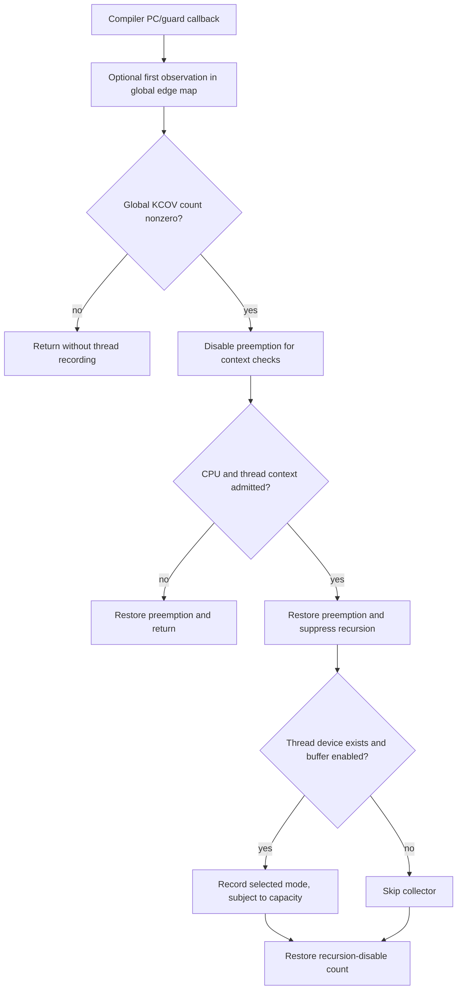
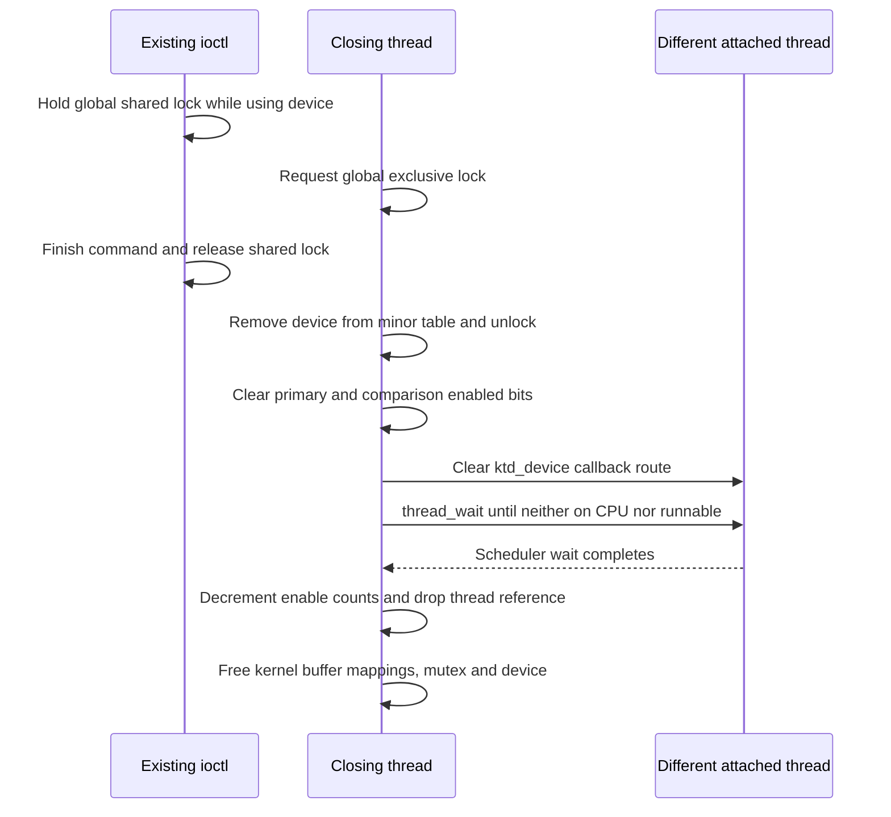

# Coverage instrumentation: device, thread and buffer lifetime

[Guide index](../README.md) · [Observability](observability.md) · [Build selection and tests](build-and-tests.md) · [Completion and failure](../cross-cutting/completion-and-failure.md) · [Sanitizer runtime](sanitizer-runtime-and-reporting.md)

KCOV dispatches compiler-inserted coverage callbacks; KSANCOV connects selected callbacks from one kernel thread to shared buffers exposed through `/dev/ksancov`. Opening the device, configuring a buffer, attaching a thread, enabling recording, and closing the descriptor are different operations. This chapter follows their implementation in `xnu-12377.121.6`, including what a trace can omit and how close stops a callback from retaining a freed device.

The discussion is source based. It does not build or run an instrumented kernel, infer coverage in a release image, or describe a campaign for generating inputs. Its concrete observation path is the supplied test that records around `getppid()` and then reads the trace.

## 1. Runtime availability and compiler instrumentation are separate

`CONFIG_KCOV`, `CONFIG_KSANCOV` and `CONFIG_STKSZ` select the dispatcher, device collector and stack-size support independently in the sanitizer source list. `config/MASTER` declares the corresponding options and the `ksancov_init_dev` pseudo-device initializer. The build's `KCOV_RUNTIME` list contains `KASAN`, and explicitly rejects adding `RELEASE` to that runtime list. These are source/build selection facts, not a statement that every kernel named KASAN has identical instrumentation. [Source selection](../../xnu/san/conf/files#L3-L21), [configuration declarations](../../xnu/config/MASTER#L765-L781), [runtime selection](../../xnu/makedefs/MakeInc.def#L650-L655).

The separate `KSANCOV=1` build setting adds `-fsanitize-coverage=trace-pc-guard,trace-cmp` and an architecture-specific coverage ignorelist to XNU's compiler flags. Coverage runtime exports are also selected by kernel configuration. The runtime can consequently exist for instrumented modules without the kernel itself having those compiler hooks. [Compiler flags](../../xnu/makedefs/MakeInc.def#L802-L808), [runtime exports](../../xnu/config/Makefile#L56-L61), [coverage symbol products](../../xnu/san/coverage/Makefile#L73-L92).

The code exposes `kern.kcov.available` from the runtime and a separate `kern.kcov.sancov_compiled` determined by `__has_feature(coverage_sanitizer)`. The first supplied test requires both values to be one; the module tests instead require on-demand support. Reading one availability bit is not evidence that every source file contains callbacks. [Sysctls](../../xnu/san/coverage/kcov.c#L52-L65), [test prerequisites](../../xnu/tests/ksancov.c#L45-L52).

Initialization also has runtime gates. An early-boot startup routine initializes KSANCOV and enables the boot CPU's coverage data; `kcov_start_cpu()` enables the per-CPU field for subsequent CPUs. Newly created threads initialize their recursion-disable count and collector/stack state. Global callback dispatch starts with `kcov_enabled == 0` until a consumer enables it. [Boot and global state](../../xnu/san/coverage/kcov.c#L48-L125), [thread initialization](../../xnu/san/coverage/kcov.c#L166-L175), [thread creation caller](../../xnu/osfmk/kern/thread.c#L1371-L1374), [CPU startup caller](../../xnu/osfmk/kern/startup.c#L990-L993).

## 2. The device is a control endpoint, not the trace itself

`ksancov_init_dev()` registers a character-device switch and creates a cloned `ksancov` node owned by root/wheel with mode `0666`. The `ksancov_open()` body does not impose a separate root-UID or entitlement check. Ordinary device-node access and the presence of this configured runtime remain distinct from that body. The node's root owner must not be mistaken for a root-only mode. [Registration and mode](../../xnu/san/coverage/kcov_ksancov.c#L1537-L1571), [open body](../../xnu/san/coverage/kcov_ksancov.c#L793-L836).

The clone helper searches up to `KSANCOV_MAX_DEV == 128` minor slots. Open validates the minor, takes the global device-table lock exclusively, rejects an occupied slot, allocates a zeroed `ksancov_dev`, and publishes it in `ksancov_devs[minor]`. The new object has mode `NONE`, its own mutex, a default capacity field and no attached thread. [Clone selection](../../xnu/san/coverage/kcov_ksancov.c#L1521-L1535), [device creation](../../xnu/san/coverage/kcov_ksancov.c#L648-L661), [open publication](../../xnu/san/coverage/kcov_ksancov.c#L793-L815).

The first open also creates the global edge-to-PC map with `KMA_PERMANENT`. Its size and `ke_nedges` capture the current `nedges`; it is shared across device instances. The edge map is not allocated separately for each attached thread, and the shown path does not resize it on every later guard registration. On this allocation's failure, open returns `ENOMEM` after having assigned the device-table slot; the body has no local unpublication rollback in that branch. [First-open map construction](../../xnu/san/coverage/kcov_ksancov.c#L815-L836).

The character-device switch provides ioctl control. Its read/write and mmap entries are unsupported stubs; buffer mapping is performed by a mapping ioctl that calls VM directly. Calling the interface “an mmap file” would hide the implemented dispatch. [Device operations](../../xnu/san/coverage/kcov_ksancov.c#L1537-L1551).

| Object or field | State and ownership |
| --- | --- |
| `ksancov_devs[minor]` | Discoverable device pointer, protected by `ksancov_devs_lck` |
| `ksancov_dev.lock` | Serializes configuration, mapping and attachment operations on this device |
| Device mode, buffer pointer, `sz`, `maxpcs` | Kernel-side recording configuration and allocation extent |
| Thread `kcov_data.ktd_device` | Callback's route to the attached device; initially null |
| Device `thread` | Referenced attached thread, released during detach |
| Shared `kh_enabled` | User-controlled recording switch for a specific buffer |
| Shared `kt_head`, `kt_entries` | Trace reservation position and records |
| Global `ksancov_edgemap` | Guard-index-to-PC observations, exposed read-only |

[Device layout](../../xnu/san/coverage/kcov_ksancov_data.h#L161-L195), [per-CPU/thread data](../../xnu/san/coverage/kcov_data.h#L42-L62).



The arrows distinguish device/thread references from VM aliases. The trace buffer's address in the kernel and its mapped address in the caller are different virtual addresses for shared storage; neither is a device DMA address.

## 3. Configuration selects one primary representation

`ksancov_ioctl()` holds the global device-table lock shared from lookup through command completion. Commands changing a device's primary mode, mapping or attachment additionally take `d->lock`. Close must acquire the global lock exclusively before removing a device, so it cannot remove that instance while one of these shared-lock ioctl bodies is using it. [Lookup and mode commands](../../xnu/san/coverage/kcov_ksancov.c#L1424-L1472), [unlock tail](../../xnu/san/coverage/kcov_ksancov.c#L1508-L1518).

| Primary mode | Allocation and record meaning |
| --- | --- |
| `KS_MODE_TRACE` | Trace header plus requested count of `uintptr_t` PCs |
| `KS_MODE_COUNTERS` | Counter header plus one byte per edge in the global map's recorded edge count |
| `KS_MODE_STKSIZE` | Trace header plus PC/stack-size records; actual recording case requires `CONFIG_STKSZ` |
| `KS_MODE_NONE` | Newly opened, not yet configured; attachment and ordinary mapping reject it |

Trace allocation checks multiplication-plus-header addition for overflow, then calls `kmem_alloc(KMA_DATA_SHARED | KMA_ZERO)`. It sets the magic, zero head, disabled header, requested capacity and kernel-side mode/extent. A second primary configuration returns `EBUSY`. Counter allocation follows the same single-primary-mode rule and initializes disabled, zeroed hit storage. [Trace allocation](../../xnu/san/coverage/kcov_ksancov.c#L839-L882), [counter allocation](../../xnu/san/coverage/kcov_ksancov.c#L885-L912).

The common trace representation makes the mutable header and records visible together:

[Source: san/coverage/kcov_ksancov_data.h, lines 60–68](../../xnu/san/coverage/kcov_ksancov_data.h#L60-L68)

<!-- source-excerpt: ../../xnu/san/coverage/kcov_ksancov_data.h#L60-L68 -->
```c
typedef struct ksancov_trace {
	ksancov_header_t kt_hdr;         /* header (must be always first) */
	uint32_t         kt_maxent;      /* Maximum entries in this shared buffer. */
	_Atomic uint32_t kt_head;        /* Pointer to the first unused element. */
	uint64_t         kt_entries[];   /* Trace entries in this buffer. */
} ksancov_trace_t;

/* PC tracing only records PCs */
typedef uintptr_t ksancov_trace_pc_ent_t;
```

The PC producer uses the kernel device's `maxpcs` for its capacity checks. The user helper uses the shared `kt_maxent` to bound the reported head. These are different fields even though allocation initializes them from the same requested count. Trace capacity is a count of records; `d->sz` is bytes. The source's `KSANCOV_MAX_PCS` is the initial default field, not a separate upper-bound check in `ksancov_trace_alloc()`. [Capacity initialization](../../xnu/san/coverage/kcov_ksancov.c#L649-L660), [allocation assignments](../../xnu/san/coverage/kcov_ksancov.c#L869-L880), [reader cap](../../xnu/san/tools/ksancov.h#L425-L440).

Comparisons use an optional second allocation and independent `cmps_mode`, `cmps_sz` and enabled header. Scalar comparisons record PC, type and two values; function-comparison records can occupy multiple fixed-size slots. Serialized testcases use another optional buffer for diagnostic retention. They do not replace the required primary mode used by thread attachment. [Comparison allocation](../../xnu/san/coverage/kcov_ksancov.c#L987-L1027), [comparison representation](../../xnu/san/coverage/kcov_ksancov_data.h#L93-L145), [testcase allocation](../../xnu/san/coverage/kcov_ksancov.c#L1059-L1083).

## 4. The mapping ioctl installs a shared VM alias

For trace/counters, `ksancov_map()` verifies that the chosen mode has a buffer and asks for read/write protection. The edge-map ioctl asks for read-only protection. Comparison and testcase buffers are also mapped read/write. Missing configuration yields `EINVAL`; failure to create the VM alias becomes `ENOMEM` at these ioctl helpers. [Primary mapping](../../xnu/san/coverage/kcov_ksancov.c#L728-L760), [edge mapping](../../xnu/san/coverage/kcov_ksancov.c#L766-L786), [comparison mapping](../../xnu/san/coverage/kcov_ksancov.c#L1030-L1055), [testcase mapping](../../xnu/san/coverage/kcov_ksancov.c#L1086-L1104).

`ksancov_do_map()` first creates a named memory entry over the kernel allocation using `MAP_MEM_VM_SHARE | prot`. It maps that entry into `get_task_map(current_task())` with no copy, equal current/maximum protections and shared inheritance:

[Source: san/coverage/kcov_ksancov.c, lines 698–708](../../xnu/san/coverage/kcov_ksancov.c#L698-L708)

<!-- source-excerpt: ../../xnu/san/coverage/kcov_ksancov.c#L698-L708 -->
```c
	kr = mach_vm_map_kernel(get_task_map(current_task()),
	    &user_addr,
	    size,
	    0,
	    VM_MAP_KERNEL_FLAGS_ANYWHERE(),
	    mem_entry,
	    0,
	    FALSE,
	    prot,
	    prot,
	    VM_INHERIT_SHARE);
```

The temporary memory-entry port is released after the mapping attempt, on both success and failure. A successful mapping owns the VM relationship needed after that local reference is dropped. The ioctl returns the user virtual address and the recorded buffer byte size. It does not return a kernel pointer that user code may dereference. [Entry creation and release](../../xnu/san/coverage/kcov_ksancov.c#L681-L723), [returned descriptor](../../xnu/san/coverage/kcov_ksancov.c#L751-L760), [VM named-entry background](../subsystems/vm/wiring-and-memory-entries.md).

The current task for mapping and the current thread for attachment are chosen by separate calls. Mapping does not attach a thread; attachment does not set `kh_enabled`. A shared mapping also has a VM lifetime separate from the file descriptor: close removes the device's kernel mappings, but the shown close path does not issue a `mach_vm_deallocate()` for the caller's alias. [Mapping versus attach commands](../../xnu/san/coverage/kcov_ksancov.c#L1457-L1472), [buffer release](../../xnu/san/coverage/kcov_ksancov.c#L663-L678).

## 5. Attachment holds a thread reference; start only changes a bit

Despite its name, `KSANCOV_IOC_START` attaches `current_thread()`. The ioctl does not use its argument as a supplied thread port. The helper rejects an unconfigured device, rejects a non-current thread, and returns `EBUSY` if the current thread already has a collector. Reattaching the same thread is therefore not an idempotent start operation. [Ioctl dispatch](../../xnu/san/coverage/kcov_ksancov.c#L1468-L1472), [attachment checks](../../xnu/san/coverage/kcov_ksancov.c#L918-L936).

If the device previously belonged to another thread, attachment detaches that old association before installing the current one. It takes a thread reference, publishes the callback route, and increments both the KSANCOV attachment count and the shared KCOV enable count:

[Source: san/coverage/kcov_ksancov.c, lines 938–943](../../xnu/san/coverage/kcov_ksancov.c#L938-L943)

<!-- source-excerpt: ../../xnu/san/coverage/kcov_ksancov.c#L938-L943 -->
```c
	d->thread = th;
	thread_reference(d->thread);

	os_atomic_store(&data->ktd_device, d, relaxed);
	os_atomic_add(&ksancov_enabled, 1, relaxed);
	kcov_enable();
```

The supplied userspace `ksancov_start()` and `ksancov_stop()` helpers do no ioctl at all. They write the enabled field in the already shared buffer:

[Source: san/tools/ksancov.h, lines 383–397](../../xnu/san/tools/ksancov.h#L383-L397)

<!-- source-excerpt: ../../xnu/san/tools/ksancov.h#L383-L397 -->
```c
static inline int
ksancov_start(void *buf)
{
	ksancov_header_t *hdr = (ksancov_header_t *)buf;
	atomic_store_explicit(&hdr->kh_enabled, 1, memory_order_relaxed);
	return 0;
}

static inline int
ksancov_stop(void *buf)
{
	ksancov_header_t *hdr = (ksancov_header_t *)buf;
	atomic_store_explicit(&hdr->kh_enabled, 0, memory_order_relaxed);
	return 0;
}
```

Stopping one buffer does not detach its thread, decrement either global count, disable a module's compiler gate, or stop a separately enabled comparison buffer. `ksancov_reset()` clears a trace head or zeroes counter bytes according to the magic; it is another userspace buffer operation rather than a kernel teardown barrier. [Reset helper](../../xnu/san/tools/ksancov.h#L399-L413).

The selected test's normal order is configure, map, attach, reset, start, execute an operation on that thread, stop, then inspect. This ensures the observation is associated with the intended thread and buffer. Other kernel threads spawned or awakened by the operation do not acquire that device association automatically. [Concrete test sequence](../../xnu/tests/ksancov.c#L53-L86), [thread-local lookup](../../xnu/san/coverage/kcov_ksancov.c#L311-L325).

## 6. Compiler callbacks pass context and recursion gates

`__sanitizer_cov_trace_pc_guard()` captures its return address and a local stack address, then calls the common `trace_pc_guard()`. Before the ordinary recording prologue, the latter invokes `kcov_ksancov_trace_guard()` to populate the global edge map if one exists and this nonzero guard has not yet been seen. This edge observation is separate from per-thread trace recording and can occur even when that thread has no active trace buffer. [ABI entry](../../xnu/san/coverage/kcov.c#L290-L304), [dispatch ordering](../../xnu/san/coverage/kcov.c#L249-L267), [edge observation](../../xnu/san/coverage/kcov_ksancov.c#L268-L308).

The ordinary prologue first tests the global enable count. It disables preemption while consulting the CPU enable field and rejects PPL and interrupt contexts, a missing current thread, or a nonzero thread recursion-disable count. It restores preemption before returning the per-thread data. The dispatcher then increments `ktd_disabled` around stack and KSANCOV recording calls, restoring it afterward. The callback's internal helper calls therefore do not recursively record through that same thread's ordinary path. [Context gates](../../xnu/san/coverage/kcov.c#L177-L233), [recursion counter](../../xnu/san/coverage/kcov.c#L131-L147), [dispatch body](../../xnu/san/coverage/kcov.c#L249-L267).



The diagram selects PC collection. Comparison callbacks reuse the prologue and recursion protocol but have a separate comparison-buffer enabled check. The indirect-call coverage entry is a no-op in this source. Guard initialization assigns numeric IDs up to `KSANCOV_MAX_EDGES`; `USE_PC_TABLE` is defined as zero, so the alternate PC-table initializer is not the selected implementation. [Comparison dispatch](../../xnu/san/coverage/kcov.c#L314-L329), [indirect-call boundary](../../xnu/san/coverage/kcov.c#L273-L280), [guard IDs](../../xnu/san/coverage/kcov_ksancov.c#L352-L372), [PC-table branch](../../xnu/san/coverage/kcov_ksancov.c#L495-L520).

The ARM64 ignorelist excludes bootstrap, PPL-helper and PAN-disabling paths that cannot safely enter the generic callback. The dispatcher comment explains why it relies on excluding PAN-disabled paths instead of reading PAN on every invocation. A trace's absent edge can consequently mean absent instrumentation or excluded context, as well as an unexecuted branch. [ARM64 exclusions](../../xnu/san/coverage/kcov-denylist-arm64), [PAN rationale](../../xnu/san/coverage/kcov.c#L183-L195).

## 7. Trace head reserves space before the record is written

For PC mode, the collector forms `VM_KERNEL_UNSLIDE(caller) - 1` and appends it. This is an unslid call-site-related address, not an instruction-count sample or a wall-clock timestamp. The producer checks capacity, atomically reserves an index with relaxed ordering, checks the returned index, and then writes the PC. [Mode dispatch](../../xnu/san/coverage/kcov_ksancov.c#L311-L349).

[Source: san/coverage/kcov_ksancov.c, lines 221–231](../../xnu/san/coverage/kcov_ksancov.c#L221-L231)

<!-- source-excerpt: ../../xnu/san/coverage/kcov_ksancov.c#L221-L231 -->
```c
	if (os_atomic_load(&dev->trace->kt_head, relaxed) >= dev->maxpcs) {
		return; /* overflow */
	}

	uint32_t idx = os_atomic_inc_orig(&dev->trace->kt_head, relaxed);
	if (__improbable(idx >= dev->maxpcs)) {
		return;
	}

	ksancov_trace_pc_ent_t *entries = (ksancov_trace_pc_ent_t *)dev->trace->kt_entries;
	entries[idx] = pc;
```

The trace is a bounded append buffer: after it fills, subsequent events are dropped rather than overwriting old entries or blocking the kernel operation. The head represents reservation progress. Because it advances before the store and uses relaxed ordering, it is not by itself a release publication of a completed record to an independently concurrent reader. The userspace head helper uses an acquire load and clamps to `kt_maxent`, but that does not change the producer's order. The supplied test reads after its traced thread has returned to userspace and stopped its buffer. [Reader helpers](../../xnu/san/tools/ksancov.h#L432-L451), [test stop/read order](../../xnu/tests/ksancov.c#L70-L83).

Counters instead index by the masked guard ID and increment an eight-bit hit count only below `KSANCOV_MAX_HITS`. They lose exact frequency once saturated and do not preserve execution order. The separate edge map associates observed IDs with PCs and marks guards with `GUARD_SEEN`; a counter array alone is not a list of executed addresses. [Saturating producer](../../xnu/san/coverage/kcov_ksancov.c#L255-L265), [edge association](../../xnu/san/coverage/kcov_ksancov.c#L287-L306).

With `CONFIG_STKSZ`, the selected stack-record case stores a PC and `ktd_stksz.kst_stksz`. The stack monitor has its own `stksz_enabled` control; choosing a KSANCOV stack buffer does not automatically enable that monitor. Its update body requires the observed stack address to be within the thread stack, then computes used bytes as stack end minus that address. Threshold/delta Kdebug and DTrace events are additional consumers. These guarded bodies were read, not build-tested as a stack-monitor configuration. [Stack record](../../xnu/san/coverage/kcov_ksancov.c#L234-L252), [mode guard](../../xnu/san/coverage/kcov_ksancov.c#L332-L337), [monitor control and measurement](../../xnu/san/coverage/kcov_stksz.c#L42-L150).

Comparison recording independently checks attachment, comparison-buffer presence/enabled state, supported mode and capacity. Scalar entries contain the two values and comparison type. Function logging checks a combined byte limit, can require that the caller belongs to an instrumented/gated region, and reserves a rounded number of slots for its variable-length data. This chapter uses that distinction to explain the test's cursor walk; it does not audit every comparison-hook family or variable-record boundary. [Scalar producer](../../xnu/san/coverage/kcov_ksancov.c#L375-L423), [function producer](../../xnu/san/coverage/kcov_ksancov.c#L426-L491).

## 8. Detach and close establish different lifetime boundaries

`ksancov_detach()` first clears the attached thread's `ktd_device` pointer. If detaching a different thread, it calls `thread_wait(thread, TRUE)` before dropping the global enable counts and its thread reference. The wait implementation waits until the thread is neither on a CPU nor runnable; it is not a thread-termination operation. Detach from the current thread skips that wait. [Detach](../../xnu/san/coverage/kcov_ksancov.c#L958-L984), [scheduler wait](../../xnu/osfmk/kern/sched_prim.c#L1637-L1684).

Close adds device-discovery exclusion before that thread synchronization. Its exclusive device-table acquisition waits for existing shared-lock ioctl users. It removes the table entry and unlocks, then clears enabled fields, detaches and frees the device. The callback does not take `d->lock`; the detached thread route and wait are the relevant protection for that participant. [Ioctl lifetime lock](../../xnu/san/coverage/kcov_ksancov.c#L1436-L1442), [close](../../xnu/san/coverage/kcov_ksancov.c#L1259-L1294).

[Source: san/coverage/kcov_ksancov.c, lines 1283–1291](../../xnu/san/coverage/kcov_ksancov.c#L1283-L1291)

<!-- source-excerpt: ../../xnu/san/coverage/kcov_ksancov.c#L1283-L1291 -->
```c
	if (d->mode != KS_MODE_NONE && d->hdr != NULL) {
		os_atomic_store(&d->hdr->kh_enabled, 0, relaxed); /* stop tracing */
	}
	if (d->cmps_mode != KS_CMPS_MODE_NONE && d->cmps_hdr != NULL) {
		os_atomic_store(&d->cmps_hdr->kh_enabled, 0, relaxed); /* stop tracing cmps */
	}

	ksancov_detach(d);
	free_dev(d);
```



This schedule selects close by a different thread and an ioctl already holding the shared lock. After table removal, a subsequent lookup cannot obtain this old device through that slot. A new open may eventually use the minor for a different object; the closing thread continues to own its detached local pointer. An already entered callback is handled through the detach/wait sequence rather than through the table lookup lock.

`free_dev()` releases the configured kernel trace/counter allocation, optional comparison buffer and optional testcase allocation, then destroys the mutex and frees the device. It does not free the permanent global edge map. Stopping a shared buffer alone performs none of this cleanup. [Free path](../../xnu/san/coverage/kcov_ksancov.c#L663-L678), [permanent map allocation](../../xnu/san/coverage/kcov_ksancov.c#L815-L831).

## 9. On-demand gates control callback invocation, not attachment

KSANCOV initializes on-demand support from `ksancov.on_demand`, with support enabled in the initial configuration. Guard registration can bookmark a loaded module only when support and initialization are ready, a module summary exists, and its image contains `__DATA,__sancov_gate`. The runtime records its bundle name, guard range, gate address and unslid text range. It cannot add compiler instrumentation to arbitrary uninstrumented code. [Boot configuration](../../xnu/san/coverage/kcov_ksancov.c#L141-L202), [module registration](../../xnu/san/coverage/kcov_ksancov.c#L523-L605).

The on-demand ioctl holds `ksancov_od_lck` while locating a registered module and getting/setting its gate or reporting a guard range. A PC-to-bundle query searches recorded text intervals. Missing modules/ranges and unsupported operations produce `EINVAL`. The gate is module state shared across device instances, not a per-thread trace enabled flag. [Command implementation](../../xnu/san/coverage/kcov_ksancov.c#L1339-L1421).

The comparison-function path also consults whether its caller is in the instrumented kernel or an enabled registered module. That decision is separate from buffer capacity, thread attachment and `kh_enabled`. A module can invoke callbacks while no thread collector accepts them, and an enabled buffer cannot record a callback the compiler gate suppresses. [Caller-region decision](../../xnu/san/coverage/kcov_ksancov.c#L608-L643), [function-comparison call site](../../xnu/san/coverage/kcov_ksancov.c#L463-L465).

## 10. What the supplied tests establish

| Source test | Actual assertions and boundaries |
| --- | --- |
| `kcov_ksancov_mode_trace` | Requires runtime and kernel instrumentation sysctls; configures/maps/attaches a trace, records around `getppid()`, expects a positive head and accesses entry zero, then checks close success |
| `kcov_ksancov_mode_trace_kext` | Requires on-demand support and the selected iPhone platform; enables the IOSurface module gate, opens/closes its user client, disables recording/gate, and expects a nonempty PC trace |
| `kcov_ksancov_mode_trace_cmp_kext` | Also configures and enables a comparison buffer, expects both traces nonempty, walks scalar/variable comparison records and asserts the cursor ends exactly at the head |
| `kcov_ksancov_testcases` | Checks returned mapping size and fixed testcase-buffer size, writes a small record and advances the ring head; invokes serial logging without asserting its return because boot configuration can disable it |

[PC test](../../xnu/tests/ksancov.c#L45-L87), [module PC test](../../xnu/tests/ksancov.c#L89-L147), [comparison test](../../xnu/tests/ksancov.c#L149-L233), [testcase-buffer test](../../xnu/tests/ksancov.c#L235-L279).

These tests do not assert exact PCs for `getppid()`, complete branch coverage, counter saturation, the stack-size mode, failure rollback, or close racing an active callback on another thread. A nonempty trace can include surrounding instrumented work; the test does not attribute every entry to one syscall body. The IOSurface provider is an external boundary: the tests and local KSANCOV transport are present, while that service's full implementation is not supplied here.

The reviewed sources cover device admission/configuration/mapping, primary trace/counter production, thread attachment/detachment, callback context checks, close cleanup, on-demand registration/control, selected comparison paths and the test assertions above. Serialized testcase panic dumping and every compiler/runtime hook were not exhaustively traced. Build selection, byte-exact excerpts, local links and standalone diagrams were checked for this documentation; no kernel configuration was compiled and no runtime test was executed.

<!-- BEGIN PLATYDOC DOCUMENTATION LICENSE -->
Original Platydoc text and diagrams are licensed under [CC BY 4.0](https://creativecommons.org/licenses/by/4.0/). Quoted source code and third-party material retain their respective licenses.
<!-- END PLATYDOC DOCUMENTATION LICENSE -->
