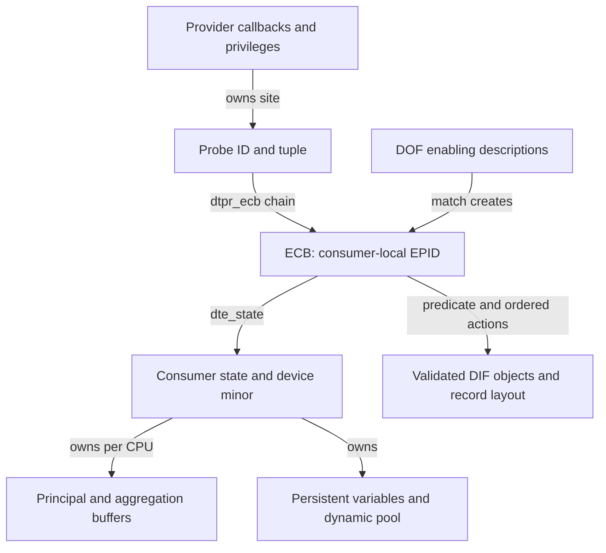
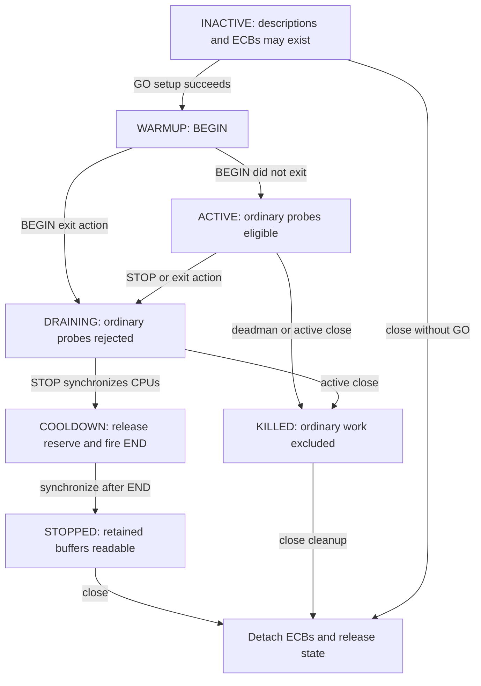
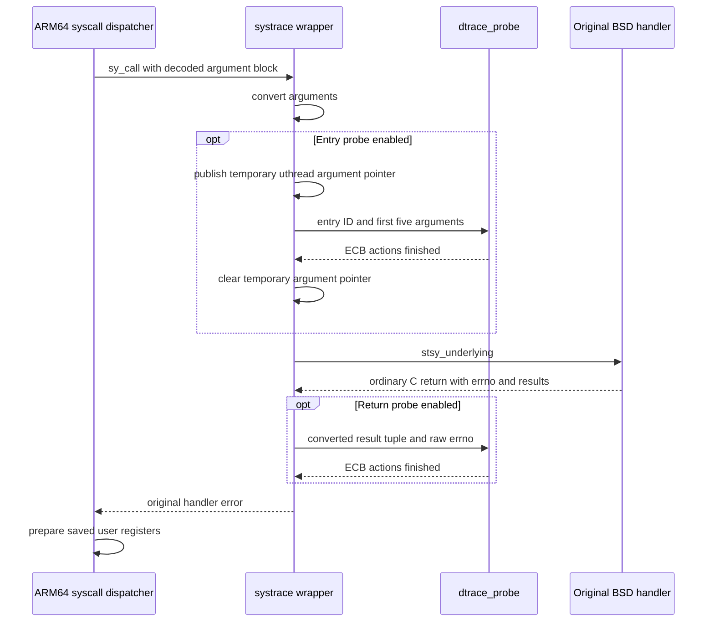
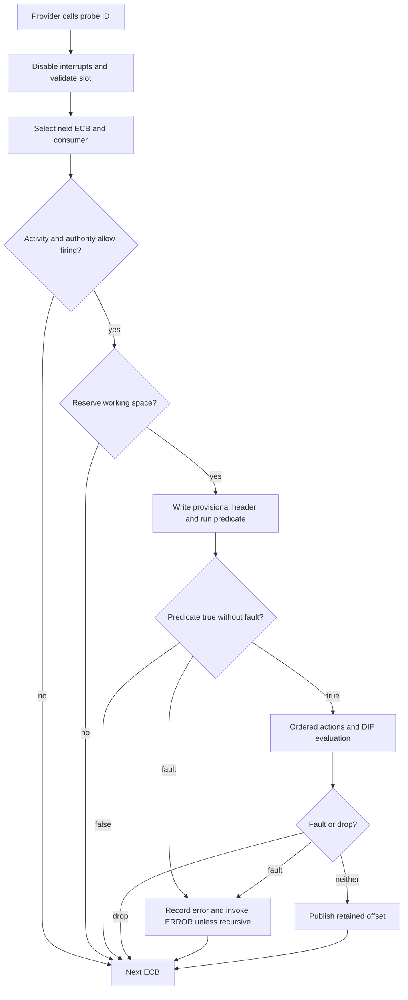
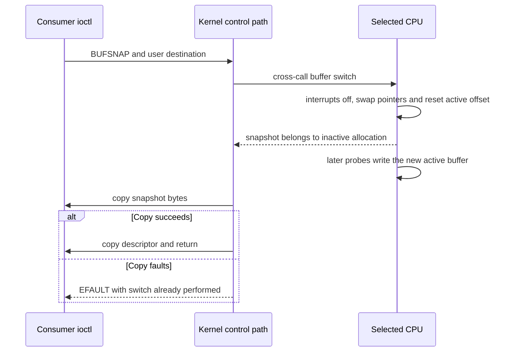

# DTrace providers, validated actions and consumer lifetime

[Guide index](../README.md) · [Observability](observability.md) · [ARM64 syscall entry](../subsystems/platform/arm64-assembly-walkthroughs.md) · [AST delivery](../subsystems/runtime/ast-flavors.md)

DTrace connects a provider's instrumentation site to one or more consumers' predicates and actions. Registering a provider, creating a probe, attaching an enabling, starting recording, draining records and removing instrumentation are separate operations. This chapter follows those boundaries through the local common implementation and the ARM64 `syscall` provider. It also follows a fault during a probe back into ARM64 exception handling. It does not assume that the presence of a provider in the tree makes it available on a particular product kernel.

The source is the `xnu-12377.121.6` checkout. Common DTrace files are selected by `config_dtrace` in [bsd/conf/files](../../xnu/bsd/conf/files#L86-L101), ARM64 backends by [files.arm64](../../xnu/bsd/conf/files.arm64#L18-L23), and pseudo-device initialization by [config/MASTER](../../xnu/config/MASTER#L510-L517). The D compiler, userspace consumer and its cross-CPU merge/formatting are outside the inspected kernel implementation. This is a source walkthrough, not a trace collected from a running kernel.

## 1. A probe ID, an enabled probe ID and a consumer are different identities

The global **probe ID** identifies an instrumentation site described by provider/module/function/name. An **enabled probe ID**, or EPID, identifies one execution-control block within one consumer. Several consumers, or several clauses in one consumer, can attach different predicates/actions to the same probe. The EPID in a recorded payload therefore requires that consumer's description to interpret it; it is not a global syscall number or probe ID.

| Object | Important state | Relationship and lifetime |
| --- | --- | --- |
| [`dtrace_provider_t`](../../xnu/bsd/sys/dtrace_impl.h#L1243-L1253) | `dtpv_pops`, privilege attributes, `dtpv_defunct`, probe/ECB counts | Provider callbacks supply, enable, disable and destroy probes. |
| [`dtrace_probe_t`](../../xnu/bsd/sys/dtrace_impl.h#L103-L125) | `dtpr_id`, tuple strings, `dtpr_arg`, `dtpr_gen`, `dtpr_ecb`, `dtpr_predcache` | Global probe array and tuple hashes locate the site; the ECB list connects it to consumers. |
| [`dtrace_state_t`](../../xnu/bsd/sys/dtrace_impl.h#L1205-L1241) | `dts_activity`, `dts_ecbs`, credentials, variable state, per-CPU principal/aggregation buffers, speculations, timers | A consumer state is associated with a device minor and owns recorded data and execution resources. |
| [`dtrace_enabling_t`](../../xnu/bsd/sys/dtrace_impl.h#L1276-L1287) | ECB descriptions, variable state, generation/error bookkeeping | Parsed descriptions can outlive current matching so newly supplied probes can also match. |
| [`dtrace_ecb_t`](../../xnu/bsd/sys/dtrace_impl.h#L221-L234) | EPID, probe/state pointers, predicate/actions, conditions, record and working sizes | Attached to a probe and indexed in the consumer's ECB array; removal from the firing list precedes destruction. |
| [`dtrace_action_t` and predicate](../../xnu/bsd/sys/dtrace_impl.h#L236-L250) | DIF object, action kind, record offset/size, references | Action lists can be shared by ECBs created from one description; layout is established before firing. |
| [`dtrace_mstate_t`](../../xnu/bsd/sys/dtrace_impl.h#L918-L940) | Current probe/EPID, five immediate arguments, scratch bounds, cached values, fault offset, access flags | Temporary execution state, distinct from the consumer's persistent variables. |

The ECB explicitly joins the two namespaces and the execution/storage requirements:

Source: [bsd/sys/dtrace_impl.h, lines 221–234](../../xnu/bsd/sys/dtrace_impl.h#L221-L234).

<!-- source-excerpt: ../../xnu/bsd/sys/dtrace_impl.h#L221-L234 -->
```c
struct dtrace_ecb {
	dtrace_epid_t dte_epid;			/* enabled probe ID */
	uint32_t dte_alignment;			/* required alignment */
	size_t dte_needed;			/* space needed for execution */
	size_t dte_size;			/* size of recorded payload */
	dtrace_predicate_t *dte_predicate;	/* predicate, if any */
	dtrace_action_t *dte_action;		/* actions, if any */
	dtrace_ecb_t *dte_next;			/* next ECB on probe */
	dtrace_state_t *dte_state;		/* pointer to state */
	uint32_t dte_cond;			/* security condition */
	dtrace_probe_t *dte_probe;		/* pointer to probe */
	dtrace_action_t *dte_action_last;	/* last action on ECB */
	uint64_t dte_uarg;			/* library argument */
};
```



[`dtrace_ecb_add()`](../../xnu/bsd/dev/dtrace/dtrace.c#L11011-L11074) allocates the next consumer EPID and grows `dts_ecbs`. Publishing a replacement array uses a producer barrier; if the state is already active, `dtrace_sync()` precedes freeing the old array because ring processing may still index it. This is an ownership rule, not merely a table-resizing detail.

## 2. Registration supplies sites; open establishes authority and state

[`dtrace_register()`](../../xnu/bsd/dev/dtrace/dtrace.c#L8647-L8780) validates the provider name, attributes, privilege bits and callback contract. At least one provide callback, plus enable/disable/destroy, is required; suspend/resume must be supplied together. It copies the operation table into a new provider, installs null operations for permitted omissions and publishes the provider under `dtrace_provider_lock` and `dtrace_lock`. If retained enablings exist, it requests matching probes, drops these locks and invokes matching through the path that acquires `cpu_lock` and `dtrace_lock`.

[`dtrace_probe_create()`](../../xnu/bsd/dev/dtrace/dtrace.c#L9056-L9119) allocates a numeric ID, retains tuple strings, records provider-private `dtpr_arg` and a monotonically advancing generation, and inserts the probe into provider/module/function/name hashes. If the global pointer array grows, it publishes the replacement, synchronizes CPUs and then frees the old array. Creation alone does not call the provider's enable operation.

Opening the consumer device checks the minor and derives privileges before allocating state. It initializes fasttrap late, asks providers to supply probes, increments the open count and calls `dtrace_state_create()` under `cpu_lock` and `dtrace_lock`. State creation reserves a client slot, starts EPIDs at one, allocates per-CPU buffer **descriptors** and random state, holds credentials, and installs option defaults. The main recording allocations happen at GO. Slot acquisition can return `ERESTART`; the open path unwinds the open count on creation failure. [Open](../../xnu/bsd/dev/dtrace/dtrace.c#L17464-L17543), [state creation](../../xnu/bsd/dev/dtrace/dtrace.c#L14127-L14252).

### Authority is Darwin-specific

The local [`PRIV_POLICY_ONLY()` and `PRIV_POLICY_CHOICE()`](../../xnu/bsd/dev/dtrace/dtrace_glue.c#L247-L259) both test superuser credentials and ignore the nominal privilege selector. Do not import another operating system's granular privilege model. [`dtrace_cred2priv()`](../../xnu/bsd/dev/dtrace/dtrace.c#L8119-L8150) further limits root's provider privileges when DTrace is restricted; [`dtrace_state_create()`](../../xnu/bsd/dev/dtrace/dtrace.c#L14234-L14252) separately selects visibility/action masks. The CSR queries and process code-signing restriction checks are local in [`dtrace_subr.c`](../../xnu/bsd/dev/dtrace/dtrace_subr.c#L418-L477); [process controls](../subsystems/security/code-signing-process-controls.md) explains that policy boundary.

There is also a source-specific distinction in the firing path. ECB creation can request `DTRACE_COND_OWNER`, `DTRACE_COND_USERMODE` and `DTRACE_COND_ZONEOWNER`. In the Apple branch, the OWNER comparison ends in literal `|| 1`, so an ECB carrying OWNER is skipped even if the listed IDs match; the zone comparison is compiled out. The inspected normal root paths set `DTRACE_CRV_ALLPROC`, which avoids installing OWNER for this `syscall` example. Generic comments about matching process ownership do not by themselves describe that Apple body. [Condition assignment](../../xnu/bsd/dev/dtrace/dtrace.c#L11822-L11858), [actual checks](../../xnu/bsd/dev/dtrace/dtrace.c#L7230-L7301).

## 3. ENABLE copies DOF, validates DIF and may leave partial attachment

DOF is a sectioned input containing probe descriptions, predicates, action descriptions, DIF bytecode and tables; the kernel does not compile a D-language program. For non-null `DTRACEIOC_ENABLE`, [`dtrace_dof_copyin()`](../../xnu/bsd/dev/dtrace/dtrace.c#L13044-L13085) first copies the header, bounds `dofh_loadsz`, allocates the whole input and copies again. A changed load size on the second copy is rejected. The ioctl then acquires `cpu_lock` and `dtrace_lock` and requires `INACTIVE`. A null ENABLE argument instead requests reevaluation of retained enablings. [ENABLE dispatcher](../../xnu/bsd/dev/dtrace/dtrace.c#L18067-L18129).

| Validation level | What the inspected code checks | Evidence |
| --- | --- | --- |
| DOF envelope | Magic, data model/native encoding, Darwin DOF v3 and DIF v2, register counts, reserved fields, section-header bounds/alignment | [`dtrace_dof_slurp()`](../../xnu/bsd/dev/dtrace/dtrace.c#L13698-L13804) |
| Loadable sections | Bounds/alignment, terminated string tables, prohibition on provider/probe-definition sections for this enabling ioctl | [Section pass](../../xnu/bsd/dev/dtrace/dtrace.c#L13805-L13849) |
| DIF object construction | Linked section types, maximum size, duplicate tables, entry size/alignment, required text; separate owned copies of bytecode/integer/string/variable tables | [`dtrace_dof_difo()`](../../xnu/bsd/dev/dtrace/dtrace.c#L13298-L13473) |
| Instruction/variable contract | Operands/reserved bits, register indices, fixed zero register, branch targets, table references, variable compatibility, subroutines | [`dtrace_difo_validate()`](../../xnu/bsd/dev/dtrace/dtrace.c#L9692-L10138) |
| Execution access | Actual ranges, scratch availability, dynamic-pool capacity, destructive authority and runtime faults | [Interpreter](../../xnu/bsd/dev/dtrace/dtrace.c#L5767-L5804), [memory checks](../../xnu/bsd/dev/dtrace/dtrace.c#L1015-L1113), [scratch allocation](../../xnu/bsd/dev/dtrace/dtrace.c#L6475-L6501) |

The branch validator rejects both an out-of-program target and a backward or self branch:

Source: [bsd/dev/dtrace/dtrace.c, lines 9847–9855](../../xnu/bsd/dev/dtrace/dtrace.c#L9847-L9855).

<!-- source-excerpt: ../../xnu/bsd/dev/dtrace/dtrace.c#L9847-L9855 -->
```c
			if (label >= dp->dtdo_len) {
				err += efunc(pc, "invalid branch target %u\n",
				    label);
			}
			if (label <= pc) {
				err += efunc(pc, "backward branch to %u\n",
				    label);
			}
			break;
```

Thus this DIF control flow cannot implement a backwards bytecode loop. That does not prove that arbitrary work in every helper/action is cheap. The validator also rewrites ordinary kernel-load opcodes to restricted loads when kernel visibility is absent, and the interpreter still checks permitted memory for those operations. [Load rewriting](../../xnu/bsd/dev/dtrace/dtrace.c#L9759-L9774), [restricted-load execution](../../xnu/bsd/dev/dtrace/dtrace.c#L5928-L6010). Helper DOF has additional restrictions in [`dtrace_difo_validate_helper()`](../../xnu/bsd/dev/dtrace/dtrace.c#L10141-L10307); helpers/USDT are a separate path from this consumer enabling.

After options are processed, matching creates ECBs, retains predicates and creates or shares action lists. `dtrace_ecb_resize()` computes record offsets/alignment and distinguishes `dte_needed`, the working space a firing needs, from `dte_size`, the bytes eventually retained. The first ECB on a site calls the provider enable callback; subsequent ECBs append to the list and synchronize CPUs. [ECB/action construction](../../xnu/bsd/dev/dtrace/dtrace.c#L11802-L11889), [layout](../../xnu/bsd/dev/dtrace/dtrace.c#L11124-L11252).

Source: [bsd/dev/dtrace/dtrace.c, lines 11093–11106](../../xnu/bsd/dev/dtrace/dtrace.c#L11093-L11106).

<!-- source-excerpt: ../../xnu/bsd/dev/dtrace/dtrace.c#L11093-L11106 -->
```c
	probe->dtpr_provider->dtpv_ecb_count++;
	if (probe->dtpr_ecb == NULL) {
		dtrace_provider_t *prov = probe->dtpr_provider;

		/*
		 * We're the first ECB on this probe.
		 */
		probe->dtpr_ecb = probe->dtpr_ecb_last = ecb;

		if (ecb->dte_predicate != NULL)
			probe->dtpr_predcache = ecb->dte_predicate->dtp_cacheid;

		return (prov->dtpv_pops.dtps_enable(prov->dtpv_arg,
                    probe->dtpr_id, probe->dtpr_arg));
```

Matching is **not an all-or-nothing transaction**. [`dtrace_enabling_match()`](../../xnu/bsd/dev/dtrace/dtrace.c#L12770-L12834) can stop after earlier probes have acquired ECBs; its error body explicitly preserves that partial progress. Destroying temporary enabling descriptions is not the same as destroying already attached consumer ECBs. Retention after matching can also fail with `ENOSPC`; that failure does not roll back attached ECBs in the ioctl. Close/state destruction is the explicit teardown path. [Retained-list admission](../../xnu/bsd/dev/dtrace/dtrace.c#L12639-L12669), [ioctl result](../../xnu/bsd/dev/dtrace/dtrace.c#L18114-L18129).

For successful retention, each ECB description's `dted_probegen` records the generation already considered, and matching skips older probes. A later provider/module can supply new sites without duplicating previous attachments. The enabling structure has other generation bookkeeping too; the actual duplicate guard here uses the **description's** generation. [Generation guard](../../xnu/bsd/dev/dtrace/dtrace.c#L11898-L11914), [generation update](../../xnu/bsd/dev/dtrace/dtrace.c#L12825-L12834).

## 4. GO activates recording; STOP does not dismantle the provider

`DTRACEIOC_GO` calls [`dtrace_state_go()`](../../xnu/bsd/dev/dtrace/dtrace.c#L14500-L14782). It requires `INACTIVE`, primes retained descriptions so requirements are known, checks destructive-action permission, reserves END space and allocates speculation descriptors, principal/aggregation buffers and the dynamic-variable pool. Automatic resize can reduce dynamic-pool size after allocation failure; manual resize causes failure instead. Successful setup installs cleaner/deadman cyclics and enters `WARMUP`.

On the initiating CPU, GO disables interrupts, activates that CPU's buffer and fires `dtrace:::BEGIN` with the consumer pointer as argument zero. If BEGIN did not execute an exit action, activity becomes `ACTIVE`; otherwise it remains `DRAINING`. A cross-call activates buffers on relevant CPUs, preventing one CPU from starting halfway through a consumer's ECB list. [Activation sequence](../../xnu/bsd/dev/dtrace/dtrace.c#L14692-L14751).



The diagram omits setup failures and some pseudo-provider/error cases. `GO` rejects a stopped state because it requires `INACTIVE`. The probe activity gate permits selected DTrace pseudo-provider work outside ACTIVE, while ordinary provider ECBs are skipped. BEGIN also checks WARMUP so a preceding BEGIN exit action prevents subsequent BEGIN clauses. [Activity gate](../../xnu/bsd/dev/dtrace/dtrace.c#L7196-L7228).

[`dtrace_state_stop()`](../../xnu/bsd/dev/dtrace/dtrace.c#L14785-L14834) accepts ACTIVE or DRAINING, publishes DRAINING and synchronizes CPUs, then COOLDOWN and synchronizes again. This establishes that former ACTIVE firings have cleared before END can use the released reserve. It fires END, records the CPU for userspace's ordering, marks STOPPED and synchronizes. ECBs, instrumentation and allocations still exist for readout/close.

Both GO and STOP perform their transition **before** copying the CPU result to userspace. An `EFAULT` from that copyout does not mean GO failed to start or STOP failed to stop. [Ioctl wrappers](../../xnu/bsd/dev/dtrace/dtrace.c#L18289-L18316).

## 5. The ARM64 syscall provider interposes a real dispatch slot

[`systrace_attach()`](../../xnu/bsd/dev/dtrace/systrace.c#L538-L557) sets the probe callback to `dtrace_probe()` and registers provider `syscall` with `DTRACE_PRIV_USER`. Its provide callback saves each eligible `sysent` handler and return type in `systrace_sysent[]`, then creates entry/return probes named from `syscallnames[]`. The provider-private argument encodes the syscall index and entry/return direction; it is not the global probe ID. [Initialization and provision](../../xnu/bsd/dev/dtrace/systrace.c#L344-L416).

`systrace_enable()` stores the entry or return probe ID. On the first enabled direction for a syscall, it replaces the dispatch pointer with `dtrace_systrace_syscall` under `dtrace_systrace_lock`, using `ml_nofault_copy()` because `sysent[]` is declared const. The source strips pointer authentication on the inserted function pointer through `ptrauth_nop_cast`. It returns success here without checking the copy routine's result; the body alone is not evidence that an arbitrary hardened target permits that write. [Enable](../../xnu/bsd/dev/dtrace/systrace.c#L446-L482).

For a 64-bit ARM64 BSD syscall, the dispatcher obtains arguments and performs admission checks, then calls `callp->sy_call`. If interposed, the wrapper obtains the selector from saved `x16`, or `x0` for an indirect syscall, runs the generated `systrace_args()` conversion and fires the entry probe. This adds no extra EL0/EL1 transition: DTrace runs synchronously inside the existing kernel syscall path. [ARM dispatcher](../../xnu/bsd/dev/arm/systemcalls.c#L90-L184), [wrapper selector and arguments](../../xnu/bsd/dev/dtrace/systrace.c#L137-L185).

Five immediate arguments are passed by value; the converted array remains temporarily reachable through the current `uthread` for the provider's other argument queries:

Source: [bsd/dev/dtrace/systrace.c, lines 173–185](../../xnu/bsd/dev/dtrace/systrace.c#L173-L185).

<!-- source-excerpt: ../../xnu/bsd/dev/dtrace/systrace.c#L173-L185 -->
```c
	if ((id = sy->stsy_entry) != DTRACE_IDNONE) {
		uthread_t uthread = current_uthread();
		if (uthread) {
			uthread->t_dtrace_syscall_args = uargs;
		}

		static_assert(SYSTRACE_NARGS >= 5, "not enough system call arguments");
		(*systrace_probe)(id, uargs[0], uargs[1], uargs[2], uargs[3], uargs[4]);

		if (uthread) {
			uthread->t_dtrace_syscall_args = NULL;
		}
	}
```



This diagram selects an ordinary C return. A syscall resuming through [`unix_syscall_return()`](../../xnu/bsd/dev/arm/systemcalls.c#L231-L267) takes the separate `dtrace_systrace_syscall_return()` hook if the current dispatch slot remains interposed; it does not return through the suspended wrapper in the diagram. The trace is sensitive to current enable state, so an entry does not guarantee a return record.

For ordinary return, the wrapper stores `t_dtrace_errno`, translates according to `stsy_return_type`, represents errors and `ERESTART` with `-1`, and uses zero for the `EJUSTRETURN` result pair. The firing arguments are `(rv0, rv0, rv1, raw_error, 0)`: duplicating the first return is deliberate provider ABI, while the architecture dispatcher subsequently implements the actual user-register/carry/restart convention. [Wrapper return conversion](../../xnu/bsd/dev/dtrace/systrace.c#L207-L284), [continuation conversion](../../xnu/bsd/dev/dtrace/systrace.c#L290-L368).

A symbolic exercise is a single active consumer with one `syscall::read:entry` ECB, a true predicate and an action recording the requested length. The wrapper supplies converted `read` arguments; the action evaluates the length expression and writes a consumer-layout record. A second consumer has its own EPID, buffer and predicate even though both attach to the same global entry probe. This is a source-derived scenario, not a claimed compiled D program or measured trace.

## 6. Firing runs with interrupts disabled and commits one ECB at a time

[`dtrace_probe_enter()`](../../xnu/bsd/dev/dtrace/dtrace.c#L6979-L7002) saves/disables interrupt state and increments the thread's in-probe nesting count. Recursion is allowed only for ERROR by the checked invariant. `dtrace_probe_exit()` decrements the count and restores previous interrupt state, including hygiene bookkeeping where configured. It does not unconditionally turn interrupts on. [Exit](../../xnu/bsd/dev/dtrace/dtrace.c#L7009-L7044), [interrupt glue](../../xnu/bsd/dev/dtrace/dtrace_glue.c#L916-L925).

`dtrace_probe()` validates the global ID/slot, identifies CPU/interrupt context, skips a matching cached-false predicate outside interrupt context, and refuses tracing during panic quiescence. It builds machine state and walks the site's ECB list. Each ECB independently checks consumer activity and security conditions, deadman liveness and buffer space. It then establishes access flags, evaluates the predicate, and executes ordered actions. [Entry checks](../../xnu/bsd/dev/dtrace/dtrace.c#L7047-L7095), [ECB processing](../../xnu/bsd/dev/dtrace/dtrace.c#L7165-L7430).



The next-ECB box returns to the remaining list; after the last ECB the routine restores interrupt state. The diagram omits speculation's separate commit branch and action-specific side effects.

Reservation precedes predicate evaluation. The routine can write a provisional header but normally advances `dtb_offset` only after successful actions; a false predicate or runtime fault therefore does not publish that ordinary record. It does **not** undo every prior effect. Variable changes, aggregation updates, destructive actions and speculation commits have their own effects; ring reservation can also discard older data before a predicate is found false. [Reservation/predicate](../../xnu/bsd/dev/dtrace/dtrace.c#L7329-L7384), [fault/drop/commit](../../xnu/bsd/dev/dtrace/dtrace.c#L7694-L7756), [ring reservation consequences](../../xnu/bsd/dev/dtrace/dtrace.c#L12231-L12372).

Only suitable predicates receive cache IDs. A single-ECB probe can cache a false result in the thread; adding another ECB clears the probe's cache ID. Exec clears the thread cache because identity variables such as `execname` may have changed. This is an optimization with validity conditions, not a cache of every predicate outcome. [Predicate creation](../../xnu/bsd/dev/dtrace/dtrace.c#L10890-L10923), [ECB append](../../xnu/bsd/dev/dtrace/dtrace.c#L11107-L11120), [exec invalidation](../../xnu/bsd/dev/dtrace/dtrace.c#L16630-L16638).

## 7. DIF has temporary execution state, persistent storage and fault reporting

[`dtrace_dif_emulate()`](../../xnu/bsd/dev/dtrace/dtrace.c#L5767-L5804) interprets the copied instruction array with integer/tuple registers, condition codes and a program counter. Register zero is fixed at zero. `mstate->dtms_difo` identifies the active object for access checks; the loop stops on `CPU_DTRACE_FAULT`. Constants and strings come from DIF tables, while variables use the consumer's [`dtrace_vstate_t`](../../xnu/bsd/sys/dtrace_impl.h#L877-L897).

| Storage | Acquisition and use | Release/reuse boundary |
| --- | --- | --- |
| Firing scratch | `dtms_scratch_base/size/ptr`; `ALLOCS` aligns, checks overflow/capacity and zeroes bytes | Temporary to the firing; later use can overwrite it. Switch-mode scratch follows reserved working space; ring/fill use the inactive allocation. |
| Static variables | DIF initialization establishes consumer global/per-CPU local allocations and holds | DIF/variable-state reference release, rather than end of one record. |
| Dynamic variables | Tuple keys plus variable/thread identity select `dtrace_dynvar_t` in a preallocated hash/pool; firing does not request a sleeping general-purpose allocation | Removal moves storage to a dirty list; cleaner synchronization precedes reuse. |

[Scratch reservation](../../xnu/bsd/dev/dtrace/dtrace.c#L12197-L12210), [ring/fill scratch](../../xnu/bsd/dev/dtrace/dtrace.c#L12388-L12400), [variable initialization](../../xnu/bsd/dev/dtrace/dtrace.c#L10535-L10647), [dynamic structures](../../xnu/bsd/sys/dtrace_impl.h#L784-L854), [dynamic lookup/allocation](../../xnu/bsd/dev/dtrace/dtrace.c#L1867-L2215).

Source: [bsd/dev/dtrace/dtrace.c, lines 6475–6495](../../xnu/bsd/dev/dtrace/dtrace.c#L6475-L6495).

<!-- source-excerpt: ../../xnu/bsd/dev/dtrace/dtrace.c#L6475-L6495 -->
```c
		case DIF_OP_ALLOCS: {
			uintptr_t ptr = P2ROUNDUP(mstate->dtms_scratch_ptr, 8);
			size_t size = ptr - mstate->dtms_scratch_ptr + regs[r1];

			/*
			 * Rounding up the user allocation size could have
			 * overflowed large, bogus allocations (like -1ULL) to
			 * 0.
			 */
			if (size < regs[r1] ||
			    !DTRACE_INSCRATCH(mstate, size)) {
				DTRACE_CPUFLAG_SET(CPU_DTRACE_NOSCRATCH);
				regs[rd] = 0;
				break;
			}

			dtrace_bzero((void *) mstate->dtms_scratch_ptr, size);
				mstate->dtms_scratch_ptr += size;
				regs[rd] = ptr;
			break;
		}
```

A removed dynamic variable cannot immediately return to the free pool: another CPU may hold a pointer from a hash traversal. Removal unlinks it, marks its hash value free and pushes it onto the current CPU's dirty list. The cleaner atomically moves dirty to rinsing, calls `dtrace_sync()`, publishes rinsed storage as clean, then synchronizes again before publishing `DTRACE_DSTATE_CLEAN`. Dirty/rinsing exhaustion is counted separately from ordinary capacity loss. [Removal](../../xnu/bsd/dev/dtrace/dtrace.c#L2048-L2097), [cleaning](../../xnu/bsd/dev/dtrace/dtrace.c#L1780-L1857), [drop status](../../xnu/bsd/dev/dtrace/dtrace.c#L18564-L18577).

A validated stream can still divide by zero, exhaust scratch, access an invalid address or encounter unavailable dynamic data. The probe checks CPU-local fault/drop flags after actions. Faults increment buffer errors and fire `dtrace:::ERROR` with consumer/EPID, action index, DIF offset, fault class and offending value; a fault in ERROR increments `dts_dblerrors` instead of recursively reporting forever. [Arithmetic fault](../../xnu/bsd/dev/dtrace/dtrace.c#L5832-L5864), [reporting](../../xnu/bsd/dev/dtrace/dtrace.c#L7694-L7753).

### ARM64 faults during instrumentation have a separate recovery rule

On a VM fault with `thread->t_dtrace_inprobe`, the kernel-abort path calls `dtrace_tally_fault()`. It records BADADDR and the address, but authorizes recovery only if `CPU_DTRACE_NOFAULT` is set. With authorization, the handler uses the applicable recovery entry or advances the saved ARM64 PC by four bytes; without it, the path panics. This does not turn arbitrary probe-time faults into ordinary `vm_fault()` waits or universally swallow kernel faults. [Fault tally](../../xnu/bsd/dev/dtrace/dtrace_glue.c#L1235-L1240), [safe-load helpers](../../xnu/bsd/dev/dtrace/dtrace.c#L550-L601).

Source: [osfmk/arm64/sleh.c, lines 2554–2569](../../xnu/osfmk/arm64/sleh.c#L2554-L2569).

<!-- source-excerpt: ../../xnu/osfmk/arm64/sleh.c#L2554-L2569 -->
```c
#if CONFIG_DTRACE
	if (is_vm_fault(fault_code) && thread->t_dtrace_inprobe) { /* Executing under dtrace_probe? */
		if (dtrace_tally_fault(fault_addr)) { /* Should a fault under dtrace be ignored? */
			/*
			 * Point to next instruction, or recovery handler if set.
			 */
			if (recover) {
				handle_kernel_abort_recover(state, esr, VM_USER_STRIP_PTR(fault_addr), thread, recover);
			} else {
				add_saved_state_pc(state, 4);
			}
			return;
		} else {
			panic_with_thread_kernel_state("Unexpected page fault under dtrace_probe", state);
		}
	}
```

## 8. Recording, aggregation and wakeup have separate completion points

The principal [`dtrace_buffer_t`](../../xnu/bsd/sys/dtrace_impl.h#L429-L451) tracks active/inactive pointers, retained offset, size, wake threshold, drops/errors and snapshot metadata. Headers carry consumer EPID and timestamp. `DTRACEIOC_EPROBE` obtains that EPID's record description; stored action values are not necessarily preformatted human-readable output. [Header](../../xnu/bsd/dev/dtrace/dtrace.c#L7339-L7358), [EPROBE](../../xnu/bsd/dev/dtrace/dtrace.c#L17889-L17971).

| Buffer policy | Producer decision | Readout constraint |
| --- | --- | --- |
| Switch, the initial default | Append to active buffer; capacity exhaustion counts drops until a switch provides space | BUFSNAP cross-calls the selected CPU, swaps allocations, then copies the inactive snapshot. |
| Ring | Wrap and advance the oldest-record boundary using EPIDs and record sizes; old records can be overwritten | Snapshot requires STOPPED and may copy the whole wrapped buffer plus oldest offset. |
| Fill | Stop taking ordinary records at capacity reduced by END reserve; mark FULL | Snapshot requires STOPPED; COOLDOWN can use the released END reserve. |

[Default](../../xnu/bsd/dev/dtrace/dtrace.c#L14202-L14223), [reservation](../../xnu/bsd/dev/dtrace/dtrace.c#L12136-L12400), [snapshot modes](../../xnu/bsd/dev/dtrace/dtrace.c#L18370-L18518).

Aggregation uses a separate per-CPU buffer. `dtrace_aggregate()` hashes the tuple constructed in principal working space, compares existing keys, and applies the operation to an existing value or allocates a new key/value within the bounded aggregation buffer. `count()` increments a counter; it does not imply one principal record per firing. New-key allocation can fail while an existing-key update still fits. AGGSNAP extracts per-CPU aggregation data; userspace combining/formatting is outside this kernel trace. [Count](../../xnu/bsd/dev/dtrace/dtrace.c#L2508-L2513), [aggregation](../../xnu/bsd/dev/dtrace/dtrace.c#L2531-L2735).

Crossing `dtb_limit` expands the current limit to buffer size, increments `dts_buf_over_limit`, sets a bit in `dtrace_wake_clients` and requests `AST_DTRACE`. It does not directly wake the sleeping consumer from probe context. The user-return AST handler runs `dtrace_ast()` with interrupts enabled; it exchanges the bitmask and wakes consumers with preemption disabled. `DTRACEIOC_SLEEP` arms a wait and rechecks the over-limit count before blocking. Threshold crossing, AST delivery, wakeup and extraction are separate events. [Producer](../../xnu/bsd/dev/dtrace/dtrace.c#L12177-L12201), [AST](../../xnu/osfmk/kern/ast.c#L307-L314), [wakeups](../../xnu/bsd/dev/dtrace/dtrace.c#L19228-L19252), [sleep/recheck](../../xnu/bsd/dev/dtrace/dtrace.c#L18338-L18362).

The deadman adds another distinction: STATUS updates `dts_laststatus`; the periodic callback refreshes `dts_alive` only while the consumer is recent enough. Firing can move a stale consumer to KILLED unless its destructive privileges/options permit the exception. An empty buffer alone does not indicate a dead consumer. [Heartbeat](../../xnu/bsd/dev/dtrace/dtrace.c#L18537-L18559), [callback](../../xnu/bsd/dev/dtrace/dtrace.c#L14101-L14124), [firing check](../../xnu/bsd/dev/dtrace/dtrace.c#L7303-L7327).

## 9. A switched snapshot is consumed before copyout can fail

[`dtrace_buffer_switch()`](../../xnu/bsd/dev/dtrace/dtrace.c#L11967-L11995) disables local interrupts while exchanging pointers and preserving the old offset/errors/drop counts. That CPU cannot simultaneously append through the old active pointer from an ordinary probe on the same CPU.

Source: [bsd/dev/dtrace/dtrace.c, lines 11978–11994](../../xnu/bsd/dev/dtrace/dtrace.c#L11978-L11994).

<!-- source-excerpt: ../../xnu/bsd/dev/dtrace/dtrace.c#L11978-L11994 -->
```c
	cookie = dtrace_interrupt_disable();
	now = dtrace_gethrtime();
	buf->dtb_tomax = xamot;
	buf->dtb_xamot = tomax;
	buf->dtb_xamot_drops = buf->dtb_drops;
	buf->dtb_xamot_offset = buf->dtb_offset;
	buf->dtb_xamot_errors = buf->dtb_errors;
	buf->dtb_xamot_flags = buf->dtb_flags;
	buf->dtb_offset = 0;
	buf->dtb_drops = 0;
	buf->dtb_errors = 0;
	buf->dtb_flags &= ~(DTRACEBUF_ERROR | DTRACEBUF_DROPPED);
	buf->dtb_interval = now - buf->dtb_switched;
	buf->dtb_switched = now;
	buf->dtb_cur_limit = buf->dtb_limit;

	dtrace_interrupt_enable(cookie);
```



The control path detects an offline/nonparticipating CPU by checking whether the pointer changed and returns `ENOENT` if no switch occurred. Once it did switch, failure copying the payload or final descriptor is not rolled back. Reissuing BUFSNAP makes another switch, rather than promising retransmission of the same failed snapshot. Data may have been partly copied, and the next switch makes its allocation writable again. [Switch/check/copyout](../../xnu/bsd/dev/dtrace/dtrace.c#L18447-L18518).

For ring/fill, buffers are stopped and the code marks CONSUMED only after both data and descriptor copyouts succeed. A fault leaves that stopped snapshot available for another attempt; after consumption, a later read yields size zero. This differs materially from switch-mode failure. [Stopped snapshot](../../xnu/bsd/dev/dtrace/dtrace.c#L18391-L18443).

Suppose CPU 2 has active buffer A containing 96 retained bytes and empty inactive B. BUFSNAP changes active to B with offset zero and inactive to A with snapshot offset 96. If copying A faults, producers may already be appending to B. A retry swaps again and obtains B's current records while A becomes active at offset zero. This is illustrative byte accounting, not a fixed record-size claim or measured execution.

## 10. Close retracts descriptions, detaches ECBs and releases storage

[`dtrace_state_destroy()`](../../xnu/bsd/dev/dtrace/dtrace.c#L14892-L15007) first retracts retained enablings. If ACTIVE or DRAINING, it marks KILLED and synchronizes CPUs before removing executable state. It releases the held credential, then disables/destroys ECBs in two passes, kernel-privileged probes first to reduce instrumentation during cleanup. It synchronizes again before freeing buffers, per-CPU random state, speculations, cyclics and variable/aggregation/format resources. This close path is not an implicit orderly STOP/END sequence.

Disabling an ECB unlinks it from its probe, decreases the provider ECB count and calls `dtrace_sync()`. If it was the last ECB, it clears predicate caching, invokes the provider disable callback and synchronizes again. Only then can destruction release predicate/action references and clear the consumer array slot. [Disable/destroy](../../xnu/bsd/dev/dtrace/dtrace.c#L11699-L11798).

For systrace, disabling one direction preserves interposition when the other direction remains enabled. Disabling the last direction restores the saved handler under the systrace lock, then clears that direction's ID. Entry and return are separate **probes**, each potentially carrying ECBs from several consumers; provider disable is called only when that probe loses its final ECB. [Systrace disable](../../xnu/bsd/dev/dtrace/systrace.c#L486-L524).

On ARM64, `dtrace_sync()` reaches an all-CPU cross-call. `dtrace_xcall()` serializes cross-calls with `dt_xc_lock` and uses synchronous `cpu_broadcast_xcall()`; callbacks select the requested CPU or all CPUs. This is why withdrawal plus synchronization can precede freeing objects referenced from interrupt-disabled probe execution. Control-plane mutexes are not held by every firing. [Sync glue](../../xnu/bsd/dev/dtrace/dtrace_glue.c#L931-L942), [ARM64 cross-call](../../xnu/bsd/dev/arm64/dtrace_isa.c#L105-L137).

Invalidation and unregister are additional boundaries. Invalidation marks `dtpv_defunct`; unregister still refuses a provider with attached ECBs, and ordinarily refuses while consumers or anonymous ECBs exist unless the provider is defunct. Successful unregister removes probe array/hash visibility, synchronizes, invokes destroy callbacks, and releases IDs/strings/probes before freeing the provider. Condense instead removes currently unenabled probes while retaining the provider. These operations are not interchangeable with stopping one consumer. [Invalidation/condense](../../xnu/bsd/dev/dtrace/dtrace.c#L8940-L9038), [unregister](../../xnu/bsd/dev/dtrace/dtrace.c#L8789-L8931).

The chosen provider does not demonstrate every unregister path: `systrace_detach()` is explicitly excluded on Apple. Close can remove instrumentation through disable without unregistering the syscall provider. Device close also handles lazy DOF/symbol transitions, attempts orphaned-module-probe cleanup and resumes cluster powerdown after state is gone. [Absent Apple detach](../../xnu/bsd/dev/dtrace/systrace.c#L560-L587), [close](../../xnu/bsd/dev/dtrace/dtrace.c#L17598-L17676).

## 11. Evidence, failure checkpoints and remaining scope

| Checkpoint | Source-supported result | What it does not establish |
| --- | --- | --- |
| Configuration/admission | Source selection, initialization, callback checks, Darwin privilege/CSR predicates | Every provider's availability or successful dispatch/text interposition on a stock device. |
| Invalid DOF/DIF | Envelope/table/instruction/variable rejection and local cleanup | Complete verification of every helper, opcode and input combination. |
| Partial ENABLE | Earlier ECBs can remain after a later matching/retention error | Transactional rollback or safe retry semantics. |
| GO/STOP result-copy failure | Activity may already have transitioned | That `EFAULT` means no effect. |
| Predicate/action failure | An ordinary principal record may stay uncommitted; errors/drops have separate counters | Rollback of prior variable/aggregation/action effects or old ring data. |
| BUFSNAP failure | Switch may already have occurred; stopped ring/fill consumption differs | Exactly-once userspace delivery. |
| Close/unregister | Retraction, withdrawal, synchronization and eventual storage release | Every provider's private patching/unload safety or whole-system concurrency correctness. |

This chapter inspected common consumer/provider/ECB/DIF validation and selected execution bodies, switch/ring/fill reservation/readout, dynamic-variable reclamation, basic aggregation, systrace and ARM64 fault/cross-call integration. Fasttrap/USDT instruction patching and single stepping, FBT/SDT/lockstat/profile internals, Mach-trap provider details, full speculation algorithms, every DIF subroutine, helper-process fork/exec lifetime and anonymous tracing remain separate work. Source selection references these implementations; it does not stand in for tracing their bodies.

No dedicated DTrace consumer-lifecycle test was identified in the inspected `tests/` filename inventory; available Kdebug/kperf tests target different mechanisms. The cited assertions and error branches describe constraints, not test results. No kernel build, DTrace program, fault injection or device experiment was run.

<!-- BEGIN PLATYDOC DOCUMENTATION LICENSE -->
Original Platydoc text and diagrams are licensed under [CC BY 4.0](https://creativecommons.org/licenses/by/4.0/). Quoted source code and third-party material retain their respective licenses.
<!-- END PLATYDOC DOCUMENTATION LICENSE -->
