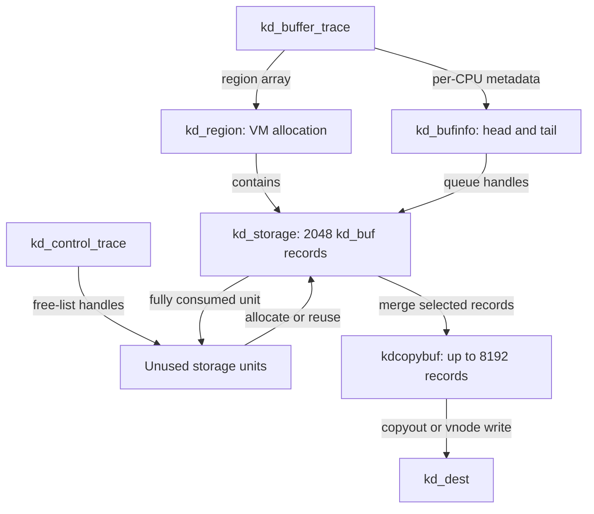
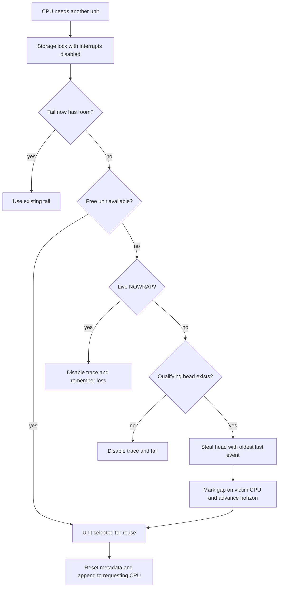
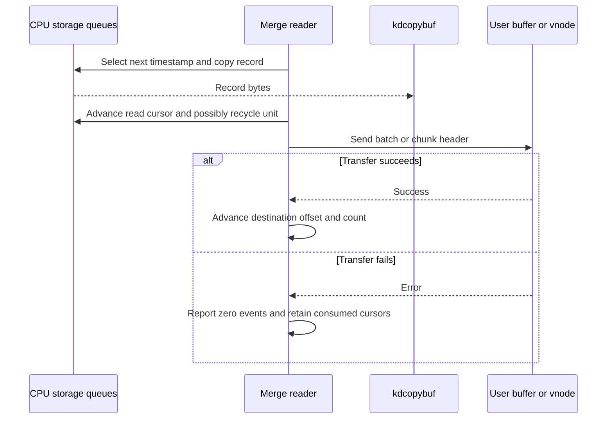
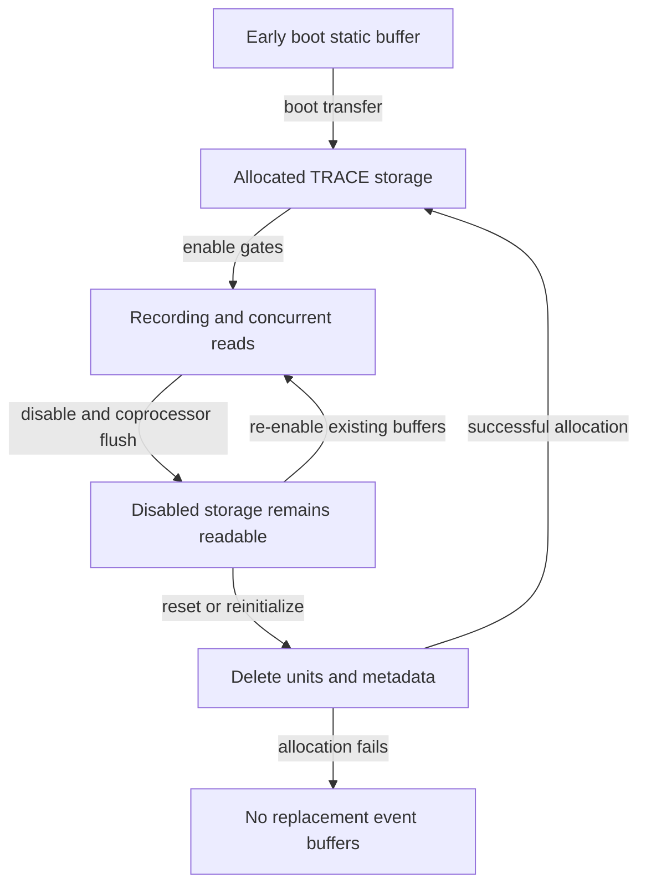

# Kdebug storage, timestamp merging and consumer readout

[Observability](observability.md) · [Handbook](../README.md) · [Kernel logging and Firehose](kernel-logging-and-firehose.md) · [Clocks and time domains](../subsystems/runtime/clocks-and-time-domains.md)

Kdebug turns selected numeric events into a bounded set of per-CPU record queues, then merges those queues for a reader. The interesting boundaries are between reserving a record, filling its fields, retaining its storage, selecting it for a read, and successfully transferring the bytes. These are different operations; an event can pass one boundary and disappear before another. This chapter follows the common and ARM64 implementation in `xnu-12377.121.6`, including coprocessor events, control ownership, loss markers and direct file output.

Kdebug is distinct from [Firehose and text logging](kernel-logging-and-firehose.md). Kperf can emit events and react to selected event IDs, but its action/sample machinery is not the storage allocator described here. Kdebug triage reuses some structures and allocation code with a separate buffer and different producer/consumer ordering. It must not be used as evidence for the regular TRACE path without checking that path's body.

## 1. The objects between an event site and a reader

On ARM64, `kd_buf` is a 64-byte ABI record: a 64-bit timestamp, five 64-bit argument slots, a 32-bit debug ID, a separate 32-bit CPU ID and an unused 64-bit slot. The argument-width definition keeps the ARM64 LP32 and LP64 representations identical. Ordinary `kernel_debug()` obtains the current thread ID for `arg5`; `kernel_debug1()` and coprocessor entry accept that field from their caller. The header's “Always the thread ID” describes its intended meaning, not a check imposed on every internal caller. [Record representation and accessors](../../xnu/bsd/sys/kdebug_private.h#L250-L303), [kernel entries](../../xnu/bsd/kern/kdebug.c#L895-L934), [coprocessor entry](../../xnu/bsd/kern/kdebug.c#L945-L975).

The debug ID carries an 8-bit class, an 8-bit subclass, a 14-bit code and two function-qualifier bits. A numeric ID and four arguments do not describe their own units or ownership: the emitting call site and [trace-code names](../../xnu/bsd/kern/trace_codes) supply that interpretation. [ID masks and extraction](../../xnu/bsd/sys/kdebug.h#L61-L92).

| Object | Important state | What owns or uses it |
| --- | --- | --- |
| `kd_control_trace` / `kd_control` | Emission mode, configured/live flags, CPU count, free-list head, storage lock, oldest acceptable time | Global TRACE control. It is not a per-process session object. |
| `kd_buffer_trace` / `kd_buffer` | Regions, per-CPU metadata, total capacity, wake threshold, `kdcopybuf` | Owns allocated backing and the merge staging buffer. |
| `kd_region` | `kdr_addr`, `kdr_size` | One VM allocation containing many `kd_storage` objects. |
| `kds_ptr` | 21-bit region index, 11-bit unit offset, `KDS_PTR_NULL` sentinel | A compact handle into the region array; not a userspace pointer or record index. |
| `kd_bufinfo` | Per-CPU head/tail, pending loss, previous read timestamp, most recent rejected old timestamp, input clock domain | One logical event queue for an application CPU or registered coprocessor ID. |
| `kd_storage` | Next unit, reservation index, count, read cursor, loss flag, timestamp floor, 2,048 records | A unit migrates between the common free list and a CPU's queue. |
| `kd_dest` | Copyout buffer/size or vnode/context, output offset, optional chunk format | A read request's destination; it does not retain the consumed source records on failure. |

Definitions: [storage and control types](../../xnu/bsd/sys/kdebug_common.h#L65-L154), [TRACE globals](../../xnu/bsd/kern/kdebug.c#L357-L385), [destination](../../xnu/bsd/kern/kdebug.c#L259-L292).

The storage fields are compact enough to read together:

[Source: `bsd/sys/kdebug_common.h`, lines 73–83](../../xnu/bsd/sys/kdebug_common.h#L73-L83).

<!-- source-excerpt: ../../xnu/bsd/sys/kdebug_common.h#L73-L83 -->
```c
struct kd_storage {
	union kds_ptr kds_next;
	uint32_t kds_bufindx;
	uint32_t kds_bufcnt;
	uint32_t kds_readlast;
	uint32_t kds_lostevents:1;
	uint32_t unused:31;
	uint64_t kds_timestamp;

	kd_buf kds_records[TRACE_EVENTS_PER_STORAGE_UNIT];
};
```

`kds_bufindx` is the next reservation index; `kds_readlast` is the consumer cursor. `kds_bufcnt` is also incremented by producers and is consulted when choosing a unit to steal. In this TRACE implementation it is incremented **before** the record payload is filled, so naming it a completed-record count would misdescribe the body. Section 4 follows the exact sequence.



This is a storage-ownership diagram. The record transfer to `kdcopybuf` is a copy; it is not a shared userspace mapping of the per-CPU storage.

## 2. Session ownership, allocation and enabling

### 2.1 A trace reader can change the shared session

The `kern.kdebug` sysctl handler takes `ktrace_lock()` around `_kd_sysctl_internal()`. Only `KERN_KDGETBUF` and `KERN_KDREADCURTHRMAP` use the read-only permission check; reading event records through `KERN_KDREADTR` calls `ktrace_configure(KTRACE_KDEBUG)`, just like a configuration operation. That matters because reading consumes global cursors and may acquire ownership. [Sysctl gate](../../xnu/bsd/kern/kdebug.c#L2914-L2926), [handler locking](../../xnu/bsd/kern/kdebug.c#L3072-L3116).

`ktrace_configure()` accepts the existing owner's process unique ID, rejects a background tool while foreground tracing is active, and performs owner-liveness maintenance before considering takeover. A PID match alone is insufficient: the found process must still have the saved unique ID. An unowned/background session can be acquired by a superuser, or by the separately guarded development/debug entitlement. Another live foreground owner produces `EBUSY`. Taking foreground ownership from background resets active kdebug/kperf state. These decisions are separate from whether any event class is enabled. [Access and identity checks](../../xnu/bsd/kern/kern_ktrace.c#L279-L375), [foreground/background transition](../../xnu/bsd/kern/kern_ktrace.c#L491-L527).

### 2.2 Capacity is rounded into units, not a private ring per CPU

A typical control sequence selects the desired number of records with `KERN_KDSETBUF`, allocates with `KERN_KDSETUP`, configures filters/flags, then enables `KERN_KDENABLE`. Setting the count does not allocate backing immediately. The request is capped using half the smaller of the kernel data-shared range size and `sane_size`, divided by `sizeof(kd_buf)`, and additionally capped by `UINT_MAX`. Allocation then rounds down to whole storage units unless it must raise the count to the minimum. [Count limit](../../xnu/bsd/kern/kdebug.c#L2172-L2191), [setup/enable dispatch](../../xnu/bsd/kern/kdebug.c#L2950-L2975).

`create_buffers_trace()` computes `kdebug_cpus` from application CPUs plus currently registered coprocessor IDs, then reserves extra metadata capacity in `alloc_cpus`. It requires at least four 2,048-record units per allocated CPU slot. The ordinary setup reserves 16 extra coprocessor slots; boot tracing reserves 32. The minimum reserves total storage, not four permanently assigned units for each CPU: units begin on a shared free list and move to whichever CPU needs them. [Constants and allocation sizing](../../xnu/bsd/kern/kdebug.c#L468-L471), [allocation](../../xnu/bsd/kern/kdebug.c#L532-L574), [unit constants](../../xnu/bsd/sys/kdebug_common.h#L48-L52).

`create_buffers()` allocates zeroed `kd_bufinfo` metadata and region descriptors with typed allocation, an 8,192-record merge buffer with `kmem_alloc(KMA_DATA | KMA_ZERO)`, and storage regions with the same VM allocation flags. Regions are limited to 128 MiB worth of whole storage units, with a final partial region if needed. It links every unit onto the free list, initializes each CPU's queue to the null handle, sets `KDBG_BUFINIT` and clears `kdc_storage_used`. Any allocation error runs `delete_buffers()` to free the successfully allocated pieces. [Creation and rollback](../../xnu/bsd/kern/kdebug_common.c#L105-L214), [destruction](../../xnu/bsd/kern/kdebug_common.c#L216-L253), [copy-buffer size](../../xnu/bsd/kern/kdebug.c#L357-L369).

The normal capacity threshold for waking a reader is half the number of storage units. `kdc_storage_used` counts units removed from the free list, not the number of fully written records. A partially occupied unit contributes to that count. [Threshold](../../xnu/bsd/kern/kdebug.c#L564-L575), [allocation accounting](../../xnu/bsd/kern/kdebug_common.c#L293-L300).

### 2.3 Enable state and clock selection

`kdbg_set_tracing_enabled()` synchronously asks registered coprocessors to flush before the state change. Disabling also notifies them before closing the gate. Under the storage spin lock, enabling latches the configured `KDBG_NOWRAP` into live flags, establishes `kdc_oldest_time = kdebug_timestamp()`, updates the global enable mask and emission selector, and updates the commpage. The enabled callback is made after releasing the lock. [State transition](../../xnu/bsd/kern/kdebug.c#L488-L529).

`kdebug_timestamp()` uses continuous time only when `KDBG_CONTINUOUS_TIME` is set; otherwise it uses absolute time. Timestamps are clock ticks, not calendar timestamps or automatically nanoseconds. A reader must know the selected domain and timebase; converting device event times into it is a separate step. [Clock selection](../../xnu/bsd/kern/kdebug_common.c#L82-L103), [clock-domain guide](../subsystems/runtime/clocks-and-time-domains.md).

## 3. Admission before touching a storage unit

The first filter can be compilation. `KDEBUG_LEVEL` selects NONE, IST, STANDARD or FULL according to build macros. Release, ordinary, filter-only and debug macros have different compile-time and runtime gates. A runtime bitmap cannot recover an event site compiled out of the kernel. [Level selection](../../xnu/bsd/sys/kdebug_kernel.h#L248-L272), [macro bodies](../../xnu/bsd/sys/kdebug_kernel.h#L279-L415).

For a normal admitted call, `_write_trace_record()` applies:

1. The emission selector and global enable mask.
2. A class/subclass bitmap, full debug-ID range, four exact event IDs with function bits masked out, or all-events mode.
3. The filter-only rule: an event marked `KDBG_FILTER_ONLY` is suppressed when the selector is simply `KDEMIT_ALL`.
4. Process filtering, unless at interrupt context or the caller selected `KDBG_NON_PROCESS`.
5. A second `enabled` check after preemption has been disabled.

`DBG_TRACE` and scheduler events bypass process filtering; a missing current process early in boot also passes. These exceptions make a PID filter useful for attribution without turning it into proof that every output record originated in that process. [Selector](../../xnu/bsd/kern/kdebug.c#L650-L666), [write admission](../../xnu/bsd/kern/kdebug.c#L829-L863), [process rules](../../xnu/bsd/kern/kdebug.c#L984-L1014).

The typefilter is an 8 KiB bitmap with one bit per class/subclass combination. The shared bitmap is allocated once, rounded to a safe VM allocation size, and exposed through a read-only memory entry; a user `kdebug_typefilter` call maps that entry and deallocates the new mapping if returning its address faults. Updating the filter copies into temporary memory first, forces `DBG_TRACE` to remain allowed, then updates the shared bitmap and notifies coprocessors. It does not swap an immutable bitmap pointer for every update. [Bitmap allocation/memory-entry creation](../../xnu/bsd/kern/kdebug.c#L103-L225), [mapping and failure](../../xnu/bsd/kern/kdebug.c#L1164-L1189), [filter replacement](../../xnu/bsd/kern/kdebug.c#L1876-L1921).

The `kdebug_trace64` syscall is an event producer, not a session owner or reader. When tracing is disabled it returns success immediately, even before validating a kernel-only event class. When enabled it rejects user attempts to emit `DBG_TRACE`, obtains the actual current thread ID, and submits the remaining event to normal filtering. Success does not prove the record survived filtering or capacity pressure. [Syscall implementation](../../xnu/bsd/kern/kdebug.c#L1205-L1225).

After the producer re-enables preemption, the `KPERF` build can invoke `kperf_kdebug_callback()`. This is a separate callback after the attempted record write; the local branch does not require a non-NULL `kd` reservation. [Callback position](../../xnu/bsd/kern/kdebug.c#L857-L878).

## 4. Reservation is not a post-payload publication counter

Preemption is disabled across CPU selection, reservation and payload stores. It keeps the producer associated with its CPU queue; it does not disable interrupts for that whole interval. An interrupt can emit its own trace record, so the reservation index uses compare-and-exchange rather than an ordinary increment. If an interrupt wins a slot, the interrupted producer retries and obtains a fresh timestamp with its next reservation attempt. [Producer critical interval](../../xnu/bsd/kern/kdebug.c#L857-L873).

The reservation loop and its return are:

[Source: `bsd/kern/kdebug.c`, lines 806–824](../../xnu/bsd/kern/kdebug.c#L806-L824).

<!-- source-excerpt: ../../xnu/bsd/kern/kdebug.c#L806-L824 -->
```c
	do {
		store = _next_storage_unit(info, cpu);
		if (!store) {
			return NULL;
		}
		store_index = store->kds_bufindx;

		// Re-capture the timestamp to ensure time is monotonically-increasing
		// within storage units.
		now = kdebug_timestamp();
		if (os_atomic_cmpxchg(&store->kds_bufindx, store_index, store_index + 1, relaxed)) {
			break;
		}
	} while (true);

	os_atomic_inc(&store->kds_bufcnt, relaxed);
	kd_buf *kd = &store->kds_records[store_index];
	kd->timestamp = now;
	return kd;
```

The outer function fills `debugid`, four arguments, `arg5` and `cpuid` **after** this helper returns. Thus the observable source order is reservation CAS, relaxed count increment, timestamp store, then payload stores. The TRACE path does not publish a final release increment after the payload, and its merge reader does not acquire-load `kds_bufcnt`. It reads the reservation index and checks timestamps instead. Do not describe `kds_bufcnt` as a release/acquire completion watermark or infer a general cross-CPU memory-order proof from its name. [Payload fill](../../xnu/bsd/kern/kdebug.c#L862-L873), [reader's actual predicates](../../xnu/bsd/kern/kdebug.c#L2431-L2454).

The shared allocator's comment says its `kds_bufcnt` test avoids stealing a unit still being recorded to. That states the intended protection, while the producer body above limits what this count alone proves. The same caution applies to the reader's comment that a timestamp older than the unit's floor identifies an unfinished coprocessor event: the test checks that timestamp relationship, not an independently published payload-complete bit. This chapter describes those implemented predicates without inventing an extra publication barrier.

Triage is a useful contrast precisely because its body is different: it writes the record before a `release` increment of `kds_bufcnt`, and its reader uses an `acquire` load of that count. It also stores triage-specific meanings in the argument fields and uses its own control/buffer objects. Copying that explanation into TRACE would be incorrect. [Triage writer](../../xnu/bsd/kern/kdebug_triage.c#L126-L175), [triage reader](../../xnu/bsd/kern/kdebug_triage.c#L191-L223).

## 5. Allocating, wrapping and recording a gap

`_next_storage_unit()` first reuses the current CPU's tail if its reservation index is below 2,048. Otherwise `kdebug_storage_alloc()` disables interrupts and takes the global storage spin lock. It rechecks the tail under the lock, because another nested producer may already have allocated a suitable unit. The global lock protects list and free-list changes, not every payload store. [Tail selection](../../xnu/bsd/kern/kdebug.c#L693-L717), [lock wrappers](../../xnu/bsd/kern/kdebug_common.c#L31-L44), [locked recheck](../../xnu/bsd/kern/kdebug_common.c#L266-L291).

| Capacity decision | Actual result |
| --- | --- |
| Free list nonempty | Remove a unit and increment `kdc_storage_used`. |
| No free unit and live `KDBG_NOWRAP` | Disable tracing, update commpage, set `KDBG_WRAPPED`, remember loss on the requesting CPU, and fail the reservation. |
| Wrapping allowed | Examine each CPU's head unit; exclude heads whose `kds_bufcnt` has not reached the unit capacity. Choose the qualifying head with the smallest timestamp in its **last** record. |
| No qualifying head in TRACE mode | Disable tracing and fail. This branch does not set the same wrapped/pending-loss fields as the NOWRAP branch. |
| A victim exists | Remove that head, mark the victim CPU's next unit—or its pending per-CPU flag—as having preceding loss, advance the oldest-time horizon, and reuse the unit. |

[Free/no-wrap branches](../../xnu/bsd/kern/kdebug_common.c#L293-L312), [victim search and gap propagation](../../xnu/bsd/kern/kdebug_common.c#L313-L371), [out-of-space disable](../../xnu/bsd/kern/kdebug_common.c#L255-L263).

The last-record comparison matters. If CPU 0's oldest unit spans ticks 100–900 and CPU 1's spans 200–300, the victim is CPU 1's unit. Choosing by first record would discard CPU 0's events near 900 unnecessarily. The timestamps here are illustrative; the actual array index is the last of 2,048 records.

The selected unit gets a new timestamp floor, null next handle, zeroed reservation/count/read cursors, and the requesting CPU's pending-loss flag. The allocator clears that pending flag and appends the unit to the CPU's tail. It resets metadata rather than zeroing all 2,048 old record payloads on every reuse. [Reuse and append](../../xnu/bsd/kern/kdebug_common.c#L374-L396).



Wrapping is global storage reuse across CPU queues, not each CPU overwriting its own fixed circular array. Loss can therefore force a later reader to discard otherwise intact records from another CPU to establish a common post-gap horizon.

## 6. Coprocessors, delayed timestamps and flush callbacks

A coprocessor is represented by a permanent `kd_coproc` containing its name, input-clock flags, callback/context, assigned CPU ID, list link and deferred-notification queue link. Registration prepends to a permanent list; there is no unregister operation in this implementation. The IDs follow the application CPU IDs. The callback traversal snapshots the session list under the coprocessor spin lock, then invokes callbacks outside that lock. [Representation and lifetime](../../xnu/bsd/kern/kdebug.c#L79-L100), [callback traversal](../../xnu/bsd/kern/kdebug.c#L449-L466).

The introductory source comment says newly registered coprocessors wait for a later session. The actual registration body has an additional case: if the new ID fits below `alloc_cpus`, it extends the current session's coprocessor list/count and queues an enable/filter notification when tracing is active. A registration beyond the reserved slots is retained globally but its ID is rejected by `kernel_debug_enter()` until a later allocation includes it. At buffer creation, `continuous_timestamps` is initialized from each included coprocessor's flags. The late-registration branch shown here does not perform that same field assignment, so do not assume the full initialization sequence is repeated for a late continuous-time source. [Registration](../../xnu/bsd/kern/kdebug.c#L581-L603), [initial clock flags](../../xnu/bsd/kern/kdebug.c#L564-L571), [deferred notification](../../xnu/bsd/kern/kdebug.c#L3278-L3289), [ID/admission checks](../../xnu/bsd/kern/kdebug.c#L959-L973).

`kernel_debug_enter()` accepts an externally supplied timestamp and CPU ID. It applies event-class filtering, disables preemption around insertion, and uses a coprocessor-specific reservation helper. That helper:

- Converts absolute/continuous time according to the per-source flag and the selected trace domain.
- Rejects a timestamp below `kdc_oldest_time`; it remembers the greatest rejected timestamp in `latest_past_event_timestamp`.
- Reserves a slot with a relaxed CAS.
- Lowers the unit's timestamp floor if the incoming event predates the unit's allocation time, then increments the count and stores the timestamp.

[Normalization and rejection](../../xnu/bsd/kern/kdebug.c#L720-L739), [reservation and floor adjustment](../../xnu/bsd/kern/kdebug.c#L741-L768), [payload stores](../../xnu/bsd/kern/kdebug.c#L771-L795).

Before readout, `_read_merged_trace_events()` issues `KD_CALLBACK_SYNC_FLUSH` to request up-to-date coprocessor events. Only after those callbacks return does `_read_trace_events()` capture its upper timestamp bound. The callback protocol is a handoff to providers; their firmware queues, local ordering and transport are outside this implementation. It is not proof that all device activity has reached durable storage. [Flush-to-read ordering](../../xnu/bsd/kern/kdebug.c#L2709-L2722), [upper bound](../../xnu/bsd/kern/kdebug.c#L2669-L2674).

## 7. Reading a bounded interval while producers continue

### 7.1 Locking and the no-wrap read interval

The caller serializes readers with the ktrace mutex. Producers continue recording. The reader marks its thread for eager preemption, captures `barrier_max`, and takes the storage lock briefly to save emission/live flags and temporarily set `KDBG_NOWRAP`. Units can no longer be stolen while the reader examines them, but producers can still use current units or allocate free ones. If they exhaust storage during this interval, they disable tracing. [Read wrapper](../../xnu/bsd/kern/kdebug.c#L2656-L2707), [flag capture](../../xnu/bsd/kern/kdebug.c#L2330-L2347).

“Barrier” here means a timestamp selection bound. It is not an instruction-level memory barrier or a CPU rendezvous. The eager-preemption helper changes the reader thread's scheduling flags and may perform a scheduling check; it is not a producer-completion handshake. [Eager-preemption implementation](../../xnu/osfmk/kern/sched_prim.c#L7108-L7164).

On exit, the wrapper restores the old live flags with the handled WRAPPED bit cleared. If the temporary no-wrap interval disabled a session that had allowed wrapping, and the old emission mode was enabled, it restores emission and enable state. A session already configured for no-wrap remains disabled after exhausting its space. An event selected by the disable matcher also leads to `kernel_debug_disable()`. This cleanup runs even when the destination operation returned an error. [Flag restoration](../../xnu/bsd/kern/kdebug.c#L2349-L2366), [read completion policy](../../xnu/bsd/kern/kdebug.c#L2687-L2706).

### 7.2 Selecting records

The reader caps the requested event count by total buffer capacity and fills `kdcopybuf` in batches of at most 8,192 records. For each next record, it scans the head unit of every logical CPU and finds the smallest eligible timestamp. This is a repeated minimum scan, not one global queue sorted on insertion. A partially filled unit can be read; it need not wait until all 2,048 slots have been reserved. [Batch and scan loop](../../xnu/bsd/kern/kdebug.c#L2457-L2530).

For each head, the reader's exact cursor/time conditions are:

[Source: `bsd/kern/kdebug.c`, lines 2432–2453](../../xnu/bsd/kern/kdebug.c#L2432-L2453).

<!-- source-excerpt: ../../xnu/bsd/kern/kdebug.c#L2432-L2453 -->
```c
	while (true) {
		uint32_t rcursor = store->kds_readlast;
		if (rcursor == store->kds_bufindx) {
			// Out of events to read on this store.
			return UINT64_MAX;
		}
		uint64_t t = store->kds_records[rcursor].timestamp;
		if (t > max) {
			return UINT64_MAX;
		} else if (__improbable(t < store->kds_timestamp)) {
			// This can only happen for coprocessors that haven't
			// finished emitting this event, it will be processed the
			// next time through.
			return UINT64_MAX;
		} else if (t >= min) {
			return t;
		}
		// Skip to the next event.
		store = _store_read_inc(store, info, cpu, &store_ptr);
		if (!store) {
			return UINT64_MAX;
		}
```

Consequences follow directly:

- `readlast == bufindx` means no more reserved entries currently visible at that head.
- An event later than `barrier_max` stays for another read. The reader does not skip over it to search later slots in the same queue.
- A timestamp below the unit's floor also defers that head.
- A timestamp below `barrier_min` is consumed and skipped, because it falls before the interval retained by this read.
- Equal timestamps are eligible. The CPU scan updates its minimum only on `<`, so equal candidates follow CPU scan order; this does not establish causality between CPUs.

Once an event is selected, its record is copied into the staging buffer and its source read cursor advances. Reaching the full unit capacity invokes `_storage_free()`. That function retakes the storage lock and verifies that the handle is still the CPU's head before unlinking and returning it to the free list. The head revalidation is explicit in the implementation; recycling is not an unconditional free of a previously observed pointer. [Copy and cursor advance](../../xnu/bsd/kern/kdebug.c#L2590-L2591), [cursor helper](../../xnu/bsd/kern/kdebug.c#L2406-L2420), [locked recycling](../../xnu/bsd/kern/kdebug.c#L2297-L2328).

### 7.3 Gap and timestamp diagnostic records

The reader synthesizes records that explain why the retained stream is incomplete:

| Record | Condition and interpretation |
| --- | --- |
| `TRACE_LOST_EVENTS`, default arguments | A previously wrapped session emits a single leading marker at the retained lower horizon, before its first selected real record. It clears redundant loss flags on the oldest units. This is not a count of every lost record. |
| `TRACE_LOST_EVENTS`, `arg1 = 1` | A marked gap encountered on a head advances `barrier_min` to the newest gap boundary seen in that scan and causes a marker when configured wrapping is allowed. Earlier records on other CPUs are skipped to preserve the shared horizon. |
| `TRACE_PAST_EVENTS` | A coprocessor tried to submit an event older than `kdc_oldest_time`. The marker carries the remembered rejected timestamp in `arg1`, uses the time of the next eligible event, clears the pending timestamp, and leaves that eligible event for the next loop. |
| `TRACE_RETROGRADE_EVENTS` | A selected event predates that CPU's `kd_prev_timebase`. The first such event in this read is replaced by a marker at the previous time; further retrograde records are consumed without emitting additional markers in that read. |

[Wrap/gap handling](../../xnu/bsd/kern/kdebug.c#L2468-L2560), [past marker](../../xnu/bsd/kern/kdebug.c#L2565-L2585), [retrograde handling](../../xnu/bsd/kern/kdebug.c#L2592-L2618).

There is a source-level detail in the retrograde record worth preserving: its `arg1` initializer reads `tempbuf->debugid`, the first staging-buffer element, rather than `tempbuf[used_count].debugid`. Therefore this field cannot unconditionally be described as the replaced event's ID. `arg2` does carry the selected event's earlier timestamp. [Exact initializer](../../xnu/bsd/kern/kdebug.c#L2606-L2614).

At successful completion of the internal read, the reader advances global `kdc_oldest_time` to the last staged output timestamp if it is newer. This prevents subsequently delivered old coprocessor events from being inserted behind the read horizon. The field can also advance during wrapping; it is not merely the start time of the session. [Read horizon update](../../xnu/bsd/kern/kdebug.c#L2644-L2652), [wrap horizon update](../../xnu/bsd/kern/kdebug_common.c#L366-L370).

The event-disable matcher is evaluated when a selected event is consumed, using masked debug ID and four arguments. It sets a request to disable at the end of the read; it is not a producer-side stop at the instant the matching event is emitted, nor does this loop immediately stop merging at the match. [Matcher](../../xnu/bsd/kern/kdebug.c#L2390-L2403), [read decision](../../xnu/bsd/kern/kdebug.c#L2587-L2589), [deferred disable](../../xnu/bsd/kern/kdebug.c#L2695-L2706).

## 8. Copyout, direct file output and partial failure

### 8.1 Control operations and output units

| Operation | Input/output behavior |
| --- | --- |
| `KERN_KDREADTR` | Input length is bytes; divides by `sizeof(kd_buf)` to obtain a record budget. On return, `*sizep` is assigned the number of records, not bytes. |
| `KERN_KDWRITETR` | The OID value selects an FD. The supplied size is used as the wait timeout, then up to total buffer capacity is merged into a vnode destination. Returns a record count. |
| `KERN_KDWRITETR_V3` | Same read mechanism, with a chunk header before each batch. |
| `KERN_KDWRITEMAP` | Writes thread-map/file-header material separately from consuming event records. |
| `KERN_KDBUFWAIT` | Waits for occupancy threshold or timeout/interruption and reports a boolean threshold result. It does not itself drain events. |
| `KERN_KDCPUMAP`, `KERN_KDCPUMAP_EXT`, `KERN_KDTHRMAP` | Supply metadata needed to interpret CPU/thread identities. Their snapshots are not an additional copy of the event queue. |

[Event read/write dispatch](../../xnu/bsd/kern/kdebug.c#L2983-L3035), [metadata operations](../../xnu/bsd/kern/kdebug.c#L3052-L3061).

For a file destination, `kd_dest_init_write()` obtains a `DTYPE_VNODE` fileproc, takes a vnode reference, snapshots file credentials and offset, and records the current thread in the VFS context. Finishing updates the file offset and releases vnode/fileproc references even when readout reported an error. Each data transfer calls `vn_rdwr()` with `UIO_SYSSPACE` and `IO_NODELOCKED | IO_UNIT`. These flags and a successful write call do not establish whole-trace atomicity or persistent storage; the helper contains no per-batch fsync and explicitly comments on the removed older flush behavior. [Destination lifetime](../../xnu/bsd/kern/kdebug.c#L294-L323), [send helpers](../../xnu/bsd/kern/kdebug.c#L2731-L2762).

The V3 batch header contains a tag, subtype, byte length and `future_events_timestamp`. This writer sets `tag = V3_RAW_EVENTS`, `sub_tag = 1` and `length = event_count * sizeof(kd_buf)`; the aggregate initializer leaves the future-events timestamp zero. It is not a serialized copy of the reader’s `barrier_max`. The legacy map/header path instead writes `RAW_VERSION1`, a calendar-time sample, thread-map entries and CPU-map material embedded in alignment padding. [Chunk representation and initialization](../../xnu/bsd/kern/kdebug.c#L2724-L2729), [chunk writer](../../xnu/bsd/kern/kdebug.c#L2767-L2790), [legacy layout](../../xnu/bsd/kern/kdebug.c#L2793-L2908).

The retained initial thread map has its own consumption rule: successful map copyout or map-file writing clears that snapshot. A failed map copyout retains it; a map-file request without an initialized map can write the header and still return `ENODATA`. `KERN_KDREADCURTHRMAP` separately allocates, copies and frees a live snapshot. These metadata operations therefore have different failure/consumption semantics from the event queues. [Map-file result](../../xnu/bsd/kern/kdebug.c#L2118-L2135), [map copyout](../../xnu/bsd/kern/kdebug.c#L2145-L2169), [live map](../../xnu/bsd/kern/kdebug.c#L2070-L2093).

### 8.2 Waiting drops ownership serialization

`kdbg_wait()` begins with the ktrace mutex held, disables interrupts for the wait spin lock, then **drops the ktrace mutex** while sleeping. It restores interrupt state and reacquires the mutex before returning. The file-write branches therefore call `ktrace_configure()` again after waiting; another owner may have changed/reset the session meanwhile. A timeout does not cause those branches to skip reading: they ignore the boolean threshold result and continue after permission revalidation. [Wait body](../../xnu/bsd/kern/kdebug.c#L2204-L2250), [write revalidation](../../xnu/bsd/kern/kdebug.c#L2997-L3004).

Producer wakeup is also selective. `_try_wakeup_above_threshold()` only tries from designated interrupt, VM-fault and syscall event classes, and `_try_wakeup_waiter()` uses a try-lock to avoid recursively deadlocking through traced sleep/lock activity. Disabling tracing performs an unconditional waiter wakeup. Occupancy crossing the threshold is therefore not a promise of immediate notification on that particular record. [Safe wake sites](../../xnu/bsd/kern/kdebug.c#L669-L690), [try-lock wake](../../xnu/bsd/kern/kdebug.c#L2257-L2293), [disable wake](../../xnu/bsd/kern/kdebug.c#L1147-L1151).

### 8.3 A failed read is not rolled back

The copy from a storage unit and `_store_read_inc()` happen before `_send_events()`. Some units can already be recycled by the time the user copy or vnode write fails. The failure branch then explicitly zeroes the reported event count, even if earlier batches were successfully transferred:

[Source: `bsd/kern/kdebug.c`, lines 2621–2635](../../xnu/bsd/kern/kdebug.c#L2621-L2635).

<!-- source-excerpt: ../../xnu/bsd/kern/kdebug.c#L2621-L2635 -->
```c
		if (used_count > 0) {
			// Remember the latest timestamp of events that we've merged so we
			// don't think we've lost events later.
			latest_time = tempbuf[used_count - 1].timestamp;

			int error = _send_events(dest, kd_buffer_trace.kdcopybuf, used_count);
			if (error != 0) {
				// XXX Why zero this when some events may have been written?
				*events_written = 0;
				os_log(OS_LOG_DEFAULT, "kdebug: events failed to copy out: %d",
				    error);
				return error;
			}
			event_count -= used_count;
			*events_written += used_count;
```

`_send_data()` checks copyout bounds, performs the transfer and advances the destination offset only on success. It does not restore source cursors on failure. In V3 mode, a successful chunk header can advance the offset before its payload fails. The failed internal read also returns before its final oldest-time update, although cursor changes, recycling, earlier output and any earlier horizon changes remain. [Destination offset rule](../../xnu/bsd/kern/kdebug.c#L2742-L2765), [V3 header/payload sequence](../../xnu/bsd/kern/kdebug.c#L2767-L2790), [source consumption](../../xnu/bsd/kern/kdebug.c#L2590-L2591), [end-of-read horizon](../../xnu/bsd/kern/kdebug.c#L2644-L2653).



The sequence omits repeated scans and flag cleanup. Its key point is the order of source consumption relative to output: retrying after an error is not a replay of the same source records.

## 9. Worked interleavings and loss examples

### 9.1 An interrupt takes the slot first

Assume two application CPUs, absolute-time ticks, fully filled record fields before the illustrative reader visits them, and no wrapping. CPU 0 has next reservation index 7.

| Step | CPU 0 | CPU 1 | Result |
| --- | --- | --- | --- |
| 1 | Outer producer loads index 7 and samples tick 100. | Emits a complete record at 104. | CPU 1 has an independent queue. |
| 2 | Interrupt producer reserves index 7 at tick 103, fills it and returns. | — | CPU 0 index becomes 8. |
| 3 | Outer CAS expecting 7 fails. It retries, samples 106 and reserves index 8. | — | CPU 0 queue order is 103, 106, not 106 followed by the stale 100. |
| 4 | — | Emits a complete record at 109 after the reader captures its bound, before the reader inspects this queue. | Reader captures `barrier_max = 108`; minimum scan emits 103, 104, 106. The concurrent 109 record remains for a later read. |

This explains why the timestamp is acquired inside the reservation retry loop. It does not assume timestamps establish a synchronization relationship between the CPUs, and it deliberately does not use an unfinished record to claim a publication guarantee absent from the body. [Reservation logic](../../xnu/bsd/kern/kdebug.c#L806-L824), [reader bound](../../xnu/bsd/kern/kdebug.c#L2432-L2453).

### 9.2 A whole unit is stolen, so another CPU loses readable history

Assume no free units and two qualifying head units: CPU 0 has events spanning 100–900, while CPU 1 has 200–300 and its next unit starts at 320. Another producer needs storage. The allocator steals CPU 1's head, marks its next unit as following a loss and raises `kdc_oldest_time` to at least 300. CPU 0's records below 300 still physically exist, but no longer belong to the common retained interval. [Victim and horizon](../../xnu/bsd/kern/kdebug_common.c#L336-L370).

On a subsequent read with the WRAPPED flag already set, the reader clears redundant oldest-unit gap flags and emits one leading `TRACE_LOST_EVENTS` when it finds the first eligible event. It skips CPU 0's records below the lower bound. If a gap is instead discovered through a unit's loss flag during scanning, the lower bound can advance to that unit's first-event timestamp and the `arg1 = 1` variant is emitted when configured wrapping permits it. These are two implemented reporting routes, not a claim that every stolen unit yields one individually counted marker. [Wrapped and unit-loss routes](../../xnu/bsd/kern/kdebug.c#L2468-L2560).

### 9.3 The second output batch fails

Assume a read requests more than 8,192 records. Batch A consumes and successfully copies 8,192 records. Batch B consumes another 500, then copyout faults. The source cursors for both batches have already advanced, fully consumed units may be reusable, and bytes from A are already in userspace. The function nonetheless reports an error with `events_written = 0`; it does not restore A or B. In a chunked file write, B's header might also already exist. This is a concrete partial-progress case, not an inference that every copyout fault copies any particular prefix. [Failure body](../../xnu/bsd/kern/kdebug.c#L2621-L2635), [transfer stages](../../xnu/bsd/kern/kdebug.c#L2742-L2790).

## 10. Disable, reset, boot and wake lifetimes

Disabling stops new admission and wakes waiters while leaving the storage available for reading. Reset is destructive to the shared trace contents: `kdbg_clear()` disables tracing and typefilter use, sleeps for 100 ms with the stated intent of letting writers observe disable, clears per-process filter bits and control flags, deletes storage, resets the event count and releases the thread map. `kdebug_reset()` then rejects all typefilter classes except `DBG_TRACE`. The global shared bitmap and its memory entry remain separate long-lived objects. [Disable](../../xnu/bsd/kern/kdebug.c#L1147-L1151), [clear/reset](../../xnu/bsd/kern/kdebug.c#L1735-L1778).

`kdbg_reinit()` similarly disables, sleeps for 100 ms, deletes the old buffers/thread map and allocates a new set. Its body uses a timed wait, not an explicit writer reference count, epoch wait or callback-completion object. Describe the implemented teardown sequence rather than inventing a stronger synchronization primitive. If allocation of the replacement fails, the old event buffers have already been removed. [Reinitialization](../../xnu/bsd/kern/kdebug.c#L1492-L1503).

Early ARM tracing has a separate 16 KiB static buffer located in ARM boot data. It accepts only the boot CPU while early mode is active and drops further records when full. The records use absolute time and zero thread IDs. When boot tracing is configured, `kernel_debug_early_end()` resets the oldest-time horizon, injects those events into the normal storage path and emits a loss indication if the early buffer overflowed. After the transition, early macros route to the normal release-event path. ARM reclaims the early allocation with its BOOTDATA segment rather than the explicit free branch used by another architecture. [Early allocation](../../xnu/bsd/kern/kdebug.c#L336-L355), [ARM backing](../../xnu/osfmk/arm/data.s#L74-L82), [early write/transfer](../../xnu/bsd/kern/kdebug.c#L1061-L1144), [reclamation boundary](../../xnu/bsd/kern/kdebug.c#L1781-L1788).

Boot tunables select event count, wrapping, typefilter and wake tracing. `kdebug_trace_start()` takes the single-threaded ktrace path, claims kernel ownership, allocates storage, defaults to no-wrap unless requested otherwise, and disables interrupts while enabling and transferring early events. `kdebug_wake()` starts a new trace when its event-count tunable is nonzero. The single-threaded flag suppresses the normal ktrace mutex only under the caller's boot/wake execution assumption; it is not an alternative concurrent session API. [Tunables and startup](../../xnu/bsd/kern/kdebug_common.c#L46-L70), [boot/wake setup](../../xnu/bsd/kern/kdebug.c#L3374-L3453), [single-threaded locking contract](../../xnu/bsd/kern/kern_ktrace.c#L143-L203).



The diagram separates disable from reset. It simplifies filter and thread-map lifetime; the preceding source paths define those separately.

## 11. Configuration and tests mapped to mechanisms

The following are source tests and implementation guards inspected for this chapter. No kernel build, trace capture, platform boot or test execution was performed. The userspace tests depend on Darwin test/runtime libraries and libktrace; their existence is not a test result for this checkout.

| Configuration or test | Mechanism exercised or limited |
| --- | --- |
| `KDEBUG_LEVEL` and release/standard/debug macros | Select which sites exist and which global enable masks permit them. [Definitions](../../xnu/bsd/sys/kdebug_kernel.h#L248-L415). |
| `KPERF` | Enables the post-write kperf callback; does not replace the kdebug allocator. [Guard](../../xnu/bsd/kern/kdebug.c#L875-L877). |
| `DEVELOPMENT || DEBUG` test sysctl | Enables synthetic old/future events, test coprocessor registration and clock-domain injections. Those hooks are not an unrestricted production control surface. [Dispatch guard](../../xnu/bsd/kern/kdebug.c#L3064-L3067), [test bodies](../../xnu/bsd/kern/kdebug.c#L3158-L3268). |
| `wrapping` | Directly allocates/enables a bounded trace, forces WRAPPED, and checks that the first observed event is a loss marker without repeated markers over its sampled prefix. [Test](../../xnu/tests/ktrace/kdebug_tests.c#L306-L385). |
| `reject_old_events` | Injects timestamps preceding the session and expects only current-time test events. [Test](../../xnu/tests/ktrace/kdebug_tests.c#L481-L518). |
| `kernel_events`, `kernel_events_filtered`, `kernel_events_noprocfilt` | Compare compile/filter-only/process-exemption behavior across macro families. [Tests](../../xnu/tests/ktrace/kdebug_tests.c#L887-L983). |
| `stress` | Combines high-rate producers, a small buffer and kperf; readback checks nondecreasing timestamps and selected large-gap/loss behavior, with explicit CPU-wake exceptions. [Setup](../../xnu/tests/ktrace/kdebug_tests.c#L1010-L1050), [readback assertions](../../xnu/tests/ktrace/kdebug_tests.c#L1083-L1125). |
| `future_iop_events` / disabled variant | Injects a far-future event and expects it absent from the bounded read interval, both while live and after disabling. This does not prove the source permanently deletes every future event. [Tests](../../xnu/tests/ktrace/kdebug_coproc_tests.c#L24-L100). |
| `iop_events_disable`, `past_coproc_events` | Observe the disable flush callback and the delayed past-event diagnostic. [Tests](../../xnu/tests/ktrace/kdebug_coproc_tests.c#L102-L173). |
| Absolute/continuous coprocessor tests | Compare record timestamp with supplied arguments. They explicitly weaken conversion checks if the machine has never slept and the two domains still agree. [Tests](../../xnu/tests/ktrace/kdebug_coproc_tests.c#L175-L279). |
| `direct_file_writing` | Writes map/events through the sysctl FD path, opens the result with libktrace and checks for a nonzero earliest timestamp. It does not establish recovery after a partial write or disk durability. [Test](../../xnu/tests/ktrace/kdebug_tests.c#L1909-L1958). |
| `typefilter_boot_arg` | Boot-time class/subclass parsing is compared with the reported configuration. [Test](../../xnu/tests/ktrace/kdebug_tests.c#L1693-L1718). |

One apparently relevant test needs an additional limit: the `ascending_time_order` callback compares each timestamp with `prev_ts`, but does not update `prev_ts` in the shown body. Its title therefore promises more than that comparison demonstrates. The separate stress readback above does update its previous timestamp and is the stronger local assertion to inspect for sequence ordering. [Ascending-test callback](../../xnu/tests/ktrace/kdebug_tests.c#L522-L551), [stress update](../../xnu/tests/ktrace/kdebug_tests.c#L1115-L1122).

## 12. Reading route and remaining boundaries

For source review, follow [control dispatch](../../xnu/bsd/kern/kdebug.c#L2914-L3116) → [allocation](../../xnu/bsd/kern/kdebug_common.c#L105-L214) → [normal producer](../../xnu/bsd/kern/kdebug.c#L797-L878) → [storage reuse](../../xnu/bsd/kern/kdebug_common.c#L266-L396) → [merge/readout](../../xnu/bsd/kern/kdebug.c#L2423-L2790) → [reset](../../xnu/bsd/kern/kdebug.c#L1735-L1778). Inspect the coprocessor route separately because its timestamps originate outside the application CPU reservation loop.

This chapter covers the local buffering and readout mechanism, selected user control operations, ARM64/common record representation, early boot, and inspected test assertions. It does not establish a complete concurrency proof for the relaxed TRACE publication sequence, audit all instrumentation sites, expand every string/thread-map encoding, or reconstruct device firmware and libktrace's persistence/decoding algorithms. Triage and kperf appear only where needed to explain shared structures or interactions; their full consumer/sample semantics remain separate topics. No KDP or x86 mechanism expansion is included.

<!-- BEGIN PLATYDOC DOCUMENTATION LICENSE -->
Original Platydoc text and diagrams are licensed under [CC BY 4.0](https://creativecommons.org/licenses/by/4.0/). Quoted source code and third-party material retain their respective licenses.
<!-- END PLATYDOC DOCUMENTATION LICENSE -->
