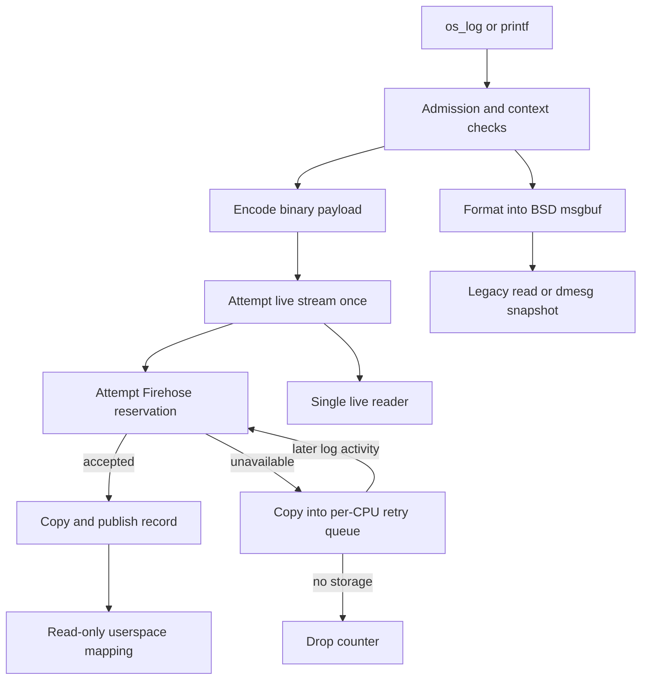
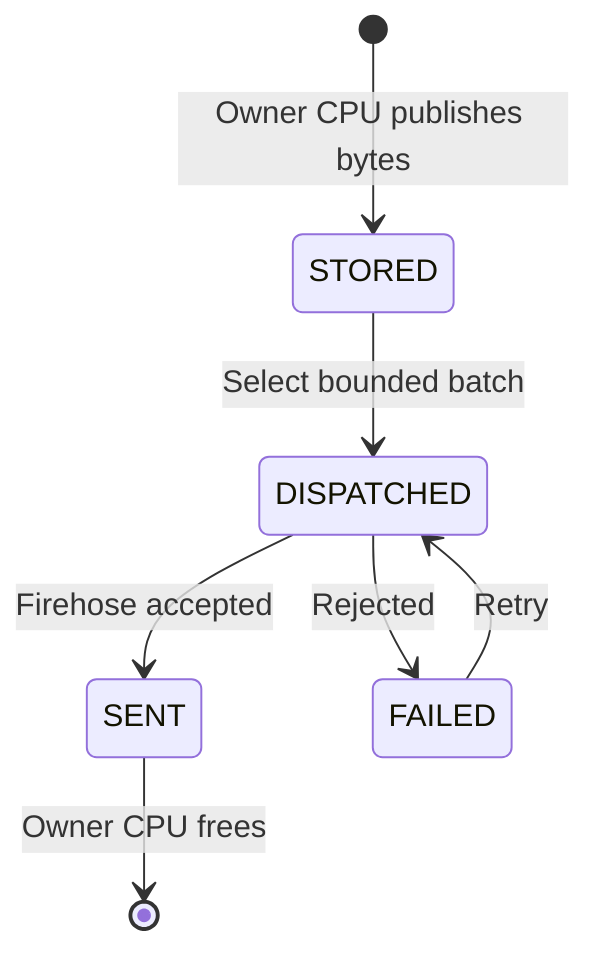
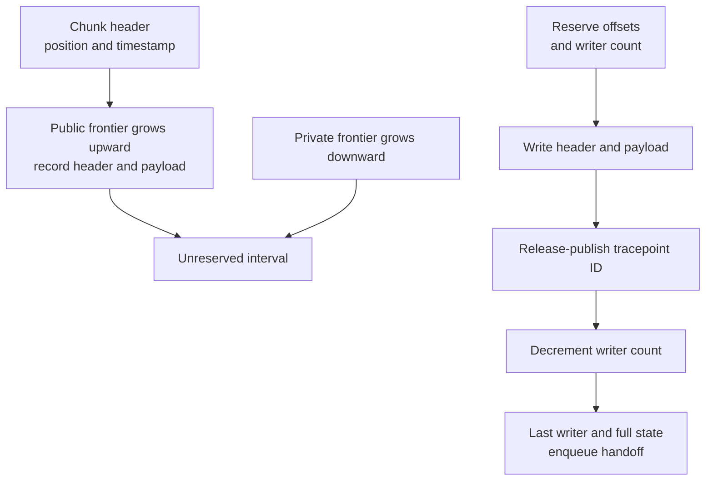
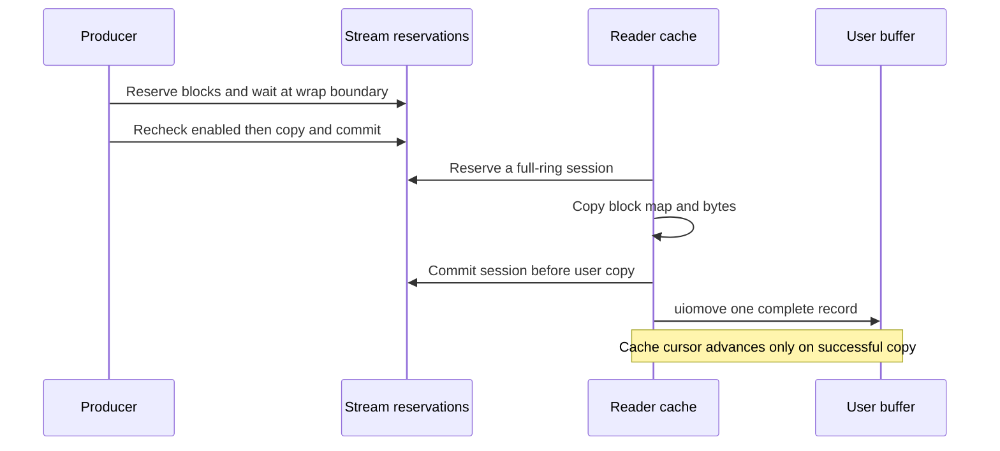

# Kernel logging: encoding, retry queues, Firehose and live readers

[Observability](observability.md) · [Handbook](../README.md) · [Clocks](../subsystems/runtime/clocks-and-time-domains.md) · [Kernel allocation](../subsystems/vm/kernel-allocation.md)

A kernel log call can produce formatted bytes in the BSD message buffer, a binary record for a live reader, and a record offered to Firehose. Those destinations have different storage, admission and completion rules. This chapter follows the local `xnu-12377.121.6` implementation from a log site to encoding, bounded buffering, retry, mapping and readout. It explains common code and ARM64 device dispatch; it does not reconstruct the missing central Firehose buffer implementation, logd's storage/decoding policy, or diagnostic consumers.

## 1. Separate the three outputs and their objects

For timestamped instrumentation events, see [Kdebug storage and readout](kdebug-storage-and-readout.md). Its per-CPU storage units, merge barriers and consuming read cursors have separate ownership and loss rules from the logging destinations below.

`os_log_with_type()` places a constant format in `__TEXT,__os_log`, then calls `_os_log_internal()` with the image handle. `_os_log_internal()` records a timestamp and return address and enters `_os_log_with_args_internal()`. Ordinary `printf()` also calls `os_log_with_args()` before separately formatting to the console. Thus console output, message-buffer output and binary logging can originate at the same call, but are not the same record. [Macro](../../platydoc-data/xnu/libkern/os/log.h#L376-L386), [ordinary entry](../../platydoc-data/xnu/libkern/os/log.c#L797-L807), [printf fanout](../../platydoc-data/xnu/osfmk/kern/printf.c#L875-L906).

| Representation | State and ownership |
| --- | --- |
| `os_log_s` / `os_log_subsystem_s` | Cached subsystem/category identity and its compact numeric ID; not a private buffer belonging to each caller. |
| `os_log_context_s` | Temporary encoding buffer, command cursor, string source pointers and optional `logmem` allocation. Its storage is released after sending or copying into a retry entry. |
| `log_payload_s` | Tracepoint ID, timestamp, total/public byte counts and stream; a descriptor of payload bytes, not their owning allocation. |
| `log_queue_entry_s` / per-CPU `log_queue_s` | Copied payload plus an atomic state, list membership and allocator-slot identity. Retains bytes when Firehose cannot accept them. |
| `firehose_chunk_s` / `firehose_tracepoint_s` | Shared binary record representation, chunk timestamp, public/private allocation cursors, active writers, type/ID and payload length. |
| `log_stream_t` / `log_cache_t` | Live-stream ring and a separate single-reader cache, with block sequences and record-boundary maps. |
| `msgbuf` | Circular formatted-character buffer with write/read positions. Its content is not an array of Firehose tracepoints. |

Definitions: [log identity](../../platydoc-data/xnu/libkern/os/log.c#L63-L78), [encoding context](../../platydoc-data/xnu/libkern/os/log_encode_types.h#L88-L126), [payload](../../platydoc-data/xnu/libkern/os/log_internal.h#L29-L36), [retry queue](../../platydoc-data/xnu/libkern/os/log_queue.c#L80-L107), [chunk](../../platydoc-data/xnu/libkern/firehose/chunk_private.h#L39-L65), [tracepoint](../../platydoc-data/xnu/libkern/firehose/tracepoint_private.h#L77-L90), [stream/cache](../../platydoc-data/xnu/bsd/kern/subr_log_stream.c#L68-L118), [message buffer](../../platydoc-data/xnu/bsd/sys/msgbuf.h#L68-L77).



The retry arrow bypasses live streaming: an old buffered log is not reinserted into the stream on every Firehose retry. Neither a successful reservation nor a userspace wakeup proves that a log was persisted to disk.

## 2. Admission, execution context and log identities

`oslog_is_safe()` requires no active kernel debugger entry, the normal debugger state, preemption level zero and enabled interrupts. `os_log_safe()` additionally permits the early startup interval before `STARTUP_SUB_EARLY_BOOT`. The normal formatting path distinguishes that safety decision from diagnostic configuration: `oslog_disabled` snapshots `ATM_TRACE_DISABLE` during startup; `ATM_TRACE_OFF` is also consulted at runtime. [Actual predicate](../../platydoc-data/xnu/osfmk/kern/debug.c#L1908-L1915), [logging predicates](../../platydoc-data/xnu/libkern/os/log.c#L136-L164), [initial configuration](../../platydoc-data/xnu/libkern/os/log.c#L297-L312).

The consequential branch is:

[Source: `libkern/os/log.c`, lines 783–794](../../platydoc-data/xnu/libkern/os/log.c#L783-L794).

<!-- source-excerpt: ../../platydoc-data/xnu/libkern/os/log.c#L783-L794 -->
```c
	/* early boot can log to dmesg for later replay (27307943) */
	bool safe = os_log_safe();
	bool logging = !os_log_turned_off();

	if (oslog != &_os_log_replay) {
		_os_log_to_msgbuf_internal(fmt, args, ts, safe, logging, addcr);
	}

	if (safe && logging) {
		const uint16_t sid = oslog->ol_subsystem.ols_id;
		_os_log_to_log_internal(sid, type, fmt, args, ts, addr, dso, driverKit);
	}
```

`OS_LOG_DISABLED` is rejected earlier, before either destination. Otherwise msgbuf is attempted even when binary logging is unsafe or turned off. On ARM64, `bsd_log_lock(false)` tries the ticket lock and can fail; the safe branch takes it normally. An unsafe caller therefore can lose the text record rather than wait on a lock it cannot safely acquire. The early-boot exception in `os_log_safe()` is a distinct startup rule, not a claim that logging is safe in every interrupt or panic context. [Disabled/empty-format exits](../../platydoc-data/xnu/libkern/os/log.c#L768-L781), [text lock failure](../../platydoc-data/xnu/libkern/os/log.c#L617-L643), [ARM64 lock branches](../../platydoc-data/xnu/osfmk/kern/printf.c#L805-L855).

`os_log_info_enabled()` and `os_log_debug_enabled()` both return the inverse of the same global turned-off predicate in this implementation; their log argument is unused. Do not infer a per-category level filter from those names. INFO/DEBUG select `firehose_stream_memory`; other types select `firehose_stream_persist`. Those are producer stream choices, not an implementation of logd retention policy. [Enable predicates](../../platydoc-data/xnu/libkern/os/log.c#L148-L158), [stream selection](../../platydoc-data/xnu/libkern/os/log.c#L196-L201).

`os_log_create_impl()` builds a normalized key from the two NUL-terminated names, each capped at 128 bytes including its terminator. It first performs an SMR hash lookup, then allocates a candidate outside the ticket lock. Under that lock it allocates a subsystem ID and performs serialized get-or-insert. A racing existing entry makes it revert the unused ID and free the candidate. Allocation or ID exhaustion returns `OS_LOG_DEFAULT`; disabled logging returns `OS_LOG_DISABLED`. A successfully inserted handle is cached, and its registration metadata is sent after unlocking. [Name/key construction](../../platydoc-data/xnu/libkern/os/log.c#L407-L441), [SMR lookup/insert](../../platydoc-data/xnu/libkern/os/log.c#L463-L531), [construction and rollback](../../platydoc-data/xnu/libkern/os/log.c#L534-L614).

The selected path has no per-use retain/release operation for cached handles (`oslog_try_get()` simply succeeds). Metadata transmission is separately fallible: `os_log_subsystem_register()` does not propagate its send result to `os_log_create_impl()`. A returned handle therefore proves identity allocation/publication, not that a consumer has already received its decoding metadata. [Registration](../../platydoc-data/xnu/libkern/os/log.c#L443-L454), [lookup lifetime callback](../../platydoc-data/xnu/libkern/os/log.c#L498-L511).

## 3. From a format string to a binary payload

### Image and location identity

`resolve_dso()` determines which kernel collection/image owns the format and call site. Static/KCGEN collections use the primary base. Dynamic/fileset paths validate that the format lies in the image's text segment and, for an ordinary kernel log, that the return address resolves to the same image. Failure increments an unresolved-image counter and stops binary logging after the independent msgbuf attempt. [Image checks](../../platydoc-data/xnu/libkern/os/log.c#L222-L276), [failure branch](../../platydoc-data/xnu/libkern/os/log.c#L723-L730).

The tracepoint ID carries namespace, type, flags and a format code/offset. The payload starts with a location: relative styles use 32 bits; the absolute style uses the unslid kernel address and the encoder stores six bytes on LP64. A valid nondefault subsystem ID follows. This is how a decoder can recover format and image identity without copying the whole constant format into every record. The decoder itself is outside this tree. [ID and relative/absolute selection](../../platydoc-data/xnu/libkern/os/log.c#L203-L244), [location calculation](../../platydoc-data/xnu/libkern/os/log.c#L279-L293), [location/header encoding](../../platydoc-data/xnu/libkern/os/log_encode.c#L493-L544).

`firehose_tracepoint_time()` chooses continuous or approximate-continuous time depending on precision configuration/flags. It is not a wall-clock string. [Timestamp helper](../../platydoc-data/xnu/libkern/firehose/tracepoint_private.h#L159-L170), [clock domains](../subsystems/runtime/clocks-and-time-domains.md).

### Commands, strings, capacity and privacy

The payload then contains a two-byte format header and a command sequence. Each command has flag/type bitfields, a one-byte data size and its data. Scalars are stored inline. A string command holds `os_log_fmt_range_s`, followed later by copied string bytes; the range offset is fixed relative to the start of that appended string-data area. The context temporarily records source string pointers while building commands, but sends copied bytes. [Wire structures](../../platydoc-data/xnu/libkern/os/log_encode_types.h#L88-L110), [command/range construction](../../platydoc-data/xnu/libkern/os/log_encode.c#L111-L205), [final range fixups](../../platydoc-data/xnu/libkern/os/log_encode.c#L207-L232).

For an illustrative `OS_LOG_DEFAULT` record using a four-byte relative location, format `count=%u name=%s`, values `7` and `"ok"`, and no pointer scrubbing:

| Payload offset | Meaning |
| --- | --- |
| 0–3 | Four-byte call-site location. |
| 4–5 | Format header: non-scalar flag and two commands. |
| 6–11 | Scalar command header plus four-byte value `7`. |
| 12–17 | String command header plus four-byte range: offset zero, length three, not truncated. |
| 18–20 | `o`, `k`, NUL copied from the string. |

These 21 payload bytes exclude the surrounding Firehose tracepoint header and chunk padding. This is arithmetic derived from the selected declarations and encoder, not captured output. A nondefault subsystem, another location style, precision command or different scalar width changes the offsets.

The initial kernel stack buffer is 256 bytes. Commands must fit the initial context; unsupported format syntax returns `EINVAL`, and command/range capacity failure returns `ENOMEM` without retrying command parsing in a larger buffer. String payloads can trigger expansion from the separate `logmem` arena, up to the configured 1 KiB maximum; if expansion is unavailable, string ranges are shortened and marked truncated. This differs from treating every record as permanently capped at the initial stack-buffer size. [Initial buffer constants](../../platydoc-data/xnu/libkern/os/log.h#L56-L64), [encoding/error decisions](../../platydoc-data/xnu/libkern/os/log_encode.c#L529-L598), [growth](../../platydoc-data/xnu/libkern/os/log_encode.c#L236-L270), [maximum order](../../platydoc-data/xnu/libkern/os/log_private.h#L32-L33).

The local runtime parser supports selected printf conversions, precision and scalar widths. It does not implement every command enum or the broad header prose that mentions `%@`. For example, `%@` and `%{private}s` encounter the parser's unsupported-character path. Ordinary strings are encoded as public here; scalar values recognized as kernel pointers are replaced with a zero-length private range when `doprnt_hide_pointers` is set:

[Source: `libkern/os/log_encode.c`, lines 272–297](../../platydoc-data/xnu/libkern/os/log_encode.c#L272-L297).

<!-- source-excerpt: ../../platydoc-data/xnu/libkern/os/log_encode.c#L272-L297 -->
```c
static int
log_encode_fmt_arg(void *arg, size_t arg_len, os_log_fmt_cmd_type_t type, os_log_context_t ctx)
{
	int rc = 0;

	switch (type) {
	case OSLF_CMD_TYPE_COUNT:
	case OSLF_CMD_TYPE_SCALAR:
		// Scrub kernel pointers.
		if (doprnt_hide_pointers && is_kernel_pointer(arg, arg_len)) {
			rc = log_add_range_arg(ctx, type, OSLF_CMD_FLAG_PRIVATE, NULL, 0);
			ctx->ctx_hdr->hdr_flags |= OSLF_HDR_FLAG_HAS_PRIVATE;
		} else {
			rc = log_add_arg(ctx, type, arg, arg_len);
		}
		break;
	case OSLF_CMD_TYPE_STRING:
		rc = log_add_range_arg(ctx, type, OSLF_CMD_FLAG_PUBLIC, arg, arg_len);
		ctx->ctx_hdr->hdr_flags |= OSLF_HDR_FLAG_HAS_NON_SCALAR;
		break;
	default:
		panic("Unsupported log value type");
	}

	return rc;
}
```

That zero-length representation omits the pointer value; it is not a private byte area containing the original pointer. Already-encoded input is different: `os_log_encoded_log()` and `os_log_encoded_signpost()` accept an explicit public-size boundary. The later Firehose copy path can place the trailing bytes in private storage. Do not extrapolate either path into the complete userspace logging privacy contract. [Runtime parser](../../platydoc-data/xnu/libkern/os/log_encode.c#L305-L490), [encoded entry points](../../platydoc-data/xnu/libkern/os/log.c#L362-L404), [public/private copying](../../platydoc-data/xnu/libkern/os/log.c#L988-L1014).

## 4. The small allocator backing encoding and retry storage

`logmem` allocates power-of-two blocks from caller-supplied bytes, with a bitmap stored after the page-rounded data area. Its binary-tree bitmap marks both ancestors and descendants of an allocated block, preventing overlapping large/small allocations. Free clears the selected subtree and ascends only while siblings permit it. Allocation returns the rounded block size through the size argument; free requires that returned size and exact address. [State/contract](../../platydoc-data/xnu/libkern/os/log_mem.h#L32-L81), [bitmap relationships](../../platydoc-data/xnu/libkern/os/log_mem.c#L35-L164), [allocation/free](../../platydoc-data/xnu/libkern/os/log_mem.c#L167-L249), [layout/init](../../platydoc-data/xnu/libkern/os/log_mem.c#L251-L294).

The ordinary encoder uses a guarded permanent arena with 16 KiB data capacity, 512-byte minimum and 1 KiB maximum allocations, plus bitmap backing. Its locked variants serialize bitmap mutation. Retry queues use their own arenas with 32-byte minimum and 2 KiB maximum blocks; queue-local mutation is protected by the per-CPU/preemption protocol described next. These are different arenas using the same allocator implementation. [Encoder arena setup](../../platydoc-data/xnu/libkern/os/log.c#L48-L50), [allocation/init](../../platydoc-data/xnu/libkern/os/log.c#L315-L336), [queue orders](../../platydoc-data/xnu/libkern/os/log_queue.c#L40-L51), [queue arena init](../../platydoc-data/xnu/libkern/os/log_queue.c#L397-L406).

For example, an encoding request for 600 bytes consumes a 1,024-byte block if available. An allocator request above its maximum fails; the caller may instead truncate the string payload. Reserving arena backing during initialization reduces ordinary log-path dependence on general VM allocation, but queue growth still performs allocation later through a thread call. It does not make logging unbounded or infallible.

## 5. Retry queues: copied data, movable execution and delayed reclamation

The front-end makes the destination order explicit:

[Source: `libkern/os/log.c`, lines 1104–1112](../../platydoc-data/xnu/libkern/os/log.c#L1104-L1112).

<!-- source-excerpt: ../../platydoc-data/xnu/libkern/os/log.c#L1104-L1112 -->
```c
bool
log_payload_send(log_payload_t lp, const void *lp_data, bool use_stream)
{
	if (use_stream) {
		bool is_metadata = (lp->lp_stream == firehose_stream_metadata);
		oslog_stream(is_metadata, lp->lp_ftid, lp->lp_timestamp, lp_data, lp->lp_data_size);
	}
	return firehose_trace(lp, lp_data) != 0;
}
```

`log_queue_log()` first attempts that send. Success increments its sent counter and dispatches a bounded retry batch from the current CPU. Failure increments the Firehose-rejection counter and attempts to copy the payload into that CPU's queue. Returning true can therefore mean **queued for later**, rather than already accepted by Firehose. [Admission](../../platydoc-data/xnu/libkern/os/log_queue.c#L756-L776).

There is no dedicated retry-sender thread in this local queue implementation: later successful calls trigger dispatch. The thread call manages memory backing, not a universal background drain. A quiet queue is not promised immediate delivery merely because userspace has consumed other Firehose records.

Each queue has a stored list and a dispatch list. With preemption disabled, code chooses the current CPU's queue, allocates an entry, copies descriptor and payload, appends it and release-publishes `STORED`. Metadata may allocate from slot zero; ordinary records start at slot one, preserving a metadata reserve. [Entry allocation/copy](../../platydoc-data/xnu/libkern/os/log_queue.c#L208-L256), [per-CPU add](../../platydoc-data/xnu/libkern/os/log_queue.c#L662-L691).

Dispatch first reclaims entries already marked `SENT`, then selects up to 24 entries, retrying `FAILED` entries before moving new `STORED` entries to the dispatch list. It marks the selected entries `DISPATCHED` before reenabling preemption. After that point execution may migrate; the sending code changes only each entry's atomic state. List/allocator cleanup remains for a later visit to the owning CPU's queue. Dependency-ordered reads and release stores connect payload publication to state observation. [State helpers](../../platydoc-data/xnu/libkern/os/log_queue.c#L195-L205), [cleanup/selection](../../platydoc-data/xnu/libkern/os/log_queue.c#L259-L325), [dispatch scope](../../platydoc-data/xnu/libkern/os/log_queue.c#L608-L659).

[Source: `libkern/os/log_queue.c`, lines 350–361](../../platydoc-data/xnu/libkern/os/log_queue.c#L350-L361).

<!-- source-excerpt: ../../platydoc-data/xnu/libkern/os/log_queue.c#L350-L361 -->
```c
			/*
			 * The log queue mechanism expects only the state to be
			 * modified here since we are likely running on a
			 * different cpu. Queue cleanup will be done safely
			 * later in dispatch_list_cleanup().
			 */
			if (log_payload_send(&lp, lp_data, false)) {
				publish(&lqe->lqe_state, LOG_QUEUE_ENTRY_STATE_SENT);
				counter_inc(&log_queue_cnt_sent);
			} else {
				publish(&lqe->lqe_state, LOG_QUEUE_ENTRY_STATE_FAILED);
			}
```



The copied descriptor preserves the original timestamp, stream, ID and size fields; it has no saved thread-ID field. The missing Firehose reservation implementation must not be inferred to preserve the original producer thread merely because the retry retains those bytes. [Copied descriptor](../../platydoc-data/xnu/libkern/os/log_internal.h#L29-L36), [retry reconstruction](../../platydoc-data/xnu/libkern/os/log_queue.c#L338-L348).

Replay uses `log_payload_send(..., false)`: live streaming is skipped because it does not reorder old queued timestamps. A live reader may already have seen a record which was subsequently queued or dropped by the Firehose path. Conversely, a retry can later reach Firehose without generating another live-stream record. [Replay policy](../../platydoc-data/xnu/libkern/os/log_queue.c#L327-L372).

Queue capacity changes use a second state machine. `lq_mem_state` prevents overlapping owner-side requests; `lq_req_state` publishes work/results to a thread call. Low usable memory or a new task-suspension observation can request another slot, bounded by the current slot limit. The worker allocates or frees with ordinary allocator calls and release-publishes `READY`; a later queue operation installs the completed allocation. A request does not immediately make space available for the record that triggered it. [Request/worker](../../platydoc-data/xnu/libkern/os/log_queue.c#L444-L496), [install](../../platydoc-data/xnu/libkern/os/log_queue.c#L542-L564), [growth predicates](../../platydoc-data/xnu/libkern/os/log_queue.c#L566-L603).

The body retains at least two slots: slot zero for metadata eligibility and slot one for general logs. The file's introductory “one slot” comment does not describe the current constants/reclaim loop. Reclaim requires an empty queue, no suspension flag, a global received-count threshold and an empty extra arena. Initialization can also obtain fewer slots than requested if allocation fails; it still sets `lq_ready`, so readiness alone does not prove all requested capacity exists. [Minimum/defaults](../../platydoc-data/xnu/libkern/os/log_queue.c#L40-L51), [extra-slot reclaim](../../platydoc-data/xnu/libkern/os/log_queue.c#L523-L540), [release predicate](../../platydoc-data/xnu/libkern/os/log_queue.c#L580-L590), [initial partial allocation](../../platydoc-data/xnu/libkern/os/log_queue.c#L694-L752).

## 6. Firehose chunks: reservation is not publication

The central functions `__firehose_buffer_tracepoint_reserve()`, `__firehose_buffer_tracepoint_flush()`, `__firehose_buffer_create()` and `__firehose_merge_updates()` are invoked locally, but their buffer implementation and included `os/firehose_buffer_private.h` are absent from this checkout. XNU does include chunk structures and inline chunk operations, its boot fallback, callbacks, backing allocation and reader mapping. The following explanation stops at those available boundaries. [Imported interface and calls](../../platydoc-data/xnu/libkern/os/log.c#L35-L39), [reserve/flush](../../platydoc-data/xnu/libkern/os/log.c#L935-L986), [create/map/update calls](../../platydoc-data/xnu/bsd/kern/subr_log.c#L444-L534).

A chunk has a timestamp and two moving frontiers: tracepoint headers/public payload grow upward, while private bytes are reserved downward. The combined position also carries stream, QoS, writer count and full state. Reservation atomically updates that position, rejects mismatched/full chunks and timestamps outside the 48-bit delta, aligns the public advance to eight bytes, reserves private bytes, and increments the writer count. A failed reservation can mark the chunk full and indicate whether a later writer or the caller must arrange enqueue. [Position and geometry](../../platydoc-data/xnu/libkern/firehose/chunk_private.h#L39-L65), [reservation](../../platydoc-data/xnu/libkern/firehose/chunk_private.h#L94-L160).



`firehose_chunk_tracepoint_begin()` writes the timestamp-delta/length word and thread identity. Payload copying precedes the release-store of the final tracepoint ID:

[Source: `libkern/firehose/chunk_private.h`, lines 181–192](../../platydoc-data/xnu/libkern/firehose/chunk_private.h#L181-L192).

<!-- source-excerpt: ../../platydoc-data/xnu/libkern/firehose/chunk_private.h#L181-L192 -->
```c
static inline bool
firehose_chunk_tracepoint_end(firehose_chunk_t fc,
    firehose_tracepoint_t ft, firehose_tracepoint_id_u ftid)
{
	firehose_chunk_pos_u pos;

	os_atomic_std(atomic_store_explicit)(&ft->ft_id.ftid_atomic_value,
	    ftid.ftid_value, os_atomic_std(memory_order_release));
	pos.fcp_pos = os_atomic_std(atomic_fetch_sub_explicit)(&fc->fc_pos.fcp_atomic_pos,
	    FIREHOSE_CHUNK_POS_REFCNT_INC, os_atomic_std(memory_order_relaxed));
	return pos.fcp_refcnt == 1 && pos.fcp_flag_full;
}
```

The writer count then participates in deciding whether a full chunk has no writer left. The record's final ID publication, chunk availability for consumption, consumer feedback and disk persistence are separate events.

For already-encoded private data, `firehose_trace_start()` reserves an extra public range descriptor. `firehose_trace_save_payload()` copies trailing private bytes to the private region and prepends its chunk-relative offset/length to the public payload. It requires the tracepoint's private-data flag. In DEBUG/DEVELOPMENT, a mismatch panics; the release branch returns from the copy helper, after which its caller still finishes the tracepoint. The internal producers must satisfy this contract; a reservation success is not a standalone payload validator. [Private layout/check](../../platydoc-data/xnu/libkern/os/log.c#L935-L946), [copy contract and caller](../../platydoc-data/xnu/libkern/os/log.c#L988-L1052).

Before the normal reserve path has succeeded, XNU can use a static boot chunk forced to the persist stream. A normal reservation sets `oslog_boot_done`; subsequent failures do not fall back to that boot chunk. `__firehose_allocate()` supplies the permanent backing address and copies the boot chunk into the final kernel-buffer chunk after clearing its writer count. These are the local migration steps; the missing buffer manager owns the surrounding initialization/rotation policy. [Boot fallback](../../platydoc-data/xnu/libkern/os/log.c#L948-L975), [boot migration](../../platydoc-data/xnu/libkern/os/log.c#L1122-L1137).

## 7. The Firehose reader uses mapping and feedback

ARM64's device switch exposes `/dev/oslog` with open/close, ioctl and select handlers, but no ordinary read handler. Devfs creates it as mode 0600 owned by logd when logging is enabled. `/dev/oslog_stream` is a different device owned by root. [Device registration](../../platydoc-data/xnu/bsd/dev/arm64/conf.c#L199-L213), [nodes/permissions](../../platydoc-data/xnu/bsd/miscfs/devfs/devfs_vfsops.c#L130-L147).

`oslog_init_firehose()` validates configured chunk/io-page counts through the imported interface, allocates permanent zeroed shared data with guard pages and calls the imported create routine. `LOGBUFFERMAP` creates a memory entry over that backing and maps it into the current task with both current and maximum protection `VM_PROT_READ`, shared inheritance and no copy. Mapping address/size are written only if both VM operations succeed. [Backing setup](../../platydoc-data/xnu/bsd/kern/subr_log.c#L503-L534), [mapping](../../platydoc-data/xnu/bsd/kern/subr_log.c#L444-L485), [memory-entry mechanisms](../subsystems/vm/wiring-and-memory-entries.md).

A source-visible limitation matters here: `oslogioctl()` stores VM errors in `ret`, but returns zero after the recognized command's switch. The local handler therefore does **not** propagate a failed map as its return status. It also shows no local release of the temporary memory-entry handle. This chapter describes the body as supplied rather than inventing cleanup or treating zero as proof that a mapping was installed. [Complete handler exit](../../platydoc-data/xnu/bsd/kern/subr_log.c#L444-L500).

`__firehose_buffer_push_to_logd()` calls `oslogwakeup()`. If safe and open, the latter wakes selectors and sets `os_log_wakeup`. `LOGFLUSHED` sends the consumer's reply to `__firehose_merge_updates()` and uses its `has_more` result to update readiness. XNU exposes this feedback boundary; it does not contain the consumer's persisted-file protocol. Open is exclusive, and close clears selector state without freeing the permanent Firehose backing. [Callback](../../platydoc-data/xnu/libkern/os/log.c#L1114-L1119), [open/close](../../platydoc-data/xnu/bsd/kern/subr_log.c#L211-L235), [readiness](../../platydoc-data/xnu/bsd/kern/subr_log.c#L318-L333), [wakeup](../../platydoc-data/xnu/bsd/kern/subr_log.c#L374-L387), [feedback](../../platydoc-data/xnu/bsd/kern/subr_log.c#L486-L499).

## 8. Live streaming: reservations, wraparound and reader isolation

The live stream holds encoded records in 64-byte blocks. A parallel byte map marks each record's header block and continuation blocks. A record contains a full timestamp followed by `firehose_tracepoint_s` and payload; it is not copied as a whole Firehose chunk. The live reader has a separate cache so user copy does not retain a reservation over the shared producer ring. [Constants/state](../../platydoc-data/xnu/bsd/kern/subr_log_stream.c#L55-L118), [record construction](../../platydoc-data/xnu/bsd/kern/subr_log_stream.c#L343-L360), [block markings/store](../../platydoc-data/xnu/bsd/kern/subr_log_stream.c#L465-L490).

The live-stream call receives the entire `lp_data_size`, including trailing bytes designated private by already-encoded input. This local transport copies encoded bytes; it does not perform the Firehose public/private split or a decoder's redaction step. Access is governed by the device path, and consumer interpretation is outside this implementation. [Stream handoff](../../platydoc-data/xnu/libkern/os/log.c#L1104-L1112), [byte copy](../../platydoc-data/xnu/bsd/kern/subr_log_stream.c#L479-L490).

`log_stream_reserve()` disables preemption and fetch-adds a block count to `ls_reserved`, returning `{location,size}`. A session then waits for a wrap-dependent boundary before snapshotting shared state. For a ring of `N` blocks, the waitpoint is the ticket's location if it crosses the physical end, otherwise the start of its ring cycle. `ls_commited` is an accumulated completed-block count; it is not simply “the end offset of the latest writer.” Commit release-adds the reservation size and reenables preemption. [Reserve/commit](../../platydoc-data/xnu/bsd/kern/subr_log_stream.c#L253-L290), [snapshot/waitpoint/wait](../../platydoc-data/xnu/bsd/kern/subr_log_stream.c#L292-L324), [session](../../platydoc-data/xnu/bsd/kern/subr_log_stream.c#L362-L390).

For an illustrative eight-block ring, a two-block ticket at sequence six fits through the end and waits on cycle start zero. A three-block ticket at sequence seven crosses the end and waits on seven before reusing wrapped bytes. Real configured buffers are larger; these values show the gate calculation, not a runnable minimum-size configuration.

The producer checks enabled/safe state and payload size, reserves a session, **rechecks enabled state inside the session**, copies header/payload, marks blocks, commits, and attempts a wakeup. Close can win between the first check and the protected snapshot. The second check prevents that writer from using detached storage. [Producer](../../platydoc-data/xnu/bsd/kern/subr_log_stream.c#L800-L841).



Refill reserves a whole ring, excluding overwriting writers for the snapshot/copy interval. Those full-ring reservations increment `ls_commited_wraps`, which is subtracted when calculating actual logged progress. If producers have lapped the reader, `log_stream_sync()` advances the reader position to the surviving window. The cache scans header markers instead of assuming an overwritten fragment starts a valid record. A partially cached record causes the stream cursor to rewind by the remaining cached blocks and refill from its start. [Refill/overrun](../../platydoc-data/xnu/bsd/kern/subr_log_stream.c#L492-L543), [cache scan/refill](../../platydoc-data/xnu/bsd/kern/subr_log_stream.c#L715-L775).

`oslog_streamread()` holds the stream mutex for cache access. With no logs it drops that mutex and waits interruptibly, or returns `EWOULDBLOCK` for nonblocking mode; after wake it rechecks enabled state. It copies one complete record. A too-small user buffer returns `ENOBUFS` without consuming the cached record; a failed `uiomove` also leaves the cache cursor unchanged, even though user memory may have been partially modified. [Wait behavior](../../platydoc-data/xnu/bsd/kern/subr_log_stream.c#L777-L798), [read and cursor publication](../../platydoc-data/xnu/bsd/kern/subr_log_stream.c#L843-L894).

[Source: `bsd/kern/subr_log_stream.c`, lines 877–889](../../platydoc-data/xnu/bsd/kern/subr_log_stream.c#L877-L889).

<!-- source-excerpt: ../../platydoc-data/xnu/bsd/kern/subr_log_stream.c#L877-L889 -->
```c
	if (log_size > MIN(uio_resid(uio), INT_MAX)) {
		log_stream_unlock();
		counter_inc(&oslog_s_error_count);
		return ENOBUFS;
	}

	error = uiomove((caddr_t)log, (int)log_size, uio);
	if (!error) {
		log_cache_consume(&log_stream_cache, log_size);
		counter_inc(&oslog_s_streamed_msgcount);
	} else {
		counter_inc(&oslog_s_error_count);
	}
```

Select consults both cached headers and stream availability. Producer wakeup uses a try-locked spin-protected selector state and records delayed wakeup attempts when that lock is busy. The `FIOASYNC` ioctl stores a flag, but this stream's wakeup body does not implement the legacy path's process/group `SIGIO` dispatch. These are observable distinctions between similarly named devices. [Selector wakeup](../../platydoc-data/xnu/bsd/kern/subr_log_stream.c#L545-L587), [select/ioctl](../../platydoc-data/xnu/bsd/kern/subr_log_stream.c#L896-L956), [legacy SIGIO](../../platydoc-data/xnu/bsd/kern/subr_log.c#L354-L369).

Open allocates ring/cache candidates before taking the stream mutex; a competing open returns `EBUSY` and frees its candidates. Enable and disable each take a full-ring session. Close clears selector state, removes the live pointers, moves cache/storage into teardown locals, unlocks, zeroes/frees the buffers. Reservation/commit sequences are intentionally preserved across reopen; resetting them with the pointers would break in-flight sequence relationships. [Pointer/sequence rule](../../platydoc-data/xnu/bsd/kern/subr_log_stream.c#L615-L654), [open/close](../../platydoc-data/xnu/bsd/kern/subr_log_stream.c#L958-L1031).

## 9. Message-buffer text, unsafe replay and dmesg

The BSD message buffer has character-level write/read cursors. `log_putc_locked()` writes and wraps without moving the read cursor to represent a record boundary. It therefore does not preserve message objects or promise lossless retention. `_os_log_to_msgbuf_internal()` formats under the log lock, optionally prefixes timestamps when the buffer is larger than 4 KiB, then unlocks before waking readers. [Character write](../../platydoc-data/xnu/bsd/kern/subr_log.c#L551-L558), [format/timestamp completion](../../platydoc-data/xnu/libkern/os/log.c#L698-L720).

Unsafe logging records a replay starting position. A later safe, logging-enabled call clears that marker, drops the lock, allocates a bounded nonblocking temporary buffer, recopies the surviving circular text under the lock, then sends newline-delimited pieces with the special replay handle. The replay handle suppresses reinsertion into msgbuf. Allocation failure or intervening overwrites can lose replay content; the marker was already reset. This is best-effort replay of formatted text, separate from binary retry entries retaining original payload/timestamp fields. [Replay implementation](../../platydoc-data/xnu/libkern/os/log.c#L638-L696), [replay bypass](../../platydoc-data/xnu/libkern/os/log.c#L783-L794).

`/dev/klog` open requires `ATM_ENABLE_LEGACY_LOGGING` and is exclusive. Its read path can return `EWOULDBLOCK`, otherwise sleeps with a five-second retry interval explicitly intended to recover from missed wakeups. Data transfer drops the lock around `uiomove` and updates the cursor afterward; it is not the live stream's private cache protocol. [Open gate](../../platydoc-data/xnu/bsd/kern/subr_log.c#L173-L195), [read](../../platydoc-data/xnu/bsd/kern/subr_log.c#L238-L297).

The proc-info dmesg path first performs MAC policy and root checks. `log_dmesg()` allocates a temporary snapshot buffer, linearizes surviving circular data under the lock, skips NUL bytes and selected syslog prefixes, appends a newline/NUL where needed, and keeps the final requested-size suffix when the caller's buffer is smaller. It unlocks before `copyout`, publishes the byte count only on success and frees the temporary buffer. This does not advance the legacy device read cursor. [Admission](../../platydoc-data/xnu/bsd/kern/proc_info.c#L3236-L3253), [snapshot/copyout](../../platydoc-data/xnu/bsd/kern/subr_log.c#L718-L801).

`kern.msgbuf` controls size, not the binary logging queues. Resize allocates new zeroed storage outside the lock, copies recent circular bytes and adjusts cursors while locked, publishes the new buffer, then zeroes/frees old dynamic storage. Boot static storage is not freed. [Resize](../../platydoc-data/xnu/bsd/kern/subr_log.c#L604-L678), [sysctl handler](../../platydoc-data/xnu/bsd/kern/subr_log.c#L682-L710).

## 10. Other producers, failures and evidence limits

DriverKit enters through the `log_data` syscall and the special logging wrapper. The syscall validates its source/size/type and driver task, copies the user string, and calls `os_log_driverKit`. The wrapper rechecks driver identity and uses the task's load tag when available so external decoding can associate the message with the dext. The dynamic format-code bit prevents treating this identifier as an ordinary format location. Coprocessor records carry an explicit UUID and offset instead; encoded Exclaves records retain the supplied stream/type and public-size boundary. These are input contracts, not implementations of dext firmware or secure-domain loggers. [DriverKit syscall](../../platydoc-data/xnu/bsd/kern/sys_generic.c#L2417-L2490), [wrapper](../../platydoc-data/xnu/libkern/os/log.c#L820-L869), [dynamic ID](../../platydoc-data/xnu/libkern/os/log.c#L203-L219), [coprocessor construction](../../platydoc-data/xnu/libkern/os/log.c#L886-L933), [Exclaves replay dispatch](../../platydoc-data/xnu/osfmk/kern/exclaves_log.c#L95-L135).

| Observation | What the local code does and does not establish |
| --- | --- |
| Text exists but binary log does not | Unsafe/disabled binary logging, image resolution, encoding failure or later capacity loss can explain the difference. |
| Live record exists but Firehose count did not advance | Live streaming is attempted first; Firehose may reject it and queueing may fail. |
| Queue send returned true | It either sent immediately or copied into retry storage; it is not a disk-persistence result. |
| Retry entry is `SENT` | Firehose accepted it; its owner CPU still has to reclaim the entry. |
| Stream read returns `ENOBUFS` | The next cached record remains available for a sufficiently large retry. |
| Stream reader falls behind | Old bytes can be overwritten and reader progress is moved to the surviving window. |
| `LOGBUFFERMAP` handler returns zero | In this body, VM failure is not propagated through the return value; inspect output publication separately. |
| A log category was created | Its cached identity exists; metadata delivery is independently fallible. |

The in-kernel `CONFIG_XNUPOST` tests check printf/msgbuf fanout, identity reuse, logging counters, parallel production and selected stress/drop behavior. They are source evidence here, not executed tests. Stream DEBUG/DEVELOPMENT verification replaces timestamps with a tag and checks it during reading; it is a diagnostic aid, not an end-to-end losslessness test. [Printf checks](../../platydoc-data/xnu/libkern/os/log.c#L1340-L1361), [handle tests](../../platydoc-data/xnu/libkern/os/log.c#L1390-L1434), [logging tests](../../platydoc-data/xnu/libkern/os/log.c#L1437-L1491), [parallel/stress](../../platydoc-data/xnu/libkern/os/log.c#L1494-L1559), [stream verification](../../platydoc-data/xnu/bsd/kern/subr_log_stream.c#L326-L341).

This chapter reviewed local producer/encoder/allocator/queue bodies, chunk inline helpers and BSD transport/readout. Central Firehose bank/rotation/reclamation algorithms, logd decoding and disk formats, diagnosticd behavior, full Exclaves configuration/admin, every formatter branch and all wakeup/resize races remain outside its claims. No kernel, logging daemon or device test was run. DTrace and sanitizer internals remain separate expansion subjects; [panic records](panic-coordination-and-records.md) and [stackshot](stackshot-and-kcdata.md) already have their own capture/publication explanations.

<!-- BEGIN PLATYDOC DOCUMENTATION LICENSE -->
Original Platydoc text and diagrams are licensed under [CC BY 4.0](https://creativecommons.org/licenses/by/4.0/). Quoted source code and third-party material retain their respective licenses.
<!-- END PLATYDOC DOCUMENTATION LICENSE -->
