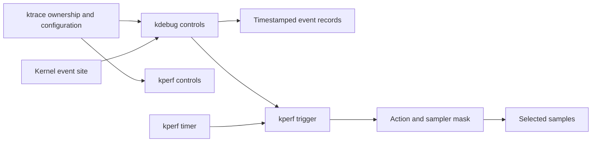

# Tracing, accounting, debugging, and diagnostics

[Guide index](../README.md) · [Runtime](../subsystems/runtime/README.md)

These mechanisms answer different questions. An event trace records selected transitions over time; a performance sample captures selected state at a trigger; an accounting counter accumulates usage; a stackshot captures structured task/thread state; a debugger inspects a live or saved kernel image. Confusing these roles leads to incorrect conclusions about missing events or apparently inconsistent totals.

For detailed artifact lifetimes, continue with [stackshot capture and kcdata](stackshot-and-kcdata.md), [corpses and process core files](corpses-and-process-core-dumps.md), and [ARM64 panic coordination and records](panic-coordination-and-records.md). These trace admission, storage, collection, publication, partial failure and cleanup; KDP protocol and kernel-core transport are outside this expansion.

For log production and delivery, read [kernel logging and Firehose](kernel-logging-and-firehose.md): format encoding, small allocation arenas, per-CPU retry queues, chunk publication, live-stream reservations/cache, read-only mappings and msgbuf replay have distinct completion and loss rules.

## Map the question to the mechanism

| Question | Mechanism | Source entry |
| --- | --- | --- |
| In what order did selected events occur? | kdebug event records | [kdebug.c](../../xnu/bsd/kern/kdebug.c), [kdebug.h](../../xnu/bsd/sys/kdebug.h) |
| What ran at a sampling trigger? | kperf actions and samplers | [action.c](../../xnu/osfmk/kperf/action.c), [kptimer.c](../../xnu/osfmk/kperf/kptimer.c) |
| How much CPU time or counter usage accumulated? | Recount, with hardware-counter support | [recount.h](../../xnu/osfmk/kern/recount.h), [recount.c](../../xnu/osfmk/kern/recount.c) |
| What device values or state residency did a driver publish? | IOReport channels, elements and samples | [Reporter implementation and sampling protocol](../subsystems/drivers/reporting-and-performance-control.md) |
| Which submitted device work is associated with a thread group? | IOPerfControl client tokens and contexts | [Performance-control ownership and completion](../subsystems/drivers/reporting-and-performance-control.md#5-performance-control-registers-callbacks-and-preserves-submitter-identity) |
| What were tasks and threads doing together? | Stackshot | [BSD entry](../../xnu/bsd/kern/stackshot.c), [collector](../../xnu/osfmk/kern/kern_stackshot.c) |
| What objects and references exist in a stopped kernel? | LLDB macros and kernel debug data | [tools/lldbmacros](../../xnu/tools/lldbmacros/) |
| Where did a log record go, and why is it missing from one consumer? | OSLog, Firehose handoff, live stream and msgbuf | [Producer, buffering and readout mechanisms](kernel-logging-and-firehose.md) |
| Where did memory misuse or undefined behavior occur? | Configured sanitizer instrumentation | [san/memory](../../xnu/san/memory/) |
| Which instrumented paths ran? | Coverage instrumentation | [san/coverage](../../xnu/san/coverage/) |

## ktrace controls; kdebug records

The control plane in [kern_ktrace.c](../../xnu/bsd/kern/kern_ktrace.c#L77) manages a mutex, off/foreground/background state, active subsystem mask, and owner identity. It uses a process unique identifier as well as a PID: `ktrace_ownership_maintenance()` checks that a found PID still names the owner instead of trusting a recycled PID. `ktrace_configure()` permits the existing owner, controls foreground/background takeover, and rejects conflicting owners. Access checks are part of this path; development/debug entitlement behavior is guarded separately from the superuser check.

The event path is in [kdebug.c](../../xnu/bsd/kern/kdebug.c#L829). A typical kernel call follows:

```text
kernel_debug(debugid, arguments)
  -> kernel_debug_internal(..., current thread ID, ...)
     -> _write_trace_record(...)
        -> check emission/debugid/process filters
        -> disable preemption
        -> select current CPU and reserve timestamped record
        -> fill debugid, arguments, thread identity, CPU
        -> enable preemption
        -> optional kperf callback
     -> consider reader wakeup threshold
```

`_next_timestamped_record()` atomically reserves an index in a storage unit and obtains a timestamp in the reservation loop. Preemption control keeps the producer associated with the selected CPU while filling its record; it is not a blanket lock on all kernel activity. The payload's meaning comes from the event code and its instrumentation site, not from `kd_buf` alone. Search [trace_codes](../../xnu/bsd/kern/trace_codes) and the emitting call site together.

When interpreting a trace, check whether the event was compiled in, enabled, filtered, and retained by the chosen buffer mode. Absence of an event is not by itself proof that the underlying operation never happened. The controls and write path above explain several ways it can be absent.

## kperf: trigger, action, sample

[kperf_sample()](../../xnu/osfmk/kperf/action.c#L407) checks the action ID, applies its PID filter, obtains its sampler mask and stack-depth settings, then invokes `kperf_sample_internal()`. An action therefore specifies what to collect; a trigger determines when to collect it.

The timer path [kptimer_sample_curcpu()](../../xnu/osfmk/kperf/kptimer.c#L205) builds a context with the current thread, task, PID, trigger type, and timer ID, then calls `kperf_sample()` with flags that can defer user sampling. The kdebug-triggered path [kperf_kdebug_handler()](../../xnu/osfmk/kperf/action.c#L435) checks its trigger and constructs a similar context. Read individual samplers for collection constraints; a timer callback does not imply that arbitrary user-stack walking is safe synchronously.



Hardware counter management has its own implementation, including [kpc_common.c](../../xnu/osfmk/kern/kpc_common.c), [cpc.c](../../xnu/osfmk/kern/cpc.c), and architecture backends. The existing [CPU-counter guide](../../xnu/doc/observability/cpu_counters.md) is useful context. Sampling configuration and always-accumulated accounting should be read separately.

## Recount: accounting tied to execution transitions

[recount.h](../../xnu/osfmk/kern/recount.h#L64) defines topology domains: system-wide, per CPU, and per CPU kind. A `recount_plan` selects granularity. A `recount_track` contains `rt_sync` and `rt_usage`; usage includes per-execution-level metrics with `rm_time_mach`, and configuration-dependent `rm_instructions`, `rm_cycles`, and energy state.

At [recount_switch_thread()](../../xnu/osfmk/kern/recount.c#L1083), the current snapshot is subtracted from the previous per-CPU snapshot. `recount_absorb_snap()` attributes the delta to the outgoing thread/task and processor, with configuration-dependent work-interval attribution, then the previous snapshot is replaced. User/kernel transition functions update attribution at finer boundaries on supported paths. Energy arrives through a separate update path and is not interchangeable with time sampled at every boundary.

Readers need related counters to describe a consistent interval. [recount_read_track()](../../xnu/osfmk/kern/recount.c#L337) reads a sequence counter, copies the usage, and retries if a writer changed it. The updater publishes changes through the corresponding sequence-lock helpers. This differs from simply taking a mutex around every user of the statistics. It also does not remove the writer-side execution/topology assumptions documented in the header.

The existing [Recount guide](../../xnu/doc/observability/recount.md) maps counters to task/thread/process APIs and LLDB commands. Prefer the current structure definition for exact field names: documentation prose and source can evolve at different speeds. Recount tracks are an example of why a structure's protection model matters as much as its field list.

## Stackshot and kcdata

The BSD [stack_snapshot_with_config()](../../xnu/bsd/kern/stackshot.c#L522) validates permissions, configuration version and size, copies the user configuration, calls `kern_stack_snapshot_internal()`, and translates the kernel return code. Entitlement reporting/refusal is conditional in this path; it is more precise to read that logic than to describe every configuration as having the same gate.

The collector in [kern_stackshot.c](../../xnu/osfmk/kern/kern_stackshot.c) coordinates capture state and output. [stackshot_trap()](../../xnu/osfmk/kern/kern_stackshot.c#L1140) enters `DebuggerTrapWithState(DBOP_STACKSHOT, ...)`; on x86-64 it also excludes an overlapping multiprocessor rendezvous because both mechanisms coordinate CPUs. The file contains configuration-dependent collection paths, including multithreaded collection. See the original [multithreaded stackshot guide](../../xnu/doc/observability/mt_stackshot.md) before treating a historical stop-the-world diagram as universal.

Stackshot can describe task/thread state from many subsystems in **kcdata**, a chunked format. [kcdata_item](../../xnu/osfmk/kern/kcdata.h#L258) has a type, payload size, flags, and payload; items are aligned to 16-byte boundaries. Container markers group records, and type descriptions allow consumers to interpret structured data. Allocation and append helpers live in [kern_cdata.c](../../xnu/osfmk/kern/kern_cdata.c), including `kcdata_memory_alloc_init()` and `kcdata_get_memory_addr()`.

[libkdd](../../xnu/libkdd/README.md) is the user-side parser library, not another kernel scheduler or tracing engine. Its [kdd.h](../../xnu/libkdd/kdd.h) exposes type descriptions and parsing into Foundation objects. [tools/lldbmacros/kcdata.py](../../xnu/tools/lldbmacros/kcdata.py) is another useful decoding reference. The format lets output carry optional records without forcing every consumer to share the exact in-kernel structure layout.

## Debugger navigation

Use symbols and structure definitions matching the image being inspected. The [LLDB README](../../xnu/tools/lldbmacros/README.md) describes loading the macros with a live connection or a core file; some examples in it are historical. For command availability and syntax in this checkout, use the registered command and its local help.

| Objects | Commands present in this tree | Definition |
| --- | --- | --- |
| Tasks, processes, threads, stacks | `showtask`, `showproc`, `showalltasks`, `showallthreads`, `showallstacks` | [process.py](../../xnu/tools/lldbmacros/process.py) |
| Processors and scheduling | `showallprocessors` | [scheduler.py](../../xnu/tools/lldbmacros/scheduler.py) |
| Zones and memory | `zprint` and memory inspection helpers | [memory.py](../../xnu/tools/lldbmacros/memory.py) |
| Event queues | `showallkqueues` | [kevent.py](../../xnu/tools/lldbmacros/kevent.py) |
| IOKit objects | `showobject` and registry helpers | [ioreg.py](../../xnu/tools/lldbmacros/ioreg.py) |
| Extensions | `showallkmods` | [kext.py](../../xnu/tools/lldbmacros/kext.py) |
| CPU accounting | `recount` subcommands | [recount.py](../../xnu/tools/lldbmacros/recount.py) |

These are navigation starting points, not commands executed during this review. A debugger can display a pointer even when the object's logical lifetime has ended; interpret it with the subsystem's reference and teardown rules.

## Sysctl: a typed control tree with handler lifetimes

Sysctl exposes many subsystem counters and controls through a tree of named/numbered objects. [`sysctl_oid`](../../xnu/bsd/sys/sysctl.h#L269) records the parent/link, number, kind/flags, name, handler, arguments, format, and reference count. `sysctl_req` holds the caller, input/output positions, lengths, and transfer functions; `SYSCTL_IN` and `SYSCTL_OUT` dispatch through those functions. A sysctl is therefore not necessarily a direct read of a global variable: a handler can validate input, calculate a result, or perform a subsystem operation.

[`sysctl_root()`](../../xnu/bsd/kern/kern_newsysctl.c#L1736) traverses under `sysctl_geometry_lock`, resolves numeric or canonical-name lookup, checks flags/access, snapshots the handler, and references a nonpermanent OID before releasing the tree lock. It can then call the MAC sysctl hook and invoke the handler without keeping the whole tree locked. Unregistration must wait for active references before the object can disappear. A separate `sysctl_unlocked_node_lock` serializes handler paths whose traversed nodes did not declare `CTLFLAG_LOCKED`; the flag should not be read as “the framework will hold my subsystem's own lock for me.” The handler still has its own state-protection contract.

[`userland_sysctl()`](../../xnu/bsd/kern/kern_newsysctl.c#L2186) retries `EAGAIN` after resetting request/output state. This is another example of a public entry point whose result depends on handler semantics, permissions, and concurrent state. When studying a particular control, find its `SYSCTL_*` registration, decode its flags, read the handler, and then follow the subsystem calls. This section reviewed the dispatch and lifetime path, not every registered control.

## Other instrumentation and diagnostic paths

DTrace lives under [bsd/dev/dtrace](../../xnu/bsd/dev/dtrace/), with central `dtrace_probe()`, ioctl control, and initialization in [dtrace.c](../../xnu/bsd/dev/dtrace/dtrace.c), provider code, and Darwin adaptation in [dtrace_glue.c](../../xnu/bsd/dev/dtrace/dtrace_glue.c). Its compilation is selected by `config_dtrace` in [bsd/conf/files](../../xnu/bsd/conf/files). This guide locates that framework but does not audit its bytecode interpreter or every provider.

Kernel logging includes [libkern/os/log.c](../../xnu/libkern/os/log.c), [firehose support](../../xnu/libkern/firehose/), and BSD's [message buffer/log implementation](../../xnu/bsd/kern/subr_log.c). Those are distinct paths from kdebug's numeric event records. The [logging companion](kernel-logging-and-firehose.md) follows the locally implemented producer, encoding, retry, streaming and readout paths and identifies the missing central Firehose implementation. Panic/debug entry and core-dump infrastructure are under [debug.c](../../xnu/osfmk/kern/debug.c) and [osfmk/kdp](../../xnu/osfmk/kdp/); extensible panic records are described in [extensible_paniclog.md](../../xnu/doc/debugging/extensible_paniclog.md).

[san/conf/files](../../xnu/san/conf/files) shows which instrumentation components require configuration options. KASAN's common code in [kasan.c](../../xnu/san/memory/kasan.c) connects poison/unpoison operations to configured backends; classic and tag-based implementations have separate files. UBSAN and coverage have separate runtimes. The presence of these files says nothing about whether an ordinary release image contains the instrumentation.

## Sources inspected and limits

The ktrace ownership path, kdebug record path, kperf trigger/action entry, Recount structures/update/read path, BSD stackshot gate, stackshot trap, kcdata definitions, sysctl handler dispatch/lifetime, and listed debugger registrations were inspected directly. The companion chapters now expand selected stackshot, corpse, process-core and ARM64 panic mechanisms. The logging companion adds local producer/encoder/allocator/queue, chunk-inline, live-stream and msgbuf mechanisms; the central Firehose manager and userspace consumers remain external. DTrace and sanitizer backends remain chiefly navigation boundaries. No live traces, counter measurements, debugger sessions, or sanitizer runs were collected.

<!-- BEGIN PLATYDOC DOCUMENTATION LICENSE -->
Original Platydoc text and diagrams are licensed under [CC BY 4.0](https://creativecommons.org/licenses/by/4.0/). Quoted source code and third-party material retain their respective licenses.
<!-- END PLATYDOC DOCUMENTATION LICENSE -->
