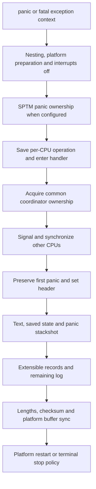

# ARM64 panic coordination and persistent diagnostic records

[Observability overview](observability.md) · [Stackshot](stackshot-and-kcdata.md) · [ARM64 exception entry](../subsystems/platform/arm64-exception-entry.md) · [SPTM](../subsystems/security/sptm.md)

Panic handling must preserve evidence while other CPUs may be running, stuck or also panicking. The common panic coordinator, ARM platform implementation, stackshot collector and extensible panic-log facility divide this work. The path described here stops at platform persistence/restart boundaries. KDP protocol, interactive debugger commands and kernel-core-output machinery are excluded.

## 1. Entry records intent before collecting diagnostics

[`panic`](../../platydoc-data/xnu/osfmk/kern/debug.c#L1106-L1113) forwards the format string, argument list and caller address to `panic_trap_to_debugger`. Variants add options, a saved exception context, an initiator or attached data. `panic_with_data` first places UUID-labelled data in the extensible log's reserved handle. [`variants`](../../platydoc-data/xnu/osfmk/kern/debug.c#L1116-L1140).

Per-CPU `debugger_state` stores the operation, message/format/arguments, caller, options, opaque data, whether synchronization failure is tolerable, nesting count and operation return value. These fields must survive the transition into the common coordinator. [`state`](../../platydoc-data/xnu/osfmk/kern/debug.c#L199-L213):

<!-- source-excerpt: ../../platydoc-data/xnu/osfmk/kern/debug.c#L199-L213 -->
```c
struct debugger_state {
	uint64_t        db_panic_options;
	debugger_op     db_current_op;
	boolean_t       db_proceed_on_sync_failure;
	const char     *db_message;
	const char     *db_panic_str;
	va_list        *db_panic_args;
	void           *db_panic_data_ptr;
	unsigned long   db_panic_caller;
	const char     *db_panic_initiator;
	/* incremented whenever we panic or call Debugger (current CPU panic level) */
	uint32_t        db_entry_count;
	kern_return_t   db_op_return;
};
static struct debugger_state PERCPU_DATA(debugger_state);
```

[`panic_trap_to_debugger`](../../platydoc-data/xnu/osfmk/kern/debug.c#L1251-L1368) handles very early failures, machine panic preparation, nesting limits, interaction with an in-progress stackshot and platform notification. It disables interrupts and preemption before the final coordination. If the caller already supplied a saved exception context, it saves the panic state and calls `handle_debugger_trap` directly. Otherwise `DebuggerTrapWithState` saves it and executes the architecture trap, obtaining a saved register context through exception entry.

Some names in this shared machinery contain “debugger”; the same coordinator serves a recoverable stackshot and a fatal panic. The operation code determines which path executes. A stackshot's ability to return is not a promise that `panic` returns to its caller. [`trap wrapper`](../../platydoc-data/xnu/osfmk/kern/debug.c#L724-L769), [`operation dispatch`](../../platydoc-data/xnu/osfmk/kern/debug.c#L1786-L1834).

## 2. Two ownership decisions protect the panic path

On an SPTM build, [`debug_fatal_panic_begin`](../../platydoc-data/xnu/osfmk/kern/debug.c#L2551-L2579) asks SPTM to begin panic lockdown and queries the panicking CPU identity. If the query succeeds and identifies another CPU, the current CPU enters the stop path rather than competing to produce a second independent panic. A failed identity query does not itself reject this CPU: the helper returns true. Security-critical entry paths can have begun lockdown before this best-effort call; this helper alone is not the complete protected-execution enforcement story.

The common coordinator also uses an atomic `debugger_cpu` owner. Reentry by that CPU is recognized; another CPU cannot simply take the shared diagnostics state. `handle_debugger_trap` returns early if it loses this acquisition, allowing the caller's panic stop behavior to take over. It then coordinates the other CPUs before manipulating global panic state. [`owner acquisition/release`](../../platydoc-data/xnu/osfmk/kern/debug.c#L611-L652), [`coordinator entry`](../../platydoc-data/xnu/osfmk/kern/debug.c#L1715-L1750).

The first panic message is retained rather than overwritten by a later nested entry. Nesting can make return unsafe, and the panic header records nested failure. This matters because a diagnostic routine itself may fault: the later failure should not erase the original cause. [`first-message handling`](../../platydoc-data/xnu/osfmk/kern/debug.c#L1754-L1784), [`nested header`](../../platydoc-data/xnu/osfmk/kern/debug.c#L1480-L1502).



This is the successful `panic_trap_to_debugger` route: its initial SPTM check precedes `DebuggerSaveState`/`DebuggerTrapWithState`. The handler repeats the SPTM check in its fatal-operation branch before collection. Early-boot and nested-failure branches can stop before all records are written. [`entry ordering`](../../platydoc-data/xnu/osfmk/kern/debug.c#L1316-L1362), [`fatal handler check`](../../platydoc-data/xnu/osfmk/kern/debug.c#L1807-L1820).

## 3. CPU synchronization has acknowledgments, timeouts and fallback

On ARM64, `DebuggerHaltOtherCores` calls [`DebuggerXCallEnter`](../../platydoc-data/xnu/osfmk/arm/model_dep.c#L1096-L1295). It tracks nested entry per CPU, resets shared synchronization state and sends `SIGPdebug` to other CPU data objects. A successful `cpu_signal` means the request was issued, not that the recipient already stopped; acknowledgment counters provide that distinction.

The waiting loop uses a deadline and accounts for CPUs already stopped in the panic path. It can inspect SPTM panic-spin state and copy saved registers when the configured backend provides that facility. If ordinary signaling is insufficient, the fallback attempts hardware debug-wrapper halt and state collection, recording failures. A requested strict synchronization path can itself panic on failure; tolerant fatal diagnostics can continue with imperfect state. [`deadline and acknowledgment`](../../platydoc-data/xnu/osfmk/arm/model_dep.c#L1156-L1182), [`SPTM/fallback`](../../platydoc-data/xnu/osfmk/arm/model_dep.c#L1216-L1295).

Consequently, a panic log may explicitly say a CPU did not yield usable state. It is misleading to interpret every panic capture as a perfect simultaneous snapshot of all cores. The return-side `DebuggerXCallReturn` releases the shared stop condition and tracks responders for operations that may resume, such as ordinary stackshot. Its wait differs from entry: a zero `debug_ack_timeout` permits an unbounded wait; only a nonzero value supplies the return deadline and timeout panic. The entry-side fallback deadline must not be assumed to cover return as well. [`return coordination`](../../platydoc-data/xnu/osfmk/arm/model_dep.c#L1306-L1362).

## 4. The panic region is a bounded record with offsets and a checksum

`debugger_collect_diagnostics` notifies platform panic listeners, initializes the panic header once, writes the panic string and calls `SavePanicInfo`. The ARM implementation preserves flags describing the initiating event, avoids repeating ordinary collection after `PanicInfoSaved`, and delegates content production to `print_all_panic_info`. [`common collection`](../../platydoc-data/xnu/osfmk/kern/debug.c#L1467-L1555), [`ARM save`](../../platydoc-data/xnu/osfmk/arm/model_dep.c#L939-L1009).

The buffer described by `gPanicBase`, `gPanicSize`, `debug_buf_base`, `debug_buf_ptr` and `panic_info` is separate from an ordinary VFS process core file. Header fields record offsets/lengths for textual panic data, stackshot, other logs and extensible data. Producers must fit within the reserved region. A failed panic stackshot records flags and diagnostic text rather than implying a complete kcdata stream exists. [`stackshot completion and extensible region`](../../platydoc-data/xnu/osfmk/arm/model_dep.c#L822-L861).

`paniclog_flush` updates lengths and the checksum, calls `PESavePanicInfo`, and synchronizes platform buffers. A repeated `SavePanicInfo` on a nested panic can refresh the checksum so earlier data remains usable. These are the in-tree publication boundaries; boot firmware retrieval and the eventual user-visible report are external. [`flush`](../../platydoc-data/xnu/osfmk/arm/model_dep.c#L1013-L1039).

## 5. Extensible logs reserve storage before the failure

An [`ext_paniclog_handle`](../../platydoc-data/xnu/osfmk/kern/ext_paniclog.h#L90-L106) records a UUID, data identifier, buffer pointer, maximum/used length, flags, active state and list linkage. Allocation can create its own buffer or use externally supplied storage, such as a descriptor-backed DriverKit buffer. The free path releases only storage owned by the handle. [`allocation and free`](../../platydoc-data/xnu/osfmk/kern/ext_paniclog.c#L75-L145).

Activation uses a state compare-exchange and inserts the handle into a mutex-protected list. Deactivation removes it. Insert overwrites from offset zero; append checks addition overflow and capacity before copying. Both can activate the handle. A claimed buffer initially advertises its maximum length; yielding updates the used length. These are caller-facing update protocols, not a general multiwriter lock around every payload byte. [`membership`](../../platydoc-data/xnu/osfmk/kern/ext_paniclog.c#L148-L186), [`payload operations`](../../platydoc-data/xnu/osfmk/kern/ext_paniclog.c#L190-L281).

During panic, `ext_paniclog_write_panicdata` uses a once-only guard, computes a bounded allocation at the end of the panic region and leaves space for other logs. It writes version/count information and then UUID, flags, NUL-terminated data identifier, length and payload for each fitting handle. The emitter stops when the next entry would exceed the available space. [`bounded writer`](../../platydoc-data/xnu/osfmk/kern/ext_paniclog.c#L339-L388):

<!-- source-excerpt: ../../platydoc-data/xnu/osfmk/kern/ext_paniclog.c#L369-L375 -->
```c
		if ((dst + tmp->used_len + data_id_size + sizeof(ext_paniclog_header_t)) > end) {
			break;
		}

		memcpy(dst, tmp->uuid, sizeof(uuid_t));
		dst += sizeof(uuid_t);
		memcpy(dst, &tmp->flags, sizeof(ext_paniclog_flags_t));
```

The header writes the active handle count before the fit loop. That count must not be interpreted independently of the actual region bounds when truncated output is decoded. This is also not a transactionally frozen application object graph: clients should prepare small, stable diagnostic buffers while the system is healthy. The local implementation and [upstream facility guide](../../platydoc-data/xnu/doc/debugging/extensible_paniclog.md) expose the serialization boundary; external reporting software decides how UUID/data identifiers appear in a report.

## 6. Failure paths are part of the diagnostic contract

Very early panics may precede serial/debug-region initialization and stop with only limited output. A nested panic can preserve an earlier buffer instead of collecting again. CPU synchronization can time out. A stackshot can run out of space. Extensible entries can be omitted for capacity. Platform restart options can skip later stages after the principal panic log is saved. None of those outcomes should be described as an ordinary successful full-system dump.

The implementation also labels synchronous filesystem flushing on panic as an unsafe optional operation because its duration is unbounded. This is distinct from the reserved panic-region checksum/cache publication. [`early and unsafe-sync branches`](../../platydoc-data/xnu/osfmk/kern/debug.c#L1260-L1278).

## Inspection boundary

This chapter follows common entry/ownership, ARM64 CPU coordination, ARM panic-region publication and extensible records. It does not audit every text producer, private monitor implementation, hardware debug-wrapper backend or firmware consumer. It adds no KDP transport or kernel-core chapter and describes source behavior rather than a panic induced on hardware.

<!-- BEGIN PLATYDOC DOCUMENTATION LICENSE -->
Original Platydoc text and diagrams are licensed under [CC BY 4.0](https://creativecommons.org/licenses/by/4.0/). Quoted source code and third-party material retain their respective licenses.
<!-- END PLATYDOC DOCUMENTATION LICENSE -->
