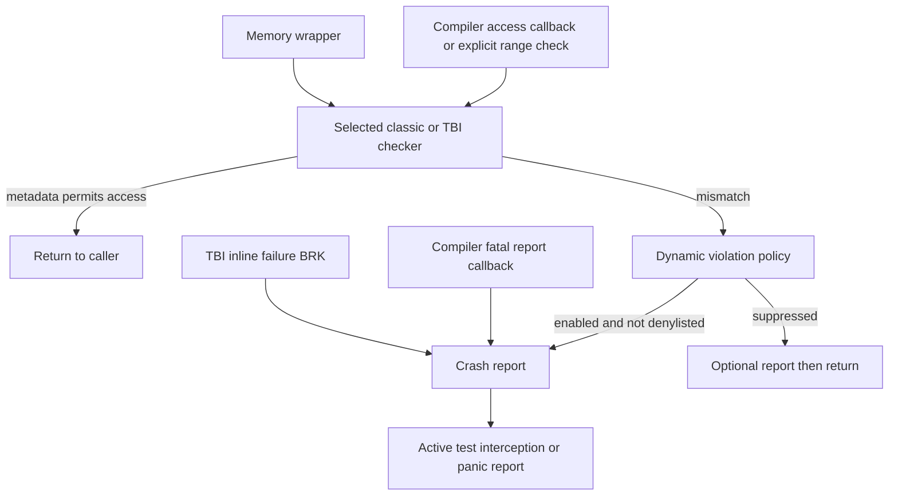
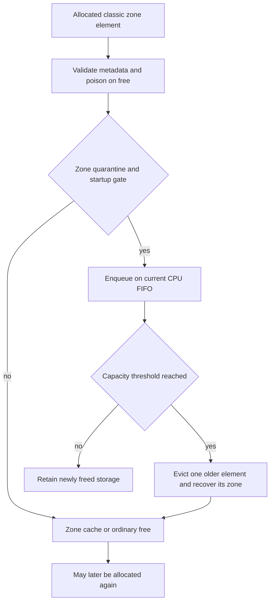
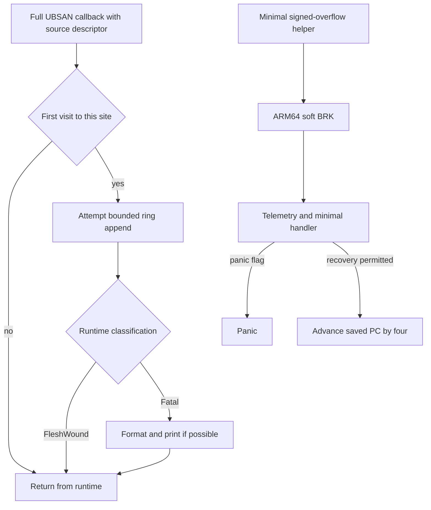

# Sanitizer runtime, allocator hooks, and reporting

[Observability guide](observability.md) · [Kernel allocation](../subsystems/vm/kernel-allocation.md) · [Memory tagging](../subsystems/vm/mte-tag-storage-and-page-lifecycle.md) · [Panic records](panic-coordination-and-records.md) · [Coverage instrumentation](coverage-instrumentation-lifecycle.md)

A sanitizer report is the end of several distinct operations: the build instruments selected code, allocators maintain metadata, an access checks that metadata, and a runtime chooses what to record or terminate. This chapter follows those operations in `xnu-12377.121.6`. KASAN classic, KASAN's software TBI model, full UBSAN and minimal UBSAN have different representations and outcomes. Their symbols alone do not establish which implementation a kernel image uses.

## 1. Establish the compiled model before interpreting a report

The common sanitizer file list selects KASAN management, reporting, callbacks, memory wrappers and tests under `config_kasan`. Full UBSAN's implementation and log are selected separately under `config_ubsan`. Architecture file lists then select classic plus fake-stack code on x86-64, or TBI code and the optional minimal UBSAN runtime on ARM64. [Common files](../../xnu/san/conf/files#L1-L15), [x86-64 files](../../xnu/san/conf/files.x86_64#L1-L4), [ARM64 files](../../xnu/san/conf/files.arm64#L1-L7).

| Selected path | Build evidence | Runtime representation |
| --- | --- | --- |
| x86-64 KASAN | `-fsanitize=address`, `KASAN_CLASSIC=1`, scale 3 | One shadow byte for eight kernel virtual bytes |
| ARM64 KASAN | `-fsanitize=kernel-hwaddress`, `KASAN_TBI=1`, scale 4 | One software shadow tag for sixteen virtual bytes, compared with pointer tag |
| KASAN Light | Selected for `WatchOS`; stack instrumentation flag becomes zero | Non-zone ranges use the default TBI tag and can share static-valid shadow mappings |
| Full UBSAN instrumentation | Inside `KASAN=1`, additionally selected by `UBSAN=1` | Compiler metadata descriptors and runtime violation records |
| Minimal UBSAN instrumentation | Non-KASAN `iPhoneOS` with kernel configuration `DEVELOPMENT` or `DEBUG` | Signed-overflow helpers emitting ARM64 `brk` |

Sources: [KASAN Light and model flags](../../xnu/makedefs/MakeInc.def#L673-L735), [full and minimal UBSAN selection](../../xnu/makedefs/MakeInc.def#L739-L794). The iPhoneOS configuration groups independently include `ubsan_minimal` in `VM_DEV` and `VM_DEBUG`; its option is `CONFIG_UBSAN_MINIMAL`. [Groups](../../xnu/config/MASTER.arm64.iPhoneOS#L96-L98), [option](../../xnu/config/MASTER.arm64.iPhoneOS#L130-L130).

The adjacent Makefile comments and minimal-runtime header mention RELEASE/DEVELOPMENT. The inspected Makefile predicate instead names DEVELOPMENT/DEBUG. Use that predicate for this source trace; the prose comment is not evidence that RELEASE receives these flags. Likewise, full UBSAN runtime files can be selected in a KASAN configuration before `UBSAN=1` enables the additional instrumentation. [Selection body](../../xnu/makedefs/MakeInc.def#L748-L790), [header comment](../../xnu/san/memory/ubsan_minimal.h#L32-L43), [x86 KASAN group](../../xnu/config/MASTER.x86_64#L68-L68).

The model headers reject a mismatch between `KASAN` and the compiler's corresponding sanitizer feature. TBI also requires `CONFIG_KERNEL_TAGGING`. Its initialization has a separate `CONFIG_SPTM && HAS_MTE` branch that rejects an MTE-enabled kernel and requests `sptm_disable_mte()`. This software shadow implementation must not be described as MTE hardware checking. [Classic feature checks](../../xnu/san/memory/kasan-classic.h#L35-L43), [TBI feature checks](../../xnu/san/memory/kasan-tbi.h#L35-L43), [TBI requirements and initialization](../../xnu/san/memory/kasan-tbi.c#L77-L79), [SPTM/MTE branch](../../xnu/san/memory/kasan-tbi.c#L125-L163).

## 2. Shadow bytes describe virtual ranges

Both models use `SHADOW_FOR_ADDRESS(x) = (strip(x) >> KASAN_SCALE) + KASAN_OFFSET`. Classic's strip operation is the identity; TBI canonicalizes the tagged pointer. These are kernel virtual addresses of metadata, not physical addresses, VM object offsets or DMA addresses. The Makefile supplies different offsets for x86-64 and ARM64. [Geometry and stripping](../../xnu/san/memory/kasan_internal.h#L70-L96), [offset selection](../../xnu/makedefs/MakeInc.def#L690-L702).

Mapping shadow and giving an allocation a valid state are separate steps. `kasan_init()` establishes initial mappings and architecture state before enabling the model. Later `kasan_notify_address_internal()` checks the address/size and maps metadata under the KASAN lock. Its ordinary and `nopoison` callers choose whether metadata may change. ARM64 can map static-valid shadow pages, including the Light-mode non-zone case. [Initialization](../../xnu/san/memory/kasan.c#L309-L345), [notifications](../../xnu/san/memory/kasan.c#L347-L385), [ARM64 mapping selection](../../xnu/san/memory/kasan-arm64.c#L315-L345).

### Classic: addressability, including a partial final granule

A classic shadow value of zero means all eight bytes are addressable. Values 1 through 7 specify an addressable prefix; poison values identify contexts such as heap redzone, freed heap or stack redzone. `kasan_poison()` writes the left redzone, full valid granules, a possible partial byte and the right redzone. [Values](../../xnu/san/memory/kasan-classic.h#L59-L93), [writer](../../xnu/san/memory/kasan-classic.c#L249-L300).

The range checker adds the access's initial granule offset to its length, aligns the starting address down, then walks metadata. Its final-granule predicate is the reason a one-byte difference can matter:

[Classic range predicate — `kasan-classic.c`, lines 317–329](../../xnu/san/memory/kasan-classic.c#L317-L329).

<!-- source-excerpt: ../../xnu/san/memory/kasan-classic.c#L317-L329 -->
```c
	size += kasan_granule_partial(base);
	base = kasan_granule_trunc(base);

	shadow = SHADOW_FOR_ADDRESS(base);
	size_t limit = (size + KASAN_GRANULE - 1) / KASAN_GRANULE;

	/* Walk the shadow table, fail on any non-valid value */
	for (i = 0; i < limit; i++, size -= KASAN_GRANULE) {
		assert(size > 0);
		uint8_t s = shadow[i];
		if (s == 0 || (size < KASAN_GRANULE && s >= size && s < KASAN_GRANULE)) {
			/* valid */
			continue;
```

For an illustrative allocation starting on an eight-byte boundary with 13 usable bytes, the first two shadow values are `0` and `5`. A one-byte access at allocation offset 12 stays within the five-byte prefix of the second granule; offset 13 does not. This example concerns byte addressability inside two granules and assumes the allocator has installed the corresponding metadata. It makes no page-size assumption.

`kasan_check_range()` first tests `checks_enabled`; `kasan_range_poisoned()` separately checks `kasan_enabled`. On failure the explicit checker identifies a granule start, not necessarily the exact failing byte, and routes to `kasan_violation()`. The source itself retains a comment about that precision limit. [Checker and reported address](../../xnu/san/memory/kasan-classic.c#L307-L370).

### TBI: tag equality at sixteen-byte granularity

The TBI implementation uses tag values 1 through 14 with the upper nibble set, a default tag `0xff`, and a reserved free-tag constant `0xf0`. `kasan_tbi_tag_range()` writes software shadow bytes and returns a pointer with the selected tag. Tag generation uses a local LFSR; it does not provide a unique generation number for each allocation. [Constants and tag set](../../xnu/san/memory/kasan-tbi.c#L60-L105), [generation and storage](../../xnu/san/memory/kasan-tbi.c#L263-L302).

The explicit checker first handles the disabled and null-pointer cases, extracts the pointer tag and applies the wildcard rule:

[TBI wildcard rule — `kasan-tbi.c`, lines 388–400](../../xnu/san/memory/kasan-tbi.c#L388-L400).

<!-- source-excerpt: ../../xnu/san/memory/kasan-tbi.c#L388-L400 -->
```c
	/*
	 * Inlining code expects to match the topmost 8 bits, while we only use
	 * four. Unconditionally set to one the others.
	 */
	uint8_t tag = vm_memtag_extract_tag(addr) | 0xF0;

	/*
	 * Stay on par with inlining instrumentation, that considers untagged
	 * addresses as wildcards.
	 */
	if (tag == KASAN_TBI_DEFAULT_TAG) {
		return;
	}
```

For other tags it compares the selected shadow bytes, reconstructs an address for a mismatching granule and calls `kasan_violation()`. The implementation computes its shadow endpoint from `addr + P2ROUNDUP(sz, 16)`; retain that expression when inspecting an unaligned access rather than substituting the classic checker's arithmetic. [TBI range checker](../../xnu/san/memory/kasan-tbi.c#L374-L419).

The selected compiler flags disable short granules. `kasan_tbi_retag_unused_space()` rounds the requested size up to sixteen before retagging remaining capacity. Thus an illustrative 13-byte request in a 32-byte bucket retains one tag across its first sixteen bytes and can give the second granule another tag. This differs from classic's `0,5` addressability encoding. [Compiler flag](../../xnu/makedefs/MakeInc.def#L711-L717), [unused-space helper](../../xnu/san/memory/kasan-tbi.c#L421-L433).

## 3. Access callbacks, memory wrappers, and inline failures

A callback with an `__asan_` prefix does not by itself identify the classic model. The TBI build explicitly selects the same memory-access callback prefix. Shared `__asan_load*`/`__asan_store*` callbacks delegate to the selected `kasan_check_range()`, while `__asan_report_load*`/`__asan_report_store*` delegate directly to the nonreturning crash-report path. [Build prefix](../../xnu/makedefs/MakeInc.def#L704-L717), [report and check callbacks](../../xnu/san/memory/kasan-helper.c#L56-L113).

The selected TBI flags favor inline checks. Its inline failure reaches a registered ARM64 breakpoint descriptor; `kasan_handle_brk_failure()` reads the address from saved `x0`, derives width and read/write type from the breakpoint immediate, and calls `kasan_crash_report()`. The descriptor is fatal by default. [Descriptor](../../xnu/san/memory/kasan-tbi.c#L81-L86), [failure handler](../../xnu/san/memory/kasan-tbi.c#L212-L229), [immediate encoding](../../xnu/san/memory/kasan-tbi.h#L54-L65).

Memory intrinsics have explicit wrappers too. For `__asan_memcpy`, source and destination checks precede the underlying uninstrumented copy:

[Memory-copy wrapper — `kasan-memintrinsics.c`, lines 56–62](../../xnu/san/memory/kasan-memintrinsics.c#L56-L62).

<!-- source-excerpt: ../../xnu/san/memory/kasan-memintrinsics.c#L56-L62 -->
```c
void *
__asan_memcpy(void *dst, const void *src, size_t sz)
{
	kasan_check_range(src, sz, TYPE_MEMR);
	kasan_check_range(dst, sz, TYPE_MEMW);
	return __nosan_memcpy(dst, src, sz);
}
```

If a dynamic violation is suppressed and its checker returns, this wrapper proceeds with the copy. Conversely, a fatal report prevents reaching the underlying operation through this path. A checker is not an error-returning replacement for `memcpy`.

Do not generalize this ordering to all string wrappers. `__asan_strlen()` first obtains the length with `__nosan_strlen()` and then checks the range including the terminator. `__asan_strnlen()` similarly determines how much was scanned before checking. Other string wrappers check a destination extent. Read the specific wrapper before claiming an access is checked before it occurs. [String paths](../../xnu/san/memory/kasan-memintrinsics.c#L100-L145).



This diagram separates entry contracts. It does not show every ABI helper. Some exported sanitizer functions are explicit no-ops and others panic as unsupported APIs; the presence of an exported name does not establish an implemented diagnostic. [Unused and unsupported ABI](../../xnu/san/memory/kasan-helper.c#L179-L223).

## 4. Classic allocation state and delayed reuse

For ordinary zone allocation, `zalloc_return()` calls `__zcache_mark_valid()`. Unless `Z_SKIP_KASAN` is set, the classic branch calls `kasan_alloc()` with the zone's usable size and redzone configuration. The kalloc wrapper instead sets `Z_SKIP_KASAN`, then installs metadata with the actual requested size through `kalloc_mark_unused_space()`. `Z_FULLSIZE` and encoded-array requests select element capacity as their usable extent. [Zone return](../../xnu/osfmk/kern/zalloc.c#L5987-L6048), [kalloc adjustment](../../xnu/osfmk/kern/kalloc.c#L2435-L2485).

The classic allocation header occupies sixteen bytes immediately before the user address. It stores allocation state, left-redzone size, requested size and allocation/free backtrace references. Quarantine reuses part of that header for its link. The header is allocator metadata inside the redzone; it is not extra caller capacity. [Header and address conversion](../../xnu/san/memory/kasan-classic.c#L408-L435).

| Transition | Concrete metadata work | Ownership consequence |
| --- | --- | --- |
| Zone backing added | Mark free slots and left redzones in shadow | Backing exists before any slot becomes a live allocation |
| Allocate | Release old backtrace references, record requested extent, mark allocated, update shadow | Returned pointer names the live usable region |
| Free validation | Check allocated state, requested size and shadow/redzones | Checking happens before marking the element freed |
| Free marking | Record free backtrace and poison usable shadow with `ASAN_HEAP_FREED` | Caller lifetime ends even if storage is retained |
| Quarantine enqueue | Change state to quarantined and link into the current CPU's FIFO | Slot is withheld from ordinary reuse |
| Eviction | Return an older slot and its owning zone | Ordinary zone free machinery receives that returned slot |

Sources: [backing initialization](../../xnu/san/memory/kasan-classic.c#L437-L464), [allocation/free](../../xnu/san/memory/kasan-classic.c#L496-L561), [free validation](../../xnu/san/memory/kasan-classic.c#L588-L616), [quarantine](../../xnu/san/memory/kasan-classic.c#L622-L667).

`zfree_ext()` first validates/marks the supplied element, then disables preemption and updates free statistics. If that zone has `z_kasan_quarantine` and startup has reached the required phase, it enqueues the element. A zero returned address ends the free operation with the original storage retained. A nonzero result may be an older allocation from a different zone; the caller replaces both `elem` and `zone` before continuing to cache or ordinary free. [Free ordering and returned pair](../../xnu/osfmk/kern/zalloc.c#L5508-L5547).

The FIFO has per-CPU byte and entry counters. It releases one head when the byte count reaches four MiB or the entry count exceeds 5000:

[Quarantine eviction — `kasan-classic.c`, lines 653–664](../../xnu/san/memory/kasan-classic.c#L653-L664).

<!-- source-excerpt: ../../xnu/san/memory/kasan-classic.c#L653-L664 -->
```c
	if (q->size >= QUARANTINE_MAXSIZE || q->count > QUARANTINE_ENTRIES) {
		h = q->head;
		assert(h->state == KASAN_STATE_QUARANTINED);

		q->head  = (kasan_alloc_header_t)(intptr_t)h->next;
		h->state = KASAN_STATE_FREED;
		h->next  = 0;

		kqr.addr = (vm_address_t)(h + 1);
		q->size -= kasan_quarantine_resolve(kqr.addr, &kqr.zone);
		q->count--;
	}
```

These are capacity thresholds, not a time-based grace period or a proof that stale pointers cannot recur after reuse. Preemption exclusion protects the selected CPU queue in this caller. The operative gate here is the zone flag plus startup phase: although this file exposes a `quarantine_enabled` sysctl variable, `kasan_quarantine()` and the shown caller do not consult that variable. [Threshold constants](../../xnu/san/memory/kasan-classic.h#L50-L57), [exposed variable](../../xnu/san/memory/kasan-classic.c#L94-L116), [sysctl](../../xnu/san/memory/kasan-classic.c#L690-L690).



Large VM allocation has its own lifecycle. Under `KMA_KASAN_GUARD`, the returned address advances by a page and `kasan_alloc_large()` marks requested bytes between implicit guards. The inspected free branch restores valid shadow before removing/unwiring the mapping. It does not route through the zone FIFO just described. [Large allocation](../../xnu/osfmk/vm/vm_kern.c#L1130-L1135), [large shadow layout](../../xnu/san/memory/kasan-classic.c#L563-L570), [VM free](../../xnu/osfmk/vm/vm_kern.c#L2635-L2656). Full mapping ownership remains in [kernel virtual allocation](../subsystems/vm/kernel-virtual-allocation.md).

### Fake stacks are a separate classic facility

Classic enables fake-stack support at compile time, while the runtime/compiler option starts at zero and can be enabled by the KASAN boot configuration or its sysctl. The allocator uses seven prefilled, exhaustible zones with a sixty-four-byte header and per-thread lists. Disabled operation, unsupported size class, reentry or allocation failure can return zero to the compiler helper. [Option and representation](../../xnu/san/memory/kasan-fakestack.c#L50-L94), [allocation](../../xnu/san/memory/kasan-fakestack.c#L172-L216), [zone setup and runtime switch](../../xnu/san/memory/kasan-fakestack.c#L270-L315).

The compiler-facing allocation records a flag pointer and list entry. Collection removes `FAKESTACK_UNUSED` entries under the KASAN lock, then restores shadow and frees them after dropping that lock. Explicit fake-stack free similarly unlinks, restores shadow and frees. These zones explicitly use `ZC_KASAN_NOREDZONE | ZC_KASAN_NOQUARANTINE`; do not substitute the ordinary FIFO algorithm for this path. [Collection](../../xnu/san/memory/kasan-fakestack.c#L130-L161), [explicit free](../../xnu/san/memory/kasan-fakestack.c#L219-L248), [zone flags](../../xnu/san/memory/kasan-fakestack.c#L283-L290).

Scheduler stack transitions call `kasan_fakestack_drop()` and collection: dropping marks allocated entries unused, rather than freeing the list in place. TBI has `KASAN_FAKESTACK=0` and clears a legacy request during initialization. [Scheduler transition](../../xnu/osfmk/kern/sched_prim.c#L3189-L3203), [drop](../../xnu/san/memory/kasan-fakestack.c#L251-L268), [TBI configuration](../../xnu/san/memory/kasan-tbi.h#L45-L48), [TBI initialization](../../xnu/san/memory/kasan-tbi.c#L156-L163).

## 5. TBI allocator hooks use software tag storage

The TBI implementation supplies `vm_memtag_load_tag`, `store_tag`, `generate_and_store_tag`, `verify_tag` and relocation operations. They use the software shadow table; the common API name also used by MTE does not make their implementations identical. [TBI implementations](../../xnu/san/memory/kasan-tbi.c#L464-L495).

For tagged zone elements, initial chunk preparation generates/stores tags. On allocation, `__zcache_mark_valid()` loads the stored tag into the returned pointer. On free, `zone_tag_free_element()` skips the canonical-address case and, on the non-MTE branch, generates/stores another tag before updating zone tagging state. Thus this selected zone path changes the tag on free and adopts it on reuse. [Chunk initialization](../../xnu/osfmk/kern/zalloc.c#L3926-L3965), [allocation](../../xnu/osfmk/kern/zalloc.c#L5956-L5962), [free](../../xnu/osfmk/kern/zalloc.c#L3888-L3924).

There is no unique lifetime counter: generated tags can repeat. Light mode can replace the chosen tag with the default outside zone-owned ranges. Requested-size tail handling also works at whole sixteen-byte granules, as shown earlier. These are concrete limits of what a tag comparison represents, independently of the allocator's reference or locking rules. [Generator](../../xnu/san/memory/kasan-tbi.c#L272-L302), [kalloc hook](../../xnu/osfmk/kern/kalloc.c#L2449-L2451).

VM allocations with `KMA_TAG` install tags for their filled region and retag unused capacity. On tagged VM free, `kasan_tbi_mark_free_space()` resets the range to the default `0xff` tag before map removal. Its nearby comment calls this a free tag, but the body uses `KASAN_TBI_DEFAULT_TAG`, not the separately defined `0xf0` constant. A tagged stale pointer and a default-tag pointer therefore have different checking behavior. [VM allocation](../../xnu/osfmk/vm/vm_kern.c#L1136-L1143), [VM free](../../xnu/osfmk/vm/vm_kern.c#L2640-L2656), [reset helper](../../xnu/san/memory/kasan-tbi.c#L436-L447), [reserved constants](../../xnu/san/memory/kasan-tbi.c#L64-L67).

Global handling also differs. Classic walks compiler global descriptors and poisons their trailing regions. TBI's `kasan_init_globals()` is an empty implementation with a comment about compiler support. Common kext-load discovery of a globals section must not be treated as proof that the TBI backend installs equivalent global metadata. [Classic globals](../../xnu/san/memory/kasan-classic.c#L138-L163), [TBI stub](../../xnu/san/memory/kasan-tbi.c#L165-L172), [common kext hook](../../xnu/san/memory/kasan.c#L184-L218).

## 6. Suppression and reporting depend on the entry path

Dynamic checking policy combines `kasan_enabled`, an access-type mask and the dynamic denylist. The denylist examines backtrace addresses with a cache and a slower symbol/range path; this is different from the build-time compiler ignorelist, which changes instrumentation emission. [Policy predicate](../../xnu/san/memory/kasan.c#L118-L122), [dynamic lookup](../../xnu/san/memory/kasan_dynamic_denylist.c#L349-L419), [compiler ignorelist](../../xnu/makedefs/MakeInc.def#L707-L725).

[Dynamic disposition — `kasan-report.c`, lines 177–192](../../xnu/san/memory/kasan-report.c#L177-L192).

<!-- source-excerpt: ../../xnu/san/memory/kasan-report.c#L177-L192 -->
```c
kasan_violation(uintptr_t addr, size_t size, access_t access, violation_t reason)
{
	assert(__builtin_popcount(access) == 1);
	if (!kasan_check_enabled(access)) {
		/*
		 * A violation happened but the annexed check is disabled. Simply
		 * report the issue.
		 */
		if (report_suppressed_checks) {
			kasan_log_report(addr, size, access, reason);
		}
		return;
	}
	/* Panic as usual */
	kasan_crash_report(addr, size, access, reason);
}
```

The optional suppressed report formats a model-specific description and surrounding shadow bytes, prints them, and prints a bounded backtrace. The fatal path invokes the test interception hook, formats a report into a static 4096-byte buffer, then panics. This is diagnostic output, not a transactional rollback of the allocator, copy or access that led there. [Formatting and crash path](../../xnu/san/memory/kasan-report.c#L101-L137), [suppressed report](../../xnu/san/memory/kasan-report.c#L139-L166).

The boot argument parser can alter the enabled check mask, dynamic checks, poisoning and suppressed-report behavior. These are not a universal switch that removes compiler inline checks. `kasan_kdp_disable()` clears dynamic checks and calls the model's debugger-disable hook while leaving the common metadata machinery's enabled state in place; its comment explains why panic/core paths need this distinction. [Boot policy](../../xnu/san/memory/kasan.c#L302-L345), [debugger disable](../../xnu/san/memory/kasan.c#L220-L233), [model hooks](../../xnu/san/memory/kasan-classic.c#L113-L120), [TBI hook](../../xnu/san/memory/kasan-tbi.c#L174-L179).

## 7. Full UBSAN records sites; minimal UBSAN handles traps

Full UBSAN receives compiler-created source/type descriptors and the values involved in an operation. For example, overflow callbacks construct a `ubsan_violation_t` containing the overflow kind, operands, descriptor and source location. They classify the call as `FleshWound` or `Fatal` before entering the common handler. [Descriptor definitions](../../xnu/san/memory/ubsan.h#L35-L85), [overflow callbacks](../../xnu/san/memory/ubsan.c#L638-L652).

`ubsan_loc_acquire()` atomically sets the high bit of the source-location line on the first visit. Subsequent visits return before log insertion or printing. Clearing the ring's entries does not clear those source descriptor bits. [First-visit marker](../../xnu/san/memory/ubsan.c#L286-L298), [handler](../../xnu/san/memory/ubsan.c#L592-L615), [log reset](../../xnu/san/memory/ubsan_log.c#L151-L174).

The name `Fatal` is not a local panic guarantee. After attempting log insertion, this body returns immediately for `FleshWound`; for `Fatal` it attempts formatting and `printf`, then also reaches the end. There is no `panic()` in this handler:

[Full UBSAN disposition — `ubsan.c`, lines 595–615](../../xnu/san/memory/ubsan.c#L595-L615).

<!-- source-excerpt: ../../xnu/san/memory/ubsan.c#L595-L615 -->
```c
ubsan_handle(ubsan_violation_t *v, enum UBFatality fatality)
{
	if (!ubsan_loc_acquire(v->loc)) {
		/* violation site already reported */
		return;
	}
	ubsan_log_append(v);

	if (fatality != Fatal) {
		return;
	}

	static char buf[512] = { 0 };
	ubsan_buf_t ubsan_buf;

	ubsan_json_init(&ubsan_buf, buf, sizeof(buf));

	if (ubsan_json_format(v, &ubsan_buf)) {
		printf("UBSan: %s", buf);
	}
}
```

Compiler-emitted trap checks and assumptions around `_abort` callbacks are separate contracts. The Makefile selects `vla-bound` and `builtin` as trap checks in the full-instrumentation branch; their behavior cannot be inferred solely from this returning body or from an ABI name. No compiler-generated image was inspected here. [Instrumentation/check selection](../../xnu/makedefs/MakeInc.def#L750-L762).

The full log has 2048 physical record slots. Writers disable preemption, reserve an index with an atomic loop, return without inserting if advancing would meet the reader tail, copy the violation, issue a release fence, and publish in reservation order. A writer can wait for an earlier enqueuer before advancing the published boundary. This bounded log can lose a first occurrence when full; the site's first-visit bit was already acquired. [Log storage and writer](../../xnu/san/memory/ubsan_log.c#L45-L101).

`kern.ubsan.log` snapshots ring boundaries, formats records into a temporary buffer and calls `SYSCTL_OUT`. Reading does not advance the tail. Writing zero to `logentries` moves the tail to the sampled head; other new values are rejected. Its JSON-like formatter explicitly lacks character quoting, and formatting can stop at capacity. The log is a bounded diagnostic representation, not an exhaustive event history or an unconditionally complete JSON export. [Readout](../../xnu/san/memory/ubsan_log.c#L112-L149), [reset and registrations](../../xnu/san/memory/ubsan_log.c#L151-L188), [formatter limits](../../xnu/san/memory/ubsan.c#L38-L40), [record formatting rollback](../../xnu/san/memory/ubsan.c#L524-L589).

### Minimal UBSAN's continuation is an exception-path decision

The minimal runtime's five signed-overflow helpers emit the same `UBSAN_SOFT_TRAP_SIGNED_OF` breakpoint immediate. The handler does not receive full source descriptors or operands through that ABI. Once initialized, it either panics under the trap's flag or increments its fixup counter. A DEVELOPMENT-only early-startup branch panics before initialization; the corresponding other branch returns. [Helpers](../../xnu/san/memory/ubsan_minimal.c#L148-L178), [handler](../../xnu/san/memory/ubsan_minimal.c#L73-L94).

The ARM64 soft-trap descriptor is registered under `HAS_TELEMETRY_KERNEL_BRK` with recoverable options. The exception dispatcher reports telemetry when enabled, calls the handler, and advances the saved PC by one four-byte instruction if the descriptor permits recovery:

[Breakpoint continuation — `sleh.c`, lines 1430–1439](../../xnu/osfmk/arm64/sleh.c#L1430-L1439).

<!-- source-excerpt: ../../xnu/osfmk/arm64/sleh.c#L1430-L1439 -->
```c
	if (desc->handle_breakpoint) {
		msg = desc->handle_breakpoint(state, comment);
	}

#if HAS_TELEMETRY_KERNEL_BRK
	/* Still alive? Check if we should recover. */
	if (desc->options.recoverable) {
		add_saved_state_pc(state, 4);
		return;
	}
```



The right-hand path resumes after the trap; it does not repair arithmetic operands or undo prior state. DEVELOPMENT/DEBUG initialization can set panic flags through `-ubsan_force_panic`, and the development sysctls expose flags and the counter. Telemetry delivery has its own subsystem and is not the full UBSAN ring. [Soft descriptor and dispatcher](../../xnu/osfmk/arm64/sleh.c#L1387-L1458), [initialization and controls](../../xnu/san/memory/ubsan_minimal.c#L96-L144).

## 8. Local tests and verification boundaries

| Local evidence | What it demonstrates in source | Limit |
| --- | --- | --- |
| `kasan-test.c` test table | Named heap, stack, memory-wrapper, denylist and fake-stack cases | Individual cases have model/configuration assumptions; this review did not execute them |
| KASAN test runner | `_setjmp` setup, report interception through `_longjmp`, result and cleanup handling | Test-mode interception changes the normal panic path |
| Minimal UBSAN sysctl test | A selected signed-overflow expression in DEVELOPMENT/DEBUG source | Does not demonstrate full UBSAN's log, all checks, or emitted instructions in a built image |
| Configuration and compiler flags | Which source groups, instrumentation options and models are selected here | Does not establish a shipping product's configuration or external compiler implementation |

Sources: [KASAN test table](../../xnu/san/memory/kasan-test.c#L550-L577), [runner and interception](../../xnu/san/memory/kasan-test.c#L580-L659), [test/fail registrations](../../xnu/san/memory/kasan-test.c#L670-L689), [minimal UBSAN test](../../xnu/san/memory/ubsan_minimal.c#L114-L144).

The review covers selected check/report paths, ordinary zone and kalloc hooks, guarded VM hooks, fake-stack bookkeeping and UBSAN publication/readout. Architecture shadow-page bootstrap, every allocator configuration, every compiler ABI helper, toolchain code generation and downstream telemetry consumers are not exhaustively traced. No kernel build, sanitizer run, panic experiment or hardware measurement was performed. The [allocator chapters](../subsystems/vm/kernel-allocation.md) remain the route for storage ownership, and [panic coordination](panic-coordination-and-records.md) explains what follows a normal panic entry.

<!-- BEGIN PLATYDOC DOCUMENTATION LICENSE -->
Original Platydoc text and diagrams are licensed under [CC BY 4.0](https://creativecommons.org/licenses/by/4.0/). Quoted source code and third-party material retain their respective licenses.
<!-- END PLATYDOC DOCUMENTATION LICENSE -->
