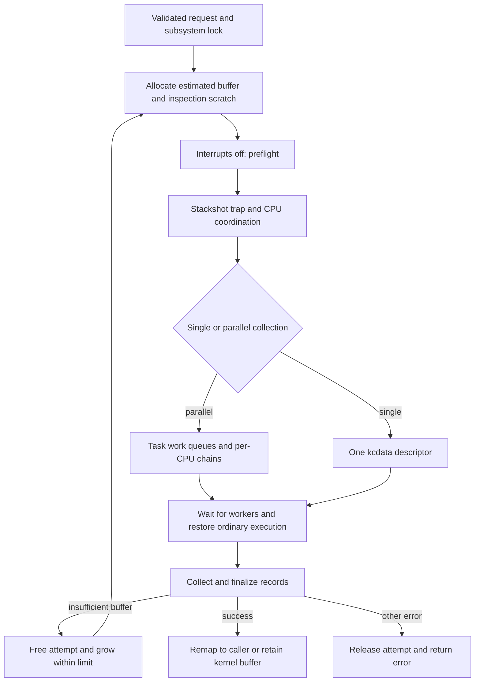

# Stackshot capture, parallel collection and kcdata records

[Observability overview](observability.md) · [Corpses and process cores](corpses-and-process-core-dumps.md) · [Panic coordination](panic-coordination-and-records.md)

A stackshot is a structured capture of selected task, thread, stack and dependency state. Its implementation must prepare storage before stopping normal execution, coordinate participating CPUs, collect records without ordinary scheduler assumptions, and publish a completed buffer. This chapter follows the ARM64/common collector in `xnu-12377.121.6`. Some stackshot helpers have historical `kdp_` names; the debugger protocol and kernel-core transport are outside this chapter.

## 1. Entry separates permission, request validation and capture

The BSD [`stack_snapshot_with_config`](../../platydoc-data/xnu/bsd/kern/stackshot.c#L522-L580) requires the superuser check, applies the configured entitlement reporting/refusal policy, validates the version and exact configuration size, and copies `stackshot_config_t` into kernel storage. It then calls `kern_stack_snapshot_internal` and converts its return to a BSD error.

The kernel entry checks request semantics independently. [`kern_stack_snapshot_internal`](../../platydoc-data/xnu/osfmk/kern/kern_stackshot.c#L2403-L2511) extracts PID, flags, delta timestamp, size hint, page-table mask, and **addresses at which to return the resulting buffer address and length**. These are not a caller-provided array into which the collector streams arbitrary records.

| Request choice | Decision |
| --- | --- |
| User request for trylock, save-in-kernel or panic flags | Rejected as an internal-only operation |
| Internal caller without save-in-kernel | Rejected on this interface |
| Delta timestamp without delta-snapshot flag | Rejected |
| User-requested compression in a non-development/non-debug kernel | Rejected on this entry point |
| Compression with delta or page-table capture | Unsupported combination |
| Exclave include and skip simultaneously | Invalid |
| Unsupported CPU counters | Corresponding collection flag cleared |
| Existing saved kernel buffer | Preserve it; do not silently overwrite it |

See the actual [flag checks](../../platydoc-data/xnu/osfmk/kern/kern_stackshot.c#L2463-L2532). A requested flag and an emitted record are therefore different facts.

## 2. A capture owns preallocated memory and global/per-CPU state

| Structure | State it carries |
| --- | --- |
| `kdp_snapshot_args` | Target, output storage, flags, timestamp and page-table selection |
| `stackshot_context` | Overall state, selected main CPU, result, participating CPUs, work queues and finalized output |
| `stackshot_cpu_context` | Per-CPU scratch stack storage, current kcdata chain and participation state |
| `stackshot_workitem` | Task to inspect, resulting kcdata chain and original ordering index |
| `stackshot_workqueue` | Producer item count, atomic consumer cursor, capacity and population-complete flag |
| `linked_kcdata_descriptor` | A kcdata descriptor plus a pointer to the next buffer fragment |
| `stackshot_buffer` | Preallocated backing region, atomic allocation cursor and free-list bookkeeping |

Definitions: [`work items, buffers and arguments`](../../platydoc-data/xnu/osfmk/kern/kern_stackshot.c#L155-L197), [`per-CPU/global state`](../../platydoc-data/xnu/osfmk/kern/kern_stackshot.c#L249-L346).

The subsystem lock serializes ordinary requests. The size estimate includes the requested scope; a size hint is accepted only within the configured maximum. Allocation uses zeroed diagnostic memory. The collector also prepares compressor inspection scratch space before entering the trap. This supports inspecting compressed backing; it is distinct from compressing the resulting kcdata stream. [`allocation and preparation`](../../platydoc-data/xnu/osfmk/kern/kern_stackshot.c#L2571-L2629).



The retry is a new capture attempt. It does not resume a half-written snapshot while pretending every record came from the same earlier instant.

## 3. Preflight selects a collection mode

[`kdp_snapshot_preflight_internal`](../../platydoc-data/xnu/osfmk/kern/kern_stackshot.c#L2811-L2915) selects single-threaded collection for a configured override, process-scoped capture without `STACKSHOT_INCLUDE_DRIVER_THREADS_IN_KERNEL`, panic capture, or page-table capture. Otherwise the parallel path can distribute work across available CPUs. Panic captures use a descriptor supplied by the panic path, rather than constructing an ordinary request's output buffer.

On ARM64 systems with heterogeneous clusters, the parallel allocator divides backing storage using the count of participating CPUs in each cluster. The main CPU sets up queues and common data; helpers process task work. Publishing `SS_RUNNING` with release ordering makes initialized shared state visible to participants. [`do_stackshot`](../../platydoc-data/xnu/osfmk/kern/kern_stackshot.c#L5923-L6014).

The collector does not simply launch normal kernel worker threads into a running system. Auxiliary CPUs enter through the stopped-CPU collection path with interrupts disabled. Normal task/thread execution is quiesced by the surrounding coordination. The capture still has explicit constraints on no-fault reads, permitted faulting, buffer exhaustion and panic interference; “stopped” does not mean every byte is safely dereferenceable. [`auxiliary entry`](../../platydoc-data/xnu/osfmk/kern/kern_stackshot.c#L6251-L6300), [`address validation`](../../platydoc-data/xnu/osfmk/kern/kern_stackshot.c#L2962-L2990), [upstream collection design](../../platydoc-data/xnu/doc/observability/mt_stackshot.md).

## 4. Parallel queue completion is different from an empty queue

A worker can temporarily find no item while the main CPU is still populating the queue. It must check both item availability and `sswq_populated`; stopping on the first empty observation would lose tasks. Each work item gets its own linked kcdata chain, and a global status check lets workers stop after another CPU reports failure. [`stackshot_cpu_work_on_queue`](../../platydoc-data/xnu/osfmk/kern/kern_stackshot.c#L6166-L6195):

<!-- source-excerpt: ../../platydoc-data/xnu/osfmk/kern/kern_stackshot.c#L6171-L6191 -->
```c
	while (((cur_workitemp = stackshot_get_workitem(queue)) != NULL || !os_atomic_load(&queue->sswq_populated, acquire))) {
		/* Check to make sure someone hasn't errored out or panicked. */
		if (__improbable(stackshot_status_check() != KERN_SUCCESS)) {
			return KERN_ABORTED;
		}

		if (cur_workitemp) {
			kcd_exit_on_error(stackshot_new_linked_kcdata());
			cur_workitemp->sswi_data = stackshot_cpu_ctx.scc_kcdata_head;
			kcd_exit_on_error(kdp_stackshot_record_task(cur_workitemp->sswi_task));
			stackshot_finalize_linked_kcdata();
		} else {
#if STACKSHOT_COLLECTS_LATENCY_INFO
			uint64_t time_begin = mach_absolute_time();
#endif
			loop_wait();
#if STACKSHOT_COLLECTS_LATENCY_INFO
			stackshot_cpu_latency.workqueue_latency_mt += mach_absolute_time() - time_begin;
#endif
		}
	}
```

On AMP builds, P-core workers traverse queues from more difficult to less difficult work; other workers use the opposite order. This changes work distribution, not the logical output schema. Participants decrement the working count when done; the coordinating path waits for that count to reach zero before accepting the capture. [`work ordering`](../../platydoc-data/xnu/osfmk/kern/kern_stackshot.c#L6201-L6248), [`completion barrier`](../../platydoc-data/xnu/osfmk/kern/kern_stackshot.c#L6016-L6036).

After returning from the trap and restoring interrupts, `stackshot_collect_kcdata()` assembles pre-task, task and post-task fragments into the final buffer. Work-item indices preserve task output order despite parallel completion order. Allocation callbacks extend a task's linked chain inside the preallocated capture storage; they are not an unrestricted VM allocation path during stopped execution. [`chain extension`](../../platydoc-data/xnu/osfmk/kern/kern_stackshot.c#L1040-L1070), [`collection`](../../platydoc-data/xnu/osfmk/kern/kern_stackshot.c#L1776-L1845).

The assembled artifact can contain phases outside the stopped-CPU interval. After interrupts are restored and ordinary parallel kcdata fragments are gathered, the configured Exclave path can call `collect_exclave_threads()` before finalization. A completed buffer therefore does not establish that every optional producer observed one globally atomic instant across XNU and external services. The main collection's CPU barrier and the final artifact's publication are different boundaries. [Post-trap ordering](../../platydoc-data/xnu/osfmk/kern/kern_stackshot.c#L2634-L2678).

## 5. kcdata is a typed stream with explicit capacity and padding

[`struct kcdata_item`](../../platydoc-data/xnu/osfmk/kern/kcdata.h#L258-L298) has a 32-bit type, a 32-bit payload size, 64-bit flags, then the payload. Its fixed header is 16 bytes. Record payloads are padded to a 16-byte boundary. The meaning of `flags` depends on record type: structure padding, array element type/count, or container identity.

`kcdata_descriptor` tracks buffer bounds, the current end, copy policy, compression state and optional allocation callback. `kcdata_memory_alloc_init` allocates the descriptor and writes a BEGIN record; it uses the supplied buffer address rather than allocating the entire payload buffer itself. [`descriptor initialization`](../../platydoc-data/xnu/osfmk/kern/kern_cdata.c#L308-L328).

The append helper reserves room for the new padded record **and a final BUFFER_END header**. It validates arithmetic and capacity; an allocation callback can supply another descriptor, otherwise it returns `KERN_INSUFFICIENT_BUFFER_SIZE`. It zeroes padding, returns the payload address, advances the cursor and normally rewrites the trailing end marker. [`append implementation`](../../platydoc-data/xnu/osfmk/kern/kern_cdata.c#L1150-L1222).

Illustrative uncompressed layout for a structure with 20 logical payload bytes:

```text
offset +0    16-byte item header: type, size=32, flags include padding=12
offset +16   20 payload bytes
offset +36   12 zero padding bytes
offset +48   next item header, or BUFFER_END
```

The `size` field describes the padded payload in this writer. A consumer must interpret padding flags and type-version rules instead of assuming `size == sizeof(current_kernel_structure)`. The header comments document legacy records that predate padding flags. Container and array records have their own flag interpretation. [`format rules`](../../platydoc-data/xnu/osfmk/kern/kcdata.h#L258-L298).

Compression uses a separate descriptor mode and its own framing/finalization; ordinary offset arithmetic above is for the uncompressed stream. Parsers in [`libkdd`](../../platydoc-data/xnu/libkdd/kdd.h) and [`kcdata.py`](../../platydoc-data/xnu/tools/lldbmacros/kcdata.py) show consumers available in this source tree. User-facing reporting and symbolication are separate from capture.

## 6. Capacity failure, retries and output ownership

If capture or finalization reports insufficient buffer space, the ordinary path frees the attempt and increases the size up to `max_tracebuf_size`. Reaching the maximum produces resource shortage instead of wrapping into an infinite growth loop. Other errors return after cleanup. Interrupt-off durations from earlier attempts are accumulated separately. [`retry and maximum`](../../platydoc-data/xnu/osfmk/kern/kern_stackshot.c#L2681-L2730).

For user output, [`stackshot_remap_buffer`](../../platydoc-data/xnu/osfmk/kern/kern_stackshot.c#L1943-L1981) maps the collected memory into `current_map()`, then copies out the new address and length. If either copyout fails, it removes the new user mapping. The first address copyout can already have succeeded when the length copyout fails: the caller must honor the operation's error result.

The rollback is explicit. [`publication cleanup`](../../platydoc-data/xnu/osfmk/kern/kern_stackshot.c#L1970-L1979):

<!-- source-excerpt: ../../platydoc-data/xnu/osfmk/kern/kern_stackshot.c#L1970-L1979 -->
```c
		error = copyout(CAST_DOWN(void *, &stackshotbuf_user_addr), (user_addr_t)out_buffer_addr, sizeof(stackshotbuf_user_addr));
		if (error != KERN_SUCCESS) {
			mach_vm_deallocate_kernel(get_task_map(current_task()), stackshotbuf_user_addr, (mach_vm_size_t)bytes_traced);
			return error;
		}
		error = copyout(&bytes_traced, (user_addr_t)out_size_addr, sizeof(bytes_traced));
		if (error != KERN_SUCCESS) {
			mach_vm_deallocate_kernel(get_task_map(current_task()), stackshotbuf_user_addr, (mach_vm_size_t)bytes_traced);
			return error;
		}
```

For internal retention, `kernel_stackshot_buf` takes ownership of the successful buffer and unused trailing pages can be freed. A later retrieve-existing request clears the saved pointer only after successful publication. A failed retrieval leaves the saved capture available. The final success guard rejects a nominally successful user operation if no publication occurred. [`retention and cleanup`](../../platydoc-data/xnu/osfmk/kern/kern_stackshot.c#L2732-L2805).

## Inspection boundary

Reviewed here are admission/configuration, allocation/retry, ARM64/common parallel collection, record assembly, kcdata append and output publication. The collector has many optional record producers: this is not an exhaustive schema dictionary or a validation of every backtrace/unwinding backend. Exclave inspection crosses into separately supplied services. No live stackshot was taken, and neither debugger networking nor kernel-core transport is covered.

<!-- BEGIN PLATYDOC DOCUMENTATION LICENSE -->
Original Platydoc text and diagrams are licensed under [CC BY 4.0](https://creativecommons.org/licenses/by/4.0/). Quoted source code and third-party material retain their respective licenses.
<!-- END PLATYDOC DOCUMENTATION LICENSE -->
