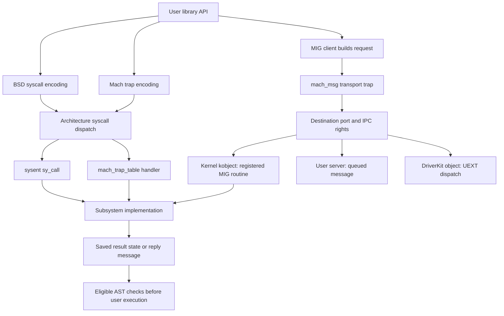

# Kernel entry interfaces: BSD syscalls, Mach traps and Mach messages

[Handbook](../README.md) · [AST mechanism](../subsystems/runtime/ast-mechanism.md) · [ARM64 assembly](../subsystems/platform/arm64-assembly-walkthroughs.md)

This is an interface map of the source snapshot. It separates three namespaces that can appear behind a familiar library function: a BSD syscall number, a Mach trap number, and a Mach message ID. A syscall or trap reaches a machine dispatcher directly. A message operation first uses IPC transport, then dispatches at the destination port. The same VM or port operation can have a current-task trap fast path and a message fallback.

## Choose the right catalog

| Surface | Catalog and implementation route |
| --- | --- |
| BSD numbered calls | [BSD dispatch and family catalogs](bsd-syscalls/README.md), with [every number and configuration alternative](bsd-syscalls/number-index.md). The master supplies declarations; each implemented entry has an explanation and local implementation references. |
| Mach numbered traps | [Mach trap catalog](mach-traps.md): valid operations, invalid slots, configured implementations, arguments and wrapper/fallback behavior. |
| Architecture selectors | [Machine entry points](machine-entry-points.md): ARM64 SVC and platform entries, x86 classes and machine-specific paths. |
| MIG messages | [Mach message interfaces](mach-messages/README.md): subsystem ranges, routine contracts, destination direction, local implementations and generated/external boundaries. |
| Deferred return work | [AST mechanism](../subsystems/runtime/ast-mechanism.md) and [flavor catalog](../subsystems/runtime/ast-flavors.md): why returning from any of these operations may first schedule, process a signal, suspend, terminate or run other pending work. |

The catalogs describe declarations across configurations. They do not describe the enabled interface set of one running product. In particular, an old public declaration, a reserved table slot, a generated sender, a kernel implementation body and a registered server operation are different pieces of evidence.

## One operation can cross several entry boundaries

The diagram does not imply all paths send messages or allocate server threads. The direct trap implementations and kobject server run in the calling thread's kernel execution. A user-server destination follows IPC queue/receive behavior instead. See [kernel RPC dispatch](../subsystems/ipc/kernel-rpc-and-exceptions.md), [`mach_kernelrpc.c`](../../xnu/osfmk/ipc/mach_kernelrpc.c), and [`ipc_kobject_server()`](../../xnu/osfmk/kern/ipc_kobject.c#L643).

For example, `mach_vm_allocate()` can attempt `_kernelrpc_mach_vm_allocate_trap()` and use `_kernelrpc_mach_vm_allocate()` only after the trap returns `MACH_SEND_INVALID_DEST`. The Mach trap index and message ID are unrelated selectors for those two routes. [`libsyscall wrapper`](../../xnu/libsyscall/mach/mach_vm.c#L53-L64).

## What each layer validates

| Layer | Decisions and objects |
| --- | --- |
| Library wrapper | Selects trap/message route, arranges argument registers or request descriptors, handles ABI-specific error/cancellation conventions. |
| Machine entry | Saves execution state, classifies the call, bounds the number, selects the argument convention and reconstructs machine return state. |
| BSD `sysent` | Chooses `sy_call`, argument layout/munger, return type, audit/filter behavior; the implementation interprets descriptor names, pointers and operation flags. |
| Mach trap table | Chooses the trap handler and argument count/munger; the handler converts port names, copies arguments and applies its own restrictions. |
| IPC copyin | Resolves local names to port/right objects, checks dispositions and message structure, transfers or retains the selected rights and memory. |
| MIG server boundary | Uses message ID, generated type/count checks, port-to-object conversion and destructor contracts before invoking the service implementation. |
| Subsystem body | Applies object-specific policy, locking, lookup, allocation, waits and cleanup. Dispatch success alone does not establish authorization or completion. |
| Return/reply | BSD errno/restart state, trap return values or MIG reply `kern_return_t` are different result conventions. Eligible AST handling can intervene before EL0 resumes. |

The shared structures are [`sysent`](../../xnu/bsd/sys/sysent.h#L45), [`mach_trap`](../../xnu/osfmk/kern/syscall_sw.h), [`ipc_kmsg`](../../xnu/osfmk/ipc/ipc_kmsg.h), [`mig_kern_subsystem`](../../xnu/osfmk/mach/mig.h#L122), and the [saved ARM64 execution state](../subsystems/platform/arm64-exception-entry.md).

## Multiplexed and generated interfaces

The [command-dispatch companion](command-dispatch-and-validation.md) follows `ioctl`, selected `fcntl` commands and dynamic `sysctl` handlers through argument copying, object retention, access checks, endpoint calls and output. Its BPF request example distinguishes the outer ABI structure from the separately copied instruction array.

Several calls select another operation through an argument: `ioctl` requests, `fcntl` commands, `sysctl` OIDs, Mach information/state flavors, voucher recipes, and IOKit external-method selectors. Their top-level catalog entries identify the local dispatch and relevant structures. A concrete driver's private selector or dynamically registered OID is not a new syscall number, and an absent driver cannot be reconstructed by enumerating the common entry.

MIG `.defs` files describe messages and conversions; generated server C is mostly a build artifact. IOKit also uses generated `.iig` interfaces and a separate DriverKit transport. Continue with [user-client and DriverKit dispatch](../subsystems/drivers/driverkit-dispatch-and-actions.md), [MIG server ownership](../subsystems/ipc/kernel-rpc-and-exceptions.md), and the message catalog's build/provenance explanation.

## How to read the implementation evidence

Start at the catalog's declaration, then read its resolved implementation and linked mechanism guide. Inline snippets explain representative decisions; catalog references locate the remaining bodies. Code inventories and selected source checks establish entry coverage and implementation routes, not complete analysis of every flag, concurrent interleaving or provider implementation.

The BSD and MIG inventories include reconciliation data and generators. They preserve conditional alternatives rather than choosing an undocumented product configuration. No generated kernel code, kernel image or live syscall workload was executed for this documentation.

<!-- BEGIN PLATYDOC DOCUMENTATION LICENSE -->
Original Platydoc text and diagrams are licensed under [CC BY 4.0](https://creativecommons.org/licenses/by/4.0/). Quoted source code and third-party material retain their respective licenses.
<!-- END PLATYDOC DOCUMENTATION LICENSE -->
