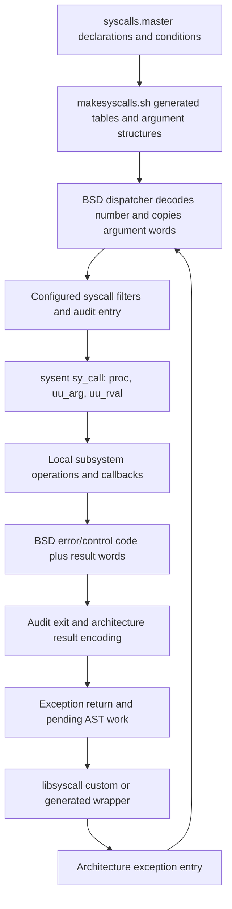

# Complete BSD syscall catalog and dispatch

[Interface guide](../README.md) · [Documentation home](../../README.md) · [Every number and conditional alternative](number-index.md)

This catalog accounts for **all 558 numbers, 0–557**, in this checkout's [syscalls.master](../../../xnu/bsd/kern/syscalls.master#L1): **669 declaration alternatives**, including **455 non-`nosys`/`enosys` declarations** and **214 placeholder alternatives**. Every non-placeholder declaration has an authored purpose, master signature and condition, local implementation link, and selected helper/mechanism explanation. The counts span mutually exclusive configurations; they are not the syscall count of one kernel build.

“Complete” here means complete enumeration and an implementation-oriented explanation for each declaration. It does not mean every command of every multiplexor, protocol/filesystem backend, input combination, or handler branch has been reconstructed. Some named handlers are unsupported stubs or successful no-ops. One declaration, conditional `vfork`, has no local handler definition. These limits are stated at the relevant entries rather than inferred from names.

## Find a call by operation

The [number index](number-index.md) preserves every source alternative, including old slots and disabled features. The family pages contain the actual mechanisms. Names in headings are the **master's kernel handler names**: for example, number 6 is `sys_close`, while generated names and `SYS_` constants strip `sys_`, yielding `close`. The transformation is visible in [makesyscalls.sh](../../../xnu/bsd/kern/makesyscalls.sh#L696).

| Family | Declared operations | Mechanism reading route |
| --- | ---: | --- |
| [Files and descriptors](files-and-descriptors.md) | 44 | [Descriptor and local IPC guide](../../subsystems/processes/descriptors-ipc.md), [file data path](../../subsystems/vfs/file-data-cache-and-read-path.md) |
| [Filesystem namespace](filesystem-namespace.md) | 33 | [Path lookup and authorization](../../subsystems/vfs/pathname-and-authorization.md), [namespace mutations](../../subsystems/vfs/namespace-mutations.md) |
| [Filesystem metadata](filesystem-metadata.md) | 57 | [Vnode dispatch](../../subsystems/vfs/vnodes-mounts-and-dispatch.md), [vnode identity](../../subsystems/vfs/vnode-cache-identity-and-reuse.md) |
| [Filesystem mounts and control](filesystem-mounts-and-control.md) | 28 | [Mount lifetime](../../subsystems/vfs/mount-lifecycle.md), [NFS server](../../subsystems/vfs/nfs-server-requests.md) |
| [Virtual memory](virtual-memory.md) | 22 | [Virtual address maps](../../subsystems/vm/virtual-address-maps.md), [memory entries and wiring](../../subsystems/vm/wiring-and-memory-entries.md) |
| [Processes, credentials and policy](processes-credentials-and-policy.md) | 72 | [Process transitions](../../subsystems/processes/process-transitions.md), [credential publication](../../subsystems/security/credential-and-policy-lifetimes.md) |
| [Signals and thread control](signals-and-thread-control.md) | 20 | [Signal delivery and return](../../subsystems/processes/signal-delivery-and-return.md) |
| [Events, pthreads and asynchronous I/O](events-pthreads-and-async-io.md) | 50 | [Kqueues/workloops](../../subsystems/processes/kqueue-and-workloops.md), [pthread/workqueue service](../../subsystems/processes/pthread-workqueue-lifecycle.md), [AIO](../../subsystems/processes/async-io.md) |
| [Local IPC](local-ipc.md) | 25 | [Descriptor/local IPC ownership](../../subsystems/processes/descriptors-ipc.md) |
| [Sockets and network policy](sockets-and-network-policy.md) | 36 | [Socket lifetime and I/O](../../subsystems/networking/socket-lifecycle-and-io.md), [policy extensions](../../subsystems/networking/policy-extensions.md) |
| [Skywalk](skywalk.md) | 12 | [Channels and nexus objects](../../subsystems/networking/skywalk.md), [Skywalk lifetimes](../../subsystems/networking/skywalk-lifecycles.md) |
| [Time and accounting](time-and-accounting.md) | 12 | [Runtime clocks/accounting](../../subsystems/runtime/time-and-accounting.md) |
| [Security and audit](security-and-audit.md) | 24 | [MAC/credential lifetimes](../../subsystems/security/credential-and-policy-lifetimes.md), [audit pipeline](../../subsystems/security/audit-pipeline.md), [signing](../../subsystems/security/code-signing.md) |
| [Diagnostics and system control](diagnostics-and-system-control.md) | 20 | [Observability and sysctl dispatch](../../development/observability.md) |

## What the master generates

The master is a build input, not C public API documentation. Its preamble identifies generated `init_sysent.c`, syscall-name/number output, argument structures/prototypes and audit mapping. Its file-selection column controls which outputs receive each entry. `NO_SYSCALL_STUB` suppresses automatic libSystem stub generation, not kernel implementation; the preamble also gives names beginning with `__` that attribute automatically. Custom wrappers may perform conversions, cancellation work, caching or argument packing before the trap. The prototype in each catalog section is retained exactly in meaning, including this annotation, and should not be substituted for a public header declaration. [Master format](../../../xnu/bsd/kern/syscalls.master#L13), [argument-structure name generation](../../../xnu/bsd/kern/makesyscalls.sh#L405).

At runtime the generated table supplies a function pointer, return-width classification and argument layout metadata:

[bsd/sys/sysent.h:38](../../../xnu/bsd/sys/sysent.h#L38)

<!-- source-excerpt: ../../../xnu/bsd/sys/sysent.h#L38-L53 -->
```c
typedef int32_t sy_call_t(struct proc *, void *, int *);
#if CONFIG_REQUIRES_U32_MUNGING
typedef void    sy_munge_t(void *);
#endif

struct sysent {         /* system call table */
	sy_call_t       *sy_call;       /* implementing function */
#if CONFIG_REQUIRES_U32_MUNGING
	sy_munge_t      *sy_arg_munge32; /* system call arguments munger for 32-bit process */
#endif
	int32_t         sy_return_type; /* system call return types */
	int16_t         sy_narg;        /* number of args */
	uint16_t        sy_arg_bytes;   /* Total size of arguments in bytes for
	                                 * 32-bit system calls
	                                 */
};
```

The callable kernel ABI is `int32_t handler(proc, args, retval)`: its C return is the BSD error/control result, while the result payload is written through `retval`, normally into `uthread.uu_rval`. Thus a master declaration returning `user_ssize_t` does not mean the handler returns a byte count as its C function result. `sy_arg_munge32`, when configured, expands/rearranges narrow userspace arguments into the expected kernel structure; it is separate from dereferencing the user addresses stored in those arguments. The syscall usually performs those later `copyin`, `copyinstr`, `copyout` or `uio` transfers itself.



The table's `nosys` and `enosys` names are meaningful. [`enosys`](../../../xnu/bsd/kern/subr_xxx.c#L123) returns `ENOSYS`. [`nosys`](../../../xnu/bsd/kern/subr_xxx.c#L181) can also post `SIGSYS` to the current thread when `send_sigsys` is enabled, then returns `ENOSYS`. Number 0 names `nosys` in the master but is recognized specially as the **indirect syscall encoding** by the dispatchers. Out-of-range numbers are redirected to `SYS_invalid`. A historical comment such as “old creat” identifies a reserved ABI slot; it does not recover a working `creat` handler.

## ARM64: wrapper, SVC and argument materialization

The common libsyscall assembly macro puts a BSD number in `x16`, executes `svc`, and branches according to the returned carry bit. `cerror` is the userspace error adapter, not a kernel exception handler:

[libsyscall/custom/SYS.h:451](../../../xnu/libsyscall/custom/SYS.h#L451)

<!-- source-excerpt: ../../../xnu/libsyscall/custom/SYS.h#L451-L460 -->
```c
#define DO_SYSCALL(num, cerror)                 \
	mov   x16, #(num)                     %%\
	svc   #SWI_SYSCALL                    %%\
	b.cc  2f                              %%\
	ARM64_STACK_PROLOG                    %%\
	PUSH_FRAME                            %%\
	bl    _##cerror                       %%\
	POP_FRAME                             %%\
	ARM64_STACK_EPILOG                    %%\
2:
```

The detailed vector/register saves are in [ARM64 assembly walkthroughs](../../subsystems/platform/arm64-assembly-walkthroughs.md). After that entry, [`handle_svc`](../../../xnu/osfmk/arm64/sleh.c#L2743) reads the saved SVC number, handles the platform special case, refreshes cached process credentials, and distinguishes negative Mach trap numbers from nonnegative BSD numbers. It passes the saved state, thread and BSD process to [`unix_syscall`](../../../xnu/bsd/dev/arm/systemcalls.c#L90). Mach traps and MIG messages have their own [trap catalog](../mach-traps.md) and [message catalog](../mach-messages/README.md).

[`arm_get_syscall_number`](../../../xnu/bsd/dev/arm/systemcalls.c#L468) takes `x16` when nonzero, otherwise `x0`; this implementation returns an `unsigned short`. The ARM64 argument copier skips the first argument register for the indirect form:

[bsd/dev/arm/systemcalls.c:380](../../../xnu/bsd/dev/arm/systemcalls.c#L380)

<!-- source-excerpt: ../../../xnu/bsd/dev/arm/systemcalls.c#L380-L389 -->
```c
	indirect_offset = (regs->x[ARM64_SYSCALL_CODE_REG_NUM] == 0) ? 1 : 0;

	/*
	 * Everything should fit in registers for now.
	 */
	if (callp->sy_narg > (int)(sizeof(uthread->uu_arg) / sizeof(uthread->uu_arg[0]))) {
		return -1;
	}

	memcpy(&uthread->uu_arg[0], &regs->x[indirect_offset], callp->sy_narg * sizeof(uint64_t));
```

For direct calls the argument words start at saved `x0`; for indirect calls they start at `x1`. This copies register values, including userspace pointer values, into `uu_arg`; it does not make their pointed-to buffers safe or kernel-resident. Under `CONFIG_REQUIRES_U32_MUNGING`, an indirect call from an ARM64 task with a narrow data model invokes the selected 32-bit argument munger. The separate [32-bit saved-state path](../../../xnu/bsd/dev/arm/systemcalls.c#L422) uses its register/stack layout and `sy_arg_bytes`; its presence is not evidence that every product supports 32-bit processes.

The custom [`__syscall` wrapper](../../../xnu/libsyscall/custom/__syscall.s#L63) itself loads the supported varargs from the user stack into registers. Its visible load sequence, the dispatcher's capacity check and each generated call's `sy_narg` are separate constraints; a general assertion that any arbitrary-length varargs list is supported would be incorrect. An ARM argument-copy failure selects the invalid handler in the visible dispatcher, unlike the x86 stack-copy failure path described next.

## x86-64: class encoding, register order and stack tail

The x86-64 wrapper loads `SYSCALL_CONSTRUCT_UNIX(number)` into `eax`, moves the fourth C argument from `rcx` to `r10`, and executes `syscall`. The [encoding](../../../xnu/osfmk/mach/i386/syscall_sw.h#L135) uses class 2 shifted by 24 bits: for example, the direct `read` number 3 is encoded as `0x02000003`. The [assembly dispatcher](../../../xnu/osfmk/x86_64/idt64.s#L1880) selects `hndl_unix_scall64`, which calls the BSD C dispatcher with the saved-state pointer. [Wrapper macro](../../../xnu/libsyscall/custom/SYS.h#L130).

[`unix_syscall64`](../../../xnu/bsd/dev/i386/systemcalls.c#L273) strips the class bits, bounds the index and locates `sysent`. The [saved-state layout](../../../xnu/osfmk/mach/i386/thread_status.h#L438) deliberately stores the syscall argument sequence contiguously: `rdi`, `rsi`, `rdx`, `r10`, `r8`, `r9`. This is why the dispatcher can copy an argument prefix with `memcpy`.

[bsd/dev/i386/systemcalls.c:318](../../../xnu/bsd/dev/i386/systemcalls.c#L318)

<!-- source-excerpt: ../../../xnu/bsd/dev/i386/systemcalls.c#L318-L331 -->
```c
	if (__improbable(callp == sysent)) {
		/*
		 * indirect system call... system call number
		 * passed as 'arg0'
		 */
		code    = regs->rdi;
		syscode = (code < nsysent) ? code : SYS_invalid;
		callp   = &sysent[syscode];
		args_start_at_rdi = FALSE;
		args_in_regs = 5;
	} else {
		args_start_at_rdi = TRUE;
		args_in_regs = 6;
	}
```

An indirect call uses `rdi` for the number and leaves five register arguments; a direct call has six. If more are required, the dispatcher copies the tail from saved userspace `rsp + sizeof(user_addr_t)`, skipping the return-address slot. A failed stack copy places the error in saved `rax`, sets carry and returns through `thread_exception_return` before the handler/audit bracket. The visible x86-64 implementation asserts at most eight arguments. [Stack-tail import](../../../xnu/bsd/dev/i386/systemcalls.c#L346).

The older [`unix_syscall`](../../../xnu/bsd/dev/i386/systemcalls.c#L89) handles the x86 32-bit saved-state and stack ABI. This catalog preserves declarations across configurations, but the detailed comparison here is ARM64 versus x86-64. Machine-specific non-BSD classes are described in the [machine entry-point guide](../machine-entry-points.md).

## Dispatch filters, credentials and auditing

Normal dispatch starts with `UT_NOTCANCELPT` set, a recorded syscall number and cleared result words. The ARM64 SVC handler refreshes cached credentials before BSD dispatch; x86-64 does so in its C dispatcher. The process pointer, current thread, cached credential and imported argument words form the local context from which the handler obtains subsystem objects.

The ARM dispatcher shows the ordering precisely:

[bsd/dev/arm/systemcalls.c:160](../../../xnu/bsd/dev/arm/systemcalls.c#L160)

<!-- source-excerpt: ../../../xnu/bsd/dev/arm/systemcalls.c#L160-L182 -->
```c
#if CONFIG_MACF
	if (__improbable(proc_syscall_filter_mask(proc) != NULL && !bitstr_test(proc_syscall_filter_mask(proc), syscode))) {
		error = mac_proc_check_syscall_unix(proc, syscode);
		if (error) {
			goto skip_syscall;
		}
	}
#endif /* CONFIG_MACF */

#if CONFIG_DEBUG_SYSCALL_REJECTION
	unsigned int call_number = mach_trap_count + syscode;
	if (__improbable(uthread->syscall_rejection_mask != NULL &&
	    uthread_syscall_rejection_is_enabled(uthread)) &&
	    !bitmap_test(uthread->syscall_rejection_mask, call_number)) {
		if (debug_syscall_rejection_handle(syscode)) {
			goto skip_syscall;
		}
	}
#endif /* CONFIG_DEBUG_SYSCALL_REJECTION */

	AUDIT_SYSCALL_ENTER(code, proc, uthread);
	error = (*(callp->sy_call))(proc, &uthread->uu_arg[0], &(uthread->uu_rval[0]));
	AUDIT_SYSCALL_EXIT(code, proc, uthread, error);
```

A cleared bit in the process's MAC syscall filter triggers `mac_proc_check_syscall_unix`; it is a request for policy evaluation, not by itself the final denial. A nonzero policy error skips the handler. The ARM source also contains the separately configured per-thread debug-rejection mask indexed after `mach_trap_count`. The shown x86-64 dispatcher has the MAC filter but does **not** contain that same debug-rejection block; feature parity should not be inferred from a shared syscall declaration.

Audit entry and exit surround the handler after these filters. `AUDIT_SYSCALL_ENTER` checks audit-enabled state; `AUDIT_SYSCALL_EXIT` checks whether a record remains on the uthread, because a record can outlive a global disable. A master `AUE_NULL` supplies no audit event for that entry; it does not remove the architecture's audit macro sites. Helpers may capture arguments and command-specific subevents. [Audit macro bodies](../../../xnu/bsd/security/audit/audit.h#L340), [record selection, commit and worker output](../../subsystems/security/audit-pipeline.md).

A handler can block using a continuation and complete through [`unix_syscall_return`](../../../xnu/bsd/dev/arm/systemcalls.c#L230), which finds saved user registers, uses the stored syscall number to select return layout, runs audit completion and returns through the exception-return machinery. The ordinary C call stack is therefore not a universal lifetime boundary for syscall state or audit records.

## Results, errno and restart are separate outcomes

| Handler outcome | ARM64 saved state | x86-64 saved state | Meaning |
| --- | --- | --- | --- |
| Zero error | Return classification selects `x0` and possibly `x1`; carry was cleared before dispatch | Classification selects `rax` and possibly `rdx`; carry cleared | The result payload is valid according to the entry's return type |
| Ordinary nonzero error | `x0 = error`, `x1 = 0`, carry set | `rax = error`, carry set | Wrapper invokes its error adapter |
| `ERESTART` | Saved PC moves backward by 4 bytes | `pal_syscall_restart` repairs the saved instruction position | Re-execute the syscall instruction; this internal code is not ordinary userspace errno |
| `EJUSTRETURN` | Ordinary result rewrite skipped | Ordinary result rewrite skipped | Preserve state established by the handler, such as signal-state restoration |

The ARM implementation's branch makes the control-result distinction explicit:

[bsd/dev/arm/systemcalls.c:502](../../../xnu/bsd/dev/arm/systemcalls.c#L502)

<!-- source-excerpt: ../../../xnu/bsd/dev/arm/systemcalls.c#L502-L515 -->
```c
	if (error == ERESTART) {
		add_user_saved_state_pc(regs, -4);
	} else if (error != EJUSTRETURN) {
		if (error) {
			ss64->x[0] = error;
			ss64->x[1] = 0;
			/*
			 * Set the carry bit to execute cerror routine.
			 * ARM64_TODO: should we have a separate definition?
			 * The bits are the same.
			 */
			ss64->cpsr |= PSR64_CF;
			unix_syscall_return_kprintf("error: setting carry to trigger cerror call\n");
		} else {        /* (not error) */
```

Both dispatchers use `sy_return_type`: `INT_T`/`UINT_T` can export two 32-bit result words, while `OFF_T`, address, size, signed-size and uint64 forms assemble a 64-bit payload from `uu_rval` and clear the second result register. The syscall's mechanism determines how those result words are populated; for example, a `pipe` wrapper can use two result registers. The [x86 restart helper](../../../xnu/osfmk/i386/pal_routines.c#L312) distinguishes its supported saved-state/trap cases; do not generalize the two-byte x86-64 `syscall` length to every historical entry instruction.

In userspace, [`cerror_nocancel`](../../../xnu/libsyscall/custom/errno.c#L63) stores the error in the global fallback and, if present, the thread-specific errno slot, then returns an all-ones failure result of the appropriate width. [`cerror`](../../../xnu/libsyscall/custom/errno.c#L75) first calls `_pthread_exit_if_canceled(err)`. The implementation of that pthread routine is outside this checkout. Some wrappers select the noncanceling adapter or have special result handling, so the kernel table alone is not the entire libc contract.

## Cancellation and noncanceling syscall pairs

The kernel does not mark every syscall a cancellation point simply because it can sleep. The ordinary `read` handler explicitly opts into the cancellation check before sharing the implementation with `read_nocancel`:

[bsd/kern/sys_generic.c:389](../../../xnu/bsd/kern/sys_generic.c#L389)

<!-- source-excerpt: ../../../xnu/bsd/kern/sys_generic.c#L389-L394 -->
```c
int
read(struct proc *p, struct read_args *uap, user_ssize_t *retval)
{
	__pthread_testcancel(1);
	return read_nocancel(p, (struct read_nocancel_args *)uap, retval);
}
```

The check clears `UT_NOTCANCELPT`. A pending cancellation is acted on only when it is neither disabled nor already consumed:

[bsd/kern/kern_sig.c:913](../../../xnu/bsd/kern/kern_sig.c#L913)

<!-- source-excerpt: ../../../xnu/bsd/kern/kern_sig.c#L913-L932 -->
```c
void
__pthread_testcancel(int presyscall)
{
	thread_t self = current_thread();
	struct uthread * uthread;

	uthread = (struct uthread *)get_bsdthread_info(self);


	uthread->uu_flag &= ~UT_NOTCANCELPT;

	if ((uthread->uu_flag & (UT_CANCELDISABLE | UT_CANCEL | UT_CANCELED)) == UT_CANCEL) {
		if (presyscall != 0) {
			unix_syscall_return(EINTR);
			/* NOTREACHED */
		} else {
			thread_abort_safely(self);
		}
	}
}
```

With `presyscall != 0`, it completes the syscall through `unix_syscall_return(EINTR)` without entering the operation. The other form safely aborts the current thread's wait. [`__pthread_markcancel`](../../../xnu/bsd/kern/kern_sig.c#L937) marks a target thread and, if it is currently cancelable and cancellation is enabled, requests a safe abort. Cancellation completion in libpthread is distinct from kernel wait abortion; a `read_nocancel` call can still encounter ordinary signal/wait errors.

The separate numbered `_nocancel` interfaces are retained in the catalog instead of merged away. They commonly reach the same I/O helper while omitting the preliminary cancellation test. Wrapper-level behavior remains relevant for command-selecting calls such as [`fcntl`](../../../xnu/libsyscall/wrappers/cancelable/fcntl-base.c#L1). See [pthread/workqueue lifetime](../../subsystems/processes/pthread-workqueue-lifecycle.md) and [signal delivery/return](../../subsystems/processes/signal-delivery-and-return.md) for the related thread state transitions.

## Multiplexors and external implementation boundaries

The catalog describes the syscall's selector, authorization/import boundary and selected dispatch mechanism. These nested interfaces need their own inventories for command-complete coverage:

| Entry/family | Included here | Separate surface and existing guide |
| --- | --- | --- |
| `ioctl`, `fcntl` | Descriptor lookup, command-shaped buffer/flag handling and file operations or common command switch | Device/protocol ioctl command spaces; advisory locks, file controls and [signature installation](../../subsystems/security/vnode-signature-lifecycle.md) |
| `sysctl`, `sysctlbyname` | Numeric/named lookup, `sysctl_req`, access checks and output-length handling | Every registered OID and OID-specific structure; [sysctl traversal/lifetime](../../development/observability.md) |
| `proc_info`, `proc_policy`, `memorystatus_control`, `persona`, coalition calls | Command/flavor entry and principal helper path | Per-flavor records, policy rules and [memorystatus/freezer mechanisms](../../subsystems/vm/memorystatus-and-freezer.md) |
| `auditon`, `csops`, `__mac_syscall` | Audit controls, process signing commands, named MAC callback dispatch | Individual audit/signing operations and externally supplied MAC policy command ABIs |
| Socket options, `connectx`, NECP actions | Socket/protocol or policy/session lookup and selected request conversion | Every protocol option and policy action; [network policy boundaries](../../subsystems/networking/policy-extensions.md) |
| Nexus/channel commands | Controller/channel descriptors, operation selectors, ring synchronization entry points | Provider implementations and complete ring/packet/flow subinterfaces; [Skywalk lifetime guide](../../subsystems/networking/skywalk-lifecycles.md) |
| `workq_kernreturn`, `bsdthread_ctl`, psynch calls | Local workqueue commands and `pthread_functions` handoffs, including local stubs | The separately supplied pthread implementation and userspace runtime; [local servicing and cleanup](../../subsystems/processes/pthread-workqueue-lifecycle.md) |
| NFS, mount, metadata and filesystem-control calls | Local VFS/NFS dispatch and owned objects | Operations of filesystems not present here, user daemons and storage/network providers |

This is also why a generated function-name index would be insufficient: `psynch_rw_upgrade` and `psynch_rw_downgrade` locally return success without implementing their nominal operation, `mlockall`/`munlockall` return `ENOSYS`, `objc_bp_assist_cfg_np` returns literal `KERN_FAILURE`, and audit/recount/search/quota bodies have configuration-specific alternatives. The family entries name those facts explicitly.

## Regeneration, validation and inspection limits

[Authored descriptions](descriptions.json) are separate from the [generated inventory](inventory.json). The [generator](../../tools/build_bsd_syscall_catalog.py) parses every numbered declaration and preprocessor branch; checks that numbers cover the entire contiguous range; requires exactly one authored entry for every non-placeholder name; verifies implementation source lines and defining symbols; and renders all family pages plus the number index. `vfork` is the single explicitly permitted declaration-only exception. The inventory records the master's SHA-256 and source candidates; discovered call-token lists are navigation aids, not proof that those calls execute on all paths.

Run these documentation commands from the Platydoc project root; the generator reads its kernel input from `xnu/`.

```sh
python3 -B docs-ai/tools/build_bsd_syscall_catalog.py
python3 -B docs-ai/tools/build_bsd_syscall_catalog.py --check
python3 -B docs-ai/tools/check_links.py
```

`--check` verifies all generated files against the current master and authored metadata without rewriting them. `--inventory-only` refreshes just the inventory. Edit descriptions in JSON, then regenerate; edits directly to generated family pages will otherwise be overwritten. The hand-authored dispatch guide is not generated.

| Inspection level | Source surface | Limit |
| --- | --- | --- |
| Exhaustive declaration accounting | Every row/alternative of `syscalls.master`; names, signatures, conditions and audit events | No product build's preprocessor environment was evaluated |
| Per-entry implementation/mechanism identification | All 455 non-placeholder declarations; 454 with local handler definitions and one explicit absent `vfork` body | Selected helpers and dispatch decisions, not every branch or backend implementation |
| Detailed dispatch/body checks | ARM/x86 dispatch, `sysent`, wrapper assembly, errno adapter, audit macros, cancellation, no-op/stub handlers and selected security/diagnostic wrappers | No kernel build, live syscall execution or hardware behavior test |
| Existing deep subsystem analysis | Linked process, VM, VFS, network, security and runtime guides | Their own source-inspection limits still apply; a link does not imply an entire source file was analyzed |

Source paths and line numbers refer to this checkout. Build-generated files, third-party/filesystem implementations, external policy providers and the separately delivered pthread runtime are not invented to fill gaps. The reconciliation establishes catalog completeness; technical depth remains measured by the particular bodies and mechanisms explained.

<!-- BEGIN PLATYDOC DOCUMENTATION LICENSE -->
Original Platydoc text and diagrams are licensed under [CC BY 4.0](https://creativecommons.org/licenses/by/4.0/). Quoted source code and third-party material retain their respective licenses.
<!-- END PLATYDOC DOCUMENTATION LICENSE -->
