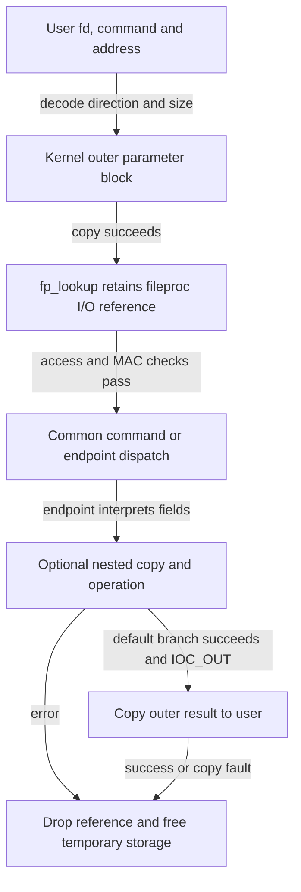
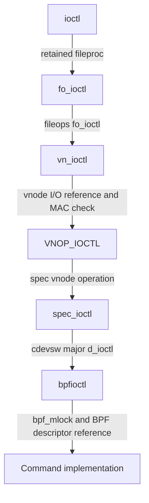
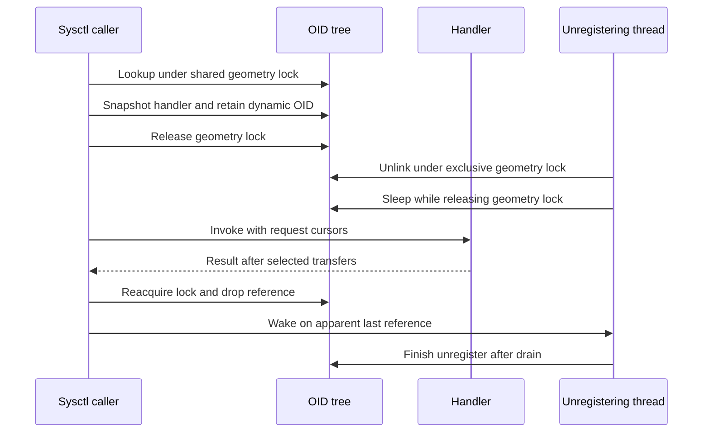

# Command dispatch, argument copying and endpoint lifetime

[Interface map](README.md) · [Descriptor ownership](../subsystems/processes/descriptors-ipc.md) · [Completion and partial failure](../cross-cutting/completion-and-failure.md)

An `ioctl`, `fcntl` or `sysctl` request selects another operation after the syscall dispatcher has selected its C entry. The selector, target object and argument representation determine the rest of the path. This chapter follows common BSD code in `xnu-12377.121.6`, including the 32/64-bit BPF argument alternatives, selected file-control commands and dynamic sysctl handlers. It distinguishes acquiring an object, copying bytes, checking access, executing the operation and returning output.

[Process inspection and snapshots](../subsystems/processes/process-inspection-and-snapshots.md) follows the related `proc_info` command namespace through call/flavor selection, process identity and access checks, descriptor lookup, bounded output and concurrent changes between queries.

## The syscall number is the first selector

| Entry | Next selector | Object or namespace | Argument handling |
| --- | --- | --- | --- |
| `ioctl(fd, command, data)` | Direction, encoded outer size, group and command | The process's descriptor table, then `fileops` and possibly vnode/device operations | The common entry copies the outer parameter block; endpoint code interprets its fields and any nested user addresses. |
| `fcntl(fd, command, arg)` | A command-specific switch or helper | Descriptor state, shared `fileglob` state, or its endpoint | `arg` may be a scalar or user address. Each branch chooses conversions and copies. |
| `sysctl` / `sysctlbyname` | Numeric OID path or canonical dotted name | Registered `sysctl_oid` tree | `sysctl_req` carries input/output pointers, lengths, cursors and transfer callbacks. Handlers choose what to transfer. |

The actual entries are [`ioctl`](../../xnu/bsd/kern/sys_generic.c#L844-L1027), [`sys_fcntl_nocancel`](../../xnu/bsd/kern/kern_descrip.c#L2845-L2901), and [`sysctl_root`](../../xnu/bsd/kern/kern_newsysctl.c#L1736-L1999). A command declaration alone does not establish that the endpoint has registered an implementation or that the caller can acquire the required object. The [build-selection guide](../development/build-and-tests.md) explains source/configuration selection; the [numbered catalog](bsd-syscalls/README.md) describes the outer syscall boundary.

For example, BPF source is selected by `bpfilter`; `bpf_init()` registers `bpf_cdevsw` and creates device nodes. The local node-creation body requests owner root, group wheel and mode `0600`. Those initial permissions are evidence of creation behavior, not a claim about the effective permissions on every running system. File opening, vnode policy and a later command have separate admission paths. [Configuration](../../xnu/config/MASTER#L503), [source selection](../../xnu/bsd/conf/files#L164-L165), [registration](../../xnu/bsd/net/bpf.c#L4553-L4580), [node creation](../../xnu/bsd/net/bpf.c#L694-L697).

## Ioctl first copies an outer argument block

The command macros encode direction in the high bits, an outer byte count in bits selected by `IOCPARM_MASK`, and a group/number below it. `_IOW` denotes copying parameters into the kernel; `_IOR` denotes copying them out. This direction describes the command parameter block, not network traffic or file access mode. [Encoding](../../xnu/bsd/sys/ioccom.h#L70-L95).

`ioctl()` extracts the size, compares it with `IOCPARM_MAX`, and chooses a zero-initialized 128-byte stack buffer or `kalloc_data` storage. It performs an `IOC_IN` copy before descriptor lookup. An output-only block is explicitly zeroed. Zero-size `IOC_IN` and `IOC_VOID` requests put the numeric user-address argument into the temporary buffer using the caller's width; they do not dereference that argument at this step. [Preparation](../../xnu/bsd/kern/sys_generic.c#L844-L915).

Consequently, the encoded size describes only one block. It neither copies an array referenced by a field nor determines an endpoint's semantic limits. A failed outer copy can return before any descriptor has been acquired. The size check should also be read literally: `IOCPARM_LEN` already masks the field to 13 bits, while `IOCPARM_MAX` is that mask plus one. [Macros](../../xnu/bsd/sys/ioccom.h#L74-L79), [size selection and copy](../../xnu/bsd/kern/sys_generic.c#L874-L894).



The diagram shows the acquired-object path. Preparation and lookup failures have their own shorter cleanup; common commands do not all use the default branch's output-copy logic.

## Descriptor retention and endpoint dispatch have different locks

Under `proc_fdlock`, `fp_lookup()` checks the descriptor bounds, table entry and reservation state, validates the allocation zone, and increments `fp_iocount`. The saved pointer therefore carries an I/O reference while the operation runs. `fp_drop()` releases that reference and may wake a descriptor drainer. The [descriptor chapter](../subsystems/processes/descriptors-ipc.md) follows close and replacement in detail. [Lookup](../../xnu/bsd/kern/kern_descrip.c#L1516-L1545), [drop](../../xnu/bsd/kern/kern_descrip.c#L1599-L1639).

The ioctl entry requires `FREAD` or `FWRITE`, replaces the VFS context's credential with `fg_cred`, and calls `mac_file_check_ioctl` when `CONFIG_MACF` is selected. These checks precede the command switch. The credential stored with the open file and the current thread are distinct inputs to this context. [Admission](../../xnu/bsd/kern/sys_generic.c#L917-L938).

For endpoint dispatch, `fo_ioctl()` drops and reacquires the process descriptor lock around the registered operation:

[Source: bsd/kern/kern_descrip.c, lines 6325–6334](../../xnu/bsd/kern/kern_descrip.c#L6325-L6334)

<!-- source-excerpt: ../../xnu/bsd/kern/kern_descrip.c#L6325-L6334 -->
```c
int
fo_ioctl(struct fileproc *fp, u_long com, caddr_t data, vfs_context_t ctx)
{
	int error;

	proc_fdunlock(vfs_context_proc(ctx));
	error = (*fp->f_ops->fo_ioctl)(fp, com, data, ctx);
	proc_fdlock(vfs_context_proc(ctx));
	return error;
}
```

The I/O reference survives this interval; arbitrary fields protected by the descriptor lock are not frozen during it. The endpoint acquires its own required protection. Keeping the reference is different from keeping the original descriptor-table lock held throughout the device operation.

For a character-device vnode such as BPF, the actual operation tables connect these functions:



This route is established by the [`vnops` file-operation table](../../xnu/bsd/vfs/vfs_vnops.c#L131-L140), [`vn_ioctl`](../../xnu/bsd/vfs/vfs_vnops.c#L1741-L1846), [spec operation registration](../../xnu/bsd/miscfs/specfs/spec_vnops.c#L148), [character-device dispatch](../../xnu/bsd/miscfs/specfs/spec_vnops.c#L857-L903), and [BPF device table](../../xnu/bsd/net/bpf.c#L275-L286). A socket or pipe uses its own file operations instead of this vnode route. After the selected command, `bpfioctl` drops its BPF descriptor reference and mutex, `vn_ioctl` drops the vnode iocount, and the common entry drops the fileproc I/O reference. [BPF return](../../xnu/bsd/net/bpf.c#L2761-L2765), [vnode return](../../xnu/bsd/vfs/vfs_vnops.c#L1843-L1846), [common return](../../xnu/bsd/kern/sys_generic.c#L1018-L1027).

## Worked argument conversion: installing a BPF program

The BPF program request contains an instruction count and a user address. The explicit kernel ABI structures preserve the pointer width and alignment:

[Source: bsd/net/bpf_private.h, lines 97–105](../../xnu/bsd/net/bpf_private.h#L97-L105)

<!-- source-excerpt: ../../xnu/bsd/net/bpf_private.h#L97-L105 -->
```c
struct bpf_program64 {
	u_int           bf_len;
	user64_addr_t   bf_insns __attribute__((aligned(8)));
};

struct bpf_program32 {
	u_int           bf_len;
	user32_addr_t   bf_insns;
};
```

`BIOCSETF32` and `BIOCSETF64` have the same group and operation number but different encoded structure sizes. The 32-bit structure is eight bytes; the explicitly aligned 64-bit structure is sixteen. In an illustrative LP64 request with three instructions, the common ioctl copies sixteen bytes from the program structure's address. The address in `bf_insns` remains a user virtual address. The endpoint later copies three `struct bpf_insn` records from that address; the array is not part of the sixteen-byte outer copy. [Command definitions](../../xnu/bsd/net/bpf_private.h#L119-L120), [instruction representation](../../xnu/bsd/net/bpf.h#L1217-L1222).

`bpfioctl()` holds `bpf_mlock`, rejects absent/reserved/closing descriptors and acquires a BPF descriptor reference. It copies the already-internalized parameter block into the appropriate ABI structure and passes the count and converted address to `bpf_setf()`. [Endpoint entry](../../xnu/bsd/net/bpf.c#L2054-L2078), [ABI dispatch](../../xnu/bsd/net/bpf.c#L2160-L2177).

`bpf_setf()` waits while a hold-buffer read is active and checks `BPF_CLOSING` after that wait. The sleep releases and reacquires `bpf_mlock`; the old filter pointer is read only after the wait and closing check. A null instruction pointer is accepted only with zero count and removes the existing filter. Otherwise it checks the instruction limit, allocates candidate storage, copies the nested array, and validates it before replacement. [Wait, removal and allocation](../../xnu/bsd/net/bpf.c#L2772-L2808). The publication and cleanup order is visible here:

[Source: bsd/net/bpf.c, lines 2809–2826](../../xnu/bsd/net/bpf.c#L2809-L2826)

<!-- source-excerpt: ../../xnu/bsd/net/bpf.c#L2809-L2826 -->
```c
	if (copyin(bf_insns, (caddr_t)fcode, size) == 0 &&
	    bpf_validate(fcode, (int)flen)) {
		d->bd_filter = fcode;
		d->bd_filter_len = flen;

		if (cmd == BIOCSETF32 || cmd == BIOCSETF64) {
			reset_d(d);
		}

		if (old != 0) {
			kfree_data_addr(old);
		}

		return 0;
	}
	kfree_data(fcode, size);
	return EINVAL;
}
```

| Stage | Stored filter | Temporary storage and result |
| --- | --- | --- |
| Waiting or checking arguments | This request has not changed the selected filter | Other operations can run during the wait; closing or invalid arguments return before this request publishes a candidate. |
| Candidate allocation/copy/validation | Existing filter remains selected | Allocation failure returns `ENOMEM`; unsuccessful nested copy or validation frees the candidate and returns `EINVAL`. |
| Candidate accepted | `bd_filter` and `bd_filter_len` select the candidate | Reset variants reset capture state; the previous filter is then freed. |
| Null pointer with zero count | Filter becomes null | Capture state is reset and any previous program is freed. |

`BIOCSETFNR` preserves the capture buffers on the ordinary non-null replacement branch; the null-program branch calls `reset_d` regardless of that distinction. The [network policy overview](../subsystems/networking/policy-extensions.md) distinguishes BPF capture from packet filtering by PF; BPF instruction execution and capture-buffer lifetime remain outside this trace. Here the relevant transformation is user structure → kernel outer copy → kernel instruction array → published filter.

The [BPF lifecycle companion](../subsystems/networking/bpf-capture-and-filter-lifecycle.md) continues this path through interface binding, interpreter results, capture buffers, readout and close.

## Fcntl chooses the representation in each command

`sys_fcntl()` checks cancellation before forwarding to `sys_fcntl_nocancel()`. The latter acquires a `fileproc`, selects the file credential for its VFS context, normalizes a possible 32-bit pointer argument, and performs the MAC check using the current credential. A scalar command consumes the scalar value; a structure command performs its own `copyin`. There is no ioctl-style universal outer-size encoding across the named commands. [Cancellation wrapper](../../xnu/bsd/kern/kern_descrip.c#L2638-L2642), [main dispatcher](../../xnu/bsd/kern/kern_descrip.c#L2845-L2901), [stored credential](../../xnu/bsd/kern/kern_descrip.c#L2707-L2711).

The default branch can also forward an unrecognized command to a vnode's `VNOP_IOCTL`, including a special-device vnode. It rejects conflicting `IOC_VOID`/`IOC_INOUT` bits and a listed set of invalid selectors, requires `DTYPE_VNODE`, drops the descriptor lock and acquires a vnode iocount. This branch then uses ioctl-style direction and size fields to prepare the argument, invokes the vnode operation, drops the vnode iocount, copies successful output and frees temporary storage. An unrecognized selector therefore does not invariably end at the fcntl switch. Its eventual implementation and admission depend on the vnode operation. [Selection and acquisition](../../xnu/bsd/kern/kern_descrip.c#L5429-L5476), [marshalling, dispatch and cleanup](../../xnu/bsd/kern/kern_descrip.c#L5477-L5568).

| Selected command | State or representation | Decision and result |
| --- | --- | --- |
| `F_GETFD` / `F_SETFD` | `fileproc.fp_flags`, `FP_CLOEXEC` | Descriptor-local state; clearing close-on-exec on a guarded descriptor can raise the guard exception. |
| `F_GETFL` / `F_SETFL` | Shared open-file flags exposed through `fp->f_flag` | Converts open flags and coordinates selected state with endpoint ioctls. |
| `F_DUPFD` / `F_DUPFD_CLOEXEC` | Minimum new descriptor number | Checks duplication guard and descriptor limit, reserves a slot, then calls `finishdup`. |

Sources: [duplication and descriptor flags](../../xnu/bsd/kern/kern_descrip.c#L2901-L2939), [open-file flags](../../xnu/bsd/kern/kern_descrip.c#L2941-L3015). The [fileproc aliases](../../xnu/bsd/kern/kern_descrip.c#L144-L148), [`fileglob` fields](../../xnu/bsd/sys/file_internal.h#L178-L193) and [descriptor ownership guide](../subsystems/processes/descriptors-ipc.md) explain why descriptor-local flags differ from state shared through `fileglob`.

For `F_SETFL`, vnode append changes have extra checks: enabling append on a writable vnode asks for `KAUTH_VNODE_APPEND_DATA`; clearing it rejects an append-only vnode. After those checks, the body publishes the selected flag bits before invoking the endpoint:

[Source: bsd/kern/kern_descrip.c, lines 2998–3015](../../xnu/bsd/kern/kern_descrip.c#L2998-L3015)

<!-- source-excerpt: ../../xnu/bsd/kern/kern_descrip.c#L2998-L3015 -->
```c
		os_atomic_rmw_loop(&fp->f_flag, oflags, nflags, relaxed, {
			nflags  = oflags & ~FCNTLFLAGS;
			nflags |= FFLAGS(tmp) & FCNTLFLAGS;
		});
		tmp = nflags & FNONBLOCK;
		error = fo_ioctl(fp, FIONBIO, (caddr_t)&tmp, &context);
		if (error) {
			goto out;
		}
		tmp = nflags & FASYNC;
		error = fo_ioctl(fp, FIOASYNC, (caddr_t)&tmp, &context);
		if (!error) {
			goto out;
		}
		os_atomic_andnot(&fp->f_flag, FNONBLOCK, relaxed);
		tmp = 0;
		(void)fo_ioctl(fp, FIONBIO, (caddr_t)&tmp, &context);
		goto out;
```

This sequence does not restore the original flag word on every error. If `FIONBIO` fails, it exits with the already updated flags. If `FIOASYNC` fails, it clears `FNONBLOCK`, calls `FIONBIO` with zero, ignores that compensation call's result and returns the earlier error. The source's nearby concurrency comment must not be replaced by a stronger atomic-operation claim: the atomic flag update and the separately unlocked endpoint calls do not constitute one indivisible transaction. This branch returns through `sys_fcntl_out`, which drops the fileproc I/O reference and then unlocks the descriptor table. [Append checks and implementation qualification](../../xnu/bsd/kern/kern_descrip.c#L2955-L3015), [return helper](../../xnu/bsd/kern/kern_descrip.c#L2728-L2735).

## Sysctl stores lookup state separately from transfer state

`sysctl_oid` holds tree placement, number, kind/flags, handler, handler arguments and a reference count. `sysctl_req` holds the caller and the input/output state. `SYSCTL_IN` and `SYSCTL_OUT` invoke callbacks in the request rather than assuming every handler receives pre-copied data. User requests install `sysctl_new_user` and `sysctl_old_user`; in-kernel requests use separate transfer callbacks. User-request setup installs `newptr` only when the input length is nonzero. [OID and request declarations](../../xnu/bsd/sys/sysctl.h#L214-L287), [user request creation](../../xnu/bsd/kern/kern_newsysctl.c#L2002-L2022), [kernel request setup](../../xnu/bsd/kern/kern_newsysctl.c#L1606-L1642).

The common lookup runs under a shared `sysctl_geometry_lock`. Canonical-name input first resolves to numeric components. Ordinary tree nodes lead to child lists; handler-bearing `CTLTYPE_NODE` entries can consume a remaining numeric suffix as arguments. A leaf with extra components fails with `EISDIR`; an unresolved or incomplete path fails with `ENOENT`. [Traversal](../../xnu/bsd/kern/kern_newsysctl.c#L1736-L1830).

Admission then depends on the request and selected OID:

| Predicate | Common dispatcher behavior |
| --- | --- |
| Input pointer present | Requires `CTLFLAG_WR`; `CTLFLAG_SECURE` also rejects writes while `securelevel > 0`. |
| In-kernel request | Requires `CTLFLAG_KERN`. |
| Experiment OID with a process | Uses the selected entitlement/internal-diagnostics predicate. |
| Ordinary user write | Requires superuser unless `CTLFLAG_ANYBODY` removes that common restriction; a handler may impose additional checks. |
| User request with `CONFIG_MACF` | Calls `mac_system_check_sysctlbyname` after releasing the geometry lock. |

These are the actual common predicates, not a claim that every read requires root or every handler uses identical policy. This dispatcher does not separately test `CTLFLAG_RD`; handler code can make additional decisions. [Admission](../../xnu/bsd/kern/kern_newsysctl.c#L1852-L1936), [experiment predicates](../../xnu/bsd/kern/kern_newsysctl.c#L1691-L1728).

## Dynamic OID removal waits for admitted handlers

Ordinary core OIDs use early registration and become read-only at lockdown. Dynamic/manual OIDs use `sysctl_register_oid`, which validates the structure version and publishes under the geometry write lock. Current-version registration uses the supplied object rather than allocating its own copy. [Registration forms](../../xnu/bsd/sys/sysctl.h#L370-L435), [dynamic registration](../../xnu/bsd/kern/kern_newsysctl.c#L253-L300).

Before dropping the geometry lock, `sysctl_root()` snapshots the handler and retains non-permanent OIDs:

[Source: bsd/kern/kern_newsysctl.c, lines 1900–1920](../../xnu/bsd/kern/kern_newsysctl.c#L1900-L1920)

<!-- source-excerpt: ../../xnu/bsd/kern/kern_newsysctl.c#L1900-L1920 -->
```c
	/*
	 * sysctl_unregister_oid() may change the handler value, so grab it
	 * under the lock.
	 */
	oid_handler = oid->oid_handler;
	if (!oid_handler) {
		error = EINVAL;
		goto err;
	}

	/*
	 * Reference the OID and drop the geometry lock; this prevents the
	 * OID from being deleted out from under the handler call, but does
	 * not prevent other calls into handlers or calls to manage the
	 * geometry elsewhere from blocking...
	 */
	if ((oid->oid_kind & CTLFLAG_PERMANENT) == 0) {
		OSAddAtomic(1, &oid->oid_refcnt);
	}

	lck_rw_done(&sysctl_geometry_lock);
```

If any traversed OID lacked `CTLFLAG_LOCKED`, it acquires the separate `sysctl_unlocked_node_lock` around the handler. That historical flag name does not mean the geometry lock stays held through execution. On `HAS_APPLE_PAC` builds, the handler pointer is authenticated and re-signed for the call. Ordinary leaves receive `oid_arg1`/`oid_arg2`; handler nodes receive the remaining OID components. [Call preparation](../../xnu/bsd/kern/kern_newsysctl.c#L1938-L1967).



This diagram selects a referenced dynamic OID whose MAC check permits execution. Unregistration removes the OID from future lookup and waits for `oid_refcnt` to drain; it does not cancel a handler that already has a reference. The wait releases the geometry lock so returning operations can drop their references, then reacquires it and rechecks the count. The MAC-denial path also rejoins reference cleanup. Current-version unregister leaves the caller-owned OID storage to its owner after draining; tree discoverability and protection of the handler's own data are separate responsibilities. [Unlink and drain](../../xnu/bsd/kern/kern_newsysctl.c#L324-L417), [reference drop](../../xnu/bsd/kern/kern_newsysctl.c#L1969-L1999).

## Output failures preserve each endpoint's actual progress

`sysctl_old_user()` first checks whether the next requested output chunk fits in the remaining buffer. If it does not fit, it returns `ENOMEM` before copying that chunk or advancing `oldidx`. Previously copied chunks remain. If the chunk fits, it attempts the copy and advances `oldidx` by the requested amount even when `copyout` reports a fault. `sysctl_new_user()` checks remaining input, attempts the copy and advances `newidx`; neither callback makes the whole handler transactional. [Output callback](../../xnu/bsd/kern/kern_newsysctl.c#L1648-L1672), [input callback](../../xnu/bsd/kern/kern_newsysctl.c#L1675-L1689).

For an illustrative handler emitting two twelve-byte records into a twenty-byte buffer, the first callback can copy twelve bytes and set `oldidx` to twelve. The second sees only eight bytes remaining, copies none of its record and returns `ENOMEM` with `oldidx` still twelve. A size-only request has no output pointer and can accumulate both requested lengths without copying. Thus the short-buffer path does not automatically report the full size the handler could have emitted. The outer userland code controls the reported length and retries `EAGAIN` using a fresh request-state copy. Those retries reset cursors; they do not undo earlier user-memory writes or handler side effects. [Userland loop and result sizing](../../xnu/bsd/kern/kern_newsysctl.c#L2186-L2216).

Typed handlers can impose their own ordering. `sysctl_io_number` outputs the old number before accepting a new one, so an output error prevents its later input step. After a successful handler, the syscall's final write to `oldlenp` can still fail; the common return path does not undo the completed handler work. [Numeric helper](../../xnu/bsd/kern/kern_newsysctl.c#L438-L501), [numeric-entry length return](../../xnu/bsd/kern/kern_newsysctl.c#L2086-L2103), [named-entry length return](../../xnu/bsd/kern/kern_newsysctl.c#L2157-L2179).

The ioctl default branch similarly calls the endpoint before attempting `IOC_OUT` copyout. For example, `BIOCSBLEN` can clamp and store `bd_bufsize`, write the chosen value into the kernel parameter block, then encounter an outer copyout fault. The stored buffer-size setting is not undone by generic ioctl cleanup. [BPF mutation](../../xnu/bsd/net/bpf.c#L2122-L2156), [outer copyout and release](../../xnu/bsd/kern/sys_generic.c#L1007-L1028).

| Observed result | What the selected implementation establishes |
| --- | --- |
| Outer ioctl copy fails | No fileproc has yet been acquired by this entry. |
| BPF candidate copy or validation fails | The candidate is freed; the existing filter remains selected. The endpoint returns `EINVAL`. |
| Endpoint succeeds, outer output copy fails | Endpoint state changes may already be published. |
| `F_SETFL` endpoint notification fails | The documented flag update and selected compensation have already run. |
| Sysctl output chunk is too large for the remaining buffer | That chunk is not copied or counted; earlier chunks may already have been copied. |
| Dynamic OID unregister completes | Existing handler references have drained after the OID was unlinked. It does not describe unrelated work a handler may have scheduled. |

## Scope and continuation

The inspected paths are the common BSD entries, the vnode/specfs/BPF operation-table chain, the selected `fcntl` branches and dynamic sysctl lifetime/transfer code. The BPF example covers command admission and argument conversion; packet execution/capture, all other ioctl endpoints, every fcntl command and every OID handler are separate mechanisms. MAC policy providers and product-specific device permission changes remain external. Source selection, ABI declarations and implementation bodies were inspected; no command was sent to a running kernel and no kernel tests were executed.

Continue with [IOKit external-method dispatch](../subsystems/drivers/user-clients-and-driverkit.md) for a connection-right and selector interface, [VM maps](../subsystems/vm/virtual-address-maps.md#api-entry-points-and-sanitization) for address/size conversion, and [ownership and locking](../cross-cutting/ownership-and-locking.md) for retained objects across unlocked calls.

<!-- BEGIN PLATYDOC DOCUMENTATION LICENSE -->
Original Platydoc text and diagrams are licensed under [CC BY 4.0](https://creativecommons.org/licenses/by/4.0/). Quoted source code and third-party material retain their respective licenses.
<!-- END PLATYDOC DOCUMENTATION LICENSE -->
