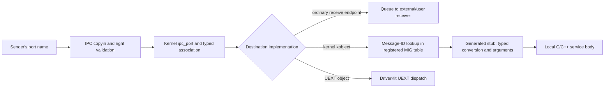
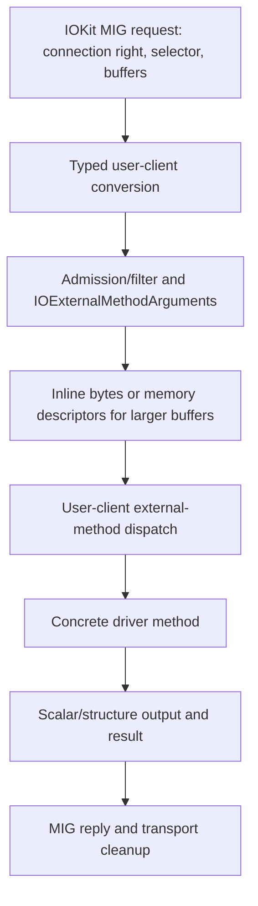
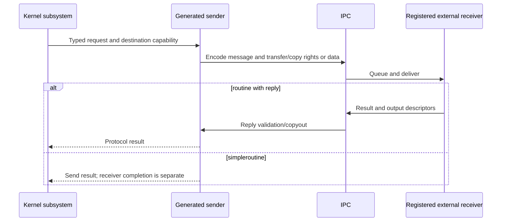

# Mach message interfaces: declarations, dispatch and implementation routes

[Kernel entry map](../README.md) · [All subsystem catalogs](subsystems.md) · [Mach traps](../mach-traps.md) · [IPC transport](../../subsystems/ipc/message-send-receive.md)

The message surface is larger than the Mach trap table. This catalog accounts for **49 subsystem-bearing `.defs` files**, **541 raw routine declaration sites**, and **510 per-file message-ID slots containing a routine in at least one inspected profile**. Another **23 per-file slots** are always skipped in those profiles. These are source-inventory counts, including compatibility aliases, historical declarations, outbound services and notifications. They are not 510 callable kernel RPCs.

Every routine slot has its purpose or quoted interface contract, an authored mechanism or implementation-boundary explanation, source declarations and profile variants, a preprocessed argument declaration, and resolved local bodies where available. The mechanisms explain selected validation, object access, ownership, results and errors; short implementation bodies expose important wrappers and unsupported results inline. The [subsystem inventory](subsystems.md) also accounts for type files, include wrappers and test-only interfaces.

For the complete kmsg and reply ownership trace, read [kernel RPC and MIG](../../subsystems/ipc/kernel-rpc-and-exceptions.md). This page explains how to interpret the catalogs and connects their families to implementation decisions.

## 1. A port destination and a message ID have different jobs

A request's destination port supplies the capability being used. The message ID supplies the operation. Copyin first translates the sender's local name and handles rights/memory dispositions. A kernel-owned destination then reaches `ipc_kobject_server()`; ordinary user-server ports queue the request for their own receivers. The kernel operation generally executes in the sending thread's kernel context. [`ipc_kmsg.c`](../../../xnu/osfmk/ipc/ipc_kmsg.c#L5221-L5239), [`ipc_kobject.c`](../../../xnu/osfmk/kern/ipc_kobject.c#L643-L675).

The built-in kobject table registers 19 subsystem references in source, with `VM32_SUPPORT`, `CONFIG_USER_NOTIFICATION` and `CONFIG_ARCADE` guarding selected entries. It includes VM/ports/tasks/threads/host/processor services, IOKit, vouchers, memory entries, restartable ranges, exception receivers and eventlinks. It does not register every `.defs` subsystem. [`mig_e`](../../../xnu/osfmk/kern/ipc_kobject.c#L171-L197).

Startup inserts real generated routines, ignoring empty slots:

[`osfmk/kern/ipc_kobject.c`, lines 220–229](../../../xnu/osfmk/kern/ipc_kobject.c#L220-L229):
<!-- source-excerpt: ../../../xnu/osfmk/kern/ipc_kobject.c#L220-L229 -->
```c
		for (j = 0; j < range; j++) {
			if (mig_e[i]->kroutine[j].kstub_routine) {
				/* Only put real entries in the table */
				nentry = j + mig_e[i]->start;
				for (pos = MIG_HASH(nentry) % MAX_MIG_ENTRIES, howmany = 1;
				    mig_buckets[pos].num;
				    pos++, pos = pos % MAX_MIG_ENTRIES, howmany++) {
					if (mig_buckets[pos].num == nentry) {
						printf("message id = %d\n", nentry);
						panic("multiple entries with the same msgh_id");
```

A duplicate ID among these registered routines is a startup error. Elsewhere, different user servers can use overlapping ID ranges because their destination ports and protocols differ. The catalog therefore groups by definition/subsystem, not by pretending the entire repository has one global message-number namespace. `vm_map` and `vm32_map` also intentionally use overlapping compatibility numbering.



The `IKOT_UEXT_OBJECT` path selects `uext_server()` before ordinary MIG dispatch. Consequently, the IOKit MIG catalog is not a substitute for the separately generated DriverKit `.iig` interface and user runtime. [`dispatch selection`](../../../xnu/osfmk/kern/ipc_kobject.c#L643-L675), [DriverKit dispatch](../../subsystems/drivers/driverkit-dispatch-and-actions.md).

## 2. Reading one `.defs` declaration

A routine declaration specifies more than an operation name:

| Declaration feature | What to follow |
| --- | --- |
| First destination argument | Which capability selects the object/service; types such as `task_t`, `task_read_t`, `ipc_space_t`, `vm_map_read_t` and `io_connect_t` have different conversion contracts. |
| `in`, `out`, `inout` | Request/reply direction. An `inout` address or count is both an input constraint and an output value. |
| Port type or explicit disposition | How send/receive/send-once rights move or are copied, and which conversion/destructor applies. |
| Array/count and `CountInOut` | Variable-size data with count inputs/outputs. The count is part of the ABI; it is not automatically an unbounded allocation request. |
| `Dealloc`, `physicalcopy` and VM-copy types | Memory-transfer and ownership requirements interpreted by generated transport and the service. |
| `routine` versus `simpleroutine` | Request/reply versus one-way MIG interface. One-way does not prove that the destination finished processing when send returns. |
| `serverprefix`, macro-wrapped names | Generated receiver names can differ from the library API; e.g. `is_io_*`, `catch_*`, `_external`, `_mig` or `_from_user`. |
| `skip` | Reserve an ID position without generating the corresponding routine in that profile. Removing a declaration from the server need not renumber later operations. |

The selected examples are visible in [`task.defs`](../../../xnu/osfmk/mach/task.defs#L100-L159), [`mach_vm.defs`](../../../xnu/osfmk/mach/mach_vm.defs#L64-L115), [`device.defs`](../../../xnu/osfmk/device/device.defs#L65-L95), and [`notify.defs`](../../../xnu/osfmk/mach/notify.defs#L59-L130).

Task control conversion, for example, is declared explicitly:

[`osfmk/mach/mach_types.defs`, lines 124–131](../../../xnu/osfmk/mach/mach_types.defs#L124-L131):
<!-- source-excerpt: ../../../xnu/osfmk/mach/mach_types.defs#L124-L131 -->
```c
/* Task control, read, inspect, name port. In descending capability. */
type task_t = mach_port_t
#if	KERNEL_SERVER
		intran: task_t convert_port_to_task_mig(mach_port_t)
		outtran: mach_port_t convert_task_to_port_kernel(task_t)
		destructor: task_deallocate_mig(task_t)
#endif	/* KERNEL_SERVER */
		;
```

The generated boundary turns a wire port argument into a referenced object and later runs its destructor contract. `task_read_t`, `task_inspect_t` and `task_name_t` have separate converters/destructors immediately below. The first argument's textual name can be `target_task` while its required type is a narrower capability. Follow the type, conversion function and body rather than assuming every task-related call needs or returns task control. [`flavor definitions`](../../../xnu/osfmk/mach/mach_types.defs#L133-L177), [port policy](../../subsystems/ipc/guards-and-policy-enforcement.md).

Generated server C is largely absent from the checkout. The build selects MIG server/user generation and the `-mach_msg2` server ABI in [`MakeInc.def`](../../../xnu/makedefs/MakeInc.def#L1243-L1261) and [`mach/Makefile`](../../../xnu/osfmk/mach/Makefile#L330-L466). This documentation does not substitute guessed generated structures for those artifacts.

## 3. The dispatcher checks policy and calls a generated routine

The registered descriptor supplies request/reply sizing and the stub function pointer. The kobject server prepares separate header/data/trailer addresses, applies configured filtering, and invokes:

[`osfmk/kern/ipc_kobject.c`, lines 579–582](../../../xnu/osfmk/kern/ipc_kobject.c#L579-L582):
<!-- source-excerpt: ../../../xnu/osfmk/kern/ipc_kobject.c#L579-L582 -->
```c
	__BeforeKobjectServerTrace(idx);
	/* See contract in header doc for ipc_kobject_reply_status() */
	(*ptr->kroutine)(req_hdr, req_data, req_trailer, reply_hdr, reply_data);
	__AfterKobjectServerTrace(idx);
```

The split arguments matter: modern kernel messages need not be one contiguous structure beginning at the header. A generated stub decodes according to this ABI, calls typed conversion/implementation code and forms a reply. The surrounding server retains responsibility for transport-owned request/reply resources. [`reply sizing and filter`](../../../xnu/osfmk/kern/ipc_kobject.c#L479-L577), [split-message layout](../../subsystems/ipc/message-send-receive.md).

There are several possible results:

- Unknown/unregistered message ID: the kobject dispatcher can return a `MIG_BAD_ID` reply.
- Conversion/argument/policy failure: the transport can succeed while the reply carries a failing `kern_return_t`.
- Ordinary implementation result: output fields and result status go into the generated reply representation.
- `MIG_NO_REPLY`: the generated/service contract has arranged no immediate reply; the surrounding code discards its provisional reply.
- A one-way service/notification message: the sender does not obtain an ordinary operation reply through that interface.

[`error and no-reply handling`](../../../xnu/osfmk/kern/ipc_kobject.c#L458-L477), [`reply completion`](../../../xnu/osfmk/kern/ipc_kobject.c#L589-L609), [request/reply ownership](../../subsystems/ipc/kernel-rpc-and-exceptions.md).

An error does not establish that no subsystem state changed. A body can commit an operation before later output handling fails. The [completion/failure guide](../../cross-cutting/completion-and-failure.md) explains this distinction across Mach and BSD interfaces.

## 4. Task and thread operations: rights, state and lifetime

Read the complete [task](task.md) and [thread](thread_act.md) catalogs alongside [thread lifecycle](../../subsystems/runtime/objects-and-lifecycle.md), [thread switching](../../subsystems/platform/arm64-context-switching.md) and [exception delivery](../../subsystems/ipc/exception-delivery.md).

These families include enumeration and information, thread creation/state, termination and suspension, exception/special-port actions, policy, voucher adoption, dyld notifications, corpse data and identity tokens. They are not one generic “control a process” interface:

| Operation group | Kernel implementation decisions |
| --- | --- |
| Task/thread information | Convert the permitted capability flavor, validate information flavor/count, serialize the relevant state and return a bounded record/array. |
| Enumeration | Retain the task/thread objects while collecting the array, and export rights at the allowed flavor. |
| Termination and suspension | Update execution-control state and arrange target-thread safe-point handling; stopped execution and final object destruction are separate. |
| State import/export | Validate architecture flavor/count and transform authenticated/control state where required. |
| Exception actions | Copy/replace action masks, behaviors, flavors and handler capabilities under the task/thread action locking protocol. |
| Identity token | Preserve identity independently of a raw task-control port; later conversion applies flavor and policy restrictions. |
| Corpse/kcdata | Capture inspection state and map diagnostic storage with corpse/type/lifetime checks. |

`task_threads_from_user()` demonstrates flavor propagation:

[`osfmk/kern/task.c`, lines 3965–3974](../../../xnu/osfmk/kern/task.c#L3965-L3974):
<!-- source-excerpt: ../../../xnu/osfmk/kern/task.c#L3965-L3974 -->
```c
	switch (kotype) {
	case IKOT_TASK_CONTROL:
		kr = task_threads_internal(task, threads_out, count, THREAD_FLAVOR_CONTROL);
		break;
	case IKOT_TASK_READ:
		kr = task_threads_internal(task, threads_out, count, THREAD_FLAVOR_READ);
		break;
	case IKOT_TASK_INSPECT:
		kr = task_threads_internal(task, threads_out, count, THREAD_FLAVOR_INSPECT);
		break;
```

It first converts the task for inspection and later releases that reference; the exported thread flavor follows the actual incoming task-port type. The operation therefore cannot be described accurately as always returning thread-control ports. [`complete body`](../../../xnu/osfmk/kern/task.c#L3949-L3982).

The catalogs also distinguish obsolete declarations and placeholders. `task_create` is skipped in the kernel-server profile, while the task voucher get/set/swap bodies are placeholders rather than the thread voucher adoption mechanism. The two `task_register_dyld_*_state` compatibility bodies return `KERN_NOT_SUPPORTED`. Their short implementations are copied in [task messages](task.md), so these limits are visible beside the interface.

## 5. VM, named entries and compatibility widths

The principal routes are [mach_vm](mach_vm.md), [memory_entry](memory_entry.md), and the [vm32 compatibility catalog](vm32_map.md). [vm_map](vm_map.md) also records the historical/interface aliases; it is not independently registered in `mig_e` under that name.

| Group | How the operation reaches VM |
| --- | --- |
| Allocate/deallocate/protect/inherit | Convert the map capability; sanitize ranges, sizes, flags and protections; invoke map allocation/removal/protection/inheritance. |
| Read/write/copy | Construct or consume VM-copy representations, apply source/destination map access rules, and preserve partial/error ownership. |
| Map/remap | Interpret the memory-entry/object capability or source map, offset, inheritance and copy/share options; install destination mappings and return protections/address. |
| Region/page queries | Validate flavor/count/range and walk map/submap or resident-page state; returned metadata is not a retained mapping. |
| Named-entry control | Convert the named entry, lock it and its object as needed, update purgeability/access tracking/ledger ownership or collect residency counts. |
| Deferred reclamation/range recipes/MTE pointers | Select the configured implementation and validate versioned inputs or current/debug map restrictions. |

The [VM mapping](../../subsystems/vm/virtual-address-maps.md), [fault/COW](../../subsystems/vm/fault-resolution.md), [memory entries](../../subsystems/vm/wiring-and-memory-entries.md) and [pmap walkthroughs](../../subsystems/vm/pmap-translation-walkthroughs.md) explain these bodies beyond the catalog entry.

Compatibility conversion is substantive. In `vm32_vm_protect`, the 32-bit range is checked before expanding it:

[`osfmk/vm/vm32_user.c`, lines 184–195](../../../xnu/osfmk/vm/vm32_user.c#L184-L195):
<!-- source-excerpt: ../../../xnu/osfmk/vm/vm32_user.c#L184-L195 -->
```c
	if (map == VM_MAP_NULL ||
	    vm_sanitize_add_overflow(start32, size32, &discard)) {
		return KERN_INVALID_ARGUMENT;
	}

	start = vm_sanitize_expand_addr_to_64(start32);
	size = vm_sanitize_expand_size_to_64(size32);

	return mach_vm_protect(map, start,
	           size,
	           set_maximum,
	           new_protection);
```

A compatibility entry is not simply the same raw pointer passed to a 64-bit routine. Other adapters truncate returned addresses/sizes or reject unsupported historical operations; the catalog links each concrete wrapper.

The current-task trap fast path is separate from MIG. The public allocator wrapper makes the fallback condition explicit:

[`libsyscall/mach/mach_vm.c`, lines 57–61](../../../xnu/libsyscall/mach/mach_vm.c#L57-L61):
<!-- source-excerpt: ../../../xnu/libsyscall/mach/mach_vm.c#L57-L61 -->
```c
	rv = _kernelrpc_mach_vm_allocate_trap(target, address, size, flags);

	if (rv == MACH_SEND_INVALID_DEST) {
		rv = _kernelrpc_mach_vm_allocate(target, address, size, flags);
	}
```

An invalid destination from that trap can mean its restricted direct route was unsuitable before any request message existed. Successful message transport also does not imply the requested VM operation succeeded; inspect the reply status.

## 6. IPC rights, vouchers, eventlinks and restartable ranges

The [mach_port catalog](mach_port.md) covers namespace enumeration, right allocation/destruction/reference adjustment, port-set membership, notification requests, context/guard operations and service/connection attributes. The operation's destination capability identifies the target IPC space; a second port-name argument is interpreted within that space. Acquiring a converted `ipc_space_t` does not replace the operation-specific right and guard checks. Continue with [names/rights](../../subsystems/ipc/names-and-rights.md), [right lifetimes](../../subsystems/ipc/ports-and-rights-lifecycle.md), and [guard policy](../../subsystems/ipc/guards-and-policy-enforcement.md).

For example, `mach_port_peek` validates the requested trailer size/type before translating the receive right and peeking under the queue lock. A valid destination space does not entitle the caller to read arbitrary context-bearing trailer data. [`mach_port_peek`](../../../xnu/osfmk/ipc/mach_port.c#L981-L1017).

[Mach voucher messages](mach_voucher.md) operate on recipes and manager-provided attributes; [voucher control declarations](mach_voucher_attr_control.md) retain obsolete client interfaces that are skipped by the kernel-server profile. [Thread adoption](thread_act.md) connects the voucher to bank/attribution state; the similarly named task-voucher placeholders do not implement the same operation. [Voucher lifetime details](../../subsystems/ipc/vouchers-and-importance.md).

[Eventlink messages](mach_eventlink.md) create/destroy/associate endpoint objects. The fast count/wait/signal operations enter through the BSD syscall surface, while classical [semaphore declarations](semaphore.md) are distinct from their [Mach trap implementations](../mach-traps.md). The mere existence of a semaphore `.defs` file does not put it into this checkout's kobject registry.

[Restartable-range messages](restartable.md) register validated instruction ranges and synchronize threads. The implementation can request reset-PC AST work and wait for acknowledgement. This is an operation where the message receiver's completion depends on execution-state coordination rather than simply updating one table. [`restartable.c`](../../../xnu/osfmk/kern/restartable.c#L583-L665), [AST flavor catalog](../../subsystems/runtime/ast-flavors.md).

## 7. Host, clock and processor interfaces

Use [mach_host](mach_host.md), [host_priv](host_priv.md), [clock](clock.md), [processor](processor.md) and [processor_set](processor_set.md). These families provide machine/statistics information, selected privileged controls, clock queries/alarms, CPU state and task/processor-set enumeration. Their first-argument conversions distinguish host-name/public capabilities from privileged host or processor control.

Information-flavor dispatch can return different record sizes and fields, and old scheduling/module/processor-set interfaces may return failure or unsupported results. A broad historical interface comment must therefore be read with the linked current body. The [platform](../../subsystems/platform/README.md), [time/accounting](../../subsystems/runtime/time-and-accounting.md) and [CPU power lifecycle](../../subsystems/platform/cpu-power-lifecycle.md) guides trace selected implementation paths.

`clock_priv` and `host_security` are accounted for as declarations outside the ordinary registered table. `ledger.defs` declares a subsystem but contains no routines in these profiles. Library-only host getters can read commpage values even though a similarly positioned kernel-server slot is skipped. The catalog preserves those variants instead of silently adding them to the list of kernel RPCs.

## 8. IOKit messages are a second dispatch layer

The [device/IOKit catalog](device.md) covers object queries, registry traversal/properties, catalogue operations, service matching/notifications, user-client open/close, memory mapping and external methods. Its `serverprefix is_` produces the receiver names found in `IOUserClient.cpp`.

For an external-method request, the common kernel receiver constructs `IOExternalMethodArguments`, handles scalar/structure buffers and descriptors, applies user-client filtering/admission, and dispatches the selected method. The method selector is a separate namespace supplied by the concrete driver. The generic kernel interface cannot describe a driver's absent private selector implementation. [User-client lifetime](../../subsystems/drivers/user-client-and-driverkit-lifetime.md), [DriverKit dispatch](../../subsystems/drivers/driverkit-dispatch-and-actions.md), [`IOUserClient.cpp`](../../../xnu/iokit/Kernel/IOUserClient.cpp).



The legacy scalar/structure combinations, OOL variants, binary serialization variants, wider address/reference fields and variable output method are separately enumerated. This is not a claim they all remain functional: several older XML/matching/property entries immediately return `kIOReturnUnsupported`. Their complete short bodies appear beside the declarations.

Memory-map requests create CPU mappings and manage user-client mapping ownership. They are separate from device DMA address generation; use [descriptor CPU mappings](../../subsystems/drivers/memory-descriptors-and-cpu-mappings.md) and [DMA segments](../../subsystems/drivers/dma-segment-walkthrough.md) for that distinction.

## 9. Messages sent out of the kernel

Many `.defs` files primarily describe a kernel sender or an external service rather than a callable kernel service:

| Family | Direction and responsibility |
| --- | --- |
| [notify](notify.md), [clock_reply](clock_reply.md), [host_notify_reply](host_notify_reply.md) | Rights-lifetime and clock/calendar notifications go to registered receive endpoints. |
| [exc](exc.md), [mach_exc](mach_exc.md) | Exception messages go to configured handlers; selected Unix exception receiver routines also exist locally and are registered. The same interface can have both sender and receiver roles. |
| [resource_notify](resource_notify.md), [telemetry](telemetry_notification.md), [memory errors](memory_error_notification.md), [I/O compression](iocompressionstats_notification.md) | Send structured accounting/error notifications to external policy or diagnostics consumers. |
| [task_access](task_access.md) | Ask an external policy service about obtaining a task capability. |
| [UNDRequest](UNDRequest.md) and [UNDReply](UNDReply.md) | Kernel notification requests go out; selected replies re-enter local notification objects. |
| [gssd](gssd_mach.md), [lockd](lockd_mach.md), [kextd](kextd_mach.md) | Authentication, network-lock and module-service requests cross into external daemons. |
| [vfs_nspace](vfs_nspace.md), [doubleagent](doubleagent_mig.md) | Filesystem namespace or extended-attribute mediation uses the declared external service protocol. |
| [sysdiagnose](sysdiagnose_notification.md), [audit triggers](audit_triggers.md), [ktrace](ktrace_background.md), [coalitions](coalition_notification.md) | Diagnostic/control/event notifications to registered services. |
| [arcade registration](arcade_register.md), [arcade upcall](arcade_upcall.md), [fairplayd notification](fairplayd_notification.md) | Configured feature-service capabilities and outbound requests; receiver internals are not supplied by the declaration. |
| [profiling](prof.md), [netname](netname.md), [test upcalls](mach_test_upcall.md) | Historical or test/service protocols, retained as declarations with their local evidence. |



The catalog labels unresolvable receiver bodies explicitly and provides local source occurrences when available. A sender call site or an `extern` declaration proves only the local boundary. No external daemon algorithm or generated client implementation is invented.

## 10. Reproducibility and limits of the profiles

[build_mig_catalog.py](../../tools/build_mig_catalog.py) preprocesses declarations with local `cpp`, counts routines/skips, associates source lines and indexes C/C++ bodies. It does not invoke MIG or compile XNU. Type includes are omitted for declaration inventory, so MIG type names remain visible; these outputs are not generated wire-structure layouts.

| Profile | Explicit selection |
| --- | --- |
| `server64` | `KERNEL`, `KERNEL_SERVER`, private-kernel flags, `__LP64__`, IOKit, VM32 support and the Arcade/Rosetta configuration flags. |
| `server32` | Same inspection selection with `__ILP32__` instead of `__LP64__`. |
| `client64`, `client32` | User-side declaration selection, respective width, IOKit/VM32/private interface flags. |
| `libsyscall64` | User-side library-interface declarations, including the public array/getter forms. |
| `sender64` | `KERNEL_USER` sender selection, including the exception audit-token flags used by the local build defaults. |
| `local64` | Kernel-server inspection with `_MACH_VM_PUBLISH_AS_LOCAL_`, exposing the alternate local VM names. |

These are inspection profiles chosen to represent every raw routine declaration site, not supported product configurations or a complete truth table of every conditional field. Token/sequence-number options can still alter individual fields. The exact macro lists and all preprocessed variants are stored in [inventory.json](inventory.json); local body/occurrence evidence is in [code-index.json](code-index.json). Independently authored purpose additions live in [descriptions.tsv](descriptions.tsv). Mechanism metadata is split into [VM](mechanisms-vm.json), [runtime/host](mechanisms-runtime.json), [ports/vouchers/eventlinks](mechanisms-ipc.json), [IOKit](mechanisms-iokit.json), and [callbacks/services](mechanisms-callbacks.json).

The generator rejects uncovered routine declaration sites, missing purposes/contracts and missing mechanism paragraphs. The handbook checker verifies the emitted exact excerpts against source. Bare call lists remain syntactic navigation evidence; the authored paragraphs and deeper guides explain selected decisions and concurrency/cleanup paths. No kernel message workload or generated-stub execution was performed.

From the Platydoc project root, regenerate with `python3 docs-ai/tools/build_mig_catalog.py`, then run `python3 docs-ai/tools/check_links.py`. `--render-only` reuses the saved source/profile inventories when only authored explanations changed; it does not refresh those inventories against edited source.
