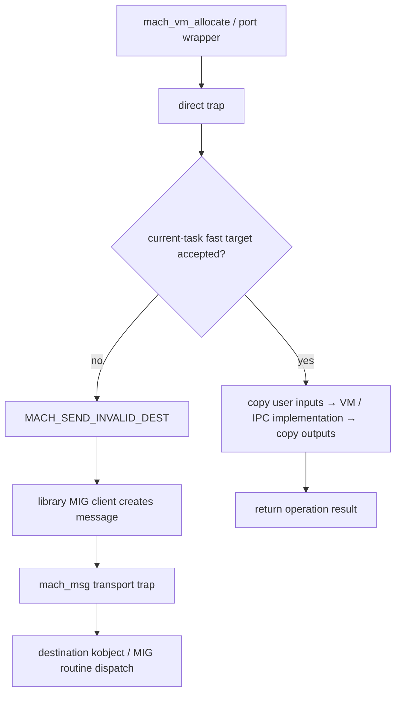

# Mach traps: complete slot catalog and operation boundaries

[Interface overview](README.md) · [Machine entry paths](machine-entry-points.md) · [IPC](../subsystems/ipc/README.md) · [VM](../subsystems/vm/README.md)

The common table has **128 slots**, indexed 0–127. There are **62 potentially named operations**: 60 unconditional named slots, slot 47 when `__LP64__ || __arm64__`, and slot 63 when `__LP64__`. Thus an LP64 build has 62 named/66 invalid entries; ARM64 without LP64 has 61/67; a build satisfying neither condition has 60/68. These are table counts, not a claim that every named operation performs useful work in every configuration. Four named backing-store interfaces are unconditional `ENOTSUP` stubs, and other handlers have configuration-dependent bodies. [Table](../../xnu/osfmk/kern/syscall_sw.c#L105-L244), [table size and entry layout](../../xnu/osfmk/kern/syscall_sw.h#L79-L116).

The catalog below preserves every slot, exact argument counts and mungers, kernel argument-field order/types, implementation location, and operation purpose. It is generated from this checkout by [build_mach_trap_catalog.py](../tools/build_mach_trap_catalog.py), with curated descriptions checked against selected bodies. The machine-entry companion explains how a slot becomes an ARM64 negative selector or an x86 class/number, and why an invalid slot generally raises a syscall exception before `kern_invalid()` is invoked.

<!-- BEGIN GENERATED MACH TRAP CATALOG -->

## Complete table: all 128 slots

The **ABI** column is `argument count / 32-bit word count / munger suffix` exactly as stored in the table; `—` means no munger. `port` marks the table’s direct port-name return flag. Argument declarations below are kernel argument-structure fields, in order; a `user_addr_t` is a userspace pointer value, not a kernel pointer. Source links on slot numbers identify the exact table entries. Conditional alternatives are preserved rather than evaluated for this host.

### Slots 0–31

| Slot | Handler and availability | ABI | Kernel argument fields | Purpose and first implementation boundary |
| ---: | --- | --- | --- | --- |
| [0](../../xnu/osfmk/kern/syscall_sw.c#L106) | `kern_invalid` | `0 / 0 / —` | none | Reserved low numbers; not a Mach operation. |
| [1](../../xnu/osfmk/kern/syscall_sw.c#L107) | `kern_invalid` | `0 / 0 / —` | none | Reserved low numbers; not a Mach operation. |
| [2](../../xnu/osfmk/kern/syscall_sw.c#L108) | `kern_invalid` | `0 / 0 / —` | none | Reserved low numbers; not a Mach operation. |
| [3](../../xnu/osfmk/kern/syscall_sw.c#L109) | `kern_invalid` | `0 / 0 / —` | none | Reserved low numbers; not a Mach operation. |
| [4](../../xnu/osfmk/kern/syscall_sw.c#L110) | `kern_invalid` | `0 / 0 / —` | none | Reserved low numbers; not a Mach operation. |
| [5](../../xnu/osfmk/kern/syscall_sw.c#L111) | `kern_invalid` | `0 / 0 / —` | none | Reserved low numbers; not a Mach operation. |
| [6](../../xnu/osfmk/kern/syscall_sw.c#L112) | `kern_invalid` | `0 / 0 / —` | none | Reserved low numbers; not a Mach operation. |
| [7](../../xnu/osfmk/kern/syscall_sw.c#L113) | `kern_invalid` | `0 / 0 / —` | none | Reserved low numbers; not a Mach operation. |
| [8](../../xnu/osfmk/kern/syscall_sw.c#L114) | `kern_invalid` | `0 / 0 / —` | none | Reserved low numbers; not a Mach operation. |
| [9](../../xnu/osfmk/kern/syscall_sw.c#L115) | `kern_invalid` | `0 / 0 / —` | none | Reserved low numbers; not a Mach operation. |
| [10](../../xnu/osfmk/kern/syscall_sw.c#L116) | [`_kernelrpc_mach_vm_allocate_trap`](../../xnu/osfmk/ipc/mach_kernelrpc.c#L59) | `4 / 5 / wwlw` | `mach_port_name_t target`, `user_addr_t addr`, `mach_vm_size_ut size`, `int flags` ([structure](../../xnu/osfmk/mach/mach_traps.h#L702)) | Allocate an anonymous region in the current task via mach_vm_allocate_external; address is copied in/out. |
| [11](../../xnu/osfmk/kern/syscall_sw.c#L117) | [`_kernelrpc_mach_vm_purgable_control_trap`](../../xnu/osfmk/ipc/mach_kernelrpc.c#L134) | `4 / 5 / wlww` | `mach_port_name_t target`, `mach_vm_offset_t address`, `vm_purgable_t control`, `user_addr_t state` ([structure](../../xnu/osfmk/mach/mach_traps.h#L750)) | Get or change current-task purgeable state via mach_vm_purgable_control; GET accepts the current-task read capability. |
| [12](../../xnu/osfmk/kern/syscall_sw.c#L118) | [`_kernelrpc_mach_vm_deallocate_trap`](../../xnu/osfmk/ipc/mach_kernelrpc.c#L81) | `3 / 5 / wll` | `mach_port_name_t target`, `mach_vm_address_ut address`, `mach_vm_size_ut size` ([structure](../../xnu/osfmk/mach/mach_traps.h#L712)) | Remove a current-task virtual range via mach_vm_deallocate_external. |
| [13](../../xnu/osfmk/kern/syscall_sw.c#L119) | [`task_dyld_process_info_notify_get_trap`](../../xnu/osfmk/ipc/mach_kernelrpc.c#L625) | `2 / 4 / ll` | `mach_vm_address_t names_addr`, `mach_vm_address_t names_count_addr` ([structure](../../xnu/osfmk/mach/mach_traps.h#L720)) | Copy active dyld notifier send-right names into the current task; capacity/count and failure cleanup are explicit. |
| [14](../../xnu/osfmk/kern/syscall_sw.c#L120) | [`_kernelrpc_mach_vm_protect_trap`](../../xnu/osfmk/ipc/mach_kernelrpc.c#L94) | `5 / 7 / wllww` | `mach_port_name_t target`, `mach_vm_address_ut address`, `mach_vm_size_ut size`, `boolean_t set_maximum`, `vm_prot_ut new_protection` ([structure](../../xnu/osfmk/mach/mach_traps.h#L728)) | Change current-task region protections via mach_vm_protect. |
| [15](../../xnu/osfmk/kern/syscall_sw.c#L121) | [`_kernelrpc_mach_vm_map_trap`](../../xnu/osfmk/ipc/mach_kernelrpc.c#L108) | `6 / 8 / wwllww` | `mach_port_name_t target`, `user_addr_t addr`, `mach_vm_size_ut size`, `mach_vm_offset_ut mask`, `int flags`, `vm_prot_ut cur_protection` ([structure](../../xnu/osfmk/mach/mach_traps.h#L738)) | Restricted anonymous mapping via mach_vm_map_external with null object, zero object offset, no copy, maximum ALL, default inheritance. |
| [16](../../xnu/osfmk/kern/syscall_sw.c#L122) | [`_kernelrpc_mach_port_allocate_trap`](../../xnu/osfmk/ipc/mach_kernelrpc.c#L168) | `3 / 3 / www` | `mach_port_name_t target`, `mach_port_right_t right`, `user_addr_t name` ([structure](../../xnu/osfmk/mach/mach_traps.h#L760)) | Allocate a named right in the current IPC space via mach_port_allocate; copy out its name. |
| [17](../../xnu/osfmk/kern/syscall_sw.c#L123) | `kern_invalid` | `0 / 0 / —` | none | No operation assigned; dispatch rejects this slot. |
| [18](../../xnu/osfmk/kern/syscall_sw.c#L124) | [`_kernelrpc_mach_port_deallocate_trap`](../../xnu/osfmk/ipc/mach_kernelrpc.c#L185) | `2 / 2 / ww` | `mach_port_name_t target`, `mach_port_name_t name` ([structure](../../xnu/osfmk/mach/mach_traps.h#L768)) | Drop a user reference through mach_port_deallocate in the current IPC space. |
| [19](../../xnu/osfmk/kern/syscall_sw.c#L125) | [`_kernelrpc_mach_port_mod_refs_trap`](../../xnu/osfmk/ipc/mach_kernelrpc.c#L198) | `4 / 4 / wwww` | `mach_port_name_t target`, `mach_port_name_t name`, `mach_port_right_t right`, `mach_port_delta_t delta` ([structure](../../xnu/osfmk/mach/mach_traps.h#L775)) | Adjust selected right user-reference count via mach_port_mod_refs. |
| [20](../../xnu/osfmk/kern/syscall_sw.c#L126) | [`_kernelrpc_mach_port_move_member_trap`](../../xnu/osfmk/ipc/mach_kernelrpc.c#L213) | `3 / 3 / www` | `mach_port_name_t target`, `mach_port_name_t member`, `mach_port_name_t after` ([structure](../../xnu/osfmk/mach/mach_traps.h#L784)) | Move a receive right between port sets via mach_port_move_member. |
| [21](../../xnu/osfmk/kern/syscall_sw.c#L127) | [`_kernelrpc_mach_port_insert_right_trap`](../../xnu/osfmk/ipc/mach_kernelrpc.c#L227) | `4 / 4 / wwww` | `mach_port_name_t target`, `mach_port_name_t name`, `mach_port_name_t poly`, `mach_msg_type_name_t polyPoly` ([structure](../../xnu/osfmk/mach/mach_traps.h#L792)) | Insert a right; same-name MAKE_SEND/COPY_SEND has a fast path, otherwise copy in a right and destroy it if insertion fails. |
| [22](../../xnu/osfmk/kern/syscall_sw.c#L128) | [`_kernelrpc_mach_port_insert_member_trap`](../../xnu/osfmk/ipc/mach_kernelrpc.c#L314) | `3 / 3 / www` | `mach_port_name_t target`, `mach_port_name_t name`, `mach_port_name_t pset` ([structure](../../xnu/osfmk/mach/mach_traps.h#L811)) | Add receive-right membership to a port set via mach_port_insert_member. |
| [23](../../xnu/osfmk/kern/syscall_sw.c#L129) | [`_kernelrpc_mach_port_extract_member_trap`](../../xnu/osfmk/ipc/mach_kernelrpc.c#L329) | `3 / 3 / www` | `mach_port_name_t target`, `mach_port_name_t name`, `mach_port_name_t pset` ([structure](../../xnu/osfmk/mach/mach_traps.h#L819)) | Remove receive-right membership from a port set via mach_port_extract_member. |
| [24](../../xnu/osfmk/kern/syscall_sw.c#L130) | [`_kernelrpc_mach_port_construct_trap`](../../xnu/osfmk/ipc/mach_kernelrpc.c#L343) | `4 / 5 / wwlw` | `mach_port_name_t target`, `user_addr_t options`, `uint64_t context`, `user_addr_t name` ([structure](../../xnu/osfmk/mach/mach_traps.h#L827)) | Copy in options, construct a port with context, and copy out its name. |
| [25](../../xnu/osfmk/kern/syscall_sw.c#L131) | [`_kernelrpc_mach_port_destruct_trap`](../../xnu/osfmk/ipc/mach_kernelrpc.c#L368) | `4 / 5 / wwwl` | `mach_port_name_t target`, `mach_port_name_t name`, `mach_port_delta_t srdelta`, `uint64_t guard` ([structure](../../xnu/osfmk/mach/mach_traps.h#L836)) | Destruct a port with send-reference delta and guard through mach_port_destruct. |
| [26](../../xnu/osfmk/kern/syscall_sw.c#L132) | [`mach_reply_port`](../../xnu/osfmk/kern/ipc_tt.c#L1319) | `0 / 0 / —`; port | no consumed fields ([structure](../../xnu/osfmk/mach/mach_traps.h#L427)) | Allocate a receive right in the current space; return its name directly or MACH_PORT_NULL. |
| [27](../../xnu/osfmk/kern/syscall_sw.c#L133) | [`thread_self_trap`](../../xnu/osfmk/kern/ipc_tt.c#L1294) | `0 / 0 / —`; port | no consumed fields ([structure](../../xnu/osfmk/mach/mach_traps.h#L439)) | Obtain the current thread self send right and install/copy it out with immovable-right support. |
| [28](../../xnu/osfmk/kern/syscall_sw.c#L134) | [`task_self_trap`](../../xnu/osfmk/kern/ipc_tt.c#L1272) | `0 / 0 / —`; port | no consumed fields ([structure](../../xnu/osfmk/mach/mach_traps.h#L445)) | Obtain the current task self send right and install/copy it out with immovable-right support. |
| [29](../../xnu/osfmk/kern/syscall_sw.c#L135) | [`host_self_trap`](../../xnu/osfmk/kern/ipc_host.c#L171) | `0 / 0 / —`; port | no consumed fields ([structure](../../xnu/osfmk/mach/mach_traps.h#L451)) | Copy a send right for the current task's host port into its IPC space. |
| [30](../../xnu/osfmk/kern/syscall_sw.c#L136) | `kern_invalid` | `0 / 0 / —` | none | No operation assigned; dispatch rejects this slot. |
| [31](../../xnu/osfmk/kern/syscall_sw.c#L137) | [`mach_msg_trap`](../../xnu/osfmk/ipc/mach_msg.c#L909) | `7 / 7 / wwwwwww` | `user_addr_t msg`, `mach_msg_option_t option`, `mach_msg_size_t send_size`, `mach_msg_size_t rcv_size`, `mach_port_name_t rcv_name`, `mach_msg_timeout_t timeout`, `mach_msg_priority_t priority`, `user_addr_t rcv_msg` ([structure](../../xnu/osfmk/mach/mach_traps.h#L457)) | Legacy combined message send/receive; sets rcv_msg to zero before the overwrite implementation. |

### Slots 32–63

| Slot | Handler and availability | ABI | Kernel argument fields | Purpose and first implementation boundary |
| ---: | --- | --- | --- | --- |
| [32](../../xnu/osfmk/kern/syscall_sw.c#L138) | [`mach_msg_overwrite_trap`](../../xnu/osfmk/ipc/mach_msg.c#L823) | `8 / 8 / wwwwwwww` | `user_addr_t msg`, `mach_msg_option_t option`, `mach_msg_size_t send_size`, `mach_msg_size_t rcv_size`, `mach_port_name_t rcv_name`, `mach_msg_timeout_t timeout`, `mach_msg_priority_t priority`, `user_addr_t rcv_msg` ([structure](../../xnu/osfmk/mach/mach_traps.h#L457)) | Legacy message send/receive with separate receive buffer; IPC_HAS_LEGACY_MACH_MSG_TRAP body, otherwise KERN_NOT_SUPPORTED. |
| [33](../../xnu/osfmk/kern/syscall_sw.c#L139) | [`semaphore_signal_trap`](../../xnu/osfmk/kern/sync_sema.c#L519) | `1 / 1 / w` | `mach_port_name_t signal_name` ([structure](../../xnu/osfmk/mach/mach_traps.h#L489)) | Signal one semaphore waiter or increment availability through semaphore_signal_internal_trap. |
| [34](../../xnu/osfmk/kern/syscall_sw.c#L140) | [`semaphore_signal_all_trap`](../../xnu/osfmk/kern/sync_sema.c#L577) | `1 / 1 / w` | `mach_port_name_t signal_name` ([structure](../../xnu/osfmk/mach/mach_traps.h#L495)) | Wake all eligible semaphore waiters; semaphore object reference is released after the operation. |
| [35](../../xnu/osfmk/kern/syscall_sw.c#L141) | [`semaphore_signal_thread_trap`](../../xnu/osfmk/kern/sync_sema.c#L445) | `2 / 2 / ww` | `mach_port_name_t signal_name`, `mach_port_name_t thread_name` ([structure](../../xnu/osfmk/mach/mach_traps.h#L501)) | Signal a semaphore with a selected thread target; resolves both names and drops references. |
| [36](../../xnu/osfmk/kern/syscall_sw.c#L142) | [`semaphore_wait_trap`](../../xnu/osfmk/kern/sync_sema.c#L833) | `1 / 1 / w` | `mach_port_name_t wait_name` ([structure](../../xnu/osfmk/mach/mach_traps.h#L508)) | Wait on a semaphore; blocking completion may return through a continuation. |
| [37](../../xnu/osfmk/kern/syscall_sw.c#L143) | [`semaphore_wait_signal_trap`](../../xnu/osfmk/kern/sync_sema.c#L977) | `2 / 2 / ww` | `mach_port_name_t wait_name`, `mach_port_name_t signal_name` ([structure](../../xnu/osfmk/mach/mach_traps.h#L514)) | Wait on one semaphore while signaling another; coordinated wait/signal internal path. |
| [38](../../xnu/osfmk/kern/syscall_sw.c#L144) | [`semaphore_timedwait_trap`](../../xnu/osfmk/kern/sync_sema.c#L904) | `3 / 3 / www` | `mach_port_name_t wait_name`, `unsigned int sec`, `clock_res_t nsec` ([structure](../../xnu/osfmk/mach/mach_traps.h#L521)) | Semaphore wait with relative seconds/nanoseconds timeout converted to a deadline. |
| [39](../../xnu/osfmk/kern/syscall_sw.c#L145) | [`semaphore_timedwait_signal_trap`](../../xnu/osfmk/kern/sync_sema.c#L1053) | `4 / 4 / wwww` | `mach_port_name_t wait_name`, `mach_port_name_t signal_name`, `unsigned int sec`, `clock_res_t nsec` ([structure](../../xnu/osfmk/mach/mach_traps.h#L529)) | Timed wait plus signal, using the same semaphore wait/signal internal machinery. |
| [40](../../xnu/osfmk/kern/syscall_sw.c#L146) | [`_kernelrpc_mach_port_get_attributes_trap`](../../xnu/osfmk/ipc/mach_kernelrpc.c#L269) | `5 / 5 / wwwww` | `mach_port_name_t target`, `mach_port_name_t name`, `mach_port_flavor_t flavor`, `user_addr_t info`, `user_addr_t count` ([structure](../../xnu/osfmk/mach/mach_traps.h#L801)) | Read current-task port attributes; clamp count to generated reply capacity, zero temporary storage, copy count/data out. |
| [41](../../xnu/osfmk/kern/syscall_sw.c#L147) | [`_kernelrpc_mach_port_guard_trap`](../../xnu/osfmk/ipc/mach_kernelrpc.c#L382) | `4 / 5 / wwlw` | `mach_port_name_t target`, `mach_port_name_t name`, `uint64_t guard`, `boolean_t strict` ([structure](../../xnu/osfmk/mach/mach_traps.h#L845)) | Guard a current-space port with a 64-bit context and strictness policy. |
| [42](../../xnu/osfmk/kern/syscall_sw.c#L148) | [`_kernelrpc_mach_port_unguard_trap`](../../xnu/osfmk/ipc/mach_kernelrpc.c#L396) | `3 / 4 / wwl` | `mach_port_name_t target`, `mach_port_name_t name`, `uint64_t guard` ([structure](../../xnu/osfmk/mach/mach_traps.h#L854)) | Unguard a current-space port after guard validation. |
| [43](../../xnu/osfmk/kern/syscall_sw.c#L149) | [`mach_generate_activity_id`](../../xnu/osfmk/ipc/ipc_voucher.c#L2375) | `3 / 3 / www` | `mach_port_name_t target`, `int count`, `user_addr_t activity_id` ([structure](../../xnu/osfmk/mach/mach_traps.h#L862)) | Reserve one or more globally allocated activity IDs; validates count and copies the first ID out. |
| [44](../../xnu/osfmk/kern/syscall_sw.c#L150) | [`task_name_for_pid`](../../xnu/bsd/kern/kern_proc.c#L6029) | `3 / 3 / www` | `mach_port_name_t target_tport`, `int pid`, `user_addr_t t` ([structure](../../xnu/osfmk/mach/mach_traps.h#L546)) | Resolve PID to a task-name capability with BSD process/credential/MAC checks. |
| [45](../../xnu/osfmk/kern/syscall_sw.c#L151) | [`task_for_pid`](../../xnu/bsd/kern/kern_proc.c#L5865) | `3 / 3 / www` | `mach_port_name_t target_tport`, `int pid`, `user_addr_t t` ([structure](../../xnu/osfmk/mach/mach_traps.h#L538)) | Resolve PID to a task-control capability with process, credential, MAC, and task-access policy checks. |
| [46](../../xnu/osfmk/kern/syscall_sw.c#L152) | [`pid_for_task`](../../xnu/bsd/kern/kern_proc.c#L5675) | `2 / 2 / ww` | `mach_port_name_t t`, `user_addr_t pid` ([structure](../../xnu/osfmk/mach/mach_traps.h#L554)) | Convert a task port to its PID and copy the PID to userspace. |
| [47](../../xnu/osfmk/kern/syscall_sw.c#L154) | [`mach_msg2_trap`](../../xnu/osfmk/ipc/mach_msg.c#L927); `__LP64__ \|\| __arm64__`, otherwise [invalid](../../xnu/osfmk/kern/syscall_sw.c#L156) | `8 / 16 / llllllll` | `mach_vm_address_t data`, `mach_msg_option64_t options`, `uint64_t msgh_bits_and_send_size`, `uint64_t msgh_remote_and_local_port`, `uint64_t msgh_voucher_and_id`, `uint64_t desc_count_and_rcv_name`, `uint64_t rcv_size_and_priority`, `uint64_t timeout` ([structure](../../xnu/osfmk/mach/mach_traps.h#L474)) | Current packed 64-bit message ABI; decode packed header/scalar fields and dispatch send/receive with message policy. |
| [48](../../xnu/osfmk/kern/syscall_sw.c#L158) | [`macx_swapon`](../../xnu/bsd/vm/dp_backing_file.c#L182) | `4 / 5 / lwww` | `uint64_t filename`, `int flags`, `int size`, `int priority` ([structure](../../xnu/osfmk/mach/mach_traps.h#L569)) | Retained ABI stub: returns ENOTSUP; does not create a swap file in this checkout. |
| [49](../../xnu/osfmk/kern/syscall_sw.c#L159) | [`macx_swapoff`](../../xnu/bsd/vm/dp_backing_file.c#L195) | `2 / 3 / lw` | `uint64_t filename`, `int flags` ([structure](../../xnu/osfmk/mach/mach_traps.h#L578)) | Retained ABI stub: returns ENOTSUP; does not remove a swap file in this checkout. |
| [50](../../xnu/osfmk/kern/syscall_sw.c#L160) | [`thread_get_special_reply_port`](../../xnu/osfmk/kern/ipc_tt.c#L1349) | `0 / 0 / —`; port | no consumed fields ([structure](../../xnu/osfmk/mach/mach_traps.h#L433)) | Unbind any prior user special reply port, allocate a new receive+send right, bind it to the thread, return name. |
| [51](../../xnu/osfmk/kern/syscall_sw.c#L161) | [`macx_triggers`](../../xnu/bsd/vm/dp_backing_file.c#L168) | `4 / 4 / wwww` | `int hi_water`, `int low_water`, `int flags`, `mach_port_t alert_port` ([structure](../../xnu/osfmk/mach/mach_traps.h#L585)) | Only compaction enable/disable flags reach macx_backing_store_compaction; other requests return ENOTSUP. |
| [52](../../xnu/osfmk/kern/syscall_sw.c#L162) | [`macx_backing_store_suspend`](../../xnu/bsd/vm/dp_backing_file.c#L102) | `1 / 1 / w` | `boolean_t suspend` ([structure](../../xnu/osfmk/mach/mach_traps.h#L594)) | Retained ABI stub: returns ENOTSUP. |
| [53](../../xnu/osfmk/kern/syscall_sw.c#L163) | [`macx_backing_store_recovery`](../../xnu/bsd/vm/dp_backing_file.c#L88) | `1 / 1 / w` | `int pid` ([structure](../../xnu/osfmk/mach/mach_traps.h#L600)) | Retained ABI stub: returns ENOTSUP. |
| [54](../../xnu/osfmk/kern/syscall_sw.c#L164) | `kern_invalid` | `0 / 0 / —` | none | No operation assigned; dispatch rejects this slot. |
| [55](../../xnu/osfmk/kern/syscall_sw.c#L165) | `kern_invalid` | `0 / 0 / —` | none | No operation assigned; dispatch rejects this slot. |
| [56](../../xnu/osfmk/kern/syscall_sw.c#L166) | `kern_invalid` | `0 / 0 / —` | none | No operation assigned; dispatch rejects this slot. |
| [57](../../xnu/osfmk/kern/syscall_sw.c#L167) | `kern_invalid` | `0 / 0 / —` | none | No operation assigned; dispatch rejects this slot. |
| [58](../../xnu/osfmk/kern/syscall_sw.c#L168) | [`pfz_exit`](../../xnu/osfmk/kern/syscall_subr.c#L88) | `0 / 0 / —` | no consumed fields ([structure](../../xnu/osfmk/mach/mach_traps.h#L612)) | No-op success body; pending AST work is picked up on kernel exit from the preemption-free region. |
| [59](../../xnu/osfmk/kern/syscall_sw.c#L169) | [`swtch_pri`](../../xnu/osfmk/kern/syscall_subr.c#L159) | `0 / 0 / —` | `int pri` ([structure](../../xnu/osfmk/mach/mach_traps.h#L606)) | Yield with temporary priority depression; the historical priority argument is unused and table argc is zero. |
| [60](../../xnu/osfmk/kern/syscall_sw.c#L170) | [`swtch`](../../xnu/osfmk/kern/syscall_subr.c#L122) | `0 / 0 / —` | no consumed fields ([structure](../../xnu/osfmk/mach/mach_traps.h#L618)) | Yield if scheduler policy says useful; boolean result reports whether yielding remains appropriate. |
| [61](../../xnu/osfmk/kern/syscall_sw.c#L171) | [`thread_switch`](../../xnu/osfmk/kern/syscall_subr.c#L200) | `3 / 3 / www` | `mach_port_name_t thread_name`, `int option`, `mach_msg_timeout_t option_time` ([structure](../../xnu/osfmk/mach/mach_traps.h#L634)) | Scheduler-directed switch/yield with optional depression/wait and a thread hint; continuation path can discard the stack. |
| [62](../../xnu/osfmk/kern/syscall_sw.c#L172) | [`clock_sleep_trap`](../../xnu/osfmk/kern/clock_oldops.c#L457) | `5 / 5 / wwwww` | `mach_port_name_t clock_name`, `sleep_type_t sleep_type`, `int sleep_sec`, `int sleep_nsec`, `user_addr_t wakeup_time` ([structure](../../xnu/osfmk/mach/mach_traps.h#L624)) | Clock-port sleep with absolute/relative clock time and wakeup-time copyout. |
| [63](../../xnu/osfmk/kern/syscall_sw.c#L174) | [`mach_vm_reclaim_update_kernel_accounting_trap`](../../xnu/osfmk/ipc/mach_kernelrpc.c#L789); `__LP64__`, otherwise [invalid](../../xnu/osfmk/kern/syscall_sw.c#L176) | `3 / 5 / wll` | `mach_port_name_t target_task`, `user_addr_t bytes_reclaimed_out`, `user_addr_t next_deadline_out` ([structure](../../xnu/osfmk/mach/mach_traps.h#L930)) | Current-task deferred-reclamation accounting update; CONFIG_DEFERRED_RECLAIM body or KERN_NOT_SUPPORTED. |

### Slots 64–95

| Slot | Handler and availability | ABI | Kernel argument fields | Purpose and first implementation boundary |
| ---: | --- | --- | --- | --- |
| [64](../../xnu/osfmk/kern/syscall_sw.c#L178) | `kern_invalid` | `0 / 0 / —` | none | No operation assigned; dispatch rejects this slot. |
| [65](../../xnu/osfmk/kern/syscall_sw.c#L179) | `kern_invalid` | `0 / 0 / —` | none | No operation assigned; dispatch rejects this slot. |
| [66](../../xnu/osfmk/kern/syscall_sw.c#L180) | `kern_invalid` | `0 / 0 / —` | none | No operation assigned; dispatch rejects this slot. |
| [67](../../xnu/osfmk/kern/syscall_sw.c#L181) | `kern_invalid` | `0 / 0 / —` | none | No operation assigned; dispatch rejects this slot. |
| [68](../../xnu/osfmk/kern/syscall_sw.c#L182) | `kern_invalid` | `0 / 0 / —` | none | No operation assigned; dispatch rejects this slot. |
| [69](../../xnu/osfmk/kern/syscall_sw.c#L183) | `kern_invalid` | `0 / 0 / —` | none | No operation assigned; dispatch rejects this slot. |
| [70](../../xnu/osfmk/kern/syscall_sw.c#L184) | [`host_create_mach_voucher_trap`](../../xnu/osfmk/ipc/mach_kernelrpc.c#L491) | `4 / 4 / wwww` | `mach_port_name_t host`, `mach_voucher_attr_raw_recipe_array_t recipes`, `int recipes_size`, `user_addr_t voucher` ([structure](../../xnu/osfmk/mach/mach_traps.h#L874)) | Copy raw recipes, create a voucher, export its send right, and copy its name to userspace. |
| [71](../../xnu/osfmk/kern/syscall_sw.c#L185) | `kern_invalid` | `0 / 0 / —` | none | No operation assigned; dispatch rejects this slot. |
| [72](../../xnu/osfmk/kern/syscall_sw.c#L186) | [`mach_voucher_extract_attr_recipe_trap`](../../xnu/osfmk/ipc/mach_kernelrpc.c#L543) | `4 / 4 / wwww` | `mach_port_name_t voucher_name`, `mach_voucher_attr_key_t key`, `mach_voucher_attr_raw_recipe_t recipe`, `user_addr_t recipe_size` ([structure](../../xnu/osfmk/mach/mach_traps.h#L883)) | Resolve a voucher, extract one raw attribute recipe into bounded temporary storage, then copy bytes/count out. |
| [73](../../xnu/osfmk/kern/syscall_sw.c#L187) | `kern_invalid` | `0 / 0 / —` | none | No operation assigned; dispatch rejects this slot. |
| [74](../../xnu/osfmk/kern/syscall_sw.c#L188) | `kern_invalid` | `0 / 0 / —` | none | No operation assigned; dispatch rejects this slot. |
| [75](../../xnu/osfmk/kern/syscall_sw.c#L189) | `kern_invalid` | `0 / 0 / —` | none | No operation assigned; dispatch rejects this slot. |
| [76](../../xnu/osfmk/kern/syscall_sw.c#L190) | [`_kernelrpc_mach_port_type_trap`](../../xnu/osfmk/ipc/mach_kernelrpc.c#L409) | `3 / 3 / wwww` | `mach_port_name_t target`, `mach_port_right_t name`, `user_addr_t ptype` ([structure](../../xnu/osfmk/mach/mach_traps.h#L893)) | Return current-space right type bits through mach_port_type and copyout. |
| [77](../../xnu/osfmk/kern/syscall_sw.c#L191) | [`_kernelrpc_mach_port_request_notification_trap`](../../xnu/osfmk/ipc/mach_kernelrpc.c#L426) | `7 / 7 / wwwwwww` | `mach_port_name_t target`, `mach_port_name_t name`, `mach_msg_id_t msgid`, `mach_port_mscount_t sync`, `mach_port_name_t notify`, `mach_msg_type_name_t notifyPoly`, `user_addr_t previous` ([structure](../../xnu/osfmk/mach/mach_traps.h#L901)) | Register/change a notification using a send-once disposition; copy previous notification right back into the namespace. |
| [78](../../xnu/osfmk/kern/syscall_sw.c#L192) | `kern_invalid` | `0 / 0 / —` | none | No operation assigned; dispatch rejects this slot. |
| [79](../../xnu/osfmk/kern/syscall_sw.c#L193) | `kern_invalid` | `0 / 0 / —` | none | No operation assigned; dispatch rejects this slot. |
| [80](../../xnu/osfmk/kern/syscall_sw.c#L194) | `kern_invalid` | `0 / 0 / —` | none | No operation assigned; dispatch rejects this slot. |
| [81](../../xnu/osfmk/kern/syscall_sw.c#L195) | `kern_invalid` | `0 / 0 / —` | none | No operation assigned; dispatch rejects this slot. |
| [82](../../xnu/osfmk/kern/syscall_sw.c#L196) | `kern_invalid` | `0 / 0 / —` | none | No operation assigned; dispatch rejects this slot. |
| [83](../../xnu/osfmk/kern/syscall_sw.c#L197) | `kern_invalid` | `0 / 0 / —` | none | No operation assigned; dispatch rejects this slot. |
| [84](../../xnu/osfmk/kern/syscall_sw.c#L198) | `kern_invalid` | `0 / 0 / —` | none | No operation assigned; dispatch rejects this slot. |
| [85](../../xnu/osfmk/kern/syscall_sw.c#L199) | `kern_invalid` | `0 / 0 / —` | none | No operation assigned; dispatch rejects this slot. |
| [86](../../xnu/osfmk/kern/syscall_sw.c#L200) | `kern_invalid` | `0 / 0 / —` | none | No operation assigned; dispatch rejects this slot. |
| [87](../../xnu/osfmk/kern/syscall_sw.c#L201) | `kern_invalid` | `0 / 0 / —` | none | No operation assigned; dispatch rejects this slot. |
| [88](../../xnu/osfmk/kern/syscall_sw.c#L202) | [`_exclaves_ctl_trap`](../../xnu/osfmk/kern/exclaves.c#L213) | `8 / 14 / wwllllll` | `mach_port_name_t name`, `uint32_t operation_and_flags`, `uint64_t identifier`, `mach_vm_address_t buffer`, `mach_vm_size_t size`, `uint64_t param1`, `uint64_t param2`, `mach_vm_address_t status` ([structure](../../xnu/osfmk/mach/mach_traps.h#L642)) | Exclaves operation multiplexer: privilege/config checks then resource, IPC, sensor, notification, and boot operations; disabled body returns KERN_NOT_SUPPORTED. |
| [89](../../xnu/osfmk/kern/syscall_sw.c#L203) | [`mach_timebase_info_trap`](../../xnu/osfmk/kern/clock.c#L407) | `1 / 1 / w` | `user_addr_t info` ([structure](../../xnu/osfmk/mach/mach_traps.h#L655)) | Copy the absolute-time conversion numerator/denominator to userspace. |
| [90](../../xnu/osfmk/kern/syscall_sw.c#L204) | [`mach_wait_until_trap`](../../xnu/osfmk/kern/clock.c#L1529) | `1 / 2 / l` | `uint64_t deadline` ([structure](../../xnu/osfmk/mach/mach_traps.h#L661)) | Wait until an absolute-time deadline through assert_wait_deadline/thread_block; interruption maps to a Mach result. |
| [91](../../xnu/osfmk/kern/syscall_sw.c#L205) | [`mk_timer_create_trap`](../../xnu/osfmk/kern/mk_timer.c#L66) | `0 / 0 / —`; port | no consumed fields ([structure](../../xnu/osfmk/mach/mach_traps.h#L667)) | Allocate a timer object and receive-right port; return the name or MACH_PORT_NULL. |
| [92](../../xnu/osfmk/kern/syscall_sw.c#L206) | [`mk_timer_destroy_trap`](../../xnu/osfmk/kern/mk_timer.c#L199) | `1 / 1 / w` | `mach_port_name_t name` ([structure](../../xnu/osfmk/mach/mach_traps.h#L673)) | Destroy the named timer port with timer-object validation. |
| [93](../../xnu/osfmk/kern/syscall_sw.c#L207) | [`mk_timer_arm_trap`](../../xnu/osfmk/kern/mk_timer.c#L320) | `2 / 3 / wl` | `mach_port_name_t name`, `uint64_t expire_time` ([structure](../../xnu/osfmk/mach/mach_traps.h#L679)) | Arm a timer at an absolute deadline through mk_timer_arm_trap_internal. |
| [94](../../xnu/osfmk/kern/syscall_sw.c#L208) | [`mk_timer_cancel_trap`](../../xnu/osfmk/kern/mk_timer.c#L345) | `2 / 2 / ww` | `mach_port_name_t name`, `user_addr_t result_time` ([structure](../../xnu/osfmk/mach/mach_traps.h#L695)) | Cancel timer delivery and optionally copy out its previous deadline. |
| [95](../../xnu/osfmk/kern/syscall_sw.c#L209) | [`mk_timer_arm_leeway_trap`](../../xnu/osfmk/kern/mk_timer.c#L326) | `4 / 6 / wlll` | `mach_port_name_t name`, `uint64_t mk_timer_flags`, `uint64_t expire_time`, `uint64_t mk_leeway` ([structure](../../xnu/osfmk/mach/mach_traps.h#L686)) | Arm a timer with flags and leeway through mk_timer_arm_trap_internal. |

### Slots 96–127

| Slot | Handler and availability | ABI | Kernel argument fields | Purpose and first implementation boundary |
| ---: | --- | --- | --- | --- |
| [96](../../xnu/osfmk/kern/syscall_sw.c#L210) | [`debug_control_port_for_pid`](../../xnu/bsd/kern/kern_proc.c#L6452) | `3 / 3 / www` | `mach_port_name_t target_tport`, `int pid`, `user_addr_t t` ([structure](../../xnu/osfmk/mach/mach_traps.h#L561)) | Obtain a task debug-control capability subject to process/credential/entitlement restrictions. |
| [97](../../xnu/osfmk/kern/syscall_sw.c#L211) | `kern_invalid` | `0 / 0 / —` | none | No operation assigned; dispatch rejects this slot. |
| [98](../../xnu/osfmk/kern/syscall_sw.c#L212) | `kern_invalid` | `0 / 0 / —` | none | No operation assigned; dispatch rejects this slot. |
| [99](../../xnu/osfmk/kern/syscall_sw.c#L213) | `kern_invalid` | `0 / 0 / —` | none | No operation assigned; dispatch rejects this slot. |
| [100](../../xnu/osfmk/kern/syscall_sw.c#L215) | [`iokit_user_client_trap`](../../xnu/iokit/Kernel/IOUserClient.cpp#L6489) | `8 / 8 / wwwwwwww` | `void * userClientRef`, `uint32_t index`, `void * p1`, `void * p2`, `void * p3`, `void * p4`, `void * p5`, `void * p6` ([structure](../../xnu/osfmk/mach/mach_traps.h#L915)) | Dispatch an IOKit user-client trap or DriverKit uext trap from a tagged reference; index and six scalars reach the selected target. |
| [101](../../xnu/osfmk/kern/syscall_sw.c#L216) | `kern_invalid` | `0 / 0 / —` | none | Reserved for IOKit; currently invalid. |
| [102](../../xnu/osfmk/kern/syscall_sw.c#L217) | `kern_invalid` | `0 / 0 / —` | none | Reserved for IOKit; currently invalid. |
| [103](../../xnu/osfmk/kern/syscall_sw.c#L218) | `kern_invalid` | `0 / 0 / —` | none | Reserved for IOKit; currently invalid. |
| [104](../../xnu/osfmk/kern/syscall_sw.c#L219) | `kern_invalid` | `0 / 0 / —` | none | Reserved for IOKit; currently invalid. |
| [105](../../xnu/osfmk/kern/syscall_sw.c#L220) | `kern_invalid` | `0 / 0 / —` | none | Reserved for IOKit; currently invalid. |
| [106](../../xnu/osfmk/kern/syscall_sw.c#L221) | `kern_invalid` | `0 / 0 / —` | none | Reserved for IOKit; currently invalid. |
| [107](../../xnu/osfmk/kern/syscall_sw.c#L222) | `kern_invalid` | `0 / 0 / —` | none | Reserved for IOKit; currently invalid. |
| [108](../../xnu/osfmk/kern/syscall_sw.c#L223) | `kern_invalid` | `0 / 0 / —` | none | Invalid despite the historical thread_set_x86_64_compat userspace stub. |
| [109](../../xnu/osfmk/kern/syscall_sw.c#L225) | `kern_invalid` | `0 / 0 / —` | none | Explicitly unused table slot. |
| [110](../../xnu/osfmk/kern/syscall_sw.c#L226) | `kern_invalid` | `0 / 0 / —` | none | Explicitly unused table slot. |
| [111](../../xnu/osfmk/kern/syscall_sw.c#L227) | `kern_invalid` | `0 / 0 / —` | none | Explicitly unused table slot. |
| [112](../../xnu/osfmk/kern/syscall_sw.c#L228) | `kern_invalid` | `0 / 0 / —` | none | Explicitly unused table slot. |
| [113](../../xnu/osfmk/kern/syscall_sw.c#L229) | `kern_invalid` | `0 / 0 / —` | none | Explicitly unused table slot. |
| [114](../../xnu/osfmk/kern/syscall_sw.c#L230) | `kern_invalid` | `0 / 0 / —` | none | Explicitly unused table slot. |
| [115](../../xnu/osfmk/kern/syscall_sw.c#L231) | `kern_invalid` | `0 / 0 / —` | none | Explicitly unused table slot. |
| [116](../../xnu/osfmk/kern/syscall_sw.c#L232) | `kern_invalid` | `0 / 0 / —` | none | Explicitly unused table slot. |
| [117](../../xnu/osfmk/kern/syscall_sw.c#L233) | `kern_invalid` | `0 / 0 / —` | none | Explicitly unused table slot. |
| [118](../../xnu/osfmk/kern/syscall_sw.c#L234) | `kern_invalid` | `0 / 0 / —` | none | Explicitly unused table slot. |
| [119](../../xnu/osfmk/kern/syscall_sw.c#L235) | `kern_invalid` | `0 / 0 / —` | none | Explicitly unused table slot. |
| [120](../../xnu/osfmk/kern/syscall_sw.c#L236) | `kern_invalid` | `0 / 0 / —` | none | Explicitly unused table slot. |
| [121](../../xnu/osfmk/kern/syscall_sw.c#L237) | `kern_invalid` | `0 / 0 / —` | none | Explicitly unused table slot. |
| [122](../../xnu/osfmk/kern/syscall_sw.c#L238) | `kern_invalid` | `0 / 0 / —` | none | Explicitly unused table slot. |
| [123](../../xnu/osfmk/kern/syscall_sw.c#L239) | `kern_invalid` | `0 / 0 / —` | none | Explicitly unused table slot. |
| [124](../../xnu/osfmk/kern/syscall_sw.c#L240) | `kern_invalid` | `0 / 0 / —` | none | Explicitly unused table slot. |
| [125](../../xnu/osfmk/kern/syscall_sw.c#L241) | `kern_invalid` | `0 / 0 / —` | none | Explicitly unused table slot. |
| [126](../../xnu/osfmk/kern/syscall_sw.c#L242) | `kern_invalid` | `0 / 0 / —` | none | Explicitly unused table slot. |
| [127](../../xnu/osfmk/kern/syscall_sw.c#L243) | `kern_invalid` | `0 / 0 / —` | none | Explicitly unused table slot. |

<!-- END GENERATED MACH TRAP CATALOG -->

## ABI metadata and historical discrepancies

The table stores a function pointer, logical argument count, count of 32-bit words, optional 32-bit munger, and a flag for direct port-name results. Six entries set that result flag: 26, 27, 28, 29, 50, and 91. Dispatchers use it when converting policy denial to `MACH_PORT_NULL`. It does not mean every other handler returns a conventional `kern_return_t`: `swtch` returns a boolean, and the retained `macx_*` bodies use BSD-valued errors through a Mach-table route. [Entry definition](../../xnu/osfmk/kern/syscall_sw.h#L79-L116), [filter return handling](../../xnu/osfmk/arm64/bsd_arm64.c#L266-L277).

The kernel's argument structures are the decoder contract; library prototypes and assembly macros are additional evidence rather than substitutes. This matters in several visible cases:

| Case | Exact source distinction |
| --- | --- |
| `mach_msg_trap`, slot 31 | Shares the overwrite argument structure but consumes seven table arguments; its body explicitly zeros `rcv_msg` before delegation. |
| `mach_msg_overwrite_trap`, slot 32 | Kernel structure/table have eight consumed fields; the user prototype and historical stub also describe a ninth `rcv_limit` argument. The ARM stub comments explicitly say the ninth is unused. |
| `swtch_pri`, slot 59 | Public prototype/argument structure contain `pri`, but the table argument count is zero and the body marks the argument structure unused. |
| `mach_port_type`, slot 76 | Table records `3 / 3 / munge_wwww`; the munger name is not a reason to silently rewrite the stored counts to four. |
| `mk_timer_arm_leeway`, slot 95 | Table records four logical arguments and six 32-bit words with `munge_wlll`; the argument structure contains one port name plus three 64-bit fields, and the non-LP64 stub requests seven words. The catalog retains this mismatch. |
| VM map stub, slot 15 | Historical stub macro requests nine words, while kernel table stores eight 32-bit words for six logical fields. |
| Compatibility stub, slot 108 | `thread_set_x86_64_compat` is emitted by the common stub list, but the actual table entry is `kern_invalid`; its declaration is not evidence of an implemented operation. |

The 32-bit munger bodies make the distinction concrete: `munge_wwww` widens four words, while `munge_wlll` reads its last 64-bit value beginning at input word five. [Munger implementations](../../xnu/bsd/dev/munge.c#L60-L63), [three-long form](../../xnu/bsd/dev/munge.c#L256-L265).

Sources: [kernel message structures](../../xnu/osfmk/mach/mach_traps.h#L460-L480), [stub list](../../xnu/osfmk/mach/syscall_sw.h#L91-L107), [unused ninth-argument comment](../../xnu/osfmk/mach/arm/syscall_sw.h#L95-L96), [swtch body](../../xnu/osfmk/kern/syscall_subr.c#L159-L175), [slot 76](../../xnu/osfmk/kern/syscall_sw.c#L190), [timer structure](../../xnu/osfmk/mach/mach_traps.h#L686-L694), [timer/compatibility stubs](../../xnu/osfmk/mach/syscall_sw.h#L191-L208). These are source observations, not fixes or claims that every compatibility path is exercised in a shipped build. Modern ARM64 argument gathering copies 64-bit slots; x86 retains both 64-bit gathering and a 32-bit copy/munge route. See [machine entry points](machine-entry-points.md).

## Current-task fast traps and MIG fallback

The `_kernelrpc_*_trap` family is not a general in-kernel MIG demultiplexer. Its handlers usually recognize a capability for the **current task**, then call a VM or IPC-space operation directly. An unsupported destination produces `MACH_SEND_INVALID_DEST`, allowing the library to choose its message-based `_kernelrpc_*` implementation. A real operation failure, such as invalid arguments or failed user copy, does not universally trigger the fallback. [VM trap bodies](../../xnu/osfmk/ipc/mach_kernelrpc.c#L59-L164), [port trap bodies](../../xnu/osfmk/ipc/mach_kernelrpc.c#L168-L486), [message interface catalog](mach-messages/README.md).

[current-task VM allocation fast path](../../xnu/osfmk/ipc/mach_kernelrpc.c#L59-L78)

<!-- source-excerpt: ../../xnu/osfmk/ipc/mach_kernelrpc.c#L59-L78 -->
```c
_kernelrpc_mach_vm_allocate_trap(struct _kernelrpc_mach_vm_allocate_trap_args *args)
{
	mach_vm_offset_t addr;
	task_t task = port_name_to_current_task_noref(args->target);
	int rv = MACH_SEND_INVALID_DEST;

	if (task) {
		if ((rv = mach_copyin(args->addr, (char *)&addr, sizeof(addr)))) {
			goto done;
		}

		rv = mach_vm_allocate_external(task->map, &addr, args->size, args->flags);
		if (rv == KERN_SUCCESS) {
			rv = mach_copyout(&addr, args->addr, sizeof(addr));
		}
	}

done:
	return rv;
}
```

The corresponding library branch is equally specific:

[VM allocation fallback condition](../../xnu/libsyscall/mach/mach_vm.c#L57-L61)

<!-- source-excerpt: ../../xnu/libsyscall/mach/mach_vm.c#L57-L61 -->
```c
	rv = _kernelrpc_mach_vm_allocate_trap(target, address, size, flags);

	if (rv == MACH_SEND_INVALID_DEST) {
		rv = _kernelrpc_mach_vm_allocate(target, address, size, flags);
	}
```



| Wrapper family | Local selection / fallback rule |
| --- | --- |
| `mach_vm_allocate`, `deallocate`, `protect`, `purgable_control` | Attempt direct trap; only `MACH_SEND_INVALID_DEST` selects the corresponding `_kernelrpc_*` message call. [VM wrappers](../../xnu/libsyscall/mach/mach_vm.c#L48-L111), [purgeable wrapper](../../xnu/libsyscall/mach/mach_vm.c#L387-L407). |
| `mach_vm_map` | Attempt the restricted trap only for a null memory object, maximum protection `VM_PROT_ALL`, and default inheritance. Other mappings begin with the message fallback result; the full message interface carries object/offset/copy/max/inheritance fields absent from the trap. [Mapping wrapper](../../xnu/libsyscall/mach/mach_vm.c#L161-L188). |
| Port type/allocate/deallocate/mod-refs/membership/right insertion/attributes/guard/construct/destruct/notification | Trap wrappers follow the same invalid-destination fallback pattern; operations without a trap, such as port rename, remain message interfaces. [Port wrappers](../../xnu/libsyscall/mach/mach_port.c#L53-L177), [notification/insertion](../../xnu/libsyscall/mach/mach_port.c#L239-L283), [construct/guard wrappers](../../xnu/libsyscall/mach/mach_port.c#L657-L727). |
| Voucher creation/extraction | Attempt recipe trap, then corresponding MIG routine on invalid destination. Host creation retains architecture-specific historical fallback checks. [Host wrapper](../../xnu/libsyscall/mach/host.c#L84-L112), [recipe extraction](../../xnu/libsyscall/mach/mach_port.c#L735-L751). |
| Deferred reclamation accounting | Userspace ring sampling calls the dedicated trap and updates its local accounting/deadline state; this body has no generic MIG fallback. [Ring wrapper](../../xnu/libsyscall/mach/vm_reclaim.c#L406-L439). |

The fast-path scope has real ownership consequences. `mach_port_insert_right` uses a same-name MAKE_SEND/COPY_SEND shortcut; otherwise it copies in a right, converts the disposition, invokes insertion, and destroys the acquired right if insertion fails. Notification registration similarly converts/acquires a send-once right and may copy a previous notification right into the caller's space. A copyout error is later than the kernel object transition: allocation and port-construction bodies do not show a universal rollback of a successfully created object when the final scalar copyout fails. [Right insertion cleanup](../../xnu/osfmk/ipc/mach_kernelrpc.c#L227-L266), [notification ownership](../../xnu/osfmk/ipc/mach_kernelrpc.c#L426-L486), [port construction](../../xnu/osfmk/ipc/mach_kernelrpc.c#L343-L365), [rights lifecycle](../subsystems/ipc/ports-and-rights-lifecycle.md).

## Message transport, packed ABI, and interruption

Slot 47's eight logical arguments are **eight 64-bit fields**, with several packing two 32-bit values. The kernel reconstructs the message header from these scalars; descriptor/body data still comes from the user message or vectors. The ordinary nonvector interpretation is:

| Packed argument | Low 32 bits | High 32 bits |
| --- | --- | --- |
| `msgh_bits_and_send_size` | Header bits | Send byte count |
| `msgh_remote_and_local_port` | Remote port | Local port |
| `msgh_voucher_and_id` | Voucher port | Message ID |
| `desc_count_and_rcv_name` | Descriptor count | Receive port/set name |
| `rcv_size_and_priority` | Receive size | Priority / relevant send context |

Vector mode changes how size/count fields are interpreted and obtains message/auxiliary vector information first. The kernel applies current-task options and `ipc_preflight_msg_option64()`, performs send if requested, and only proceeds to receive if send succeeded. A bad receive vector does not necessarily prevent a valid send in a combined operation. [Packed decoding and send](../../xnu/osfmk/ipc/mach_msg.c#L927-L1018), [message ownership guide](../subsystems/ipc/message-send-receive.md).

[header reconstruction from packed trap fields](../../xnu/osfmk/ipc/mach_msg.c#L966-L976)

<!-- source-excerpt: ../../xnu/osfmk/ipc/mach_msg.c#L966-L976 -->
```c
		mach_msg_send_uctx_t send_uctx = {
			.send_header = {
				.msgh_bits         = (mach_msg_bits_t) (mb_ss),
				.msgh_size         = 0,
				.msgh_remote_port  = (mach_port_name_t)(mr_lp),
				.msgh_local_port   = (mach_port_name_t)(mr_lp >> 32),
				.msgh_voucher_port = (mach_port_name_t)(mv_id),
				.msgh_id           = (mach_msg_id_t)   (mv_id >> 32),
			},
			.send_dsc_count = (mach_msg_size_t)dc_rn,
		};
```

`mach_msg2_internal()` removes library-only option bits and retries an interrupted send when allowed. After an interrupted **receive**, it clears the send action and send size before retrying. Reissuing the original combined operation could otherwise resend a request whose send already completed. [Library retry body](../../xnu/libsyscall/mach/mach_msg.c#L93-L147), [receive phase and compensation](../subsystems/ipc/message-send-receive.md#7-errors-tell-you-which-resources-moved).

Slots 31 and 32 remain named on all table configurations, but their meaningful legacy body is selected by `IPC_HAS_LEGACY_MACH_MSG_TRAP`, defined here only for `XNU_TARGET_OS_OSX`. Otherwise the overwrite handler returns `KERN_NOT_SUPPORTED`; slot 31 delegates to it. Thus the count of installed function names is not the count of supported transports. [Legacy configuration](../../xnu/osfmk/ipc/ipc_policy.h#L53-L60), [disabled result](../../xnu/osfmk/ipc/mach_msg.c#L886-L892).

Message IDs belong to a separate namespace. A request using slot 47 may target a user server, a kernel kobject, or another supported destination; only later IPC/kobject dispatch selects the appropriate service routine. The [MIG catalog](mach-messages/README.md) inventories those messages and generated/external boundaries. The transport trap number does not identify a particular MIG operation.

## Semaphores, scheduler calls, and timer ports

The semaphore traps convert port names to retained semaphore objects before using the shared wait/signal machinery. A targeted signal also resolves and later releases a thread reference; a null target means “choose an existing waiter without pre-posting” in that particular operation. Timed waits validate the timespec; `{0,0}` selects nonblocking behavior rather than an arbitrary already-expired timestamp. Wait handlers supply `thread_syscall_return` as their continuation, so the blocked operation can complete without returning through its original C frame. [Targeted signal](../../xnu/osfmk/kern/sync_sema.c#L445-L479), [wait entry](../../xnu/osfmk/kern/sync_sema.c#L833-L855), [timed-wait conversion](../../xnu/osfmk/kern/sync_sema.c#L904-L944), [wait/turnstile mechanisms](../subsystems/runtime/wait-and-turnstile-protocols.md).

`swtch` and `swtch_pri` ask scheduler policy whether yielding is useful; `swtch_pri` adds temporary depression and removes it in its continuation. `pfz_exit` currently just succeeds: its purpose is to enter/exit the kernel so pending AST processing can run, not to invoke a hidden scheduler-specific handler in the trap body. `thread_switch` has a richer option/hint path. [Yield operations](../../xnu/osfmk/kern/syscall_subr.c#L88-L175), [thread switch](../../xnu/osfmk/kern/syscall_subr.c#L200-L308), [scheduler guide](../subsystems/runtime/scheduler-execution.md).

Timer creation allocates a timer object, initializes a thread call, preallocates a reusable expiration message, and allocates a receive-right port carrying the timer label. The timer retains its own send right. Arming/canceling operate through this port identity; destruction validates the receive right and timer label. Final timer teardown coordinates with an active callback, so “cancel” and “destroy the port/object” are different lifetime operations. [Creation](../../xnu/osfmk/kern/mk_timer.c#L66-L105), [label deallocation](../../xnu/osfmk/kern/mk_timer.c#L119-L140), [destroy](../../xnu/osfmk/kern/mk_timer.c#L199-L231), [arm/cancel](../../xnu/osfmk/kern/mk_timer.c#L320-L397).

## Exclaves slot 88: all 26 secondary operations

`operation_and_flags` uses the upper byte for the operation and the lower 24 bits for flags; this trap currently rejects nonzero flags. `CONFIG_EXCLAVES == 0` leaves the slot present but returns `KERN_NOT_SUPPORTED`. With the feature enabled, the body applies operation-specific privilege checks, waits for ExclaveCore boot for the ordinary route, and interprets the other seven arguments according to the selected operation. Boot is handled by an earlier privilege-gated branch. [Encoding enum/macros](../../xnu/osfmk/mach/exclaves.h#L1334-L1370), [entry privilege/configuration](../../xnu/osfmk/kern/exclaves.c#L213-L334), [disabled body](../../xnu/osfmk/kern/exclaves.c#L1298-L1306).

The following table inventories every non-sentinel enum operation. Field names refer to the slot-88 kernel structure above; the local handler may rename `identifier` to an offset and `param1/param2` to secondary lengths/offsets. These are operation-specific uses, not additional trap numbers.

| Operation | Main arguments and local implementation boundary |
| --- | --- |
| 1 `ENDPOINT_CALL` | Null name; identifier selects service; buffer/size hold an exact-size IPC buffer. Copy into per-thread IPC storage, check current-domain service availability, call endpoint, copy response out. [Body](../../xnu/osfmk/kern/exclaves.c#L365-L448). |
| 2 `NAMED_BUFFER_CREATE` | Identifier is a user string pointer; size and param1 select length/permissions; return resource port through buffer. [Body](../../xnu/osfmk/kern/exclaves.c#L450-L494). |
| 3 `NAMED_BUFFER_COPYIN` | Resource port name; buffer/size and identifier/param1/param2 select one/two copy ranges; retained shared-memory resource passed to copyin helper then released. [Body](../../xnu/osfmk/kern/exclaves.c#L496-L519). |
| 4 `NAMED_BUFFER_COPYOUT` | Corresponding shared-memory resource-to-user copy and release. [Body](../../xnu/osfmk/kern/exclaves.c#L521-L543). |
| 5 `BOOT` | Null name plus identifier/stage; privilege-gated `operation_boot()` before ordinary resource dispatch. [Body](../../xnu/osfmk/kern/exclaves.c#L181-L209). |
| 6 `LAUNCH_CONCLAVE` | Null name; ensure thread IPC buffer, call `task_launch_conclave`, then handle stop-upcall completion. [Body](../../xnu/osfmk/kern/exclaves.c#L545-L564). |
| 7 `LOOKUP_SERVICES` | Buffer/size describe resource lookup data; current body requires exactly one `exclaves_resource_user` request. [Body](../../xnu/osfmk/kern/exclaves.c#L566-L625). |
| 8 `AUDIO_BUFFER_CREATE` | Identifier string and size; map arbitrated audio-memory resource and return a port through buffer. [Shared body](../../xnu/osfmk/kern/exclaves.c#L722-L765). |
| 9 `AUDIO_BUFFER_COPYOUT` | Resource port, user buffer/ranges and status address; arbitrated-memory copyout helper. [Shared body](../../xnu/osfmk/kern/exclaves.c#L767-L792). |
| 10 `SENSOR_CREATE` | Identifier string; open sensor resource in current domain and export port through buffer. [Body](../../xnu/osfmk/kern/exclaves.c#L794-L827). |
| 11 `SENSOR_START` | Sensor port and identifier; call start helper, release resource, copy status through buffer. [Body](../../xnu/osfmk/kern/exclaves.c#L829-L853). |
| 12 `SENSOR_STOP` | Same shape with sensor stop helper. [Body](../../xnu/osfmk/kern/exclaves.c#L854-L878). |
| 13 `SENSOR_STATUS` | Same shape with status query helper. [Body](../../xnu/osfmk/kern/exclaves.c#L879-L903). |
| 14 `NOTIFICATION_RESOURCE_LOOKUP` | Exact resource-user structure in buffer; lookup notification, export port and metadata, undo exported right on output failure. [Body](../../xnu/osfmk/kern/exclaves.c#L904-L962). |
| 15 `AOE_SETUP` | Requires joined conclave; setup helper returns message/worker counts through buffer/status addresses. [Body](../../xnu/osfmk/kern/exclaves.c#L964-L991). |
| 16 `AOE_MESSAGE_LOOP` | Requires joined conclave; enter `exclaves_aoe_message_loop()`. [Body](../../xnu/osfmk/kern/exclaves.c#L993-L1001). |
| 17 `AOE_WORK_LOOP` | Requires joined conclave; enter `exclaves_aoe_work_loop()`. [Body](../../xnu/osfmk/kern/exclaves.c#L1003-L1011). |
| 18 `SENSOR_MIN_ON_TIME` | Special privilege; null name and exact indicator-deadline structure copied in/out around deadline helper. [Body](../../xnu/osfmk/kern/exclaves.c#L1013-L1041). |
| 19 `ARBITRATED_BUFFER_CREATE` | Same shape as audio creation, selecting the non-audio arbitrated-memory type. [Shared body](../../xnu/osfmk/kern/exclaves.c#L722-L765). |
| 20 `ARBITRATED_BUFFER_COPYOUT` | Same arbitrated-resource copyout path as operation 9. [Shared body](../../xnu/osfmk/kern/exclaves.c#L767-L792). |
| 21 `DAEMON_NOTIFICATION_REGISTER` | Privileged caller; exact daemon-notification structure, copied send right, named resource lookup, retained resource plus port-list entry under resource mutex. [Body](../../xnu/osfmk/kern/exclaves.c#L1043-L1120). |
| 22 `DAEMON_NOTIFICATION_DEREGISTER` | Match translated send port in the resource list, remove entry, release send right and registration resource reference. [Body](../../xnu/osfmk/kern/exclaves.c#L1122-L1202). |
| 23 `AOE_ENUMERATE_AND_SETUP_SERVICES` | Null name/joined conclave; enumerate/setup and copy service count through buffer. [Body](../../xnu/osfmk/kern/exclaves.c#L1204-L1229). |
| 24 `AOE_GET_ALL_SERVICE_INFOS` | Null name/joined conclave; nonzero integral array of service-info structures, bounded count, helper plus copyout. [Body](../../xnu/osfmk/kern/exclaves.c#L1231-L1265). |
| 25 `AOE_MESSAGE_LOOP_WITH_SERVICE_ID` | Null name/joined conclave; service identifier passed in param1 to message-loop helper. [Body](../../xnu/osfmk/kern/exclaves.c#L1267-L1280). |
| 26 `AOE_WORK_LOOP_WITH_SERVICE_ID` | Same selection for work-loop helper. [Body](../../xnu/osfmk/kern/exclaves.c#L1282-L1295). |

Operation zero, the `LAST` sentinel, and other unhandled selectors reach invalid-argument handling after the applicable front-end checks. The catalog establishes local argument roles and dispatch, not the secure service's complete implementation. Continue with [Exclaves resources](../subsystems/security/exclaves.md) and [secure execution](../subsystems/security/exclaves-execution.md) for resource, thread, scheduler and external-boundary ownership.

## IOKit, task access, and retained stubs

Slot 100 is a dispatch surface, not one universal driver operation. `iokit_user_client_trap()` interprets tagged reference bits, then either looks up a DriverKit uext reference and calls `IOUserServerUEXTTrap`, or resolves a current-task connection, applies an optional trap filter, and asks the user client for its target/trap at the supplied index. The six scalar payload arguments reach that selected member function. Lookup references are released by the appropriate path. The concrete target's index table remains provider-specific. [IOKit trap body](../../xnu/iokit/Kernel/IOUserClient.cpp#L6489-L6549), [DriverKit dispatch](../subsystems/drivers/driverkit-dispatch-and-actions.md), [user-client ownership](../subsystems/drivers/user-clients-and-driverkit.md).

PID/task conversion traps are implemented in BSD's process code even though they live in the Mach trap table. `task_for_pid` and debug-control access can obtain a task reference, drop a process reference before an access-server upcall, and apply credential/MAC/entitlement policy. A table slot or a PID is not authorization to receive a task-control right. `pid_for_task` consumes a task-name conversion and returns the PID through a userspace address; its body also handles a corpse task. [Task-control entry](../../xnu/bsd/kern/kern_proc.c#L5865-L6023), [debug-control entry](../../xnu/bsd/kern/kern_proc.c#L6452-L6560), [PID conversion](../../xnu/bsd/kern/kern_proc.c#L5675-L5712), [process access policy](../subsystems/security/README.md).

Four historical `macx_*` handlers—swapon, swapoff, backing-store suspend and recovery—return `ENOTSUP` immediately. `macx_triggers` only supports compaction enable/disable flags via `macx_backing_store_compaction()`, whose disable behavior is further conditional on ARM64 macOS. Their old names/comments must not be used to document nonexistent modern swap-file operations. [Stub/compaction bodies](../../xnu/bsd/vm/dp_backing_file.c#L88-L199).

The deferred-reclamation accounting trap is installed only in LP64 table builds. In both feature configurations it first checks current-task identity and nonnull output addresses, returning `MACH_SEND_INVALID_DEST` or `KERN_INVALID_ARGUMENT` on those failures. After those checks, a build without `CONFIG_DEFERRED_RECLAIM` returns `KERN_NOT_SUPPORTED`. The enabled path invokes the accounting helper and attempts its two scalar copyouts only if that helper succeeds. It returns the helper's status rather than testing the copyout return values, so success cannot be read as a universal proof that both userspace outputs were written. [Accounting trap](../../xnu/osfmk/ipc/mach_kernelrpc.c#L787-L815).

## Mach-named operations outside this table

`mach_eventlink_signal`, `mach_eventlink_wait_until`, and `mach_eventlink_signal_wait_until` are BSD slots **496, 497, and 498**. The library explicitly explains the choice: these calls need a 64-bit register return containing count/result information, while ordinary Mach traps do not offer that result convention. The wrappers decode the error and, for wait operations, update the caller's count. Creation/association and other object operations can still be message interfaces. [BSD declarations](../../xnu/bsd/kern/syscalls.master#L779-L781), [library encoding boundary](../../xnu/libsyscall/mach/mach_eventlink.c#L37-L104), [BSD catalog](bsd-syscalls/README.md), [MIG catalog](mach-messages/README.md).

Likewise, direct ARM absolute/continuous-time selectors and x86 machine-dependent/diagnostic tables are cataloged in [machine entry points](machine-entry-points.md), not counted as additional common Mach slots. A port's `externalMethod` selector, a voucher recipe command, and a MIG message ID are yet other namespaces selected after the top-level entry.

## Inspection scope and regeneration

| Area | Work performed and limit |
| --- | --- |
| Shared table and ABI | All 128 slots, both conditional alternatives, all 62 potential handler definitions, and their kernel argument structures were extracted. Munger spelling and count mismatches are preserved. |
| Current-task fast paths | Read VM/port/voucher trap bodies and library fallback selectors, including rights transfer, bounded buffers and output-copy boundaries. Linked subsystem guides supply full lower-layer algorithms. |
| Message transport | Read legacy feature gating, packed `mach_msg2` decoding and send-before-receive boundary, plus library interruption loops. Full message ownership is in the IPC guide. |
| Blocking/time operations | Read semaphore entry/reference/deadline paths, scheduler yield continuations, clock waits and timer creation/arm/cancel/destroy entry bodies. Not every scheduler/interleaving was re-audited. |
| Multiplexers and policy | Read all Exclaves case boundaries and selected resource ownership branches, IOKit trap dispatch, task/PID access entry bodies, accounting and backing-store stubs. Secure service/driver implementations remain separate providers. |
| Validation | `python3 -B docs-ai/tools/build_mach_trap_catalog.py --check` verifies the generated catalog against the source snapshot; the general documentation checker validates links and exact excerpts. No syscall execution, compatibility test, or kernel build was performed. |

The generator updates only the marked all-slot table, preserving this explanatory material. Its purpose descriptions are curated from implementation bodies and must be reviewed if behavior changes; extraction is not semantic verification or a C preprocessor.
