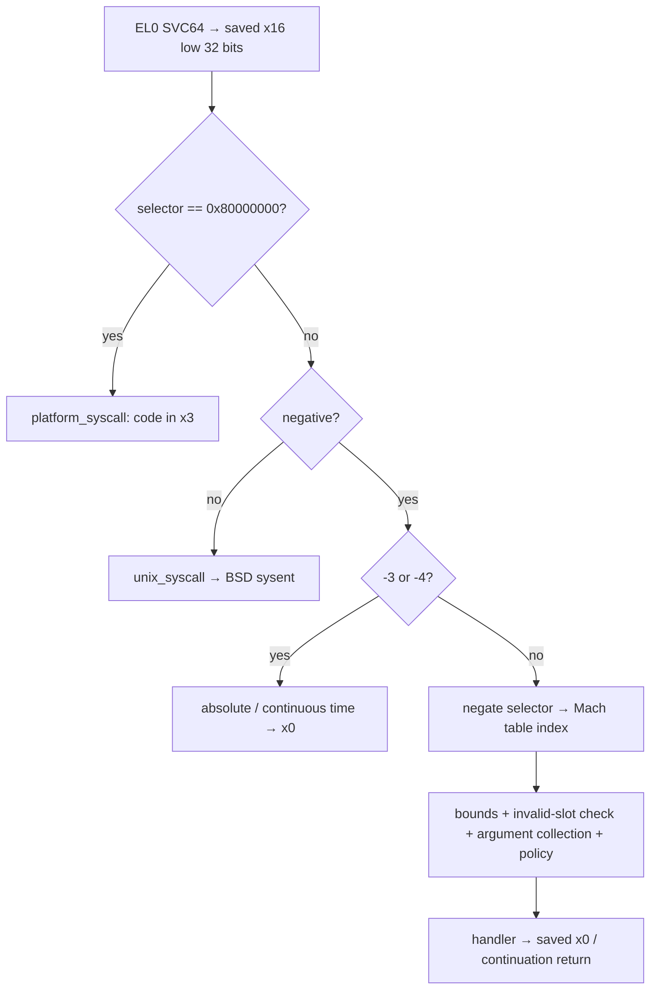
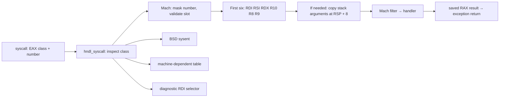

# Machine entry points: ARM64 SVC, x86 syscall classes, and compatibility routes

[Interface overview](README.md) · [All Mach trap slots](mach-traps.md) · [Platform exceptions](../subsystems/platform/arm64-exception-entry.md) · [Scheduler execution](../subsystems/runtime/scheduler-execution.md)

A userspace function name does not identify its kernel entry mechanism. Ordinary Mach traps use a shared 128-slot table, but ARM time queries and the ARM platform selector bypass it. x86 uses a class field to choose Mach, BSD, machine-dependent, or diagnostic dispatch. Eventlinks have Mach-style public names but use BSD syscalls. MIG operations are message IDs carried through the Mach message transport; they are not additional trap numbers. This page covers the actual entry classifiers and every operation in the local machine-dependent tables and ARM platform switch. [ARM classifier](../../xnu/osfmk/arm64/sleh.c#L2743-L2787), [x86 classifier](../../xnu/osfmk/x86_64/idt64.s#L1870-L1940), [eventlink wrapper](../../xnu/libsyscall/mach/mach_eventlink.c#L37-L62).

## 1. ARM64: the SVC instruction and selector are separate

The ARM64 library trap macro loads a signed operation number into `x16`, executes `svc #SWI_SYSCALL`, then returns. `SWI_SYSCALL` is `0x80`. The operation number is therefore **not the SVC immediate**: `-10` selects the VM-allocation trap through the register, while `0x80` is the instruction's immediate. The saved-state accessor takes the low 32 bits of the selector register as an `int`. [Stub macro](../../xnu/osfmk/mach/arm/syscall_sw.h#L106-L117), [SVC constant](../../xnu/osfmk/mach/arm/vm_param.h#L419), [selector extraction](../../xnu/osfmk/mach/arm/thread_status.h#L1030-L1034).

[ARM64 Mach trap stub](../../xnu/osfmk/mach/arm/syscall_sw.h#L110-L117)

<!-- source-excerpt: ../../xnu/osfmk/mach/arm/syscall_sw.h#L110-L117 -->
```asm
#define kernel_trap(trap_name, trap_number, num_args) \
.globl _##trap_name                                           %% \
.text                                                         %% \
.align  2                                                     %% \
_##trap_name:                                                 %% \
    mov x16, #(trap_number)                                   %% \
    svc #SWI_SYSCALL                                          %% \
    ret
```

After the assembly vector has saved context, `sleh_synchronous()` classifies the exception syndrome. The `ESR_EC_SVC_64` branch requires a 64-bit saved state originating in userspace and calls `handle_svc()`. It does not treat every synchronous exception as a syscall: data faults, instruction faults, trapped instructions and other exception classes take other branches. The surrounding exception/return machinery is described in the platform guides. [SVC classification](../../xnu/osfmk/arm64/sleh.c#L930-L948), [exception-level boundaries](../subsystems/platform/exception-levels-and-monitors.md).

`handle_svc()` resets the thread's I/O-tier override. It checks the platform selector **before** the sign test, updates cached process credentials for the ordinary route, then handles two negative time selectors before Mach-table dispatch:

[ARM selector precedence](../../xnu/osfmk/arm64/sleh.c#L2758-L2777)

<!-- source-excerpt: ../../xnu/osfmk/arm64/sleh.c#L2758-L2777 -->
```c
	if (trap_no == (int)PLATFORM_SYSCALL_TRAP_NO) {
		platform_syscall(state);
		panic("Returned from platform_syscall()?");
	}

	current_cached_proc_cred_update();

	if (trap_no < 0) {
		switch (trap_no) {
		case MACH_ARM_TRAP_ABSTIME:
			handle_mach_absolute_time_trap(state);
			return;
		case MACH_ARM_TRAP_CONTTIME:
			handle_mach_continuous_time_trap(state);
			return;
		}

		/* Counting perhaps better in the handler, but this is how it's been done */
		thread->syscalls_mach++;
		mach_syscall(state);
```



### ARM selectors outside the common Mach table

| Register selector | Additional inputs | Local operation and return |
| --- | --- | --- |
| `-3` / `MACH_ARM_TRAP_ABSTIME` | None | `handle_mach_absolute_time_trap()` writes the 64-bit absolute time directly to saved `x0`. |
| `-4` / `MACH_ARM_TRAP_CONTTIME` | None | `handle_mach_continuous_time_trap()` writes continuous time directly to saved `x0`. |
| `0x80000000` / `PLATFORM_SYSCALL_TRAP_NO` | Operation code from low 32 bits of saved `x3`; value/input in `x0` | `platform_syscall()` switch below, then `thread_exception_return()`. |

The time constants and handlers are at [`traps.h`](../../xnu/osfmk/mach/arm/traps.h#L36-L37) and [`sleh.c`](../../xnu/osfmk/arm64/sleh.c#L2789-L2801); the platform constant is at [`proc_reg.h`](../../xnu/osfmk/arm64/proc_reg.h#L2885). Common table slots 3 and 4 are invalid: the early ARM classifier is why these negative numbers still have meaning on this architecture. These time paths bypass `mach_syscall()` and its per-task Mach trap filter; that exception is stated in the dispatcher. Library time routines also contain direct counter/commpage paths, so a time API call need not execute an SVC at all. [Filter comment](../../xnu/osfmk/arm64/bsd_arm64.c#L255-L263), [ARM64 time fallbacks](../../xnu/libsyscall/wrappers/mach_absolute_time.s#L224-L295).

The **entire local platform switch** has only two active operations:

| `x3` code | Behavior |
| ---: | --- |
| 0 | Historical instruction-cache flush, removed; falls through to no action. |
| 1 | Historical data-cache flush, removed; falls through to no action. |
| 2 | Pass saved `x0` to `thread_set_cthread_self()` → `machine_thread_set_tsd_base(current_thread(), self)`. The switch does not place that helper's status into `x0`. |
| 3 | Obtain `thread_get_cthread_self()` and write its value to saved `x0`. |
| Any other value | No action in this switch; no synthesized invalid-selector error before returning. |

This is a **four-explicit-case switch, two functional cases**, not a hidden generic cache-control API. The TSD setter rejects a kernel task, clamps an out-of-range base to zero, updates `thread->machine.cthread_self`, and updates the current thread's read-only-user thread-pointer register under preemption disable. The getter reads that register and asserts consistency with the thread field. [Platform switch](../../xnu/osfmk/arm64/machine_routines.c#L2634-L2669), [helpers](../../xnu/osfmk/arm/machdep_call.c#L52-L76), [TSD update](../../xnu/osfmk/arm64/pcb.c#L1678-L1707).

## 2. ARM Mach-table arguments, policy, and return

`mach_syscall()` negates the selector, rejects an index at or above 128, and rejects entries whose function is `kern_invalid`. Its `bad` path delivers `EXC_SYSCALL` using `exception_triage()`; the ordinary invalid-table case does not call the stub and return `KERN_INVALID_ARGUMENT`. An exception handler may affect the eventual outcome, so this is also not equivalent to an unconditional process kill. [Dispatch and bounds](../../xnu/osfmk/arm64/bsd_arm64.c#L194-L250), [bad path](../../xnu/osfmk/arm64/bsd_arm64.c#L321-L328).

For a 64-bit saved state, `arm_get_mach_syscall_args()` copies the table's argument count of 64-bit words starting at saved `x0` into a zero-initialized `mach_call_args`. The table currently uses at most eight logical arguments. Kernel argument structures use `PAD_ARG_` to lay out each field at the required slot width; the field's C type still matters, especially userspace pointer integers and pairs of packed 32-bit values. [Argument collection](../../xnu/osfmk/arm64/bsd_arm64.c#L87-L122), [argument padding](../../xnu/osfmk/mach/mach_traps.h#L387-L427).

Under `CONFIG_MACF`, a task filter mask can trigger `mac_task_mach_trap_evaluate()`. On policy denial, a trap flagged as returning a port gets `MACH_PORT_NULL`, while ordinary traps retain the error result. Debug syscall rejection has a separate configuration and returns `KERN_DENIED` or null for port-return traps. After a normal handler return, the dispatcher writes the result to the saved return register and performs its accounting/throttling checks. [Policy checks and invocation](../../xnu/osfmk/arm64/bsd_arm64.c#L255-L309).

A blocking handler can instead complete with `thread_syscall_return()`: it writes saved `x0`, emits the trace exit if enabled, and enters `thread_exception_return()`. This is used by semaphore and scheduling continuations; a C call's stack does not need to remain intact until the user resumes. The platform return path handles pending user-return work before restoring the saved context. [Continuation return](../../xnu/osfmk/arm64/sleh.c#L3176-L3199), [semaphore continuation entry](../../xnu/osfmk/kern/sync_sema.c#L833-L855), [scheduler continuation](../../xnu/osfmk/kern/syscall_subr.c#L103-L117).

Historical ARM32 stub/collection code remains in the source: it uses `r12` for the number, skips frame-pointer register `r7` during argument collection, and applies conditional 32-bit mungers. The retained collector has another literal discrepancy: for more than seven words, its first `bcopy` copies seven complete words, but the second starts at saved `r8` with a byte count of `reg_count - 7`, without multiplying by `sizeof(uint32_t)`. It must not be described as a verified complete-word transfer. This chapter does not infer an active 32-bit SVC route from those helper branches: the SVC64 dispatch shown above explicitly requires a 64-bit saved state, and additional compatibility metadata discrepancies are called out in the [trap catalog](mach-traps.md#abi-metadata-and-historical-discrepancies). [ARM32 stubs](../../xnu/osfmk/mach/arm/syscall_sw.h#L35-L104), [actual compatibility copies](../../xnu/osfmk/arm64/bsd_arm64.c#L91-L115).

## 3. x86-64: syscall class selects the dispatcher

The x86-64 library Mach stub moves the fourth C argument from `rcx` to `r10`, constructs `(1 << 24) | slot`, places it in `eax`, and executes `syscall`. This accounts for `syscall` using `rcx` for the saved instruction pointer. It is not the negative selector used by the ARM64 and legacy i386 Mach stubs. [Stub and class macros](../../xnu/osfmk/mach/i386/syscall_sw.h#L106-L169).

[x86-64 Mach stub](../../xnu/osfmk/mach/i386/syscall_sw.h#L112-L117)

<!-- source-excerpt: ../../xnu/osfmk/mach/i386/syscall_sw.h#L112-L117 -->
```asm
#define kernel_trap(trap_name,trap_number,number_args) \
LEAF(_##trap_name,0) ;\
	movq	%rcx, %r10	;\
	movl	$ SYSCALL_CONSTRUCT_MACH(-##trap_number), %eax	;\
	syscall		;\
END(_##trap_name)
```

`idt64_syscall` preserves the user stack, synthesizes an interrupt-style saved frame with `SYSCALL_CS`, and records the syscall number in its error/code slot before common dispatch. The synthesized selector also tells the eventual return code that SYSRET is an available return route. [Frame construction](../../xnu/osfmk/x86_64/idt64.s#L534-L573).

The class is bits `[31:24]`; the number is the remaining low 24 bits. The header defines six class constants, but the assembly classifier accepts only four:

| Class | Name | Actual 64-bit dispatch |
| ---: | --- | --- |
| 0 | `NONE` | Unknown-class `EXC_SYSCALL` path. |
| 1 | `MACH` | `hndl_mach_scall64` → `mach_call_munger64` → shared Mach table. |
| 2 | `UNIX` | `hndl_unix_scall64` → `unix_syscall64` → BSD table. |
| 3 | `MDEP` | `hndl_mdep_scall64` → seven-slot `machdep_call_table64`. |
| 4 | `DIAG` | `hndl_diag_scall64` → `diagCall64`; selector is in `rdi`. |
| 5 | `IPC` | Defined in the header but no matching dispatch branch here; falls to unknown-class handling. It is not the route used for `mach_msg2_trap`. |

[x86-64 syscall class dispatch](../../xnu/osfmk/x86_64/idt64.s#L1884-L1899)

<!-- source-excerpt: ../../xnu/osfmk/x86_64/idt64.s#L1884-L1899 -->
```asm
	movl	R64_RAX(%r15), %eax		/* syscall number/class */
	movl	%eax, %edx
	andl	$(SYSCALL_CLASS_MASK), %edx	/* syscall class */
	cmpl	$(SYSCALL_CLASS_MACH<<SYSCALL_CLASS_SHIFT), %edx
	je	EXT(hndl_mach_scall64)
	cmpl	$(SYSCALL_CLASS_UNIX<<SYSCALL_CLASS_SHIFT), %edx
	je	EXT(hndl_unix_scall64)
	cmpl	$(SYSCALL_CLASS_MDEP<<SYSCALL_CLASS_SHIFT), %edx
	je	EXT(hndl_mdep_scall64)
	cmpl	$(SYSCALL_CLASS_DIAG<<SYSCALL_CLASS_SHIFT), %edx
	je	EXT(hndl_diag_scall64)

	/* Syscall class unknown */
	sti
	CCALL3(i386_exception, $(EXC_SYSCALL), %rax, $1)
	/* no return */
```

`mach_call_munger64()` masks out the class, bounds-checks the number, rejects `kern_invalid`, and copies up to six logical arguments from the saved registers in `rdi,rsi,rdx,r10,r8,r9` order. Extra arguments come from the user stack immediately after the return-address word. Copyin failure stores `KERN_INVALID_ARGUMENT` in `rax` and returns through exception return. The table supports a maximum of nine arguments in this helper, while the current trap table's maximum is eight. [Munger](../../xnu/osfmk/i386/bsd_i386.c#L614-L683).



The Mach dispatcher returns a raw Mach result in `rax`; it does not apply the BSD `errno`/carry-bit translation. `mach_trap_returns_port` has the same filter-denial role as on ARM. Return to user restores address-space/debug/register state and selects `sysretq` versus `iretq` from the frame's route and checks; it is not a C `ret` from the trap body. [Mach result/filter](../../xnu/osfmk/i386/bsd_i386.c#L689-L731), [return preparation](../../xnu/osfmk/x86_64/idt64.s#L1403-L1443), [SYSRET/IRET selection](../../xnu/osfmk/x86_64/idt64.s#L782-L827).

## 4. Legacy x86 entry and 32-bit argument munging

The IDT installs userspace-callable gates at `0x80` for BSD, `0x81` for Mach, and `0x82` for machine-dependent calls. Their entry stubs label the saved frame with the corresponding handler. The separate `sysenter` route uses the **sign of saved `eax`** to distinguish Mach from BSD. The i386 Mach library stub loads a negative number and calls `__sysenter_trap`; that helper removes its own return address into `edx`, records the user stack in `ecx`, and executes `sysenter`. [IDT gates](../../xnu/osfmk/x86_64/idt_table.h#L164-L166), [entry stubs](../../xnu/osfmk/x86_64/idt64.s#L287-L303), [sign dispatch](../../xnu/osfmk/x86_64/idt64.s#L1796-L1806), [library helper](../../xnu/libsyscall/custom/custom.s#L60-L63).

The kernel synthesizes the saved frame because SYSENTER does not supply the same interrupt-frame state as an interrupt gate. The legacy Mach munger negates `eax`, validates the slot, copies `mach_trap_u32_words * sizeof(int)` bytes from the user stack after the return-address word, and applies `mach_trap_arg_munge32` when configured. That produces the wider/aligned kernel argument structure; merely copying the logical argument count would mishandle 64-bit scalar arguments from a 32-bit ABI. [SYSENTER frame](../../xnu/osfmk/x86_64/idt64.s#L576-L596), [32-bit copy/munge](../../xnu/osfmk/i386/bsd_i386.c#L479-L490), [legacy dispatch](../../xnu/osfmk/i386/bsd_i386.c#L500-L607).

[32-bit Mach argument collection](../../xnu/osfmk/i386/bsd_i386.c#L481-L490)

<!-- source-excerpt: ../../xnu/osfmk/i386/bsd_i386.c#L481-L490 -->
```c
{
	if (copyin((user_addr_t)(sp + sizeof(int)), (char *)args, trapp->mach_trap_u32_words * sizeof(int))) {
		return KERN_INVALID_ARGUMENT;
	}
#if CONFIG_REQUIRES_U32_MUNGING
	trapp->mach_trap_arg_munge32(args);
#else
#error U32 mach traps on x86_64 kernel requires munging
#endif
	return KERN_SUCCESS;
```

A legacy invalid Mach slot raises `EXC_SYSCALL`; a user-stack copy failure returns a Mach invalid-argument result. The saved state and synthetic code selector later determine SYSEXIT versus IRET restoration. These are source-retained compatibility paths, not evidence that every historical userspace ABI is enabled in a given modern product configuration. [Invalid/argument errors](../../xnu/osfmk/i386/bsd_i386.c#L534-L561), [legacy return choice](../../xnu/osfmk/x86_64/idt64.s#L1109-L1148).

## 5. Complete x86 machine-dependent tables

Each machine-dependent table has **seven slots**. The 32-bit table has four named handlers and three invalid entries. The 64-bit table has three unconditional named handlers, two conditional hypervisor handlers, and two always-invalid entries: five named/two invalid with `HYPERVISOR`, otherwise three/four. These counts are separate from the 128-slot Mach table. [Both arrays](../../xnu/osfmk/i386/machdep_call.c#L45-L70).

| Slot | 32-bit route | 64-bit route | Arguments and actual purpose |
| ---: | --- | --- | --- |
| 0 | `kern_invalid` | `hv_task_trap` if `HYPERVISOR`, otherwise invalid | `index,arg` as two 64-bit values; dispatch through a registered hypervisor task-trap table using the current task target. |
| 1 | `kern_invalid` | `hv_thread_trap` if `HYPERVISOR`, otherwise invalid | `index,arg`; same registration boundary for the current thread target. |
| 2 | `kern_invalid` | `kern_invalid` | No operation. |
| 3 | `thread_fast_set_cthread_self` | `thread_fast_set_cthread_self64` | One pointer-width `self`; updates TSD base and returns the `USER_CTHREAD` selector, explicitly not an ordinary `kern_return_t`. |
| 4 | `thread_set_user_ldt` | `kern_invalid` | Three 32-bit arguments `address,size,flags`; build the thread's user-settable data-segment descriptor, return selector or `-1`. |
| 5 | `i386_set_ldt` | `i386_set_ldt64` | `start_sel,descs,num_sels`; validate and install task LDT entries. BSD-style error/result convention. |
| 6 | `i386_get_ldt` | `i386_get_ldt64` | Same argument roles; copy selected task/current LDT entries out. BSD-style error/result convention. |

Handlers: [`TSD and user-settable LDT`](../../xnu/osfmk/i386/bsd_i386_native.c#L131-L213), [`LDT set implementation`](../../xnu/osfmk/i386/user_ldt.c#L97-L157), [`LDT get implementation`](../../xnu/osfmk/i386/user_ldt.c#L304-L348), [`pointer-width wrappers`](../../xnu/osfmk/i386/user_ldt.c#L425-L469), [`hypervisor dispatch`](../../xnu/osfmk/kern/hv_support_kext.c#L223-L258).

`machdep_syscall()` gets its number from saved `eax` and its arguments from the 32-bit user stack. `machdep_syscall64()` masks the class from `rax` and reads `rdi,rsi,rdx`. The table entry's `bsd_style` flag chooses whether a three-argument handler returns a raw value or produces an error plus separate result. In the latter case the dispatcher sets carry and returns the error, or clears carry and returns the value. Out-of-range machine-dependent calls directly use `kern_invalid()` and return its result; this differs from the shared Mach-table invalid-slot exception path. [32-bit dispatcher](../../xnu/osfmk/i386/bsd_i386.c#L291-L382), [64-bit dispatcher](../../xnu/osfmk/i386/bsd_i386.c#L386-L456).

[machine-dependent BSD-style return](../../xnu/osfmk/i386/bsd_i386.c#L428-L435)

<!-- source-excerpt: ../../xnu/osfmk/i386/bsd_i386.c#L428-L435 -->
```c
			error = (*entry->routine.args64_bsd_3)(&rval, regs->rdi, regs->rsi, regs->rdx);
			if (error) {
				regs->rax = (uint64_t)error;
				regs->isf.rflags |= EFL_CF;    /* carry bit */
			} else {
				regs->rax = rval;
				regs->isf.rflags &= ~(uint64_t)EFL_CF;
			}
```

The LDT bodies serialize task state with `task_lock`, check selector ranges and descriptor contents, and use userspace copy operations. The table number grants no blanket permission to install arbitrary kernel descriptors. Hypervisor handlers similarly perform only an index-bounded dispatch into registered callbacks here; the callback implementation is responsible for target validation. The local registered tables start empty, so an absent handler or out-of-range subindex yields `KERN_INVALID_ARGUMENT`. Do not infer the external hypervisor's complete operation surface from these two entry points. [LDT validation](../../xnu/osfmk/i386/user_ldt.c#L97-L120), [hypervisor registration](../../xnu/osfmk/kern/hv_support_kext.c#L60-L70), [dispatch boundary](../../xnu/osfmk/kern/hv_support_kext.c#L223-L230).

## 6. x86 diagnostic selectors

`hndl_diag_scall64` calls `diagCall64()` with interrupts disabled. The diagnostic body reads its selector from `rdi`, manages interrupt state around selected work, stores its result in saved `rax`, and returns zero for an unhandled selector. The assembly takes nonzero success directly to `return_to_user` without the ordinary AST check at this dispatch point; zero invokes `EXC_SYSCALL` with code `0x6000`. This special return is a concrete reason to avoid describing every system entry as one identical return protocol. [Diagnostic assembly](../../xnu/osfmk/x86_64/idt64.s#L1931-L1940), [diagnostic dispatcher](../../xnu/osfmk/i386/Diagnostics.c#L126-L350).

Every handled selector in this body is listed below. Other numeric definitions in `Diagnostics.h` do not create dispatch cases by themselves.

| Selector | Case | Inputs, operation, and gating |
| ---: | --- | --- |
| 10 | `dgGzallocTest` | `DEVELOPMENT \|\| DEBUG` only; when diagnostic enable is set, performs the intentional allocator use-after-free test. The body leaves result zero, so this is not an ordinary success-returning service. |
| 17 | `dgPowerStat` | `rsi` output buffer; sample package/core residency, energy and related counters, then copy statistics out. Not gated by the local `diagflag` test in this case. |
| 22 | `dgEnaPMC` | Check CPUID architectural performance-monitor version and request per-CPU PMC enable when supported; mark the request successful. Not gated by `diagflag` here. |
| 25 | `dgRuptStat` | `rsi == 0` clears interrupt counts; otherwise treat it as an output address for CPU count, interval and per-CPU interrupt statistics. Not gated by `diagflag` here. |
| 26 | `dgPermCheck` | `DEVELOPMENT \|\| DEBUG` only; when diagnostic enable is set, run `pmap_permissions_verify()` and use its result. |

Numeric values are in [`Diagnostics.h`](../../xnu/osfmk/i386/Diagnostics.h#L52-L85); case bodies are [`interrupt statistics`](../../xnu/osfmk/i386/Diagnostics.c#L142-L185), [`power statistics`](../../xnu/osfmk/i386/Diagnostics.c#L187-L302), and [`PMC/debug cases`](../../xnu/osfmk/i386/Diagnostics.c#L303-L350). The source retains unchecked copyout return values in several diagnostic paths; do not interpret a nonzero diagnostic result as a comprehensive successful-copy guarantee.

## 7. Boundaries and source coverage

The **normal result** of a Mach trap is a 32-bit Mach status, boolean, or port name as specified by the handler. The early ARM time paths are deliberate exceptions returning 64-bit time directly. BSD eventlinks use their own 64-bit return encoding; platform calls and machine-dependent selector-returning calls are additional exceptions. A function's `kern_return_t` spelling alone does not establish its semantic result, as the TSD handlers explicitly demonstrate.

This page read the actual classifiers, argument gatherers, invalid-slot branches, filter/return boundaries, both machine-dependent arrays, ARM platform switch and its TSD helpers, every implemented x86 diagnostic case, and selected LDT/hypervisor bodies. It did not execute a syscall, build an ABI compatibility test, or reconstruct external hypervisor/monitor code. The assembly excerpts show entry classification and frame/return contracts; complete AST, signal, exception, and scheduler continuations remain in their own subsystem guides. [Mach operation catalog](mach-traps.md), [runtime](../subsystems/runtime/README.md), [process signals](../subsystems/processes/signal-delivery-and-return.md), [Mach exceptions](../subsystems/ipc/exception-delivery.md).
