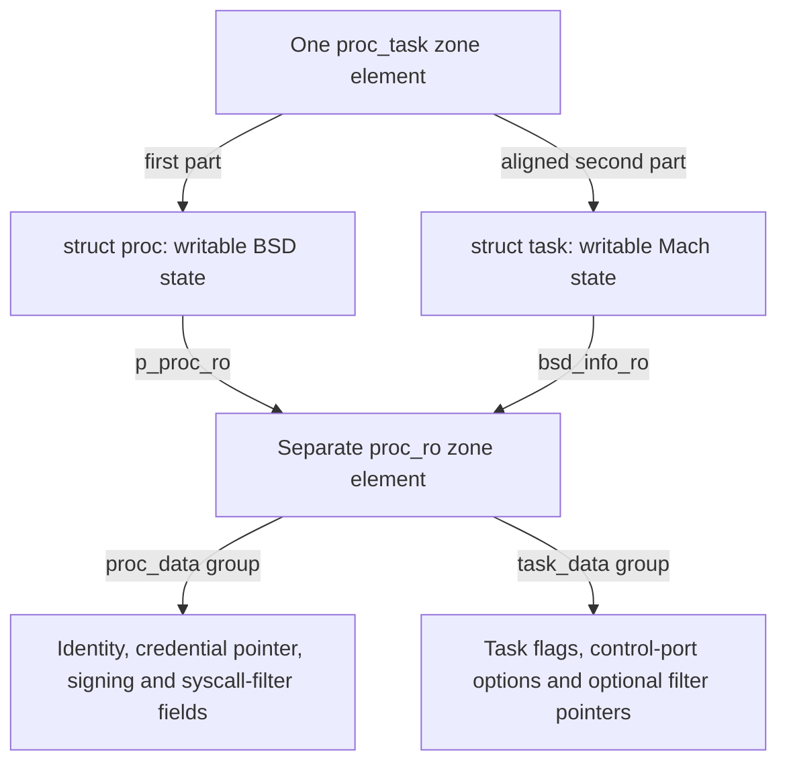

# Key structures: allocation, access and lifetime

This section follows a kernel structure from the allocator that supplies its storage to the last operation that releases it. Start with `proc`, `task` and their protected companion, `proc_ro`, in `xnu-12377.121.6`. The aim is to connect a field declaration to actual callers: how a pointer is obtained, what makes it valid, which reads are permitted, how an update reaches memory, and what survives logical teardown.

[Handbook home](../README.md) · [Architecture](../architecture.md) · [Reading guide](../reading-guide.md)

## Start with the process and task pair

| Read | Questions answered |
| --- | --- |
| [The process and its protected data](proc-and-proc-ro.md) | Where does `struct proc` come from? How do PID lookup and the current thread reach it? Which fields live in `proc_ro`, how does exec update identity, and when can the allocation be reclaimed? |
| [The task and its shared read-only data](task-and-shared-ro.md) | How does the task occupy the second part of the allocation? How do references, threads and task ports reach it? How are task flags and control-port options protected, and how does final task release interact with BSD? |
| [Writing protected object fields](read-only-object-updates.md) | What does a field-update macro actually do? How do source and destination checks, physical aliases, PPL entry and the SPTM implementation differ? What synchronization and lifetime duties remain with the caller? |

The existing [process lifecycle](../subsystems/processes/lifecycle.md), [process transitions](../subsystems/processes/process-transitions.md), [runtime objects](../subsystems/runtime/objects-and-lifecycle.md) and [task capabilities](../subsystems/security/task-and-thread-capabilities.md) explain larger operations. These structure chapters give those operations a concrete storage and access model.

## Two writable structures and one protected companion

For an ordinary BSD process created through `forkproc()`, there are two relevant allocations. The `proc_task` zone supplies one element containing the process followed by an aligned task. A separate `proc_ro` zone element holds process and task association/security fields. The whole process or task is not placed in the RO zone. [Combined-zone construction](../../xnu/osfmk/kern/task.c#L1243-L1252), [process allocation](../../xnu/bsd/kern/kern_fork.c#L933-L943), [RO-zone definition](../../xnu/bsd/kern/kern_proc.c#L230-L231).

The first two arrows describe layout; the others describe pointer links or field groups, not additional allocations. The RO object also carries `pr_proc` and `pr_task` backreferences. `proc_ro_data` and `task_ro_data` are groups inside `struct proc_ro`; there is no separate `task_ro` allocation on this path. Fork initializes the process side, then task creation fills the task side of the same object. [RO layout](../../xnu/bsd/sys/proc_ro.h#L69-L97), [process-side initialization](../../xnu/bsd/kern/kern_fork.c#L1087-L1097), [task-side attachment](../../xnu/osfmk/kern/task.c#L1621-L1638).

This diagram deliberately selects the ordinary process-creation path. A corpse can have a task without an initialized BSD process. Kernel bootstrap first creates the kernel task with no supplied RO object, then BSD initialization separately allocates the kernel process's RO object. Follow those bodies rather than extending the shared-object diagram to every case. [Process initialization boundary](../../xnu/bsd/sys/proc_internal.h#L266-L269), [kernel task creation](../../xnu/osfmk/kern/task.c#L1211-L1219), [kernel process RO creation](../../xnu/bsd/kern/bsd_init.c#L541-L544). The two structure chapters trace these variants.

## Follow one field through all of its operations

| Stage | Concrete example | What must be distinguished |
| --- | --- | --- |
| Allocate | `forkproc()` allocates the combined element; `proc_ro_alloc()` constructs a stack template and copies it into the RO element | The allocator slot, initialized object and externally usable object are separate milestones. [Template and copy](../../xnu/bsd/kern/kern_proc.c#L5580-L5603). |
| Locate | `proc_find(pid)` searches under SMR, attempts a process reference and handles exec replacement | A PID lookup establishes a lifetime protocol; address arithmetic between the two structure halves alone does not. [Lookup](../../xnu/bsd/kern/kern_proc.c#L2519-L2575), [raw conversion](../../xnu/bsd/kern/kern_proc.c#L2023-L2033). |
| Read | `proc_get_ro(p)` or `task_get_ro(t)` validates the RO zone and corresponding backreference before returning the pointer | Validation checks the association. It does not acquire a new object reference or a field lock. [Process accessor](../../xnu/bsd/kern/kern_proc.c#L5638-L5650), [task accessor](../../xnu/osfmk/kern/task.c#L10360-L10371). |
| Update | `proc_setpidversion()` copies a selected field; `task_ro_flags_set()` performs an atomic OR | Both use the RO API, but a copy and an atomic read-modify-write provide different concurrency guarantees. [Identity update](../../xnu/bsd/kern/kern_proc.c#L2113-L2119), [task flag update](../../xnu/osfmk/kern/task.c#L10373-L10391). |
| Detach | Final task destruction atomically clears `pr_task`, then releases its hold on the combined allocation | Removing an association does not necessarily free either allocation immediately. [Task cleanup](../../xnu/osfmk/kern/task.c#L2203-L2206), [protected pointer clearing](../../xnu/bsd/kern/kern_proc.c#L5623-L5628). |
| Reclaim | The last process/task allocation hold permits `proc_free()` to release the credential, RO element and combined element | BSD wait-reference retirement crosses an SMR grace period; task references and allocation-hold bits have distinct roles. [Deferred process release](../../xnu/bsd/kern/kern_proc.c#L1091-L1105), [two-sided release](../../xnu/bsd/kern/kern_proc.c#L1232-L1278). |

The chapters use these stages to explain selected fields rather than reproduce every member of the large declarations. Each worked path states the relevant references, locks and configuration. A pointer to protected data still requires an owner that keeps the data alive.

## How the RO-zone material fits

Start with [read-only zone registration and geometry](../subsystems/vm/read-only-and-special-zones.md#1-read-only-zone-registration-and-geometry) for the allocator's reserved IDs, RO submap and population policy. Then follow [writing protected object fields](read-only-object-updates.md) for concrete process/task updates. Return to [mutation checks](../subsystems/vm/read-only-and-special-zones.md#2-mutation-is-checked-at-two-different-layers) and [atomic updates and free](../subsystems/vm/read-only-and-special-zones.md#3-atomic-updates-and-read-only-free) for the general contracts.

Read-only describes the ordinary mapping and controlled update interface when enforcement is enabled; the fields can still change. The selected backends write through a physical-aperture virtual address for the same physical bytes. PPL and SPTM take different paths, and the SPTM write-preparation/completion hooks in this checkout have empty bodies. The update chapter separates what the source implements from external monitor behavior. [Legacy ARM copy](../../xnu/osfmk/arm/pmap/pmap.c#L12423-L12458), [SPTM copy](../../xnu/osfmk/arm64/sptm/pmap/pmap.c#L11781-L11811), [SPTM hooks](../../xnu/osfmk/arm64/sptm/pmap/pmap.c#L11718-L11732).

For the surrounding storage lifecycle, use [zone allocation and reuse](../subsystems/vm/zone-allocator.md) and [SMR publication and deferred callbacks](../cross-cutting/smr-and-publication.md). An SMR-protected lookup does not by itself mean the object was allocated with `zalloc_smr`; the process path uses an explicit deferred callback before releasing its allocation hold.

## Scope of this first structure study

The current route covers `proc`, `task`, their shared ordinary-process RO record, selected access/update paths and coordinated reclamation. `thread_ro`, credentials, VM maps and IPC ports appear where they lead to or are referenced by these objects; their complete field-by-field lifecycles are not claimed here. Layout depends on the selected configuration, so arithmetic uses the source's alignment and offset expressions rather than a fixed structure size or an offset copied from another release.

The examples are source walkthroughs. They do not report a kernel build, device experiment or vulnerability investigation. External policy and monitor implementations remain explicit boundaries.

<!-- BEGIN PLATYDOC DOCUMENTATION LICENSE -->
Original Platydoc text and diagrams are licensed under [CC BY 4.0](https://creativecommons.org/licenses/by/4.0/). Quoted source code and third-party material retain their respective licenses.
<!-- END PLATYDOC DOCUMENTATION LICENSE -->
