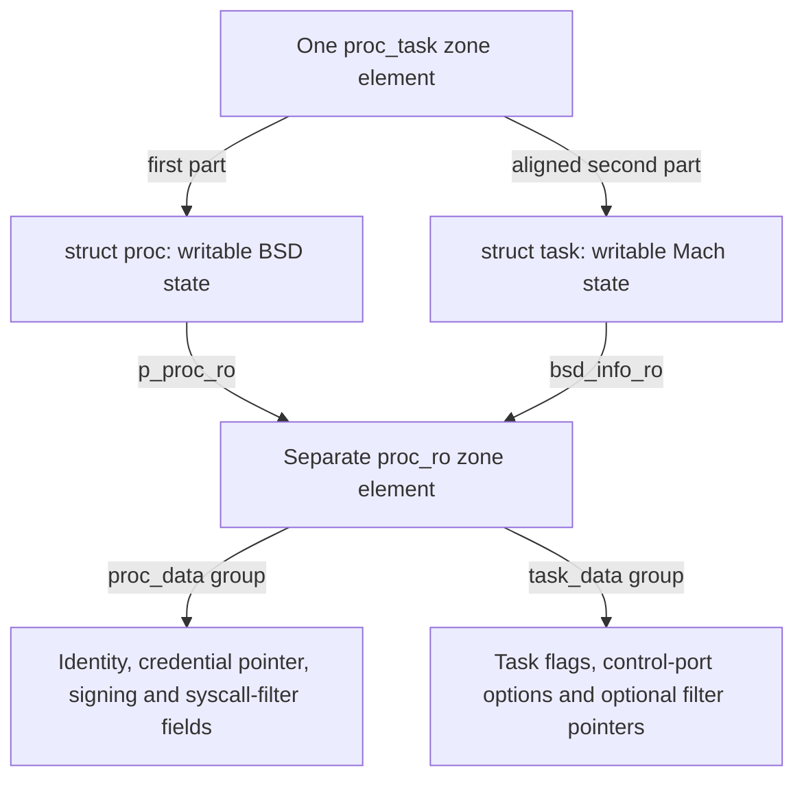

# Key structures: allocation, access and lifetime

This section follows a kernel structure from the allocator that supplies its storage to the last operation that releases it in `xnu-12377.121.6`. Start with process and task identity, continue through thread identity and credentials, then follow Mach capabilities, VM structures and file descriptors into their backing storage. The aim is to connect a field declaration to actual callers: how a pointer is obtained, what makes it valid, which reads are permitted, how an update reaches memory, and what survives logical teardown.

[Handbook home](../README.md) · [Architecture](../architecture.md) · [Reading guide](../reading-guide.md)

## Start with the process and task pair

| Read | Questions answered |
| --- | --- |
| [The process and its protected data](proc-and-proc-ro.md) | Where does `struct proc` come from? How do PID lookup and the current thread reach it? Which fields live in `proc_ro`, how does exec update identity, and when can the allocation be reclaimed? |
| [The task and its shared read-only data](task-and-shared-ro.md) | How does the task occupy the second part of the allocation? How do references, threads and task ports reach it? How are task flags and control-port options protected, and how does final task release interact with BSD? |
| [Writing protected object fields](read-only-object-updates.md) | What does a field-update macro actually do? How do source and destination checks, physical aliases, PPL entry and the SPTM implementation differ? What synchronization and lifetime duties remain with the caller? |

The existing [process lifecycle](../subsystems/processes/lifecycle.md), [process transitions](../subsystems/processes/process-transitions.md), [runtime objects](../subsystems/runtime/objects-and-lifecycle.md) and [task capabilities](../subsystems/security/task-and-thread-capabilities.md) explain larger operations. These structure chapters give those operations a concrete storage and access model.

## Continue through thread identity and Mach capabilities

| Read | Questions answered |
| --- | --- |
| [Thread, BSD thread state and protected associations](thread-and-thread-ro.md) | How do one writable `thread`/`uthread` allocation and a separate `thread_ro` become a usable thread? Which accessors reach the task, process, credentials and exception actions? What do the creation, termination, reaper and final-reference stages each release? |
| [Credentials and credential storage](credentials-and-credential-storage.md) | How do an embedded `posix_cred`, protected `ucred` and writable `ucred_rw` form one identity? How does hash uniquing handle a duplicate creator? Why do temporary references and long-term holdings have different counters? How do process replacement and thread caches interact? |
| [MAC label storage and ownership](mac-label-storage.md) | What does a label slot contain, how is it encoded, and who owns it? How do ordinary owned labels differ from credential labels? How do RO updates, policy callbacks, lazy vnode publication and destruction cooperate? |
| [IPC spaces, entries and task-local names](ipc-spaces-and-entries.md) | How does a name select an entry and validate its generation and right type? How do table reservation, publication, growth, lockless lookup and termination keep entries usable? Which pointers survive a lock drop or table replacement? |
| [IPC ports and kernel-object associations](ipc-ports-and-kobjects.md) | What lives in a port's embedded object, message queue and state-dependent unions? How do right counts, object references, receiver state, kobject association and conversion policy differ? What happens between receive-right destruction and final port storage release? |

These chapters explain the structures behind the existing [credential and policy lifetime](../subsystems/security/credential-and-policy-lifetimes.md), [port and right lifecycle](../subsystems/ipc/ports-and-rights-lifecycle.md), and [thread execution](../subsystems/runtime/scheduler-execution.md) paths. Read an operation chapter alongside its structure companion: one explains why control reaches the next function, the other explains what that function may read, retain, update or release.

## Follow virtual memory into backing and translation storage

| Read | Questions answered |
| --- | --- |
| [VM maps and entries](vm-maps-and-entries.md) | Where are a map, its header, interval entries and lookup nodes allocated? How do packed backing fields, map references, range/entry locks and list/tree publication cooperate? What changes when a range is clipped, detached or destroyed? |
| [VM objects and backing](vm-objects-and-backing.md) | How does an object acquire resident pages, pager/control associations, shadow/copy relationships and references? Which paging/activity holds survive ordinary reference changes, and how does termination release backing? |
| [VM pages and resident storage](vm-pages-and-resident-storage.md) | Where do page descriptors come from, and how do they name physical frames? How do insertion, lookup, busy/wire state, object and queue locks, detachment and recycling change their meaning? |
| [Pmap and translation storage](pmap-and-translation-storage.md) | Who allocates the pmap, root and lower tables, PTD metadata and reverse mappings? How do ordinary, PPL and SPTM storage/update rules differ, and what postpones table or pmap release? |
| [Memory-entry capabilities and VM copies](memory-entries-and-vm-copies.md) | How does a named-entry port own a bounded memory view? Why does a single-object entry contain a copy wrapper? How do borrowed access, retained backing, copy-entry conversion, buffer copying and consuming/nonconsuming cleanup differ? |

Read these alongside the [VM operation route](../subsystems/vm/README.md). A map entry can exist before an object has resident pages or the pmap has a leaf translation. A page descriptor is metadata about a frame; allocating metadata alone does not fill that frame. A named memory handle can outlive its source mapping, and an established destination mapping can outlive the handle. Each companion identifies the allocation and ownership steps behind those distinctions.

## Follow descriptors into file and signature storage

| Read | Questions answered |
| --- | --- |
| [File descriptor tables](file-descriptor-tables.md) | How does the embedded filedesc own movable arrays? Which slot flags distinguish reservation, publication and close? What survives growth, fork, exec or a descriptor-number reuse? |
| [Fileprocs and fileglobs](fileprocs-and-fileglobs.md) | Which fields and references belong to one descriptor or the shared open-file state? How do dup, I/O holds, message transfer, guarded storage, offset locking and final close work? |
| [Vnodes and vnode identity](vnodes-and-vnode-identity.md) | How are vnode storage and filesystem identity created, acquired, published, reclaimed and reused? What do iocount, usecount, kernel-use and hold references each protect? |
| [UBC and vnode pagers](ubc-and-vnode-pagers.md) | How do ubc_info, the pager and the VM object acquire their associations? Which holds protect mappings and paging, and what survives truncation, reclaim or forced unmount? |
| [Code-signature blob storage](code-signature-blob-storage.md) | How do RO wrappers, serialized buffers, interior views, retained entitlements and monitor objects differ? How do pointer reconstruction, protected updates, publication and cleanup preserve those relationships? |

Read these with the [descriptor operation chapter](../subsystems/processes/descriptors-ipc.md), [VFS route](../subsystems/vfs/README.md) and [signature attachment lifecycle](../subsystems/security/vnode-signature-lifecycle.md). An fd number, fileproc I/O hold, shared fileglob reference, vnode identity and borrowed signature pointer name different resources. Closing one descriptor need not destroy file backing; keeping vnode storage alive need not preserve its filesystem identity through reclaim.

## Two writable structures and one protected companion

For an ordinary BSD process created through `forkproc()`, there are two relevant allocations. The `proc_task` zone supplies one element containing the process followed by an aligned task. A separate `proc_ro` zone element holds process and task association/security fields. The whole process or task is not placed in the RO zone. [Combined-zone construction](../../xnu/osfmk/kern/task.c#L1243-L1252), [process allocation](../../xnu/bsd/kern/kern_fork.c#L933-L943), [RO-zone definition](../../xnu/bsd/kern/kern_proc.c#L230-L231).

The first two arrows describe layout; the others describe pointer links or field groups, not additional allocations. The RO object also carries `pr_proc` and `pr_task` backreferences. `proc_ro_data` and `task_ro_data` are groups inside `struct proc_ro`; there is no separate `task_ro` allocation on this path. Fork initializes the process side, then task creation fills the task side of the same object. [RO layout](../../xnu/bsd/sys/proc_ro.h#L69-L97), [process-side initialization](../../xnu/bsd/kern/kern_fork.c#L1087-L1097), [task-side attachment](../../xnu/osfmk/kern/task.c#L1621-L1638).

This diagram deliberately selects the ordinary process-creation path. A corpse can have a task without an initialized BSD process. Kernel bootstrap first creates the kernel task with no supplied RO object, then BSD initialization separately allocates the kernel process's RO object. Follow those bodies rather than extending the shared-object diagram to every case. [Process initialization boundary](../../xnu/bsd/sys/proc_internal.h#L266-L269), [kernel task creation](../../xnu/osfmk/kern/task.c#L1211-L1219), [kernel process RO creation](../../xnu/bsd/kern/bsd_init.c#L541-L544). The two structure chapters trace these variants.

## Follow one field through all of its operations

| Stage | Concrete example | What must be distinguished |
| --- | --- | --- |
| Allocate | `forkproc()` allocates the combined element; `proc_ro_alloc()` constructs a stack template and copies it into the RO element | The allocator slot, initialized object and externally usable object are separate milestones. [Template and copy](../../xnu/bsd/kern/kern_proc.c#L5580-L5603). |
| Locate | `proc_find(pid)` searches under SMR, attempts a process reference and handles exec replacement | A PID lookup establishes a lifetime protocol; address arithmetic between the two structure halves alone does not. [Lookup](../../xnu/bsd/kern/kern_proc.c#L2519-L2575), [raw conversion](../../xnu/bsd/kern/kern_proc.c#L2023-L2033). |
| Read | `proc_get_ro(p)` or `task_get_ro(t)` validates the RO zone and corresponding backreference before returning the pointer | Validation checks the association. It does not acquire a new object reference or a field lock. [Process accessor](../../xnu/bsd/kern/kern_proc.c#L5638-L5650), [task accessor](../../xnu/osfmk/kern/task.c#L10360-L10371). |
| Update | `proc_setpidversion()` copies a selected field; `task_ro_flags_set()` performs an atomic OR | Both use the RO API, but a copy and an atomic read-modify-write provide different concurrency guarantees. [Identity update](../../xnu/bsd/kern/kern_proc.c#L2113-L2119), [task flag update](../../xnu/osfmk/kern/task.c#L10373-L10391). |
| Detach | Final task destruction atomically clears `pr_task`, then releases its hold on the combined allocation | Removing an association does not necessarily free either allocation immediately. [Task cleanup](../../xnu/osfmk/kern/task.c#L2203-L2206), [protected pointer clearing](../../xnu/bsd/kern/kern_proc.c#L5623-L5628). |
| Reclaim | The last process/task allocation hold permits `proc_free()` to release the credential, RO element and combined element | BSD wait-reference retirement crosses an SMR grace period; task references and allocation-hold bits have distinct roles. [Deferred process release](../../xnu/bsd/kern/kern_proc.c#L1091-L1105), [two-sided release](../../xnu/bsd/kern/kern_proc.c#L1232-L1278). |

The chapters use these stages to explain selected fields rather than reproduce every member of the large declarations. Each worked path states the relevant references, locks and configuration. A pointer to protected data still requires an owner that keeps the data alive.

## How the RO-zone material fits

Start with [read-only zone registration and geometry](../subsystems/vm/read-only-and-special-zones.md#1-read-only-zone-registration-and-geometry) for the allocator's reserved IDs, RO submap and population policy. Then follow [writing protected object fields](read-only-object-updates.md) for concrete process/task updates. Return to [mutation checks](../subsystems/vm/read-only-and-special-zones.md#2-mutation-is-checked-at-two-different-layers) and [atomic updates and free](../subsystems/vm/read-only-and-special-zones.md#3-atomic-updates-and-read-only-free) for the general contracts.

Read-only describes the ordinary mapping and controlled update interface when enforcement is enabled; the fields can still change. The selected backends write through a physical-aperture virtual address for the same physical bytes. PPL and SPTM take different paths, and the SPTM write-preparation/completion hooks in this checkout have empty bodies. The update chapter separates what the source implements from external monitor behavior. [Legacy ARM copy](../../xnu/osfmk/arm/pmap/pmap.c#L12423-L12458), [SPTM copy](../../xnu/osfmk/arm64/sptm/pmap/pmap.c#L11781-L11811), [SPTM hooks](../../xnu/osfmk/arm64/sptm/pmap/pmap.c#L11718-L11732).

For the surrounding storage lifecycle, use [zone allocation and reuse](../subsystems/vm/zone-allocator.md) and [SMR publication and deferred callbacks](../cross-cutting/smr-and-publication.md). An SMR-protected lookup does not by itself mean the object was allocated with `zalloc_smr`; the process path uses an explicit deferred callback before releasing its allocation hold.

## Keep storage, authority and lifetime separate

Each structure has several contracts. An allocator or protected mapping answers where bytes live; an accessor or capability conversion answers how code reaches an object; a reference, lock or read-side interval answers how long that access is valid. Follow all three before interpreting a field assignment.

| Structure family | Storage question | Access and lifetime question | Companion |
| --- | --- | --- | --- |
| `proc` / `task` / `proc_ro` | Which fields belong to the combined writable allocation and which to the shared RO record? | Does this path hold a process reference, task reference, SMR read-side protection or one of the allocation's final ownership bits? | [Process](proc-and-proc-ro.md), [task](task-and-shared-ro.md) |
| `thread` / `uthread` / `thread_ro` | Is this state in the combined writable element, the RO companion, or an independently allocated object reached through a pointer? | Is the thread alive, active, IPC-enabled, stopped or still awaiting final reference release? Those are different predicates. | [Thread](thread-and-thread-ro.md) |
| `ucred` / `ucred_rw` | Is this an immutable identity value, a protected long-term holding count, or writable hash/reference bookkeeping? | Is the pointer borrowed, retained for this call, or installed in a long-lived owner? Which counter and retirement path correspond to that use? | [Credentials](credentials-and-credential-storage.md) |
| MAC `label` | Does protection cover the slot value or also the policy object that the value names? | Is the label tied to the address of an owner's pointer, privately under construction, or published as credential identity? Which provider destroys slot data? | [Labels](mac-label-storage.md) |
| `ipc_space` / `ipc_entry` | Is this a retained space or a location inside a replaceable typed table? | What validates the name's index, generation and right type? What must be retried after the table or port state changes? | [Spaces and entries](ipc-spaces-and-entries.md) |
| `ipc_port` / kobject | Which active/inactive or special-port state selects the meaning of a union? | Is this a name's user-reference count, a live right, a port reference, or a referenced task/thread obtained through conversion? | [Ports and kobjects](ipc-ports-and-kobjects.md) |
| `vm_map` / `vm_map_entry` | Is this a map allocation, an embedded header, a live entry or a copy entry? | Does a map reference keep the map alive while range/entry locks stabilize the selected interval? What must be relooked up after a wait? | [Maps and entries](vm-maps-and-entries.md) |
| `vm_object` / `vm_page` | Is this logical backing, a resident descriptor or actual physical bytes? | Which object reference, paging/activity hold, busy state, wire count or queue lock protects the operation? | [Objects](vm-objects-and-backing.md), [pages](vm-pages-and-resident-storage.md) |
| `pmap` / PTD / PV | Is this pmap-object storage, a translation table, its descriptor or reverse-mapping metadata? | Which backend owns the bytes, and which lock, epoch, table pin or retained pmap delays reuse? | [Translation storage](pmap-and-translation-storage.md) |
| `vm_named_entry` / `vm_map_copy` | Is this a port-owned descriptor, an entry-list wrapper or a separate byte buffer? | Is the next accessor borrowing, the next map acquiring a reference, or the next transfer consuming the container? | [Memory capabilities and copies](memory-entries-and-vm-copies.md) |
| `filedesc` / `fileproc` / `fileglob` | Is this an embedded header, replaceable table array, descriptor record or shared open-file allocation? | Does the caller own a reserved slot, a fileproc I/O hold, a shared reference or an in-flight message reference? | [Tables](file-descriptor-tables.md), [open-file storage](fileprocs-and-fileglobs.md) |
| `vnode` / `ubc_info` / vnode pager | Does the pointer name a current filesystem identity, cached-file association or pager allocation? | Which generation, iocount, usecount, hold, named-object or paging protection is needed? | [Vnodes](vnodes-and-vnode-identity.md), [UBC and pagers](ubc-and-vnode-pagers.md) |
| `cs_blob` and its backing | Is this an RO wrapper, serialized buffer, interior view or separately retained provider object? | Does access have vnode/VM lifetime protection, and which owner must release each allocation? | [Signature storage](code-signature-blob-storage.md) |

The RO update API supplies a checked way to change protected bytes. It does not replace the owner's synchronization, convert an unretained pointer into a retained one, or make an object reached through a protected pointer immutable. Conversely, the writable IPC objects still have precise ownership and authority checks. Follow the chapter's accessor, mutation and teardown bodies together instead of inferring those contracts from `const`, a zone name or a structure member's spelling.

## Worked reading routes

1. **A newly created BSD thread:** follow the task supplied to `thread_create_internal()`, the writable allocation and RO template, BSD initialization, credential holdings, task-list publication and IPC enablement in the [thread chapter](thread-and-thread-ro.md). Then follow final destruction backward: which references remain after the thread stops executing, and what prevents early reuse of the combined element?
2. **A process changes identity:** start with a concrete UID/GID operation in [credential storage](credentials-and-credential-storage.md), follow template derivation, duplicate lookup, publication under the process credential lock, and release of the replaced owner. Then compare cached real and assumed credentials in the thread chapter. A published process credential and the identity already cached by another thread are separate observations.
3. **A policy uses a label slot:** follow allocation, slot access and owner verification in [MAC label storage](mac-label-storage.md), then compare credential labels with a vnode's lazily installed label. Stop at the policy callback where its body is external; a framework-owned slot does not explain the provider's private representation or decision.
4. **A task uses a Mach name:** start with a numeric name in [spaces and entries](ipc-spaces-and-entries.md), resolve the index/generation and required right, then follow the locked port into [kobject conversion](ipc-ports-and-kobjects.md). Finish with the returned object's reference release. Repeat the walk after receive-right destruction to see why a valid table lookup alone does not establish a live service.
5. **An anonymous range becomes readable:** start with the [map entry](vm-maps-and-entries.md), follow its [object and offset](vm-objects-and-backing.md), the [resident descriptor and physical frame](vm-pages-and-resident-storage.md), then the [translation tables](pmap-and-translation-storage.md). Use the existing [fault walkthrough](../subsystems/vm/mapping-walkthroughs.md) to connect these steps. Track metadata allocation separately from page acquisition, initialization and PTE installation.
6. **A task exports and releases memory:** follow a [named entry](memory-entries-and-vm-copies.md) from object construction through its copy wrapper and port, then map the handle in another task. Write down the additional backing reference, release the final send right, and identify why the established mapping remains valid. Compare consuming copyout with a preserving copyout and account for every entry reference.
7. **An open file is duplicated and closed:** follow slot reservation and publication in [descriptor tables](file-descriptor-tables.md), then account for two fileprocs sharing one [fileglob](fileprocs-and-fileglobs.md). Keep a read in flight while another thread closes one descriptor; record the slot flags, I/O count, shared count and offset lock separately. Repeat after the number is reused.
8. **A signed file is mapped and reclaimed:** acquire the [vnode identity](vnodes-and-vnode-identity.md), follow its [UBC/pager association](ubc-and-vnode-pagers.md) into VM, and locate the [signature wrapper and byte views](code-signature-blob-storage.md). Explain which references survive descriptor close, what protects a page-validation traversal, and how reclaim detaches state before final storage release.

For each route, keep a short ownership ledger beside the source: object or table pointer, how acquired, protecting lock or read-side interval, newly owned reference, transfer point, and matching cleanup. When a helper returns, record both the value and the lock/reference state promised by its caller contract.

## Scope and remaining structures

The current route covers process/task/thread associations, credential and label storage, IPC namespace/port structures, VM maps/entries/objects/pages, ARM64 translation storage, named memory entries and VM copies, descriptor/open-file storage, vnodes, UBC/pagers and signature attachments, with selected normal, failure and teardown paths. It does not enumerate every scheduling field, policy slot provider, kobject type, pager, memory policy or configuration. Layout depends on the selected configuration, so arithmetic uses the source's alignment and offset expressions rather than a fixed structure size or an offset copied from another release.

`ipc_kmsg`, socket/PCB/mbuf state and IOKit client/memory objects remain candidates for further structure companions. Their existing [message](../subsystems/ipc/message-path.md), [network](../subsystems/networking/README.md) and [driver](../subsystems/drivers/README.md) operation chapters remain the reading routes for those families. Mount, buffer-cache, knote/workloop and other supporting structures also have selected operation coverage without exhaustive structure companions.

The examples are source walkthroughs. They do not report a kernel build, device experiment or vulnerability investigation. External policy and monitor implementations remain explicit boundaries.

<!-- BEGIN PLATYDOC DOCUMENTATION LICENSE -->
Original Platydoc text and diagrams are licensed under [CC BY 4.0](https://creativecommons.org/licenses/by/4.0/). Quoted source code and third-party material retain their respective licenses.
<!-- END PLATYDOC DOCUMENTATION LICENSE -->
