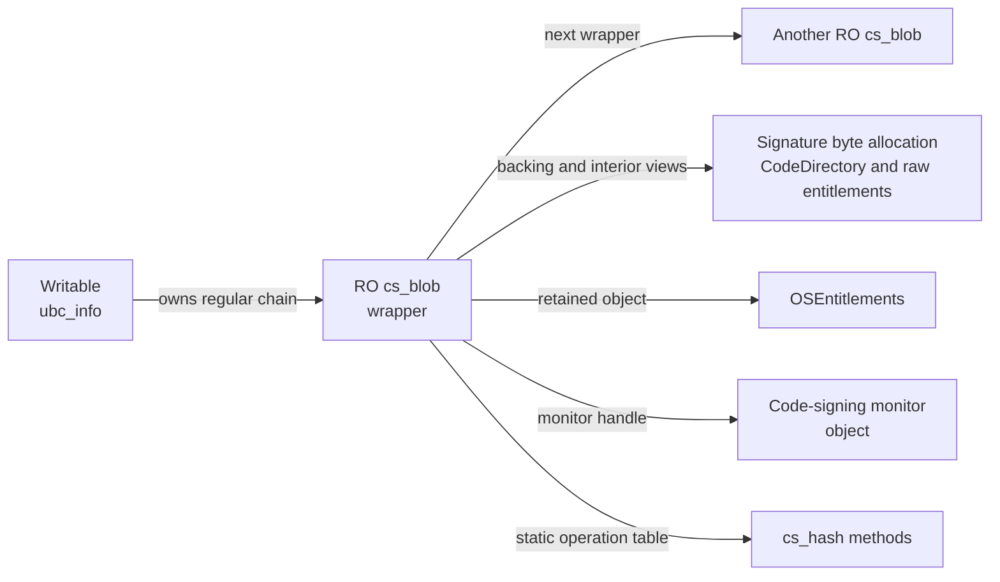
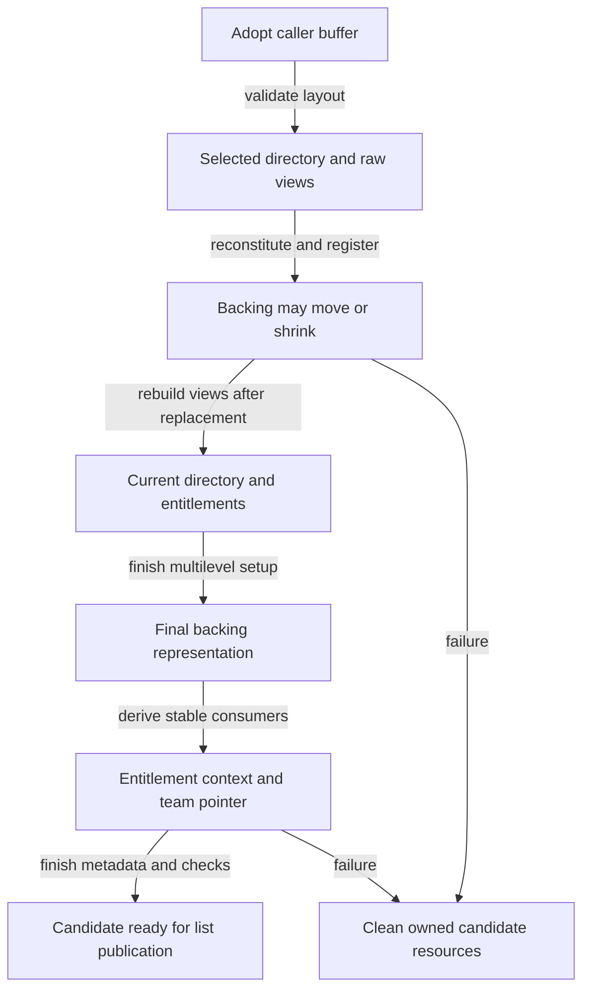
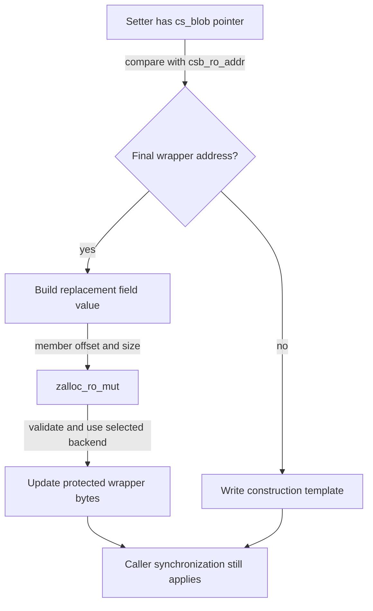
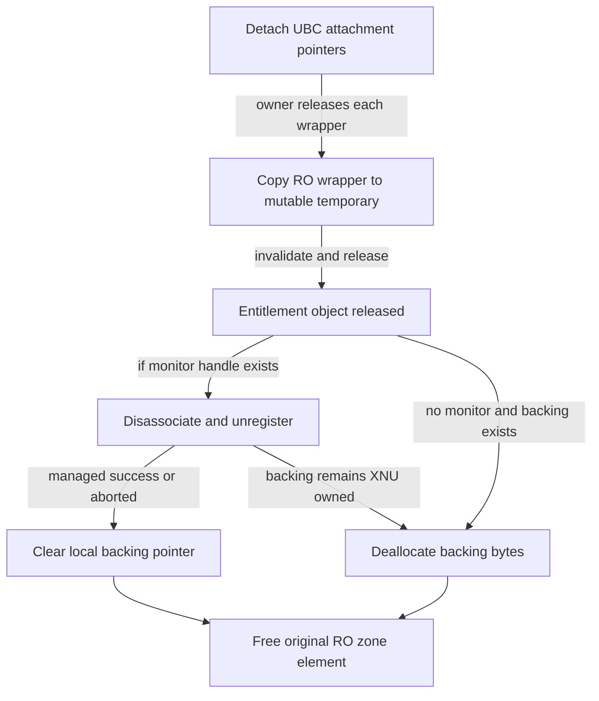

# Code-signature blobs and protected attachment storage

[Structure guide](README.md) · [UBC and vnode pagers](ubc-and-vnode-pagers.md) · [RO object updates](read-only-object-updates.md) · [Signature attachment lifecycle](../subsystems/security/vnode-signature-lifecycle.md)

A `cs_blob` connects a file's signed coverage to parsed signature bytes and accepted signing metadata. To follow an access, first identify which allocation the pointer names: the protected wrapper, its serialized backing, a view inside that backing, or a separately owned entitlement or monitor object. Their allocation, mutation and release rules differ.

This companion follows those storage contracts in `xnu-12377.121.6`. The [format chapter](../subsystems/security/signature-format-and-blob-validation.md) explains container validation and hash selection; the [attachment chapter](../subsystems/security/vnode-signature-lifecycle.md) explains loader/fcntl registration, compatibility and revalidation; [page validation](../subsystems/security/page-signature-validation.md) follows the later use of hashes. Read this chapter alongside those operations when resolving fields and ownership in the source.

Inspect the live [`cs_blob` layout](layout-browser.md?declaration=cs_blob) for the selected source profile.

## 1. The wrapper is in an RO zone; its pointees have separate contracts

The wrapper comes from `ZONE_ID_CS_BLOB`, declared with both read-only allocation and clearing on free. The adjacent `ubc_info` zone is a different, writable allocation. A protected `csb_mem_kaddr` field does not by itself protect every byte reached through that field. Backing allocation and monitor registration determine the serialized buffer's treatment. [Zone declarations](../../platydoc-data/xnu/bsd/kern/ubc_subr.c#L106-L117), [backing allocator](../../platydoc-data/xnu/bsd/kern/ubc_subr.c#L3131-L3189).

[bsd/kern/ubc_subr.c:116–117](../../platydoc-data/xnu/bsd/kern/ubc_subr.c#L116-L117):
<!-- source-excerpt: ../../platydoc-data/xnu/bsd/kern/ubc_subr.c#L116-L117 -->
```c
ZONE_DEFINE_ID(ZONE_ID_CS_BLOB, "cs_blob zone", struct cs_blob,
    ZC_READONLY | ZC_ZFREE_CLEARMEM);
```



The arrows describe storage relationships, not calls or independent references for every pointer. The supplemental attachment is a separate `ubc_info` slot, covered below. [`cs_blob` declaration](../../platydoc-data/xnu/bsd/sys/ubc_internal.h#L106-L164), [`ubc_info` signing fields](../../platydoc-data/xnu/bsd/sys/ubc_internal.h#L171-L207).

| Fields or object | Representation and access | Ownership consequence |
| --- | --- | --- |
| `csb_next`, `csb_vnode`, `csb_ro_addr` | Regular-list link, vnode association, protected wrapper address recorded during attachment | A backpointer does not acquire a vnode reference. The enclosing vnode/UBC lifecycle protects readers. |
| `csb_cpu_info`, `csb_signer_info`, `csb_platform_flags` | Grouped architecture, signing and platform fields | Group updates use the same RO mutation mechanism as scalar fields. A group is not a separate allocation. |
| `csb_mem_kaddr`, `csb_mem_size`, `csb_mem_offset` | Serialized storage address, size and offset; initialization sets the offset to zero | Cleanup releases backing according to its ownership branch. Page verification computes bounds using these fields. |
| `csb_cd`, `csb_teamid`, XML/DER pointers | Views inside retained serialized storage | Never free these individually. Replacing the buffer requires rebuilding views. |
| `csb_cdhash`, conditional `csb_linkage` | Inline 20-byte arrays in the wrapper | Their addresses point into RO wrapper storage, unlike an identity/team string. |
| `csb_hashtype`, linkage hash type | Pointers to static `cs_hash` tables | No per-attachment allocation or release of the table. Its digest size and stored slot size may differ. |
| `csb_entitlements` | Pointer to an independently retained `OSEntitlements` object | Copy/get/set helpers have different ownership effects; raw serialized entitlements are separate. |
| `csb_csm_obj`, managed flag, trust level | Conditional monitor handle and recorded result | The handle's existence and ownership of replacement backing are separate facts. |
| `csb_supplement_teamid` | Conditional allocated copy of the original attachment's team string | Supplemental teardown frees it before common wrapper cleanup. |

The declaration has no general `cs_blob` reference counter or mutex. The global blob counts/sizes updated on attachment are advisory statistics, not lifetime references. [`cs_hash` tables and selection](../../platydoc-data/xnu/bsd/kern/ubc_subr.c#L164-L214), [initialization](../../platydoc-data/xnu/bsd/kern/ubc_subr.c#L4031-L4149), [verification bounds](../../platydoc-data/xnu/bsd/kern/ubc_subr.c#L5864-L5911), [statistics](../../platydoc-data/xnu/bsd/kern/ubc_subr.c#L4206-L4228).

## 2. Allocate bytes, adopt them, then prepare the protected wrapper

`ubc_cs_blob_allocate()` receives an in/out size and an output address. The normal data-allocation route uses zeroed `kalloc_data_tag` storage. Under `CODE_SIGNING_MONITOR`, an active monitor and a size above `csm_signature_size_limit()` select pagewise allocation: round the size and call `kmem_alloc` with `KMA_KOBJECT | KMA_DATA | KMA_ZERO`. The matching free helper applies the same selection rule. Neither the monitor threshold nor page size should be hardcoded from a different configuration. [Selection predicate](../../platydoc-data/xnu/bsd/kern/ubc_subr.c#L930-L953), [allocation and output updates](../../platydoc-data/xnu/bsd/kern/ubc_subr.c#L3131-L3189).

The loader and fcntl routes fill that storage before calling `ubc_cs_blob_add()`. Their read sizes, short-read behavior and output-copy failures differ; use the [registration comparison](../subsystems/security/vnode-signature-lifecycle.md#3-fcntl-registration-has-different-input-and-reuse-rules) when tracking the original buffer. In particular, the allocation's rounded size, a container's declared length, and the signed file interval are different quantities.

`cs_blob_init_validated()` first zeroes a mutable wrapper, adopts `*addr`, and clears the caller's address before parsing. Thus an error after adoption is cleaned through the wrapper. It stores the selected directory and raw entitlement views, chooses the static hash implementation, derives coverage, and computes the cached CDHash. Initial `CS_VALID` is derived during structural initialization; full policy and monitor checks in attachment have not yet completed. [Adoption and parsing](../../platydoc-data/xnu/bsd/kern/ubc_subr.c#L4031-L4097), [derived metadata and failure cleanup](../../platydoc-data/xnu/bsd/kern/ubc_subr.c#L4099-L4149).

For regular vnode attachment, `ubc_cs_blob_add()` works on `tmp_blob` on the stack, allocates the RO wrapper, records its address and vnode, then copies an early snapshot into it:

[bsd/kern/ubc_subr.c:4819–4827](../../platydoc-data/xnu/bsd/kern/ubc_subr.c#L4819-L4827):
<!-- source-excerpt: ../../platydoc-data/xnu/bsd/kern/ubc_subr.c#L4819-L4827 -->
```c
	blob_ro = zalloc_ro(ZONE_ID_CS_BLOB, Z_WAITOK | Z_NOFAIL);
	assert(blob_ro != NULL);

	tmp_blob.csb_ro_addr = blob_ro;
	tmp_blob.csb_vnode = vp;

	/* AMFI needs to see the current blob state at the RO address */
	zalloc_ro_update_elem(ZONE_ID_CS_BLOB, blob_ro, &tmp_blob);

```

That copy gives AMFI a stable protected address during preparation. It does not yet place the wrapper in `uip->cs_blobs`. Further checks and storage transformations can fail; the candidate still belongs to the construction path. [Preparation and policy calls](../../platydoc-data/xnu/bsd/kern/ubc_subr.c#L4819-L4953), [candidate unwind](../../platydoc-data/xnu/bsd/kern/ubc_subr.c#L5164-L5178).

There is also a smaller `cs_blob_create_validated()` API. Its visible body invokes the initializer and, when `ret_blob` is provided, allocates and copies an RO wrapper. It does not execute the vnode-attachment policy sequence, fill `csb_vnode`/`csb_ro_addr`, or publish a vnode list entry. Its paired `cs_blob_free()` releases the standalone wrapper. No caller of this constructor was found in the local C/header sources; the declaration alone does not establish how an external consumer uses its optional outputs. Do not transfer the regular-attachment self-address invariant to every object made by this API. [Constructor](../../platydoc-data/xnu/bsd/kern/ubc_subr.c#L4161-L4186), [free](../../platydoc-data/xnu/bsd/kern/ubc_subr.c#L4024-L4028), [declaration](../../platydoc-data/xnu/bsd/sys/codesign.h#L204-L207).

## 3. Storage transformations invalidate interior addresses

A regular attachment can undergo first-stage reconstitution, monitor registration, second-stage reconstitution and multilevel-hash setup before its interior pointers become stable. These steps can retain different serialized components or replace the buffer; they are not merely flag changes. The [format chapter's reconstitution sections](../subsystems/security/signature-format-and-blob-validation.md#8-reconstitution-preserves-needed-evidence-while-changing-storage) detail the selection and hash geometry. [Attachment ordering](../../platydoc-data/xnu/bsd/kern/ubc_subr.c#L4780-L4796), [final transformations](../../platydoc-data/xnu/bsd/kern/ubc_subr.c#L4914-L4953).

On successful monitor registration, `register_code_signature_monitor()` compares the returned signature address with the current one. If they differ, it frees the old XNU buffer, reconstructs pointers using the returned address and the previous directory offset, and sets `csb_csm_managed`. A successful registration that keeps the address does not take this replacement branch. `KERN_NOT_SUPPORTED` is accepted; other registration failures become `EPERM`. [Monitor registration and replacement](../../platydoc-data/xnu/bsd/kern/ubc_subr.c#L4335-L4374).

`ubc_cs_blob_reconstruct()` installs the new base/size and reconstructs the selected directory address:

[bsd/kern/ubc_subr.c:3282–3288](../../platydoc-data/xnu/bsd/kern/ubc_subr.c#L3282-L3288):
<!-- source-excerpt: ../../platydoc-data/xnu/bsd/kern/ubc_subr.c#L3282-L3288 -->
```c
	/* Setup the signature blob address */
	cs_blob->csb_mem_kaddr = (void*)signature_addr;
	cs_blob->csb_mem_size = signature_size;

	/* Setup the code directory in the blob */
	code_directory = (const CS_CodeDirectory*)(signature_addr + code_directory_offset);
	cs_blob->csb_cd = code_directory;
```

It then searches the new serialized container for the XML and DER entitlement blobs. Those pointers are views, so no retain or independent allocation accompanies their reconstruction. The team pointer is parsed later, after all transformations, for a non-platform attachment. Entitlement-query acceleration also waits until the signature pointers stop moving. Its AMFI/monitor contexts are external representations; their internal layouts are not supplied by this source. [Raw-view reconstruction](../../platydoc-data/xnu/bsd/kern/ubc_subr.c#L3290-L3304), [team parsing](../../platydoc-data/xnu/bsd/kern/ubc_subr.c#L3108-L3127), [acceleration interface](../../platydoc-data/xnu/bsd/kern/ubc_subr.c#L4432-L4497), [ordering rationale](../../platydoc-data/xnu/bsd/kern/ubc_subr.c#L4933-L4953).



This diagram groups the successful transformations. Each helper has its own failure path; it does not imply that monitor replacement or multilevel hashing happens on every attachment.

## 4. PAC must match the eventual field address

Under `HAS_APPLE_PAC`, the entitlement and conditional monitor pointers need signatures diversified for their **final RO field addresses**. After the relevant providers return, attachment computes signed pointer values using `&blob_ro->csb_entitlements` or `&blob_ro->csb_csm_obj`. The temporary stack wrapper has different field addresses. [Monitor pointer preparation](../../platydoc-data/xnu/bsd/kern/ubc_subr.c#L4839-L4847), [entitlement pointer preparation](../../platydoc-data/xnu/bsd/kern/ubc_subr.c#L4878-L4884).

Immediately before the final RO copy, the code transfers those already diversified pointer bits with `memcpy`. The source explains why an ordinary typed assignment would instead cause signing for the stack location:

[bsd/kern/ubc_subr.c:5104–5116](../../platydoc-data/xnu/bsd/kern/ubc_subr.c#L5104-L5116):
<!-- source-excerpt: ../../platydoc-data/xnu/bsd/kern/ubc_subr.c#L5104-L5116 -->
```c
#if HAS_APPLE_PAC
	/*
	 * Update all the critical pointers in the blob with the RO diversified
	 * values before updating the read-only blob with the full contents of
	 * the struct cs_blob. We need to use memcpy here as otherwise a simple
	 * assignment will cause the compiler to re-sign using the stack variable
	 * as the address diversifier.
	 */
	memcpy((void*)&tmp_blob.csb_entitlements, &signed_entitlements, sizeof(void*));
#if CODE_SIGNING_MONITOR
	memcpy((void*)&tmp_blob.csb_csm_obj, &signed_monitor_obj, sizeof(void*));
#endif
#endif
```

This is distinct from signing/authenticating the entire temporary blob around a blocking operation. The whole-blob check protects that temporary state across the intervening operation; the field signatures prepare pointers for later dereference at the published RO address. Neither mechanism substitutes for the vnode lock or resource-lifetime rules. [Whole-blob signing](../../platydoc-data/xnu/bsd/kern/ubc_subr.c#L4968-L4978), [authentication before publication](../../platydoc-data/xnu/bsd/kern/ubc_subr.c#L5092-L5098), [field annotations](../../platydoc-data/xnu/bsd/sys/ubc_internal.h#L140-L164).

## 5. Publication transfers the candidate to UBC ownership

After preparation, the code locks the vnode and verifies that UBC state still exists. It checks compatibility against existing blobs, detects a duplicate or overlap, and marks the file VM object signed through `memory_object_signed()`. A duplicate can update an existing wildcard CPU association and return that existing pointer while destroying the newly prepared candidate. Internal `EAGAIN` on this duplicate path is normalized to successful reuse; it is not publication of two equivalent nodes. [Locked comparison](../../platydoc-data/xnu/bsd/kern/ubc_subr.c#L4980-L5072), [VM signed state](../../platydoc-data/xnu/bsd/kern/ubc_subr.c#L5075-L5089), [return/unwind](../../platydoc-data/xnu/bsd/kern/ubc_subr.c#L5152-L5178).

For a new regular attachment, the temporary `csb_next` becomes the old head. After final pointer preparation, `zalloc_ro_update_elem()` copies the complete wrapper, a sequentially consistent fence precedes publication, and `uip->cs_blobs` receives `blob_ro`. The old head remains reachable. This append-at-head rule supports permitted concurrent traversal; it is not a guarantee that whole-list teardown never occurs. [Final publication](../../platydoc-data/xnu/bsd/kern/ubc_subr.c#L5101-L5133), [whole-list detachment](../../platydoc-data/xnu/bsd/kern/ubc_subr.c#L5539-L5581).

| Point reached | Owner of candidate resources | Meaning of a returned or stored pointer |
| --- | --- | --- |
| Before initializer adoption | Input caller | Caller still owns the byte allocation. |
| After adoption, before head publication | Construction path | Temporary state and early RO copy are preparation, not a searchable attachment. |
| Duplicate accepted | Existing UBC list owns old node; candidate is cleaned | Output may identify the preexisting wrapper. |
| New head published | UBC/vnode lifecycle | Output is borrowed; there is no new general blob reference. |
| Later syscall output copy fails | UBC still owns published attachment | User-visible failure need not undo registration. |

For the full policy checks and syscall output order, follow [attachment lifecycle](../subsystems/security/vnode-signature-lifecycle.md). The table describes regular vnode attachment, not an inferred contract for the standalone constructor.

## 6. Accessors return different kinds of results

Several similarly named helpers expose different storage. `csblob_get_addr()` returns the serialized buffer address; `csblob_get_storage_addr()` retrieves `csb_ro_addr` and validates that address as a blob-zone object. The latter does not return the signature bytes:

[bsd/kern/kern_cs.c:834–840](../../platydoc-data/xnu/bsd/kern/kern_cs.c#L834-L840):
<!-- source-excerpt: ../../platydoc-data/xnu/bsd/kern/kern_cs.c#L834-L840 -->
```c
void *
csblob_get_storage_addr(struct cs_blob *csblob)
{
	void *addr = csblob->csb_ro_addr;
	cs_blob_require((struct cs_blob *)addr, NULL);
	return addr;
}
```

`cs_blob_require()` checks zone/type size and, when a vnode argument is present, its backpointer association:

[bsd/kern/ubc_subr.c:4246–4253](../../platydoc-data/xnu/bsd/kern/ubc_subr.c#L4246-L4253):
<!-- source-excerpt: ../../platydoc-data/xnu/bsd/kern/ubc_subr.c#L4246-L4253 -->
```c
cs_blob_require(struct cs_blob *blob, vnode_t vp)
{
	zone_require_ro(ZONE_ID_CS_BLOB, sizeof(struct cs_blob), blob);

	if (vp != NULL && __improbable(blob->csb_vnode != vp)) {
		panic_cs_blob_backref_mismatch(blob, vp);
	}
}
```

These checks do not acquire a lock, retain an object, or validate signing policy. A caller must already hold the lifetime protection required by the operation. [Serialized address/size getters](../../platydoc-data/xnu/bsd/kern/kern_cs.c#L449-L476).

| Accessor | Result and ownership | Detail to check at a call site |
| --- | --- | --- |
| `csblob_get_addr`, `csblob_get_size` | Borrowed byte-buffer address and scalar size | Size is retained signature storage, not file length or signed coverage. |
| `csblob_get_storage_addr` | Protected wrapper address, validated through `cs_blob_require` | Depends on the constructor having established `csb_ro_addr`. |
| `csblob_get_code_directory` | Borrowed selected-directory view | Selection may prefer an alternate directory. |
| `csblob_get_identity` | Borrowed string found through the primary `CSSLOT_CODEDIRECTORY` | Its implementation searches that slot rather than simply using `csb_cd`. |
| `csblob_get_teamid` | Borrowed cached string | For a regular non-platform blob it points into the final directory storage. |
| `csblob_get_cdhash` | Pointer to the inline 20-byte cached value | Its storage is the RO wrapper, not an interior serialized-buffer view. |
| `csblob_os_entitlements_get` | Borrowed object pointer | No retain is added. |
| `csblob_os_entitlements_copy` | Retained object pointer, or null | Explicitly calls `osobject_retain`; caller must balance ownership. |
| Flags, signer type, category, auxiliary info, trust-level getters | Scalar values | Trust level returns `UINT32_MAX` without a monitor object; it is not an implicit accepted trust result. |

[Identity/team/CDHash getters](../../platydoc-data/xnu/bsd/kern/kern_cs.c#L615-L653), [scalar metadata](../../platydoc-data/xnu/bsd/kern/kern_cs.c#L662-L772), [selected directory and entitlement access](../../platydoc-data/xnu/bsd/kern/kern_cs.c#L781-L840).

`csblob_os_entitlements_set()` asserts that the existing pointer is null, retains the supplied object and assigns the field directly. It is a construction-style helper, not an RO mutation wrapper. The dictionary-copy helper delegates to AMFI's `OSEntitlements_asdict`; its internal conversion is not present here. The old dictionary-set helper explicitly panics as unsupported. These are concrete differences in the function bodies, not interchangeable meanings of “get/set entitlements.” [Entitlement helpers](../../platydoc-data/xnu/bsd/kern/kern_cs.c#L787-L832).

### Finding a blob does not retain it

`ubc_cs_blob_get()` searches under the vnode spin lock and unlocks before returning. Its match is an architecture branch **or** an offset-in-coverage branch. The caller may still need to verify base offset, subtype, flags or generation, as the loader does. `csproc_get_blob()` checks process/text-vnode/signing state before using the lookup with `p_textoff`; it does not add an independent blob hold. [UBC lookup](../../platydoc-data/xnu/bsd/kern/ubc_subr.c#L5499-L5536), [process lookup](../../platydoc-data/xnu/bsd/kern/kern_cs.c#L580-L594), [loader checks](../../platydoc-data/xnu/bsd/kern/mach_loader.c#L3790-L3847).

The lockless head accessor documents two lifetime layers: a vnode reference keeps the vnode available, but forced unmount may still reclaim UBC state. During page validation, the VM object's `paging_in_progress` protects the pager/UBC lifetime; other callers need protection against reclaim, such as the vnode lock. The accessor validates the head's zone/backpointer but does not manufacture those protections. [Accessor contract and body](../../platydoc-data/xnu/bsd/kern/ubc_subr.c#L5741-L5776), [vnode identity and reference kinds](vnodes-and-vnode-identity.md), [UBC teardown](ubc-and-vnode-pagers.md).

## 7. How an allowed write reaches RO storage

Regular attachment sets both the temporary wrapper's `csb_ro_addr` and the copied RO wrapper's field to `blob_ro`. The temporary address differs from that field; the final wrapper's address equals it. Selected setters use this equality to choose direct writes to temporary state or allocator-mediated writes to protected storage. It is a constructor-established routing convention, not an arbitrary-pointer zone-membership test.

For invalidation, the helper reads flags, clears `CS_VALID` in a local value, and copies the replacement field through the RO helper when the equality holds:

[bsd/kern/kern_cs.c:502–512](../../platydoc-data/xnu/bsd/kern/kern_cs.c#L502-L512):
<!-- source-excerpt: ../../platydoc-data/xnu/bsd/kern/kern_cs.c#L502-L512 -->
```c
csblob_invalidate_flags(struct cs_blob *csblob)
{
	bool ro_blob = csblob == csblob->csb_ro_addr;
	unsigned int current_flags = csblob->csb_flags;
	unsigned int updated_flags = current_flags & (~CS_VALID);
	if (ro_blob == true) {
		zalloc_ro_update_field(ZONE_ID_CS_BLOB, csblob, csb_flags, &updated_flags);
	} else {
		csblob->csb_flags = updated_flags;
	}

```

It also invalidates the retained entitlement object when present. `csvnode_invalidate_flags()` marks `UI_CSBLOBINVALID` under the vnode lock, then calls the per-blob invalidation helper while walking the list. Clearing validity, marking UBC for later discard, and releasing storage are separate actions. [Invalidation and UBC marker](../../platydoc-data/xnu/bsd/kern/kern_cs.c#L514-L546).

`zalloc_ro_update_field()` derives the member's byte offset and size and calls `zalloc_ro_mut()`. `zalloc_ro_update_elem()` uses offset zero and the structure size. The protected mutation implementation checks its destination/source contract and uses the configured RO-write backend. The [RO update companion](read-only-object-updates.md) follows those checks, locks and ARM64 backend differences; [special zones](../subsystems/vm/read-only-and-special-zones.md) covers allocator-wide behavior. [Field and element macros](../../platydoc-data/xnu/osfmk/kern/zalloc.h#L855-L876).



This field-copy path is not an atomic read-modify-write just because it targets RO storage. The flag helper computes its replacement from an ordinary read; the caller's lifetime and serialization protocol must be read separately. Do not infer an object mutex or compare-and-swap from `zalloc_ro_update_field`.

| Mutation | Actual decision and update | Serialization visible at the cited site |
| --- | --- | --- |
| Clear `CS_VALID` | Local mask then field replacement; invalidate entitlement object | Helper itself acquires no vnode lock. |
| Validation category | Accept when current category is INVALID/NONE, when new category is NONE, or when unchanged; reject other replacements with `-1` | Tests and writes are not a compare-and-swap. |
| Auxiliary info | Replace the full `uint64_t`; return zero | Despite “bits” in the description, the body does not OR bits into the old value. |
| Duplicate CPU wildcard | `cs_blob_set_cpu_type()` copies `csb_cpu_type` | Attachment holds the vnode lock while matching/updating. |
| Loader CPU association | Copy grouped CPU type/subtype | Vnode spin lock surrounds the group update. |
| Revalidation result | Copy grouped signer metadata and set UBC generation | Vnode spin lock; metadata can be updated on failure too, with generation reset. |

[Category rules](../../platydoc-data/xnu/bsd/kern/kern_cs.c#L677-L706), [auxiliary replacement](../../platydoc-data/xnu/bsd/kern/kern_cs.c#L730-L741), [CPU helper](../../platydoc-data/xnu/bsd/kern/ubc_subr.c#L4232-L4235), [duplicate update](../../platydoc-data/xnu/bsd/kern/ubc_subr.c#L5040-L5058), [loader group update](../../platydoc-data/xnu/bsd/kern/mach_loader.c#L3820-L3836), [revalidation group/generation](../../platydoc-data/xnu/bsd/kern/ubc_subr.c#L5712-L5727).

`cs_add_gen` lives in writable UBC state. Resetting the global generation makes old acceptance require revalidation; it does not free wrappers or rewrite every page's validation bits. A reconstituted attachment can require rereading the signature rather than applying the same revalidation procedure to changed serialized evidence. [Generation/revalidation rules](../subsystems/security/vnode-signature-lifecycle.md#7-generation-refresh-and-invalidation-answer-different-questions).

## 8. Worked example: file coordinates and buffer coordinates

Assume an illustrative 16 KiB VM page configuration, ordinary one-level 4 KiB signing pages, no scatter, and SHA-256 slots of 32 bytes. Let a Mach-O slice start at file offset `0x4000`; its CodeDirectory has `codeLimit = 0x8800`. Initialization rounds coverage end to `0x9000` relative to the slice, giving file coverage `[0x4000, 0xd000)`. The bytes after the actual code limit are not automatically additional authenticated program bytes; page validation has separate terminal-page handling. [Coverage initialization](../../platydoc-data/xnu/bsd/kern/ubc_subr.c#L4099-L4109), [terminal-page validation](../subsystems/security/page-signature-validation.md).

Now examine file byte `0x8120`:

| Conversion | Result | Coordinate system |
| --- | --- | --- |
| Subtract `csb_base_offset = 0x4000` | `0x4120` | Slice-relative file offset |
| Divide by signing page size `0x1000` | Slot 4, displacement `0x120` | Signing-page index and byte offset |
| VM file page containing the byte | `[0x8000, 0xc000)` | 16 KiB file-backed VM page |
| Signing pages covered by that VM page | Slots 4 through 7 | Four separate 4 KiB hash units |

The page validator aligns work to signing-page boundaries and subtracts the slice base before looking up the code slot. It does not use the user mapping's virtual address as a signature-buffer offset. [Coverage selection and slot lookup](../../platydoc-data/xnu/bsd/kern/ubc_subr.c#L5864-L5911).

Separately, suppose serialized storage begins at kernel virtual address `R`, the selected CodeDirectory begins at `R + 0x180`, and its directory-relative `hashOffset` is `0x100`. The expected slot-4 digest begins at `R + 0x180 + 0x100 + 4 * 0x20 = R + 0x300`. A directory-relative team offset of `0x80` points to `R + 0x200`. These illustrative offsets require a valid, sufficiently large container; they are not a complete binary signature. [Directory/hash representation](../subsystems/security/signature-format-and-blob-validation.md#1-three-layers-of-data-and-three-kinds-of-offset), [team pointer derivation](../../platydoc-data/xnu/bsd/kern/ubc_subr.c#L3108-L3127).

If a monitor replaces the allocation at `R` with one at `R2`, the selected-directory and raw-entitlement views must be rebuilt for `R2`; the team pointer is derived after final transformations. The inline `csb_cdhash` remains in the wrapper. Neither `R`, the file offset nor a slot number is a physical page address or an IOVA. Reconstitution may also change directory offsets, so arbitrary transformations require their own reconstruction logic rather than blindly adding a common address delta.

## 9. Detach first, then release each owned resource

Two UBC paths free attached signatures: invalid-state disposal and complete UBC destruction. `ubc_cs_free_and_vnode_unlock()` requires the invalid marker, clears it, detaches regular/supplemental pointers and deallocates the optional bitmap under the vnode lock, then unlocks before destroying the detached wrappers. `ubc_cs_free()` performs full cleanup during UBC release. In both cases the owner controls whole-list lifetime; a borrowed accessor result does not defer the free. [Invalid-state detachment](../../platydoc-data/xnu/bsd/kern/ubc_subr.c#L5539-L5581), [full UBC signing cleanup](../../platydoc-data/xnu/bsd/kern/ubc_subr.c#L5585-L5613).

The RO wrapper cannot be passed directly to a cleanup routine that clears its fields. `cs_blob_ro_free()` therefore makes a mutable copy, cleans the resources recorded by that copy, and frees the original zone element:

[bsd/kern/ubc_subr.c:4004–4018](../../platydoc-data/xnu/bsd/kern/ubc_subr.c#L4004-L4018):
<!-- source-excerpt: ../../platydoc-data/xnu/bsd/kern/ubc_subr.c#L4004-L4018 -->
```c
cs_blob_ro_free(struct cs_blob *blob)
{
	struct cs_blob tmp;

	if (blob != NULL) {
		/*
		 * cs_blob_cleanup clears fields, so we need to pass it a
		 * mutable copy.
		 */
		tmp = *blob;
		cs_blob_cleanup(&tmp);

		zfree_ro(ZONE_ID_CS_BLOB, blob);
	}
}
```

That copy does not retain each pointee or create a second independently owned signature. It is the original owner's mutable cleanup record. `cs_blob_cleanup()` invalidates/releases the entitlement object first, removes any monitor profile association, unregisters the signature, and then decides whether XNU still owns backing that it should deallocate. [Common cleanup](../../platydoc-data/xnu/bsd/kern/ubc_subr.c#L3955-L4001).

| Monitor cleanup result | Backing action in XNU |
| --- | --- |
| Successful unregister and `csb_csm_managed` | Clear local backing address/size because the monitor freed its replacement storage. |
| `KERN_ABORTED` | Clear local backing address/size because the monitor refused unregister; storage may remain externally held. Do not report this as a confirmed physical free. |
| Remaining non-null backing after monitor handling | Call `ubc_cs_blob_deallocate()` for the tracked allocation, then clear fields. |



The diagram omits empty-resource branches and advisory statistics. In particular, invalidation is not equivalent to this full destruction path, and monitor refusal is not equivalent to successful backing reclamation.

## 10. Supplemental storage and source boundaries

With `CONFIG_SUPPLEMENTAL_SIGNATURES`, UBC has one supplemental slot in addition to the regular chain. Supplemental registration finds the linked original attachment, records its linkage hash information, and may allocate a separate copy of its team ID. That allocation differs from regular `csb_teamid`, which is a view into the signature bytes. The supplemental free routine releases the copied string before common RO wrapper cleanup. [Supplemental construction and association](../../platydoc-data/xnu/bsd/kern/ubc_subr.c#L5200-L5322), [publication](../../platydoc-data/xnu/bsd/kern/ubc_subr.c#L5325-L5414), [supplemental free](../../platydoc-data/xnu/bsd/kern/ubc_subr.c#L4190-L4202).

Use the [supplemental lifecycle section](../subsystems/security/vnode-signature-lifecycle.md#9-supplemental-signatures-use-a-distinct-single-attachment-path) for that path's flags, admission and visible cleanup limitations. A supplemental pointer is not another regular list node, and lookup coverage alone does not establish policy acceptance. [Supplement lookup](../../platydoc-data/xnu/bsd/kern/ubc_subr.c#L5461-L5496).

The reviewed source establishes wrapper allocation, local policy calls, pointer reconstruction, publication and cleanup decisions. AMFI entitlement internals, certificate trust, monitor-owned storage implementation and filesystem-private persistence remain external boundaries. `CODE_SIGNING_MONITOR`, `CONFIG_MACF`, `HAS_APPLE_PAC`, `CONFIG_SUPPLEMENTAL_SIGNATURES` and bitmap support select different portions of this path. Follow their actual guards when applying this chapter to another build; an RO-zone wrapper alone does not describe those providers' behavior.

<!-- BEGIN PLATYDOC DOCUMENTATION LICENSE -->
Original Platydoc text and diagrams are licensed under [CC BY 4.0](https://creativecommons.org/licenses/by/4.0/). Quoted source code and third-party material retain their respective licenses.
<!-- END PLATYDOC DOCUMENTATION LICENSE -->
