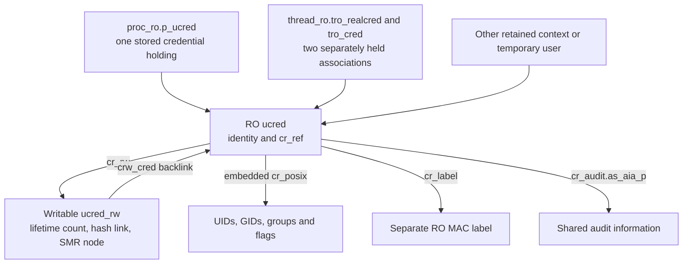
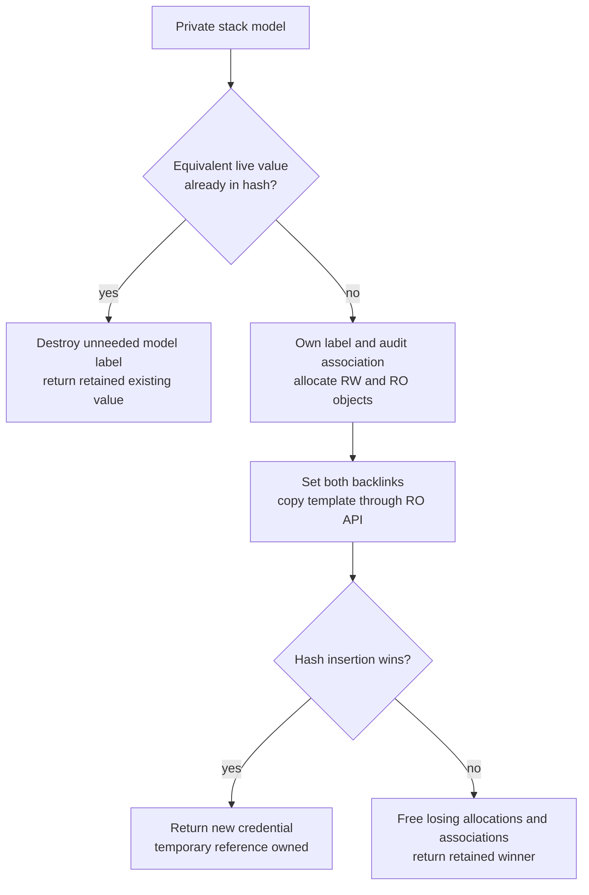
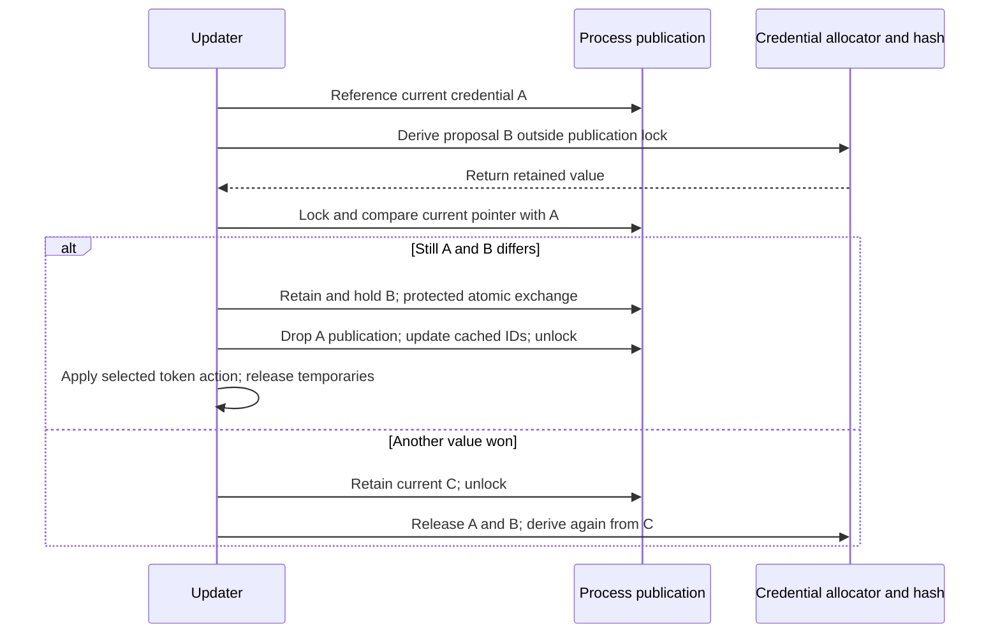

# Credentials: immutable identity and writable lifetime state

[Key structures](README.md) · [Process and proc_ro](proc-and-proc-ro.md) · [Thread and thread_ro](thread-and-thread-ro.md) · [MAC-label storage](mac-label-storage.md)

A credential answers which identity an operation uses. It is not simply the UID in `proc`, and changing identity does not overwrite the existing credential's UID. In `xnu-12377.121.6`, an immutable `ucred` value lives in a read-only zone, a separate writable `ucred_rw` manages lifetime and hash membership, and process/thread publication slots hold references to that value. This chapter follows those allocations and fields through construction, lookup, replacement and reclamation.

Read [credential publication and policy lifetimes](../subsystems/security/credential-and-policy-lifetimes.md) for the surrounding authorization algorithms, kauth listeners and MAC registration. The focus here is the concrete object graph, the meaning of each reference, and how to recognize the storage contract at a source call site. [Writing protected fields](read-only-object-updates.md) supplies the common RO mutation backend; it should not be inferred from a credential API's name.

Inspect the live [`ucred`](layout-browser.md?declaration=ucred), [`posix_cred`](layout-browser.md?declaration=posix_cred), and [`ucred_rw`](layout-browser.md?declaration=ucred_rw) layouts for the selected source profile.

## 1. Three representations with different storage

`kauth_cred_t` is a pointer to `struct ucred`. `posix_cred_t` points at the `cr_posix` member embedded inside that object; this path does not allocate a separate POSIX credential. `ucred_rw` is a separate allocation, reached through `cr_rw`, with a backlink `crw_cred`. The private kernel layout replaces an older public declaration of list links with these private pointer fields. [Types and layout](../../xnu/bsd/sys/ucred.h#L146-L193), [writable companion](../../xnu/bsd/kern/kern_credential.c#L3295-L3306).

| Storage | Important fields | What the fields mean |
| --- | --- | --- |
| RO `ucred` | `cr_rw`, `cr_unused`, `cr_ref` | Companion pointer, unused compatibility field, and protected count of long-term stored holdings. `cr_ref` is not the counter decremented by every temporary `kauth_cred_unref()`. |
| Embedded `cr_posix` | `cr_uid`, `cr_ruid`, `cr_svuid` | Effective, real and saved UID, respectively. Their distinct roles are visible in the identity-changing syscall predicates. |
| Embedded `cr_posix` | `cr_groups`, `cr_ngroups`, `cr_rgid`, `cr_svgid` | Inline group array/count plus real and saved GID. Effective GID is the `cr_gid` macro, which selects `cr_groups[0]`; it is not a fourth separately stored GID field. |
| Embedded `cr_posix` | `cr_gmuid`, `cr_flags`, configuration-dependent padding | External-membership lookup identity and flags, including `CRF_NOMEMBERD` and `CRF_MAC_ENFORCE`. Equal effective UIDs alone do not establish equal credential values. |
| RO `ucred` | `cr_label`, `cr_audit` | Separate MAC-label pointer and an embedded audit association. `cr_audit` contains an audit-info pointer and process selection mask, rather than the complete session object. |
| Writable `ucred_rw` | `crw_weak_ref`, `crw_cred`, `crw_link`, `crw_node` | Atomic lifetime count, RO backlink, uniquing-hash link and deferred SMR callback node. |

The field declarations, aliases and flags are in [ucred.h](../../xnu/bsd/sys/ucred.h#L146-L213); the audit substructure is in [audit.h](../../xnu/bsd/bsm/audit.h#L257-L261). Audit identity and session membership are detailed in [audit-session capabilities](../subsystems/security/audit-session-capabilities.md). Membership resolution is detailed in [personas and membership resolution](../subsystems/security/personas-and-membership-resolution.md).



Arrows name associations, not identical ownership rules. `cr_posix` is inline storage, while the label and audit-info pointers lead elsewhere. Several processes or threads can share one credential. The hash does not keep an otherwise unreferenced credential alive forever: the final lifetime release removes it and starts retirement. [Allocation and deduplication](../../xnu/bsd/kern/kern_credential.c#L3673-L3762), [retirement](../../xnu/bsd/kern/kern_credential.c#L3812-L3824).

### A getter is not a constructor or retain

The current `posix_cred_get()` body simply returns the embedded member's address. Its long preceding comment discusses a possible future POSIX policy module and fallback identities; those alternatives are not implemented by this body. [Current getter — `kern_credential.c`, lines 4666–4670](../../xnu/bsd/kern/kern_credential.c#L4666-L4670).

<!-- source-excerpt: ../../xnu/bsd/kern/kern_credential.c#L4666-L4670 -->
```c
posix_cred_t
posix_cred_get(kauth_cred_t cred)
{
	return &cred->cr_posix;
}
```

`kauth_cred_getuid()` and the other scalar getters load through this pointer. They do not validate the RO zone, take a lock, or retain the object. The same getter can therefore inspect a live published credential or the writable stack model used during construction; the caller must know which it has. A non-const return type is not permission to edit a published RO value. [Scalar getters](../../xnu/bsd/kern/kern_credential.c#L1921-L1956), [model contract](../../xnu/bsd/sys/kauth.h#L493-L514).

## 2. Allocation creates a protected value and a writable companion

The credential zone uses `ZC_READONLY | ZC_ZFREE_CLEARMEM`. The companion uses a typed allocation definition for `struct ucred_rw`, without `ZC_READONLY`. The SMR hash traits place lookup and retirement in `smr_proc_task`. [Registration — `kern_credential.c`, lines 3302–3314](../../xnu/bsd/kern/kern_credential.c#L3302-L3314).

<!-- source-excerpt: ../../xnu/bsd/kern/kern_credential.c#L3302-L3314 -->
```c
#define KAUTH_CRED_REF_MAX 0x0ffffffful

ZONE_DEFINE_ID(ZONE_ID_KAUTH_CRED, "cred", struct ucred, ZC_READONLY | ZC_ZFREE_CLEARMEM);
static KALLOC_TYPE_DEFINE(ucred_rw_zone, struct ucred_rw, KT_DEFAULT);
os_refgrp_decl(static, ucred_ref_grp, "ucred_rw", NULL);

SMRH_TRAITS_DEFINE(kauth_cred_traits, struct ucred_rw, crw_link,
    .domain      = &smr_proc_task,
    .key_hash    = kauth_cred_key_hash,
    .key_equ     = kauth_cred_key_equ,
    .obj_hash    = kauth_cred_obj_hash,
    .obj_equ     = kauth_cred_obj_equ,
    .obj_try_get = kauth_cred_obj_try_get);
```

`kauth_cred_derive(parent, fn)` first constructs a local `struct ucred model`, copying only `cr_posix`, `cr_label` and `cr_audit`. The callback receives the parent and this private model. A false result retains and returns the parent. A true result calls `kauth_cred_alloc()`, which may still find an identical existing value. Neither a callback returning true nor a returned pointer necessarily proves that a new allocation survived. [Derive body](../../xnu/bsd/kern/kern_credential.c#L3907-L3921).

The allocator has three stages:

1. Search the SMR uniquing hash using the model's value. A match already has a temporary reference from the hash's `obj_try_get` hook. If the model owns a distinct label, discard that unneeded label and return the match.
2. If no match exists, ensure ownership of a new credential label: when the model still points at its parent's label, initialize and associate a fresh one. Seal that label in configurations with the diagnostic seal, reference its audit session, allocate the writable companion and initialize its lifetime count. Set `model.cr_rw`, clear `cr_unused`, set `cr_ref = 0`, allocate the RO value, set the writable backlink, and copy the model into the RO element.
3. Attempt `smr_shash_get_or_insert()`. Another thread may have inserted an equivalent credential while allocation ran. The loser frees its new label, audit association, writable companion and RO element, then returns the retained winner. The successful new element starts with one temporary lifetime reference and no long-term stored holdings.

[Initial lookup and label ownership](../../xnu/bsd/kern/kern_credential.c#L3673-L3713), [allocation and publication](../../xnu/bsd/kern/kern_credential.c#L3714-L3746), [race cleanup](../../xnu/bsd/kern/kern_credential.c#L3743-L3762), [try-retain hook](../../xnu/bsd/kern/kern_credential.c#L4582-L4593).

On `HAS_APPLE_PAC`, the label pointer is signed for its eventual `newcred->cr_label` address and discriminator before the full-element copy. A bitwise copy from a stack object to a differently located authenticated pointer field is not treated as sufficient. The final `zalloc_ro_update_elem()` still performs the protected write; pointer authentication and RO storage are separate mechanisms. [Pointer signing and copy](../../xnu/bsd/kern/kern_credential.c#L3725-L3737).



The new credential allocations use `Z_WAITOK | Z_ZERO | Z_NOFAIL`; the normal derivation interface promises not to return NULL. Fresh POSIX-template creation has other validation, including rejecting a group count below one and reconciling external-resolution identity. Do not assign all credential constructors the same failure contract. [Allocation flags](../../xnu/bsd/kern/kern_credential.c#L3714-L3723), [derive contract](../../xnu/bsd/sys/kauth.h#L507-L514), [fresh template path](../../xnu/bsd/kern/kern_credential.c#L3826-L3878).

### What makes two credentials equal

Hashing includes the bytes of `cr_posix` and `cr_audit`. Equality compares those same complete structures. With `CONFIG_MACF` and `CRF_MAC_ENFORCE`, hashing/comparison also includes the label's policy-slot array; the MAC helper compares slot bytes, not recursively the contents of arbitrary policy objects. `cr_ref`, `cr_rw`, the companion's lifetime count, and the label owner field are not credential identity keys. [Hash/equality](../../xnu/bsd/kern/kern_credential.c#L4507-L4570), [label equality and hash](../../xnu/security/mac_process.c#L146-L156).

Consequently, equal UID/GID pairs can still have different groups, saved IDs, resolver state, audit associations, masks or enforced MAC-label values. Even a reordered supplementary array can count as a changed value. The group-update code explicitly compares the ordered array before copying a model. [Group-model replacement](../../xnu/bsd/kern/kern_credential.c#L4131-L4161).

## 3. Access validates storage only where the API says so

| Access route | Result and protection | What it does not provide |
| --- | --- | --- |
| `kauth_cred_get()` | Current thread's `tro_cred`, borrowed from its existing association. | No added temporary reference; not necessarily the process's published credential. [Body](../../xnu/bsd/kern/kern_credential.c#L3443-L3447). |
| `current_cached_proc_cred(p)` | `tro_realcred`, with a process-match check when `p` is supplied. | No forced resampling of `proc_ro.p_ucred`; it is the thread's cached process identity. [Body](../../xnu/bsd/kern/kern_credential.c#L3467-L3476). |
| `kauth_cred_get_with_ref()` / `current_cached_proc_cred_ref()` | The corresponding thread-associated value plus a temporary reference. | No guarantee that process identity cannot subsequently change. [Bodies](../../xnu/bsd/kern/kern_credential.c#L3488-L3495), [retained current identity](../../xnu/bsd/kern/kern_credential.c#L3535-L3541). |
| `kauth_cred_require()` | Checks the credential RO-zone provenance when RO validation is enabled. | No retain, backlink check, or synchronization of a publication slot. [Body](../../xnu/bsd/kern/kern_credential.c#L3760-L3765). |
| Internal `kauth_cred_rw()` / `kauth_cred_ro()` | Validate RO provenance and the opposing companion backlink before using the pair. | No new ownership merely from conversion. [RO-to-RW](../../xnu/bsd/kern/kern_credential.c#L3544-L3562), [RW-to-RO](../../xnu/bsd/kern/kern_credential.c#L3772-L3790). |
| `proc_ucred_smr(p)` / `proc_ucred_locked(p)` | Read the process publication with an assertion of SMR participation or `p_ucred_mlock` ownership. | No independent credential or process reference. [Bodies](../../xnu/bsd/kern/kern_proc.c#L2057-L2077). |
| `kauth_cred_proc_ref(p)` | Safely acquire a temporary reference to a published value; retry under the process credential mutex if the optimistic try-retain loses. | Does not itself acquire a lifetime reference on `p`. [Body](../../xnu/bsd/kern/kern_credential.c#L3566-L3583). |

`proc_ucred_unsafe()` uses a serialized SMR pointer load and requires the credential zone. Its name does not mean the pointed-to storage is writable; it lacks the surrounding reader-state assertion of the other two process accessors. [Accessor bodies](../../xnu/bsd/kern/kern_proc.c#L2057-L2077). As with proc/task, RO-zone validation is not a generation check or a substitute for owning the object; see [the common validation explanation](read-only-object-updates.md#3-reads-validate-the-relationship-and-then-load-normally).

The process-reference helper enters `smr_proc_task`, loads the credential and tries to retain its writable companion. A zero-count credential cannot be resurrected by that try-retain. SMR keeps its storage readable during this attempt. On failure, the helper leaves SMR, locks `p_ucred_mlock`, samples the current publication again and retains that value. It does not retry the stale pointer. [Optimistic acquisition and fallback](../../xnu/bsd/kern/kern_credential.c#L3566-L3583).

PID-based helpers combine a process lookup and optional identity-version comparison with credential acquisition. The fast path uses `proc_find_noref_smr()` inside SMR; a failed credential try-retain falls back to `proc_find()` plus credential acquisition and process release. A missing process or mismatched requested version yields `NOCRED`. These APIs return a credential snapshot; a PID is not itself a permanent reference to the process or its identity. [PID/version helpers](../../xnu/bsd/kern/kern_credential.c#L3587-L3654).

## 4. Lifetime references and long-term holdings are separate counts

The word `weak` in `crw_weak_ref` can mislead readers. It is the count incremented by ordinary `kauth_cred_ref()` and decremented by `kauth_cred_unref()`; reaching zero initiates credential retirement. A successfully retained credential is safe to use until that reference is released. `cr_ref`, by contrast, counts long-term associations installed using the holding protocol. [Companion operations](../../xnu/bsd/kern/kern_credential.c#L3318-L3340), [public retain/release](../../xnu/bsd/kern/kern_credential.c#L4394-L4412).

| Operation | Companion lifetime count | Protected `cr_ref` | Publication effect |
| --- | --- | --- | --- |
| Successful new allocation or hash lookup | Caller obtains one temporary reference. | No new stored holding. | No process/thread association yet. |
| `kauth_cred_ref(cred)` | Increment. | Unchanged. | None. |
| `kauth_cred_unref(&local)` | Decrement; zero invokes retirement. | Unchanged. | Sets that local pointer to `NOCRED`. |
| `kauth_cred_set(&slot, new)` when pointers differ | Retain new, release old. | Hold new, drop old. | Assign new to the supplied writable slot between acquisition and release. |
| Successful process compare-and-publish | Explicitly retain new publication and release old publication. | Explicit hold/drop. | Atomic exchange of the protected process pointer. |

`kauth_cred_hold()` and `kauth_cred_drop()` use `zalloc_ro_update_field_atomic()` with `ZRO_ATOMIC_ADD_LONG`. The old value is checked against the configured reference limit or underflow conditions; invalid counts panic. The current lifetime counter stays in writable memory so ordinary temporary references need not update the RO value. [Protected counter updates](../../xnu/bsd/kern/kern_credential.c#L3357-L3379).

`kauth_cred_set()` does not itself know how to write a protected publication field. It works on a writable pointer location. For `thread_ro` updates, callers first manipulate a local pointer or local credentials group with `kauth_cred_set()`, then copy the updated field/group through the RO API. For process publication, `kauth_cred_proc_update()` performs the hold/ref accounting explicitly and uses the atomic RO exchange. [Generic assignment](../../xnu/bsd/kern/kern_credential.c#L4436-L4454), [thread group update](../../xnu/bsd/kern/kern_credential.c#L3499-L3513), [process exchange](../../xnu/bsd/kern/kern_credential.c#L3945-L3957).

The macro wrappers for `kauth_cred_set()` and `kauth_cred_unref()` first authenticate a potentially signed input pointer into an ordinary local, call the function, then assign the result back so the compiler can sign it for its destination. They are not RO write helpers. [Pointer wrappers](../../xnu/bsd/sys/kauth.h#L554-L573).

### Worked reference ledger

Suppose newly created credential C starts with lifetime count 1 and `cr_ref` 0. A caller installs C into a writable long-term slot S using `kauth_cred_set(&S, C)`: the counts become 2 and 1. Dropping the caller's temporary reference leaves 1 and 1. A temporary reader retains C, producing 2 and 1. Clearing S through `kauth_cred_set(&S, NOCRED)` produces 1 and 0. Only the reader's later unref produces 0 and 0 and starts retirement. This is an illustrative isolated object, excluding other holders; the transitions follow [assignment](../../xnu/bsd/kern/kern_credential.c#L4436-L4454), [hold/drop](../../xnu/bsd/kern/kern_credential.c#L3357-L3379) and [release](../../xnu/bsd/kern/kern_credential.c#L4400-L4412).

There is no separate free operation at the moment `cr_ref` becomes zero. Conversely, final reclamation asserts that no long-term holdings remain. Two thread slots pointing at the same credential can represent two holdings, even though their pointer values compare equal; the no-op check in `kauth_cred_set()` applies to one destination slot at a time.

## 5. Identity replacement changes the publication, not the old value

`kauth_cred_proc_update()` retains the current process credential, derives a proposal without holding `p_ucred_mlock`, then locks and compares the publication with its retained input. Holding a credential protects that value's lifetime; it does not freeze the process pointer. Another updater may have published a different value in the meantime. [Update loop](../../xnu/bsd/kern/kern_credential.c#L3925-L3979).

On a match, the updater obtains the new publication's temporary-reference equivalent and long-term holding, atomically exchanges `proc_ro.p_ucred.__smr_ptr`, drops the old publication holdings, refreshes the process's cached scalar IDs and unlocks. Its own temporary reference to the old value is still held during `ucred_rw_unref_live()`, which is why that particular decrement cannot be final. [Successful publication — `kern_credential.c`, lines 3945–3957](../../xnu/bsd/kern/kern_credential.c#L3945-L3957).

<!-- source-excerpt: ../../xnu/bsd/kern/kern_credential.c#L3945-L3957 -->
```c
		proc_ucred_lock(p);
		if (__probable(proc_ucred_locked(p) == cur_cred)) {
			kauth_cred_ref(new_cred);
			kauth_cred_hold(new_cred);

			zalloc_ro_update_field_atomic(ZONE_ID_PROC_RO, proc_get_ro(p),
			    p_ucred.__smr_ptr, ZRO_ATOMIC_XCHG_LONG, new_cred);

			kauth_cred_drop(cur_cred);
			ucred_rw_unref_live(cur_cred->cr_rw);

			proc_update_creds_onproc(p, new_cred);
			proc_ucred_unlock(p);
```

On a mismatch, it retains the newly current credential while locked, unlocks, releases the rejected proposal and former input, and derives again. The callback can therefore execute more than once. A derivation callback is not a one-shot transaction hook for unrelated irreversible work. If derivation returns the same pointer, the helper releases both temporary references and reports no publication change. [No-change and retry branches](../../xnu/bsd/kern/kern_credential.c#L3934-L3943), [retry cleanup](../../xnu/bsd/kern/kern_credential.c#L3971-L3979).



The diagram omits the early no-change return. The process credential mutex (`p_ucred_mlock`) protects publication and cached ID updates; it is not a mutex embedded in the immutable credential or the general `proc_lock()` mutex. The RO exchange provides atomic replacement of one pointer, not atomic completion of every identity-related operation. `proc_update_creds_onproc()` copies six scalar UID/GID fields into writable `proc`; task security/audit tokens are updated afterward according to the selected mode. [Credential mutex and cached IDs](../../xnu/bsd/kern/kern_fork.c#L1281-L1302), [post-publication actions](../../xnu/bsd/kern/kern_credential.c#L3959-L3969).

| Mode | Behavior beyond publication |
| --- | --- |
| `PROC_SETTOKEN_NONE` | No task-token update. |
| `PROC_SETTOKEN_LAZY` | Update task tokens when a different credential is published. |
| `PROC_SETTOKEN_ALWAYS` | Also update tokens on the no-change path. |
| `PROC_SETTOKEN_SETUGID` | On changed publication, set `P_SUGID` and update tokens. |

[Mode declarations](../../xnu/bsd/sys/kauth.h#L516-L521), [actual branches](../../xnu/bsd/kern/kern_credential.c#L3934-L3969). `set_security_token()` builds tokens from the supplied credential and process identity and calls `task_set_security_tokens()`; this updater does not propagate that function's return as an errno. Its own boolean answers whether the credential pointer changed. [Token construction](../../xnu/bsd/kern/kern_prot.c#L1647-L1701).

## 6. Worked UID and group changes

### `setuid`: the local model is the writable object

For an illustrative privileged caller with effective UID 0, assume MAC admission succeeds, no persona is attached, and `CRF_NOMEMBERD` is set. `setuid(501)` acquires `setuid_lock`, then asks `kauth_cred_proc_update()` to derive a replacement. The callback verifies admission using the current parent value; privilege permits real, effective and saved UID to become 501. Since the original credential opted out of external membership resolution, the requested membership UID remains `KAUTH_UID_NONE`. `kauth_cred_model_setresuid()` writes those fields in the private stack model. [Syscall and decisions](../../xnu/bsd/kern/kern_prot.c#L703-L760), [model mutation](../../xnu/bsd/kern/kern_credential.c#L4003-L4045).

The allocator either finds that complete value or constructs it. Successful process publication changes the pointer and cached scalar IDs, sets `P_SUGID`, and updates task tokens. If the real UID actually changed and the process has no persona, the syscall adjusts process counts for the new and old real UID before releasing `setuid_lock`. The old credential can remain alive for other processes, existing contexts and thread caches; its UID fields never become 501 through this operation. [Accounting and return](../../xnu/bsd/kern/kern_prot.c#L762-L769), [publication actions](../../xnu/bsd/kern/kern_credential.c#L3945-L3969).

For an unprivileged caller, matching the real or saved UID permits changing only the effective UID through the same model mechanism. A MAC denial or failed privilege check sets the captured `error` and returns false from the derivation callback. False is also the callback's ordinary no-modification result, so the outer syscall returns `error`, not the updater's changed/not-changed boolean. [Admission and saved/real choices](../../xnu/bsd/kern/kern_prot.c#L724-L743), [syscall return](../../xnu/bsd/kern/kern_prot.c#L768-L769).

### `setgid`: effective GID occupies array slot zero

Take an illustrative private model with `cr_groups = [20, 80, 12]` and `cr_ngroups = 3`. If an admitted `setgid(80)` changes effective GID, the helper searches slots 1 onward, finds 80, moves old effective GID 20 into that slot, and writes 80 into slot zero: `[80, 20, 12]`. It returns “no displacement,” preserving this group's membership information and avoiding the displacement-triggered resolver opt-out. [Swap and return](../../xnu/bsd/kern/kern_credential.c#L1865-L1886), [effective-slot store](../../xnu/bsd/kern/kern_credential.c#L1914-L1918).

If the admitted target were 99, absent from the remaining slots, the result would be `[99, 80, 12]`: group 20 was displaced. `kauth_cred_model_setresgid()` then sets `CRF_NOMEMBERD` and `cr_gmuid = KAUTH_UID_NONE`. It separately changes real/saved GID when the syscall's privilege decision requests that. This is why replacing `cr_groups[0]` alone is not a complete description of a group change. [Model helper](../../xnu/bsd/kern/kern_credential.c#L4063-L4091), [setgid admission and arguments](../../xnu/bsd/kern/kern_prot.c#L959-L997).

The old group-resolution alternative under `#if radar_4600026` contains a compile-time error and is not the implemented path selected for these examples. The examples explain actual array transformations, not an invocation performed on a running kernel. [Disabled branch](../../xnu/bsd/kern/kern_credential.c#L1888-L1912).

## 7. Thread identity has two independently held associations

`thread_ro.tro_realcred` caches the process identity; `tro_cred` is the thread's current identity. Normal threads often point both fields at the same value. A thread that assumes a different identity can retain the process cache in `tro_realcred` while `tro_cred` points elsewhere. Their meanings come from the actual fields and updates, not a single universal “current credential.” [Thread fields](../../xnu/osfmk/kern/thread.h#L187-L210), [current/cached accessors](../../xnu/bsd/kern/kern_credential.c#L3443-L3476).

For the selected ARM64 entry, `handle_svc()` calls the credential refresh after handling the special platform syscall and before choosing Mach versus BSD syscall dispatch. It is not a universal operation on every interrupt/exception entry. The refresh compares the cached process pointer with the process publication. [Concrete entry caller](../../xnu/osfmk/arm64/sleh.c#L2742-L2781).

The slow path references the current process credential and snapshots `tro_creds` into a local group. If the old two pointers agree, it replaces both associations. If they differ, it replaces only `tro_realcred`, preserving the assumed identity. Both reference-accounting changes occur on local fields before the group is copied back through `ZONE_ID_THREAD_RO`. [Refresh — `kern_credential.c`, lines 3499–3513](../../xnu/bsd/kern/kern_credential.c#L3499-L3513).

<!-- source-excerpt: ../../xnu/bsd/kern/kern_credential.c#L3499-L3513 -->
```c
kauth_cred_thread_update_slow(thread_ro_t tro, proc_t proc)
{
	struct ucred *cred = kauth_cred_proc_ref(proc);
	struct thread_ro_creds my_creds = tro->tro_creds;

	if (my_creds.tro_realcred != cred) {
		if (my_creds.tro_realcred == my_creds.tro_cred) {
			kauth_cred_set(&my_creds.tro_cred, cred);
		}
		kauth_cred_set(&my_creds.tro_realcred, cred);
		zalloc_ro_update_field(ZONE_ID_THREAD_RO,
		    tro, tro_creds, &my_creds);
	}
	kauth_cred_unref(&cred);
}
```

For example, initial `(realcred=A, cred=A)` becomes `(B, B)` after the process publishes B and this thread refreshes. Initial `(A, X)` becomes `(B, X)` instead. These are pointer/ownership transitions, not field edits to A, B or X. The current-thread refresh explicitly skips the kernel task. [Refresh gate](../../xnu/bsd/kern/kern_credential.c#L3525-L3533).

`kern_settid_assume_cred()` uses the same local-pointer technique to change only `tro_cred`; `kern_settid()` performs privilege and assume/revert checks before calling it. That helper is not itself an authorization check. New-thread inheritance also distinguishes ordinary and workqueue threads, and final thread destruction releases each credential association. Follow [the thread structure companion](thread-and-thread-ro.md) for those construction/teardown paths. [Assumption helper and checks](../../xnu/bsd/kern/kern_prot.c#L1163-L1224), [inheritance](../../xnu/bsd/kern/kern_fork.c#L1343-L1370), [final credential drops](../../xnu/osfmk/kern/thread.c#L368-L381).

## 8. Retirement precedes storage reclamation

The last `kauth_cred_unref()` clears its caller's pointer, observes the companion count reaching zero and calls `kauth_cred_retire()`. Retirement removes the hash entry, releases the audit-session association and queues the companion's `crw_node` in `smr_proc_task`. The hash can no longer vend a new reference to that retired value, while pre-existing SMR readers may still be inspecting its storage. [Release](../../xnu/bsd/kern/kern_credential.c#L4400-L4412), [retirement — `kern_credential.c`, lines 3812–3823](../../xnu/bsd/kern/kern_credential.c#L3812-L3823).

<!-- source-excerpt: ../../xnu/bsd/kern/kern_credential.c#L3812-L3823 -->
```c
kauth_cred_retire(struct ucred_rw *rw, struct ucred *cred __unused)
{
	vm_size_t size = sizeof(struct ucred_rw) +
#if CONFIG_MACF
	    sizeof(struct label) +
#endif
	    sizeof(struct ucred);

	smr_shash_remove(&kauth_cred_hash, &rw->crw_link, &kauth_cred_traits);
	AUDIT_SESSION_UNREF(cred); /* uses SMR, safe to do immediately */
	smr_call(&smr_proc_task, &rw->crw_node, size, kauth_cred_free);
}
```

The callback recovers `ucred_rw` from its node and validates its RO counterpart. It rejects freeing the global kernel credential and asserts that `cr_ref` is zero. It destroys/frees the MAC label when configured, frees the writable companion, and frees the RO credential. The zeroing behavior and architecture write path of `zfree_ro()` are covered by [RO allocation and free](../subsystems/vm/read-only-and-special-zones.md#3-atomic-updates-and-read-only-free). [Final callback](../../xnu/bsd/kern/kern_credential.c#L3793-L3808).

The `ucred.h` lifecycle comment still names `smr_kauth_cred`; the implementation and hash traits use `smr_proc_task` in this checkout. Follow the code's actual domain when tracing callbacks. [Older comment](../../xnu/bsd/sys/ucred.h#L129-L141), [current traits](../../xnu/bsd/kern/kern_credential.c#L3308-L3314). The label remains until credential reclamation; the audit association has its own SMR-compatible release protocol. Neither fact means every arbitrary pointee in a credential is automatically immutable or independently retained by a getter.

## 9. Field access and synchronization checklist

| Field or association | Writer and synchronization | Reader/lifetime obligation |
| --- | --- | --- |
| Published `cr_posix`, `cr_audit`, `cr_label` | Construct privately, then publish an immutable value; changed identity means derive another value. | Hold a credential reference or use the applicable SMR/context ownership. Scalar getters add none. |
| `cr_rw` / `crw_cred` | Initialized before hash insertion; not swapped by normal identity updates. | Checked conversions validate backlinks, but do not create references. |
| `crw_weak_ref` | Atomic refcount APIs. | Try-retain must succeed before escaping an SMR lookup with a pointer. |
| `cr_ref` | Protected atomic hold/drop; no per-credential mutex is introduced. | Do not interpret the count as every reader or every temporary reference. |
| `crw_link` / `crw_node` | SMR hash operations and retirement callback protocol. | Hash visibility, reference lifetime and grace-period completion are different milestones. |
| `proc_ro.p_ucred` | `p_ucred_mlock`, hold/ref accounting, protected atomic pointer exchange. | Locked or SMR accessor, or `kauth_cred_proc_ref()` to obtain independent lifetime. |
| `thread_ro.tro_creds` | Current-thread local snapshot plus reference adjustments and RO copy. | Select actual thread identity versus cached process identity; cross-thread inspection needs its caller's protocol. |
| Writable `proc` scalar identity caches and task tokens | Updated by publication follow-up and token helpers. | Do not assume these fields and every thread cache change as one atomic transaction. |

The table summarizes [credential field construction](../../xnu/bsd/kern/kern_credential.c#L3700-L3737), [reference operations](../../xnu/bsd/kern/kern_credential.c#L3318-L3379), [process publication](../../xnu/bsd/kern/kern_credential.c#L3925-L3979), [thread refresh](../../xnu/bsd/kern/kern_credential.c#L3499-L3533), and [cached scalar updates](../../xnu/bsd/kern/kern_fork.c#L1293-L1302).

## Source scope and remaining boundaries

This study follows common BSD credential storage, `CONFIG_MACF` label integration, the selected UID/GID syscalls, current-thread credential updates and `smr_proc_task` reclamation in the supplied release. RO protection depends on the backend/build described in the [protected-update chapter](read-only-object-updates.md); `HAS_APPLE_PAC`, audit and external-resolver configurations add their own branches. No allocator address, structure size or counter example here is a measurement from a product kernel.

The source does not provide every policy module, directory-service database or platform authorization decision. Group resolution, audit-session internals, all credential-changing syscalls, every retained VFS/network context and every cross-thread inspection path are not re-traced here. Their dedicated chapters remain the next reading routes. This is a source walkthrough, not a kernel execution or vulnerability analysis.

<!-- BEGIN PLATYDOC DOCUMENTATION LICENSE -->
Original Platydoc text and diagrams are licensed under [CC BY 4.0](https://creativecommons.org/licenses/by/4.0/). Quoted source code and third-party material retain their respective licenses.
<!-- END PLATYDOC DOCUMENTATION LICENSE -->
