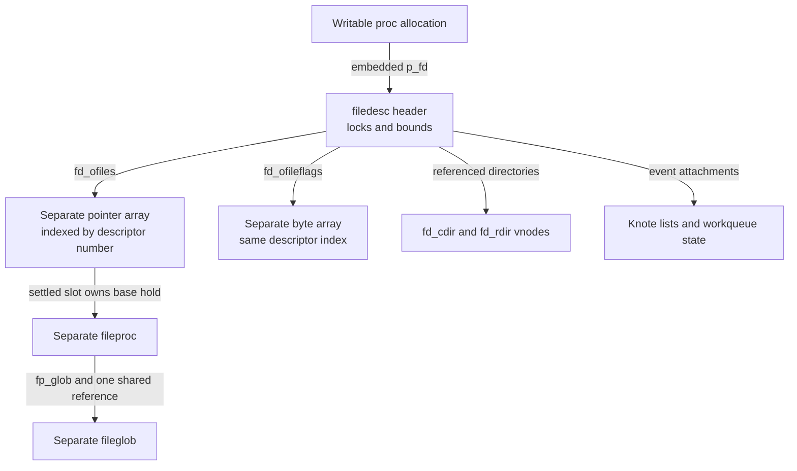
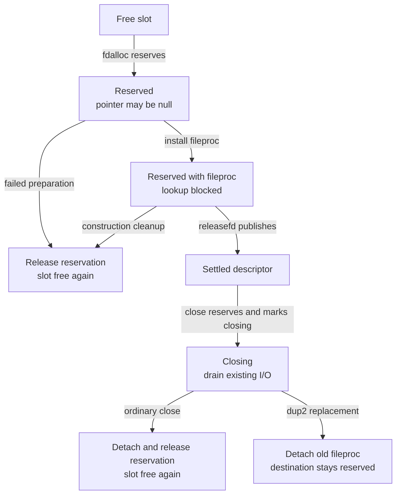
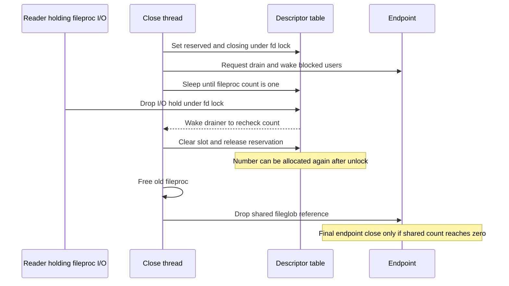
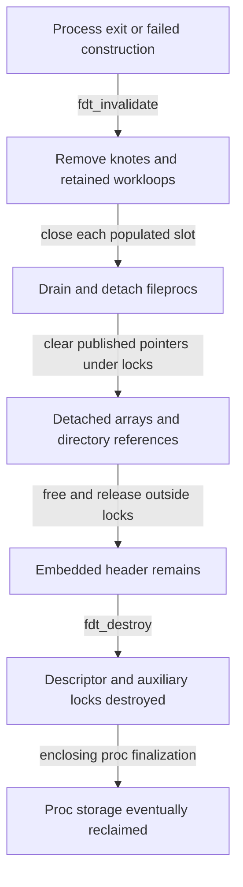

# File descriptor tables: storage, publication and reuse

A file descriptor is an index into one process's `filedesc`. The table contains pointers to separately allocated `fileproc` records, plus a parallel byte array that describes whether each slot can be used. This chapter follows that container through initialization, allocation, growth, inheritance and destruction in `xnu-12377.121.6`. Its central distinction is between keeping a slot stable, keeping a `fileproc` alive for I/O, and keeping the shared `fileglob` alive.

[Key structures](README.md) · [Processes guide](../subsystems/processes/README.md) · [Proc and proc_ro](proc-and-proc-ro.md) · [Fileprocs and fileglobs](fileprocs-and-fileglobs.md) · [Vnode identity](vnodes-and-vnode-identity.md)

The operation-oriented [descriptors and local IPC](../subsystems/processes/descriptors-ipc.md) chapter follows open, duplication, reads and transfers. This companion explains the storage behind those operations. Use [process inspection](../subsystems/processes/process-inspection-and-snapshots.md) for the separate question of what an exported descriptor listing actually promises.

Inspect the live [`filedesc`](layout-browser.md?declaration=filedesc) layout for the selected source profile.

## 1. An embedded header owns two movable arrays

`struct proc` embeds `struct filedesc p_fd`; there is no independently allocated or reference-counted `filedesc` object in this layout. The writable proc allocation provides the header's storage. `fd_ofiles` and `fd_ofileflags` point to two separate heap allocations: an array of `struct fileproc *`, and an equally indexed byte array. The `fileproc` records are separate again, so growing either array does not move them. [Proc field](../../platydoc-data/xnu/bsd/sys/proc_internal.h#L310-L315), [filedesc layout](../../platydoc-data/xnu/bsd/sys/filedesc.h#L121-L159), [array replacement](../../platydoc-data/xnu/bsd/kern/kern_descrip.c#L1291-L1301).



The header also contains directory and event state. It is therefore broader than an array of file descriptors. Closing the highest descriptor does not destroy the header, drop the current directory or necessarily shrink the arrays. `fdrelse()` clears a slot and updates bounds; array reclamation belongs to growth or whole-table invalidation. [Slot release](../../platydoc-data/xnu/bsd/kern/kern_descrip.c#L501-L526), [table invalidation](../../platydoc-data/xnu/bsd/kern/kern_descrip.c#L1053-L1142).

None of these allocations is presented here as RO-zone storage. The header is in writable `proc`, its arrays use `kalloc_type`/`kalloc_data`, and the fileproc/fileglob records have ordinary dedicated zones. A signed pointer annotation on `fd_ofiles` does not make the referenced array read-only. [Array allocation](../../platydoc-data/xnu/bsd/kern/kern_descrip.c#L978-L979), [record zones](../../platydoc-data/xnu/bsd/kern/kern_descrip.c#L150-L151).

## 2. Fields describe different kinds of state

The declaration labels the main mutex domain `(L)`, the dynamic-kqueue hash domain `(Q)`, and the knote hash domain `(N)`. The directory rwlock has an additional purpose: keeping directory associations stable across pathname lookup. These are distinct locks, not interchangeable ways to lock the whole process. [Layout and lock labels](../../platydoc-data/xnu/bsd/sys/filedesc.h#L91-L159).

| Fields | Interpretation | Access or ownership rule |
| --- | --- | --- |
| `fd_lock` | Mutex for descriptor slots, bounds and ordinary table state | `proc_fdlock()` and `proc_fdlock_spin()` acquire this same mutex; the spin acquisition does not authorize sleeping without the appropriate conversion or wait primitive. [Wrappers](../../platydoc-data/xnu/bsd/kern/kern_descrip.c#L661-L692). |
| `fd_ofiles`, `fd_ofileflags` | Parallel arrays of pointers and slot-state bytes | Inspect/update under `fd_lock`. After dropping it, an array or slot-address pointer may be stale because growth replaces and frees both allocations. [Growth](../../platydoc-data/xnu/bsd/kern/kern_descrip.c#L1268-L1301). |
| `fd_nfiles` | Allocated capacity, not the number of open files | Both arrays have this many elements. The process descriptor limit can be lower than available capacity. [Allocator bounds](../../platydoc-data/xnu/bsd/kern/kern_descrip.c#L1216-L1257). |
| `fd_afterlast` | Exclusive upper bound for potentially occupied/reserved slots | A reservation can raise it before a fileproc exists. Releasing a tail slot walks backward over empty, unreserved slots. [Reserve](../../platydoc-data/xnu/bsd/kern/kern_descrip.c#L1240-L1249), [tail contraction](../../platydoc-data/xnu/bsd/kern/kern_descrip.c#L508-L521). |
| `fd_freefile` | Approximate low free-slot search position | It is a hint maintained by allocation/release, not an independently reserved descriptor. [Search](../../platydoc-data/xnu/bsd/kern/kern_descrip.c#L1234-L1249), [release](../../platydoc-data/xnu/bsd/kern/kern_descrip.c#L501-L508). |
| `fd_fpdrainwait` | Process-wide indication that a close is waiting for I/O holds | The sleep event is this field's address. Returning a fileproc to its base count can clear it and wake drainers; each drainer rechecks its own fileproc. [Drop](../../platydoc-data/xnu/bsd/kern/kern_descrip.c#L1618-L1633), [drain](../../platydoc-data/xnu/bsd/kern/kern_descrip.c#L1687-L1712). |
| `fd_flags`, `fd_cmask` | Table policy and file-creation mask | Fork copies the mask and only `FILEDESC_FORK_INHERITED_MASK`, currently `FD_CHROOT`, from the flags. [Flags](../../platydoc-data/xnu/bsd/sys/filedesc.h#L95-L118), [inheritance](../../platydoc-data/xnu/bsd/kern/kern_descrip.c#L897-L906). |
| `fd_cdir`, `fd_rdir`, `fd_dirs_lock` | Process current/root directories and lookup stabilization | Stored directory pointers carry vnode references. Normal directory replacement takes the directory lock exclusively and the fd mutex; pathname setup takes the directory lock shared. Thread current-directory state is a separate association. [Lookup](../../platydoc-data/xnu/bsd/vfs/vfs_lookup.c#L566-L595), [replacement](../../platydoc-data/xnu/bsd/vfs/vfs_syscalls.c#L4438-L4468). |
| `fd_knlistsize`, `fd_knlist`, `fd_knhash*` | Knote attachment structures | Teardown removes knotes before closing descriptors. Hash access has its own mutex. These fields do not add a fileproc reference merely by being present. [Layout](../../platydoc-data/xnu/bsd/sys/filedesc.h#L141-L159), [teardown](../../platydoc-data/xnu/bsd/kern/kern_descrip.c#L1066-L1080). |
| `fd_wqkqueue`, `fd_kqhash*` | Process workqueue kqueue and dynamic-workloop hash | Whole-table cleanup detaches these associations and frees/deallocates them outside their protecting lock. [Cleanup](../../platydoc-data/xnu/bsd/kern/kern_descrip.c#L1100-L1141). |
| Conditional descriptor/workloop counts and limits | `CONFIG_PROC_RESOURCE_LIMITS` accounting | `fd_nfiles_open` increments on reservation and decrements on release, so it can count in-progress opens. Its soft/hard guard limits are separate from the `RLIMIT_NOFILE` bound used by `fdalloc()`. [Fields](../../platydoc-data/xnu/bsd/sys/filedesc.h#L129-L139), [limit handling](../../platydoc-data/xnu/bsd/kern/kern_descrip.c#L1181-L1196), [reservation accounting](../../platydoc-data/xnu/bsd/kern/kern_descrip.c#L1249-L1252). |

For example, capacity 50, `fd_afterlast == 12` and six live fileprocs are consistent: slots below 12 can contain holes, and a reserved slot need not contain a pointer. None of those three quantities is the global `nfiles` counter, which is incremented when a `fileglob` is constructed. [Global accounting](../../platydoc-data/xnu/bsd/kern/kern_descrip.c#L175-L202).

## 3. Header initialization is not array allocation

New process construction obtains zeroed combined proc/task storage, then initializes the embedded filedesc locks. `fdt_init()` does not allocate arrays or open any files. [Process allocation and initialization](../../platydoc-data/xnu/bsd/kern/kern_fork.c#L937-L952).

Exact lock initialization, [kern_descrip.c lines 769–777](../../platydoc-data/xnu/bsd/kern/kern_descrip.c#L769-L777):

<!-- source-excerpt: ../../platydoc-data/xnu/bsd/kern/kern_descrip.c#L769-L777 -->
```c
fdt_init(proc_t p)
{
	struct filedesc *fdp = &p->p_fd;

	lck_mtx_init(&fdp->fd_kqhashlock, &proc_kqhashlock_grp, &proc_lck_attr);
	lck_mtx_init(&fdp->fd_knhashlock, &proc_knhashlock_grp, &proc_lck_attr);
	lck_mtx_init(&fdp->fd_lock, &proc_fdmlock_grp, &proc_lck_attr);
	lck_rw_init(&fdp->fd_dirs_lock, &proc_dirslock_grp, &proc_lck_attr);
}
```

The inherited-table constructor is `fdt_fork()`. It selects capacity 25 (`NDFILE`) when the captured high-water mark fits, otherwise rounds that mark up to a multiple of 50 (`NDEXTENT`). It then allocates both arrays outside the parent mutex. The header and the constructor retain historical comments about “internal arrays,” but the actual current declaration contains pointers and the body unconditionally allocates the selected array sizes. Do not reconstruct an inline 25-slot array from that comment. [Constants/comment](../../platydoc-data/xnu/bsd/sys/filedesc.h#L73-L84), [capacity selection and allocation](../../platydoc-data/xnu/bsd/kern/kern_descrip.c#L962-L991).

Exact storage allocation, [kern_descrip.c lines 976–982](../../platydoc-data/xnu/bsd/kern/kern_descrip.c#L976-L982):

<!-- source-excerpt: ../../platydoc-data/xnu/bsd/kern/kern_descrip.c#L976-L982 -->
```c
	proc_fdunlock(p);

	ofiles = kalloc_type(struct fileproc *, n_files, Z_WAITOK | Z_ZERO);
	ofileflags = kalloc_data(n_files, Z_WAITOK | Z_ZERO);
	if (ofiles == NULL || ofileflags == NULL) {
		kfree_type(struct fileproc *, n_files, ofiles);
		kfree_data(ofileflags, n_files);
```

The pointer array uses typed variable-count allocation; the flag array uses data allocation. Both request `Z_WAITOK | Z_ZERO`, and either allocation failing leads to freeing both candidates and releasing the directory references acquired so far. These flags differ from the no-fail fileproc allocation used later. [Failure cleanup](../../platydoc-data/xnu/bsd/kern/kern_descrip.c#L980-L991), [fileproc allocator](../../platydoc-data/xnu/bsd/kern/kern_descrip.c#L1146-L1153).

## 4. Slot state determines whether a pointer is published

The flag array stores reservation and inheritance state. Close-on-exec and close-on-fork are instead bits in `fileproc.fp_flags`. Keeping those two byte/word domains separate is necessary when reading `fcntl()`, spawn actions and table iteration. [Slot flags](../../platydoc-data/xnu/bsd/sys/filedesc.h#L181-L184), [fileproc flags](../../platydoc-data/xnu/bsd/sys/file_internal.h#L103-L109).

Exact slot flag definitions, [filedesc.h lines 181–184](../../platydoc-data/xnu/bsd/sys/filedesc.h#L181-L184):

<!-- source-excerpt: ../../platydoc-data/xnu/bsd/sys/filedesc.h#L181-L184 -->
```c
#define UF_RESERVED     0x04            /* open pending / in progress */
#define UF_CLOSING      0x08            /* close in progress */
#define UF_RESVWAIT     0x10            /* close in progress */
#define UF_INHERIT      0x20            /* "inherit-on-exec" */
```

| Slot state | Pointer | Relevant flags | Consequence |
| --- | --- | --- | --- |
| Free | Null | `UF_RESERVED` clear | May be selected by `fdalloc()`; a null pointer alone is insufficient. |
| Reserved for construction/replacement | Null or a not-yet-published fileproc | `UF_RESERVED` set | Ordinary lookup returns `EBADF`; another allocator cannot take the slot. |
| Settled | Non-null, initialized fileproc | `UF_RESERVED` clear | Ordinary lookup may acquire an I/O reference. `UF_INHERIT` can additionally describe spawn inheritance. |
| Closing | Old fileproc remains installed while I/O drains | `UF_RESERVED | UF_CLOSING` | New ordinary lookups fail. A holder of an existing I/O reference can still find the record through the special drop/access path. |
| Replacement reserved after old close | Null | `UF_RESERVED` remains; `UF_CLOSING` cleared | `dup2()` retains ownership of the destination number while preparing its replacement. |

`UF_RESVWAIT` overlays a reserved state: a waiter has requested a wakeup when the reservation is cleared. It does not itself own the slot or a fileproc. [Reserve/wait/clear helpers](../../platydoc-data/xnu/bsd/kern/kern_descrip.c#L428-L484), [ordinary lookup](../../platydoc-data/xnu/bsd/kern/kern_descrip.c#L1516-L1544), [close and replacement](../../platydoc-data/xnu/bsd/kern/kern_descrip.c#L1727-L1830).



The diagram shows normal ownership transitions; it is not a claim that every early error in every caller releases a reservation. In particular, the existing [allocation discussion](../subsystems/processes/descriptors-ipc.md#allocation-and-table-growth-recheck-after-sleeping) records the visible `CONFIG_MACF` early-return branch in `falloc_withinit()` separately from the post-construction `fp_free()` path. Read each caller's actual unwind. [Creation branch](../../platydoc-data/xnu/bsd/kern/kern_descrip.c#L1381-L1395), [constructed cleanup](../../platydoc-data/xnu/bsd/kern/kern_descrip.c#L1443-L1452).

The publication helper's name can be misleading: `procfdtbl_releasefd()` releases the reservation, making a prepared descriptor usable. It does not close the file. Its optional pointer argument either installs the new fileproc or leaves an already installed pointer intact. [Helper](../../platydoc-data/xnu/bsd/kern/kern_descrip.c#L454-L464).

Exact publication, [kern_descrip.c lines 454–464](../../platydoc-data/xnu/bsd/kern/kern_descrip.c#L454-L464):

<!-- source-excerpt: ../../platydoc-data/xnu/bsd/kern/kern_descrip.c#L454-L464 -->
```c
procfdtbl_releasefd(struct proc * p, int fd, struct fileproc * fp)
{
	if (fp != NULL) {
		p->p_fd.fd_ofiles[fd] = fp;
	}
	p->p_fd.fd_ofileflags[fd] &= ~UF_RESERVED;
	if ((p->p_fd.fd_ofileflags[fd] & UF_RESVWAIT) == UF_RESVWAIT) {
		p->p_fd.fd_ofileflags[fd] &= ~UF_RESVWAIT;
		wakeup(&p->p_fd);
	}
}
```

For ordinary VFS open, `falloc_withinit()` installs a fileproc while its slot remains reserved. `open1()` sets the endpoint operations and data, completes open processing, then calls `procfdtbl_releasefd(p, indx, NULL)` under the fd mutex and drops the constructor's extra I/O reference. The returned integer becomes usable only after that final publication step. [Reserved construction](../../platydoc-data/xnu/bsd/kern/kern_descrip.c#L1405-L1427), [vnode association](../../platydoc-data/xnu/bsd/vfs/vfs_syscalls.c#L4986-L4991), [publication](../../platydoc-data/xnu/bsd/vfs/vfs_syscalls.c#L5179-L5187).

## 5. Growth preserves indices, not array addresses

`fdalloc(p, want, result)` runs with the fd mutex held. It searches from `max(want, fd_freefile)` up to the smaller of capacity and the current descriptor limit, looking for a null pointer with `UF_RESERVED` clear. Success reserves the slot before returning. Reaching the limit returns `EMFILE`; the caller cannot interpret “some null pointer exists” as proof that allocation should succeed. [Search and limit](../../platydoc-data/xnu/bsd/kern/kern_descrip.c#L1216-L1263).

When expansion is needed, capacity becomes 50 if it was smaller, otherwise doubles, capped by the limit. Both new arrays are allocated while the fd mutex is dropped. On reacquisition, the function checks allocation failure and whether another thread has already grown the table to at least the candidate capacity. A superseded candidate is freed and the search restarts. Otherwise it copies the **current** arrays, frees their old storage, replaces both pointers and updates capacity. [Growth loop](../../platydoc-data/xnu/bsd/kern/kern_descrip.c#L1264-L1301).

Exact replacement under the reacquired lock, [kern_descrip.c lines 1291–1301](../../platydoc-data/xnu/bsd/kern/kern_descrip.c#L1291-L1301):

<!-- source-excerpt: ../../platydoc-data/xnu/bsd/kern/kern_descrip.c#L1291-L1301 -->
```c
		oldnfiles = fdp->fd_nfiles;
		memcpy(newofiles, fdp->fd_ofiles,
		    oldnfiles * sizeof(*fdp->fd_ofiles));
		memcpy(newofileflags, fdp->fd_ofileflags, oldnfiles);

		kfree_type(struct fileproc *, oldnfiles, fdp->fd_ofiles);
		kfree_data(fdp->fd_ofileflags, oldnfiles);
		fdp->fd_ofiles = newofiles;
		fdp->fd_ofileflags = newofileflags;
		fdp->fd_nfiles = numfiles;
		fdexpand++;
```

Consider an inherited table of capacity 25 with every slot unavailable. Thread A computes a candidate capacity of 50 and drops the mutex to allocate. Thread B may reserve/release slots or grow the table during that interval. If B reaches capacity 50, A frees its candidate and retries. If B changes entries without reaching 50, A copies B's changes from the current arrays after reacquiring the mutex. The source does not copy an earlier unlocked snapshot. [Candidate rejection and current-array copy](../../platydoc-data/xnu/bsd/kern/kern_descrip.c#L1273-L1301).

The practical pointer rules follow directly:

| Saved value | After dropping `fd_lock` |
| --- | --- |
| Integer descriptor number | Still an integer in this process's namespace; it may no longer identify the same fileproc. |
| `&fd_ofiles[fd]` or `&fd_ofileflags[fd]` | May point into freed array storage after growth. Recompute under the mutex. |
| Borrowed `struct fileproc *` | Does not survive arbitrary close without an additional lifetime guarantee. |
| Fileproc with an acquired I/O reference | Its record survives while the reference is held. Table growth does not move it, and close waits before slot detachment/reuse. |
| `struct fileglob *` with a shared reference | Its shared open-file state survives; this alone does not preserve the original descriptor number or fileproc. |

Growth does not acquire one new fileproc reference per copied pointer: ownership remains with the same logical slot. The replacement copies arrays, not fileproc records or fileglob references. [Copy body](../../platydoc-data/xnu/bsd/kern/kern_descrip.c#L1291-L1301).

## 6. Lookup, iteration and existing I/O holders

`fp_lookup()` validates bounds, pointer presence and reservation state while holding the fd mutex. It checks the allocation's zone identity and increments `fp_iocount` before allowing the caller to proceed outside the lock. `fp_get_ftype()` adds a type check before retaining, returning its caller-supplied error for a type mismatch. [Lookup](../../platydoc-data/xnu/bsd/kern/kern_descrip.c#L1516-L1544), [typed lookup](../../platydoc-data/xnu/bsd/kern/kern_descrip.c#L1548-L1572).

Exact successful retention, [kern_descrip.c lines 1533–1542](../../platydoc-data/xnu/bsd/kern/kern_descrip.c#L1533-L1542):

<!-- source-excerpt: ../../platydoc-data/xnu/bsd/kern/kern_descrip.c#L1533-L1542 -->
```c
	zone_id_require(ZONE_ID_FILEPROC, sizeof(*fp), fp);
	os_ref_retain_locked(&fp->fp_iocount);

	if (resultfp) {
		*resultfp = fp;
	}
	if (!locked) {
		proc_fdunlock(p);
	}

```

Other helpers provide different contracts:

| Route | What it returns or proves | What the caller still owes |
| --- | --- | --- |
| `fp_get_noref_locked()` | Borrowed pointer to a settled slot; no I/O increment | Keep the fd mutex or another applicable lifetime guarantee. [Body](../../platydoc-data/xnu/bsd/kern/kern_descrip.c#L1456-L1469). |
| `fp_get_noref_locked_with_iocount()` | Pointer for a caller already holding I/O; permits closing-reserved state and checks count greater than one | It does not acquire the reference. The caller must actually own the preexisting hold. [Body](../../platydoc-data/xnu/bsd/kern/kern_descrip.c#L1472-L1488). |
| `fdt_next()` / `fdt_prev()` | Iterator pair of integer index and pointer under the lock | No retain is performed. With `only_settled == true`, bodies skip reserved slots. [Bodies](../../platydoc-data/xnu/bsd/kern/kern_descrip.c#L718-L765). |
| `fdt_foreach()` | Settled-entry iteration through `fdt_next(..., true)` | Do not keep returned pointers beyond their lock/lifetime scope. [Macro](../../platydoc-data/xnu/bsd/sys/filedesc.h#L284-L287). |
| `fdt_available_locked()` | Capacity/hole calculation under the mutex | It does not reserve the counted slots; availability can change after unlock. [Body](../../platydoc-data/xnu/bsd/kern/kern_descrip.c#L695-L714). |
| `fp_drop()` | Releases a previously acquired I/O hold and may wake drainers | `locked == 0` makes the body lock/unlock internally; nonzero means the caller already holds the fd mutex. [Body](../../platydoc-data/xnu/bsd/kern/kern_descrip.c#L1599-L1635). |

Two nearby comments require reading the implementations carefully. The iterator declarations describe `only_settled` in terms of `UF_RESERVED` being set, whereas the bodies skip entries with that bit set. The `fp_drop()` lock paragraph repeats “non-zero” for both alternatives; its body clearly acquires the mutex when `!locked`. The table above follows those bodies. [Iterator declaration](../../platydoc-data/xnu/bsd/sys/filedesc.h#L216-L266), [drop comment and body](../../platydoc-data/xnu/bsd/kern/kern_descrip.c#L1591-L1608).

These rules also explain why a process-inspection list of `(fd, type)` records is not a retained set of open objects. The list operation can release its fd lock before a later detail operation independently resolves the same number. See the [list-then-detail example](../subsystems/processes/process-inspection-and-snapshots.md#6-worked-list-then-detail-operation-with-concurrent-changes).

## 7. Fork and exec construct different inherited views

`fdt_fork()` builds new arrays and new fileprocs; it shares the selected fileglobs by taking one reference for each new fileproc. It does not share the entire filedesc or copy the parent's I/O counts, select wait state or event attachments. The caller supplies `in_exec` to distinguish ordinary child inheritance from the new process used by exec. [Caller](../../platydoc-data/xnu/bsd/kern/kern_fork.c#L1102-L1112), [record construction](../../platydoc-data/xnu/bsd/kern/kern_descrip.c#L996-L1049).

| Item | Ordinary fork | `in_exec` construction |
| --- | --- | --- |
| Null/reserved entries | Skipped | Skipped |
| `FG_CONFINED` fileglob | Skipped | Skipped |
| Close flag used to omit a source entry | `FP_CLOFORK` | `FP_CLOEXEC` |
| Flags copied into the new fileproc | `FP_CLOEXEC` | `FP_CLOEXEC | FP_CLOFORK` mask |
| Guard storage | The selected ordinary-fork path asserts that the source is unguarded | A guarded source gets separately allocated guard storage with copied attributes and ID |
| Shared file state | New fileproc retains the same fileglob | New fileproc retains the same fileglob |

The table reports the branch conditions, including the ordinary-fork guard assertion; it should not be replaced by an assumption that every guarded descriptor has identical inheritance flags. Guard creation/change has its own flag rules. [Selection and copy](../../platydoc-data/xnu/bsd/kern/kern_descrip.c#L1003-L1034), [guard copying](../../platydoc-data/xnu/bsd/kern/kern_guarded.c#L109-L122), [guard installation flags](../../platydoc-data/xnu/bsd/kern/kern_guarded.c#L612-L636).

There is a lock-drop boundary in this constructor too. It captures the parent's high-water mark and free hint before allocating, then reacquires the mutex and reads current entries below that captured upper bound. It is not a byte-for-byte atomic snapshot of every parent field across allocation. After the copy, assigning the private child's arrays and bounds publishes the completed inherited table into that child object; this does not publish a child process into all process lookup structures by itself. [Capture/allocation](../../platydoc-data/xnu/bsd/kern/kern_descrip.c#L968-L995), [final assignment](../../platydoc-data/xnu/bsd/kern/kern_descrip.c#L1037-L1049).

Directory inheritance has its own references and failure rules. A non-null parent root directory must yield a new vnode reference; failure returns `EPERM`. The child's current directory prefers `uth_cdir` over the process current directory. It temporarily gets an iocount, obtains the use reference for the stored association, then puts the iocount. If the parent's current directory cannot be referenced and that was the selected source, the body also drops and clears the parent's unusable current-directory association. Array-allocation failure later releases any child directory references already acquired. [Directory acquisition](../../platydoc-data/xnu/bsd/kern/kern_descrip.c#L909-L960), [allocation unwind](../../platydoc-data/xnu/bsd/kern/kern_descrip.c#L980-L991).

`fdt_exec()` is a later filtering/cleanup operation, called from exec activation. It unbinds applicable workqueue state, removes knotes, and walks the inherited table backward. Entries close for `FP_CLOEXEC`, for default-close spawn mode without `UF_INHERIT`, or for a MAC inheritance denial when configured. It clears `UF_INHERIT`, transfers POSIX locks for retained entries during exec, and detaches/deallocates the process workqueue kqueue. The implementation expects other threads stopped and panics if a populated slot has transition flags other than `UF_INHERIT`. [Exec caller](../../platydoc-data/xnu/bsd/kern/kern_exec.c#L2345-L2349), [filter and transitions](../../platydoc-data/xnu/bsd/kern/kern_descrip.c#L791-L881).

## 8. Close makes a number reusable before the endpoint necessarily dies

Ordinary close starts from a borrowed, locked fileproc rather than adding an I/O reference that its own drain would wait for. `fp_close_and_unlock()` marks the slot reserved and closing, runs applicable notifications/AIO cancellation, removes descriptor knotes, then drains preexisting I/O references. New ordinary lookups fail once the reservation is set. `fileproc_drain()` sets `FPV_DRAIN`, calls the endpoint drain operation, wakes select users and sleeps until only the base fileproc reference remains. [Close entry](../../platydoc-data/xnu/bsd/kern/kern_descrip.c#L5607-L5626), [closing transition](../../platydoc-data/xnu/bsd/kern/kern_descrip.c#L1727-L1803), [drain](../../platydoc-data/xnu/bsd/kern/kern_descrip.c#L1660-L1723).

Only then does ordinary close call `fdrelse()`, unlock, free the fileproc and drop its fileglob reference. For `FD_DUP2RESV`, it clears the old pointer and closing bit while retaining the destination reservation. That prevents another allocator from taking the destination during replacement. [Final table transition](../../platydoc-data/xnu/bsd/kern/kern_descrip.c#L1804-L1830).



The sequence simplifies the notification and repeated-wakeup branches; a wakeup means “recheck,” not proof that this particular fileproc is drained. The endpoint can still exist because another descriptor, a queued UNIX-domain message or a fileport holds the shared fileglob. [Drop/wakeup](../../platydoc-data/xnu/bsd/kern/kern_descrip.c#L1618-L1633), [final shared release](../../platydoc-data/xnu/bsd/kern/kern_descrip.c#L244-L295), [message retain](../../platydoc-data/xnu/bsd/kern/uipc_usrreq.c#L2262-L2282).

For a worked reuse example, assume fd 7 points to fileproc A, which shares fileglob G with fd 12's fileproc B. A reader retains A. Close of fd 7 marks that slot closing and waits; fd 7 cannot yet be reused. After the reader drops A, close detaches the slot and frees A. G remains alive through B. A later open can assign fd 7 to fileproc C and a different fileglob H. The integer 7 then identifies H even though the original shared open G still exists through fd 12. No descriptor generation number is exported by ordinary `(fd, type)` listing. [Lookup/drain/release](../../platydoc-data/xnu/bsd/kern/kern_descrip.c#L1516-L1544), [close completion](../../platydoc-data/xnu/bsd/kern/kern_descrip.c#L1804-L1830), [inspection contract](../subsystems/processes/process-inspection-and-snapshots.md#4-descriptor-listing-returns-numbers-and-types).

Duplication's source and destination have distinct lifetime needs. `finishdup()` retains the fileglob and allocates a new fileproc for the reserved destination; the source fileproc's I/O hold spans the lock drop. `dup2()` releases its source hold before waiting for a reserved destination and restarts lookup afterward. A destination already closed during replacement is not restored merely because a later duplication step fails. The full branch walk is in [duplication](../subsystems/processes/descriptors-ipc.md#duplication-preserves-the-open-file-and-replaces-descriptor-state). [Finish helper](../../platydoc-data/xnu/bsd/kern/kern_descrip.c#L555-L618), [replacement path](../../platydoc-data/xnu/bsd/kern/kern_descrip.c#L2529-L2615).

## 9. Invalidate contents, then destroy locks, then release proc storage

There are three separate finalization events. `fdt_invalidate()` removes the resources owned by the header; `fdt_destroy()` destroys its locks; the enclosing proc allocation has its own later storage lifecycle. Keeping those stages separate matters when reading exit and failed process creation. [Invalidate](../../platydoc-data/xnu/bsd/kern/kern_descrip.c#L1053-L1142), [destroy](../../platydoc-data/xnu/bsd/kern/kern_descrip.c#L780-L788), [proc storage](proc-and-proc-ro.md).



Invalidation first removes knotes and outstanding retained workloops. It then locks the table, walks populated slots backward and uses normal close/drain, reacquiring the lock after each close. It treats the process credential as stable because the process is terminating and rejects populated reserved slots. It saves the two array pointers, directory pointers and workqueue association, nulls the published fields and zeroes capacity before unlocking. [Initial cleanup and close loop](../../platydoc-data/xnu/bsd/kern/kern_descrip.c#L1066-L1113).

Exact detachment, [kern_descrip.c lines 1105–1113](../../platydoc-data/xnu/bsd/kern/kern_descrip.c#L1105-L1113):

<!-- source-excerpt: ../../platydoc-data/xnu/bsd/kern/kern_descrip.c#L1105-L1113 -->
```c
	fdp->fd_ofileflags = NULL;
	fdp->fd_ofiles = NULL;
	fdp->fd_nfiles = 0;
	fdp->fd_wqkqueue = NULL;
	fdp->fd_cdir = NULL;
	fdp->fd_rdir = NULL;

	proc_fdunlock(p);

```

The dynamic-workloop hash is detached separately under `fd_kqhashlock`. The function then frees the arrays with their captured allocation sizes, deallocates the workqueue object, releases both vnode references and destroys the now-empty workloop hash. It does not destroy the header locks. [Detached cleanup](../../platydoc-data/xnu/bsd/kern/kern_descrip.c#L1115-L1142).

The exit caller performs workqueue/AIO exit preparation before table invalidation. Later reaping destroys the embedded table locks. Failed fork construction also has an invalidate/destroy path, so the cleanup distinction is useful before a process ever becomes a normal running child. [Exit ordering](../../platydoc-data/xnu/bsd/kern/kern_exit.c#L2372-L2390), [reap destruction](../../platydoc-data/xnu/bsd/kern/kern_exit.c#L2984-L2996), [failed construction](../../platydoc-data/xnu/bsd/kern/kern_fork.c#L830-L846).

## 10. A reading route and the limits of this account

To follow a descriptor operation in the source, establish these facts in order:

1. Which `proc` supplies the namespace, and what keeps that process valid? A retained fileglob is not a process reference.
2. Is the slot free, reserved, settled or closing? Read the parallel flag byte as well as the pointer.
3. Does the lookup borrow the fileproc or acquire I/O? Identify the matching `fp_drop()` and whether the fd mutex is already held.
4. Does the path drop the fd mutex? Recompute array addresses and revalidate numerical lookups afterward; separately retained fileprocs can remain valid.
5. Is the operation copying a slot, creating a new fileproc, retaining a fileglob or transferring an existing fileglob reference? Those are different changes.
6. Does cleanup merely release a reservation, close one fileproc, drop the last shared endpoint owner, invalidate the table or destroy the embedded header locks?

The allocator, table and reference protocols above are common BSD code. Resource-limit fields, MAC inheritance checks, AIO/workqueue interactions and pointer-authentication annotations have their own configuration or architecture conditions. The chapter does not claim all descriptor types share vnode behavior, or that a descriptor-table lock stabilizes filesystem state, socket queues or a mutable endpoint's contents. Continue with [fileproc/fileglob storage](fileprocs-and-fileglobs.md), [vnode identity](vnodes-and-vnode-identity.md), [VFS dispatch](../subsystems/vfs/vnodes-mounts-and-dispatch.md) and the existing [local IPC paths](../subsystems/processes/descriptors-ipc.md#pipes-and-transferred-file-references).

<!-- BEGIN PLATYDOC DOCUMENTATION LICENSE -->
Original Platydoc text and diagrams are licensed under [CC BY 4.0](https://creativecommons.org/licenses/by/4.0/). Quoted source code and third-party material retain their respective licenses.
<!-- END PLATYDOC DOCUMENTATION LICENSE -->
