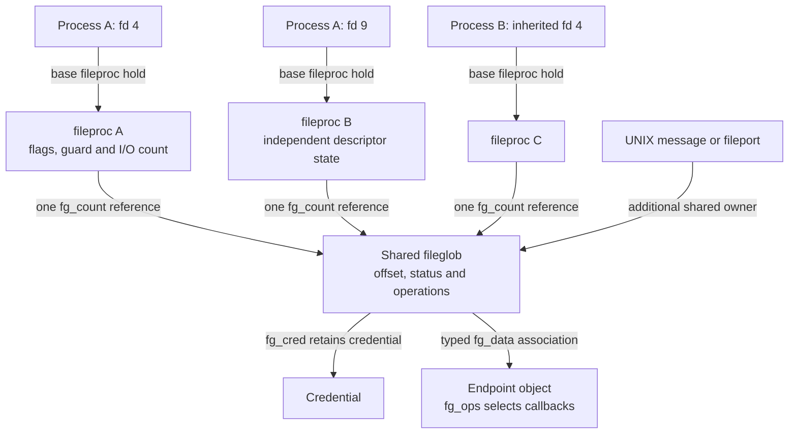
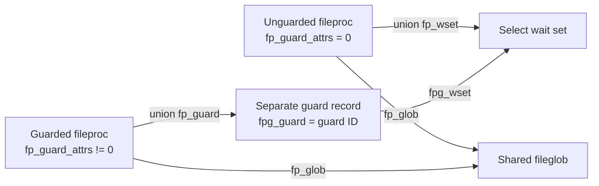
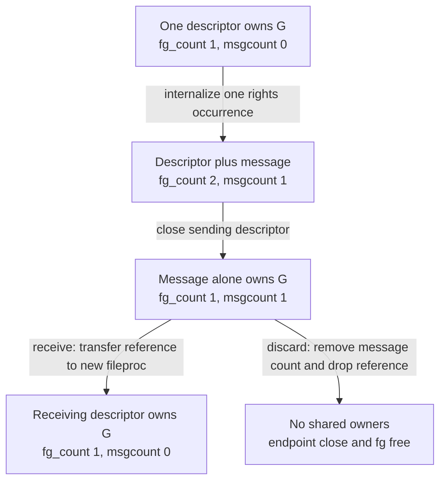
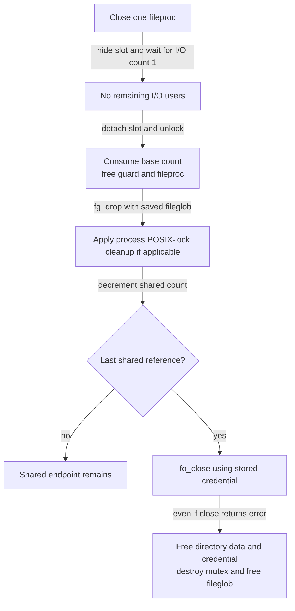

# Fileprocs and fileglobs: descriptor instances and shared open files

A settled descriptor-table slot points to a `fileproc`. That record holds per-descriptor flags, guard/select state and references for in-progress I/O. Its `fp_glob` points to a `fileglob`, the separately reference-counted open-file state that can be shared by duplicated descriptors, inherited descriptors, UNIX-domain messages and fileports. This chapter follows the allocations, field access and last releases in `xnu-12377.121.6` so that a pointer or count in a caller can be matched to the object it actually protects.

[Key structures](README.md) · [Descriptor tables](file-descriptor-tables.md) · [Processes guide](../subsystems/processes/README.md) · [Vnode identity](vnodes-and-vnode-identity.md) · [Credential storage](credentials-and-credential-storage.md) · [IPC ports](ipc-ports-and-kobjects.md)

The existing [descriptor operations](../subsystems/processes/descriptors-ipc.md) chapter traces the syscall algorithms. The emphasis here is representation and ownership: why duplication allocates another fileproc, why I/O retention does not increment the fileglob count, how a guard changes a union's interpretation, and why closing a descriptor is different from closing the endpoint.

## 1. The sharing graph has several independent lifetimes

An ordinary descriptor slot owns a fileproc's base reference. A fileproc owns one shared fileglob reference. The fileglob holds a referenced credential and an endpoint association selected by its operations table. The endpoint may be a vnode, socket, pipe, shared-memory object or another supported type; its own reference/close protocol belongs to that type. [Fileproc and fileglob declarations](../../xnu/bsd/sys/file_internal.h#L111-L194), [fileglob credential reference](../../xnu/bsd/kern/kern_descrip.c#L175-L191), [fileops](../../xnu/bsd/sys/file_internal.h#L162-L175).



The message/fileport arrow does not imply those owners are fileprocs. A queued UNIX-domain rights message stores fileglob pointers; a fileport associates a Mach kobject port with a fileglob. A recipient allocates a new fileproc when it creates a descriptor. [UNIX externalization](../../xnu/bsd/kern/uipc_usrreq.c#L2436-L2447), [fileport association](../../xnu/osfmk/kern/ipc_misc.c#L43-L107), [fileport-to-fd](../../xnu/bsd/kern/kern_descrip.c#L6163-L6200).

Conversely, two independent opens of the same vnode normally have separate fileglobs, credentials and offsets, even though both `fg_data` associations reach that vnode. A duplicate shares the existing fileglob. The distinction is established by `fg_alloc_init()` in new-file construction versus `fg_ref()` and assignment in `finishdup()`. [New construction](../../xnu/bsd/kern/kern_descrip.c#L1405-L1414), [duplicate construction](../../xnu/bsd/kern/kern_descrip.c#L590-L602).

## 2. Ordinary writable zones and the constructor's extra hold

Fileglobs use the typed `fg_zone`; fileprocs use the fixed ID `ZONE_ID_FILEPROC`. Both zone declarations request `ZC_ZFREE_CLEARMEM`. These are ordinary mutable objects, not the RO-zone companions used by proc/task/thread. The flag asks the allocator to clear storage on free; it is not a field-access locking rule. [Zone definitions](../../xnu/bsd/kern/kern_descrip.c#L150-L151), [RO comparison](read-only-object-updates.md).

Exact zone declarations, [kern_descrip.c lines 150–151](../../xnu/bsd/kern/kern_descrip.c#L150-L151):

<!-- source-excerpt: ../../xnu/bsd/kern/kern_descrip.c#L150-L151 -->
```c
ZONE_DEFINE_TYPE(fg_zone, "fileglob", struct fileglob, ZC_ZFREE_CLEARMEM);
ZONE_DEFINE_ID(ZONE_ID_FILEPROC, "fileproc", struct fileproc, ZC_ZFREE_CLEARMEM);
```

`fileproc_alloc_init()` obtains zeroed no-fail storage and initializes `fp_iocount` to its base reference. A newly allocated fileproc is private and has no fileglob until its caller assigns one. [Allocator](../../xnu/bsd/kern/kern_descrip.c#L1146-L1153).

Exact fileproc initialization, [kern_descrip.c lines 1146–1153](../../xnu/bsd/kern/kern_descrip.c#L1146-L1153):

<!-- source-excerpt: ../../xnu/bsd/kern/kern_descrip.c#L1146-L1153 -->
```c
fileproc_alloc_init(void)
{
	struct fileproc *fp;

	fp = zalloc_id(ZONE_ID_FILEPROC, Z_WAITOK | Z_ZERO | Z_NOFAIL);
	os_ref_init(&fp->fp_iocount, &f_refgrp);
	return fp;
}
```

`fg_alloc_init(ctx)` requests `Z_WAITOK | Z_ZERO`, initializes the mutex and atomic shared count, installs `uninitops`, retains `ctx->vc_ucred`, and increments the global `nfiles` count. Unlike the fileproc call, the written allocation flags do not include `Z_NOFAIL`; the body nevertheless proceeds directly to initialization without an explicit null-return branch. Record the actual flags/body rather than inventing a recoverable allocation return that callers do not handle. [Constructor](../../xnu/bsd/kern/kern_descrip.c#L175-L191).

Exact shared initialization, [kern_descrip.c lines 179–188](../../xnu/bsd/kern/kern_descrip.c#L179-L188):

<!-- source-excerpt: ../../xnu/bsd/kern/kern_descrip.c#L179-L188 -->
```c
	fg = zalloc_flags(fg_zone, Z_WAITOK | Z_ZERO);
	lck_mtx_init(&fg->fg_lock, &file_lck_grp, LCK_ATTR_NULL);

	os_ref_init_raw(&fg->fg_count, &f_refgrp);
	fg->fg_ops = &uninitops;

	kauth_cred_ref(ctx->vc_ucred);
	fg->fg_cred = ctx->vc_ucred;

	os_atomic_inc(&nfiles, relaxed);
```

The provisional `uninitops` object ensures that `FILEGLOB_DTYPE()` can dereference an operations table before endpoint setup. It is a zero-initialized static table, not a completed endpoint with working callbacks. Normal constructors install the real operations before publication. For a vnode open, `open1()` writes `fg_flag`, sets `fg_ops = &vnops`, then uses `fp_set_data()` for the vnode pointer. That ordering also supplies the type used by the pointer-authentication accessor. [Provisional table](../../xnu/bsd/kern/kern_descrip.c#L156-L160), [type macro](../../xnu/bsd/sys/file_internal.h#L208-L208), [vnode initialization](../../xnu/bsd/vfs/vfs_syscalls.c#L4986-L4991).

`falloc_withinit()` first reserves a descriptor, optionally initializes guard state, allocates both records, and increments `fp_iocount` a second time. Thus its result has a base hold plus a constructor I/O hold. It installs the pointer while the descriptor remains reserved. On successful open, publication clears the reservation and `fp_drop()` removes the extra hold. [Construction](../../xnu/bsd/kern/kern_descrip.c#L1360-L1429), [open publication/drop](../../xnu/bsd/vfs/vfs_syscalls.c#L5179-L5187).

For post-construction failure, `fp_free()` releases the slot, directly calls `fg_free()`, releases the extra I/O hold and finally frees the base fileproc. It does **not** call the endpoint's `fo_close`. Endpoint cleanup already performed by the constructor's error path is therefore part of the contract: late vnode-open failure calls `vn_close()` and `vnode_put()` before `fp_free()`. Earlier failure can free an uninitialized fileglob without dispatching through `uninitops`. [Record rollback](../../xnu/bsd/kern/kern_descrip.c#L1443-L1452), [early open errors](../../xnu/bsd/vfs/vfs_syscalls.c#L4956-L4980), [late vnode cleanup](../../xnu/bsd/vfs/vfs_syscalls.c#L5188-L5207).

## 3. Fileproc fields are descriptor-instance state

Exact layout, [file_internal.h lines 120–130](../../xnu/bsd/sys/file_internal.h#L120-L130):

<!-- source-excerpt: ../../xnu/bsd/sys/file_internal.h#L120-L130 -->
```c
struct fileproc {
	os_refcnt_t      fp_iocount;
	_Atomic fileproc_vflags_t fp_vflags;
	fileproc_flags_t fp_flags;
	uint16_t         fp_guard_attrs;
	struct fileglob *XNU_PTRAUTH_SIGNED_PTR("fileproc.fp_glob") fp_glob;
	union {
		struct select_set     *fp_wset;   /* fp_guard_attrs == 0 */
		struct fileproc_guard *XNU_PTRAUTH_SIGNED_PTR("fileproc.fp_guard") fp_guard;  /* fp_guard_attrs != 0 */
	};
};
```

| Field | Meaning | Read/write and lifetime contract |
| --- | --- | --- |
| `fp_iocount` | Base reference plus temporary I/O users | Lookup/drop use locked reference operations under the process fd mutex. Close drains to one; final fileproc free requires the last base reference. This is not the fileglob's shared count. [Lookup](../../xnu/bsd/kern/kern_descrip.c#L1516-L1544), [drop](../../xnu/bsd/kern/kern_descrip.c#L1599-L1635), [free](../../xnu/bsd/kern/kern_descrip.c#L1157-L1165). |
| `fp_vflags` | Atomic flags, currently including `FPV_DRAIN` | Helpers use relaxed atomic load/or/and-not. The drain bit records a drain request; it does not itself release I/O holds. [Definition](../../xnu/bsd/sys/file_internal.h#L96-L101), [helpers](../../xnu/bsd/kern/kern_descrip.c#L1309-L1322). |
| `fp_flags` | `FP_CLOEXEC`, `FP_CLOFORK`, select/AIO state | These belong to this fileproc. A duplicate/new inherited fileproc receives selected flags rather than sharing the same word. Operational access uses the fd-table protocol. [Flags](../../xnu/bsd/sys/file_internal.h#L103-L109), [dup initialization](../../xnu/bsd/kern/kern_descrip.c#L594-L600), [fork masks](../../xnu/bsd/kern/kern_descrip.c#L1018-L1029). |
| `fp_guard_attrs` | Guard operation mask and union discriminator | Zero selects `fp_wset`; nonzero selects `fp_guard`. Read it before choosing the union arm. Updates in `change_fdguard_np()` occur with the fd mutex held. [Declaration](../../xnu/bsd/sys/file_internal.h#L124-L129), [guard changes](../../xnu/bsd/kern/kern_guarded.c#L612-L671). |
| `fp_glob` | Shared open-file association | One ordinary published fileproc accounts for one fileglob reference. Holding fileproc I/O keeps the association usable because close cannot free that fileproc/drop its shared ownership until I/O drains. [Close ordering](../../xnu/bsd/kern/kern_descrip.c#L1804-L1830). |
| `fp_wset` | Select wait-set pointer when unguarded | It is not a fileglob pointer or guard ID. Free asserts this arm is null after any guard removal. [Layout/free](../../xnu/bsd/sys/file_internal.h#L126-L129), [final assertion](../../xnu/bsd/kern/kern_descrip.c#L1159-L1164). |
| `fp_guard` | Allocated guard record when guarded | The guard record contains both the guard ID and relocated select wait-set pointer. Freeing a guarded fileproc first restores the wait-set arm and frees the guard allocation. [Guard layout](../../xnu/bsd/sys/file_internal.h#L111-L114), [unguard](../../xnu/bsd/kern/kern_guarded.c#L130-L138). |

The fileproc does not contain a descriptor number or a back-pointer to its owning table. Functions that need to drop I/O or change slot state therefore receive `proc` and `fd` separately. `fp_drop()` can use an explicitly supplied pointer, or recover the pointer by number for existing I/O holders; the latter permits `UF_RESERVED` only when `UF_CLOSING` is also set. That exception lets an already admitted operation finish while new lookups are denied. [Layout](../../xnu/bsd/sys/file_internal.h#L120-L130), [drop lookup](../../xnu/bsd/kern/kern_descrip.c#L1599-L1616), [special existing-I/O access](../../xnu/bsd/kern/kern_descrip.c#L1472-L1488).

## 4. Fileglob fields describe the shared open state

`FILEGLOB_DTYPE(fg)` reads `fg_ops->fo_type`; there is no independent mutable `fg_type` field. Source files also define aliases such as `fp->f_flag`, `fp->f_ops` and `fp->f_offset` that expand through `fp_glob`. An assignment to `fp->f_offset` therefore changes shared state, despite the expression beginning with a fileproc pointer. [Type accessor](../../xnu/bsd/sys/file_internal.h#L208-L208), [local aliases](../../xnu/bsd/kern/kern_descrip.c#L144-L148).

| Fields | Meaning | Access, ownership and release |
| --- | --- | --- |
| `fg_count` | Atomic reference count for the shared open file | Owners include fileprocs, message references and fileport objects. `fg_ref()` requires the process fd mutex for process-associated acquisition; `fg_drop()` can perform final endpoint close and must be called without locks. [Contracts](../../xnu/bsd/sys/file_internal.h#L228-L281), [bodies](../../xnu/bsd/kern/kern_descrip.c#L224-L295). |
| `fg_msgcount`, `f_msglist` | Count/subset and list membership for UNIX rights messages | Message references are included in `fg_count`. `fg_lock` protects local transitions; `uipc_lock` protects the global list. A count or link alone does not complete both transitions. [Insert protocol](../../xnu/bsd/kern/uipc_usrreq.c#L2262-L2312), [remove marking](../../xnu/bsd/kern/uipc_usrreq.c#L2328-L2347). |
| `fg_flag` | Shared access/status and bookkeeping flags | Declared `uint32_t` with an atomic-use comment; updates can use atomic operations. `F_SETFL` also performs endpoint ioctls and authorization, so do not replace its whole protocol with a plain flag assignment. [Field](../../xnu/bsd/sys/file_internal.h#L180-L180), [fcntl update](../../xnu/bsd/kern/kern_descrip.c#L2955-L3017). |
| `fg_lflags` | Offset lock state, UNIX-list transitions, confinement and other shared flags | Different bits have different protocols. `FG_PORTMADE` records that a port was created at some point; it is not a current port reference count. `FG_HAS_OFDLOCK` similarly records has/had state. [Definitions](../../xnu/bsd/sys/file_internal.h#L151-L160). |
| `fg_cred` | Referenced credential supplied at open-file construction | `fg_alloc_init()` retains it and `fg_free()` releases it. It can outlive the opener's current credential and be used by another process that receives the open file. [Acquire/release](../../xnu/bsd/kern/kern_descrip.c#L175-L215). |
| `fg_ops` | Constant operations-table association | Chooses the endpoint type and callbacks. Most operations take a fileproc, but final `fo_close` takes a fileglob. A const table does not make the fileglob immutable. [Callbacks](../../xnu/bsd/sys/file_internal.h#L162-L175). |
| `fg_data` | Type-dependent endpoint pointer stored as `uintptr_t` | Use accessors; pointer-authentication builds sign/authenticate using field address and endpoint type. Access does not retain or lock the endpoint. [Setter/getter](../../xnu/bsd/kern/kern_descrip.c#L299-L338). |
| `fg_offset` | Shared stream/file position | Vnode implicit-offset I/O uses the separate offset-lock bit protocol. Explicit-offset I/O does not advance this position. Endpoint type and operation determine whether the field has meaning. [Vnode read](../../xnu/bsd/vfs/vfs_vnops.c#L1220-L1268). |
| `fg_vn_data` | Optional directory-enumeration storage | Allocated for vnode directories and freed by `fg_free()`. Despite “per fd” comments, this pointer lives in the shared fileglob and is therefore shared by duplicates. [Creation](../../xnu/bsd/vfs/vfs_syscalls.c#L5043-L5050), [release](../../xnu/bsd/kern/kern_descrip.c#L204-L207). |
| `fg_lock` | Mutex for selected shared state and wait protocols | It is neither a universal endpoint lock nor a mutex held throughout ordinary read/write dispatch. [Offset protocol](../../xnu/bsd/vfs/vfs_vnops.c#L1095-L1121), [message protocol](../../xnu/bsd/kern/uipc_usrreq.c#L2262-L2282). |
| Conditional `fg_vgo` | Vnode-guard owner state under `CONFIG_MACF && CONFIG_VNGUARD` | Destroyed through `vng_file_label_destroy()` during final fileglob storage cleanup. This association is separate from `fileproc_guard`. [Field](../../xnu/bsd/sys/file_internal.h#L190-L192), [cleanup](../../xnu/bsd/kern/kern_descrip.c#L216-L219). |

`fd_vn_data` contains its own mutex, offset/cookie, temporary directory-entry buffer, valid/consumed/allocation sizes and start/end filesystem offsets. Its constructor initializes `fv_lock`; its destructor frees the buffer and destroys the mutex. The shared pointer's location is more informative about duplication semantics than the historical structure comment describing “a file descriptor.” [Layout](../../xnu/bsd/sys/vnode_internal.h#L329-L357), [allocation/free](../../xnu/bsd/vfs/vfs_syscalls.c#L4863-L4884).

Confinement is shared state too. `F_SETCONFINED` checks for exactly one fileglob reference and `FP_CLOFORK` before setting the immutable `FG_CONFINED` bit; an already confined fileglob succeeds, a shared one returns `EAGAIN`, and clearing confinement is rejected. `fg_sendable()` rejects confined objects and admits only selected types. The fd-lock requirement on `fg_ref()` is explicitly tied to this admission/count relationship. [Setter](../../xnu/bsd/kern/kern_descrip.c#L3093-L3120), [sendability](../../xnu/bsd/kern/kern_descrip.c#L390-L403), [reference contract](../../xnu/bsd/sys/file_internal.h#L228-L246).

## 5. Accessing endpoint data and selecting a callback

`fg_get_data()` is a `__pure2` wrapper around `fg_get_data_volatile()`. The documented distinction concerns compiler hoisting of repeated calls, not reference ownership. The corresponding `fp_get_data()` forwards through `fp_glob`. Neither accessor obtains vnode I/O, socket locks or another endpoint-specific hold. [Accessor contracts](../../xnu/bsd/sys/file_internal.h#L292-L327), [fileproc forwarding](../../xnu/bsd/sys/file_internal.h#L344-L402).

On builds with `__has_feature(ptrauth_calls)`, the accessor authenticates the stored pointer using the address of `fg_data` blended with a discriminator derived from the fileglob type. On other builds the field is returned without that branch. This is why copying raw `fg_data` bits into another fileglob is different from storing the decoded pointer through its setter. [Setter/getter bodies](../../xnu/bsd/kern/kern_descrip.c#L299-L338).

Exact authenticated load, [kern_descrip.c lines 325–336](../../xnu/bsd/kern/kern_descrip.c#L325-L336):

<!-- source-excerpt: ../../xnu/bsd/kern/kern_descrip.c#L325-L336 -->
```c

#if __has_feature(ptrauth_calls)
	int type = FILEGLOB_DTYPE(fg);

	if (fg_data) {
		type ^= OS_PTRAUTH_DISCRIMINATOR("fileglob.fg_data");
		fg_data = ptrauth_auth_data(fg_data,
		    ptrauth_key_process_independent_data,
		    ptrauth_blend_discriminator(store, type));
	}
#endif // __has_feature(ptrauth_calls)

```

The ordinary read path demonstrates the layers. `preparefileread()` validates the descriptor and access mode while retaining the fileproc. `readv_internal()` copies the current VFS context but replaces its credential with `fg_cred`. `fo_read()` calls the selected operations table. For a vnode, `vn_read()` obtains a vnode iocount with `vnode_getwithref()` before filesystem work and puts it afterward. Finally the syscall path drops fileproc I/O. [Admission](../../xnu/bsd/kern/sys_generic.c#L225-L259), [context/dispatch/drop](../../xnu/bsd/kern/sys_generic.c#L327-L347), [dispatch wrapper](../../xnu/bsd/kern/kern_descrip.c#L6262-L6265), [vnode access](../../xnu/bsd/vfs/vfs_vnops.c#L1220-L1268).

The caller's current process, the open-file credential, the fileproc I/O hold and the vnode iocount answer different questions. An inherited descriptor keeps the shared fileglob's credential; it does not automatically replace `fg_cred` with the inheriting process's current credential. Individual operations can still perform additional checks using an explicitly supplied current credential. [Construction](../../xnu/bsd/kern/kern_descrip.c#L184-L185), [inheritance](../../xnu/bsd/kern/kern_descrip.c#L1018-L1030), [read context](../../xnu/bsd/kern/sys_generic.c#L339-L345), [MAC duplication check](../../xnu/bsd/kern/kern_descrip.c#L579-L586).

The vnode table makes callback ownership visible: read/write/ioctl/select/kqfilter receive a fileproc, while close receives the shared fileglob. Its default drain callback is `fo_no_drain`, which returns `ENOTSUP`; fileproc drain ignores that return and waits according to I/O count. The generic drain mechanism therefore cannot be read as a guarantee that every endpoint can cancel every pending operation. [Vnode operations table](../../xnu/bsd/vfs/vfs_vnops.c#L132-L142), [generic drain callback](../../xnu/bsd/kern/kern_descrip.c#L6405-L6415), [drain loop](../../xnu/bsd/kern/kern_descrip.c#L1687-L1712).

## 6. A guard adds storage without changing the shared fileglob

Guarded and unguarded fileprocs use the same `ZONE_ID_FILEPROC` allocation. A guarded record additionally owns a `struct fileproc_guard` allocated through `KALLOC_TYPE_DEFINE(fp_guard_zone, ..., KT_DEFAULT)` with `Z_WAITOK | Z_ZERO | Z_NOFAIL`. The guard record stores a `guardid_t` and the select wait-set pointer that otherwise lives directly in the fileproc union. It is not a separate kind of fileglob or a protected RO allocation. [Guard allocation](../../xnu/bsd/kern/kern_guarded.c#L82-L107), [guard structure](../../xnu/bsd/sys/file_internal.h#L111-L114).



The two fileprocs in this diagram illustrate the two representations; it does not claim that a guard operation creates a duplicate. Adding a guard to an existing fileproc preserves the existing wait-set pointer by moving it into `fpg_wset` before switching the union. Removing it saves the guard allocation, clears attributes and restores `fp_wset`; the old allocation can then be freed. Thus “unguard” does not mean “discard select state.” [Installation](../../xnu/bsd/kern/kern_guarded.c#L612-L636), [removal](../../xnu/bsd/kern/kern_guarded.c#L637-L680).

Exact final unguard helper, [kern_guarded.c lines 130–138](../../xnu/bsd/kern/kern_guarded.c#L130-L138):

<!-- source-excerpt: ../../xnu/bsd/kern/kern_guarded.c#L130-L138 -->
```c
guarded_fileproc_unguard(struct fileproc *fp)
{
	struct fileproc_guard *fpg = fp->fp_guard;

	fp->fp_guard_attrs = 0;
	fp->fp_wset = fpg->fpg_wset;

	zfree(fp_guard_zone, fpg);
}
```

`change_fdguard_np()` copies user guard values and may preallocate storage before entering the fd-table critical section. It looks up the fileproc with an I/O hold, validates the current ID/attributes, and changes the representation under the fd mutex. An optional old-flags copyout temporarily drops that mutex while retaining the fileproc; subsequent checks use the state under the reacquired lock. Guard addition is restricted to vnode, pipe, socket, kqueue and netpolicy types, sets `FP_CLOEXEC`, and adds `FP_CLOFORK` when `GUARD_CLOSE` is present. Guard removal applies the requested descriptor close flags after restoring the unguarded representation. [Change setup/checks](../../xnu/bsd/kern/kern_guarded.c#L507-L611), [type/flag transitions](../../xnu/bsd/kern/kern_guarded.c#L612-L680).

The guard mask governs operations such as close, duplication, UNIX rights transfer, fileport creation and guarded writes. The guard ID is checked by the relevant guarded API; it is not a reference count or a descriptor generation. `guarded_fileproc_copy_guard()` creates separate storage when exec constructs a shadow process. At final free, exclusive fileproc ownership allows `guarded_fileproc_unguard()` without the fd mutex. [Mask](../../xnu/bsd/kern/kern_guarded.c#L78-L80), [guarded lookup](../../xnu/bsd/kern/kern_guarded.c#L141-L163), [shadow copy/final cleanup](../../xnu/bsd/kern/kern_guarded.c#L109-L138).

## 7. The reference ledger: I/O holds are not shared-file owners

The following transitions describe an ordinary new file and its later sharing. A private, newly allocated fileproc starts with the base count even before installation; calling that a “table hold” describes its eventual ownership, not proof that the object is already published.

| Operation | Fileproc `fp_iocount` | Shared `fg_count` | Other state |
| --- | --- | --- | --- |
| Allocate fileproc and fileglob | New fp starts at 1 | New fg starts at 1 | Private records, endpoint not yet published |
| `falloc_withinit()` extra hold | 1 → 2 | Unchanged | Installed pointer remains reserved |
| Open publishes and drops constructor I/O | 2 → 1 | Unchanged | Descriptor becomes settled |
| `fp_lookup()` / matching `fp_drop()` | 1 → 2 → 1 in the single-user example | Unchanged | Endpoint work can occur while close waits |
| Duplicate or inherit one descriptor | New fp starts at 1; source may separately have I/O | +1 | Two distinct fileprocs share fg |
| Put one rights occurrence into a UNIX message | No new fileproc required | +1 | `fg_msgcount` also +1 |
| Externalize that occurrence into a descriptor | New fp starts at 1 | Unchanged | `fg_msgcount` −1; existing shared reference transfers to new fp |
| Create a fileport | Source fp held for I/O during creation | +1 for the port association | Mach send-right count is a different counter |
| Close one settled descriptor | Drain to 1, then base 1 → 0 | −1 after fp free | Final endpoint close only at fg zero |

The relevant bodies are [constructors](../../xnu/bsd/kern/kern_descrip.c#L175-L191), [constructor extra hold](../../xnu/bsd/kern/kern_descrip.c#L1405-L1414), [duplication](../../xnu/bsd/kern/kern_descrip.c#L590-L600), [message retain](../../xnu/bsd/kern/uipc_usrreq.c#L2274-L2281), [externalization](../../xnu/bsd/kern/uipc_usrreq.c#L2436-L2447), [fileport retain](../../xnu/bsd/kern/kern_descrip.c#L6094-L6104) and [close/free](../../xnu/bsd/kern/kern_descrip.c#L1804-L1830).

`fg_ref()` uses an atomic reference operation, but its process-associated acquisition contract still requires the fd mutex. Atomic counting alone does not serialize against deciding whether the fileglob can become confined. The debug/development body checks that mutex when a process is supplied. `fg_drop_live()` specifically requires that the released reference is not the last; it is not a substitute for final `fg_drop()`. [Reference bodies](../../xnu/bsd/kern/kern_descrip.c#L224-L241), [contracts](../../xnu/bsd/sys/file_internal.h#L228-L281).

## 8. Shared offsets: a worked duplicate and independent-open example

Assume a normal regular vnode, no swap-file special case, no concurrent seek and successful reads of the stated lengths. Opening it once yields fileproc A/fileglob G with `fg_offset == 0`. Duplicating the descriptor yields fileproc B pointing to G. A separate ordinary open of the same vnode yields fileproc C/fileglob H with its own zeroed offset. [New initialization](../../xnu/bsd/kern/kern_descrip.c#L175-L191), [duplicate association](../../xnu/bsd/kern/kern_descrip.c#L590-L600).

| Action | G offset | H offset | Why |
| --- | --- | --- | --- |
| Read 100 bytes through A | 100 | 0 | Implicit read uses and advances G |
| Read 40 bytes through B | 140 | 0 | B shares G, so starts at 100 |
| Read 12 bytes through C | 140 | 12 | C has independent H |
| Explicit-offset read through B at byte 4096 | 140 | 12 | `FOF_OFFSET` uses supplied offset without advancing G |
| Set close-on-exec on A | 140 | 12 | Changes A's `fp_flags`; B's flags are independent |
| Change shared status flags through B | 140 | 12 | Targets G's `fg_flag`, visible through A as well |

The read arithmetic follows `read_len - uio_resid(uio)`, not merely the requested byte count or a success/failure boolean. The syscall read wrapper can convert certain interruption/would-block errors into success after partial transfer, and the vnode routine updates the implicit offset by the transferred amount. [Vnode position update](../../xnu/bsd/vfs/vfs_vnops.c#L1254-L1266), [partial read result](../../xnu/bsd/kern/sys_generic.c#L271-L294), [per-fp close flag](../../xnu/bsd/kern/kern_descrip.c#L2922-L2939), [shared status update](../../xnu/bsd/kern/kern_descrip.c#L2995-L3005).

The shared offset is serialized by `FG_OFF_LOCKED`, with `FG_OFF_LOCKWANT` recording a waiter. `vn_offset_lock()` uses `fg_lock` to inspect/set those bits, sleeps through the mutex if busy, then releases the mutex after setting the ownership bit. The bit remains held across the relevant I/O; the fileglob mutex itself does not remain locked across the entire filesystem call. [Offset lock/unlock](../../xnu/bsd/vfs/vfs_vnops.c#L1095-L1121).

Exact offset lock acquisition, [vfs_vnops.c lines 1095–1105](../../xnu/bsd/vfs/vfs_vnops.c#L1095-L1105):

<!-- source-excerpt: ../../xnu/bsd/vfs/vfs_vnops.c#L1095-L1105 -->
```c
vn_offset_lock(struct fileglob *fg)
{
	lck_mtx_lock_spin(&fg->fg_lock);
	while (fg->fg_lflags & FG_OFF_LOCKED) {
		fg->fg_lflags |= FG_OFF_LOCKWANT;
		msleep(&fg->fg_lflags, &fg->fg_lock, PVFS | PSPIN,
		    "fg_offset_lock_wait", 0);
	}
	fg->fg_lflags |= FG_OFF_LOCKED;
	lck_mtx_unlock(&fg->fg_lock);
}
```

`vn_read()` takes that bit lock for implicit-offset access before obtaining the vnode iocount. If vnode acquisition fails, it releases the bit before returning. It drops the bit early for non-regular or swap vnodes, so the regular-file worked example is not a universal endpoint serialization guarantee. Explicit-offset reads skip the shared-position protocol. [Read branches](../../xnu/bsd/vfs/vfs_vnops.c#L1232-L1268).

Directory enumeration has its own `fd_vn_data.fv_lock` and buffer/cookie state. Sharing the fileglob also shares that storage; do not treat every descriptor number as having an independent directory enumeration cursor merely because the type is named `fd_vn_data`. [Directory storage](../../xnu/bsd/sys/vnode_internal.h#L329-L357), [fileglob association](../../xnu/bsd/sys/file_internal.h#L188-L188).

## 9. UNIX messages and fileports keep fileglobs without original slots

UNIX-domain rights internalization first validates the supplied descriptors while holding the process fd mutex, including sendability and applicable guards. It then replaces descriptor integers with fileglob pointers and takes message references. `fg_insertuipc_mark()` increments both `fg_count` and `fg_msgcount`; first-message insertion is completed separately on the global list. [Internalization](../../xnu/bsd/kern/uipc_usrreq.c#L2504-L2550), [message marking/list insertion](../../xnu/bsd/kern/uipc_usrreq.c#L2262-L2312).

Exact message ownership increment, [uipc_usrreq.c lines 2274–2281](../../xnu/bsd/kern/uipc_usrreq.c#L2274-L2281):

<!-- source-excerpt: ../../xnu/bsd/kern/uipc_usrreq.c#L2274-L2281 -->
```c
	os_ref_retain_raw(&fg->fg_count, &f_refgrp);
	fg->fg_msgcount++;
	if (fg->fg_msgcount == 1) {
		fg->fg_lflags |= FG_INSMSGQ;
		insert = TRUE;
	}
	lck_mtx_unlock(&fg->fg_lock);
	return insert;
```

`FG_INSMSGQ`/`FG_RMMSGQ` and their waiter bits coordinate the interval between changing local counts and changing the global list. `fg_removeuipc_mark()` decrements `fg_msgcount` and marks last-message removal, but does not itself decrement `fg_count`. That distinction lets successful externalization transfer the existing shared reference into a new fileproc. Discard instead removes message bookkeeping and calls `fg_drop()`. The discard helper takes a process argument and substitutes `current_proc()` for null; call sites can pass `FG_NOPROC` when process lock-release side effects must be avoided. [Remove marking](../../xnu/bsd/kern/uipc_usrreq.c#L2328-L2347), [transfer](../../xnu/bsd/kern/uipc_usrreq.c#L2436-L2447), [discard](../../xnu/bsd/kern/uipc_usrreq.c#L2825-L2839), [explicit failure argument](../../xnu/bsd/kern/uipc_usrreq.c#L2463-L2467).



This example has one non-cyclic rights occurrence and omits other temporary owners. `fg_msgcount` is a subset of shared references, not an extra count to add to `fg_count`. Queued socket cycles require the UNIX garbage-collection algorithm described with the [local IPC paths](../subsystems/processes/descriptors-ipc.md#pipes-and-transferred-file-references).

Fileports use a different ownership container. `sys_fileport_makeport()` retains source fileproc I/O, checks sendability/guard restrictions, then takes a fileglob reference before dropping the fd mutex. `fileport_alloc()` creates an `IKOT_FILEPORT` kobject port associated with that reference. Port-allocation failure drops the extra reference with `fg_drop_live()` because the held source fileproc still owns G. Failed port-name insertion or final user copyout uses the port/right cleanup path; the syscall also drops its source I/O hold. [Creation and unwind](../../xnu/bsd/kern/kern_descrip.c#L6077-L6140), [port allocator](../../xnu/osfmk/kern/ipc_misc.c#L43-L62).

The no-senders callback deallocates the kobject port and releases its fileglob through `fileport_releasefg()`, which calls `fg_drop(FG_NOPROC, fg)`. Copying a Mach send right does not create another fileproc or independently call `fg_ref()` for each right. `fileport_makefd()` obtains the port's fileglob association, allocates a new fileproc, reserves a local descriptor, takes a new shared reference under that process's fd mutex and publishes it. The fileport association continues to own its original reference. [No-senders](../../xnu/osfmk/kern/ipc_misc.c#L86-L107), [release bridge](../../xnu/bsd/kern/kern_descrip.c#L6143-L6147), [new descriptor](../../xnu/bsd/kern/kern_descrip.c#L6163-L6200).

The caller's valid fileport/right lifetime is part of borrowing that association: `fileport_port_to_fileglob()` does not itself retain a fileglob. Follow its supplied port/right contract before moving the returned pointer across another lifetime boundary. [Conversion](../../xnu/osfmk/kern/ipc_misc.c#L64-L83), [syscall port copyin/release](../../xnu/bsd/kern/kern_descrip.c#L6221-L6237).

One inspection caller deliberately uses the structure outside the ordinary allocation protocol. `proc_fileport_info()` zeroes a stack-local fileproc and assigns the fileport's fileglob so selected detail helpers can reuse their fileproc-shaped interface. It does not initialize a base I/O reference, install a descriptor slot or own a new fileglob reference. `fileport_invoke()` holds the typed send reference across the callback, which supplies the actual lifetime. Passing `PROC_NULL` to vnode detail omits descriptor-specific close flags. This adapter must not be mistaken for a zone-allocated fileproc that should receive `fp_drop()`/`fileproc_free()`. [Adapter](../../xnu/bsd/kern/proc_info.c#L3068-L3089), [callback lifetime](../../xnu/osfmk/kern/ipc_misc.c#L120-L142), [conditional descriptor information](../../xnu/bsd/kern/proc_info.c#L2651-L2667). See [fileport inspection](../subsystems/processes/process-inspection-and-snapshots.md#7-fileport-detail-uses-a-different-namespace-and-lifetime).

## 10. Drain the fileproc, then drop the shared open file

`fp_close_and_unlock()` hides the descriptor with `UF_RESERVED | UF_CLOSING` before any I/O drain. Notification/AIO work can drop and reacquire the fd mutex while that reservation prevents ordinary lookup. After descriptor knotes are removed, `fileproc_drain()` sets `FPV_DRAIN`, invokes the drain callback and wakes select waiters through the correct guarded/unguarded union arm. It sleeps on the process drain event while `fp_iocount > 1`, reacquiring the fd mutex and checking again. [Close setup](../../xnu/bsd/kern/kern_descrip.c#L1727-L1803), [drain](../../xnu/bsd/kern/kern_descrip.c#L1660-L1723).

An existing I/O holder calls `fp_drop()` under the same fd-lock protocol. Reaching count one can clear select-conflict state and wake process drainers. The closing caller must not retain an extra I/O hold on itself: guarded close explicitly drops the hold acquired by guarded lookup before entering `fp_close_and_unlock()`. [Drop/wakeup](../../xnu/bsd/kern/kern_descrip.c#L1618-L1633), [guarded close ordering](../../xnu/bsd/kern/kern_guarded.c#L423-L446).

When only the base count remains, close detaches the slot, releases the fd mutex and calls `fileproc_free()`. This consumes the final fileproc reference, frees any guard storage and asserts no select wait-set association remains. The function does not drop `fp_glob`; its caller saved that pointer and separately calls `fg_drop()` after the fileproc is gone. [Close completion](../../xnu/bsd/kern/kern_descrip.c#L1804-L1830).

Exact fileproc final free, [kern_descrip.c lines 1157–1165](../../xnu/bsd/kern/kern_descrip.c#L1157-L1165):

<!-- source-excerpt: ../../xnu/bsd/kern/kern_descrip.c#L1157-L1165 -->
```c
fileproc_free(struct fileproc *fp)
{
	os_ref_release_last(&fp->fp_iocount);
	if (fp->fp_guard_attrs) {
		guarded_fileproc_unguard(fp);
	}
	assert(fp->fp_wset == NULL);
	zfree_id(ZONE_ID_FILEPROC, fp);
}
```



`fg_drop()` first constructs a VFS context using `fg_cred`; it supplies `current_thread()` only when the passed process is current, otherwise a null thread. For a vnode and an applicable process, POSIX record-lock cleanup occurs **before** the shared-count decrement. Consequently closing one duplicate can release that process's POSIX locks even when another duplicate keeps the fileglob alive. This is separate from flock/OFD cleanup associated with final vnode-file close. [Context and POSIX cleanup](../../xnu/bsd/kern/kern_descrip.c#L244-L282), [final vnode lock cleanup](../../xnu/bsd/vfs/vfs_vnops.c#L1882-L1918).

Only a decrement to zero calls `fo_close(fg, &context)`, then `fg_free(fg)`. The callback's error is returned after storage cleanup; an error does not restore the descriptor or fileglob. `fg_free()` decrements global `nfiles`, frees optional directory state, unreferences the credential, destroys the mutex, performs conditional vnode-guard cleanup and returns the allocation to `fg_zone`. [Last release](../../xnu/bsd/kern/kern_descrip.c#L283-L295), [storage cleanup](../../xnu/bsd/kern/kern_descrip.c#L200-L220).

For a vnode, `fo_close` dispatches to `vn_closefile()`. It tries to obtain a vnode iocount, releases applicable flock/OFD/lease state, calls `vn_close()` and puts the iocount. `vn_close()` has distinct special-device ordering for dropping the open use reference around `VNOP_CLOSE`; this is endpoint teardown, not a release of `fp_iocount`. If acquiring the vnode fails, `vn_closefile()` returns that error and the caller still frees the fileglob. [Vnode final-close body](../../xnu/bsd/vfs/vfs_vnops.c#L1882-L1919), [vnode close ordering](../../xnu/bsd/vfs/vfs_vnops.c#L863-L930), [generic finalization](../../xnu/bsd/kern/kern_descrip.c#L283-L295).

## 11. Reading an unfamiliar caller without conflating the objects

| Source pattern | Questions to answer before following the pointer |
| --- | --- |
| `fp_lookup()` or `fp_get_ftype()` | Which process supplies the descriptor namespace? Where is its I/O hold dropped? Can close begin while the operation runs? |
| `fp_get_noref_locked()` | Is the fd mutex held for the entire borrowed use, or is ownership converted before unlock? |
| `fp->f_flag`, `fp->f_offset`, `fp->f_ops` | Which local macro expands this expression into shared fileglob state? |
| `fp_get_data()` / `fg_get_data()` | What endpoint type does the ops table select, and which additional endpoint hold/lock is needed? |
| `fg_ref()` / `fg_drop()` | Is this a new independent shared owner? Does the supplied process affect confinement checks or POSIX-lock release? |
| `fg_msgcount` | Is the code changing message bookkeeping, the underlying shared reference, or transferring that reference to a new owner? |
| `fp_guard_attrs` | Which union arm is valid, and is the caller manipulating the guard ID, select state or both? |
| `fp_free()` versus `fp_close_and_unlock()` | Is this private construction rollback or close of a published descriptor? Which path already handled endpoint cleanup? |

These are common BSD structures and dispatch paths. Pointer signing is conditional on pointer-authentication support; MAC/vnode-guard, file leases and other endpoint features have explicit guards. This account does not claim every descriptor endpoint uses vnode offsets, vnode credentials or a cancellable drain. It follows the generic record owners and selected concrete vnode/UNIX/fileport bodies; filesystem-provider implementations remain the boundary described by [VFS dispatch](../subsystems/vfs/vnodes-mounts-and-dispatch.md). For the objects beyond `fg_data`, continue with [vnode identity](vnodes-and-vnode-identity.md) and [UBC/vnode pagers](ubc-and-vnode-pagers.md).

<!-- BEGIN PLATYDOC DOCUMENTATION LICENSE -->
Original Platydoc text and diagrams are licensed under [CC BY 4.0](https://creativecommons.org/licenses/by/4.0/). Quoted source code and third-party material retain their respective licenses.
<!-- END PLATYDOC DOCUMENTATION LICENSE -->
