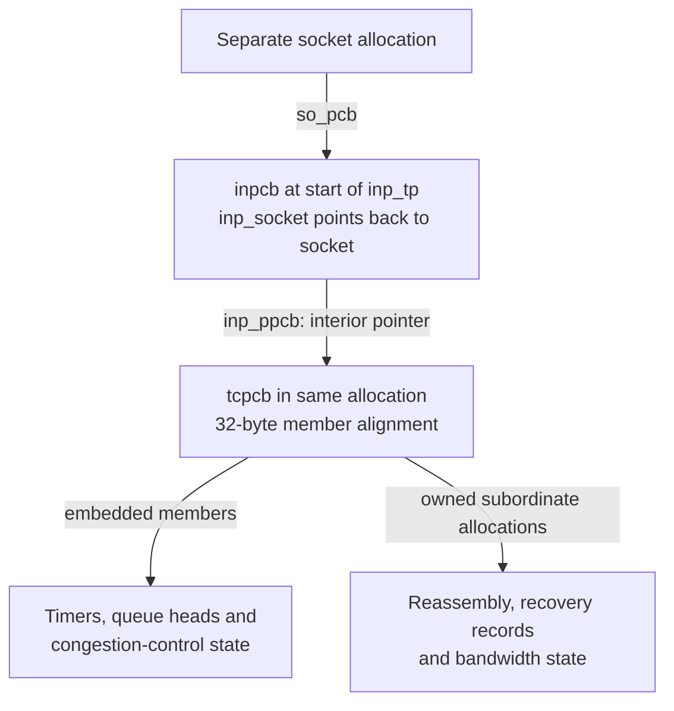
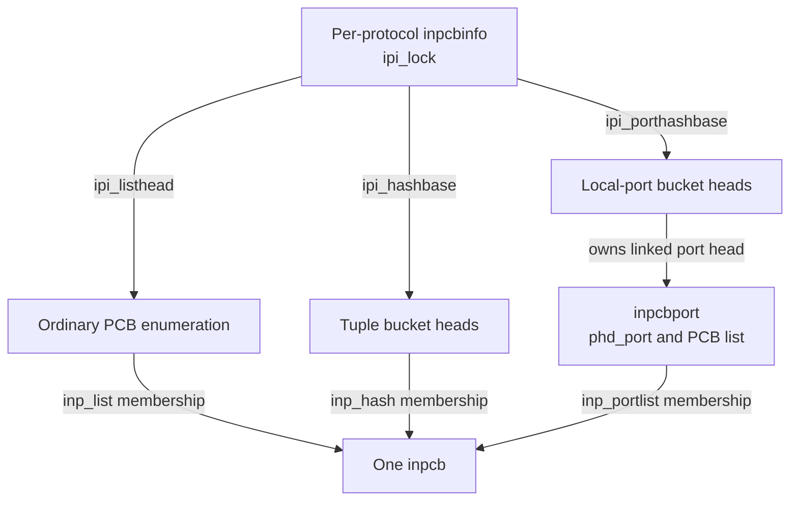
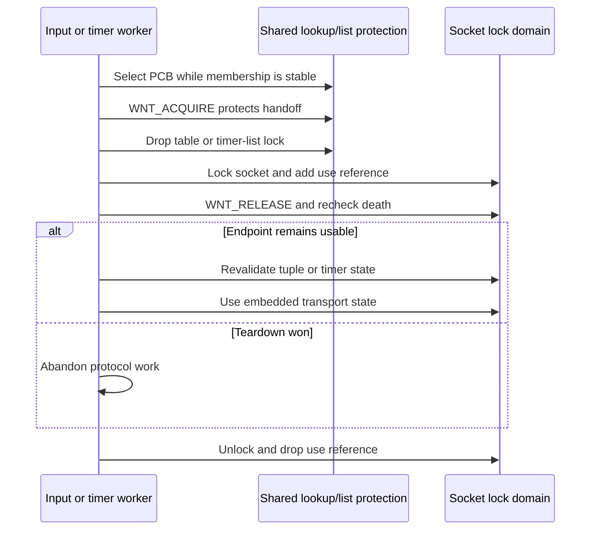
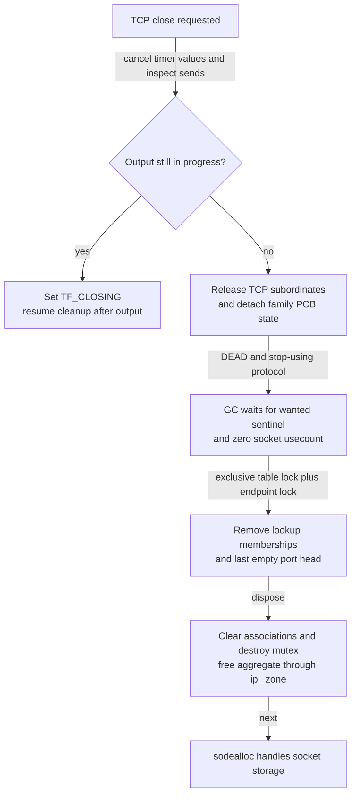

# Internet PCBs and transport storage

An Internet PCB is the shared storage behind a socket's network identity: addresses, ports, route state, lookup memberships and a lifetime handoff to protocol code. TCP adds a `tcpcb`, but this checkout allocates the two records together. Understanding that allocation, its subordinate objects and its references explains why a successful tuple lookup, a closed connection and freed PCB storage are different events.

[Structure guide](README.md) · [Sockets and protocol attachments](sockets-and-protocol-attachments.md) · [Socket buffers](socket-buffers-and-record-queues.md) · [Mbuf storage](mbufs-and-external-storage.md)

This companion documents `xnu-12377.121.6`. The existing [Internet PCB operation chapter](../subsystems/networking/internet-pcbs-ports-and-lifetime.md) explains binding and demultiplexing; [TCP connections and timers](../subsystems/networking/tcp-connections-and-timers.md) follows handshake and close decisions; [TCP recovery](../subsystems/networking/tcp-loss-recovery-and-congestion-control.md) explains the algorithms using the recovery records below. Use this chapter to resolve an allocation, field, ownership transfer or cleanup while reading those bodies.

## 1. TCP allocates one aggregate, UDP and raw IP allocate a plain PCB

The concrete TCP allocation is private to `tcp_subr.c`. `inpcb` is its first member; the embedded `tcpcb` has a 32-byte alignment requirement. A pointer to the first member therefore also names the beginning of the allocation, but the TCP member's offset must follow the actual layout and alignment, not an assumed sum of field sizes. [Allocation layout and rationale](../../platydoc-data/xnu/bsd/netinet/tcp_subr.c#L302-L317).

[Source: `bsd/netinet/tcp_subr.c`, lines 311–317](../../platydoc-data/xnu/bsd/netinet/tcp_subr.c#L311-L317).

<!-- source-excerpt: ../../platydoc-data/xnu/bsd/netinet/tcp_subr.c#L311-L317 -->
```c
struct  inp_tp {
	struct  inpcb   inp;
	struct  tcpcb   tcb __attribute__((aligned(ALIGNMENT)));
};
#undef ALIGNMENT

static KALLOC_TYPE_DEFINE(tcpcbzone, struct inp_tp, NET_KT_DEFAULT);
```



The arrows name layout or pointer relationships. They are not independent reference counts for every arrow. In particular, freeing `tp` separately from its enclosing `inp_tp` would not match this allocator path. `tcp_newtcpcb()` selects the embedded member, zeroes it and initializes its queues; it does not allocate another `tcpcb`. [Embedded-member initialization](../../platydoc-data/xnu/bsd/netinet/tcp_subr.c#L1321-L1357).

| Protocol storage | Selected allocation | Initialization and release boundary |
| --- | --- | --- |
| Ordinary IPv4/IPv6 TCP, including an internal MPTCP TCP subflow | `tcpcbzone` is a typed allocation view for `struct inp_tp`; `tcbinfo.ipi_zone` selects it. | `in_pcballoc()` allocates the aggregate; `tcp_newtcpcb()` initializes its TCP member. `in_pcbdispose()` ultimately frees through the same `ipi_zone`. |
| IPv4/IPv6 UDP | `inpcbzone` is a typed view for `struct inpcb`; `udbinfo.ipi_zone` selects it. | UDP attachment initializes family/default fields. This path has no embedded TCP extension or separate UDP control-block allocation through `inp_ppcb`. |
| Raw IPv4/IPv6 | `ripzone` supplies a plain `struct inpcb` through `ripcbinfo`. | Raw protocol number and family-specific options live in the PCB. Raw IPv6 additionally allocates an ICMPv6 filter and frees it in its protocol detach callback. |
| MPTCP application endpoint | Separate `mpp_mtp` aggregate, not `inp_tp` | The application socket uses `mppcb`/session/MPTCP state. Each internal TCP subflow has the TCP aggregate described here. |

Evidence: [TCP selection](../../platydoc-data/xnu/bsd/netinet/tcp_subr.c#L694-L704), [UDP view](../../platydoc-data/xnu/bsd/netinet/udp_usrreq.c#L161), [UDP table initialization](../../platydoc-data/xnu/bsd/netinet/udp_usrreq.c#L300-L318), [raw view and selection](../../platydoc-data/xnu/bsd/netinet/raw_ip.c#L134-L169), [raw IPv6 filter ownership](../../platydoc-data/xnu/bsd/netinet6/raw_ip6.c#L1019-L1048), [MPTCP storage](../subsystems/networking/mptcp-sessions-and-subflows.md#1-one-application-socket-several-transport-identities).

These are writable typed allocations, not RO-zone companions. `NET_KT_DEFAULT` selects `KT_PRIV_ACCT` in development/debug and `KT_DEFAULT` otherwise. The actual object allocator uses waiting, zeroed, no-fail storage after an explicit protocol-memory admission check. Typed-allocation placement does not add a reference count or immutable-field contract. [Network allocation flags](../../platydoc-data/xnu/bsd/net/if_var.h#L78-L84), [allocation and association](../../platydoc-data/xnu/bsd/netinet/in_pcb.c#L693-L725).

[Source: `bsd/netinet/in_pcb.c`, lines 699–718](../../platydoc-data/xnu/bsd/netinet/in_pcb.c#L699-L718).

<!-- source-excerpt: ../../platydoc-data/xnu/bsd/netinet/in_pcb.c#L699-L718 -->
```c
	if (proto_memacct_hardlimit(so->so_proto)) {
		return ENOBUFS;
	}
	addr = __zalloc_flags(pcbinfo->ipi_zone, Z_WAITOK_ZERO_NOFAIL);
	__builtin_assume(addr != NULL);

	proto_memacct_add(so->so_proto, kalloc_type_size(pcbinfo->ipi_zone));

	/*
	 * N.B: the allocation above may actually be inp_tp
	 * which is a structure that includes inpcb, but for
	 * the purposes of this function we just touch
	 * struct inpcb.
	 */
	inp = __unsafe_forge_single(struct inpcb *, addr);

	inp->inp_gencnt = ++pcbinfo->ipi_gencnt;
	inp->inp_pcbinfo = pcbinfo;
	inp->inp_socket = so;
	so->so_pcb = (caddr_t)inp;
```

Protocol memory accounting charges the selected allocation size, so TCP is charged for the aggregate rather than just `sizeof(struct inpcb)`. Final disposal subtracts that size. There is no PCB-specific cached-object fast path in these allocation/free bodies. `INPCB_STATE_CACHED` is still defined in the header, but that name is not evidence that this path inserts the object into such a cache. Allocator reuse after `zfree` and the subordinate TCP segment pool discussed below are different mechanisms. [Final allocation/accounting release](../../platydoc-data/xnu/bsd/netinet/in_pcb.c#L2133-L2148), [state definitions](../../platydoc-data/xnu/bsd/netinet/in_pcb.h#L893-L901).

## 2. Fields name network identity, memberships and separate state owners

The complete declaration is [`struct inpcb`](../../platydoc-data/xnu/bsd/netinet/in_pcb.h#L160-L271). Its local/foreign addresses and route are unions, while its IPv4 and IPv6 option groups are separate fields. This matters for dual-stack sockets: freeing IPv6 resources does not automatically free the distinct IPv4 option/multicast objects.

| PCB storage | Representation / access | Ownership and synchronization consequence |
| --- | --- | --- |
| `inpcb_mtx` | Protocol-specific socket mutex when `PR_PCBLOCK` applies | Protects ordinary endpoint decisions through socket lock callbacks; it is not the global table lock. MPTCP can redirect the logical socket lock. |
| `inp_socket`, `inp_ppcb`, `inp_pcbinfo` | Socket backlink, protocol extension pointer, protocol table owner | Plain associations. For TCP, `inp_ppcb` points inside the aggregate. A non-null pointer alone does not prove operational liveness. |
| `inp_list`, `inp_hash`, `inp_portlist`, `inp_phd` | Intrusive links for protocol enumeration, tuple bucket and shared local-port head | Membership is maintained under `ipi_lock`; the PCB remains one allocation even when several indexes reach it. TIME_WAIT moves enumeration to a different queue. |
| `inp_gencnt`, `inp_hash_element` | Instance-generation bookkeeping and cached tuple-bucket index | Generation snapshots help enumeration; they are not wanted references or a promise against reuse of a stale pointer. |
| `inp_wantcnt`, `inp_state` | Temporary wanted accounting / stop sentinel; logical-death state | Wanted accounting bridges lock domains. Socket users and membership still have separate gates at disposal. |
| `inp_fport`, `inp_lport` | Network-byte-order remote/local ports | Tuple comparison uses packet port representation. Human-readable output and the port hash use conversions. |
| Address unions, `inp_vflag`, `inp_lifscope`, `inp_fifscope` | IPv4 tail view or full IPv6 address; eligible families and scope IDs | The socket family, permitted receive families and current address representation are related but not interchangeable. |
| `inp_route` / `in6p_route` | One union holding the selected cached route representation | Route/ifaddr references require copy/release helpers. A copied structure without balancing those references is not equivalent. |
| `inp_boundifp`, `inp_last_outifp` | Selected-bound and last-output interface associations | Do not infer an independent retained interface reference from field assignment; distinguish them from explicitly retained `outif` results for callers. |
| `inp_sndinprog_cnt`, waiters | Outstanding lower-layer sends across socket-lock drops | TCP close checks this count before releasing state that output may still update. |
| Options, multicast, IPsec, NECP, namespace, offload and statistics fields | Mixture of owned allocations, retained objects, cached values, callbacks and registration tokens | Each requires its provider's cleanup, not one generic `free(inp_ppcb)` or a scalar-state reset. |

Evidence: [core fields and unions](../../platydoc-data/xnu/bsd/netinet/in_pcb.h#L160-L230), [conditional/provider fields](../../platydoc-data/xnu/bsd/netinet/in_pcb.h#L236-L270), [field aliases](../../platydoc-data/xnu/bsd/netinet/in_pcb.h#L581-L612), [hash definitions](../../platydoc-data/xnu/bsd/netinet/in_pcb.h#L728-L731), [generation changes at removal](../../platydoc-data/xnu/bsd/netinet/in_pcb.c#L2912-L2964).

The IPv4 address wrapper contains three 32-bit padding words followed by `struct in_addr`; the same union can hold a full `in6_addr`. `inp_laddr`/`inp_faddr` select the IPv4 tail, while `in6p_laddr`/`in6p_faddr` select the IPv6 representation. `INP_IPV4`, `INP_IPV6` and `INP_V4MAPPEDV6` are flags rather than a C union discriminator automatically enforced by the language. For example, UDP6 attachment can set both `INP_IPV6` and `INP_IPV4` when mapped addresses are enabled. [Shared address shape](../../platydoc-data/xnu/bsd/netinet/in_pcb.h#L116-L125), [aliases and flags](../../platydoc-data/xnu/bsd/netinet/in_pcb.h#L584-L590), [UDP6 attachment](../../platydoc-data/xnu/bsd/netinet6/udp6_usrreq.c#L897-L919).

The conversion macros are deliberately small: `sotoinpcb(so)` casts `so_pcb`; `sotoin6pcb` is the same conversion; `intotcpcb(inp)` casts `inp_ppcb`; `sototcpcb` composes those operations. None locks, retains, checks the socket's protocol, tests death or allocates storage. The calling context must already establish those properties. [Socket-to-PCB macros](../../platydoc-data/xnu/bsd/netinet/in_pcb.h#L879-L880), [TCP conversions](../../platydoc-data/xnu/bsd/netinet/tcp_var.h#L1095-L1096).

### TCP's extension is state plus collection heads

| `tcpcb` storage | Meaning and owner |
| --- | --- |
| `t_inpcb`, `t_state`, flag groups | Backlink and wire-protocol state; socket/PCB lifetime is broader than the TCP state enum. |
| `snd_una`, `snd_nxt`, `snd_max`, `rcv_nxt`, windows | Sequence-space and flow-control coordinates. These are not byte offsets into the allocation or addresses of packet storage. |
| `t_timer[]`, embedded `tentry` | Per-connection timer values plus a scheduler-list node; no separate timer-node allocation is needed for this connection. |
| `t_segq`, `t_reassqlen`, `t_reassq_mbcnt` | Reassembly descriptors and accounting for their held mbuf chains. |
| `snd_holes`, `sackhint`, `t_rxt_segments` | Loss/retransmission metadata; hints borrow nodes owned by the corresponding collections. |
| `t_segs_sent`, `t_segs_sent_tree`, `t_segs_acked`, `seg_pool` | Several indexes/work lists over sent-segment metadata, plus a per-connection reusable-node pool. |
| `t_bwmeas` | Separately allocated bandwidth measurement state. |
| `t_ccstate`, embedded `_t_ccstate` | For the selected algorithms, the pointer aliases embedded congestion-control storage; the helper called “allocate” does not allocate heap memory here. |
| `t_twentry` | Intrusive membership in the TCP TIME_WAIT queue. |
| Conditional `t_mptcb`, `t_mpsub` | Shared MPTCP connection and this subflow's association; they do not make the parent MPTCP aggregate part of `inp_tp`. |

[Core/TCP sequence fields](../../platydoc-data/xnu/bsd/netinet/tcp_var.h#L422-L525), [SACK fields](../../platydoc-data/xnu/bsd/netinet/tcp_var.h#L602-L650), [bandwidth/congestion/TIME_WAIT fields](../../platydoc-data/xnu/bsd/netinet/tcp_var.h#L713-L730), [MPTCP associations](../../platydoc-data/xnu/bsd/netinet/tcp_var.h#L772-L778), [collection initialization](../../platydoc-data/xnu/bsd/netinet/tcp_subr.c#L1350-L1357), [embedded congestion-state selection](../../platydoc-data/xnu/bsd/netinet/tcp_cc.c#L205-L215).

## 3. Allocation, protocol readiness and tuple publication are separate

`in_pcballoc()` first checks `proto_memacct_hardlimit()` and returns `ENOBUFS` if admission fails. Otherwise it obtains the zeroed allocation, charges memory, connects `so_pcb`/`inp_socket`, records `inp_pcbinfo`, initializes the PCB mutex when required, and applies initial family/policy flags. It finally takes exclusive `ipi_lock`, assigns the publication generation, inserts `inp_list` and increments `ipi_count`. Its earlier generation assignment and later locked assignment are both visible in the body; do not treat a generation value as an acquired hold. [Allocation](../../platydoc-data/xnu/bsd/netinet/in_pcb.c#L693-L725), [defaults and all-PCB publication](../../platydoc-data/xnu/bsd/netinet/in_pcb.c#L728-L748).

The whole allocation was zeroed. This routine does not assign `INPCB_STATE_INUSE`, despite that named constant in the header: the fresh path's `inp_state` remains zero until a later explicit transition. The inspected attach bodies add family/protocol state rather than setting it to the symbolic value `1`. Death is tested and assigned explicitly as `INPCB_STATE_DEAD`. Likewise, all-PCB-list insertion does not establish a bound port, tuple-hash membership, or finished TCP initialization.

TCP attachment reserves socket buffers, invokes `in_pcballoc()`, initializes family/autosizing state, and calls `tcp_newtcpcb()`. The embedded-member selection is direct. [TCP attach](../../platydoc-data/xnu/bsd/netinet/tcp_usrreq.c#L3094-L3150).

[Source: `bsd/netinet/tcp_subr.c`, lines 1330–1335](../../platydoc-data/xnu/bsd/netinet/tcp_subr.c#L1330-L1335).

<!-- source-excerpt: ../../platydoc-data/xnu/bsd/netinet/tcp_subr.c#L1330-L1335 -->
```c
	it = (struct inp_tp *)(void *)inp;
	tp = &it->tcb;

	bzero((char *) tp, sizeof(struct tcpcb));
	LIST_INIT(&tp->t_segq);
	tp->t_maxseg = tp->t_maxopd = isipv6 ? tcp_v6mssdflt : tcp_mssdflt;
```

The initializer establishes queue heads, defaults, the `t_inpcb` backlink, embedded congestion-state access and bandwidth state. It publishes `inp_ppcb = tp` at the end; attach then records `TCPS_CLOSED`. The visible `tcp_newtcpcb()` body returns that embedded pointer on its ordinary return path. `tcp_attach()` retains a defensive null-result branch that suppresses `SS_NOFDREF` while detaching and then restores it; this is not evidence of a second failing TCP allocation in this snapshot. A separate null-result check around the bandwidth helper clears only its feature flag. The helper itself performs a waiting allocation, initializes its result and returns it; it has no explicit null-return path. [Defaults and subordinates](../../platydoc-data/xnu/bsd/netinet/tcp_subr.c#L1350-L1424), [bandwidth helper body](../../platydoc-data/xnu/bsd/netinet/tcp_subr.c#L2119-L2125), [protocol-pointer publication](../../platydoc-data/xnu/bsd/netinet/tcp_subr.c#L1438-L1445), [defensive attach unwind](../../platydoc-data/xnu/bsd/netinet/tcp_usrreq.c#L3132-L3149).

### Protocol tables own indexes, local-port heads group endpoints

`inpcbinfo` is protocol-wide state shared across IPv4/IPv6: all-PCB list/count/generation, tuple and local-port bucket arrays, allocation view, port-search cursors and GC/timer callbacks. Its `ipi_lock` protects membership and shared protocol tables; the separate global `inpcb_lock` protects the registry of these `inpcbinfo` records and callout coordination. TCP initializes its arrays with `hashinit_counted_by()`, derives each mask as count minus one, assigns callbacks and registers the record. [Table layout and lock domains](../../platydoc-data/xnu/bsd/netinet/in_pcb.h#L645-L725), [TCP initialization](../../platydoc-data/xnu/bsd/netinet/tcp_subr.c#L694-L704), [registry insertion](../../platydoc-data/xnu/bsd/netinet/in_pcb.c#L563-L577).

A local-port head is a separate typed allocation with a list of all PCBs using that port. [Source: `bsd/netinet/in_pcb.h`, lines 631–635](../../platydoc-data/xnu/bsd/netinet/in_pcb.h#L631-L635).

<!-- source-excerpt: ../../platydoc-data/xnu/bsd/netinet/in_pcb.h#L631-L635 -->
```c
struct inpcbport {
	LIST_ENTRY(inpcbport) phd_hash;
	struct inpcbhead phd_pcblist;
	u_short phd_port;
};
```



These are index memberships, not three extra allocations of the PCB. `in_pcbinshash()` selects the tuple bucket, finds or allocates a port head, completes configured namespace work, stores `inp_phd`, inserts both links and sets `INP2_INHASHLIST`. Its lock-acquisition fallback can drop/reacquire the socket lock; it checks death afterward. [Lock transition and bucket selection](../../platydoc-data/xnu/bsd/netinet/in_pcb.c#L2722-L2768), [port-head allocation and publication](../../platydoc-data/xnu/bsd/netinet/in_pcb.c#L2770-L2828).

The surrounding bind transaction must revalidate after its own lock drop. If insertion fails, the IPv4 bind body resets local address/port, last interface and anonymous-port state and releases its namespace token. The insertion routine itself can return after a port head has already been allocated; do not describe all its intermediate state as one indivisible commit. On ordinary removal, an empty port head is unlinked and freed after removing the PCB's port membership. [Bind recheck/rollback](../../platydoc-data/xnu/bsd/netinet/in_pcb.c#L1291-L1341), [insertion failure point](../../platydoc-data/xnu/bsd/netinet/in_pcb.c#L2782-L2809), [last-port-member removal](../../platydoc-data/xnu/bsd/netinet/in_pcb.c#L2921-L2938).

Connect/disconnect can rehash a PCB as its foreign tuple changes. `in_pcbrehash()` explicitly does not handle changing the local port because the port-head membership would also need updating. Follow the [bind/connect operation chapter](../subsystems/networking/internet-pcbs-ports-and-lifetime.md) and [IPv6 socket routes](../subsystems/networking/ipv6-sockets-and-packet-options.md) for admission and namespace-reservation details.

## 4. Wanted references protect the gap between table and socket locks

`inp_wantcnt` is not a conventional general-purpose “retain this TCP object” API. A table or timer walker uses it while handing a selected PCB to the socket-lock domain. `WNT_STOPUSING` is `0xffff`; acquire compares the low 16 bits against that sentinel and uses a 32-bit compare-and-swap to increment. It does not separately inspect `inp_state` in that branch, despite the broader nearby comment. [Modes and sentinel](../../platydoc-data/xnu/bsd/netinet/in_pcb.h#L893-L907), [actual acquire branch](../../platydoc-data/xnu/bsd/netinet/in_pcb.c#L3017-L3031).

[Source: `bsd/netinet/in_pcb.c`, lines 3023–3031](../../platydoc-data/xnu/bsd/netinet/in_pcb.c#L3023-L3031).

<!-- source-excerpt: ../../platydoc-data/xnu/bsd/netinet/in_pcb.c#L3023-L3031 -->
```c
		do {
			origwant = *wantcnt;
			if ((UInt16) origwant == 0xffff) {
				/* should stop using */
				return WNT_STOPUSING;
			}
			newwant = origwant + 1;
		} while (!OSCompareAndSwap(origwant, newwant, wantcnt));
		return WNT_ACQUIRE;
```

`WNT_STOPUSING` first establishes `inp_state = DEAD` under socket protection and schedules GC. It attempts to replace a zero wanted count with the sentinel; if wanted users remain, the count can stay nonzero even though this operation returns `WNT_STOPUSING`. `WNT_RELEASE` decrements through CAS under socket protection, then checks death and revisits the stop-using logic. Thus **dead state**, **stop-using return value** and **sentinel installed in the field** are three distinguishable observations. Disposal checks the field itself. [Stop transition](../../platydoc-data/xnu/bsd/netinet/in_pcb.c#L2983-L3015), [release/recheck](../../platydoc-data/xnu/bsd/netinet/in_pcb.c#L3033-L3071), [disposal gates](../../platydoc-data/xnu/bsd/netinet/in_pcb.c#L2081-L2102).



The outer shared protection differs by caller. `in_pcblookup_hash()` takes shared `ipi_lock`; its exact-match helper applies family/interface/policy checks and acquires the wanted reference before returning. A timer walker instead holds the global timer-list mutex while choosing its embedded node. Neither lock may be silently replaced by a wanted reference before the object has been safely found. [Hash lookup](../../platydoc-data/xnu/bsd/netinet/in_pcb.c#L2564-L2607), [wrapper lock](../../platydoc-data/xnu/bsd/netinet/in_pcb.c#L2674-L2688), [timer handoff](../../platydoc-data/xnu/bsd/netinet/tcp_timer.c#L2177-L2201).

Normal TCP locking obtains `inpcb_mtx` and optionally increments `so_usecount`; unlocking balances that count. For an MPTCP subflow, `tcp_lock()` redirects to the parent socket and rechecks the subflow flag after acquiring the candidate lock, retrying if attachment changed the lock identity. Its subflow and parent use accounting must be followed in those callbacks. The parent aggregate has a separate lifetime; the mere presence of `t_mptcb` does not create another independently lockable connection. [TCP locking and retry](../../platydoc-data/xnu/bsd/netinet/tcp_subr.c#L3523-L3572), [unlock accounting](../../platydoc-data/xnu/bsd/netinet/tcp_subr.c#L3576-L3618), [MPTCP lock/lifetime route](../subsystems/networking/mptcp-sessions-and-subflows.md#3-lock-switching-and-deferred-callbacks-protect-the-session).

## 5. Worked tuple lookup and reference ledger

Choose ordinary IPv4 TCP on a **little-endian** machine, with an illustrative 256-bucket table (`ipi_hashmask = 0xff`). Let the endpoint be local `192.0.2.10:50000`, remote `203.0.113.9:443`. These are documentation addresses; the example assumes the connection is already validly attached and published. It does not imply a running system uses this bucket count.

| Coordinate | Stored/derived value | Use |
| --- | --- | --- |
| Foreign IPv4 bytes | `cb 00 71 09`, read as little-endian `s_addr = 0x097100cb` | Input to `INP_PCBHASH`. |
| Local/foreign port bytes | `c3 50` and `01 bb` | Network representation retained in PCB and packet headers. |
| Host port XOR | `50000 ^ 443 = 0xc2eb` | Produced by `ntohs(lport ^ fport)` in the hash expression. |
| Tuple bucket | `(0x097100cb ^ 0x00000971 ^ 0xc2eb) & 0xff = 0x51` | Candidate bucket 81. The local address is still checked during tuple equality even though absent from this hash expression. |
| Local-port bucket | `50000 & 0xff = 0x50` | Bucket 80 contains the port head for 50000 among any colliding port heads. |

[Exact hash macros](../../platydoc-data/xnu/bsd/netinet/in_pcb.h#L728-L731), [equality after hashing](../../platydoc-data/xnu/bsd/netinet/in_pcb.c#L2578-L2607). IPv6 insertion uses the final 32-bit foreign-address word for bucket selection; scoped full-address comparison remains a separate decision. Do not use hash equality as address/namespace equality. [IPv6 hash key](../../platydoc-data/xnu/bsd/netinet/in_pcb.c#L2756-L2763), [scoped input recheck](../../platydoc-data/xnu/bsd/netinet/tcp_input.c#L3198-L3215).

For a packet from the remote endpoint, TCP passes packet source as the foreign address/port and packet destination as local. It obtains the socket lock, releases the wanted reference and tests the result. For a connected IPv4 endpoint it then rechecks all tuple fields; a changed tuple can cause one new lookup attempt. Only afterward does it obtain `tp = intotcpcb(inp)` and reject absent or closed transport state. [Packet lookup arguments](../../platydoc-data/xnu/bsd/netinet/tcp_input.c#L3054-L3068), [handoff](../../platydoc-data/xnu/bsd/netinet/tcp_input.c#L3158-L3178), [tuple retry and TCP state access](../../platydoc-data/xnu/bsd/netinet/tcp_input.c#L3180-L3234).

The following ledger chooses a connection with one non-receive socket use reference and no timer-list hold at the start. Actual counts can include more owners.

| Step | Wanted field | Socket usecount | Consequence |
| --- | --- | --- | --- |
| Published connection | `0` | `1` | Table/list membership keeps it discoverable under the appropriate locks. |
| Receiver finds exact tuple under shared table lock | `1` | `1` | The wanted hold protects the upcoming lock handoff. |
| Receiver acquires `socket_lock(so, 1)` | `1` | `2` | Socket mutex protects endpoint decisions; a socket user now also exists. |
| Receiver releases wanted hold on a live PCB | `0` | `2` | Tuple and TCP state must still be revalidated before processing. |
| Receiver unlocks with reference release | `0` | `1` | The original socket owner remains. |

For the competing-close branch, start after the wanted acquire but let the closer obtain the socket lock first. It marks the PCB dead while wanted remains `1`, finishes its work and releases its own socket use reference. GC cannot dispose because wanted is not the sentinel. The receiver can still acquire the socket lock, decrement wanted to zero and observe dead state; stop-using logic then attempts the sentinel transition. The receiver abandons packet processing and drops its socket use reference. Once wanted is actually `0xffff` and socket usecount is zero, GC can proceed under the required locks. [Stop/release body](../../platydoc-data/xnu/bsd/netinet/in_pcb.c#L2983-L3071), [TCP input rejection](../../platydoc-data/xnu/bsd/netinet/tcp_input.c#L3171-L3177), [final gates](../../platydoc-data/xnu/bsd/netinet/in_pcb.c#L2081-L2102).

## 6. Timers and subordinate transport records have distinct owners

### An embedded timer node can own a socket reference

`tcptimerentry` stores list links, timer-start time, the selected timer index/mode and runtime. It is embedded in `tcpcb`; the global list stores a link to it and has its own mutex/thread-call state. On first insertion, `tcp_sched_timers()` adds a **socket use reference**, not a `tcpcb`-specific reference. This can keep the aggregate pending after a user descriptor closes. [Timer representation](../../platydoc-data/xnu/bsd/netinet/tcp_timer.h#L220-L249), [timer scheduling](../../platydoc-data/xnu/bsd/netinet/tcp_timer.c#L2324-L2346).

[Source: `bsd/netinet/tcp_timer.c`, lines 2338–2341](../../platydoc-data/xnu/bsd/netinet/tcp_timer.c#L2338-L2341).

<!-- source-excerpt: ../../platydoc-data/xnu/bsd/netinet/tcp_timer.c#L2338-L2341 -->
```c
			tp->t_inpcb->inp_socket->so_usecount++;

			LIST_INSERT_HEAD(&listp->lhead, te, te_le);
			tp->t_flags |= TF_TIMER_ONLIST;
```

The timer worker uses the wanted handoff, then rechecks `te_index` and `te_runtime` after obtaining the socket lock. Cancellation/rescheduling could have occurred while it waited. `tcp_remove_timer()` removes the embedded link, adjusts the walker's saved-next pointer if needed, drops the insertion use reference, clears `TF_TIMER_ONLIST` and clears links. `tcp_canceltimers()` calls that removal helper first, then clears timer values and sets the selected index to `TCPT_NONE`: cancellation therefore also releases any ordinary timer-list membership and its socket use reference. [Connection-timer revalidation](../../platydoc-data/xnu/bsd/netinet/tcp_timer.c#L1980-L2024), [list removal](../../platydoc-data/xnu/bsd/netinet/tcp_timer.c#L1852-L1884), [cancellation body](../../platydoc-data/xnu/bsd/netinet/tcp_timer.c#L861-L873).

### Reassembly metadata owns packet chains until delivery or discard

A `tseg_qent` contains intrusive linkage, segment length, a pointer to a TCP header and an mbuf-chain pointer. The header view and packet bytes are not stored in the queue descriptor itself. `tcp_create_reass_qent()` first allocates a descriptor under protocol memory limits using `Z_NOPAGEWAIT`; failure returns null before taking ownership into a new descriptor. Success records the chain/header, increments queue counts and accounts for chain capacity. [Descriptor layout](../../platydoc-data/xnu/bsd/netinet/tcp_var.h#L180-L187), [creation and allocation gates](../../platydoc-data/xnu/bsd/netinet/tcp_subr.c#L1707-L1765).

`tcp_destroy_reass_qent()` subtracts chain-capacity accounting, decrements counts, frees the descriptor, and **returns the mbuf chain**. It does not itself free those bytes. The caller determines whether the chain transfers onward or is discarded. Final `tcp_free_reassq()` removes each descriptor and calls `m_freem()` on the returned chain. [Descriptor-versus-chain release](../../platydoc-data/xnu/bsd/netinet/tcp_subr.c#L1693-L1704), [destroy helper](../../platydoc-data/xnu/bsd/netinet/tcp_subr.c#L1733-L1772), [mbuf ownership](mbufs-and-external-storage.md).

### Recovery metadata can remain allocated after leaving active indexes

SACK holes store sequence intervals and a retransmission cursor, not retained packet payload. Their typed allocator checks per-connection hole count and TCP memory limits before allocating; removal frees the node and balances accounting. `sackhint.nexthole` is cleared when the scoreboard is emptied. [Hole layout](../../platydoc-data/xnu/bsd/netinet/tcp_var.h#L189-L206), [allocation/free](../../platydoc-data/xnu/bsd/netinet/tcp_sack.c#L238-L274), [scoreboard cleanup](../../platydoc-data/xnu/bsd/netinet/tcp_sack.c#L667-L677).

`tcp_seg_sent` similarly describes transmitted sequence ranges, timestamps and state, with separate links for a time-ordered queue, RB tree, acknowledged work list and free-node pool. `tcp_seg_alloc_init()` first reuses and zeroes a pool node; only an empty pool reaches the memory-limit check and typed allocation. Deleting a no-longer-indexed node can put it in the pool instead of returning its bytes to the allocator. The limit is 64 pooled items in this snapshot. [Node and pool layout](../../platydoc-data/xnu/bsd/netinet/tcp_var.h#L218-L242), [pool-first allocation](../../platydoc-data/xnu/bsd/netinet/tcp_subr.c#L4173-L4195).

[Source: `bsd/netinet/tcp_subr.c`, lines 4813–4823](../../platydoc-data/xnu/bsd/netinet/tcp_subr.c#L4813-L4823).

<!-- source-excerpt: ../../platydoc-data/xnu/bsd/netinet/tcp_subr.c#L4813-L4823 -->
```c
tcp_seg_delete(struct tcpcb *tp, struct tcp_seg_sent *seg)
{
	if (tp->seg_pool.free_segs_count >= TCP_SEG_POOL_MAX_ITEM_COUNT) {
		zfree(tcp_seg_sent_zone, seg);
		tcp_memacct_sub(kalloc_type_size(tcp_seg_sent_zone));
	} else {
		bzero(seg, sizeof(*seg));
		TAILQ_INSERT_TAIL(&tp->seg_pool.free_segs, seg, free_link);
		tp->seg_pool.free_segs_count++;
	}
}
```

`tcp_segs_sent_clean(tp, free_segs)` removes active queue/tree membership, recycles nodes and resets accounting; when `free_segs` is true it also drains the free pool. `tcp_close()` passes true. A separate memory-shortage route cleans this storage and disables RACK. Thus an empty active segment list can still have allocated pool storage, while final TCP cleanup drains both. [Full cleanup](../../platydoc-data/xnu/bsd/netinet/tcp_subr.c#L4826-L4859), [RACK allocation fallback](../../platydoc-data/xnu/bsd/netinet/tcp_subr.c#L4861-L4866), [close call](../../platydoc-data/xnu/bsd/netinet/tcp_subr.c#L1973-L1977).

The DSACK retransmission list uses another typed node, `tcp_rxt_seg`; `tcp_rxtseg_clean()` removes and frees those entries. Bandwidth measurement uses `tcp_bwmeas_zone`, with a separate allocator/free helper that clears `t_bwmeas` and its feature flag. In contrast, `tcp_cc_allocate_state()` points into `_t_ccstate` and zeroes it for selected congestion algorithms. Provider-specific congestion cleanup remains a callback. [Retransmission cleanup](../../platydoc-data/xnu/bsd/netinet/tcp_subr.c#L4097-L4108), [bandwidth allocation/free](../../platydoc-data/xnu/bsd/netinet/tcp_subr.c#L2119-L2134), [embedded congestion state](../../platydoc-data/xnu/bsd/netinet/tcp_cc.c#L205-L215), [algorithm cleanup calls](../../platydoc-data/xnu/bsd/netinet/tcp_subr.c#L2011-L2019).

## 7. Route references, interface associations and policy resources

The PCB route union is an owned cache of referenced routing objects. TCP output creates a local route representation, copies from the PCB while socket-locked, can drop the socket lock around lower-layer output, and later merges the local state back. `route_copyout()` adds references for both route and source-interface address. [PCB copy wrappers](../../platydoc-data/xnu/bsd/netinet/in_pcb.c#L3162-L3192), [IPv6 wrappers](../../platydoc-data/xnu/bsd/netinet6/in6_pcb.c#L1680-L1707), [output copyout](../../platydoc-data/xnu/bsd/netinet/tcp_output.c#L3743-L3751), [copyback](../../platydoc-data/xnu/bsd/netinet/tcp_output.c#L3969-L3973).

[Source: `bsd/net/route.c`, lines 4111–4125](../../platydoc-data/xnu/bsd/net/route.c#L4111-L4125).

<!-- source-excerpt: ../../platydoc-data/xnu/bsd/net/route.c#L4111-L4125 -->
```c
route_copyout(struct route *dst, const struct route *src, size_t length)
{
	/* Copy everything (rt, srcif, flags, dst) from src */
	__route_copy(src, dst, length);

	/* Hold one reference for the local copy of struct route */
	if (dst->ro_rt != NULL) {
		RT_ADDREF(dst->ro_rt);
	}

	/* Hold one reference for the local copy of struct ifaddr */
	if (dst->ro_srcia != NULL) {
		ifa_addref(dst->ro_srcia);
	}
}
```

`route_copyin()` reconciles an empty destination, identical route, changed route or absent source route, transferring or dropping references accordingly and clearing source ownership when done. `ROUTE_RELEASE` ultimately releases `ro_rt` and `ro_srcia`. The IPv4 wrapper discards a stale or non-IPv4 cached route before copying; the IPv6 wrapper checks that a non-null route is IPv6. These helpers carry lifetime obligations that a struct assignment would omit. [Copyin decisions](../../platydoc-data/xnu/bsd/net/route.c#L4128-L4205), [release body](../../platydoc-data/xnu/bsd/net/route.c#L4097-L4105).

By contrast, `inp_bindif_common()` stores `inp_boundifp` and updates `INP_BOUND_IF` without adding a reference there, then invalidates the route cache. `inp_bindif()` resolves the index under the interface-head lock. A different source-selection result explicitly calls `ifnet_reference(ifp)` **for the caller** before returning `outif`. These are different contracts even when the addresses refer to the same interface. The wider interface detach/storage protocol is outside this selected field trace. [Bound-interface storage](../../platydoc-data/xnu/bsd/netinet/in_pcb.c#L3198-L3242), [retained caller result](../../platydoc-data/xnu/bsd/netinet/in_pcb.c#L1788-L1805).

| Conditional/resource group | What is owned or cached | Selected cleanup boundary |
| --- | --- | --- |
| IPv4/IPv6 options | IPv4 option mbuf, IPv6 option chain and `ip6_pktopts` with its own suballocations | Family-specific detach frees the appropriate objects; IPv6 also handles IPv4 mapped-address resources. |
| Multicast options | Referenced `ip_moptions` / `ip6_moptions` objects | `IMO_REMREF` / `IM6O_REMREF`; membership objects have their own lifetimes. |
| IPsec policy | `inp_sp` pointer when configured | IPv4/IPv6 detach invokes the corresponding PCB-policy deletion helper. |
| NECP attributes, resolver signature, client registration | Owned strings/bytes plus cached result, UUID and callback association | Disposal unregisters socket flow, frees owned attribute buffers and resolver-signature storage. The embedded result is not a separately allocated policy provider. |
| Skywalk namespace tokens | Registration ownership for local tuple/port, including optional IPv4 wildcard reservation | Detach releases unless TIME_WAIT preserves the reservation; final list removal releases remaining tokens. |
| Keepalive data and statistics locus | Offload bytes and provider-specific tracking | IPv4 detach frees its recorded keepalive buffer; statistics detach happens before endpoint information is cleared. TCP separately clears interface-counted keepalive offload. |

[IPv4 detach](../../platydoc-data/xnu/bsd/netinet/in_pcb.c#L1982-L2038), [IPv6 detach](../../platydoc-data/xnu/bsd/netinet6/in6_pcb.c#L885-L953), [NECP cleanup](../../platydoc-data/xnu/bsd/net/necp_client.c#L13101-L13143), [namespace release at removal](../../platydoc-data/xnu/bsd/netinet/in_pcb.c#L2939-L2943), [TCP offload cleanup](../../platydoc-data/xnu/bsd/netinet/tcp_subr.c#L1994-L1998). Follow [IPv6 packet-option storage](../subsystems/networking/ipv6-sockets-and-packet-options.md), [NECP clients](../subsystems/networking/necp-clients-and-flow-registration.md) and [Skywalk namespace lifetime](../subsystems/networking/skywalk-lifecycles.md) for their full mechanisms.

## 8. Close, detach and final aggregate release

TCP protocol close first cancels timer values and removes flow integration. It may then defer cleanup if lower-layer sends remain in progress or closing is already recorded. This matters because returning IP output can merge route state back into the PCB. Setting `TF_CLOSING` records work to resume; a null return from `tcp_close()` does not by itself mean the allocation was freed. [Close entry and deferral](../../platydoc-data/xnu/bsd/netinet/tcp_subr.c#L1782-L1818), [send-in-progress accounting](../../platydoc-data/xnu/bsd/netinet/tcp_output.c#L3770-L3778), [output return](../../platydoc-data/xnu/bsd/netinet/tcp_output.c#L3903-L3908).

[Source: `bsd/netinet/tcp_subr.c`, lines 1814–1818](../../platydoc-data/xnu/bsd/netinet/tcp_subr.c#L1814-L1818).

<!-- source-excerpt: ../../platydoc-data/xnu/bsd/netinet/tcp_subr.c#L1814-L1818 -->
```c
	if ((tp->t_flags & TF_CLOSING) ||
	    inp->inp_sndinprog_cnt > 0) {
		tp->t_flags |= TF_CLOSING;
		return NULL;
	}
```

When cleanup proceeds, `tcp_close()` releases reassembly chains, holes, ACK-notification state, bandwidth/retransmission/sent-segment records and packet-list storage; records `TCPS_CLOSED`; clears offload and congestion resources; then calls the family-specific PCB detach. `soisdisconnected()` follows detach because that notification may unlock the socket. These bodies do not independently free the embedded `tcpcb`, and do not clear `inp_ppcb` as a liveness signal. [Subordinate cleanup](../../platydoc-data/xnu/bsd/netinet/tcp_subr.c#L1961-L1986), [final detach/notification](../../platydoc-data/xnu/bsd/netinet/tcp_subr.c#L1994-L2044).

`in_pcbdetach()` / `in6_pcbdetach()` mark dead through stop-using, release family/provider resources, set `SOF_PCBCLEARING` and schedule GC. Socket/PCB pointers and table membership can still exist afterward. The clearing flag suppresses repeating the main cleanup block; it is not proof that wanted users drained or that the allocation is gone. [IPv4 detach](../../platydoc-data/xnu/bsd/netinet/in_pcb.c#L2003-L2071), [IPv6 detach](../../platydoc-data/xnu/bsd/netinet6/in6_pcb.c#L905-L954).



The deferred-output node represents unfinished work, not an eventual-success guarantee. GC also has retry paths when locks or users are still active.

### TIME_WAIT changes enumeration without allocating a smaller TCP record

`add_to_time_wait_locked()` removes `inp_list` from ordinary enumeration on first entry, sets `INP2_TIMEWAIT`, increments `ipi_twcount` and links the existing embedded `t_twentry` into `tcp_tw_tailq`. It removes the ordinary timer-list entry if present and uses `t_timer[TCPT_2MSL]` as an absolute `tcp_now + delay` deadline in this path. The aggregate remains allocated; hash/port identity is not replaced by a miniature TIME_WAIT object. [Queue move and deadline](../../platydoc-data/xnu/bsd/netinet/tcp_timer.c#L543-L574).

TCP GC enumerates both the ordinary list and TIME_WAIT queue under exclusive `ipi_lock`. Its collector has special handling for listening-queue overflow/embryonic holds and MPTCP parent/subflow relations; do not assume every intermediate usecount of one means an application fd. It ultimately reaches disposal with zero socket users and the stop sentinel. UDP GC applies the same final count gates with its own retry walk. [TCP scan](../../platydoc-data/xnu/bsd/netinet/tcp_timer.c#L807-L851), [TCP collector gates](../../platydoc-data/xnu/bsd/netinet/tcp_timer.c#L657-L765), [UDP collector](../../platydoc-data/xnu/bsd/netinet/udp_usrreq.c#L2827-L2884).

### Disposal frees one selected allocation

`in_pcbdispose()` checks zero `so_usecount`, exact `inp_wantcnt == WNT_STOPUSING`, and exclusive table locking. It advances generation bookkeeping and removes tuple/port and enumeration membership. The last member frees its local-port head; TIME_WAIT uses its own queue removal. Flow-control-tree and namespace memberships have separate removal calls. [Disposal gates](../../platydoc-data/xnu/bsd/netinet/in_pcb.c#L2076-L2106), [membership cleanup](../../platydoc-data/xnu/bsd/netinet/in_pcb.c#L2912-L2964).

For a socket with `PR_PCBLOCK`, disposal performs remaining socket cleanup, releases buffer storage if needed, verifies no listener head remains, unlocks the PCB mutex, removes configured NECP callbacks and destroys that mutex. It then clears both socket/PCB associations, disposes NECP state and releases a route that may have been cached after detach. Only then does it free the PCB allocation and call `sodealloc()`. [Mutex/socket cleanup](../../platydoc-data/xnu/bsd/netinet/in_pcb.c#L2108-L2131).

[Source: `bsd/netinet/in_pcb.c`, lines 2133–2148](../../platydoc-data/xnu/bsd/netinet/in_pcb.c#L2133-L2148).

<!-- source-excerpt: ../../platydoc-data/xnu/bsd/netinet/in_pcb.c#L2133-L2148 -->
```c
		so->so_flags |= SOF_PCBCLEARING;
		so->so_pcb = NULL;
		inp->inp_socket = NULL;
#if NECP
		necp_inpcb_dispose(inp);
#endif /* NECP */
		/*
		 * In case there a route cached after a detach (possible
		 * in the tcp case), make sure that it is freed before
		 * we deallocate the structure.
		 */
		ROUTE_RELEASE(&inp->inp_route);
		zfree(ipi->ipi_zone, inp);
		proto_memacct_sub(so->so_proto, kalloc_type_size(ipi->ipi_zone));

		sodealloc(so);
```

The displayed free uses the protocol's allocation view: it releases both TCP members together for `tcbinfo`, and just `inpcb` for UDP/raw views. Returning these bytes to the allocator is later than protocol shutdown and hash lookup exclusion. Socket storage has its own deallocation conditions explained in [sockets and protocol attachments](sockets-and-protocol-attachments.md).

## 9. Configuration and source-reading boundaries

The ordinary tuple/reference example selects IPv4 TCP. IPv6 has scoped-address equality, mapped-address state and option ownership that require its own bodies. MPTCP selects a parent lock and session-level lifetime above each TCP allocation. Raw sockets use protocol-specific receive paths rather than the exact TCP lookup sequence. `NECP`, `SKYWALK`, `IPSEC`, `MPTCP`, statistics and offload configuration add callbacks and owned state; the field existing under a guard does not prove it is populated in every connection.

This chapter follows allocation composition, selected subordinate allocations, table publication, wanted/socket handoffs and storage teardown. It links full bind, TCP recovery, socket-buffer, policy and routing algorithms instead of repeating them. Provider callbacks and platform networking components outside this checkout remain boundaries. When reading another branch, identify whether it carries a borrowed field pointer, an index membership, a wanted hold, a socket use reference, retained route state or ownership of packet bytes before continuing past a lock drop or callback.

<!-- BEGIN PLATYDOC DOCUMENTATION LICENSE -->
Original Platydoc text and diagrams are licensed under [CC BY 4.0](https://creativecommons.org/licenses/by/4.0/). Quoted source code and third-party material retain their respective licenses.
<!-- END PLATYDOC DOCUMENTATION LICENSE -->
