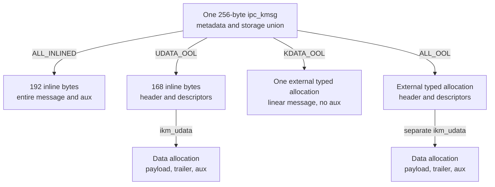
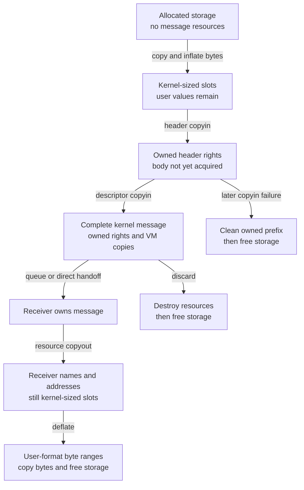
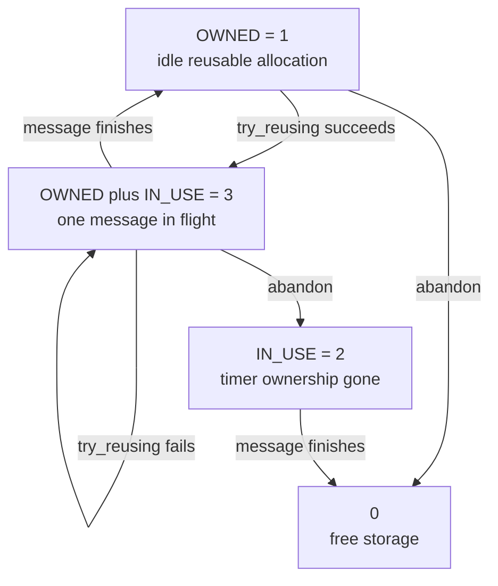
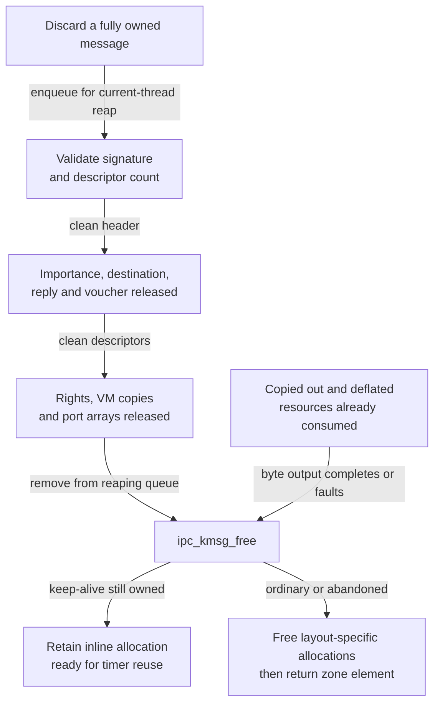

# IPC kmsgs and message storage

An `ipc_kmsg` is the kernel's message container. Its allocation can hold message bytes inline or point to separately allocated header/descriptor and data buffers. During a send, some of those bytes change from task-local names and user addresses into owned rights and VM-copy objects; during a receive, they change back into receiver-local values. This chapter follows those storage and ownership transitions in `xnu-12377.121.6`, including the reusable message retained by a Mach timer.

[Key structures](README.md) · [IPC guide](../subsystems/ipc/README.md) · [Ports and kobjects](ipc-ports-and-kobjects.md) · [Memory entries and VM copies](memory-entries-and-vm-copies.md)

Read [message representations](../subsystems/ipc/message-path.md), [send and receive](../subsystems/ipc/message-send-receive.md), [complex-message copyin and copyout](../subsystems/ipc/complex-message-copyin-and-copyout.md), and [message integrity](../subsystems/ipc/message-integrity-and-descriptor-authentication.md) for the surrounding algorithms. Here the questions are narrower: which allocation contains a field, which representation makes an accessor valid, who owns the resources at that point, and which cleanup releases them.

Inspect the live [`ipc_kmsg`](layout-browser.md?declaration=ipc_kmsg) layout for the selected source profile.

## 1. A fixed container with four storage layouts

The `ipc kmsgs` zone supplies one **256-byte `struct ipc_kmsg`**, with caching and clear-on-free flags. It is writable storage; neither a read-only zone nor an immutable message object. Pointer-authentication annotations on selected pointers and the message signature are separate mechanisms. The zone and variable-size typed allocation family are defined together in [ipc_kmsg.c:176–184](../../xnu/osfmk/ipc/ipc_kmsg.c#L176-L184):

<!-- source-excerpt: ../../xnu/osfmk/ipc/ipc_kmsg.c#L176-L184 -->
```c
ZONE_DEFINE_ID(ZONE_ID_IPC_KMSG, "ipc kmsgs", struct ipc_kmsg,
    ZC_CACHING | ZC_ZFREE_CLEARMEM);
#define ikm_require(kmsg) \
	zone_id_require(ZONE_ID_IPC_KMSG, sizeof(struct ipc_kmsg), kmsg)
#define ikm_require_aligned(kmsg) \
	zone_id_require_aligned(ZONE_ID_IPC_KMSG, kmsg)

KALLOC_TYPE_VAR_DEFINE(KT_IPC_KMSG_KDATA_OOL,
    mach_msg_base_t, mach_msg_kdescriptor_t, KT_DEFAULT);
```

The declaration reserves a **192-byte union after a 64-byte metadata prefix**. The 64-byte offset follows from the asserted 256-byte total and asserted extent of `ikm_big_data`; it is not an assumption about arbitrary compiler padding. An alternative view of that union holds 168 inline bytes followed by two pointers and two size fields. [Layout and static assertions](../../xnu/osfmk/ipc/ipc_kmsg.h#L134-L196).

The layout selector decides whether the tail bytes are message content or allocation metadata. In `ALL_INLINED`, bytes that would hold `ikm_kdata`, `ikm_udata` and their sizes in another layout are part of `ikm_big_data`. Reading those union members as pointers in that state is incorrect. Both inline arrays start at the same address; the accessor still dispatches on `ikm_type`. [Union declaration](../../xnu/osfmk/ipc/ipc_kmsg.h#L161-L190), [header accessor](../../xnu/osfmk/ipc/ipc_kmsg.c#L289-L300).

| `ikm_type` | Header and kernel descriptors | Ordinary message data, trailer and auxiliary data | Storage release |
| --- | --- | --- | --- |
| `IKM_TYPE_ALL_INLINED` | In the 192-byte `ikm_big_data` region | Same inline region; auxiliary data, if any, is anchored at its end | No external allocation; eventually return the zone element. |
| `IKM_TYPE_UDATA_OOL` | In the 168-byte `ikm_small_data` region | Separate `kalloc_data()` buffer reached through `ikm_udata` | Free the data allocation, then the zone element. |
| `IKM_TYPE_KDATA_OOL` | At the beginning of one external, linear typed allocation | Immediately after the header/descriptors in that same allocation; no auxiliary data | Free the variable-size typed allocation, then the zone element. |
| `IKM_TYPE_ALL_OOL` | Separate typed allocation of a `mach_msg_base_t` and an array of `mach_msg_kdescriptor_t` | Separate `kalloc_data()` buffer | Free both allocations with their original capacities, then the zone element. |

The selector's definitions are in [ipc_kmsg.h:104–132](../../xnu/osfmk/ipc/ipc_kmsg.h#L104-L132); allocation and release implement these cases in [ipc_kmsg_alloc()](../../xnu/osfmk/ipc/ipc_kmsg.c#L763-L884) and [ipc_kmsg_free_allocations()](../../xnu/osfmk/ipc/ipc_kmsg.c#L978-L1015). “OOL” here describes where the **message buffer** resides. A Mach out-of-line memory descriptor is a separate concept: its owned VM-copy object can be referenced from a descriptor stored in any of these layouts.



The four branches are alternatives, not four simultaneous allocations. The arrows to the data buffers abbreviate pointers stored in the `ipc_kmsg` metadata, not pointers embedded in the descriptor array. Apple's [kmsg layout notes](../../xnu/doc/mach_ipc/kmsg.md) provide complementary byte-layout drawings.

### Metadata that survives message-format changes

The leading fields are independent of the header's user/kernel layout. [ipc_kmsg.h:145–159](../../xnu/osfmk/ipc/ipc_kmsg.h#L145-L159):

<!-- source-excerpt: ../../xnu/osfmk/ipc/ipc_kmsg.h#L145-L159 -->
```c
struct ipc_kmsg {
	queue_chain_t              ikm_link;
	ipc_port_t                 XNU_PTRAUTH_SIGNED_PTR("kmsg.ikm_voucher_port") ikm_voucher_port;   /* voucher port carried */
	struct ipc_importance_elem *ikm_importance;  /* inherited from */
	queue_chain_t              ikm_inheritance;  /* inherited from link */
	uint16_t                   ikm_aux_size;     /* size reserved for auxiliary data */
	ipc_kmsg_keep_alive_t      ikm_keep_alive;   /* only used for IKM_TYPE_ALL_INLINED */
	uint8_t                    __ikm_padding;
	uint32_t                   ikm_ppriority;    /* pthread priority of this kmsg */
	uint32_t                   ikm_signature;    /* sig for all kernel-processed data */
	ipc_object_copyin_flags_t  ikm_flags;
	mach_msg_qos_t             ikm_qos_override; /* qos override on this kmsg */

	mach_msg_type_name_t       ikm_voucher_type: 6; /* disposition type the voucher came in with */
	ipc_kmsg_type_t            ikm_type: 2;
```

| Field or group | Meaning and access rule |
| --- | --- |
| `ikm_link` | Link for a message queue or the current thread's destruction queue. Those uses represent different ownership stages; the same link is not simultaneously on both lists. [Queue helpers](../../xnu/osfmk/ipc/ipc_kmsg.h#L204-L221), [destruction enqueue](../../xnu/osfmk/ipc/ipc_kmsg.c#L1318-L1342). |
| `ikm_voucher_port`, `ikm_voucher_type` | Separately stored voucher port and original incoming disposition. The kernel header's voucher slot remains a 32-bit name-sized field and cannot hold this port pointer. [Voucher installation](../../xnu/osfmk/ipc/ipc_kmsg.c#L2078-L2094). |
| `ikm_importance`, `ikm_inheritance` | Owned importance association and its independent list link. Linking requires the importance lock and a donated reference; unlinking returns that reference to its caller. [Link/unlink contracts](../../xnu/osfmk/ipc/ipc_importance.c#L167-L226). |
| `ikm_aux_size` | Reserved auxiliary extent, including its auxiliary header. This is not the ordinary message body's size. [Auxiliary accessor](../../xnu/osfmk/ipc/ipc_kmsg.c#L302-L320), [auxiliary header](../../xnu/osfmk/mach/message.h#L642-L646). |
| `ikm_keep_alive` | Atomic ownership/in-flight bits used by the timer path. This is not a general kmsg reference counter. [Bit definitions](../../xnu/osfmk/ipc/ipc_kmsg.h#L138-L143), [reuse/completion](../../xnu/osfmk/ipc/ipc_kmsg.c#L905-L944). |
| `ikm_ppriority`, `ikm_qos_override` | Message priority and queue-related override state. User and kernel-origin messages initialize them differently. Queue insertion can propagate an override backward through earlier messages without sorting the queue by priority. [Priority initialization](../../xnu/osfmk/ipc/ipc_kmsg.c#L1394-L1459), [queue propagation](../../xnu/osfmk/ipc/ipc_kmsg.c#L1196-L1263). |
| `ikm_signature` | Integrity value for the kernel-processed representation. Validation also checks aligned membership in the kmsg zone and returns a validated descriptor count. It is not a lifetime reference or a blanket signature over all user payload bytes. [Validation](../../xnu/osfmk/ipc/ipc_kmsg.c#L554-L570), [integrity scope](../subsystems/ipc/message-integrity-and-descriptor-authentication.md). |
| `ikm_flags` | Copyin policy carried with the message, including decisions made after the destination is known. It is distinct from the allocator's `IPC_KMSG_ALLOC_*` argument. [Destination-dependent policy](../../xnu/osfmk/ipc/ipc_kmsg.c#L2103-L2119), [allocator flags](../../xnu/osfmk/ipc/ipc_kmsg.h#L239-L248). |
| `ikm_type`, `ikm_kdata_size`, `ikm_udata_size` | Layout and allocation capacities. These select access/free behavior; they do not replace the current header's logical `msgh_size` or descriptor count. [Initialization](../../xnu/osfmk/ipc/ipc_kmsg.c#L861-L881), [capacity-based free](../../xnu/osfmk/ipc/ipc_kmsg.c#L984-L1003). |

There is no lock or ordinary reference counter inside this structure. Access comes from the current send/receive owner, the appropriate queue lock, or a specific subordinate protocol such as the importance lock. A pointer returned by `ikm_header()` or `ikm_udata()` does not acquire any of those protections.

## 2. Allocation reserves capacity before it acquires rights

The selected user route, `mach_msg_trap_send()`, validates the user size, alignment and descriptor-count bounds, then passes the **unexpanded user message size** to `ipc_kmsg_alloc(..., IPC_KMSG_ALLOC_USER)`. Allocation precedes both byte inflation and right acquisition. [Caller and bounds](../../xnu/osfmk/ipc/mach_msg.c#L669-L721).

For this kernel representation, a user header grows from 24 to 32 bytes, and each descriptor may grow from the minimum user size of 12 bytes to the uniform 16-byte kernel size. The allocator reserves the maximum expansion, not the exact expansion of every descriptor already inspected. [Size constants](../../xnu/osfmk/ipc/ipc_kmsg.c#L150-L159), [header and descriptor assertions](../../xnu/osfmk/mach/message.h#L610-L618), [kernel descriptor union](../../xnu/osfmk/mach/message.h#L678-L685).

The arithmetic explicitly adds this growth for user-origin messages. [ipc_kmsg.c:748–761](../../xnu/osfmk/ipc/ipc_kmsg.c#L748-L761):

<!-- source-excerpt: ../../xnu/osfmk/ipc/ipc_kmsg.c#L748-L761 -->
```c
	if (flags & IPC_KMSG_ALLOC_KERNEL) {
		assert(aux_size == 0);
		max_delta = 0;
	} else if (os_mul_and_add_overflow(desc_count, USER_DESC_MAX_DELTA,
	    USER_HEADER_SIZE_DELTA, &max_delta)) {
		return IKM_NULL;
	}

	if (os_add3_overflow(kmsg_size, MAX_TRAILER_SIZE, max_delta, &max_kmsg_size)) {
		return IKM_NULL;
	}
	if (os_add_overflow(max_kmsg_size, aux_size, &max_kmsg_and_aux_size)) {
		return IKM_NULL;
	}
```

Using `S` for the caller's message size, `D` for its descriptor count, `A` for auxiliary bytes and `T` for the maximum trailer reservation, the selected user path computes:

| Quantity | Expression | Purpose |
| --- | --- | --- |
| Maximum expansion | `8 + 4 × D` | Header expansion plus the worst descriptor expansion. |
| Maximum message reservation | `S + T + 8 + 4 × D` | Expanded message plus trailer capacity. |
| Total reservation | Previous row `+ A` | Determines whether everything fits in 192 inline bytes. |
| Split header/descriptor capacity | `36 + 16 × D` | A kernel base header/body plus maximum descriptor array. The allocator reserves the base even for a simple message. |
| Split data capacity | Total reservation `− (32 + 12 × D)` | Conservative data/trailer/auxiliary capacity after subtracting the minimum header/descriptor extent used by this calculation. |

These are **allocation formulas**, not the exact occupied sizes after inflation. Kernel-origin allocation instead uses zero expansion and `16 × D` in the minimum kernel-data subtraction. All multiply/add/subtract operations shown in the allocator are checked for overflow. [Complete layout calculation](../../xnu/osfmk/ipc/ipc_kmsg.c#L748-L826).

An older allocator comment says `kmsg_size` already accounts for header expansion. For the user route above, the actual caller passes `send_msg_size` and the body adds `USER_HEADER_SIZE_DELTA`; use those bodies to interpret the argument. Similarly, `IPC_KMSG_ALLOC_LINEAR` selects the linear external case only when a caller supplies it. The selected user call supplies `IPC_KMSG_ALLOC_USER`, not an inferred linear flag based solely on destination type. [Comment](../../xnu/osfmk/ipc/ipc_kmsg.c#L709-L724), [actual call](../../xnu/osfmk/ipc/mach_msg.c#L704-L705), [linear branch](../../xnu/osfmk/ipc/ipc_kmsg.c#L768-L782).

### Allocator selection and failure unwind

For totals at most 192 bytes, allocation chooses `ALL_INLINED`. Otherwise `ALL_INLINE` makes oversize a panic; `LINEAR` chooses one external allocation and requires zero auxiliary bytes; the remaining route splits the storage and uses `UDATA_OOL` if the header/descriptor capacity fits in 168 bytes, or `ALL_OOL` if it does not. [Selection](../../xnu/osfmk/ipc/ipc_kmsg.c#L763-L826).

The allocator obtains the data buffer first, then any external kernel-data allocation, and finally the fixed zone element. Failure to allocate kernel data releases the already allocated data buffer. The fixed element is always allocated with `Z_WAITOK | Z_ZERO | Z_NOFAIL`; external allocations acquire `Z_ZERO` and `Z_NOFAIL` only from the corresponding caller flags. Thus a zeroed container does not imply zeroed external payload capacity. Arithmetic failure can return `IKM_NULL` before an allocation even with `NOFAIL`. [Allocation flags and unwind](../../xnu/osfmk/ipc/ipc_kmsg.c#L829-L867).

`ALL_OOL` uses the typed base-plus-descriptor-array allocator. `KDATA_OOL` instead uses the variable-size `KT_IPC_KMSG_KDATA_OOL` family because the one linear buffer includes payload/trailer space as well as pointer-bearing header/descriptors. The free path must match that choice. [Typed helper](../../xnu/osfmk/ipc/ipc_kmsg.c#L695-L705), [allocation branches](../../xnu/osfmk/ipc/ipc_kmsg.c#L844-L855).

### Worked allocation: the ninth descriptor changes the storage

Select an ARM64 kernel and a 64-bit user sender. Suppose a valid complex message has ordinary port descriptors, 48 payload bytes and 16 auxiliary bytes including its eight-byte auxiliary header. All descriptor dispositions and names are assumed valid for the later copyin. A user port descriptor occupies 12 bytes; its kernel representation occupies 16. The kernel reserves the 68-byte maximum trailer. [Descriptor sizing](../../xnu/osfmk/ipc/ipc_kmsg.c#L327-L362), [base/header sizes](../../xnu/osfmk/mach/message.h#L653-L676), [trailer size](../../xnu/osfmk/mach/message.h#L838-L848), [maximum trailer alias](../../xnu/osfmk/mach/message.h#L893-L894).

| Quantity | Eight port descriptors | Nine port descriptors |
| --- | --- | --- |
| User `S = 28 + 12D + 48` | 172 | 184 |
| Maximum expansion `8 + 4D` | 40 | 44 |
| Reservation including trailer and auxiliary data | `172 + 40 + 68 + 16 = 296` | `184 + 44 + 68 + 16 = 312` |
| Header/descriptor capacity `36 + 16D` | 164 | 180 |
| Data capacity | `296 − (32 + 96) = 168` | `312 − (32 + 108) = 172` |
| Selected layout | `UDATA_OOL`: 164 fits in 168 | `ALL_OOL`: 180 exceeds 168 |
| Requested storage, excluding allocator rounding/metadata | One 256-byte zone element and 168 data bytes | One 256-byte zone element, 180 typed kernel-data bytes and 172 data bytes |

In the eight-descriptor case, the actual expanded message size becomes `172 + 40 = 212`, consisting of 164 header/descriptor bytes and 48 payload bytes. The trailer starts at `ikm_udata + 48`. The auxiliary header starts at `ikm_udata + 168 − 16 = ikm_udata + 152`, leaving 36 bytes between the end of the maximum trailer reservation at offset 116 and the auxiliary region. That gap is capacity, not an extra transmitted field. The allocator deliberately over-reserves rather than assuming every input descriptor's exact size. [Inflated sizes and split copy](../../xnu/osfmk/ipc/ipc_kmsg.c#L2891-L3020), [trailer accessor](../../xnu/osfmk/ipc/ipc_kmsg.c#L384-L399), [auxiliary accessor](../../xnu/osfmk/ipc/ipc_kmsg.c#L302-L320).

Neither allocation has acquired eight or nine send rights yet. It has only made room for the later representations. Adding the ninth descriptor changes where the header/descriptors live; it does not by itself change the capability conversion algorithm.

### Kernel producers and maximum reply capacity

Kernel-origin messages need not be linear. `ipc_kmsg_get_from_kernel()` allocates with `IPC_KMSG_ALLOC_KERNEL`, copies header/descriptors and payload into the selected layout, and performs the required descriptor-pointer relocation or signing. `ipc_kmsg_copyin_from_kernel()` is a later resource-conversion operation; copying bytes alone is not its substitute. [Kernel buffer copy](../../xnu/osfmk/ipc/ipc_kmsg.c#L4893-L4956), [kernel resource copyin](../../xnu/osfmk/ipc/ipc_kmsg.c#L4991-L5110). The explicit `ipc_kmsg_alloc_uext_reply()` wrapper does request `LINEAR`. [Wrapper](../../xnu/osfmk/ipc/ipc_kmsg.c#L891-L896).

A kobject reply illustrates capacity versus actual content. The server reserves the registered maximum reply size and maximum descriptor count, then addresses the reply data using that count. A simple error reply can temporarily use the header area for `NDR` and `RetCode`, overlapping capacity otherwise reserved for descriptors. The server has explicit handling for `MIG_NO_REPLY` and replacement of an oversized error reply with a small inline error allocation. Do not infer the allocation's original shape from the final reply's descriptor count. [Reply allocation and data pointer](../../xnu/osfmk/kern/ipc_kobject.c#L458-L558), [error replacement and old-buffer release](../../xnu/osfmk/kern/ipc_kobject.c#L590-L628).

## 3. Accessors depend on layout and representation

`ikm_header()` is a layout switch. It neither retains the message nor validates the current header contents. [ipc_kmsg.c:289–300](../../xnu/osfmk/ipc/ipc_kmsg.c#L289-L300):

<!-- source-excerpt: ../../xnu/osfmk/ipc/ipc_kmsg.c#L289-L300 -->
```c
ikm_header(
	ipc_kmsg_t         kmsg)
{
	switch (kmsg->ikm_type) {
	case IKM_TYPE_ALL_INLINED:
		return (mach_msg_header_t *)kmsg->ikm_big_data;
	case IKM_TYPE_UDATA_OOL:
		return (mach_msg_header_t *)kmsg->ikm_small_data;
	default:
		return (mach_msg_header_t *)kmsg->ikm_kdata;
	}
}
```

| Accessor | Coordinate or result | Preconditions and limits |
| --- | --- | --- |
| `ikm_header(kmsg)` | Kernel virtual address of the selected header region | Caller owns/protects the kmsg; `ikm_type` must be valid. A returned pointer is not proof that a populated kernel-format header exists there. |
| `ikm_kdata_size(count, complex)` | Actual header/descriptor extent for the given kernel representation | Complex means base plus `count × 16`; simple means only the kernel header. This differs from allocator capacity. [Implementation](../../xnu/osfmk/ipc/ipc_kmsg.c#L200-L222). |
| `ikm_udata(kmsg, count, complex)` | Start of the ordinary data body | Linear: header address plus the calculated actual extent. Split: `ikm_udata`. Descriptors must be in the appropriate kernel representation and the caller must establish bounds. Explicit arguments allow construction before the header has been filled. [Contract and body](../../xnu/osfmk/ipc/ipc_kmsg.c#L225-L249). |
| `ikm_udata_from_header(kmsg)` | Same result, deriving count/complexity from the header | Requires a populated, trustworthy header and count. It is inappropriate while those values are still being established. [Implementation](../../xnu/osfmk/ipc/ipc_kmsg.c#L252-L267). |
| `ikm_kdata_end(kmsg)` | End of the selected capacity, for development/debug checks | Uses 192/168 inline capacity or the external stored capacity. It does not report the actual message end. [Conditional helper](../../xnu/osfmk/ipc/ipc_kmsg.c#L270-L283). |
| `ipc_kmsg_get_trailer(kmsg)` | Trailer following the actual message data | Uses header `msgh_size`; for split storage, subtracts the actual kernel-data extent before indexing the data buffer. [Implementation](../../xnu/osfmk/ipc/ipc_kmsg.c#L384-L399). |
| `ikm_aux_header(kmsg)` | Auxiliary region at the end of the allocation | Returns null for no auxiliary data; otherwise subtracts `ikm_aux_size` from the inline end or external data-buffer end. It does not search immediately after the actual trailer. [Implementation](../../xnu/osfmk/ipc/ipc_kmsg.c#L302-L320). |
| Voucher get/set/clear | Access to the separate voucher slot | Setting checks a valid port's kobject type but does not acquire a reference; clearing only clears fields and does not release the right. Ownership comes from the surrounding copyin/copyout/cleanup operation. [Helpers](../../xnu/osfmk/ipc/ipc_kmsg.c#L402-L425). |

For a concrete construction path, `kernel_mach_msg_send()` computes a kernel size and descriptor count, allocates zeroed storage, obtains the header and calls `ikm_udata()` with explicit count/complexity before filling the final message. That is different from deriving an offset from an uninitialized header. [Kernel message construction](../../xnu/osfmk/kern/ipc_mig.c#L236-L286).

The trailer reservation is also distinct from the trailer returned to a particular receiver. Send-side initialization supplies security/audit information and signs the kernel representation; receive options and receiver bitness select the eventual trailer size and conversion. [Send-side trailer](../../xnu/osfmk/ipc/ipc_kmsg.c#L528-L550), [receive-side trailer conversion](../../xnu/osfmk/ipc/ipc_kmsg.c#L4585-L4641).

## 4. Resource ownership changes in stages

The same pointer-sized slot can successively contain a cast user name, an owned port pointer, and a receiver-local scalar. The cast used while copying bytes does not make the original name a valid port pointer. `ipc_kmsg_get_and_inflate_from_user()` expands the representation; `ipc_kmsg_copyin_header()` and the descriptor helpers acquire resources. [Inflation](../../xnu/osfmk/ipc/ipc_kmsg.c#L2891-L3020), [ordered copyin stages](../../xnu/osfmk/ipc/ipc_kmsg.c#L3055-L3117).



The diagram shows the successful representation route and selected cleanup branches. Header-copyout failure, send compensation and descriptor-copyout errors have their own handling; they are not permission to jump to a destructor for an arbitrary mixture of user values and kernel pointers.

| Resource | When the kmsg owns it | Matching consumption or release |
| --- | --- | --- |
| Destination and optional reply right | Successful header copyin installs kernel port pointers and normalized dispositions; local temporaries are cleared as ownership transfers. [Commit to header](../../xnu/osfmk/ipc/ipc_kmsg.c#L2146-L2167). | Receive/header conversion, kernel dispatch or cleanup; destruction uses the destination-specific helper for the remote right and ordinary right destruction for the local right. [Header cleanup](../../xnu/osfmk/ipc/ipc_kmsg.c#L1056-L1081). |
| Voucher send right | Header copyin stores the port outside the Mach header and normalizes its carried right to a send right. The original disposition is kept separately. [Voucher transfer](../../xnu/osfmk/ipc/ipc_kmsg.c#L2078-L2094). | Receive can install it or release it when not requested; cleanup destroys it and clears the slot. The slot helper itself performs no retain/release. [Receive handling](../../xnu/osfmk/ipc/ipc_kmsg.c#L3415-L3475), [cleanup](../../xnu/osfmk/ipc/ipc_kmsg.c#L1076-L1081). |
| Port or guarded-port descriptor | That descriptor's copyin has completed successfully; its disposition describes the carried right. | Copyout transfers/consumes it, or descriptor cleanup destroys it and clears the name field. [Descriptor cleanup](../../xnu/osfmk/ipc/ipc_kmsg.c#L1094-L1160). |
| OOL memory descriptor | Successful conversion has replaced the user address with an owned `vm_map_copy_t`; kernel senders can supply an already prepared copy object. | VM copyout consumes the copy or the cleanup path discards it. The data buffer is not itself this VM-copy object. [User conversion](../subsystems/ipc/complex-message-copyin-and-copyout.md), [kernel conversion](../../xnu/osfmk/ipc/ipc_kmsg.c#L4991-L5110), [discard](../../xnu/osfmk/ipc/ipc_kmsg.c#L1094-L1160). |
| OOL port-array descriptor | An allocated array and the successfully acquired rights in it, with partial conversion handled inside its helper. | Copyout/cleanup releases array storage as well as consuming/destroying its elements. The enclosing descriptor loop only treats this descriptor as acquired after its helper succeeds. [Body dispatch and prefix cleanup](../../xnu/osfmk/ipc/ipc_kmsg.c#L2833-L2867), [array cleanup](../../xnu/osfmk/ipc/ipc_kmsg.c#L1123-L1141). |
| Importance association | The importance subsystem links the kmsg using a donated element reference; feature-conditioned work can also account for a destination boost. | `ipc_importance_clean()` unlinks/releases under its own lock and handles the port-side boost. Header cleanup invokes it while destination and voucher references still exist. [Importance cleanup](../../xnu/osfmk/ipc/ipc_importance.c#L3323-L3350), [ordering](../../xnu/osfmk/ipc/ipc_kmsg.c#L1063-L1068). |

### A partially acquired body is not a fully owned message

Suppose descriptor 0 acquired a send right, descriptor 1 acquired a VM copy, and descriptor 2 fails while converting an OOL port array. The failing helper unwinds its own partial array work. The outer loop then cleans the header and exactly the two completed descriptors. Descriptors after that point may still contain user values and must not be treated as owned kernel objects. The loop expresses that boundary in [ipc_kmsg.c:2859–2867](../../xnu/osfmk/ipc/ipc_kmsg.c#L2859-L2867):

<!-- source-excerpt: ../../xnu/osfmk/ipc/ipc_kmsg.c#L2859-L2867 -->
```c
		if (MACH_MSG_SUCCESS != mr) {
			/* clean from start of message descriptors to copied_in_dscs */
			ipc_kmsg_clean_header(kmsg);
			ipc_kmsg_clean_descriptors(kbase->msgb_dsc_array,
			    copied_in_dscs);
			if (psize) {
				kmem_free(ipc_kernel_copy_map, paddr, psize);
			}
			return mr;
```

The temporary pageable copy-map reservation has a separate lifetime: allocation failure cleans the already acquired header, and descriptor failure also frees unused reserved space. Once `ipc_kmsg_copyin_from_user()` returns an error, the caller frees the container; it does not run whole-message resource destruction again. Releasing already acquired resources does not necessarily restore every sender-side right or mapping consumed earlier. [Copy-map reservation](../../xnu/osfmk/ipc/ipc_kmsg.c#L2800-L2830), [caller error branch](../../xnu/osfmk/ipc/mach_msg.c#L718-L721), [complex-message partial progress](../subsystems/ipc/complex-message-copyin-and-copyout.md).

For the eight-descriptor allocation example, assume a `COPY_SEND` destination and eight valid `COPY_SEND` port descriptors. Before copyin there are zero owned message rights. After header acquisition there is the destination right; after descriptor acquisition there are eight additional carried send rights. The sender's original rights remain, while the receiver may later install names or merge these rights with existing entries. Eight descriptor slots do not imply eight new port objects or eight distinct receiver names. [Kernel representation and header copyin](../subsystems/ipc/message-path.md), [copyout into existing entries](ipc-spaces-and-entries.md), [right/reference accounting](ipc-ports-and-kobjects.md).

## 5. Queue handoff changes the owner, not the buffer layout

After copyin, sending can dispatch to a kernel service, enqueue on a port, hand directly to a waiting receiver, or dispose of the message on a terminal path. A successful send result establishes consumption by the send path, not proof that a receiver obtained the message bytes. Circularity and a destination that dies during sending have explicit destruction paths returning success. [Send decisions](../../xnu/osfmk/ipc/ipc_kmsg.c#L5124-L5338).

| Stage | Protection and ownership | What the next stage receives |
| --- | --- | --- |
| Private send/copyin | The current operation owns the container; namespace/port/VM helpers use their own locks while acquiring resources. | A complete owned message or an error with its acquired resources cleaned. |
| Queue reservation | `ipc_mqueue_send_locked()` reserves `imq_msgcount` before dropping the queue lock and posting. The reservation count can exceed the number of linked messages. [Reservation](../../xnu/osfmk/ipc/ipc_mqueue.c#L432-L456). | Permission for the post stage to publish or discharge the reservation. |
| Queued message | The port message-queue lock protects queue linkage and queue-side priority state; the queue owns the posted message. [Post](../../xnu/osfmk/ipc/ipc_mqueue.c#L640-L779), [enqueue/QoS](../../xnu/osfmk/ipc/ipc_kmsg.c#L1196-L1234). | The selected receiver gets the same allocation, removed from the queue. |
| Direct handoff | Post assigns the kmsg to `receiver->ith_kmsg` while holding the waitq lock, records the sequence number, wakes the receiver and releases the unused reservation. [Handoff](../../xnu/osfmk/ipc/ipc_mqueue.c#L750-L761). | Receiver ownership without intermediate residence on the message list. |
| Receive selection | Queue selection performs size decisions before removing the message. `MACH_RCV_LARGE` can report the needed size while leaving the message available. [Selection](../../xnu/osfmk/ipc/ipc_mqueue.c#L1090-L1141). | Either ownership of the selected kmsg or a size/error result without that transfer. |
| Destruction queue | Current-thread reaping owns the messages until resource cleanup finishes; this uses `ikm_link` after port-queue ownership has ended. [Enqueue and drain](../../xnu/osfmk/ipc/ipc_kmsg.c#L1318-L1374). | Final storage free, or return to a timer's reusable idle allocation. |

Importance has its own synchronization rather than borrowing the message queue lock for every operation. Likewise, the optional preadopt-thread-group accessor specifically requires kmsg ownership plus the mqueue lock and returns a borrowed thread group; a caller retaining it beyond that interval must acquire its own reference. That narrow contract should not be generalized to every field or accessor. [Thread-group access contract](../../xnu/osfmk/ipc/ipc_kmsg.c#L427-L449), [importance link lock contract](../../xnu/osfmk/ipc/ipc_importance.c#L167-L226).

If normal user sending returns an error after successful copyin, the trap invokes pseudo-receive to return resources through a defined compensation path. Kernel sending instead destroys the message on send failure after successful kernel copyin; an early kernel-copyin error frees the buffer. Track the caller's branch rather than treating `ipc_kmsg_send()` as an always-consuming API. [User send compensation](../../xnu/osfmk/ipc/mach_msg.c#L724-L729), [kernel send ownership](../../xnu/osfmk/kern/ipc_mig.c#L132-L178).

## 6. Receiver conversion and deflation are different operations

Resource copyout replaces owned kernel resources with receiver-local port names and addresses while leaving them in kernel-layout slots. Ordinary body copyout visits every descriptor, accumulates errors, and consumes or releases resources through the per-descriptor helpers; an error can coexist with successful installations from other descriptors. Header-copyout errors have a different ownership boundary and retain resources for the caller's error handling. [Header/body driver](../../xnu/osfmk/ipc/ipc_kmsg.c#L4227-L4269), [body loop](../../xnu/osfmk/ipc/ipc_kmsg.c#L4098-L4132).

Deflation subsequently contracts the header and descriptors into user format. Its contract explicitly limits subsequent operations. [ipc_kmsg.c:3146–3160](../../xnu/osfmk/ipc/ipc_kmsg.c#L3146-L3160):

<!-- source-excerpt: ../../xnu/osfmk/ipc/ipc_kmsg.c#L3146-L3160 -->
```c
 * IPC kmsg deflate
 * ~~~~~~~~~~~~~~~~
 *
 * This is the operation that turns a message in kernel representation,
 * but with rights copied out, into user representation.
 *
 * This is driven by @c ipc_kmsg_deflate() which will:
 * - convert the message header into user layout (mach_msg_user_header_t),
 * - convert the descriptors into user layout,
 * - generate receive time parts of the trailer and convert it to user layout.
 *
 * This operation mangles the payload of the kmsg, making most of the kmsg
 * functions have undefined behavior. The only valid things to do with
 * a deflated message is to copy the bytes back to userspace and destroy
 * the message with @c ipc_kmsg_free().
```

Before modifying those bytes, `ipc_kmsg_deflate()` captures a context containing the header/data ranges, auxiliary region, receiver bitness and requested trailer. It determines the split-data boundary from the actual kernel representation, then converts trailer, descriptors and header. Descriptors contract toward their end, moving the beginning of the user message while preserving ordinary payload/trailer/auxiliary positions. A later `ikm_header()` can still return the allocation's original header address, but that does not make it the beginning of a valid user or kernel header. [Context capture and conversion](../../xnu/osfmk/ipc/ipc_kmsg.c#L4644-L4705), [backward descriptor contraction](../../xnu/osfmk/ipc/ipc_kmsg.c#L4136-L4176), [header contraction](../../xnu/osfmk/ipc/ipc_kmsg.c#L4559-L4582).

`ipc_kmsg_put_to_user()` uses the captured ranges to copy the contracted header/descriptors and, for a split layout, the body/trailer into adjacent user addresses. Auxiliary output is handled separately according to the receive-vector mode. A later byte-copy fault returns `MACH_RCV_INVALID_DATA`, clears reported output sizes and frees the container. It cannot undo receiver rights or VM mappings already installed by resource copyout, and earlier byte writes may already have succeeded. [Output-mode decisions](../../xnu/osfmk/ipc/ipc_kmsg.c#L4740-L4830), [copy and final free](../../xnu/osfmk/ipc/ipc_kmsg.c#L4833-L4872).

The kernel-output path has a different destination format: `ipc_kmsg_put_to_kernel()` copies a linear message or joins the split pieces into the caller's kernel buffer, handles descriptor pointer relocation/stripping for the selected destination, and frees the kmsg. It does not run user deflation, and auxiliary data is excluded. The copy transfers the message's representation and resource responsibility; it does not independently duplicate every right described by the copied bytes. [Kernel output](../../xnu/osfmk/ipc/ipc_kmsg.c#L5346-L5392), [descriptor relocation contract](../subsystems/ipc/message-integrity-and-descriptor-authentication.md).

## 7. A Mach timer retains storage across separate messages

The timer path allocates one inline kmsg and keeps it as `mk_timer.prealloc`. `mk_timer` has its own zone, simple lock, thread-call state, `is_armed`/`is_dead` flags and active-callback count. The timer owns a send right to its timer port; the port's `IOT_TIMER_PORT` label points back to the timer object. These are separate relationships from the kmsg's two keep-alive bits. [Timer layout and allocation](../../xnu/osfmk/kern/mk_timer.c#L50-L104), [timer-port policy destructor](../../xnu/osfmk/ipc/ipc_policy.c#L1690-L1697).

Creation requests `KERNEL | ZERO | ALL_INLINE | NOFAIL | USE_KEEP_ALIVE`. The kernel expiration message consists of a 32-byte header and three 64-bit unused values: 56 bytes, plus 68 bytes of maximum trailer reservation, fits inside the 192-byte inline capacity. Allocation initializes `OWNED` but not `IN_USE`. [Preallocation](../../xnu/osfmk/kern/mk_timer.c#L83-L92), [expiration message layout](../../xnu/osfmk/mach/mk_timer.h#L78-L85), [keep-alive initialization](../../xnu/osfmk/ipc/ipc_kmsg.c#L865-L867).



This diagram selects an allocation already created with keep-alive enabled. Ordinary messages use zero to mean that the facility is unused. For them, completion immediately permits normal freeing. The atomic helpers do not supply a general lock for reading or rewriting the payload.

`ipc_kmsg_keep_alive_try_reusing()` atomically ORs `IN_USE`, asserts that the prior state contained `OWNED`, and returns whether `IN_USE` was previously absent. A failed attempt leaves the already in-flight message in place. On final message handling, `ipc_kmsg_free()` calls `done_using()`: clearing `IN_USE` while `OWNED` remains keeps the allocation; clearing the last in-flight bit after abandonment permits freeing. Completion and abandonment use release operations plus the acquire fence on the path that frees. [Reuse and completion bodies](../../xnu/osfmk/ipc/ipc_kmsg.c#L905-L944).

Abandoning an idle buffer frees it immediately; abandoning an in-flight one leaves freeing to its completion. [ipc_kmsg.c:957–968](../../xnu/osfmk/ipc/ipc_kmsg.c#L957-L968):

<!-- source-excerpt: ../../xnu/osfmk/ipc/ipc_kmsg.c#L957-L968 -->
```c
	uintptr_t v;

	v = os_atomic_andnot_orig(&kmsg->ikm_keep_alive,
	    IKM_KEEP_ALIVE_OWNED, release);

	/* if the message wasn't owned, something is wrong */
	ipc_release_assert(v & IKM_KEEP_ALIVE_OWNED);

	if ((v & IKM_KEEP_ALIVE_IN_USE) == 0) {
		os_atomic_thread_fence(acquire);
		ipc_kmsg_free(kmsg);
	}
```

### One expiration owns the reusable bytes until completion

The expiration callback checks timer state under the timer lock, disarms and drops that lock, then attempts to acquire the preallocated buffer's in-flight bit. On success it rebuilds the expiration message and sends it through the normal kernel-message ownership path. [mk_timer.c:157–171](../../xnu/osfmk/kern/mk_timer.c#L157-L171):

<!-- source-excerpt: ../../xnu/osfmk/kern/mk_timer.c#L157-L171 -->
```c
		timer->is_armed = false;
		simple_unlock(&timer->lock);

		if (ipc_kmsg_keep_alive_try_reusing(kmsg)) {
			mk_timer_expire_msg_t *msg;

			msg = __container_of(ikm_header(kmsg),
			    mk_timer_expire_msg_t, header);
			bzero(msg, sizeof(mk_timer_expire_msg_t));
			msg->header.msgh_bits =
			    MACH_MSGH_BITS_SET(MACH_MSG_TYPE_COPY_SEND, 0, 0, 0);
			msg->header.msgh_size = sizeof(mk_timer_expire_msg_t);
			msg->header.msgh_remote_port = port;

			kernel_mach_msg_send_kmsg(kmsg);
```

Rebuilding the header matters: the previous delivery could have deflated that same inline storage into user format. The timer does not send a second copy from those bytes while the first remains in flight. If reuse fails, this callback does not allocate a replacement or append another message. Afterward it retakes the timer lock, updates the active-callback count, and performs deferred timer destruction if the label destructor marked the timer dead. [Callback](../../xnu/osfmk/kern/mk_timer.c#L149-L183).

The timer's retained send right keeps the port relationship available across expirations. Each successfully constructed expiration message uses `COPY_SEND`, so kernel copyin acquires the message's own destination right rather than transferring away the timer's retained one. Failure after kernel copyin destroys the message; failure before it frees the message buffer. Both paths eventually reach the keep-alive completion check. [Expiration header](../../xnu/osfmk/kern/mk_timer.c#L165-L171), [kernel send cleanup](../../xnu/osfmk/kern/ipc_mig.c#L132-L178), [kernel header right acquisition](../../xnu/osfmk/ipc/ipc_kmsg.c#L4991-L5110).

### Timer death, cancellation and constructor failure

The label destructor cancels a pending thread call when possible, updates the active count, clears armed state and marks the timer dead. It destroys the timer immediately only if no callback remains active. The final helper saves the preallocated kmsg pointer, drops the timer lock, frees the timer, abandons the kmsg and releases the retained send right. An in-flight kmsg can therefore survive the timer structure itself. [Label destruction and final helper](../../xnu/osfmk/kern/mk_timer.c#L108-L138).

The creation error path is also owned: `ipc_port_alloc()` consumes the label and frees it on failure, which invokes the timer label destructor. The short `return MACH_PORT_NULL` in `mk_timer_create_trap()` is not evidence that its preallocated objects are forgotten. [Port allocation failure cleanup](../../xnu/osfmk/ipc/ipc_port.c#L905-L943), [label policy dispatch](../../xnu/osfmk/ipc/ipc_policy.h#L570-L575), [registered timer destructor](../../xnu/osfmk/ipc/ipc_policy.c#L1690-L1697).

Canceling an armed timer is different from destroying its port. The cancel operation clears armed state and adjusts callback accounting; it does not abandon `prealloc`, nor does it recall a message already emitted by an earlier expiration. Copying the previous deadline to the user can fail after cancellation has occurred. [Cancel implementation](../../xnu/osfmk/kern/mk_timer.c#L345-L397). During port teardown, queued messages are transferred to destruction and the label is released before the reaping pass: abandonment and later message completion can therefore cooperate through the two bits. [Port teardown ordering](../../xnu/osfmk/ipc/ipc_port.c#L1225-L1262).

## 8. Destroy resources, then release or retain storage

`ipc_kmsg_free()` is a **buffer release** operation. It asserts that the voucher slot no longer contains a valid port but does not walk and destroy header rights, descriptor rights, VM copies or importance state. Its keep-alive branch can also turn a nominal “free” into a return to idle storage. The final portion is [ipc_kmsg.c:1038–1046](../../xnu/osfmk/ipc/ipc_kmsg.c#L1038-L1046):

<!-- source-excerpt: ../../xnu/osfmk/ipc/ipc_kmsg.c#L1038-L1046 -->
```c
	if (kmsg->ikm_type == IKM_TYPE_ALL_INLINED &&
	    !ipc_kmsg_keep_alive_done_using(kmsg)) {
		return;
	}

	ipc_kmsg_free_allocations(kmsg);
	zfree_id(ZONE_ID_IPC_KMSG, kmsg);
	/* kmsg struct freed */
}
```

For a fully owned, discarded message, `ipc_kmsg_destroy()` arranges resource destruction first. Skip-remote/skip-local flags are used when a caller has already consumed or transferred those rights; the destructor adjusts those fields and the signature before enqueueing. They are ownership declarations by the caller, not requests to leak a still-owned right. [Destroy flags and enqueue](../../xnu/osfmk/ipc/ipc_kmsg.c#L1275-L1309).

The current thread's reaping queue prevents recursive destruction from growing the C stack: the drain validates the signature/count, cleans the header and descriptors while the current message remains queued, removes it, and finally calls `ipc_kmsg_free()`. Newly triggered destruction appends to that queue. This is a current-thread drain, not a promise of a separate background worker. [Drain implementation](../../xnu/osfmk/ipc/ipc_kmsg.c#L1318-L1374), [operation walkthrough](../subsystems/ipc/message-send-receive.md#destruction-cascades-use-a-per-thread-reaping-queue).



The `ALL_OOL` free path derives its allocation count from `(ikm_kdata_size − sizeof(mach_msg_base_t)) / KERNEL_DESC_SIZE`, not from the possibly rewritten message body. `UDATA_OOL` frees only the data buffer; `KDATA_OOL` uses its variable typed free; `ALL_INLINED` has no external allocation. It then clears the allocation metadata and returns the fixed zone element. This is why allocation capacities must remain trustworthy even after the message header has ceased to be interpretable. [Free switch and metadata reset](../../xnu/osfmk/ipc/ipc_kmsg.c#L984-L1015).

| Failure or completion point | Resources and bytes that may already have changed | Required next ownership action |
| --- | --- | --- |
| Allocation arithmetic or external allocation failure | No message rights acquired; one external buffer may have been allocated and unwound internally. | Caller handles `IKM_NULL`; no kmsg destructor is needed. [Allocator unwind](../../xnu/osfmk/ipc/ipc_kmsg.c#L748-L861). |
| User copy/inflation/schema failure | Kernel bytes may be partly written, but no header/body resource acquisition has occurred yet. | Free the allocated storage. [Staging](../../xnu/osfmk/ipc/ipc_kmsg.c#L3067-L3087), [caller](../../xnu/osfmk/ipc/mach_msg.c#L718-L721). |
| Header policy or body-copyin failure | Header rights and a descriptor prefix may have been acquired; sender-side movement may already have happened. | The copyin path cleans its owned state; caller frees storage. Do not destroy unconverted descriptor slots. [Policy cleanup](../../xnu/osfmk/ipc/ipc_kmsg.c#L3091-L3095), [prefix cleanup](../../xnu/osfmk/ipc/ipc_kmsg.c#L2859-L2867). |
| Send error after successful user copyin | Complete message resources remain for the caller's compensation path. | Pseudo-receive returns/consumes resources and ultimately frees storage. [Caller](../../xnu/osfmk/ipc/mach_msg.c#L724-L729). |
| Receive header-copyout error | Message resources remain for error handling. | Follow the receive error path; do not deflate as if all rights were already consumed. [Copyout contract and driver](../../xnu/osfmk/ipc/ipc_kmsg.c#L4227-L4269). |
| Receive descriptor-copyout error | Other descriptors can have installed rights/mappings; processing continues and releases failed resources. | Output the resulting receiver representation/error information and release storage through the normal receive path. [Body loop](../../xnu/osfmk/ipc/ipc_kmsg.c#L4098-L4132), [receive operation](../subsystems/ipc/message-send-receive.md). |
| Final user-byte copy fault | Resource installation and some earlier byte writes can already have succeeded. | Clear reported sizes and free storage; do not repeat resource destruction or imply rollback. [Final copyout](../../xnu/osfmk/ipc/ipc_kmsg.c#L4833-L4872). |
| Timer message finishes while its owner lives | Its per-send resources have been consumed or destroyed; user deflation may have changed inline bytes. | Clear `IN_USE`, retain allocation, rebuild the next message only after successful reuse acquisition. [Completion](../../xnu/osfmk/ipc/ipc_kmsg.c#L925-L944), [rebuild](../../xnu/osfmk/kern/mk_timer.c#L157-L171). |

## 9. Reading boundaries

This chapter follows the local allocation, representation, user/kernel conversion, queue ownership, timer reuse and destruction bodies in the selected source snapshot. Its numerical example uses the asserted ARM64 kernel and 64-bit user layouts, not a claim that every ABI, descriptor kind or configured field has the same size. The arithmetic is in message-buffer bytes and kernel virtual addresses; it does not equate a user OOL address with a kernel virtual address or a VM-copy object.

The existing [integrity chapter](../subsystems/ipc/message-integrity-and-descriptor-authentication.md) covers signature/PAC selection, validation and descriptor relocation; the existing [complex-message chapter](../subsystems/ipc/complex-message-copyin-and-copyout.md) covers per-descriptor conversion algorithms and rollback limits. This companion does not reconstruct missing generated MIG server bodies, service implementations or user-space receive code. A registered reply maximum, a kernel buffer, a carried right and a successfully dispatched service operation remain distinct pieces of evidence.

To read another producer, begin with its allocation flags and supplied size/count, follow how it populates header/data through accessors, identify the exact point each resource becomes owned, then find both its failed-send and final-completion branches. For a reusable producer, additionally locate the owner that prevents storage release and the operation that abandons that ownership.

<!-- BEGIN PLATYDOC DOCUMENTATION LICENSE -->
Original Platydoc text and diagrams are licensed under [CC BY 4.0](https://creativecommons.org/licenses/by/4.0/). Quoted source code and third-party material retain their respective licenses.
<!-- END PLATYDOC DOCUMENTATION LICENSE -->
