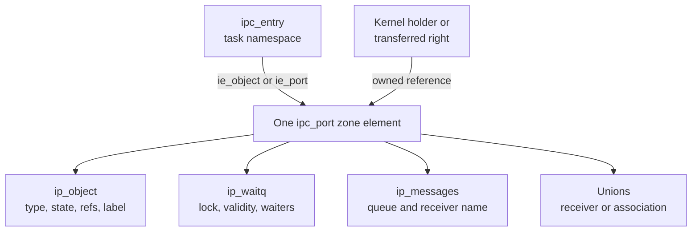
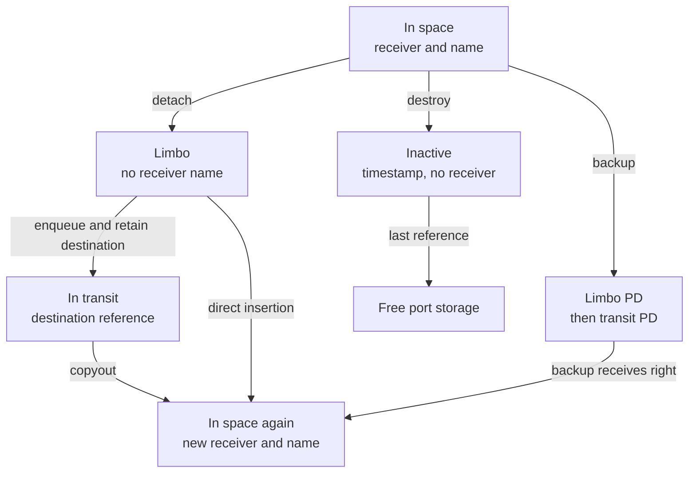
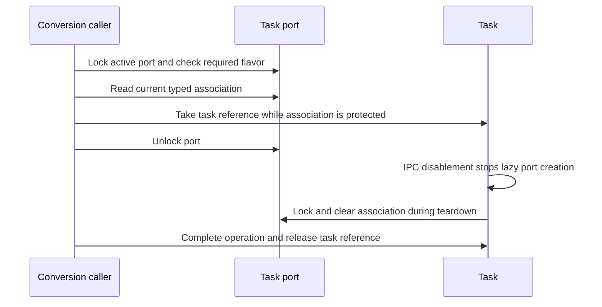
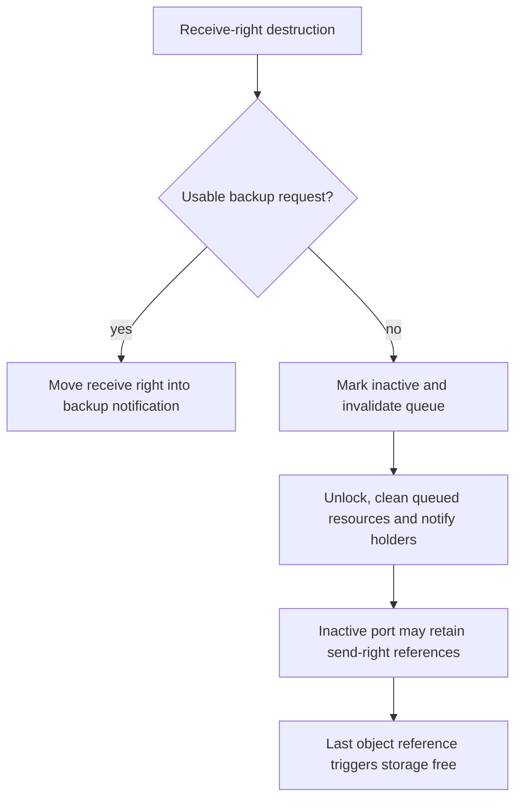

# IPC ports and kernel objects: storage, state and capability lifetime

An `ipc_port` can be an ordinary message endpoint or a typed route to a kernel object. Its storage can remain alive after its receive endpoint dies, and an active task port can lose its task association before the port itself is destroyed. This chapter follows allocation, field access, right ownership, association changes and final freeing in `xnu-12377.121.6`.

[Key structures](README.md) · [IPC spaces and entries](ipc-spaces-and-entries.md) · [Task structure](task-and-shared-ro.md) · [IPC guide](../subsystems/ipc/README.md)

Read [port and right lifecycle](../subsystems/ipc/ports-and-rights-lifecycle.md) for complete transfer operations and [task/thread capabilities](../subsystems/security/task-and-thread-capabilities.md) for flavor-specific admission. Here the aim is to make a source pointer or field understandable: which allocation contains it, which state gives it meaning, what lock protects it and which owner keeps it alive.

## 1. Start with the object header and its containing allocation

`struct ipc_port` begins with `struct ipc_object`. Port sets also begin with this header but are a different enclosing type, `struct ipc_pset`; the generic header is not a separately allocated object. `io_waitq()` uses a synthetic common layout to reach the wait queue following the header. The header describes object identity/state/reference ownership, while the containing port supplies the receiver, queue, notification and scheduling fields. [Object declaration and common layout](../../platydoc-data/xnu/osfmk/ipc/ipc_object.h#L190-L319), [port declaration](../../platydoc-data/xnu/osfmk/ipc/ipc_port.h#L119-L201), [port-set declaration](../../platydoc-data/xnu/osfmk/ipc/ipc_pset.h#L77-L84).



The diagram shows embedded storage, not separate allocations for each box. Actual kmsgs, notification-request arrays, turnstiles and optional label records are external objects with their own ownership rules. `ipc_mqueue` does not embed a second wait queue: this version keeps `ip_waitq` and `ip_messages` as separate port members. [Queue fields](../../platydoc-data/xnu/osfmk/ipc/ipc_mqueue.h#L83-L118), [external pointers](../../platydoc-data/xnu/osfmk/ipc/ipc_port.h#L164-L194).

### Zone properties are not read-only protection

Ports and port sets have dedicated zone IDs. The shared flags clear freed elements and sequester their virtual-address ranges; the port zone additionally enables caching:

[Source: `osfmk/ipc/ipc_object.c`, lines 125–131](../../platydoc-data/xnu/osfmk/ipc/ipc_object.c#L125-L131)

<!-- source-excerpt: ../../platydoc-data/xnu/osfmk/ipc/ipc_object.c#L125-L131 -->
```c
#define IPC_OBJECT_ZC_BASE (ZC_ZFREE_CLEARMEM | ZC_SEQUESTER)

ZONE_DEFINE_ID(ZONE_ID_IPC_PORT, "ipc ports", struct ipc_port,
    IPC_OBJECT_ZC_BASE | ZC_CACHING);

ZONE_DEFINE_ID(ZONE_ID_IPC_PORT_SET, "ipc port sets", struct ipc_pset,
    IPC_OBJECT_ZC_BASE);
```

`ip_alloc()` requests `ZONE_ID_IPC_PORT` with `Z_WAITOK_ZERO_NOFAIL`. These are writable port fields; ordinary updates use locks and reference operations, not `zalloc_ro_update_field()`. Sequestering prevents a former port-zone address from becoming an unrelated allocation class. It does not give the address a permanent port identity: a later allocation can occupy the slot, so name lookup must revalidate its relationship to the candidate object. [Typed allocation/free macros](../../platydoc-data/xnu/osfmk/ipc/ipc_port.h#L305-L308), [zone/lookup rationale](../../platydoc-data/xnu/osfmk/ipc/ipc_object.c#L102-L138), [lookup identity check](../../platydoc-data/xnu/osfmk/ipc/ipc_right.c#L237-L247).

The speculative lookup path uses `ipc_object_lock_allow_invalid()`: it checks the zone covering the wait queue, then tries a wait-queue lock operation that can reject freed/uninitialized storage or an invalid mapping. This relies on cleared storage and the waitq validity protocol, not simply on possessing an address numerically inside the zone. [Speculative lock implementation](../../platydoc-data/xnu/osfmk/ipc/ipc_object.c#L1217-L1267), [zone allocator background](../subsystems/vm/zone-allocator.md).

## 2. Allocation initializes a locked object before publishing its right

For an ordinary user-space receive endpoint, `ipc_port_alloc()` obtains the zeroed port, reserves an entry in the target space, initializes the port while the space is locked, initializes the entry, and unlocks the space. Failure to reserve the entry frees both the allocated label and raw port. Successful return leaves the port locked, and the caller does not receive an extra port reference beyond the reference owned by the installed right. [Complete allocation contract/body](../../platydoc-data/xnu/osfmk/ipc/ipc_port.c#L884-L945), [namespace reservation](ipc-spaces-and-entries.md#5-reservation-initialization-and-publication).

| Initializer step | Field effect | Why the order matters |
| --- | --- | --- |
| Initialize `io_references` and `ip_waitq` | One initial object reference; `WQT_PORT`, initialized locked | Many port bitfields share waitq flag storage, so this occurs first. |
| Apply the type's movement policy | May select `IO_STATE_IN_SPACE_IMMOVABLE` | Receive-right movement is constrained by the object policy from birth. |
| Initialize QoS and notification union state | Default QoS/iotier; appropriate null pointer representation | Zero bytes alone do not replace typed/PAC pointer initialization for every union. |
| Initialize `ip_messages` | Queue and counters prepared | The message queue must be usable before another operation can observe the port. |
| Set receiver and name, then initialize label/header | Port is born in the supplied ordinary or special space | The authenticated label encodes the selected type/state. |
| Optional `IP_INIT_MAKE_SEND_RIGHT` | `ip_srights = 1`, `ip_mscount = 1` | The combined receive/send entry still owns one object reference, not two. |

Sources: [`ipc_port_init`](../../platydoc-data/xnu/osfmk/ipc/ipc_port.c#L837-L881), [entry initialization](../../platydoc-data/xnu/osfmk/ipc/ipc_policy.c#L1092-L1118).

The first two initialization operations are small but important:

[Source: `osfmk/ipc/ipc_port.c`, lines 848–850](../../platydoc-data/xnu/osfmk/ipc/ipc_port.c#L848-L850)

<!-- source-excerpt: ../../platydoc-data/xnu/osfmk/ipc/ipc_port.c#L848-L850 -->
```c
	/* must be done first, many ip_* bits live inside the waitq */
	os_ref_init_raw(&port->ip_object.io_references, NULL);
	waitq_init(&port->ip_waitq, WQT_PORT, SYNC_POLICY_INIT_LOCKED);
```

Special allocation uses the same raw zone and initializer but attaches the receive right to `ipc_space_kernel` or another special space with `MACH_PORT_SPECIAL_DEFAULT`; there is no ordinary entry-table slot. `ipc_kobject_alloc_port()` then optionally makes a send right, installs the typed kernel-object association and unlocks the port. A no-fail constructor contract does not mean this whole path is suitable under arbitrary locks: its comments require no locks held because allocation can wait. [Special allocation](../../platydoc-data/xnu/osfmk/ipc/ipc_port.c#L3180-L3207), [kobject constructor](../../platydoc-data/xnu/osfmk/kern/ipc_kobject.c#L909-L941).

## 3. Field and accessor map

### Header, lock and queue

| Field/group | Meaning | Access and lifetime rule |
| --- | --- | --- |
| `ip_object.io_type` | Port class/kobject type, or port-set class for that enclosing type | Immutable during the object's lifetime. It can be read without the lock when storage lifetime is otherwise valid. It is not the entry's send/receive-right bitmask. |
| `io_state` | Inactive, in-space, immovable, limbo or transit state | Mutable under the object lock. Prefer resolved/authenticated label access when interpreting policy/state together. |
| `io_filtered` | Whether IPC filtering applies | Documented immutable property, separate from mutable queue state. |
| `io_references` | Atomic references retaining the allocation | `ip_reference`, `ip_release` and corresponding generic helpers do not grant a send/receive right by themselves. |
| `iol_*` union | Optional service/bootstrap/connection/kobject/timer label payload | Signed when stored in the header. Use label accessors; its pointer is not stable for the whole port lifetime. |
| `io_label_lock` | Tracks an outstanding resolved label value | Internal accessor discipline, not a second general-purpose mutex. |
| `ip_waitq` | Port lock, waiters and bitfields such as guards/special-reply state | `ip_mq_lock()` reaches `ipc_port_lock()`, which validates the object and takes the waitq lock. |
| `ip_messages` | Kmsg list, sequence number, queue count/limit and receiver-name alias | Port/queue protocol protects it; queue length is unrelated to port reference count. |

Sources: [header field contracts](../../platydoc-data/xnu/osfmk/ipc/ipc_object.h#L190-L253), [port lock](../../platydoc-data/xnu/osfmk/ipc/ipc_port.c#L162-L190), [lock aliases](../../platydoc-data/xnu/osfmk/ipc/ipc_port.h#L282-L308), [queue representation](../../platydoc-data/xnu/osfmk/ipc/ipc_mqueue.h#L83-L118).

`ipc_object_label_t` deliberately reuses the header's representation as a temporary resolved value. The source calls it non-copyable/movable: only one such value may be outstanding for a port, while its lock remains held. `io_label_get()` authenticates the payload with a discriminator incorporating object address and header bits. `ip_label_put()` or `io_label_set_and_put()` consumes the temporary; unlocking with an outstanding label is rejected. These are explicit lifetime rules around a temporary value, not a reference to a newly allocated label object. [Resolved-label contract](../../platydoc-data/xnu/osfmk/ipc/ipc_object.h#L256-L280), [authentication](../../platydoc-data/xnu/osfmk/ipc/ipc_object.h#L391-L431), [label update/put](../../platydoc-data/xnu/osfmk/ipc/ipc_object.h#L441-L486), [unlock check](../../platydoc-data/xnu/osfmk/ipc/ipc_object.c#L1269-L1274).

### Unions whose valid member depends on state

| Union/field | Valid interpretation | Accessor or discriminant |
| --- | --- | --- |
| `ip_receiver` / `ip_destination` / `ip_timestamp` | Receiving space, retained destination port for an in-transit receive right, or time of endpoint death | `ip_get_receiver()`, `ip_get_destination()`, `ip_get_death_time()` with the object state and lock contract. |
| `ip_kobject` / `ip_nsrequest` | Typed kernel-object pointer, or ordinary port's no-senders notification right | Object type selects interpretation. Kobject access uses `ipc_kobject_get_*`; no-senders preparation consumes/clears the ordinary notification association. |
| `ip_imp_task` / sync-inheritor pointers | Importance owner or special-reply donation destination | Special-reply type and `ip_sync_link_state` select the layout; `ip_get_imp_task()` also checks temporary-owner state. |
| `ip_pid` / `ip_twe` / `ip_pdrequest` | Special-reply PID, task-watchport element, or port-destroyed backup right | Special-reply type and `ip_has_watchport`. Destruction clears watchport state before using `ip_pdrequest`. |
| `ip_requests` | Separately allocated dead-name/send-possible request array | Each entry's request index selects a record; hold the port lock or satisfy the inactive-port contract to avoid table-growth races. |
| `ip_context` with guard flags | User context or guard-related value | Guarded operations check policy and the supplied guard; the value alone does not establish authority. |

Sources: [port unions](../../platydoc-data/xnu/osfmk/ipc/ipc_port.h#L152-L194), [receiver/destination/death accessors](../../platydoc-data/xnu/osfmk/ipc/ipc_port.h#L453-L500), [request table lookup](../../platydoc-data/xnu/osfmk/ipc/ipc_port.c#L576-L612), [watchport-before-backup ordering](../../platydoc-data/xnu/osfmk/ipc/ipc_port.c#L1167-L1183), [guard policy](../subsystems/ipc/guards-and-policy-enforcement.md).

The object/IPC labels here are not interchangeable with the MAC framework's credential/object labels. An `ipc_kobject_label` carries an `ipc_label_t` mask and optional alternate port; the latter can request controlled task/thread-port substitution during copyout. [Kobject label definition](../../platydoc-data/xnu/osfmk/kern/ipc_kobject.h#L161-L165), [substitution and checks](../../platydoc-data/xnu/osfmk/kern/ipc_kobject.c#L1339-L1477), [MAC label storage](mac-label-storage.md).

## 4. Receiver state tells you which pointer exists

| State | Receiver union | Name and reference consequence |
| --- | --- | --- |
| `IO_STATE_IN_SPACE` | `ip_receiver` | Ordinary receive name, or special-space marker; one owner holds the receive right. |
| `IO_STATE_IN_SPACE_IMMOVABLE` | `ip_receiver` | Same representation, with movement restricted by state/policy. |
| `IO_STATE_IN_LIMBO` / `_PD` | Zero/null destination representation | No receiving-space name; kernel code temporarily owns the detached receive right. `_PD` marks the backup-notification route. |
| `IO_STATE_IN_TRANSIT` / `_PD` | `ip_destination` | No receiving-space name; owns a reference to the destination carrying the receive right. |
| `IO_STATE_INACTIVE` | `ip_timestamp` | Receiver name is null; storage can still be retained by outstanding references. |

The enum's field contracts are in [`ipc_object.h`](../../platydoc-data/xnu/osfmk/ipc/ipc_object.h#L122-L187). The state transition helpers implement them in [`ipc_port.c`](../../platydoc-data/xnu/osfmk/ipc/ipc_port.c#L697-L827).



The two in-space boxes describe the same state at different times. This diagram selects movable ordinary endpoints; some policies reject or constrain the transitions, and transit/limbo cleanup can also reach destruction. Moving an existing receive right first removes port-set memberships, wakes receivers through `ipc_mqueue_changed()`, and resets make-send count, receive sequence and guard/context state. It does not allocate a replacement port object. `ipc_port_mark_in_space()` returns the previous destination pointer for the enclosing path to release after changing the receiver representation. [Movement preparation](../../platydoc-data/xnu/osfmk/ipc/ipc_port.c#L664-L692), [receive installation](../../platydoc-data/xnu/osfmk/ipc/ipc_port.c#L697-L735), [copyout destination cleanup](../../platydoc-data/xnu/osfmk/ipc/ipc_right.c#L2765-L2818).

The ownership added by entering transit is visible directly:

[Source: `osfmk/ipc/ipc_port.c`, lines 787–789](../../platydoc-data/xnu/osfmk/ipc/ipc_port.c#L787-L789)

<!-- source-excerpt: ../../platydoc-data/xnu/osfmk/ipc/ipc_port.c#L787-L789 -->
```c
	ip_reference(dest);
	port->ip_receiver_name = MACH_PORT_NULL;
	port->ip_destination = dest;
```

A receive right cannot be understood simply as an `ip_receiver` pointer. While it travels, the receiving-space association is absent, but the port and receive-right ownership still exist. Circularity checks and destination-chain locking prevent invalid receive-right graphs through separate algorithms described in [port transit and backup recovery](../subsystems/ipc/ports-and-rights-lifecycle.md). [Destination-chain code](../../platydoc-data/xnu/osfmk/ipc/ipc_port.c#L1321-L1475).

## 5. Count rights, urefs and allocation references separately

| Quantity | Unit | Representative update |
| --- | --- | --- |
| Entry send urefs | User references to that name's send right | Adding another copy into an existing send entry increments urefs, normally without leaving another standalone send-right instance. |
| `ip_srights` | Kernel send-right instances | One per send-bearing entry plus naked rights in messages/kernel code. Copying a naked send right increments this count. |
| `ip_sorights` | Send-once right instances | Making a send-once right increments this count and the allocation refcount. Send-once rights do not coalesce on ordinary copyout. |
| `ip_mscount` | Make-send events since creation/reset | Making increments it; copying an existing send right does not. Receive movement resets it. |
| `io_references` | Allocation references | References held by entries, naked rights and auxiliary kernel holders; they do not imply the port remains active. |

Sources: [make/copy send](../../platydoc-data/xnu/osfmk/ipc/ipc_port.c#L2841-L2899), [make send-once](../../platydoc-data/xnu/osfmk/ipc/ipc_port.c#L3061-L3070), [copyout/coalescing](../../platydoc-data/xnu/osfmk/ipc/ipc_right.c#L2587-L2687), [movement reset](../../platydoc-data/xnu/osfmk/ipc/ipc_port.c#L684-L692), [reference operations](../../platydoc-data/xnu/osfmk/ipc/ipc_object.c#L183-L225).

[Source: `osfmk/ipc/ipc_port.c`, lines 2841–2850](../../platydoc-data/xnu/osfmk/ipc/ipc_port.c#L2841-L2850)

<!-- source-excerpt: ../../platydoc-data/xnu/osfmk/ipc/ipc_port.c#L2841-L2850 -->
```c
ipc_port_t
ipc_port_make_send_any_locked(
	ipc_port_t      port)
{
	require_ip_active(port);
	port->ip_mscount++;
	ip_srights_inc(port);
	ip_reference(port);
	return port;
}
```

A receive-only entry has zero stored send urefs. A combined receive/send entry retains a single object reference, while `ip_srights` records its send capability. This distinction explains why moving the last send uref out of a combined entry has to add a reference for the outgoing right, while moving the last send uref out of a send-only entry can transfer the disappearing entry's reference. [Last-uref branches](../../platydoc-data/xnu/osfmk/ipc/ipc_right.c#L2400-L2441).

### A worked transfer ledger

Assume a movable ordinary port, unsaturated urefs, no notifications, no concurrent operation and no extra kernel references. Task A owns a combined receive/send entry with one send uref. The table counts only references to this port, not the separate message destination.

| Step | A's entry | Naked right | B's entry | `ip_srights` | Object references |
| --- | --- | --- | --- | ---: | ---: |
| Starting state | Receive + send(1) | — | — | 1 | 1 |
| A moves its last send uref | Receive | Send | — | 1 | 2 |
| B copies out the incoming right into a fresh entry | Receive | — | Send(1) | 1 | 2 |
| B copies a send right into a second message | Receive | Send | Send(1) | 2 | 3 |
| A receives it and combines it with its receive entry | Receive + send(1) | — | Send(1) | 2 | 2 |
| B moves its last uref into another message | Receive + send(1) | Send | — | 2 | 2 |
| A receives and coalesces it with its existing send right | Receive + send(2) | — | — | 1 | 1 |

The first move keeps A's entry alive because it still has receive ownership, so the outgoing right needs a new reference. B's later move can donate its entry reference. The last copyout consumes both the redundant send instance and its reference while increasing A's urefs. These are representation changes around one endpoint, not creation/destruction of one port per right. [Move-send implementation](../../platydoc-data/xnu/osfmk/ipc/ipc_right.c#L2359-L2461), [copy-send acquisition](../../platydoc-data/xnu/osfmk/ipc/ipc_port.c#L2892-L2899), [copyout accounting](../../platydoc-data/xnu/osfmk/ipc/ipc_right.c#L2639-L2683).

Saturated urefs and pinned/immovable rights change these operations: saturation can leave the uref value pegged, a pinned entry cannot lose its last protected send uref through ordinary movement, and an immovable send requires an explicitly permitted path. They must be checked before reusing the example's arithmetic. [Pinned/immovable gates](../../platydoc-data/xnu/osfmk/ipc/ipc_right.c#L2390-L2402), [saturation on move](../../platydoc-data/xnu/osfmk/ipc/ipc_right.c#L2442-L2450), [saturation on copyout](../../platydoc-data/xnu/osfmk/ipc/ipc_right.c#L2676-L2681).

## 6. Kobject association has a separate type and lifetime contract

A kobject port is created in `ipc_space_kernel`. Its immutable `io_type` identifies a particular `IKOT_*` class. `ip_kobject` is the associated kernel pointer, stored in a union also used by ordinary no-senders notification state. A kobject type is distinct from a port-name right and from a MIG request ID. The port chooses the exported object; the request ID chooses an operation; typed conversion and operation policy decide whether that object may be used. [Kobject construction](../../platydoc-data/xnu/osfmk/kern/ipc_kobject.c#L923-L941), [typed conversion](../../platydoc-data/xnu/osfmk/kern/ipc_tt.c#L2439-L2508), [RPC dispatch](../subsystems/ipc/kernel-rpc-and-exceptions.md).

The raw store signs the pointer using the storage address and expected kobject type when pointer-authentication calls are enabled:

[Source: `osfmk/kern/ipc_kobject.c`, lines 765–776](../../platydoc-data/xnu/osfmk/kern/ipc_kobject.c#L765-L776)

<!-- source-excerpt: ../../platydoc-data/xnu/osfmk/kern/ipc_kobject.c#L765-L776 -->
```c
	uintptr_t *store = &port->ip_kobject;

#if __has_feature(ptrauth_calls)
	type ^= OS_PTRAUTH_DISCRIMINATOR("ipc_port.ip_kobject");
	kobject = ptrauth_sign_unauthenticated(kobject,
	    ptrauth_key_process_independent_data,
	    ptrauth_blend_discriminator(store, type));
#else
	(void)type;
#endif // __has_feature(ptrauth_calls)

	*store = (uintptr_t)kobject;
```

`ipc_kobject_get_raw()` authenticates with the corresponding discriminator, but does not by itself acquire the port lock, validate activity or take a reference to the target. With PAC disabled, its type argument does not supply a software type check. Callers still need the proper access helper and lifetime protocol. [Raw getter](../../platydoc-data/xnu/osfmk/kern/ipc_kobject.c#L777-L809).

| Helper or property | Guarantee | Caller responsibility |
| --- | --- | --- |
| `ipc_kobject_get_locked(port, type)` | Returns the raw association only when active and of the requested type | Hold the port lock or satisfy the documented association-stability condition; separately retain the target if needed. |
| `ipc_kobject_get_stable()` | Requires a type policy declaring a stable association, then uses the checked getter | Stable association is a type-specific ownership promise, not a general guarantee for task/thread ports. |
| `ipc_kobject_enable()` | Under the port lock, verifies activity/type and installs a new association | Caller handles target references; stable types cannot use this changing-association interface. |
| `ipc_kobject_disable*()` | Clears the association and optional alternate-port pointer, returning the old target pointer | Clearing does not itself release every possible target reference or necessarily destroy the port. |
| `ipc_kobject_dealloc_port*()` | Checks type and optional make-send count, clears association and destroys the receive endpoint | Target-owner cleanup uses the returned old association and that type's own ownership rules. |

Sources: [checked/stable getters](../../platydoc-data/xnu/osfmk/kern/ipc_kobject.c#L839-L888), [disable primitive](../../platydoc-data/xnu/osfmk/kern/ipc_kobject.c#L1084-L1100), [deallocation](../../platydoc-data/xnu/osfmk/kern/ipc_kobject.c#L1152-L1185), [enable/disable interfaces](../../platydoc-data/xnu/osfmk/kern/ipc_kobject.c#L1217-L1294).

For the current deallocation body, the association-clear helper is called unconditionally before `ipc_port_destroy()`. Nearby comments still mention clearing only for kobjects without a destroy callback; the quoted current body, not that older qualification, determines this path. [Comment and implementation](../../platydoc-data/xnu/osfmk/kern/ipc_kobject.c#L1102-L1185).

### Task ports demonstrate why a port reference is not a task reference

`convert_port_to_task_with_flavor_locked_noref()` requires a locked active port, checks the flavor/type hierarchy, loads the association, handles corpse admission and applies task-conversion policy. Its referenced wrapper then calls `task_reference_grp()` before releasing the protection that made the pointer valid. The ordinary conversion wrapper produces a task reference without consuming the caller's port reference. [Borrowed conversion](../../platydoc-data/xnu/osfmk/kern/ipc_tt.c#L2439-L2477), [reference-taking wrapper](../../platydoc-data/xnu/osfmk/kern/ipc_tt.c#L2491-L2508), [outer contract](../../platydoc-data/xnu/osfmk/kern/ipc_tt.c#L2511-L2528).



The diagram selects a successful conversion before disablement; conversion after clearing returns no task. Task ports themselves do not hold a task reference. `ipc_task_disable()` first clears `task->ipc_active` under the task IPC lock to stop lazy creation, then disables existing flavor ports before task storage can be released. A still-retained port cannot resurrect the former task by following its old pointer. [Disable ordering and ownership comment](../../platydoc-data/xnu/osfmk/kern/ipc_tt.c#L427-L466).

## 7. Named access and transfer APIs return different things

| Operation | On success | On failure or after unlocking |
| --- | --- | --- |
| `ipc_port_translate_send()` / `ipc_object_translate()` | Appropriate port locked; no added allocation reference | Do not keep a borrowed pointer after unlocking without acquiring ownership. |
| `ipc_typed_port_copyin_send()` | Owned copied send right, with requested type checked if specified | Type mismatch releases the acquired send right and returns `IP_NULL`; a dead sentinel must still be distinguished from a valid pointer. |
| `ipc_object_copyout()` | Consumes supplied right into a new or existing name | Its failure cleanup destroys a still-valid supplied right. |
| `ipc_object_copyout_name()` | Consumes supplied reference on success at the caller-selected name | Failure leaves supplied-right ownership to the caller; a newly reserved empty entry is rolled back where required. |
| `ipc_port_copyout_send()` | Consumes naked send right and returns a name/sentinel | Maps invalid capability to `MACH_PORT_DEAD` and other copyout failures to `MACH_PORT_NULL`; sentinel return is not a new port allocation. |

Sources: [translation](../../platydoc-data/xnu/osfmk/ipc/ipc_port.c#L218-L248), [typed copyin](../../platydoc-data/xnu/osfmk/kern/ipc_kobject.c#L1003-L1028), [ordinary copyout](../../platydoc-data/xnu/osfmk/ipc/ipc_object.c#L853-L964), [named copyout](../../platydoc-data/xnu/osfmk/ipc/ipc_object.c#L967-L1090), [name/sentinel wrapper](../../platydoc-data/xnu/osfmk/ipc/ipc_port.c#L2951-L2975).

Ordinary copyout may drop the space lock to grow and restart; it also checks port labels and can substitute another capability. Substitution consumes the old right and unlocks both objects before restarting with the replacement. Reverse lookup coalesces ordinary send/receive rights, but send-once copyout claims another entry. Named copyout has stronger constraints: it rejects a different existing name for the same ordinary right, a conflicting occupied name, and labeled kobject ports for which the caller may not choose a name. [Growth/substitution](../../platydoc-data/xnu/osfmk/ipc/ipc_object.c#L874-L932), [name selection](../../platydoc-data/xnu/osfmk/ipc/ipc_object.c#L932-L951), [named checks and rollback](../../platydoc-data/xnu/osfmk/ipc/ipc_object.c#L1006-L1052).

Partial progress also matters during copyin. A lookup can discover a dead port and convert its entry into a dead name, including request/uref bookkeeping, before the enclosing operation decides its result. The outer copyin performs deferred cleanup after releasing the space lock. A failed operation therefore does not universally mean every name-table byte is unchanged. [Dead-name conversion](../../platydoc-data/xnu/osfmk/ipc/ipc_right.c#L660-L742), [copyin cleanup boundary](../../platydoc-data/xnu/osfmk/ipc/ipc_object.c#L550-L564), [complex-message partial ownership](../subsystems/ipc/complex-message-copyin-and-copyout.md).

## 8. No senders, backup transfer and endpoint death are different events

### Losing the last send right can leave a live endpoint

`ipc_port_release_send_and_unlock()` decrements `ip_srights`, prepares a no-senders event if appropriate, unlocks, releases the naked right's object reference, then emits the prepared event. It does not destroy an ordinary receive right merely because `ip_srights` became zero. [Send release](../../platydoc-data/xnu/osfmk/ipc/ipc_port.c#L3015-L3031).

[Source: `osfmk/ipc/ipc_port.c`, lines 3020–3030](../../platydoc-data/xnu/osfmk/ipc/ipc_port.c#L3020-L3030)

<!-- source-excerpt: ../../platydoc-data/xnu/osfmk/ipc/ipc_port.c#L3020-L3030 -->
```c

	ip_srights_dec(port);

	if (ip_active(port) && port->ip_srights == 0) {
		nsrequest = ipc_notify_no_senders_prepare(port);
	}

	ip_mq_unlock(port);
	ip_release(port);

	ipc_notify_no_senders_emit(nsrequest);
```

For an ordinary port, preparation takes the notification send-once right from `ip_nsrequest` and clears that field. For an active kobject whose policy enables no-senders, it instead takes an extra reference to the port itself and captures `ip_mscount`; emission calls the registered policy callback and releases that extra reference. That temporary port reference protects the callback argument, not every possible associated kernel object automatically. [Preparation and dispatch](../../platydoc-data/xnu/osfmk/ipc/ipc_notify.c#L134-L178), [emit selector](../../platydoc-data/xnu/osfmk/ipc/ipc_notify.h#L235-L247), [policy callback field](../../platydoc-data/xnu/osfmk/ipc/ipc_policy.h#L399-L407).

Type-specific ownership determines what the callback does. For example, task-identity-token ports declare a stable association and release a token reference in their no-senders handler. This is different from task-control ports' explicitly non-owning task association. The common code also supplies `ipc_kobject_is_mscount_current_locked()` to test activity, zero send rights and a matching captured make-send count; a delayed event's count is not universally current merely because it was captured under a lock. [Token callback/registration](../../platydoc-data/xnu/osfmk/kern/task_ident.c#L109-L124), [current-count predicate](../../platydoc-data/xnu/osfmk/kern/ipc_kobject.c#L986-L1000), [policy registration](../../platydoc-data/xnu/osfmk/ipc/ipc_policy.c#L1786-L1794).

### Destroying receive ownership can transfer it to a backup

`ipc_port_destroy()` consumes the caller's receive-right reference and unlocks the port, but its name does not guarantee endpoint death. It first rejects permanent ports, clears reply/watchport state and takes the port-destroyed request out of its union. A usable backup request selects `IO_STATE_IN_LIMBO_PD`, updates turnstile state, unlocks and sends a port-destroyed notification carrying the receive right. The notification consumes the rights to both the backup destination and the carried endpoint. [Destruction entry and backup branch](../../platydoc-data/xnu/osfmk/ipc/ipc_port.c#L1140-L1221), [notification transfer](../../platydoc-data/xnu/osfmk/ipc/ipc_notify.c#L126-L130).

Without a usable backup, the port is marked inactive. This clears receiver/name state, writes a death timestamp and invalidates the queue under the same locking phase that wakes existing receivers, preventing another thread from blocking on a queue already being destroyed. Later work releases label data, reaps queued messages where required, resolves notification rights, sends dead-name notifications and releases the caller's reference. Work that can call out or free ancillary objects occurs after the port unlock. [Inactive transition](../../platydoc-data/xnu/osfmk/ipc/ipc_port.c#L803-L827), [cleanup after death](../../platydoc-data/xnu/osfmk/ipc/ipc_port.c#L1222-L1313).



Remote send entries do not all get synchronously rewritten by walking every IPC space. They can still retain references to the inactive port until a right operation converts them into dead-name entries or releases them. The dead-name request table supplies notification destinations; its records are different from the namespace entry array. [Dead-name notification scan](../../platydoc-data/xnu/osfmk/ipc/ipc_port.c#L1092-L1125), [lazy entry conversion](../../platydoc-data/xnu/osfmk/ipc/ipc_right.c#L660-L742), [request storage](../../platydoc-data/xnu/osfmk/ipc/ipc_port.h#L102-L116).

The backup-destination activity check is explicitly racy and treated as an optimization in the destruction path. A selected backup route does not guarantee that user space will successfully receive the notification; the notification/message layer owns subsequent delivery and failure cleanup. [Branch commentary](../../platydoc-data/xnu/osfmk/ipc/ipc_port.c#L1239-L1250), [notification send decision](../../platydoc-data/xnu/osfmk/ipc/ipc_notify.c#L83-L111), [port backup recovery details](../subsystems/ipc/ports-and-rights-lifecycle.md).

## 9. Final release frees storage after logical death

`ipc_object_release()` decrements the allocation reference count and dispatches the zero transition to a type-specific free. `ipc_object_release_safe()` can defer that final free to a daemon queue when preemption context prevents immediate work; the queue temporarily uses linkage in the invalid wait queue. This is a separate mechanism from SMR retirement of an IPC entry table. [Reference release](../../platydoc-data/xnu/osfmk/ipc/ipc_object.c#L183-L225), [deferred object-free queue](../../platydoc-data/xnu/osfmk/ipc/ipc_object.c#L140-L176), [table retirement comparison](ipc-spaces-and-entries.md#the-retired-array-contains-its-own-callback-record).

`ipc_port_free()` asserts that the port is inactive and that send/receive turnstile state has already been cleaned. It frees the request array, deinitializes the wait queue, drops optional debug backtrace storage and returns the element to the typed port zone. It does not redo receive-right destruction or run arbitrary kobject teardown. Those ownership transitions had to happen earlier. [Final free](../../platydoc-data/xnu/osfmk/ipc/ipc_port.c#L3216-L3241).

[Source: `osfmk/ipc/ipc_port.c`, lines 3227–3234](../../platydoc-data/xnu/osfmk/ipc/ipc_port.c#L3227-L3234)

<!-- source-excerpt: ../../platydoc-data/xnu/osfmk/ipc/ipc_port.c#L3227-L3234 -->
```c
	ipc_release_assert(!ip_active(port));

	if (requests) {
		port->ip_requests = NULL;
		ipc_port_request_table_free_noclear(requests);
	}

	waitq_deinit(&port->ip_waitq);
```

Read any new holder with four separate questions: does it own a right or only a reference, does it hold the port lock, which union member is valid now, and does it separately retain the associated kernel object? Answers can change at copyin/copyout, receive movement, IPC disablement, callback dispatch and final release. The [namespace companion](ipc-spaces-and-entries.md), [task structure](task-and-shared-ro.md) and [thread structure](thread-and-thread-ro.md) connect these transitions to their surrounding owners.

## 10. Reviewed scope and boundaries

This chapter follows common port storage, namespace allocation, selected reference/right transfers, state accessors, kobject association, task conversion, no-senders dispatch, backup/normal destruction and final freeing. It uses the current C bodies rather than old Mach descriptions that place the lock inside `ipc_mqueue`, assume a stable `ip_receiver`, or conflate task and port references.

The policy table, PAC-enabled/disabled branches, optional importance/watchport state and task-token example are inspected source paths, not a complete review of every `IKOT_*` provider. [Synchronous reply dependencies](../subsystems/ipc/synchronous-dependencies-and-special-replies.md), [port sets](../subsystems/ipc/port-sets-and-waitq-readiness.md), [importance propagation](../subsystems/ipc/importance-propagation-and-delayed-drops.md), [message integrity](../subsystems/ipc/message-integrity-and-descriptor-authentication.md) and [kernel RPC](../subsystems/ipc/kernel-rpc-and-exceptions.md) retain those mechanisms' full explanations. Product policy, unavailable provider bodies, generated MIG stubs and compiler-emitted authentication instructions are not reconstructed here. No kernel build or runtime experiment is implied.

<!-- BEGIN PLATYDOC DOCUMENTATION LICENSE -->
Original Platydoc text and diagrams are licensed under [CC BY 4.0](https://creativecommons.org/licenses/by/4.0/). Quoted source code and third-party material retain their respective licenses.
<!-- END PLATYDOC DOCUMENTATION LICENSE -->
