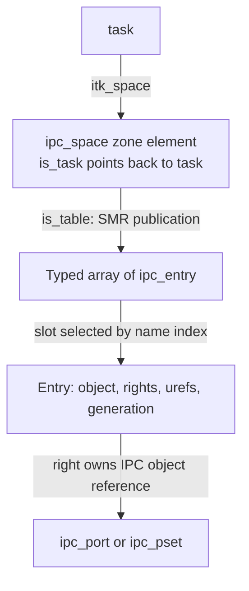
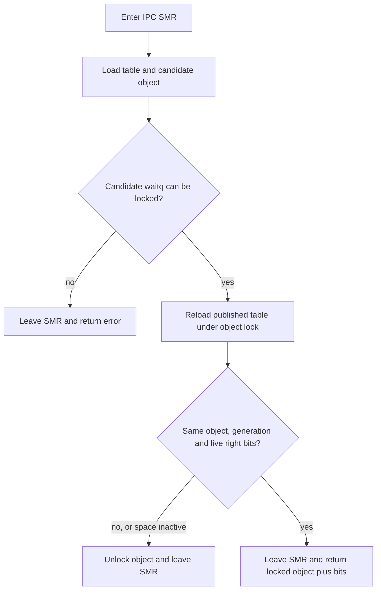
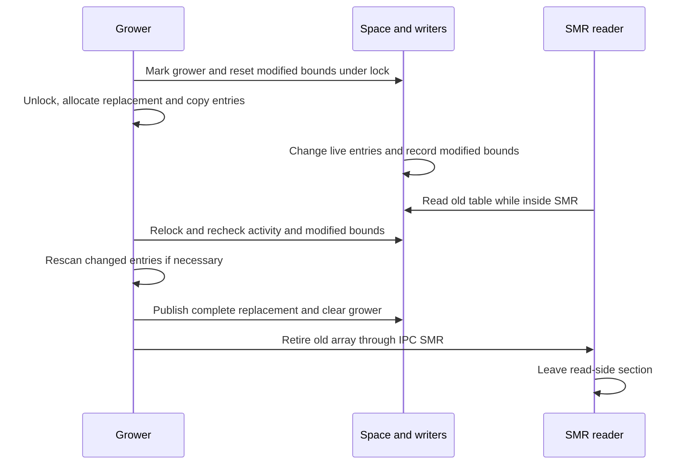

# IPC spaces and entries: allocating, finding and retiring capabilities

A task's `ipc_space` turns a user-visible Mach port name into rights to an IPC object. The space, its replaceable entry table and the referenced ports have different allocations, locks and lifetimes. This chapter follows those boundaries in `xnu-12377.121.6`, starting at `task->itk_space` and ending when the last space reference and the retired table are released.

[Key structures](README.md) · [Task and its protected data](task-and-shared-ro.md) · [Ports and kernel objects](ipc-ports-and-kobjects.md) · [IPC guide](../subsystems/ipc/README.md)

Use this chapter as a field-and-access companion to [names and rights](../subsystems/ipc/names-and-rights.md). The latter develops right accounting and reverse hashing; [port lifecycle](../subsystems/ipc/ports-and-rights-lifecycle.md) follows transfers and notifications. The distinction that matters throughout is **a name selects a right in one space; the entry pointer itself is not a capability or an independently retained object**. [Entry representation](../../xnu/osfmk/ipc/ipc_entry.h#L109-L158), [locked lookup contract](../../xnu/osfmk/ipc/ipc_entry.c#L151-L183).

## 1. Three allocations, three meanings of ownership



The entry box is a portion of the array, not another allocation. Several entries in different spaces can refer to the same port; the space's owning task is distinct from a port's receiving task. A send entry in task A can point to a port whose receive right belongs to task B. [Structures](../../xnu/osfmk/ipc/ipc_space.h#L141-L162), [port receiver fields](../../xnu/osfmk/ipc/ipc_port.h#L152-L167), [task attachment](../../xnu/osfmk/kern/ipc_tt.c#L168-L217).

| Storage or relationship | Allocation/publication | Release and what it protects |
| --- | --- | --- |
| `ipc_space` | `ipc_space_alloc()` uses the `ipc spaces` zone with `Z_WAITOK | Z_ZERO | Z_NOFAIL`, then initializes its ticket lock | `is_reference()`/`is_release()` retain/release the space allocation. Final release requires an inactive space and destroys its lock before `zfree`. |
| `ipc_entry_table_t` | A `KALLOC_ARRAY_TYPE_DEFINE` array of `struct ipc_entry`; helpers provide its base, count and byte size | Replacement/termination schedules the old array through `smr_ipc_call`; it is not freed when the published pointer first changes. |
| One `ipc_entry` | Claimed inside the current table under the space lock | No entry refcount. Returning the slot to the free list and freeing the array are separate operations. |
| Entry's `ie_object` | Installed during claim/initialization or right copyout | An occupied object-bearing entry carries the appropriate object reference. A combined send/receive entry shares one object reference. Dead-name entries can have no object. |
| Task association | `ipc_task_init()` assigns `space->is_task = task` and `task->itk_space = space` | Assignment does not take a task reference. Preserve the task/active-space protocol before following this backpointer; a retained dead space is not a retained task. |

Sources: [space allocator/reference release](../../xnu/osfmk/ipc/ipc_space.c#L95-L158), [typed array definition](../../xnu/osfmk/ipc/ipc_entry.c#L81-L94), [retirement](../../xnu/osfmk/ipc/ipc_space.c#L122-L141), [entry claim/deallocation](../../xnu/osfmk/ipc/ipc_entry.c#L240-L301), [dead-name creation](../../xnu/osfmk/ipc/ipc_object.c#L378-L400), [combined-right reference handling](../../xnu/osfmk/ipc/ipc_right.c#L2639-L2667), [task-side final release](../../xnu/osfmk/kern/task.c#L2110-L2118).

Neither the space nor its entry array is `proc_ro` storage. Their normal mutations use locks, atomics and SMR publication. The [RO-zone update interface](read-only-object-updates.md) is useful contrast, but is not used to turn `is_table` or `ie_bits` into read-only fields. [Space zone](../../xnu/osfmk/ipc/ipc_space.c#L95-L107), [entry mutation](../../xnu/osfmk/ipc/ipc_entry.c#L284-L287).

## 2. Read the current space fields, not the historical comments

| Field/group | What the value means | How to read or change it |
| --- | --- | --- |
| `is_lock` | Ticket lock serializing namespace writers and locked readers | Both `is_read_lock` and `is_write_lock` call `ipc_space_lock`; the names do not imply a reader/writer lock. |
| `is_bits` | Atomic reference count with six low flag bits reserved, including resource-limit notification state | Ref helpers use masked reference operations; `is_bits_set/clear/test` manipulate flags. |
| `is_table` | SMR-published typed-array handle | Ordinary active-space access uses the lock/serialized helpers or the explicit SMR lookup protocol. A null table marks an ordinary namespace inactive. |
| `is_table_free`, `is_table_hashed` | Free name slots and pure-send entries in the reverse hash | Updated under the space lock; they count different populations. |
| `is_entropy`, `is_prng` | State for free-list/generation randomization | Constructor and entry allocation/growth consume this state; it is not a reference or unique-ID mechanism. |
| `is_grower`, `is_low_mod`, `is_high_mod` | Current grower thread and changed-entry bounds | A grower runs much of its copy unlocked; writers mark modified indices so it can rescan. |
| `is_task` | Associated task pointer | Used with the caller's task/space lifetime and activity guarantees; it is not a new task reference. |
| `is_policy` | IPC-space policy value stored with a data-PAC discriminator when supported | Use `ipc_space_policy()` and `ipc_space_set_policy()`; the discriminator includes the field address. |
| `is_label` | `ipc_label_t` privilege/substitution bitmask | This is a `uint64_t` IPC label, not a `struct label *` from the MAC framework. |
| Limits and `is_telemetry` | Conditional table limits and atomic event-rate state | `CONFIG_PROC_RESOURCE_LIMITS` changes the layout and limit-handling paths. |

Sources: [field declaration](../../xnu/osfmk/ipc/ipc_space.h#L141-L162), [policy accessors](../../xnu/osfmk/ipc/ipc_space.h#L167-L191), [flags and predicates](../../xnu/osfmk/ipc/ipc_space.h#L111-L124), [activity/growth helpers](../../xnu/osfmk/ipc/ipc_space.h#L194-L228), [lock aliases](../../xnu/osfmk/ipc/ipc_space.h#L272-L285), [IPC label type](../../xnu/osfmk/ipc/ipc_types.h#L65-L74).

Two comments need qualification when reading this version. The `is_bits` field comment says it holds “refs, active, growing”, but `is_active()` actually tests `is_table` and `is_growing()` tests `is_grower`. The header also describes an `is_table[0].ie_size` field that is absent from today's `ipc_entry`; current callers obtain array sizes through typed-table helpers. Follow the declarations and bodies rather than interpreting these comments as current layout. [Old comments](../../xnu/osfmk/ipc/ipc_space.h#L95-L110), [current predicates](../../xnu/osfmk/ipc/ipc_space.h#L213-L228), [current entry](../../xnu/osfmk/ipc/ipc_entry.h#L109-L137).

## 3. Construction and the two initial references

`ipc_space_create()` first allocates a zeroed table with a minimum requested count of 32, then the space. It asks the allocation for its actual count, initializes the PRNG/free list, reserves index zero and publishes the table into the still-private space. The two initial references are the caller's reference and the active-space reference later dropped by termination. This is not one reference for every table entry. [Constructor](../../xnu/osfmk/ipc/ipc_space.c#L275-L299), [active-reference release](../../xnu/osfmk/ipc/ipc_space.c#L469-L477).

[Source: `osfmk/ipc/ipc_space.c`, lines 291–298](../../xnu/osfmk/ipc/ipc_space.c#L291-L298)

<!-- source-excerpt: ../../xnu/osfmk/ipc/ipc_space.c#L291-L298 -->
```c
	os_ref_init_count_mask(&space->is_bits, IS_FLAGS_BITS, &is_refgrp, 2, 0);
	space->is_table_free = count - 1;
	space->is_label = label;
	space->is_low_mod = count;
	smr_init_store(&space->is_table, table);

	*spacep = space;
	return KERN_SUCCESS;
```

`ipc_task_init()` attaches this space before completing the task's IPC setup. The task holds its space reference until final `task_deallocate()` cleanup. `convert_port_to_space_with_flavor()` can obtain an additional space reference while holding a task-port lock: successful task conversion means IPC disablement has not yet severed the association, and space termination occurs after that disablement. It also checks `task->active`. The conversion returns a referenced space; it does not return a borrowed pointer merely because the input port was valid. [Task constructor](../../xnu/osfmk/kern/ipc_tt.c#L168-L217), [conversion ordering](../../xnu/osfmk/kern/ipc_tt.c#L2739-L2775), [task final release](../../xnu/osfmk/kern/task.c#L2114-L2114).

### Special spaces have a different construction contract

`ipc_space_create_special()` allocates only the space, starts with one reference, installs kernel policy and sets `IPC_LABEL_SPECIAL`; it does not allocate or publish an ordinary name table. `ipc_space_kernel` and `ipc_space_reply` are created this way. These are placeholders for naked receive rights, whose port stores `MACH_PORT_SPECIAL_DEFAULT` as its receiver name. A null `is_table` therefore cannot be interpreted as “this special kernel space has undergone ordinary task termination”. [Special constructor](../../xnu/osfmk/ipc/ipc_space.c#L364-L388), [startup assignments](../../xnu/osfmk/ipc/ipc_init.c#L142-L145), [special port allocation](../../xnu/osfmk/ipc/ipc_port.c#L3194-L3207).

## 4. Decode a name before following an entry pointer

The user-visible name combines an index and generation encoding:

[Source: `osfmk/mach/port.h`, lines 278–280](../../xnu/osfmk/mach/port.h#L278-L280)

<!-- source-excerpt: ../../xnu/osfmk/mach/port.h#L278-L280 -->
```c
#define MACH_PORT_INDEX(name)           ((name) >> 8)
#define MACH_PORT_GEN(name)             (((name) & 0xff) << 24)
#define MACH_PORT_MAKE(index, gen)      (((index) << 8) | ((gen) >> 24))
```

As an illustrative example, `0x403` selects index 4 and yields generation value `0x03000000`. It says nothing about an address or which task owns another name with the same integer. `ipc_entry_lookup()` rejects index zero, out-of-range indices, generation mismatch and `MACH_PORT_TYPE_NONE`. A live name also needs the right requested by the caller; finding an entry is only the first step. [Lookup](../../xnu/osfmk/ipc/ipc_entry.c#L160-L183), [right-specific translation](../../xnu/osfmk/ipc/ipc_object.c#L256-L282).

| Part of `ipc_entry` | Active interpretation | Different interpretation later |
| --- | --- | --- |
| First pointer union | `ie_object`, `ie_port` and `ie_pset` are typed views of the referenced IPC object; `ie_volatile_object` supports speculative lookup | Index zero's `ie_self` holds the table handle during SMR retirement. |
| `ie_bits` low 16 bits | Send, send-once or dead-name urefs | Free slots preserve generation/rollover bits while clearing rights/urefs. |
| Rights and extended bits | `MACH_PORT_TYPE_*`, former-receive marker, pinned-send and immovable-send state | A dead-name conversion replaces the live-right type; this is separate from freeing the slot. |
| Generation/rollover bits | Six generation bits and two rollover-selector bits | Reclaim advances the generation using the selector; it can wrap and is not a permanent unique ID. |
| `ie_request` / `ie_next` | Notification-request table index for an occupied entry | Next free-slot index when free; index zero anchors the free list. |
| `ie_dist`, `ie_index` | Reverse-hash bucket displacement and referenced entry index | The bucket's own normal name entry can describe an unrelated right. |
| Second union's `ie_smr_node` | Not an extra per-entry callback object during ordinary use | Overlays the ordinary bits/request/hash fields in the base entry when the whole table is retired. |

Sources: [complete entry and masks](../../xnu/osfmk/ipc/ipc_entry.h#L109-L158), [generation functions](../../xnu/osfmk/ipc/ipc_entry.c#L117-L148), [deallocation](../../xnu/osfmk/ipc/ipc_entry.c#L499-L536), [hash storage](../../xnu/osfmk/ipc/ipc_hash.c#L147-L185), [retirement overlay](../../xnu/osfmk/ipc/ipc_space.c#L122-L141).

`IE_BITS_GEN()` forces the external low generation bits to the required rollover-mask value. Named allocation rejects names that do not match `ipc_entry_name_mask()`. The internal increment depends on the rollover selector and can restart with new randomness on overflow. Thus the worked `0x403` arithmetic is an encoding example, not a promise that allocation returns that value or that the next name is `0x404`. [Masks](../../xnu/osfmk/ipc/ipc_entry.h#L151-L158), [name mask and advancement](../../xnu/osfmk/ipc/ipc_entry.c#L111-L148), [named allocation validation](../../xnu/osfmk/ipc/ipc_entry.c#L364-L390).

The reverse hash answers **“does this space already have an ordinary send/receive name for this object?”**, allowing send rights to coalesce on copyout. Only pure-send entries are placed in the hash; receive ownership has its own reverse path, and send-once rights receive distinct entries. Do not read `table[h].ie_object` as the hash result: the bucket's `ie_index` identifies the actual entry to inspect. [Reverse lookup](../../xnu/osfmk/ipc/ipc_right.c#L362-L405), [hash lookup](../../xnu/osfmk/ipc/ipc_hash.c#L198-L258), [copyout selection](../../xnu/osfmk/ipc/ipc_object.c#L932-L941).

## 5. Reservation, initialization and publication

An ordinary port allocation obtains a zeroed port before it claims a namespace slot. `ipc_entry_alloc()` locks the space and repeats active-space/capacity checks, growing the table if necessary. Success returns with the space locked. `ipc_port_init()` then establishes the port's object reference, locked wait queue, receiver and label; `ipc_entry_init()` installs rights/urefs and records the modification before the space is unlocked. The caller receives a locked port, not an additional owned port reference. [Allocation sequence](../../xnu/osfmk/ipc/ipc_port.c#L884-L945), [entry allocator](../../xnu/osfmk/ipc/ipc_entry.c#L318-L344), [policy-aware entry initialization](../../xnu/osfmk/ipc/ipc_policy.c#L1092-L1118).

| Stage | What has happened | What must still happen |
| --- | --- | --- |
| `ipc_entries_hold(space, n)` | Checks sufficient free slots and projected reverse-hash capacity while locked | It has not removed slots or allocated an independent reservation. Preserve the lock until claim. |
| `ipc_entry_claim()` | Removes a free-list head, advances generation, clears request state and stores the object pointer | Complete initialization and mark the entry modified before unlocking. |
| `ipc_entry_init()` | Adds actual rights/urefs and applicable immovable-send policy | Caller completes its publication/lock-release contract. |
| Space unlock | Other namespace operations can observe the initialized right | The returned name still belongs only to this space; later lookup must revalidate it. |
| `ipc_entry_dealloc()` | Clears rights/object state, relinks the slot and records the change | It does not itself perform all port-right/reference cleanup. The enclosing right operation owns that work. |

Sources: [hold](../../xnu/osfmk/ipc/ipc_entry.c#L185-L237), [claim](../../xnu/osfmk/ipc/ipc_entry.c#L240-L301), [initialize](../../xnu/osfmk/ipc/ipc_policy.c#L1092-L1118), [deallocate](../../xnu/osfmk/ipc/ipc_entry.c#L499-L536).

The claim deliberately starts with generation bits, not a ready capability:

[Source: `osfmk/ipc/ipc_entry.c`, lines 284–287](../../xnu/osfmk/ipc/ipc_entry.c#L284-L287)

<!-- source-excerpt: ../../xnu/osfmk/ipc/ipc_entry.c#L284-L287 -->
```c
	gen = ipc_entry_next_gen(entry->ie_bits, space);
	entry->ie_bits = gen;
	entry->ie_request = IE_REQ_NONE;
	entry->ie_object = object;
```

For a hypothetical 32-entry array, index zero leaves 31 ordinary slots. The hold check separately rejects a projected hashed population above `32 * 7 / 8 = 28`. “No space” can therefore mean hash-capacity pressure even while free name slots exist. Actual capacities come from the typed-array helpers, and the check conservatively assumes each requested entry needs hashing. [Capacity branch](../../xnu/osfmk/ipc/ipc_entry.c#L201-L225).

If slot allocation fails after the raw port allocation, `ipc_port_alloc()` frees the label and port before returning. Named allocation additionally distinguishes an existing right under the requested name, a free slot, incompatible generation and an index requiring growth. A failed higher-level operation can leave a larger namespace table even though it did not publish the requested new right. [Port failure cleanup](../../xnu/osfmk/ipc/ipc_port.c#L925-L932), [named allocation](../../xnu/osfmk/ipc/ipc_entry.c#L364-L485), [grow-and-retry loop](../../xnu/osfmk/ipc/ipc_entry.c#L318-L344).

## 6. Lookup: protect the table and revalidate the relationship

| API | Successful result | Protection that ends on return |
| --- | --- | --- |
| `ipc_entry_lookup()` | Entry pointer inside the current active table | None added: the caller must already hold the space lock and continue holding it while using the entry. |
| `ipc_right_lookup_write()` | Entry pointer, space locked | Do not keep that pointer after unlocking or across a helper that drops the lock to grow. |
| `ipc_right_lookup_read()` | Object locked and entry bits copied out | IPC SMR has been left; it returns no table/entry pointer and adds no object reference. |
| `ipc_object_translate()` | Object locked, with requested right checked | No object reference is donated; the caller must obtain any longer-lived ownership explicitly. |
| `ipc_object_copyin()` | Owned transferred/created right on success | Space locking and deferred copyin cleanup have finished. This is a different contract from lookup. |

Sources: [entry lookup](../../xnu/osfmk/ipc/ipc_entry.c#L151-L183), [write/read lookup](../../xnu/osfmk/ipc/ipc_right.c#L97-L298), [translation](../../xnu/osfmk/ipc/ipc_object.c#L243-L282), [copyin](../../xnu/osfmk/ipc/ipc_object.c#L526-L565).

Read lookup combines two mechanisms. IPC SMR keeps a loaded table allocation from being reclaimed; the port/port-set's sequestered, cleared storage supports speculative `io_lock_allow_invalid()`. That helper validates the candidate's allocator zone and attempts to lock a wait queue whose valid bit distinguishes initialized objects from cleared storage. A successful lock alone does not prove that the user's name still denotes this object. [Lookup body](../../xnu/osfmk/ipc/ipc_right.c#L109-L258), [speculative object lock](../../xnu/osfmk/ipc/ipc_object.c#L1217-L1267), [port-zone rationale](../../xnu/osfmk/ipc/ipc_object.c#L102-L138).



The initial table/index checks can also fail before a lock attempt; they are folded into the error route. The second table load matters because growth may have replaced the first table, followed by an entry mutation. The code uses an ordering barrier before the object lock and reloads `is_table` after locking; it then compares the pointer, generation and nonempty right bits. Table growth can still occur later, which is why even those final entry reads remain inside SMR. [Ordering argument and reload](../../xnu/osfmk/ipc/ipc_right.c#L132-L235).

[Source: `osfmk/ipc/ipc_right.c`, lines 237–254](../../xnu/osfmk/ipc/ipc_right.c#L237-L254)

<!-- source-excerpt: ../../xnu/osfmk/ipc/ipc_right.c#L237-L254 -->
```c
	if (__improbable(entry->ie_object != object)) {
		kr = KERN_INVALID_NAME;
		goto out_put_unlock;
	}

	ipc_entry_bits_t bits = entry->ie_bits;
	if (__improbable(IE_BITS_GEN(bits) != MACH_PORT_GEN(name) ||
	    IE_BITS_TYPE(bits) == MACH_PORT_TYPE_NONE)) {
		kr = KERN_INVALID_NAME;
		goto out_put_unlock;
	}

	/* Done with hazardous accesses to the table */
	smr_ipc_leave();

	*bitsp = bits;
	*objectp = object;
	return KERN_SUCCESS;
```

Do not infer that every field in an entry is protected solely by the port lock. For example, send copyout can release the port lock before final entry uref bookkeeping while retaining the space lock and the entry's object reference. The read-lookup contract is the checked object/right relationship; it is not an API for an independently stable uref snapshot or an arbitrary entry pointer. [Copyout lock handoff](../../xnu/osfmk/ipc/ipc_right.c#L2639-L2683).

## 7. Growth replaces the array without replacing the space

`ipc_entry_grow_table()` enters with the active space locked. If another grower exists it sleeps on the space, then returns for the caller to recheck. Otherwise it computes a bounded target size, records itself as grower, initializes modification bounds and drops the lock before allocating/copying. A table reference is not handed to every user; the growth/termination protocol prevents the source array from being freed during this work. [Sizing/start](../../xnu/osfmk/ipc/ipc_entry.c#L624-L705), [grower completion](../../xnu/osfmk/ipc/ipc_entry.c#L585-L600), [termination wait](../../xnu/osfmk/ipc/ipc_space.c#L413-L425).

The copy snapshots object, bits and request/free-list state once per entry. These unlocked snapshots may be inconsistent, so it reconstructs the new table conservatively, rebuilds pure-send reverse-hash entries, and tolerates a changed free list. After relocking, it either abandons the replacement because the space died, rescans the modified index interval, or publishes the completed table. It transfers the representation of existing rights; it does not create a second owned send right merely because the object pointer now appears in both old and replacement arrays. [Copy/rescan](../../xnu/osfmk/ipc/ipc_entry.c#L710-L818), [publication](../../xnu/osfmk/ipc/ipc_entry.c#L820-L838).



The diagram selects successful growth; allocation failure and termination branches are separate. The unlock/wakeup and retirement sequence is explicit:

[Source: `osfmk/ipc/ipc_entry.c`, lines 828–838](../../xnu/osfmk/ipc/ipc_entry.c#L828-L838)

<!-- source-excerpt: ../../xnu/osfmk/ipc/ipc_entry.c#L828-L838 -->
```c
	smr_serialized_store(&space->is_table, ntable);

	ipc_space_done_growing_and_unlock(space);

	/*
	 *	Now we need to free the old table.
	 */
	ipc_space_retire_table(otable);
	is_write_lock(space);

	return KERN_SUCCESS;
```

`KERN_SUCCESS` from growth means the caller can continue with the space lock held, not necessarily that the space is still active or that a new right exists. The termination-during-growth branch frees the uninstalled replacement, relocks and returns success so the outer allocator/copyout loop can detect death. Allocation failure returns `KERN_RESOURCE_SHORTAGE` unlocked; maximum capacity returns `KERN_NO_SPACE` unlocked. [Termination/rescan branch](../../xnu/osfmk/ipc/ipc_entry.c#L776-L816), [failure return](../../xnu/osfmk/ipc/ipc_entry.c#L696-L701), [maximum limit](../../xnu/osfmk/ipc/ipc_entry.c#L840-L843).

### The retired array contains its own callback record

`ipc_space_retire_table()` uses reserved index zero to store the table handle and callback node. The callback needs the retired table, not a live `ipc_space` pointer; consequently the table's delayed release and the space's final-reference release are distinct completion events. [Retirement callback](../../xnu/osfmk/ipc/ipc_space.c#L122-L141).

[Source: `osfmk/ipc/ipc_space.c`, lines 137–140](../../xnu/osfmk/ipc/ipc_space.c#L137-L140)

<!-- source-excerpt: ../../xnu/osfmk/ipc/ipc_space.c#L137-L140 -->
```c
	base = ipc_entry_table_base(table);
	size = ipc_entry_table_size(table);
	base->ie_self = table;
	smr_ipc_call(&base->ie_smr_node, size, ipc_space_free_table);
```

The `*_free_noclear` name is an allocator-helper choice. It does not mean the entry's capability remains valid after namespace removal, or permit using an entry after SMR/locking protection ends. Continue with [SMR publication](../cross-cutting/smr-and-publication.md) for the generic grace-period model.

## 8. Namespace death before final allocation release

`ipc_space_terminate()` first locks the space and returns immediately if already inactive. It saves the table handle and clears the published table pointer; new lookups can now reject the space. It waits for any grower to discover this state before beginning unlocked entry cleanup. [Initial termination](../../xnu/osfmk/ipc/ipc_space.c#L400-L425).

[Source: `osfmk/ipc/ipc_space.c`, lines 413–423](../../xnu/osfmk/ipc/ipc_space.c#L413-L423)

<!-- source-excerpt: ../../xnu/osfmk/ipc/ipc_space.c#L413-L423 -->
```c
	table = smr_serialized_load(&space->is_table);
	smr_clear_store(&space->is_table);

	/*
	 *	If somebody is trying to grow the table,
	 *	we must wait until they finish and figure
	 *	out the space died.
	 */
	while (is_growing(space)) {
		is_write_sleep(space);
	}
```

Cleanup runs in two passes: receive rights first, then all remaining nonempty entries. Removing receives first reduces notifications aimed at endpoints that are also dying in this space. Each right type invokes its own cleanup; destroying the space does not imply all referred-to ports die, since many entries contain only send rights. The table is then retired through IPC SMR and termination drops the active reference. The task and other referenced-space callers may still keep the inactive space allocation alive. [Two cleanup passes and active-reference release](../../xnu/osfmk/ipc/ipc_space.c#L429-L477), [right termination](../../xnu/osfmk/ipc/ipc_right.c#L754-L836), [space final release](../../xnu/osfmk/ipc/ipc_space.c#L112-L158).

For a worked sequence, take an ordinary task-owned space at its initial two references. A successful port-to-space conversion adds a third. Namespace termination removes rights and drops the active reference, leaving the task-held and conversion references. Releasing either one still leaves the other; releasing the last destroys the space's ticket lock and allocation. The retired entry array may still be waiting for an SMR reader. This example isolates space references from all port references and makes no claim about scheduling order. [Conversion retain](../../xnu/osfmk/kern/ipc_tt.c#L2767-L2772), [release operation](../../xnu/osfmk/kern/ipc_tt.c#L3793-L3805), [free prerequisites](../../xnu/osfmk/ipc/ipc_space.c#L112-L120).

## 9. Source-reading checklist and limits

When following a new caller, identify whether it owns a space reference or has a valid task/port lifetime that supplies access. Then check whether the helper returns a locked entry, a locked object, or an owned right. Any call that can grow the table can invalidate a cached `ipc_entry_t`; any right transfer can change the relationship between the name and port without changing the port address. [Entry allocation loop](../../xnu/osfmk/ipc/ipc_entry.c#L318-L344), [lookup results](../../xnu/osfmk/ipc/ipc_right.c#L237-L258), [copyout growth/restart](../../xnu/osfmk/ipc/ipc_object.c#L874-L932).

This chapter reviews the common task-space construction, selected entry allocation/lookup, growth, transfer integration and teardown paths in the local snapshot. It does not enumerate every notification command, special-space client, resource-limit policy, PAC code sequence or concurrency interleaving. [Port policy](../subsystems/ipc/guards-and-policy-enforcement.md), [complex-message conversion](../subsystems/ipc/complex-message-copyin-and-copyout.md), [concurrent-operation examples](../cross-cutting/concurrent-operation-walkthroughs.md) and the [Mach interface catalogs](../interfaces/mach-messages/README.md) provide the adjacent routes. No kernel execution or generated MIG-stub inspection is implied.

<!-- BEGIN PLATYDOC DOCUMENTATION LICENSE -->
Original Platydoc text and diagrams are licensed under [CC BY 4.0](https://creativecommons.org/licenses/by/4.0/). Quoted source code and third-party material retain their respective licenses.
<!-- END PLATYDOC DOCUMENTATION LICENSE -->
