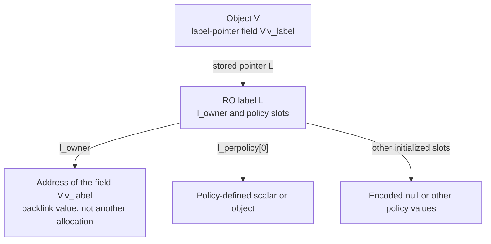
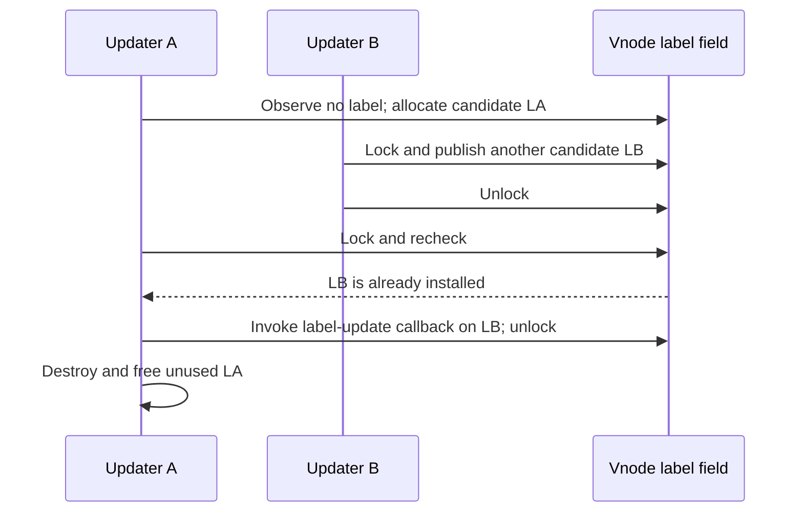

# MAC labels: owner pointers, policy slots and protected storage

[Key structures](README.md) · [Credential storage](credentials-and-credential-storage.md) · [Credential and policy lifetimes](../subsystems/security/credential-and-policy-lifetimes.md) · [Writing protected fields](read-only-object-updates.md)

A MAC label is a small protected container through which the framework associates policy-specific state with credentials, vnodes, mounts and other kernel objects. In `xnu-12377.121.6`, `struct label` itself contains an owner-pointer backlink and an array of machine-word slots. It does not contain a universal sandbox rule set, a POSIX credential or the entire implementation of a MAC policy. This chapter follows label allocation, owner validation, slot access, copying and teardown, using credential and vnode callers to show the different lifetime contracts.

The [policy-lifetime chapter](../subsystems/security/credential-and-policy-lifetimes.md) explains policy registration, callback iteration and decision aggregation. Here the question is what memory those callbacks receive and which part of that state each framework operation actually owns. Policy modules outside the checkout remain external implementations.

Inspect the live [`label`](layout-browser.md?declaration=label) layout for the selected source profile.

## 1. The label contains a pointer address and policy slots

The declaration is intentionally small. [Layout and sentinels — `_label.h`, lines 82–89](../../platydoc-data/xnu/security/_label.h#L82-L89).

<!-- source-excerpt: ../../platydoc-data/xnu/security/_label.h#L82-L89 -->
```c
/* l_owner set to this value means the label is inlined in the cred */
#define MAC_LABEL_CRED_OWNED  ((struct label **)~0ul)
#define MAC_LABEL_NULL_SLOT   (~0l)

struct label {
	struct label **l_owner;
	long           l_perpolicy[MAC_MAX_SLOTS];
};
```

`l_owner` ordinarily points to the **field that stores the label pointer**. For a vnode V whose field is `V->v_label = L`, the label records `L->l_owner = &V->v_label`. It does not store `V`, and a matching backlink does not itself acquire a reference to V. Labels created without this owner-pointer protocol instead start with `l_owner = NULL`. Credential labels can use a diagnostic sentinel described below. [Owner initialization](../../platydoc-data/xnu/security/mac_label.c#L70-L106), [validation](../../platydoc-data/xnu/security/mac_label.c#L136-L151).

`MAC_MAX_SLOTS` depends on configuration: 7 for `XNU_TARGET_OS_OSX`; otherwise 4 with `CONFIG_VNGUARD`, or 3 without it. Each slot is a `long` exposed through an `intptr_t` API. Its meaning is assigned by a policy; the framework does not require every value to be a pointer or impose a common pointee type. [Slot count and layout](../../platydoc-data/xnu/security/_label.h#L72-L90), [slot API](../../platydoc-data/xnu/security/mac_label.c#L176-L208).

| Field or related state | Owner and role | Mutation/access contract |
| --- | --- | --- |
| `label.l_owner` | Framework's association with an owner pointer, or NULL/sentinel for another lifecycle. | Set through the RO API during construction or diagnostic seal/unseal. Read by owned-label verification. |
| `label.l_perpolicy[n]` | Framework storage assigned to one policy slot. | Initialize with the encoded null value; use `mac_label_get()` / `mac_label_set()`. Callback/provider rules determine further synchronization. |
| Object's label-pointer field | Vnode, mount, devnode or another containing object. | Publication/clearing belongs to that object's protocol; an owner-aware allocator does not always publish it. |
| Policy slot number | Allocated from the framework's slot bitmap at policy registration. | Written through `mpc_field_off`; returned on eligible policy unregister. It is not a dynamically sized array index supplied by a user request. |
| Policy-private value reached through a slot | Provider-defined data or scalar state. | Neither the RO zone nor a plain slot getter supplies its allocation, reference count, locks or destructor implementation. |

The bitmap and allocation code bounds the number of registered slot users. A policy requesting a slot when none remains gets `ENOMEM`; a policy without `mpc_field_off` need not consume one. [Slot bitmap](../../platydoc-data/xnu/security/mac_base.c#L137-L142), [slot assignment](../../platydoc-data/xnu/security/mac_base.c#L690-L699), [slot return](../../platydoc-data/xnu/security/mac_base.c#L826-L828). `mac_label_get()` itself contains no explicit index-range check: its caller uses the policy's assigned slot. Do not infer that the getter parses or validates a user-controlled slot namespace. [Getter body](../../platydoc-data/xnu/security/mac_label.c#L176-L183).



The backlink-value box names the field address inside the object; it is neither the object address nor additional allocated storage. The diagram's policy-object arrow represents one possible slot interpretation; it does not imply that the framework owns a reference to every possible pointee.

## 2. Allocation initializes the slot encoding through the RO API

`ZONE_ID_MAC_LABEL` is registered for `struct label` with `ZC_READONLY | ZC_ZFREE_CLEARMEM`. `empty_label` initializes every slot to `MAC_LABEL_NULL_SLOT`; its omitted `l_owner` member is zero. A zero-filled allocation alone is therefore not the initialized empty-label representation. [Zone and template — `mac_label.c`, lines 40–48](../../platydoc-data/xnu/security/mac_label.c#L40-L48).

<!-- source-excerpt: ../../platydoc-data/xnu/security/mac_label.c#L40-L48 -->
```c
ZONE_DEFINE_ID(ZONE_ID_MAC_LABEL, "MAC Labels", struct label,
    ZC_READONLY | ZC_ZFREE_CLEARMEM);

/*
 * Number of initial values matches logic in security/_label.h
 */
const struct label empty_label = {
	.l_perpolicy[0 ... MAC_MAX_SLOTS - 1] = MAC_LABEL_NULL_SLOT,
};
```

The allocation helpers have distinct effects:

| Helper | Initializes `l_owner`? | Publishes through the supplied owner field? | Extra setup |
| --- | --- | --- | --- |
| `mac_labelzone_alloc(flags)` | NULL via `empty_label`. | No owner field is supplied. | None. |
| `mac_labelzone_alloc_for_owner(labelp, flags, setup)` | When `labelp` is non-NULL, copy a local template with `l_owner = labelp`; otherwise use the unowned allocator. | No. The pointer is returned to the caller. | Invoked on a non-NULL result after template copy. |
| `mac_labelzone_alloc_owned(labelp, flags, setup)` | Through the preceding helper. | Yes, plain assignment to `*labelp` when `labelp` is non-NULL, after setup. | Through the preceding helper. |

[Helper implementations](../../platydoc-data/xnu/security/mac_label.c#L50-L106). “Unowned” here means no `l_owner` backlink; it does not mean leaked, unreferenced, or free for any reader to destroy. The containing subsystem still owns the returned allocation. A credential, for example, owns and eventually frees its label through the credential lifecycle without using the object-pointer backlink variant.

The low-level allocator requests `Z_ZERO` and the supplied `MAC_NOWAIT` bit; a static assertion equates that bit with `Z_NOWAIT`. `mac_labelzone_alloc()` checks a NULL allocation before copying the empty template. The non-NULL-owner branch of `mac_labelzone_alloc_for_owner()` invokes its template copy immediately after allocation, without a local NULL check before that copy. The credential, mount and vnode examples below use `MAC_WAITOK`; this walkthrough does not claim that all owner-aware callers implement a common recoverable nonblocking-allocation path. [Allocation flags and branches](../../platydoc-data/xnu/security/mac_label.c#L50-L89), [credential caller](../../platydoc-data/xnu/security/mac_process.c#L93-L103), [mount/vnode callers](../../platydoc-data/xnu/security/mac_vfs.c#L147-L186).

Ordinary code cannot initialize RO slots with direct stores merely because the label has not yet been published. The helpers copy `empty_label` or a stack template through `zalloc_ro_update_elem()`. The architecture-dependent checks and writable alias are those explained in [protected object updates](read-only-object-updates.md); they do not replace the ownership/publication protocol of the containing object.

## 3. Validation does not acquire object lifetime

`mac_label_verify(labelp)` acquire-loads `*labelp`, permits NULL, validates a non-NULL allocation's RO zone, and compares its owner backlink against the exact supplied field address. A mismatch panics. [Verifier — `mac_label.c`, lines 136–151](../../platydoc-data/xnu/security/mac_label.c#L136-L151).

<!-- source-excerpt: ../../platydoc-data/xnu/security/mac_label.c#L136-L151 -->
```c
struct label *
mac_label_verify(struct label **labelp)
{
	struct label *label = os_atomic_load(labelp, acquire);

	if (label != NULL) {
		zone_require_ro(ZONE_ID_MAC_LABEL, sizeof(struct label), label);

		if (__improbable(label->l_owner != labelp)) {
			panic("label backref mismatch: labelp:%p label:%p l_owner:%p", labelp,
			    label, label->l_owner);
		}
	}

	return label;
}
```

The acquire load is useful with the release publication used by vnode labels. It does not increment a label reference count, enter SMR or lock the containing vnode. There is no reference-count field in `struct label`. The surrounding owner/lifecycle must prevent teardown while a caller uses the returned pointer. The common RO-zone check is also not proof of allocation liveness; its enabled/fallback behavior is explained in [RO validation](read-only-object-updates.md#3-reads-validate-the-relationship-and-then-load-normally).

An unowned credential label is accessed through `mac_cred_label(cred)`, which simply returns `cred->cr_label`; it should not be passed through the owned verifier with an invented owner field. Keeping the credential alive keeps its label allocation alive until the credential's deferred destruction. [Credential accessor](../../platydoc-data/xnu/security/mac_process.c#L140-L144), [credential final free](../../platydoc-data/xnu/bsd/kern/kern_credential.c#L3793-L3808).

## 4. Null is encoded, and slot writes are protected copies

The initialized null representation is all-one bits (`MAC_LABEL_NULL_SLOT`), not stored zero. `mac_label_slot_encode(0)` produces that sentinel. Decoding the sentinel returns zero; decoding raw stored zero returns the sentinel instead. This makes accidentally zero-filled slot storage distinguishable from initialized logical null. The setter rejects an input value equal to the sentinel rather than permitting two logical meanings for the same stored representation. [Encoding and decoding](../../platydoc-data/xnu/security/mac_label.c#L153-L171), [setter](../../platydoc-data/xnu/security/mac_label.c#L185-L208).

| Logical operation | Stored slot bits | `mac_label_get()` result |
| --- | --- | --- |
| Fresh initialized empty label | `MAC_LABEL_NULL_SLOT` | 0 |
| `mac_label_set(L, n, 0)` | `MAC_LABEL_NULL_SLOT` | 0 |
| Set an ordinary nonzero value V other than the sentinel | V | V |
| Raw zero-filled slot, before proper template initialization | 0 | `MAC_LABEL_NULL_SLOT` |
| Attempt to set `MAC_LABEL_NULL_SLOT` as the API value | Setter panics. | No normal result. |

The getter validates the label's RO-zone membership and loads/decodes one slot. The setter checks the debug/development seal when compiled in, rejects the sentinel input, encodes the value, then copies exactly the selected slot through `zalloc_ro_update_field()`. [Selected setter body — `mac_label.c`, lines 197–207](../../platydoc-data/xnu/security/mac_label.c#L197-L207).

<!-- source-excerpt: ../../platydoc-data/xnu/security/mac_label.c#L197-L207 -->
```c
#if DEVELOPMENT || DEBUG
	/* can't modify a sealed label, see mac_cred_label_seal() */
	assertf(label->l_owner != (struct label **)-1,
	    "mac_label_set(%p, %d, 0x%lx) is sealed",
	    label, slot, (uintptr_t)v);
#endif
	if (v == MAC_LABEL_NULL_SLOT) {
		panic_label_set_sentinel();
	}
	v = mac_label_slot_encode(v);
	zalloc_ro_update_field(ZONE_ID_MAC_LABEL, label, l_perpolicy[slot], &v);
```

This is a field-copy interface, not the RO atomic read-modify-write API used for credential holding counts. It does not retain a new policy pointee, release an old one, take an object lock or publish a multislotted transaction. If a provider stores a pointer in a slot, it must supply the pointee's lifetime and synchronization rules. Protecting the word containing a pointer does not transitively make the pointed-to memory read-only. [Field-copy macro](../../platydoc-data/xnu/osfmk/kern/zalloc.h#L872-L876), [credential protected atomic example](../../platydoc-data/xnu/bsd/kern/kern_credential.c#L3357-L3379).

## 5. Credential labels use private construction and a diagnostic seal

`mac_cred_label_alloc()` allocates an unowned label, then dispatches `cred_label_init` callbacks. `mac_cred_label_init(model)` stores that pointer directly in the supplied credential. In the derivation paths studied here, that credential is the writable private model; the helper is not a generic in-place setter for an already published RO credential. [Allocation/init](../../platydoc-data/xnu/security/mac_process.c#L93-L110), [derivation model](../../platydoc-data/xnu/bsd/kern/kern_credential.c#L3907-L3921).

The normal credential replacement sequence is:

1. Copy the old identity, label pointer and audit association into a local model.
2. If the selected update needs a new label, initialize one and run policy association/update callbacks on the model. If allocation later sees that the model still shares the parent's label, it creates and associates a separate label before retaining a new credential value.
3. Seal the resulting label in `DEVELOPMENT || DEBUG`, obtain the audit association and credential storage, then publish/deduplicate the complete credential value.
4. Keep the old credential and its label intact for their existing holders. Destroy a losing candidate's label if a hash insertion race selects another credential.

[Explicit process label derivation](../../platydoc-data/xnu/bsd/kern/kern_credential.c#L4325-L4336), [allocator label ownership and seal](../../platydoc-data/xnu/bsd/kern/kern_credential.c#L3673-L3713), [loser cleanup](../../platydoc-data/xnu/bsd/kern/kern_credential.c#L3743-L3762). The [credential-storage companion](credentials-and-credential-storage.md) follows both counters, process compare-and-publish retry and the complete final SMR release.

`mac_cred_label_seal()` writes `(struct label **)-1` into `l_owner` only for development/debug builds. `mac_label_set()` checks that sentinel under the same configuration guard. In other builds, the sealing function has no operational body; the RO mapping and controlled-write mechanism still follow their own configuration. Published-label immutability is an API/ownership rule and must not be described as an unconditional production-build sentinel check. [Seal body](../../platydoc-data/xnu/security/mac_process.c#L112-L122), [setter guard](../../platydoc-data/xnu/security/mac_label.c#L197-L202).

The header comment beside `MAC_LABEL_CRED_OWNED` says “inlined in the cred,” but the allocation bodies here create a separate `struct label` element and store its pointer in `ucred.cr_label`. The sentinel does not prove physical inline allocation. The implementation's concrete seal functions use the equivalent `(struct label **)-1` value. [Header comment](../../platydoc-data/xnu/security/_label.h#L82-L85), [separate label allocation](../../platydoc-data/xnu/security/mac_process.c#L93-L110), [credential RO allocation](../../platydoc-data/xnu/bsd/kern/kern_credential.c#L3722-L3737).

### Label equality is not arbitrary policy-object equality

When `CRF_MAC_ENFORCE` requires labels to participate in credential uniquing, `mac_cred_label_is_equal()` compares the `l_perpolicy` arrays with `memcmp()`, and the hash helper hashes those bytes. `l_owner` is excluded. These helpers do not dereference and recursively compare an unknown provider's objects. If a slot holds a pointer, its value participates as slot bytes; provider canonicalization or immutability rules are outside these helpers. [Equality/hash](../../platydoc-data/xnu/security/mac_process.c#L146-L156), [credential selection of label comparison](../../platydoc-data/xnu/bsd/kern/kern_credential.c#L4507-L4570).

`mac_cred_label_update()` first marks the private model with `CRF_MAC_ENFORCE`, then dispatches `cred_label_update`. This explains why that flag is part of credential representation rather than merely a global policy switch. [Update helper](../../platydoc-data/xnu/security/mac_process.c#L276-L286).

### Credential-label teardown

`mac_cred_label_free()` clears the seal sentinel in development/debug builds before invoking `cred_label_destroy`, allowing those callbacks to perform their teardown. It then frees the label's RO element. `mac_cred_label_destroy(model)` additionally clears the model's `cr_label` pointer before calling this free routine; that direct assignment belongs to a writable model path. Final published-credential reclamation instead passes the saved label pointer directly to `mac_cred_label_free()` before releasing the credential allocations. [Unseal, callbacks and free](../../platydoc-data/xnu/security/mac_process.c#L124-L138), [model destroy](../../platydoc-data/xnu/security/mac_process.c#L173-L179), [published credential callback](../../platydoc-data/xnu/bsd/kern/kern_credential.c#L3793-L3808).

## 6. Worked owned label: lazy vnode publication and competing allocators

Vnode labels make the owner field and publication distinction concrete. `mac_vnode_label_alloc(vp)` calls the owner-aware allocator with `&vp->v_label`, runs `vnode_label_init` callbacks and increments the label count. It **does not write `vp->v_label`**. `mac_vnode_label_init(vp)` separately publishes the returned pointer with a release store. `mac_vnode_label(vp)` uses the acquire-loading verifier. [Allocation, publication and read](../../platydoc-data/xnu/security/mac_vfs.c#L173-L206).

`mac_vnode_label_update(ctx, vp, newlabel)` obtains its subject credential from the supplied VFS context. If no label exists, it prepares a candidate before locking the vnode. After taking `vnode_lock(vp)`, it checks again: another thread may have published a label while this caller allocated. If still empty, it release-publishes its candidate and clears the local candidate variable to mark transfer. It dispatches the update callback with the currently installed label under the vnode lock, unlocks, and destroys any unneeded candidate afterward. [Complete update path](../../platydoc-data/xnu/security/mac_vfs.c#L2180-L2209).



The sequence selects the competing-publication branch; it does not imply every update races. Both candidates may carry the same owner-field address, but only one is installed in that field. A matching backlink therefore is not proof that a privately allocated candidate has been published. The loser uses `mac_vnode_label_free(candidate)`, which runs cleanup and frees that candidate without clearing the owner's installed pointer. Clearing the owner field on this path would discard the winner. [Candidate free](../../platydoc-data/xnu/security/mac_vfs.c#L208-L224), [post-lock cleanup](../../platydoc-data/xnu/security/mac_vfs.c#L2201-L2208).

`CONFIG_MACF_LAZY_VNODE_LABELS` also changes the routine allocation/recycle path. With lazy labels enabled, `mac_vnode_label_init_needed()` returns false; otherwise it checks the label-vnodes setting and whether a label is already present. Recycle dispatches `vnode_label_recycle`; in the lazy configuration it destroys an existing label and clears `VL_LABELED`. These are lifecycle choices, not changes to the `struct label` layout. [Allocation-needed predicate and wrapper](../../platydoc-data/xnu/security/mac_vfs.c#L238-L256), [recycle](../../platydoc-data/xnu/security/mac_vfs.c#L263-L275).

This trace begins with a vnode already valid under its caller's lifetime rules. The label helper does not obtain a vnode reference itself. Follow [vnode lifetime and caches](../subsystems/vfs/vnode-cache-identity-and-reuse.md) for the owner object's lifetime; label pointer acquire/release does not replace that protocol.

## 7. Owned destruction clears the field; plain free does not

`mac_labelzone_free_owned(labelp, deinit)` first validates the owner association. When the pointer is non-NULL it runs the extra destructor, release-stores NULL to the owner's field, then frees the label. It has no additional label reference-count wait or SMR grace period. Any necessary exclusion from readers belongs to the owner's teardown protocol. [Owned teardown — `mac_label.c`, lines 125–133](../../platydoc-data/xnu/security/mac_label.c#L125-L133).

<!-- source-excerpt: ../../platydoc-data/xnu/security/mac_label.c#L125-L133 -->
```c
	label = mac_label_verify(labelp);
	if (label) {
		if (extra_deinit) {
			extra_deinit(label);
		}

		os_atomic_store(labelp, NULL, release);
		mac_labelzone_free(label);
	}
```

Plain `mac_labelzone_free(label)` requires non-NULL and only calls `zfree_ro()`. It does not consult `l_owner`, clear that field's target, or automatically dispatch policy callbacks. The correct subsystem wrapper supplies those steps. Mount destruction uses the owned helper with `mount_label_destroy`; vnode owner destruction uses it with `mac_vnode_label_cleanup`; a discarded vnode candidate uses plain label free after its cleanup; credential reclamation uses its distinct unowned-label wrapper. [Plain free](../../platydoc-data/xnu/security/mac_label.c#L109-L117), [mount wrapper](../../platydoc-data/xnu/security/mac_vfs.c#L163-L171), [vnode wrappers](../../platydoc-data/xnu/security/mac_vfs.c#L208-L236), [credential wrapper](../../platydoc-data/xnu/security/mac_process.c#L124-L138).

This division matters while reading error paths: freeing an unpublished candidate, detaching an installed object label, and retiring a shared credential label are different operations. They happen to end in the same RO allocator, but the ownership work preceding that call differs.

## 8. Copying and policy dispatch are not raw structure cloning

The label framework uses object-specific callbacks to copy or associate policy state. `mac_vnode_label_copy(src, dest)` invokes `vnode_label_init` when `src` is NULL, otherwise `vnode_label_copy`. It does not `memcpy()` the complete label, which would also copy the source owner backlink. Credential derivation similarly creates a fresh label and calls `cred_label_associate` when it needs a label separate from the parent. [Vnode copy wrapper](../../platydoc-data/xnu/security/mac_vfs.c#L277-L287), [credential association wrapper](../../platydoc-data/xnu/security/mac_process.c#L239-L243), [allocation caller](../../platydoc-data/xnu/bsd/kern/kern_credential.c#L3703-L3709).

The callback determines whether its policy state is copied, shared through its own references, reset, or otherwise transformed. The generic label code cannot establish that choice for a missing provider. The framework's `MAC_PERFORM` operation walks registered policies and invokes non-NULL callbacks without aggregating an authorization result. `MAC_CHECK`, used by admission wrappers, instead combines errors. Label initialization or copy is therefore not in itself a grant decision. [Perform dispatch](../../platydoc-data/xnu/security/mac_internal.h#L309-L321), [check dispatch](../../platydoc-data/xnu/security/mac_internal.h#L258-L274).

Static/dynamic policy iteration has a registry lifetime protocol; it is distinct from the lifetime of an individual label or its policy-private pointee. Dynamic iteration increments the policy-list busy state, allowing unregister to wait for callback execution. It does not supply a general label lock for every caller. [Iteration](../../platydoc-data/xnu/security/mac_internal.h#L226-L247), [registry waiting](../../platydoc-data/xnu/security/mac_base.c#L271-L279). The full registration/unregistration and error-combination explanation is in [credential and policy lifetimes](../subsystems/security/credential-and-policy-lifetimes.md#7-mac-registration-divides-stable-and-dynamic-policy-entries).

Textual label import/export also uses policy callbacks rather than copying a `struct label` to userspace. Credential externalize/internalize wrappers call the framework's text operations. A user-facing string, a policy slot value and an in-kernel label pointer are different representations. [Credential wrappers](../../platydoc-data/xnu/security/mac_process.c#L181-L200), [framework dispatch macros](../../platydoc-data/xnu/security/mac_internal.h#L297-L304). Detailed syntax, policy namespaces and every provider's parsing are outside this structure walkthrough.

## 9. Reading a label call site

For a concrete label access, identify the answers in this order:

1. **Which owner?** A credential label, vnode label and mount label can use the same storage type while having different lifetime/publication rules.
2. **Which pointer is retained?** A credential reference can preserve its label; an owned-label getter does not itself retain the containing object or label.
3. **Which slot?** Find the policy's assigned `mpc_field_off`, then its `mac_label_get()`/`set()` calls. A slot's meaning belongs to that provider.
4. **Which bytes change?** A label-pointer assignment, a protected slot copy, a private model's `cr_label` change and a mutation of policy-private data are different writes.
5. **Which callback and lock?** Follow the object wrapper into `MAC_PERFORM` or `MAC_CHECK`; read whether the object lock is held and whether a prepared candidate can lose publication.
6. **Which teardown?** Determine who runs policy destructors, clears an owner field, and eventually invokes `zfree_ro()`.

The concrete examples above supply all six answers for the selected credential and vnode paths. A statement such as “the label is protected” alone cannot establish them.

## Source scope and remaining boundaries

This chapter covers local `struct label` storage, MAC label-zone allocation/access/free, credential-label construction/sealing/equality, and selected mount/vnode publication, update, copy and cleanup paths. It distinguishes `CONFIG_MACF`, debug/development seals, target slot counts and lazy vnode-label behavior. RO backend enforcement is inherited from the [protected-update implementation](read-only-object-updates.md), not independently reconstructed here.

Policy-specific slot formats, sandbox/AMFI provider internals, all other labeled object families and every lock/interleaving of owner teardown remain outside this trace. In particular, a documented wrapper or registered callback does not establish that the provider body is present. No kernel execution, object-layout measurement or vulnerability analysis was performed.

<!-- BEGIN PLATYDOC DOCUMENTATION LICENSE -->
Original Platydoc text and diagrams are licensed under [CC BY 4.0](https://creativecommons.org/licenses/by/4.0/). Quoted source code and third-party material retain their respective licenses.
<!-- END PLATYDOC DOCUMENTATION LICENSE -->
