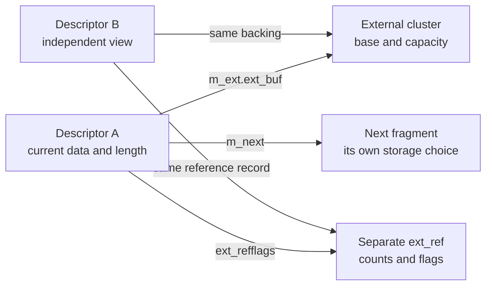
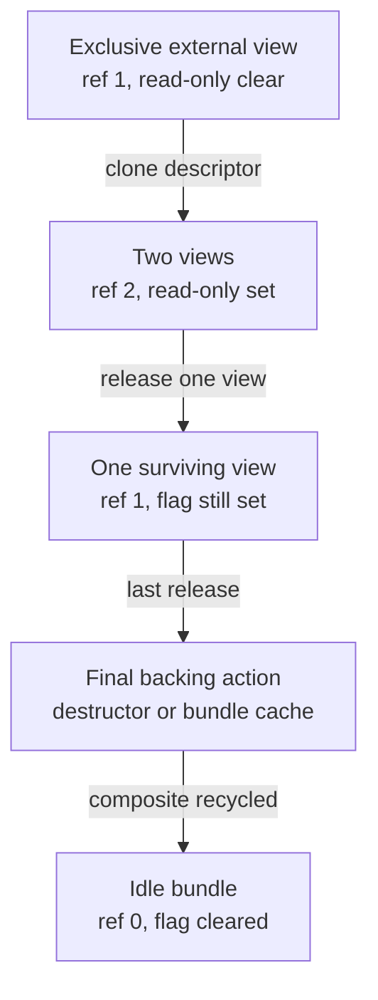
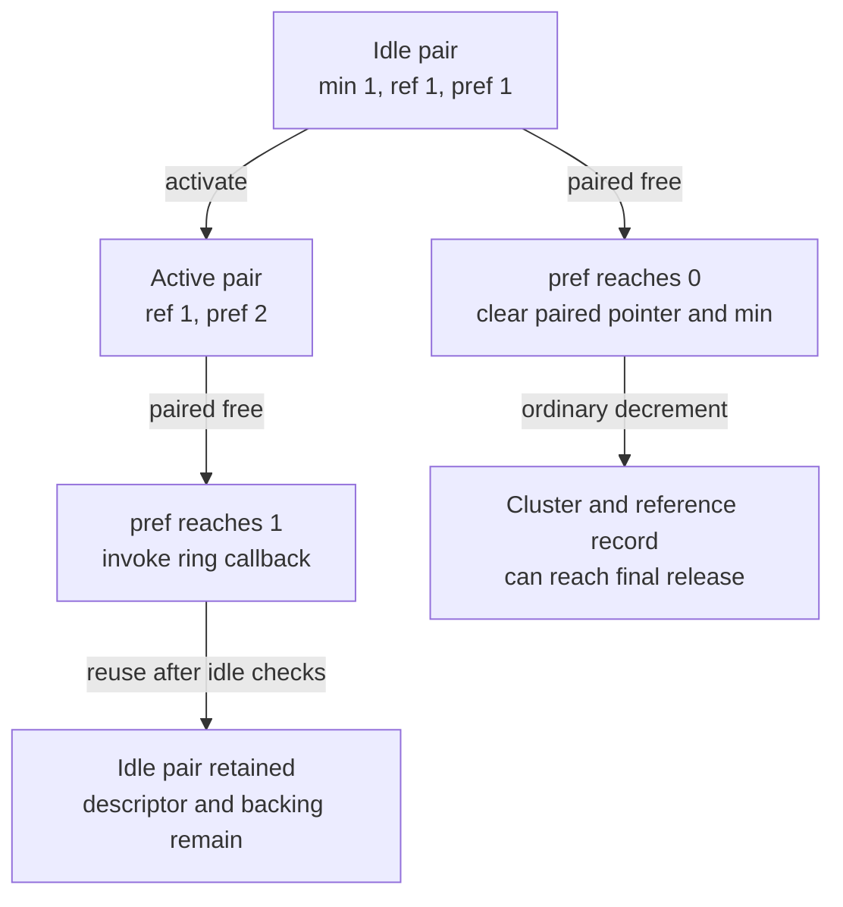
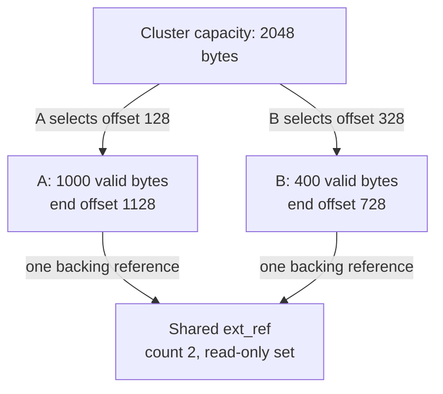

# Mbufs: packet views, shared clusters and external storage

An mbuf is a mutable descriptor for a range of packet bytes. It may contain those bytes inline, point into a separate cluster, link to another fragment, or head a packet carrying additional metadata. Copying a packet can allocate new descriptors while retaining the original external bytes. This chapter follows those representations and their allocation, access and release rules in `xnu-12377.121.6`, including both allocator configurations present in the source.

[Key structures](README.md) · [Networking guide](../subsystems/networking/README.md) · [Socket buffers](socket-buffers-and-record-queues.md) · [Sockets](sockets-and-protocol-attachments.md) · [Internet PCBs](internet-pcbs-and-transport-storage.md)

Read [mbuf allocation, caches and pressure](../subsystems/networking/mbuf-allocation-caches-and-pressure.md) for the MCACHE class/slab/worker algorithms and [packets, routes and interfaces](../subsystems/networking/packets-routes-and-interfaces.md) for packet movement. Here the central questions are which allocation a pointer names, whether a byte range is contiguous and writable, and what the next operation consumes.

Inspect the live [`m_ext`](layout-browser.md?declaration=m_ext), [`ext_ref`](layout-browser.md?declaration=ext_ref) layouts for the selected source profile.

## 1. Separate the descriptor, its byte view and its backing

The common header contains two links, a current data address, a fragment length, a type and flags. `m_next` links fragments within a chain; `m_nextpkt` links packet or record heads according to the owning queue. Neither link increments a backing reference. Packet queues and socket-buffer records impose additional rules on those links. [Header](../../platydoc-data/xnu/bsd/sys/mbuf.h#L134-L152), [record ownership](socket-buffers-and-record-queues.md).

`M_EXT` selects external storage. Its `m_ext` stores a backing base and capacity, a destructor and argument, and a pointer to a separately allocated `ext_ref`. Cloned descriptors copy this extension and increment its shared count. The descriptor itself has no general reference counter or embedded mutex. Code must obtain ownership or the containing queue's synchronization before changing its links, lengths or metadata. The atomics in `ext_ref` protect the backing protocol, not arbitrary concurrent edits to a descriptor. [Extension](../../platydoc-data/xnu/bsd/sys/mbuf.h#L607-L620), [clone](../../platydoc-data/xnu/bsd/kern/uipc_mbuf.c#L3127-L3148), [reference operations](../../platydoc-data/xnu/bsd/kern/uipc_mbuf.c#L1053-L1076).



This diagram shows shared backing rather than a duplicated payload. The two descriptors can select different, even overlapping, ranges of the same cluster. The chain link is independent of that sharing graph.

Exact extension declaration, [mbuf.h lines 607–620](../../platydoc-data/xnu/bsd/sys/mbuf.h#L607-L620):

<!-- source-excerpt: ../../platydoc-data/xnu/bsd/sys/mbuf.h#L607-L620 -->
```c
struct m_ext {
	caddr_t __counted_by(ext_size) ext_buf;   /* start of buffer */
	m_ext_free_func_t              ext_free;  /* free routine (plain-text), if not the usual */
	u_int                          ext_size;  /* size of the external buffer */
	caddr_t                        ext_arg;   /* additional ext_free argument (plain-text) */
	struct ext_ref {
		struct mbuf *paired;
		u_int16_t minref;
		u_int16_t refcnt;
		u_int16_t prefcnt;
		u_int16_t flags;
		u_int32_t priv;
	} *ext_refflags;
};
```

`ext_free` and `ext_arg` are declared as plain-text fields. `m_get_ext_free()` returns a `ptrauth_nop_cast` of the stored callback; it does not implement the field-address authentication used by some other handbook structures. `m_get_rfa()` merely returns the reference-record pointer. These helpers neither acquire ownership nor lock the object. [Accessors and setter](../../platydoc-data/xnu/bsd/kern/uipc_mbuf.c#L455-L511).

## 2. Select the layout before doing storage arithmetic

`CONFIG_MBUF_MCACHE` affects both allocator choice and the C representation. `uipc_mbuf.c` is common input; `uipc_mbuf_mcache.c` is selected by the configuration, and alternative definitions in the common file are guarded by `!CONFIG_MBUF_MCACHE`. Do not infer the selected implementation from the first same-named search result. [Build selection](../../platydoc-data/xnu/bsd/conf/files#L476-L478), [configuration option](../../platydoc-data/xnu/config/MASTER#L90-L90), [descriptor size](../../platydoc-data/xnu/bsd/sys/mbuf.h#L96-L108).

| Selected configuration | Descriptor layout | Inline payload capacity |
| --- | --- | --- |
| `CONFIG_MBUF_MCACHE` | `_MSIZE = 256`; a common `m_hdr` followed by a union of ordinary data or packet-header/extension/data storage | `MLEN = _MSIZE - sizeof(m_hdr)`; `MHLEN = MLEN - sizeof(pkthdr)`. External metadata occupies the selected union member. [Layout](../../platydoc-data/xnu/bsd/sys/mbuf.h#L625-L670). |
| `!CONFIG_MBUF_MCACHE` | `_MSIZE = 512`; `m_hdr_common` has dedicated header, extension and packet-header fields before the data union | The source asserts `sizeof(m_hdr_common) == 224`, so both `MLEN` and `MHLEN` are 288 bytes for this layout. Flags still determine which fields are semantically valid. [Layout and assertions](../../platydoc-data/xnu/bsd/sys/mbuf.h#L672-L716). |

Exact alternative layout geometry, [mbuf.h lines 678–691](../../platydoc-data/xnu/bsd/sys/mbuf.h#L678-L691):

<!-- source-excerpt: ../../platydoc-data/xnu/bsd/sys/mbuf.h#L678-L691 -->
```c
	struct m_hdr M_hdr;
	struct m_ext M_ext  __attribute__((aligned(16)));             /* M_EXT set */
#if defined(__arm64__)
	uint64_t m_hdr_crumbs;
#endif
	struct pkthdr M_pkthdr  __attribute__((aligned(16)));         /* M_PKTHDR set */
};

_Static_assert(sizeof(struct m_hdr_common) == 224, "Crumbs effecting size of struct");
#if defined(__arm64__)
_Static_assert(sizeof(struct m_hdr_common) == 224, "Crumbs effecting size of struct");
#endif

/*
```

An external 2 KiB cluster does not enlarge the mbuf allocation itself. Its capacity is separate from the descriptor's `_MSIZE` and the shared `ext_ref`. The ARM definitions choose cluster sizes of 2048, 4096 and 16384 bytes; those are allocation classes, not an assertion about the hardware translation-page size. [ARM sizes](../../platydoc-data/xnu/bsd/arm/param.h#L84-L89), [x86 sizes](../../platydoc-data/xnu/bsd/i386/param.h#L108-L113).

`M_PKTHDR` authorizes interpreting packet-header fields; it is not enough that a layout reserves bytes for them. `mbuf_init()` sets the initial data pointer to `m_dat` or `m_pktdat`, clears links/length, selects flags and initializes packet metadata when requested. It does not zero every payload byte. `m_getclr()` explicitly clears an ordinary inline data area. [Initialization](../../platydoc-data/xnu/bsd/kern/uipc_mbuf.c#L711-L744), [cleared allocation](../../platydoc-data/xnu/bsd/kern/uipc_mbuf.c#L1564-L1578).

## 3. Allocation supplies one component or a reusable three-part bundle

| Request | What becomes owned on success | Failure or reuse detail |
| --- | --- | --- |
| `m_get()` / `m_gethdr()` | One initialized descriptor; the latter has packet metadata | MCACHE uses `mcache_alloc(MC_MBUF)`; the alternative uses `mz_alloc()`. Both initialize through `mbuf_init()`. [MCACHE body](../../platydoc-data/xnu/bsd/kern/uipc_mbuf_mcache.c#L3055-L3073), [zone body and wrappers](../../platydoc-data/xnu/bsd/kern/uipc_mbuf.c#L1519-L1560). |
| `m_getcl()` | Descriptor, 2 KiB cluster and shared reference record from a composite cache | An idle cached bundle has reference count equal to its minimum; checkout reinitializes the descriptor and sets count 1. [Zone variant](../../platydoc-data/xnu/bsd/kern/uipc_mbuf.c#L1840-L1866), [MCACHE variant](../../platydoc-data/xnu/bsd/kern/uipc_mbuf_mcache.c#L3273-L3307). |
| `MCLGET()` / `m_mclget()` on an ordinary mbuf | Attaches a separately acquired reference record and cluster | The function returns the supplied mbuf even when attachment fails. Inspect `M_EXT`, rather than interpreting a nonnull result as proof of a cluster. [Zone variant](../../platydoc-data/xnu/bsd/kern/uipc_mbuf.c#L1870-L1890), [MCACHE variant](../../platydoc-data/xnu/bsd/kern/uipc_mbuf_mcache.c#L3311-L3330). |
| `mbuf_attachcluster()` | Association with caller-supplied bytes, callback and callback argument | Validates arguments, then replaces `*mbuf` with `m_clattach()`'s result. This is an ownership-changing operation; see section 8. [KPI](../../platydoc-data/xnu/bsd/kern/kpi_mbuf.c#L181-L195). |

Under `!CONFIG_MBUF_MCACHE`, the ordinary descriptor and reference-record zones use `ZC_CACHING | ZC_KASAN_NOQUARANTINE`. The three cluster zones additionally use `ZC_SHARED_DATA`. None is a read-only zone. Composite `ZCACHE_DEFINE` entries supply callbacks that build and retire a bundle. Their advertised size is the sum of its components, not evidence of one contiguous allocation. [Zone/cache declarations](../../platydoc-data/xnu/bsd/kern/uipc_mbuf.c#L354-L382), [RO-zone comparison](read-only-object-updates.md).

The alternative backend's exact component allocations and failure unwind, [uipc_mbuf.c lines 924–962](../../platydoc-data/xnu/bsd/kern/uipc_mbuf.c#L924-L962):

<!-- source-excerpt: ../../platydoc-data/xnu/bsd/kern/uipc_mbuf.c#L924-L962 -->
```c
{
	const zone_id_t cl_zid = mz_cl_zid(zid);
	struct mbuf *m = NULL;
	struct ext_ref *rfa = NULL;
	void *cl = NULL;

	cl = mz_cl_alloc(cl_zid, flags);
	if (__improbable(cl == NULL)) {
		goto out;
	}
	rfa = mz_ref_alloc(flags);
	if (__improbable(rfa == NULL)) {
		goto out_free_cl;
	}
	m = mz_alloc(flags);
	if (__improbable(m == NULL)) {
		goto out_free_rfa;
	}
	mbuf_init(m, 0, MT_FREE);
	if (zid == ZONE_ID_MBUF_CLUSTER_2K) {
		MBUF_CL_INIT(m, cl, rfa, 0, EXTF_COMPOSITE);
	} else if (zid == ZONE_ID_MBUF_CLUSTER_4K) {
		MBUF_BIGCL_INIT(m, cl, rfa, 0, EXTF_COMPOSITE);
	} else {
		MBUF_16KCL_INIT(m, cl, rfa, 0, EXTF_COMPOSITE);
	}
	VERIFY(m->m_flags == M_EXT);
	VERIFY(m_get_rfa(m) != NULL && MBUF_IS_COMPOSITE(m));

	return m;
out_free_rfa:
	mz_ref_free(rfa);
out_free_cl:
	mz_cl_free(cl_zid, cl);
out:
	return NULL;
}

static void *
```

The callback acquires cluster, reference record and descriptor in that order, then initializes a cached `MT_FREE` bundle with `EXTF_COMPOSITE` and count zero. Failure frees only the acquired components in reverse order. Its mark-valid/mark-invalid callbacks perform KASAN transitions for each component; the final destroy callback dismantles the bundle. [Marking](../../platydoc-data/xnu/bsd/kern/uipc_mbuf.c#L965-L1015), [destruction](../../platydoc-data/xnu/bsd/kern/uipc_mbuf.c#L1018-L1044).

Allocation wait semantics also depend on this backend. `mz_alloc()` maps `Z_NOWAIT` to `Z_NOPAGEWAIT`; otherwise, absent `Z_NOPAGEWAIT`, it adds `Z_NOFAIL`. The surrounding comment explains that taking a mutex is acceptable while waiting for VM pages is not. Reference-record allocation has its own wrapper and does not add that same no-fail flag. Consequently “nonblocking mbuf allocation” is not a promise that every implementation avoids locks. [Wrapper rationale and descriptor allocation](../../platydoc-data/xnu/bsd/kern/uipc_mbuf.c#L748-L791), [reference-record allocation](../../platydoc-data/xnu/bsd/kern/uipc_mbuf.c#L825-L843).

## 4. Access the current view, not an assumed payload address

| Field or helper | Interpretation | What it does not establish |
| --- | --- | --- |
| `M_START(m)` | Base of external storage, packet inline data, or ordinary inline data, selected by flags | The beginning of currently valid packet bytes. |
| `M_SIZE(m)` | Capacity of the selected data area | The fragment length or total packet length. |
| `m_data` / `mtod(m, type)` | Current byte-view address; `mtod` uses `m_mtod_current()` | Contiguity of the remainder of the chain, writable ownership or protocol validity. |
| `m_len` | Current fragment's byte count | Packet-wide length. |
| `m_pkthdr.len` | Packet-wide length when `M_PKTHDR` applies | Capacity of the first descriptor, or automatic consistency with the chain. |
| `m_capacity(m)` | `_MSIZE + ext_size` for an external mbuf, `_MSIZE` otherwise | Unique physical memory owned by this packet; shared backing can be charged by more than one descriptor. |
| `m_next` / `m_nextpkt` | Fragment-chain and packet/record-queue links | A reference to the queue, a retained next descriptor or interchangeable traversal orders. |

The relevant accessors are [base and size](../../platydoc-data/xnu/bsd/sys/mbuf.h#L962-L974), [current range](../../platydoc-data/xnu/bsd/sys/mbuf.h#L1505-L1538), [capacity](../../platydoc-data/xnu/bsd/sys/mbuf.h#L1546-L1550) and [header fields](../../platydoc-data/xnu/bsd/sys/mbuf.h#L134-L152). `m_length()` returns `m_pkthdr.len` immediately for a packet-header mbuf; it sums the chain only otherwise. It is therefore not a consistency validator for a packet header already present. [Length implementation](../../platydoc-data/xnu/bsd/kern/uipc_mbuf.c#L3717-L3730).

Exact conversion from stored address to the current view, [mbuf.h lines 1521–1526](../../platydoc-data/xnu/bsd/sys/mbuf.h#L1521-L1526):

<!-- source-excerpt: ../../platydoc-data/xnu/bsd/sys/mbuf.h#L1521-L1526 -->
```c
__stateful_pure static inline caddr_t __header_bidi_indexable
m_mtod_current(struct mbuf *m)
{
	caddr_t data = m_mtod_lower_bound(m);
	return data + (m->m_data - (uintptr_t)data);
}
```

The source describes the required ordering as `lower bound <= current <= end <= upper bound`. It computes these addresses from the selected storage and fragment length. A bounds-aware pointer expression does not traverse `m_next`, parse a packet header, or acquire a cluster reference. Code needing a contiguous protocol structure must separately establish enough bytes in the current fragment or use a chain operation. [Range contract](../../platydoc-data/xnu/bsd/sys/mbuf.h#L1505-L1538), [pullup](../../platydoc-data/xnu/bsd/kern/uipc_mbuf.c#L3458-L3544).

`M_LEADINGSPACE` and `M_TRAILINGSPACE` return zero for a nonwritable external view. Their comments explicitly leave the caller responsible for ensuring that writing the proposed bytes is appropriate. Spare capacity is not equivalent to initialized packet data. [Space macros](../../platydoc-data/xnu/bsd/sys/mbuf.h#L978-L998).

## 5. Shared clusters use a sticky software writability state

`m_incref()` increments a 16-bit backing count with relaxed ordering. When the resulting count exceeds `minref + 1`, it sets `EXTF_READONLY`. `m_decref()` performs an acquire-release decrement. The former requires an already valid backing association; it cannot safely resurrect an unowned pointer. [Reference bodies](../../platydoc-data/xnu/bsd/kern/uipc_mbuf.c#L1053-L1076).

Exact increment and sharing transition, [uipc_mbuf.c lines 1053–1066](../../platydoc-data/xnu/bsd/kern/uipc_mbuf.c#L1053-L1066):

<!-- source-excerpt: ../../platydoc-data/xnu/bsd/kern/uipc_mbuf.c#L1053-L1066 -->
```c
m_incref(struct mbuf *m)
{
	uint16_t new = os_atomic_inc(&MEXT_REF(m), relaxed);

	VERIFY(new != 0);
	/*
	 * If cluster is shared, mark it with (sticky) EXTF_READONLY;
	 * we don't clear the flag when the refcount goes back to the
	 * minimum, to simplify code calling m_mclhasreference().
	 */
	if (new > (MEXT_MINREF(m) + 1) && !(MEXT_FLAGS(m) & EXTF_READONLY)) {
		os_atomic_or(&MEXT_FLAGS(m), EXTF_READONLY, relaxed);
	}
}
```

`m_mclhasreference()` tests the flag, not whether the current count exceeds one. `M_WRITABLE()` accepts inline storage or an external view without that flag. Once an ordinary active backing has been shared, dropping the other descriptor does not make the remaining view writable through this test. This avoids treating a count observation as exclusive byte ownership. [Flag test](../../platydoc-data/xnu/bsd/kern/uipc_mbuf.c#L1908-L1922), [writability macro](../../platydoc-data/xnu/bsd/sys/mbuf.h#L937-L942).

Here “read-only” is software ownership state. It does not imply `zalloc_ro`, protected page mappings, PPL writes or an RO mutation API. The descriptor and reference record remain writable through their ordinary synchronization/ownership protocol. Compare [protected object fields](read-only-object-updates.md) when reading similarly named flags in other subsystems.

The flag comment says it is never cleared. The free bodies refine that statement: when the final reference returns a composite bundle to its idle cache, they explicitly clear `EXTF_READONLY`. Thus the conservative state persists through an active sharing lifetime; it is reset for a subsequent cached-bundle use. `MBUF_IS_COMPOSITE()` also requires count equal to the minimum, so it identifies the idle bundle state rather than every actively used descriptor carrying `EXTF_COMPOSITE`. [Definitions and comments](../../platydoc-data/xnu/bsd/sys/mbuf.h#L1940-L1988), [zone recycle](../../platydoc-data/xnu/bsd/kern/uipc_mbuf.c#L1696-L1723), [MCACHE recycle](../../platydoc-data/xnu/bsd/kern/uipc_mbuf_mcache.c#L3128-L3156).



This diagram assumes ordinary `minref = 0` storage. Paired buffers use an additional reserved minimum and paired count, described in section 9.

## 6. Cloning data and transferring packet metadata are different operations

For external storage, `m_copym_mode()` allocates a destination descriptor, copies `m_ext`, increments the shared backing count, sets the destination view to `m_data + off`, and marks it external. For inline storage it copies bytes, limited by destination capacity. The result is a new descriptor chain, with shared or copied bytes chosen per fragment. [Copy loop](../../platydoc-data/xnu/bsd/kern/uipc_mbuf.c#L3090-L3159).

Exact external-view clone, [uipc_mbuf.c lines 3129–3134](../../platydoc-data/xnu/bsd/kern/uipc_mbuf.c#L3129-L3134):

<!-- source-excerpt: ../../platydoc-data/xnu/bsd/kern/uipc_mbuf.c#L3129-L3134 -->
```c
		n->m_len = MIN(len, (m->m_len - off));
		if (m->m_flags & M_EXT) {
			n->m_ext = m->m_ext;
			m_incref(m);
			n->m_data = m->m_data + off;
			n->m_flags |= M_EXT;
```

Packet metadata has a separate ownership decision:

| Helper | Packet-header action | Cleanup consequence |
| --- | --- | --- |
| `m_copy_pkthdr()` / `M_COPY_PKTHDR()` | Moves header state, especially tag ownership, into the destination; clears source classifier, tags and scratch state | Despite its name, it is a move. It deletes any destination tags first. It does not itself clear the source `M_PKTHDR` bit; callers that need that transition perform it. [Body](../../platydoc-data/xnu/bsd/kern/uipc_mbuf.c#L2000-L2020), [pullup caller](../../platydoc-data/xnu/bsd/kern/uipc_mbuf.c#L3514-L3517). |
| `m_dup_pkthdr()` | Copies header values, clears the duplicate's TX completion request flag, initializes its tag list and deep-copies dynamic tags | Destination tag allocation can fail. The source retains its tags; destination cleanup must follow the returned status. [Body](../../platydoc-data/xnu/bsd/kern/uipc_mbuf.c#L2022-L2046). |
| `m_copym()` | Invokes `m_copym_mode(..., M_COPYM_MOVE_HDR)` | A function named “copy” can transfer header-owned state from the source. Inspect the mode before assuming source metadata is untouched. [Wrapper](../../platydoc-data/xnu/bsd/kern/uipc_mbuf.c#L3172-L3176). |

A failed clone is also mode-dependent. With `M_COPYM_MOVE_HDR`, the first destination can already own the source tags before a later descriptor allocation fails. The `nospace` path frees that partial destination chain; a null result therefore does not promise that the original packet metadata was preserved. [Move before later iterations](../../platydoc-data/xnu/bsd/kern/uipc_mbuf.c#L3104-L3112), [partial-chain cleanup](../../platydoc-data/xnu/bsd/kern/uipc_mbuf.c#L3165-L3168).

Dynamic tags have their own allocator path: `m_tag_alloc()` chooses mbuf-backed storage under `MB_TAG_MBUF` or the registered tag allocator otherwise. `m_tag_copy_chain()` deletes destination tags before copying and deletes partially copied tags on failure. Tag allocation and shared cluster retention are separate failure/ownership steps. [Tag allocator selection](../../platydoc-data/xnu/bsd/kern/uipc_mbuf2.c#L571-L613), [copy cleanup](../../platydoc-data/xnu/bsd/kern/uipc_mbuf2.c#L970-L999).

`rcvif`, protocol hints, flow metadata, checksum state and scratch bytes are not all independent retained resources. The shown header assignment copies `rcvif` as a pointer; it does not acquire an interface reference. The declaration calls `pkt_proto` a best-effort hint and says module-private scratch is not guaranteed across module transitions. Follow the interface/queue or module contract before using these fields beyond the current ownership interval. [Packet header](../../platydoc-data/xnu/bsd/sys/mbuf.h#L365-L495), [scratch initialization](../../platydoc-data/xnu/bsd/kern/uipc_mbuf.c#L693-L708), [interface lifetime](../subsystems/networking/packets-routes-and-interfaces.md#interface-teardown-hide-quiesce-dismantle-release).

## 7. Reshaping a chain can invalidate both the head and earlier views

| Operation | Representation change | Ownership on failure |
| --- | --- | --- |
| `m_pullup(n, len)` | Copies enough leading bytes into one inline descriptor, reusing or allocating a head and freeing consumed fragments | Frees the input chain and returns null on its failure path. It has explicit `MLEN`/`MHLEN` limits, even if the whole packet is longer. [Body](../../platydoc-data/xnu/bsd/kern/uipc_mbuf.c#L3466-L3544). |
| `m_split(m, offset, how)` | Detaches a tail; a split inside external bytes creates another shared view and increments the backing count | Returns null at allocation/range failures. The comment promises an attempt to restore state, not transactional rollback; one packet-header branch changes the original length before a recursive allocation can fail. [Body](../../platydoc-data/xnu/bsd/kern/uipc_mbuf.c#L3599-L3710). |
| `m_copyback_cow(m, off, len, bytes, how)` | Replaces shared regions with writable storage and copies the supplied bytes; may replace the chain head | Verifies that the requested range fits the existing packet. On an error it frees the possibly modified chain and returns null. [Wrapper](../../platydoc-data/xnu/bsd/kern/uipc_mbuf.c#L3778-L3797). |
| `m_makewritable(&m, off, len, how)` | Uses the same COW engine with a preserve-data mode and publishes the current head through `mp` | Returns the engine error without freeing the whole chain in its wrapper; callers must use the updated pointer and handle partial reshaping. [Wrapper](../../platydoc-data/xnu/bsd/kern/uipc_mbuf.c#L3799-L3828). |

Exact consuming COW error handling, [uipc_mbuf.c lines 3786–3796](../../platydoc-data/xnu/bsd/kern/uipc_mbuf.c#L3786-L3796):

<!-- source-excerpt: ../../platydoc-data/xnu/bsd/kern/uipc_mbuf.c#L3786-L3796 -->
```c
	error = m_copyback0(&m0, off, len, cp,
	    M_COPYBACK0_COPYBACK | M_COPYBACK0_COW, how);
	if (error) {
		/*
		 * no way to recover from partial success.
		 * just free the chain.
		 */
		m_freem(m0);
		return NULL;
	}
	return m0;
```

The shared COW engine can split a fragment, allocate replacement data, move a packet header, advance old views, release exhausted descriptors and splice the replacement into the chain. Its `ENOBUFS` return is reached after some of those actions may already have occurred. Retain the resulting head according to the wrapper's contract and reacquire byte pointers after reshaping; a pointer taken from `mtod()` before the call may no longer name the chosen bytes. [COW branch](../../platydoc-data/xnu/bsd/kern/uipc_mbuf.c#L3905-L4001), [error return](../../platydoc-data/xnu/bsd/kern/uipc_mbuf.c#L4021-L4030).

The older `m_copyback()` wrapper is `void`, requests extension rather than COW mode, and only checks the internal error under `DEBUG`. The engine's extension allocation failure can reach its ordinary return after partial progress. It is unsuitable as evidence of an all-or-nothing write merely because no error reaches the caller. Read the actual wrapper chosen by a call site. [Wrapper](../../platydoc-data/xnu/bsd/kern/uipc_mbuf.c#L3748-L3776), [extension](../../platydoc-data/xnu/bsd/kern/uipc_mbuf.c#L3858-L3900).

## 8. Attaching external bytes establishes a destructor contract

`mbuf_attachcluster()` rejects null output, bytes or destructor, and zero capacity. It then passes the existing descriptor, if any, to `m_clattach()`. A new external association is initialized with `minref = 0`, `refcnt = 1`, no paired count and the supplied callback argument. The final noncomposite backing release invokes that callback and frees the separate reference record. [KPI admission](../../platydoc-data/xnu/bsd/kern/kpi_mbuf.c#L181-L195), [initialization](../../platydoc-data/xnu/bsd/kern/uipc_mbuf.c#L1820-L1830), [final backing release](../../platydoc-data/xnu/bsd/kern/uipc_mbuf.c#L1683-L1695).

This is not a pure setter that preserves the prior mbuf on every error. `m_clattach()` may release existing backing, reuse its reference record, return a composite to its cache, allocate a replacement descriptor, or fail while obtaining metadata. The KPI overwrites `*mbuf` with the result. An early paired-descriptor rejection returns before replacing backing, while later failures have different partial-progress states. Follow the specific branch and caller preconditions; do not reconstruct ownership from the final `ENOMEM` alone. [Zone implementation](../../platydoc-data/xnu/bsd/kern/uipc_mbuf.c#L1738-L1832), [MCACHE implementation](../../platydoc-data/xnu/bsd/kern/uipc_mbuf_mcache.c#L3170-L3267).

Incoming external bytes are installed only by the final `mext_init()`. For a concrete caller-owned allocation, `mbuf_ring_cluster_alloc()` explicitly frees its newly acquired cluster if attachment fails. This provides a useful boundary: acquiring bytes for attachment and transferring them to a completed mbuf are separate stages. [Ring allocation and rollback](../../platydoc-data/xnu/bsd/kern/kpi_mbuf.c#L198-L227), [extension initialization](../../platydoc-data/xnu/bsd/kern/uipc_mbuf.c#L513-L530).

## 9. Paired ring buffers have a second reference protocol

The ring KPI obtains a standard cluster and attaches it with `pair = 1`. This sets `minref = 1`, ordinary `refcnt = 1`, paired `prefcnt = 1`, `EXTF_PAIRED`, and `paired = m`. The callback argument is forced to the mbuf pointer. This state reserves the descriptor/cluster pair for reuse rather than representing an ordinary exclusive packet. `MBUF_IS_PAIRED()` requires the paired pointer to match this descriptor; the flag alone can survive unpairing. [Attachment](../../platydoc-data/xnu/bsd/kern/uipc_mbuf.c#L1820-L1830), [predicate](../../platydoc-data/xnu/bsd/sys/mbuf.h#L1980-L1988).

`m_ext_paired_activate()` verifies both counts equal the minimum, saves backing metadata, reinitializes the mbuf, and restores the extension with paired count 2. It preserves the private property value. `mbuf_ring_cluster_activate()` returns `EBUSY` if already active. [Activation](../../platydoc-data/xnu/bsd/kern/uipc_mbuf.c#L4771-L4807), [KPI](../../platydoc-data/xnu/bsd/kern/kpi_mbuf.c#L231-L245).



The diagram isolates an unshared pair and omits provider-specific ring synchronization. Cloned ordinary views add backing references, and the source permits concurrent unpair observations; this is not a universal driver execution sequence.

`m_free_paired()` issues a sequentially consistent fence and, while still paired, atomically decrements `prefcnt`. Above 1 it retains the pair; at 1 it calls the registered callback and retains the pair; at 0 it restores `minref = 0`, release-stores a null paired pointer, and selects the standard cluster destructor by capacity. It leaves `EXTF_PAIRED` set. A nonretaining result tells `m_free()` to continue with the ordinary backing decrement. The body also handles having lost a race with unpairing rather than assuming the earlier predicate stays true. [Full helper](../../platydoc-data/xnu/bsd/kern/uipc_mbuf.c#L1584-L1647).

Exact callback-versus-unpair decision, [uipc_mbuf.c lines 1597–1618](../../platydoc-data/xnu/bsd/kern/uipc_mbuf.c#L1597-L1618):

<!-- source-excerpt: ../../platydoc-data/xnu/bsd/kern/uipc_mbuf.c#L1597-L1618 -->
```c
		if (prefcnt > 1) {
			return 1;
		} else if (prefcnt == 1) {
			m_ext_free_func_t m_free_func = m_get_ext_free(m);
			VERIFY(m_free_func != NULL);
			(*m_free_func)(m->m_ext.ext_buf,
			    m->m_ext.ext_size, m_get_ext_arg(m));
			return 1;
		} else if (prefcnt == 0) {
			VERIFY(MBUF_IS_PAIRED(m));

			/*
			 * Restore minref to its natural value, so that
			 * the caller will be able to free the cluster
			 * as appropriate.
			 */
			MEXT_MINREF(m) = 0;

			/*
			 * Clear MEXT_PMBUF, but leave EXTF_PAIRED intact
			 * as it is immutable.  atomic_set_ptr also causes
			 * memory barrier sync.
```

The callback at paired count 1 is a reuse notification, so it must not be read as proof that the cluster has been physically freed. Conversely, final unpair replaces that callback with the appropriate standard allocator release. The visible helper and KPI establish the generic protocol; individual driver ring bodies and DMA ownership rules are outside this chapter.

## 10. Final release can free a descriptor while preserving its bytes

Both `m_free()` implementations first remember `m_next`, reject `MT_FREE`, and, for packet headers, delete dynamic tags and run TX completion handling. Then they process paired state and external backing. `m_do_tx_compl_callback()` checks the request flag, looks up each selected callback under the registration-table lock, drops that lock before invoking it, and clears the callback bitmap. `m_free()` supplies a null interface argument to that completion path. [Zone free](../../platydoc-data/xnu/bsd/kern/uipc_mbuf.c#L1652-L1734), [MCACHE free](../../platydoc-data/xnu/bsd/kern/uipc_mbuf_mcache.c#L3082-L3166), [completion dispatch](../../platydoc-data/xnu/bsd/kern/kpi_mbuf.c#L2092-L2148).

Before decrementing a shared reference, each free body saves the composite flag, destructor and minimum count. If another owner remains, that owner may concurrently perform the final release; the current free must not inspect the shared reference record afterward. The saved values permit selecting the nonfinal branch without re-reading potentially retired metadata. [Saved-state ordering](../../platydoc-data/xnu/bsd/kern/uipc_mbuf.c#L1671-L1681), [MCACHE counterpart](../../platydoc-data/xnu/bsd/kern/uipc_mbuf_mcache.c#L3101-L3111).

| Result of the backing protocol | Descriptor action | Backing action |
| --- | --- | --- |
| Paired helper retains the pair | Return saved next pointer without returning the descriptor to its allocator | Pair remains available under its ring protocol. |
| Ordinary count remains above minimum | Return this descriptor to its allocator | Another descriptor keeps cluster and `ext_ref` alive. |
| Count reaches minimum, noncomposite | Return descriptor after backing cleanup | Call the standard cluster allocator or custom destructor, then free `ext_ref`. |
| Count reaches minimum, composite | Reset type/flags/links/length and return the whole bundle to its intermediate cache | Keep cluster and `ext_ref` attached for reuse; clear the sharing flag. |

The last descriptor releasing composite backing need not be the descriptor that first acquired it: a clone can become the final surviving view. The branch is selected by the shared metadata copied into the current mbuf, not by a permanent original-owner identity. [Clone association](../../platydoc-data/xnu/bsd/kern/uipc_mbuf.c#L3129-L3134), [composite return](../../platydoc-data/xnu/bsd/kern/uipc_mbuf.c#L1696-L1723).

For noncomposite zone returns, `mz_free()` calls `m_elide()` before `zfree_nozero()`. Elision clears links, data/extension pointers, packet pointer fields, tags and scratch state. It is distinct from zeroing every payload byte. Composite returns instead retain their associations and reinitialize on checkout. [Elision](../../platydoc-data/xnu/bsd/kern/uipc_mbuf.c#L748-L780), [zone free wrapper](../../platydoc-data/xnu/bsd/kern/uipc_mbuf.c#L807-L815).

`m_free()` returns the next fragment but does not free the remainder. `m_freem()` explicitly walks `m_next`; `m_freem_list()` also handles packet lists through `m_nextpkt`. The owner must select the traversal matching its queue representation. [Chain free](../../platydoc-data/xnu/bsd/kern/uipc_mbuf.c#L2869-L2883), [packet-list free](../../platydoc-data/xnu/bsd/kern/uipc_mbuf.c#L2628-L2685), [MCACHE list variant](../../platydoc-data/xnu/bsd/kern/uipc_mbuf_mcache.c#L3873-L3946).

## 11. Worked storage and reference ledger

Choose the `!CONFIG_MBUF_MCACHE` layout and an ordinary, noncomposite 2048-byte cluster. This example concerns offsets within CPU-accessible buffers; it assumes no translation-page size and makes no physical-address or DMA-contiguity claim. Descriptor size is 512 bytes, inline capacity would be 288, and this external view uses the full cluster capacity instead. [Layout](../../platydoc-data/xnu/bsd/sys/mbuf.h#L678-L704), [cluster size](../../platydoc-data/xnu/bsd/arm/param.h#L84-L85).

Let backing base be `P`. Descriptor A selects `m_data = P + 128`, `m_len = 1000`, and has no additional fragment. Its valid interval is `[P + 128, P + 1128)`. With an initialized packet header, `m_pkthdr.len = 1000`. Before sharing, the raw leading capacity is 128 bytes and trailing capacity is `2048 - 128 - 1000 = 920` bytes.

Clone a 400-byte view starting 200 bytes into A using `M_COPYM_MUST_COPY_HDR`. The `MUST` mode matters because the source offset is nonzero: ordinary `M_COPYM_COPY_HDR` alone would not select a packet header for this example. The external branch sets descriptor B's current address to `P + 328` and length to 400, selecting `[P + 328, P + 728)`. It increments the common backing count from 1 to 2 and sets `EXTF_READONLY`. [Clone implementation](../../platydoc-data/xnu/bsd/kern/uipc_mbuf.c#L3105-L3134).

| Stage | Descriptor ownership | Shared backing state | Writability and accounting |
| --- | --- | --- | --- |
| Initial packet | A owns one external view | `minref = 0`, `refcnt = 1`, flag clear | `M_WRITABLE(A)` true under this protocol; `m_capacity(A) = 512 + 2048 = 2560`. |
| View clone succeeds | A and B each own their descriptor; packet tags duplicated according to the selected mode | Count 2, read-only flag set | Both conservative leading/trailing-space helpers return zero despite unused physical capacity. |
| A is freed | B remains; A's descriptor is returned | Count 1, flag still set | B still reports nonwritable; freeing A did not run the cluster destructor. |
| B is freed | No descriptor owner remains | Count 0 reaches minimum | Noncomposite branch releases the cluster and reference record, then B's descriptor. |

If both views are charged independently through `m_capacity()`, their combined charge is 5120 bytes although only one 2048-byte payload allocation exists. The charge also does not include every auxiliary tag or reference-record byte. It is socket-buffer accounting, not a census of distinct physical allocations. See [socket-buffer counters](socket-buffers-and-record-queues.md) for where the helper is applied.



The same view arithmetic works for the MCACHE backend; descriptor geometry, allocator operations and capacity charges change with configuration. A composite example would end in cache return rather than immediate dismantling of the three components. A paired example would require accounting for `minref` and `prefcnt` separately.

## 12. Reading checklist and implementation boundaries

At a call site, first identify the selected layout and whether the mbuf is an ordinary fragment, a packet header, a queued record or a paired descriptor. Then write down the current byte interval, backing base/capacity, sharing state and metadata owner. For each helper, distinguish a borrowed pointer from a returned owner, an in-place edit from a head replacement, and a retained chain from a consuming failure.

This companion covers common descriptor allocation, the alternative zone backend's component lifecycle, selected MCACHE counterparts, shared external views, packet-header/tag transfer, generic ring pairing, chain reshaping and final release. It does not enumerate every allocator class slow path, all tag providers, every packet transform, hardware DMA mapping, driver callback body or all Skywalk conversions. Continue with [allocator pressure](../subsystems/networking/mbuf-allocation-caches-and-pressure.md), [socket queues](socket-buffers-and-record-queues.md), [Skywalk packet storage](../subsystems/networking/skywalk-packets-buflets-and-pools.md) and [driver memory](../subsystems/drivers/README.md) as the caller requires.

The evidence is the local source and selected caller/callee paths. No kernel execution or device experiment is claimed.

<!-- BEGIN PLATYDOC DOCUMENTATION LICENSE -->
Original Platydoc text and diagrams are licensed under [CC BY 4.0](https://creativecommons.org/licenses/by/4.0/). Quoted source code and third-party material retain their respective licenses.
<!-- END PLATYDOC DOCUMENTATION LICENSE -->
