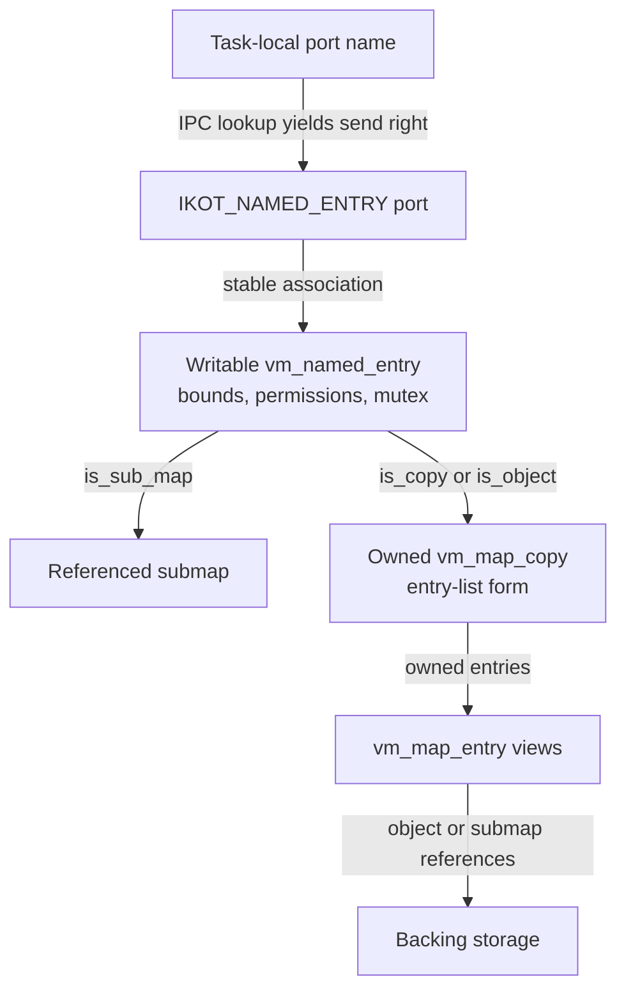
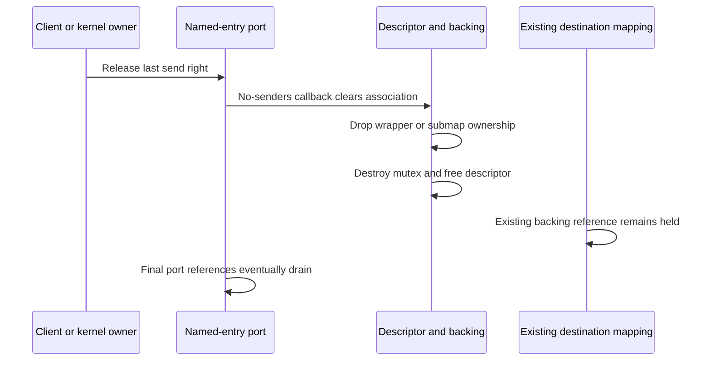
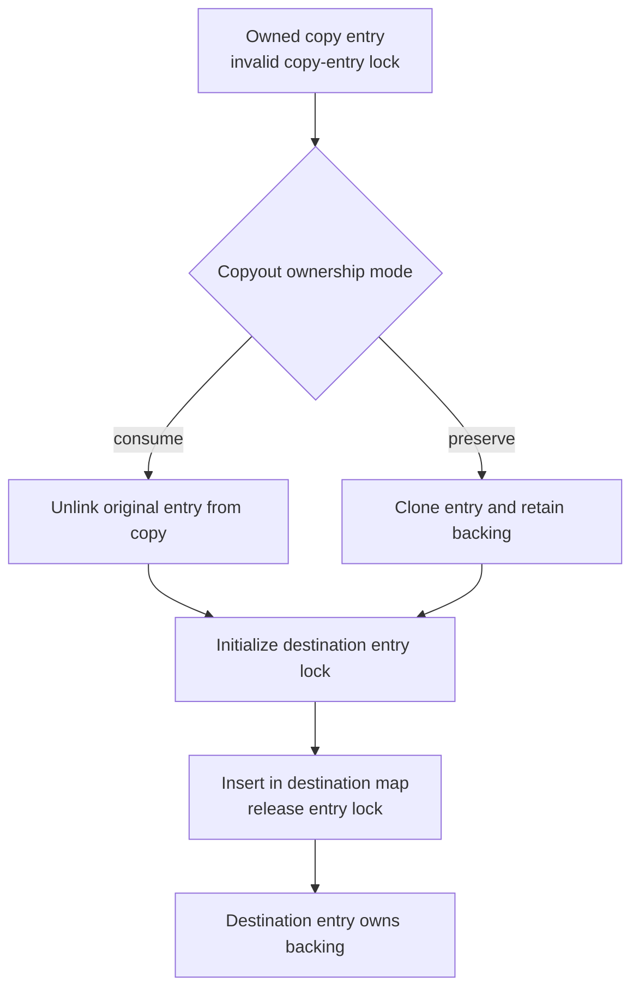

# Memory-entry capabilities and VM copy storage

A named memory entry gives a Mach client a bounded view of memory; a `vm_map_copy` holds an owned transfer representation inside the kernel. They can point to the same backing objects while having different allocation, locking and destruction rules. This chapter follows those containers in `xnu-12377.121.6`, from their writable storage through port access, entry conversion, publication and final release.

[Key structures](README.md) · [Maps and entries](vm-maps-and-entries.md) · [VM objects](vm-objects-and-backing.md) · [Ports and kobjects](ipc-ports-and-kobjects.md)

The [wiring and memory-entry chapter](../subsystems/vm/wiring-and-memory-entries.md) explains the surrounding export/map operations; [copy-overwrite and remapping](../subsystems/vm/copy-overwrite-and-remap.md) follows destination mutation and mixed page sizes. Here the focus is the actual allocation graph, access contracts and ownership of each container. A port name, a named-entry pointer, a copy pointer, an object offset and a mapped virtual address are separate representations.

Inspect the live [`vm_named_entry`](layout-browser.md?declaration=vm_named_entry), [`vm_map_copy`](layout-browser.md?declaration=vm_map_copy) layouts for the selected source profile.

## 1. A named entry is a port-owned descriptor

`struct vm_named_entry` has a mutex but no separate reference-count member. Its backing union contains either `vm_map_t map` or `vm_map_copy_t copy`. In particular, `is_object` means a single object **wrapped in a one-entry copy**, not a direct object pointer in that union. [Complete layout](../../xnu/osfmk/vm/vm_map_xnu.h#L104-L124).

| Member | Representation and use | Ownership/access distinction |
| --- | --- | --- |
| `Lock` | Named-entry mutex, using the VM object lock group | Protects selected backing/access operations; not a port lock, map interlock or VM object lock. |
| `backing.map` | Retained submap when `is_sub_map` | Teardown drops a map reference. A map getter must establish its own lifetime if it outlives the capability. |
| `backing.copy` | Owned copy when `is_copy`, or one-entry wrapper when `is_object` | Teardown discards the copy and its backing holdings. These two flags describe different views of the same pointer type. |
| `offset`, `size` | Exported backing interval | Mapping checks bounds and adds the named-entry offset; these are not a receiving task's virtual addresses. |
| `data_offset` | Requested data position within a rounded exported range | Used by selected data-address and copy-backed mapping paths; not an extra reference or physical address. |
| `protection` | Allowed mapping permissions | Current/max mapping requests are checked or intersected against this ceiling. |
| `access` | `MAP_MEM_*` access/cache mode | May lead to WIMG changes in the VM object; it is not the same field as `protection`. |
| `internal`, `is_fully_owned` | Backing classification and object ownership/accounting result | They are not the allocation's refcount. `is_fully_owned` is computed from backing objects and their owner/accounting state. |

Sources: [lock macros](../../xnu/osfmk/vm/vm_map_xnu.h#L74-L77), [field definitions](../../xnu/osfmk/vm/vm_map_xnu.h#L104-L124), [copy-backed ownership classification](../../xnu/osfmk/vm/vm_memory_entry.c#L559-L590), [mapping admission and offsets](../../xnu/osfmk/vm/vm_map.c#L4441-L4524), [WIMG and object acquisition](../../xnu/osfmk/vm/vm_map.c#L4994-L5039).



This shows alternatives, not simultaneous members of the backing union. The port and descriptor are separate allocations. The copy does not contain a pmap, and sharing its backing does not share a receiving task's page tables. [Representation](../../xnu/osfmk/vm/vm_map_xnu.h#L104-L124), [copy declaration](../../xnu/osfmk/vm/vm_map_xnu.h#L768-L784).

## 2. Allocation, construction and publication are separate steps

`mach_memory_entry_allocate()` uses typed `kalloc_type(struct vm_named_entry, Z_WAITOK | Z_ZERO | Z_NOFAIL)`, initializes the mutex, and allocates a kobject port with one send right. Neither the descriptor nor its copy is allocated from an RO zone. The helper returns the descriptor and writes a kernel `ipc_port_t` to the output slot; it has not copied a numeric name into another task's IPC table. [Allocator — `vm_memory_entry.c`, lines 1287–1297](../../xnu/osfmk/vm/vm_memory_entry.c#L1287-L1297).

<!-- source-excerpt: ../../xnu/osfmk/vm/vm_memory_entry.c#L1287-L1297 -->
```c
__private_extern__ vm_named_entry_t
mach_memory_entry_allocate(ipc_port_t *user_handle_p)
{
	vm_named_entry_t user_entry;

	user_entry = kalloc_type(struct vm_named_entry,
	    Z_WAITOK | Z_ZERO | Z_NOFAIL);
	named_entry_lock_init(user_entry);

	*user_handle_p = ipc_kobject_alloc_port(user_entry, IKOT_NAMED_ENTRY,
	    IPC_KOBJECT_ALLOC_MAKE_SEND);
```

The type policy explicitly supports movable sends, a stable association and a no-senders callback. Stable means this type's association remains valid under its right-ownership protocol; it does not turn the descriptor into immutable RO storage. [Registration — `vm_memory_entry.c`, lines 47–50](../../xnu/osfmk/vm/vm_memory_entry.c#L47-L50).

<!-- source-excerpt: ../../xnu/osfmk/vm/vm_memory_entry.c#L47-L50 -->
```c
IPC_KOBJECT_DEFINE(IKOT_NAMED_ENTRY,
    .iko_op_movable_send = true,
    .iko_op_stable     = true,
    .iko_op_no_senders = mach_memory_entry_no_senders);
```

The named-create route illustrates the construction ordering. It sanitizes size/flags, creates a VM object, prepares selected ownership/cache policy, then creates the named descriptor/port and fills its backing, bounds and permissions. Creating the object does not populate physical pages. The object-to-entry helper installs the caller-supplied object into a new copy entry; it does not take an additional object reference on its own. The fresh object's ownership is transferred into the wrapper. [Object creation and preparation](../../xnu/osfmk/vm/vm_memory_entry.c#L341-L458), [descriptor fields](../../xnu/osfmk/vm/vm_memory_entry.c#L458-L477), [wrapper construction](../../xnu/osfmk/vm/vm_map.c#L19172-L19214).

A parent-derived descriptor differs: it creates its own wrapper and explicitly increments the shared object's reference, or retains the parent's submap. The parent and child can then be released independently. It also checks the requested protection against the parent's ceiling and rejects the unsupported symmetric-object state on this route. [Parent bounds and permission decision](../../xnu/osfmk/vm/vm_memory_entry.c#L1083-L1117), [backing acquisition](../../xnu/osfmk/vm/vm_memory_entry.c#L1119-L1167).

Do not infer a full destructor from a helper name. `mach_make_memory_entry_cleanup()` clears output size/port and sanitizes the return code; its `user_entry` argument is unused outside debugging. A caller that already owns an object or extracted copy performs that release separately. For example, the ownership-change failure releases its VM object before calling this output helper. [Output cleanup body](../../xnu/osfmk/vm/vm_memory_entry.c#L115-L136), [object unwind](../../xnu/osfmk/vm/vm_memory_entry.c#L424-L430), [extracted-copy unwind](../../xnu/osfmk/vm/vm_memory_entry.c#L803-L827).

## 3. Port access borrows the descriptor; mapping acquires backing

`mach_memory_entry_from_port()` checks the pointer sentinel and calls `ipc_kobject_get_stable(port, IKOT_NAMED_ENTRY)`. The helper checks the policy/type/activity contract and authenticates the association where configured. It does not acquire a named-entry reference or lock the descriptor. Keep the owned send right or equivalent enclosing right-lifetime protection while using the returned pointer. A raw allocation reference to a port is not a substitute for preserving its live named-entry association. [Accessor](../../xnu/osfmk/vm/vm_memory_entry.c#L2101-L2108), [stable/checked kobject helpers](../../xnu/osfmk/kern/ipc_kobject.c#L839-L888), [port-versus-target lifetime](ipc-ports-and-kobjects.md#6-kobject-association-has-a-separate-type-and-lifetime-contract).

`vm_named_entry_to_vm_object()` asserts the single-object representation, requires the copy's zone provenance, checks that its header has one entry, and applies `VME_OBJECT()` to that entry. It returns a borrowed object. The checks neither increment `ref_count` nor establish the caller's object lock. [Unwrapping body](../../xnu/osfmk/vm/vm_map.c#L19217-L19242).

The mapping path makes reference acquisition visible. `vm_map_enter_mem_object()` first checks the descriptor's permission ceiling and extent, handles requested data offset and adds the exported object offset. It then takes the named-entry mutex to select backing. For `is_object`, it obtains the object pointer, locks the object, drops the named-entry mutex, applies permitted cache-mode changes and acquires an object reference before proceeding with mapping. The referenced object, not an unprotected copy-entry pointer, continues into later work. [Checks and named-entry lock](../../xnu/osfmk/vm/vm_map.c#L4441-L4524), [object lock handoff and retain](../../xnu/osfmk/vm/vm_map.c#L4994-L5039).

Some descriptor fields are read before the mutex on this concrete path. The implementation does not take the mutex around every scalar getter. Read construction/publication and the particular operation together rather than treating `Lock` as proof that all fields are always protected by the same critical section. `MAP_MEM_ONLY`, for example, has its own access-mode mutation path. [Access-mode update](../../xnu/osfmk/vm/vm_memory_entry.c#L159-L246).

`convert_port_entry_to_map()` is narrower than “map any memory handle”: for a named entry it requires a writable submap view, checks the pmap boundary and returns a new map reference. An object-backed named entry does not become an arbitrary task map through this helper. Non-named ports use the task-port map conversion. [Conversion](../../xnu/osfmk/vm/vm_map.c#L19254-L19285).

### A bounded-view example

Assume an ordinary single-object descriptor, 16 KiB map and system pages (`0x4000`), no data-address flags and `data_offset = 0`. Let its exported object `offset` be `0x8000`, `size` be `0xc000`, and permission be read/write. Mapping handle-relative offset `0x4000`, length `0x4000`, read-only passes the extent test (`0x4000 + 0x4000 <= 0xc000`) and addresses object offset `0xc000`. If the destination interval begins at VA `0x400000`, byte VA `0x400120` corresponds to object byte offset `0xc120`. The destination VA was independently selected; no PA or PTE address is determined by this arithmetic. [Extent/offset checks](../../xnu/osfmk/vm/vm_map.c#L4470-L4510), [map-entry address translation](vm-maps-and-entries.md).

The same handle-relative offset with length `0xc000` exceeds the export. Requesting execute permission exceeds this descriptor's protection. These are distinct rejection predicates before ordinary mapping installation. If data-address flags are selected, include `data_offset` and alignment adjustments instead of reusing this simplified calculation. [Permission failures](../../xnu/osfmk/vm/vm_map.c#L4450-L4468), [data-address adjustment](../../xnu/osfmk/vm/vm_map.c#L4443-L4452), [single-object alignment](../../xnu/osfmk/vm/vm_map.c#L5000-L5013).

## 4. Final send-right release does not remove existing mappings

`mach_memory_entry_port_release()` releases a send right. When no send rights remain, the kobject notification mechanism invokes `mach_memory_entry_no_senders()`. Generic dispatch holds an extra port reference while delivering the callback and captures its make-send count; this is callback-argument protection, not another named-entry ownership mechanism. The callback deallocates the typed port association using that count, then releases the descriptor's backing. [Release/accessor](../../xnu/osfmk/vm/vm_memory_entry.c#L2087-L2108), [notification preparation and dispatch](../../xnu/osfmk/ipc/ipc_notify.c#L134-L178), [typed deallocation checks](../../xnu/osfmk/kern/ipc_kobject.c#L1152-L1185).

For submaps it calls `vm_map_deallocate()`. For either copy-backed variant it calls `vm_map_copy_discard()`; the single-object form additionally asserts one entry. Finally it destroys the mutex and frees the typed descriptor. The source comment says the descriptor shares its owning port's lifetime, but the concrete boundary is destruction of the association/receive endpoint: port storage references can survive until a later final port release. [Named-entry callback](../../xnu/osfmk/vm/vm_memory_entry.c#L2154-L2187), [port storage release](ipc-ports-and-kobjects.md#9-final-release-frees-storage-after-logical-death).



This sequence assumes no remaining send rights and an already established destination mapping. Its mapping entry keeps its own backing alive; releasing the handle does not scan and unmap every destination. Conversely, a named entry can keep backing alive after the original source map no longer contains that region. The ownership acquired on each side determines which object can actually be reclaimed.

## 5. A VM copy has two representations and one active owner protocol

The header contract says a `vm_map_copy` may be used by only one thread at a time. It contains no mutex or reference count. A named-entry mutex can serialize accesses to a stored copy, while an in-flight message or a local transfer routine supplies ownership for other uses. Copying the pointer does not clone its contents or create another ownership claim. [Contract and representation](../../xnu/osfmk/vm/vm_map_xnu.h#L738-L784).

| Header/member | Meaning | Reading constraint |
| --- | --- | --- |
| `type` | `VM_MAP_COPY_ENTRY_LIST` or `VM_MAP_COPY_KERNEL_BUFFER` | Select the union member before accessing it; this source has no third page-list/object variant. |
| `offset`, `size` | Logical transfer start and byte extent | Entry-list bounds can include rounded coverage; a kernel-buffer copy uses offset zero. |
| `cpy_hdr` | Embedded `vm_map_header`: list sentinel, count, page shift | It is not a complete `vm_map`; there is no pmap, map interlock or B+tree root in the copy. |
| `cpy_kdata` | Pointer to separately allocated bytes, authenticated where configured | Valid only for the buffer variant. It is not storage inline after the copy header. |
| `cpy_uses_large_buffers` | Allows the selected large physical-copy path | Not a generic permission to reinterpret an arbitrary length as valid. |
| `is_kernel_range`, `is_user_range`, `orig_range` | Source range provenance populated by selected extraction paths | Not a source-map reference or a promise that range policy cannot change concurrently. |

Sources: [layout and aliases](../../xnu/osfmk/vm/vm_map_xnu.h#L768-L806), [range provenance](../../xnu/osfmk/vm/vm_map.c#L15729-L15741), [buffer invariants](../../xnu/osfmk/vm/vm_map.c#L10504-L10523).

Both variants allocate their header from `ZONE_ID_VM_MAP_COPY`, whose zone is created with `VM_MAP_ZFLAGS = ZC_NOENCRYPT | ZC_VM` and later enables caching. The entry-list variant initializes its sentinel/header through `vm_map_copy_store_init()`. The embedded header shares code with ordinary maps; ordinary map initialization separately creates a B+tree root. [Zone flags](../../xnu/osfmk/vm/vm_map.c#L1190-L1196), [zone creation](../../xnu/osfmk/vm/vm_map.c#L1809-L1810), [caching](../../xnu/osfmk/vm/vm_map.c#L1963-L1963), [store initialization](../../xnu/osfmk/vm/vm_map_store.c#L822-L843).

[Header constructor — `vm_map.c`, lines 9114–9125](../../xnu/osfmk/vm/vm_map.c#L9114-L9125):

<!-- source-excerpt: ../../xnu/osfmk/vm/vm_map.c#L9114-L9125 -->
```c
__static_testable vm_map_copy_t
vm_map_copy_allocate(uint16_t type, uint32_t pageshift)
{
	vm_map_copy_t new_copy;

	new_copy = zalloc_id(ZONE_ID_VM_MAP_COPY, Z_WAITOK | Z_ZERO);
	new_copy->type = type;
	if (type == VM_MAP_COPY_ENTRY_LIST) {
		vm_map_copy_store_init(new_copy, pageshift);
	}
	return new_copy;
}
```

`vm_map_copy_require()` validates the header's allocation zone. It does not acquire ownership or prove that every offset, entry link, size or backing object satisfies an operation's contract. Copyout separately checks size; `vm_map_copy_validate_size()` requires exact equality for buffers and permits a documented rounded-size interval for entry lists. Those two interfaces have different validation duties. [Zone check](../../xnu/osfmk/vm/vm_map.c#L1203-L1207), [size helper](../../xnu/osfmk/vm/vm_map.c#L10710-L10748), [copyout exact-size check](../../xnu/osfmk/vm/vm_map.c#L10789-L10815).

## 6. Copy entries own backing but do not use live-map entry locks

`vm_map_copy_entry_create()` uses the ordinary entry allocator and initializes its lock to `VMEL_INVALID_REASON_COPY_ENTRY`. The node is real `vm_map_entry` storage, but it is not yet a live-map entry participating in that map's lock/tree protocol. The copy header's sentinel is embedded header storage, not another zone-allocated entry to free. [Creation](../../xnu/osfmk/vm/vm_map.c#L785-L800), [sentinel helpers](../../xnu/osfmk/vm/vm_map_xnu.h#L809-L817).

The `*_copy` and `*_copy_no_ownership` entry helpers deliberately differ. `_vm_map_entry_copy(original, own_obj)` takes an object or submap reference only when requested, copies the fields, then clears tree/list linkage so the new entry can be installed elsewhere. A plain structure assignment is not sufficient for two independently owning entries. The matching free helper likewise takes an ownership parameter. [Clone and acquisition](../../xnu/osfmk/vm/vm_map.c#L626-L659), [free and backing release](../../xnu/osfmk/vm/vm_map.c#L671-L697), [copy-entry wrappers](../../xnu/osfmk/vm/vm_map.c#L802-L856).

Before an entry is transferred into a real map, conversion verifies its copy-lock state and initializes it as exclusively locked in the destination map. [Conversion — `vm_map.c`, lines 834–842](../../xnu/osfmk/vm/vm_map.c#L834-L842):

<!-- source-excerpt: ../../xnu/osfmk/vm/vm_map.c#L834-L842 -->
```c
static void
vm_map_copy_entry_convert(
	vm_map_copy_t           copy __unused,
	vm_map_t                map,
	vm_map_entry_t          entry)
{
	VM_ENTRY_ASSERT_LOCK_INVALID(entry, VMEL_INVALID_REASON_COPY_ENTRY);
	vm_entry_lock_init_locked_exclusive(map, entry);
}
```



This selects successful ordinary entry installation. The consume branch transfers entries and frees the emptied copy header; the preserve branch creates new entries while the original copy keeps its holdings. Page-size adjustment can introduce another temporary copy, with separate cleanup. [Transfer helper](../../xnu/osfmk/vm/vm_map.c#L10633-L10651), [retaining remap helper](../../xnu/osfmk/vm/vm_map.c#L10658-L10701), [selected success cleanup](../../xnu/osfmk/vm/vm_map.c#L11073-L11099).

Transferring entry storage does not preserve every policy field. Consuming copyout resets protection, maximum protection, inheritance and behavior to its selected defaults, with an ARM64e TPRO exception. Preserving copyout installs the protection/inheritance values supplied to its remap helper. Read the destination policy assignment separately from backing ownership. [Copyout contract](../../xnu/osfmk/vm/vm_map.c#L10755-L10763), [consuming policy reset](../../xnu/osfmk/vm/vm_map.c#L10928-L10948), [preserving assignments](../../xnu/osfmk/vm/vm_map.c#L10658-L10701).

As an illustrative reference ledger, assume a copy entry is the sole ordinary owner of object O and no other holds interfere. Consuming copyout moves that ownership to a destination entry without adding an object reference. Preserving copyout adds a second reference for the cloned destination entry; discarding the original copy removes one, and removing the destination removes the other. Object paging/activity holds and cached-object behavior can delay actual destruction beyond this simplified ordinary-reference ledger; the [object companion](vm-objects-and-backing.md) follows those rules.

## 7. Buffer copies allocate bytes separately and publish only after copying

The buffer path allocates `kdata` using `kalloc_data(len, Z_WAITOK)`, copies from the source map, and frees that buffer if the copy faults. Only after successful byte acquisition does it allocate the copy header and attach the pointer. The current declaration's preceding comment describes an older zero-sized inline array, and the discard comment mentions a combined allocation; neither describes the current two-allocation body. [Historical description](../../xnu/osfmk/vm/vm_map_xnu.h#L760-L766), [actual allocation](../../xnu/osfmk/vm/vm_map.c#L10431-L10445), [current destructor](../../xnu/osfmk/vm/vm_map.c#L9158-L9171).

The strategy selector considers length, flags, address bounds, purgeable/max-protection requirements and MTE policy. The memory-entry copy route explicitly requests `VM_MAP_COPYIN_ENTRY_LIST` because its consumers require entries. Therefore `is_copy` on a named descriptor never means “its backing is necessarily a kernel byte buffer,” and the type name `vm_map_copy` does not prove an eager byte-for-byte snapshot. [Selection](../../xnu/osfmk/vm/vm_map.c#L11372-L11453), [named copy input flags and attachment](../../xnu/osfmk/vm/vm_memory_entry.c#L542-L567).

For a source-destroy request, the buffer path copies first, then attempts removal of the rounded source range, selecting different flags for kernel and user maps. It explicitly ignores the removal result and returns the completed copy. Read that ordering before treating an API error/result as a transaction across acquisition and source removal. [Source-destroy branch and output publication](../../xnu/osfmk/vm/vm_map.c#L10447-L10474).

Buffer copyout may allocate a new destination region or overwrite an existing one. A foreign target map requires a temporary map reference and map-context switch around `copyout()`, followed by restoration and reference release. On byte-copy failure, the allocation-style path removes its new region; overwrite cannot promise restoration of already written destination bytes. A successful consuming call frees both the byte buffer and header. [Destination allocation](../../xnu/osfmk/vm/vm_map.c#L10526-L10552), [context switch and cleanup](../../xnu/osfmk/vm/vm_map.c#L10555-L10618).

## 8. Match the exact transfer API to its cleanup

| Operation | Ownership on successful return | Error/cleanup responsibility |
| --- | --- | --- |
| `vm_map_copyin()` | Returns an owned copy, with representation selected by its internal path | Caller must not assume source removal or destination publication merely from the pointer type. |
| `mach_vm_read()` implementation | Writes a copy pointer into the kernel-side output for later IPC handling | A direct non-IPC caller must handle that copy; it is not already a user address. |
| `vm_map_copyout()` / `_size()` | Consume the supplied copy after successful destination installation | Failed copyout leaves the supplied copy for its owner to release; inspect partial destination work separately. |
| Nonconsuming internal copyout | Retains the original copy and gives new destination entries their own backing holdings | Successful installation discards selected temporary adjusted copies; inspect early exits separately. |
| `vm_map_copy_discard()` | No result; destroys owned representation | Entry-list form releases every node's backing; buffer form frees data; then free the header. |

Sources: [copyin wrapper](../../xnu/osfmk/vm/vm_map.c#L11154-L11165), [read output](../../xnu/osfmk/vm/vm_user.c#L355-L390), [copyout wrappers](../../xnu/osfmk/vm/vm_map.c#L11110-L11145), [internal ownership modes](../../xnu/osfmk/vm/vm_map.c#L11073-L11099), [discard](../../xnu/osfmk/vm/vm_map.c#L9135-L9172).

Discard first accepts NULL, then validates a non-NULL copy. For an entry list it unlinks each node before invoking the owning entry destructor; the destructor requires null list links and drops object/submap ownership. The copy entry's invalid lock is destroyed before its zone element is freed. [Destructor loop — `vm_map.c`, lines 9148–9157](../../xnu/osfmk/vm/vm_map.c#L9148-L9157):

<!-- source-excerpt: ../../xnu/osfmk/vm/vm_map.c#L9148-L9157 -->
```c
	switch (copy->type) {
	case VM_MAP_COPY_ENTRY_LIST:
		while (vm_map_copy_first_entry(copy) !=
		    vm_map_copy_to_entry(copy)) {
			vm_map_entry_t  entry = vm_map_copy_first_entry(copy);

			vm_map_copy_store_remove(copy, entry);
			vm_map_copy_entry_free(copy, entry);
		}
		break;
```

The macOS-only `vm_map_copy_copy()` is a naming trap worth recognizing even without expanding that platform route: it moves the representation to a new header and empties the old one. It does not independently retain all entries or duplicate the byte contents. Its PAC branch reassigns the buffer pointer after the header copy. [Conditional move implementation](../../xnu/osfmk/vm/vm_map.c#L9174-L9255).

## 9. Source-reading checklist and limits

For a memory handle, trace the task-local name into an owned right, then the stable descriptor association, backing discriminator, bounds/permissions and any newly acquired map/object reference. For a copy, identify its current owner, active union member, requested size, entry-lock state and whether the next successful helper consumes it. In either route, write down which caller releases each resource on failure. A zone check, mutex or authenticated pointer does not supply missing ownership automatically.

This study covers common named-entry construction/access/no-senders cleanup and current copy-container allocation, entry ownership, buffer acquisition, selected copyout and discard paths. It links to the existing [operation guide](../subsystems/vm/wiring-and-memory-entries.md), [complex-message conversion](../subsystems/ipc/complex-message-copyin-and-copyout.md), [argument validation](../subsystems/vm/api-argument-validation.md) and [mixed-size remapping](../subsystems/vm/copy-overwrite-and-remap.md) for their full algorithms. Every ledger/purgeable/cache mode, source alias, MTE permission combination, generated MIG stub and external pager/provider is not reconstructed here. The example uses stated 16 KiB geometry; no device layout measurement or kernel execution is implied.

<!-- BEGIN PLATYDOC DOCUMENTATION LICENSE -->
Original Platydoc text and diagrams are licensed under [CC BY 4.0](https://creativecommons.org/licenses/by/4.0/). Quoted source code and third-party material retain their respective licenses.
<!-- END PLATYDOC DOCUMENTATION LICENSE -->
