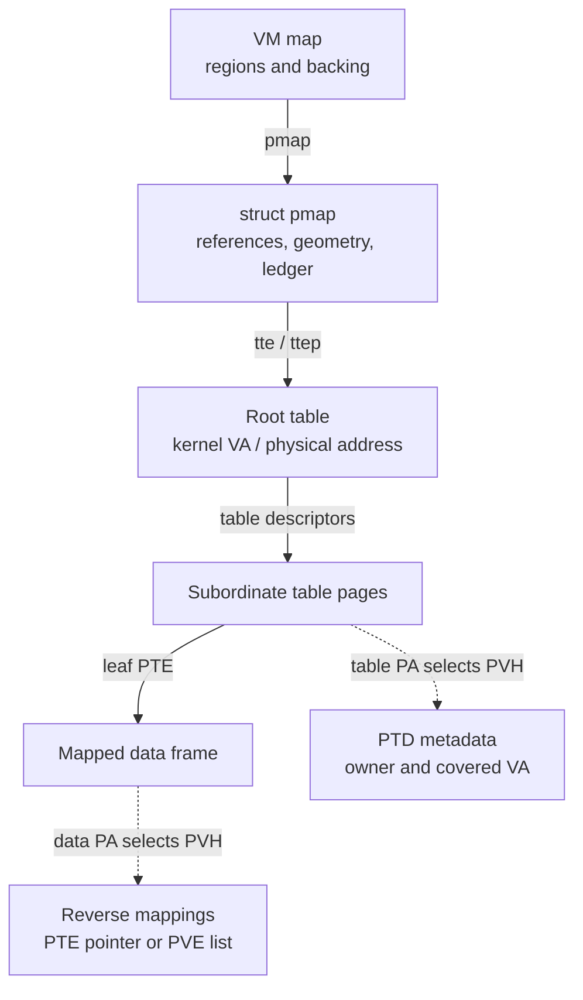
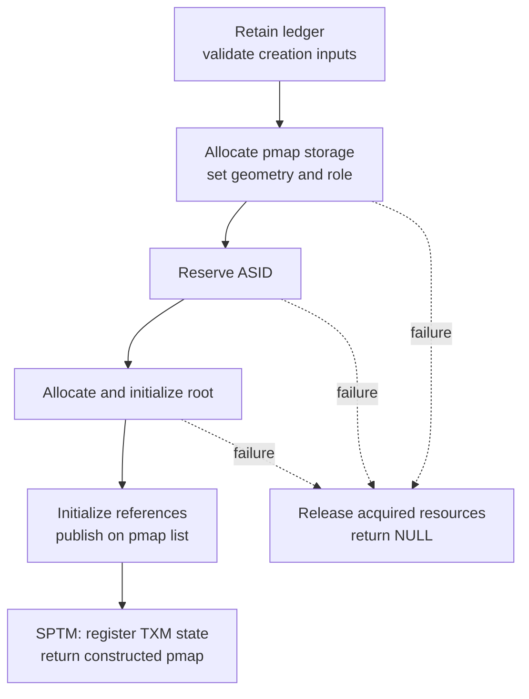
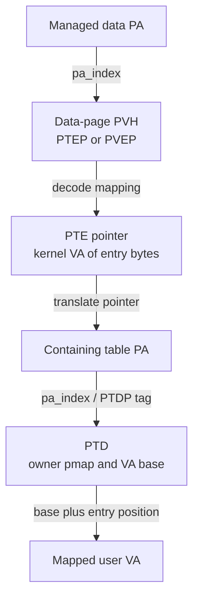
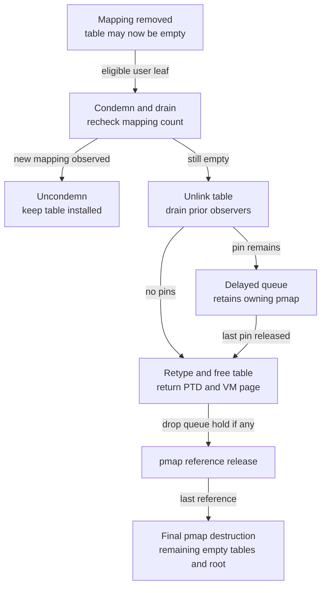

# Pmap and ARM64 translation storage

A `pmap` connects an address space to the tables that CPUs walk. Understanding its storage requires following several different allocations: the `struct pmap`, its root table, subordinate table pages, page-table descriptors, and reverse-mapping records for mapped physical pages. This chapter follows those objects through creation, lookup, publication and reclamation in `xnu-12377.121.6` (`ac9718fb1af618d5ce8678d0dc6e8a58f252216f`). It distinguishes the legacy ARM64 implementation, its PPL configuration, and the separate SPTM backend.

[Key structures](README.md) · [VM guide](../subsystems/vm/README.md) · [Maps and entries](vm-maps-and-entries.md) · [Objects and backing](vm-objects-and-backing.md) · [Resident pages](vm-pages-and-resident-storage.md)

Read [ARM64 pmap](../subsystems/vm/pmap-arm64.md) for the overall translation model, [translation walkthroughs](../subsystems/vm/pmap-translation-walkthroughs.md) for numeric PTE decoding, and [mapping lifecycle](../subsystems/vm/pmap-mapping-lifecycle.md) for complete insertion/removal algorithms. Here the recurring questions are: which bytes does this pointer address, who owns them, what keeps them accessible, and which operation eventually makes them reusable? The separate [x86 pmap chapter](../subsystems/vm/pmap-x86.md) covers that backend.

Inspect the live [`pmap`](layout-browser.md?declaration=pmap) layout for the selected source profile.

## 1. Start with the objects, not just the root address

A VM map describes allowed regions and backing objects. Its `pmap` supplies machine translations; the mapping policy and resident contents are not stored inside `struct pmap`. `vm_map_create_with_page_shift()` assigns its supplied pmap pointer to the new map; that assignment does not itself call `pmap_reference()`. Map destruction first deletes entries and disposes their detached resources, then releases the map's pmap through `pmap_destroy()`. Follow the caller's ownership transfer instead of assuming that every pointer assignment adds a reference. [Map construction](../../platydoc-data/xnu/osfmk/vm/vm_map.c#L2174-L2235), [map destruction](../../platydoc-data/xnu/osfmk/vm/vm_map.c#L2397-L2435).



Solid arrows select translation state or a mapping target. Dashed arrows describe metadata lookup; neither is an automatic reference acquisition. The root uses its own allocator and is reached directly through the pmap. The PTD path below concerns subordinate table pages, not a requirement that every root have a PTD. [SPTM root/table distinction](../../platydoc-data/xnu/osfmk/arm64/sptm/pmap/pmap_data.c#L1868-L1879), [legacy table descriptor setup](../../platydoc-data/xnu/osfmk/arm/pmap/pmap_data.c#L2923-L2951).

The two root coordinates are explicit in the SPTM declaration:

[Source: `osfmk/arm64/sptm/pmap/pmap.h`, lines 307–313](../../platydoc-data/xnu/osfmk/arm64/sptm/pmap/pmap.h#L307-L313)

<!-- source-excerpt: ../../platydoc-data/xnu/osfmk/arm64/sptm/pmap/pmap.h#L307-L313 -->
```c
struct pmap {
	/* Pointer to the root translation table. */
	tt_entry_t *tte;

	/* Physical page of the root translation table. */
	pmap_paddr_t ttep;

```

`tte` is a kernel virtual pointer used to read table entries. `ttep` is the physical root address passed to SPTM operations or used in translation-root selection. A `pt_entry_t *` points to the bytes of an entry; it is not the physical frame encoded *inside* that entry. A physical page index, or PAI, is yet another coordinate: it indexes per-VM-page metadata and is computed relative to `vm_first_phys`. [SPTM PAI conversion](../../platydoc-data/xnu/osfmk/arm64/sptm/pmap/pmap_data.h#L91-L125), [entry/address conversion macros](../../platydoc-data/xnu/osfmk/arm64/sptm/pmap/pmap.h#L292-L305).

### Selected field map

The umbrella header selects different declarations under `CONFIG_SPTM`; do not combine their fields into one imaginary layout. [Header selection](../../platydoc-data/xnu/osfmk/arm/pmap.h#L42-L46), [legacy declaration](../../platydoc-data/xnu/osfmk/arm/pmap/pmap.h#L334-L489), [SPTM declaration](../../platydoc-data/xnu/osfmk/arm64/sptm/pmap/pmap.h#L307-L440).

| Field or group | What it describes | Ownership/access consequence |
| --- | --- | --- |
| `tte`, `ttep` | Two addresses for the root allocation | Root lifetime follows the pmap's final teardown; obtaining either address does not retain the pmap. |
| `min`, `max`, conditional `pmap_pt_attr` | Hardware-addressable range and translation geometry | These bounds do not replace VM-map policy. Geometry selects levels, granule, masks and backend operations. |
| `ledger` | Accounting destination for mappings and table storage | The public creation wrapper takes a ledger reference; final destruction releases it. The ledger is not embedded in the pmap. |
| `pmaps` | Link in the global pmap list | Publication/removal use `pmaps_lock`; list membership is distinct from an owning reference. |
| Legacy `rwlock`, `tt_entry_free` | Pmap synchronization and unused chunks of subordinate-table pages | The SPTM declaration has neither field. Its hierarchy and reclamation protocol must be read separately. |
| `ref_count` | Lifetime of the pmap object | Legacy uses an atomic integer; SPTM uses `os_ref_atomic_t`. Neither is the number of PTEs or mapped pages. |
| Nested-region fields | Shared-region bounds and association state | Legacy has separate nested-pmap/bitmap fields and additional counters. SPTM overlays `nested_pmap` and `nested_region_unnested_table_bitmap` in a union, selected by the pmap's role. |
| Legacy `hw_asid`/`sw_asid`; SPTM `asid`/`vmid` union | Address-space identifiers | ASIDs identify translation contexts, not object references. This checkout's shown constructors reject nonzero `size` and do not create stage-2 pmaps. |
| `type`, `is_64bit`, `nx_enabled`, signing/JOP/Rosetta flags | Role and selected machine/security policy | Feature guards affect layout and operations. A nonzero pmap reference does not imply that every policy transition is permitted. |
| SPTM `associated_vm_map_serial_id`, conditional MTE alias flag | VM-domain association and alias-admission state | These supplement mapping policy; they do not own a `vm_map` pointer. |

The SPTM declaration has reserved storage where its comment describes TXM address-space ownership. Local implementation bodies refer to TXM integration state, including `txm_lck` and `txm_trust_level`; the published declaration does not expose that complete member layout. Document the visible registration/locking calls without assigning invented fields to the reserved bytes. [Reserved declaration](../../platydoc-data/xnu/osfmk/arm64/sptm/pmap/pmap.h#L418-L425), [registration](../../platydoc-data/xnu/osfmk/arm64/sptm/pmap/pmap.c#L2832-L2844), [TXM lock wrappers](../../platydoc-data/xnu/osfmk/arm64/sptm/pmap/pmap.c#L12554-L12598).

## 2. Object storage and table protection are different contracts

There is no universal “pmap lives in an RO zone” rule. The ordinary zone is created with `ZC_ZFREE_CLEARMEM`, not `ZC_READONLY`:

[Source: `osfmk/arm64/sptm/pmap/pmap.c`, lines 2587–2588](../../platydoc-data/xnu/osfmk/arm64/sptm/pmap/pmap.c#L2587-L2588)

<!-- source-excerpt: ../../platydoc-data/xnu/osfmk/arm64/sptm/pmap/pmap.c#L2587-L2588 -->
```c
	pmap_zone = zone_create_ext("pmap", sizeof(struct pmap),
	    ZC_ZFREE_CLEARMEM, ZONE_ID_PMAP, NULL);
```

The legacy backend creates the corresponding zone too. `SECURITY_READ_ONLY_LATE(zone_t) pmap_zone` protects the zone-handle variable after initialization; it does not declare every zone element read-only. The PPL configuration then selects a different object allocator in its constructor. [Legacy zone creation](../../platydoc-data/xnu/osfmk/arm/pmap/pmap.c#L2808-L2814), [legacy global storage](../../platydoc-data/xnu/osfmk/arm/pmap/pmap.c#L423-L426), [SPTM global storage](../../platydoc-data/xnu/osfmk/arm64/sptm/pmap/pmap.c#L514-L517), [constructor selection](../../platydoc-data/xnu/osfmk/arm/pmap/pmap.c#L3021-L3044).

| Storage | Legacy without PPL | Legacy with `XNU_MONITOR` / PPL | SPTM |
| --- | --- | --- | --- |
| Kernel pmap object | Static `kernel_pmap_store` | Static store in pmap-protected data | Static `kernel_pmap_store` |
| Ordinary user pmap object | `zalloc(pmap_zone)` | A `pmap_list_entry_t` slot carved from a PPL page | `zalloc(pmap_zone)` |
| Root/subordinate-table backing | Pmap allocators backed by wired VM pages and caches | PPL page pool; mutation through the PPL implementation | Wired VM pages, then SPTM root/table frame-type transitions |
| Update mechanism | Pmap locks, PTE stores and architectural ordering | Protected pmap routines, PPL validation and controlled execution | XNU metadata updates plus `sptm_*` calls for protected table/frame changes |
| Final object-storage release | `zfree(pmap_zone, pmap)` | Return wrapper to the protected pmap free list | `zfree(pmap_zone, pmap)` |

These choices are visible in [legacy allocation/free](../../platydoc-data/xnu/osfmk/arm/pmap/pmap_data.c#L1284-L1322), [legacy page release](../../platydoc-data/xnu/osfmk/arm/pmap/pmap_data.c#L1510-L1565), [SPTM page allocation/free](../../platydoc-data/xnu/osfmk/arm64/sptm/pmap/pmap_data.c#L500-L597), [SPTM table retyping](../../platydoc-data/xnu/osfmk/arm64/sptm/pmap/pmap.c#L3353-L3450), and the final destructors discussed below. The [protected-object update guide](read-only-object-updates.md) covers the different `zalloc_ro` mutation API used by process/task/thread companions; pmap table updates are not applications of that same object-field API.

### PPL's wrapper preserves allocation identity

`pmap_list_entry_t` starts with a union holding either a live `struct pmap` or the next free-list pointer. An `array_index` follows it. This is one slot, not a pmap allocation plus a separately allocated wrapper. The first-member requirement allows the live object address to be converted back to its wrapper. [Complete wrapper](../../platydoc-data/xnu/osfmk/arm/pmap/pmap_data.c#L435-L463).

[Source: `osfmk/arm/pmap/pmap_data.c`, lines 450–453](../../platydoc-data/xnu/osfmk/arm/pmap/pmap_data.c#L450-L453)

<!-- source-excerpt: ../../platydoc-data/xnu/osfmk/arm/pmap/pmap_data.c#L450-L453 -->
```c
	union {
		struct pmap pmap;
		struct pmap_list_entry *next;
	};
```

When the free list is empty, `pmap_alloc_pmap()` obtains a PPL page, divides it into wrapper-sized slots, initializes their reference counts to zero, and installs each slot into the protected `pmap_ptr_array`. The slot records the reciprocal index. Allocation pops a slot; the constructor then initializes its live fields. Exhausting the directory returns `KERN_NO_SPACE`; an empty PPL page pool returns `KERN_RESOURCE_SHORTAGE`. [Allocator](../../platydoc-data/xnu/osfmk/arm/pmap/pmap_data.c#L3179-L3246).

`validate_user_pmap()` checks the index, equality with the directory's registered slot, and a positive reference count. The mutable validator also records the pmap as in flight on the local CPU before validating it. Final PPL destruction checks for in-flight or active users and panics on a conflicting use; this is not a blocking reference acquisition or a general grace-period wait. The caller must already obey lifetime rules. Returning the object to `pmap_free_list` reuses its first bytes as `next` while preserving the directory/index association. [Identity and liveness checks](../../platydoc-data/xnu/osfmk/arm/pmap/pmap_data.c#L3295-L3326), [mutable validation](../../platydoc-data/xnu/osfmk/arm/pmap/pmap_data.c#L3374-L3413), [free-list return](../../platydoc-data/xnu/osfmk/arm/pmap/pmap_data.c#L3259-L3281), [final-use checks](../../platydoc-data/xnu/osfmk/arm/pmap/pmap.c#L3333-L3370).

SPTM's functions named `validate_pmap_internal()` and `validate_pmap_mutable_internal()` only assert non-NULL in this tree. Its separate `pmap_require()` checks `ZONE_ID_PMAP` for non-kernel objects. Neither adds a reference or proves that a caller may resurrect a freed object. Do not import PPL's directory checks into the SPTM path because the function names resemble one another. [SPTM validator bodies](../../platydoc-data/xnu/osfmk/arm64/sptm/pmap/pmap_data.c#L1890-L1927).

## 3. Bootstrap and ordinary creation start from different storage

### The static kernel pmap

`pmap_bootstrap()` initializes the static kernel object with `cpu_tte` and `cpu_ttep`, geometry, address bounds, an initial reference and the kernel role. SPTM reserves ASID zero for it. This is not a call to the ordinary user-pmap constructor. [Legacy initialization](../../platydoc-data/xnu/osfmk/arm/pmap/pmap.c#L2256-L2302), [SPTM initialization](../../platydoc-data/xnu/osfmk/arm64/sptm/pmap/pmap.c#L1631-L1672).

The bootstrap metadata allocator advances the physical `avail_start` cursor for `pp_attr_table`, `pv_head_table` and initial PTD storage, zeroes the region, and primes the PTD pool. Each metadata table is indexed per VM page. Later runtime PTD allocation grows its pool with page allocations. A variable called `ptd_root_table` in this bootstrap code holds initial *descriptor storage*; it is not the CPU's root translation table. [SPTM bootstrap layout](../../platydoc-data/xnu/osfmk/arm64/sptm/pmap/pmap_data.c#L367-L433), [legacy bootstrap layout](../../platydoc-data/xnu/osfmk/arm/pmap/pmap_data.c#L640-L711), [PTD pool initialization](../../platydoc-data/xnu/osfmk/arm64/sptm/pmap/pmap_data.c#L1626-L1645).

SPTM also receives an existing kernel root and physical-aperture configuration from its external bootstrap interface; XNU constructs PTDs for preexisting tables. The source therefore does not demonstrate XNU allocating every initial translation page from scratch. [SPTM root setup](../../platydoc-data/xnu/osfmk/arm64/sptm/arm_init_sptm.c#L1848-L1874), [static descriptor setup](../../platydoc-data/xnu/osfmk/arm64/sptm/arm_init_sptm.c#L2080-L2110), [bootstrap memory guide](../subsystems/platform/bootstrap-memory-and-lockdown.md), [SPTM bootstrap boundary](../subsystems/security/sptm.md#bootstrap-establish-the-interface-before-ordinary-vm-initialization).

### A newly allocated user pmap

The public `pmap_create_options()` wrapper retains the supplied ledger, invokes the backend constructor, and drops the ledger reference on failure. The constructor validates flags, allocates the object, selects geometry, obtains an ASID, allocates a root, initializes the remaining state, sets the initial pmap reference to one, and inserts the object into the global list. SPTM then registers its TXM address-space state after root/ASID setup. [Legacy wrapper and retries](../../platydoc-data/xnu/osfmk/arm/pmap/pmap.c#L3184-L3217), [SPTM wrapper](../../platydoc-data/xnu/osfmk/arm64/sptm/pmap/pmap.c#L2859-L2880), [legacy constructor](../../platydoc-data/xnu/osfmk/arm/pmap/pmap.c#L2993-L3181), [SPTM constructor](../../platydoc-data/xnu/osfmk/arm64/sptm/pmap/pmap.c#L2676-L2856).



The diagram selects ordinary successful creation and the constructor's recoverable allocation failures; it does not imply that every protected call has a recoverable error branch. ASID exhaustion and root allocation failure follow separate cleanup labels. PPL also retains its protected ledger bookkeeping, distinct from the public ledger reference, and its outer wrapper can replenish the PPL page pool and retry resource shortages. [Legacy cleanup](../../platydoc-data/xnu/osfmk/arm/pmap/pmap.c#L3159-L3181), [PPL retry](../../platydoc-data/xnu/osfmk/arm/pmap/pmap.c#L3190-L3213), [SPTM cleanup](../../platydoc-data/xnu/osfmk/arm64/sptm/pmap/pmap.c#L2848-L2856).

PPL makes the transition from inactive registered slot to live object explicit: prior field initialization precedes the nonzero reference count observed by validators.

[Source: `osfmk/arm/pmap/pmap.c`, lines 3131–3140](../../platydoc-data/xnu/osfmk/arm/pmap/pmap.c#L3131-L3140)

<!-- source-excerpt: ../../platydoc-data/xnu/osfmk/arm/pmap/pmap.c#L3131-L3140 -->
```c
#if XNU_MONITOR
	os_atomic_init(&p->nested_count, 0);
	assert(os_atomic_load(&p->ref_count, relaxed) == 0);
	/* Ensure prior updates to the new pmap are visible before the non-zero ref_count is visible */
	os_atomic_thread_fence(release);
#endif
	os_atomic_init(&p->ref_count, 1);
	pmap_simple_lock(&pmaps_lock);
	queue_enter(&map_pmap_list, p, pmap_t, pmaps);
	pmap_simple_unlock(&pmaps_lock);
```

SPTM initializes its `os_ref` count and publishes under `pmaps_lock`, but its construction sequence is not evidence of PPL-style pointer-directory validation. In either backend the returned object initially has a root, not a preallocated leaf table for every possible user VA. [SPTM publication](../../platydoc-data/xnu/osfmk/arm64/sptm/pmap/pmap.c#L2813-L2817), [root-already-present contract](../../platydoc-data/xnu/osfmk/arm64/sptm/pmap/pmap.c#L7320-L7327).

## 4. Roots and subordinate tables have different allocators

### Root allocation

The legacy `pmap_tt1_allocate()` first tries globally cached whole-page or subpage root slots under `tt1_lock`. Otherwise it obtains zeroed backing and, for a subpage root, puts the remaining chunks on the root free list. The constructor explicitly writes fault entries across the root and issues `FLUSH_PTE()`. Freeing a root returns its slot to the appropriate cache; whole-page cache excess can be returned through `pmap_pages_free()`. Thus root deallocation need not immediately return a physical page to VM. [Root allocation](../../platydoc-data/xnu/osfmk/arm/pmap/pmap.c#L3484-L3570), [root initialization](../../platydoc-data/xnu/osfmk/arm/pmap/pmap.c#L3091-L3111), [root release](../../platydoc-data/xnu/osfmk/arm/pmap/pmap.c#L3574-L3632).

SPTM's root allocator instead either claims an available subpage root table (SURT) or obtains a page and retypes it. An ordinary whole root becomes `XNU_USER_ROOT_TABLE`; a SURT container becomes `XNU_SUBPAGE_USER_ROOT_TABLES`, then its first slot is claimed before the page joins the shared SURT allocator queue. Supported subpage sizing includes monitor metadata, not just the visible root TTE bytes. Separate SURT slots belong to separate pmaps; sharing their physical allocation is not the shared-region nesting described later. [Constructor sizing](../../platydoc-data/xnu/osfmk/arm64/sptm/pmap/pmap.c#L2763-L2784), [root allocation and retyping](../../platydoc-data/xnu/osfmk/arm64/sptm/pmap/pmap.c#L3143-L3264).

On SURT release, XNU first calls `sptm_surt_free()`, orders that operation before its local allocator bitmap update, and checks whether other slots remain. Only the last slot permits retyping the whole container to `XNU_DEFAULT` and returning the page to VM. For whole roots, frame type depends on ordinary-user versus nested/shared role. [Root release](../../platydoc-data/xnu/osfmk/arm64/sptm/pmap/pmap.c#L3268-L3350).

### Subordinate-table allocation

A lower table needs backing *and* metadata. In the legacy path, `pmap_tt_allocate()` first consumes a free table chunk from `pmap->tt_entry_free`; if necessary it obtains a VM-sized page and PTD. With a 16 KiB VM page and a 4 KiB pmap granule, unused 4 KiB chunks go on that pmap's free list. They can represent distinct table ranges, so the PTD records per-chunk VAs and counters. Whole-page reclamation requires all chunks to be unused and accounted for. [Legacy allocation](../../platydoc-data/xnu/osfmk/arm/pmap/pmap.c#L3635-L3742), [chunk-aware release](../../platydoc-data/xnu/osfmk/arm/pmap/pmap.c#L3747-L3834).

SPTM `pmap_tt_allocate()` obtains one VM page and a PTD, installs the PTD into the page's PVH, accounts the allocation, drains outstanding retype-sensitive epochs, and changes the frame from `XNU_DEFAULT` to the required table type. If PTD allocation fails, it returns the already allocated page. SPTM groups multiple small-granule tables within that page and installs adjacent parent entries for the group; there is no `tt_entry_free` member in its pmap. [SPTM allocation](../../platydoc-data/xnu/osfmk/arm64/sptm/pmap/pmap.c#L3353-L3415), [grouped table traversal](../../platydoc-data/xnu/osfmk/arm64/sptm/pmap/pmap.c#L7444-L7453), [grouped-table validation](../../platydoc-data/xnu/osfmk/arm64/sptm/pmap/pmap.c#L3521-L3530).

The runtime page allocator wires the `vm_page`, records it in the global `pmap_object`, and returns its PA. The object's offset is `PA - gPhysBase`; that storage-accounting offset is unrelated to the user VA mapped through the table. `pmap_page_free()` looks up that same offset and returns the wired page to VM. A PTD metadata page also uses this allocator, but is not consequently a hardware page-table frame: the caller's retype determines the frame's role. [Page allocation](../../platydoc-data/xnu/osfmk/arm64/sptm/pmap/pmap_data.c#L500-L562), [pmap-object insertion](../../platydoc-data/xnu/osfmk/arm64/sptm/pmap/pmap_data.c#L446-L465), [page release](../../platydoc-data/xnu/osfmk/arm64/sptm/pmap/pmap_data.c#L571-L597).

## 5. PTDs, reverse mappings and the addresses they recover

### A descriptor describes table storage; it is not a table

`pt_desc_t` is called a page-table descriptor, or PTD. It is a software record distinct from an ARM table-descriptor entry. Its `pmap` pointer identifies the owner without taking a reference in `ptd_alloc()`; its VA information reconstructs the address translated by a PTE; its `ptd_info` points to frequently updated counters. [SPTM PTD allocation](../../platydoc-data/xnu/osfmk/arm64/sptm/pmap/pmap_data.c#L1794-L1805), [legacy PTD allocation](../../platydoc-data/xnu/osfmk/arm/pmap/pmap_data.c#L2825-L2842).

| Metadata | Legacy/PPL representation | SPTM representation |
| --- | --- | --- |
| Owner | `pt_desc_t.pmap` | `pt_desc_t.pmap` |
| Covered VA | `va[PT_INDEX_MAX]`, one base per table chunk | One `va` base for the grouped VM-page allocation |
| Counts | `ptd_info[index].refcnt` and `wiredcnt` | One `ptd_info->wiredcnt`; table mapping reference count is queried through `sptm_get_page_table_refcnt()` |
| Non-leaf treatment | `refcnt == PT_DESC_REFCOUNT` sentinel, not a count of child mappings | SPTM owns the protected table reference-count contract |
| Reclaim-list linkage | `pt_page` chain | No corresponding field in the shown PTD declaration |
| Free PTD | First bytes reused as the pool's next pointer | Same pool-overlay technique |

See the [legacy declarations](../../platydoc-data/xnu/osfmk/arm/pmap/pmap_data.h#L825-L917), [SPTM declarations](../../platydoc-data/xnu/osfmk/arm64/sptm/pmap/pmap_data.h#L1013-L1022), [SPTM PTD fields](../../platydoc-data/xnu/osfmk/arm64/sptm/pmap/pmap_data.h#L1072-L1117), and [SPTM table-release count query](../../platydoc-data/xnu/osfmk/arm64/sptm/pmap/pmap.c#L3427-L3435). The legacy leaf `refcnt` counts nonempty entries, including compressed-marker state; it is not a count of data-page references. `wiredcnt` can include temporary table pins as well as wired translations, so its name alone is insufficient to interpret a nonzero value. [Legacy counter contract](../../platydoc-data/xnu/osfmk/arm/pmap/pmap_data.h#L841-L864), [SPTM consistency scan](../../platydoc-data/xnu/osfmk/arm64/sptm/pmap/pmap.c#L3491-L3558), [SPTM pinning](../../platydoc-data/xnu/osfmk/arm64/sptm/pmap/pmap.c#L3705-L3773).

PTDs and their `ptd_info` records occupy separate regions of the same allocator page. The allocator computes the PTD's index within its page and selects the corresponding counter record at `ptd_info_offset`. This separation reduces cache-line sharing; it is not a separate zone allocation for each counter. Pool growth drops the free-list lock while obtaining a page, then merges that page with whatever free list another CPU may have populated meanwhile. Returning a PTD pushes its storage back onto the pool; callers must stop interpreting its old owner/VA fields. [SPTM pool growth and indexing](../../platydoc-data/xnu/osfmk/arm64/sptm/pmap/pmap_data.c#L1664-L1778), [PTD release](../../platydoc-data/xnu/osfmk/arm64/sptm/pmap/pmap_data.c#L1818-L1836), [legacy pool](../../platydoc-data/xnu/osfmk/arm/pmap/pmap_data.c#L2692-L2811).

### One PVH array serves several physical-page roles

`pv_head_table[pa_index(pa)]` is a tagged value, not unconditionally a `pv_entry_t *`. A data frame with one tracked mapping can name the PTE directly; multiple mappings use a PVE list. A table frame instead names its PTD. `PVH_TYPE_NULL` excludes tracked mappings outside the physical aperture; it does not claim that no kernel aperture mapping exists. [PVH type definitions](../../platydoc-data/xnu/osfmk/arm64/sptm/pmap/pmap_data.h#L149-L184).

| PVH tag | Meaning of the payload | Correct next interpretation |
| --- | --- | --- |
| `PVH_TYPE_NULL` | No tracked ordinary aliases | No PTE/PVE/PTD payload to dereference |
| `PVH_TYPE_PTEP` | One tracked mapping | Decode through `pvh_ptep()` |
| `PVH_TYPE_PVEP` | List of reverse-map records | Decode through `pvh_pve_list()`, then visit PVE slots |
| `PVH_TYPE_PTDP` | This physical page is table storage | Decode through `pvh_ptd()` after checking the tag |

A PVE contains `pve_next` and `pve_ptep[PTE_PER_PVE]`. Per-mapping internal/alternate-accounting flags occupy low bits of PTE pointers; use `pve_get_ptep()` to strip them. PVH itself also embeds type/flag state. Raw pointer casts bypass those representation rules. [PVE declaration](../../platydoc-data/xnu/osfmk/arm64/sptm/pmap/pmap.h#L145-L158), [PVH accessors](../../platydoc-data/xnu/osfmk/arm64/sptm/pmap/pmap_data.h#L552-L588), [per-mapping flags](../../platydoc-data/xnu/osfmk/arm64/sptm/pmap/pmap_data.h#L699-L723), [PTE pointer accessor](../../platydoc-data/xnu/osfmk/arm64/sptm/pmap/pmap_data.h#L839-L852).



This is a representation walk, not a recipe for walking unlocked metadata. Each stage needs the surrounding PVH/table-lifetime protocol. `ptep_get_ptd()` translates the *PTE pointer* to the containing table's PA, then checks its PVH for `PVH_TYPE_PTDP`; `ptep_get_pmap()` returns the PTD's borrowed owner pointer. `tte_get_ptd()` instead starts with a parent table-descriptor value and follows the child table PA encoded inside it. These operations do not retain either object. [SPTM conversion helpers](../../platydoc-data/xnu/osfmk/arm64/sptm/pmap/pmap_data.h#L1276-L1338), [legacy conversion helpers](../../platydoc-data/xnu/osfmk/arm/pmap/pmap_data.h#L943-L1002).

### PVE storage: allocation, refill and return to the pools

A second tracked mapping does not allocate another pmap or PTD. In the selected SPTM path, `pmap_enter_pv()` converts a direct `PTEP` head into `PVEP` form by allocating a PVE, putting the old PTE pointer in slot zero, and moving its per-mapping accounting bits out of `pp_attr_table` into that slot. It then installs the new mapping in a free slot; `PTE_PER_PVE` is two here. A full head needs another PVE. The first tracked mapping requires no PVE allocation at all. [Two-slot declaration](../../platydoc-data/xnu/osfmk/arm64/sptm/pmap/pmap.h#L143-L158), [conversion](../../platydoc-data/xnu/osfmk/arm64/sptm/pmap/pmap_data.c#L1207-L1250), [insertion](../../platydoc-data/xnu/osfmk/arm64/sptm/pmap/pmap_data.c#L1349-L1416).

`pv_alloc()` first tries the per-CPU pool; `pv_list_alloc()` disables preemption while manipulating that local state and can refill it from the locked global ring of `PV_BATCH_SIZE` batches. Kernel/IOMMU requests can additionally use the kernel reserve. When the reserve is low, the local allocator avoids taking another global batch for ordinary requests, allowing refill to replenish the reserve. These are custom pools of records, not a separate `zalloc()` per new alias. [Per-CPU/global allocation](../../platydoc-data/xnu/osfmk/arm64/sptm/pmap/pmap_data.c#L613-L775), [reserve and allocation choices](../../platydoc-data/xnu/osfmk/arm64/sptm/pmap/pmap_data.c#L986-L1055).

If the pools cannot supply a node, `pv_alloc()` drops the data page's PVH lock before `pve_feed_page()` obtains a wired pmap page and divides it into one batch of linked PVE records. It reacquires the PVH lock before returning. Successful refill returns `PV_ALLOC_RETRY`, with no individual PVE handed to the caller: the old PVH representation might have changed while unlocked, so the insertion must restart its consistency checks. Allocation failure returns `PV_ALLOC_FAIL`. Early `mapping_free_prime_internal()` uses the same page feeder to seed the pools to their configured targets. [Page feeder](../../platydoc-data/xnu/osfmk/arm64/sptm/pmap/pmap_data.c#L895-L944), [drop/refill/relock](../../platydoc-data/xnu/osfmk/arm64/sptm/pmap/pmap_data.c#L1049-L1088), [bootstrap priming](../../platydoc-data/xnu/osfmk/arm64/sptm/pmap/pmap_data.c#L1164-L1181).

Removal clears the matching slot and may free an empty PVE, coalesce a partly filled record into the head, or collapse the sole remaining one-mapping record back into `PTEP` form. That last transition moves accounting bits back to the page-attribute representation before freeing the PVE. `pv_free()` delegates to `pv_list_free()`: records return to a per-CPU list, with excess batches spilled to the global ring or kernel reserve. This makes individual PVE bytes reusable; these free paths do not return each record's containing page to VM. A removal can also report `PV_REMOVE_FAIL` when a competing disconnect already removed the recorded mapping, so callers distinguish “no longer recorded” from an allocator failure. [Slot/list removal](../../platydoc-data/xnu/osfmk/arm64/sptm/pmap/pmap_data.c#L1450-L1607), [single-record free](../../platydoc-data/xnu/osfmk/arm64/sptm/pmap/pmap_data.c#L1096-L1102), [pool return/spill](../../platydoc-data/xnu/osfmk/arm64/sptm/pmap/pmap_data.c#L788-L890).

The legacy allocator has similar pool organization but a different refill context: it drops and reacquires both the PVH lock and the supplied pmap lock for CPU mappings. PPL requires nonblocking page allocation from its protected pool; shortage must be handled outside that protected operation before retrying. Preserve these differences instead of importing SPTM's lock signature into the legacy caller. [Legacy allocator and retry contract](../../platydoc-data/xnu/osfmk/arm/pmap/pmap_data.c#L1930-L2110), [PPL page source](../../platydoc-data/xnu/osfmk/arm/pmap/pmap_data.c#L1284-L1318). The [mapping lifecycle guide](../subsystems/vm/pmap-mapping-lifecycle.md) connects these record transitions to actual PTE insertion, removal and accounting rollback.

### Worked metadata walk: four 4 KiB tables in one 16 KiB VM page

Select a 16 KiB VM page, a 4 KiB translation granule, 8-byte entries, and ordinary leaf tables covering 2 MiB each. Suppose a PTE pointer lies at `table_page_KVA + 2 * 4096 + 7 * 8`. This is an illustrative layout calculation, not a real kernel address or a full VA-to-PA translation.

| Step | Result | Coordinate |
| --- | --- | --- |
| Offset within the 16 KiB allocation | `0x2038` | Bytes of table storage |
| Hardware table chunk | `2` | Third 4 KiB table in that allocation |
| PTE index within that chunk | `7` | Eighth 8-byte entry |
| SPTM covered-range displacement | `2 * 2 MiB + 7 * 4 KiB = 0x407000` | Virtual address being translated |
| Result with SPTM PTD base `B` | `B + 0x407000` | Mapped VA, not the data PA |

The SPTM helper implements both terms:

[Source: `osfmk/arm64/sptm/pmap/pmap_data.h`, lines 1410–1417](../../platydoc-data/xnu/osfmk/arm64/sptm/pmap/pmap_data.h#L1410-L1417)

<!-- source-excerpt: ../../platydoc-data/xnu/osfmk/arm64/sptm/pmap/pmap_data.h#L1410-L1417 -->
```c
	const unsigned int ttep_index = ptep_page & ((1U << (PAGE_SHIFT - pmap_page_shift)) - 1);
	va += ttep_index * pt_attr_twig_size(pt_attr);

	/* Increment VA now to target the VA space covered by this specific PTE */
	const vm_offset_t ptep_index = ((vm_offset_t)ptep & pt_attr_leaf_offmask(pt_attr)) / sizeof(*ptep);
	va += (ptep_index << pt_attr_leaf_shift(pt_attr));

	return va;
```

`pmap_expand()` first uses `pt_attr_align_va()` to select a VM-page-aligned group of parent entries; `ptd_info_init()` then clears the within-table-range offset when storing the base. [Group alignment](../../platydoc-data/xnu/osfmk/arm64/sptm/pmap/pmap_pt_geometry.h#L731-L749), [aligned caller](../../platydoc-data/xnu/osfmk/arm64/sptm/pmap/pmap.c#L7377-L7411). The legacy helper instead selects `va[2]`, then adds `7 * 4096`: its independently allocated table chunks need not describe consecutive VA ranges. For a 16 KiB granule on a 16 KiB VM system there is one table per allocation and the chunk-index term is zero. [SPTM base initialization](../../platydoc-data/xnu/osfmk/arm64/sptm/pmap/pmap_data.c#L1855-L1881), [legacy chunk index](../../platydoc-data/xnu/osfmk/arm/pmap/pmap_data.h#L1015-L1040), [legacy VA reconstruction](../../platydoc-data/xnu/osfmk/arm/pmap/pmap_data.h#L1089-L1112).

## 6. Access safety has several independent layers

A pmap reference preserves the object. It does not freeze the table hierarchy, lock reverse mappings, pin a physical data frame, or complete a TLB invalidation. The actual operation must supply the additional protocol it needs.

| Access or change | Required surrounding mechanism | What it does not establish |
| --- | --- | --- |
| Follow `map->pmap` / `vm_map_pmap(map)` | A valid map and the caller's map/pmap ownership | The accessor macro acquires no reference. [Macro](../../platydoc-data/xnu/osfmk/vm/vm_map_xnu.h#L847). |
| Take/release a pmap reference | Existing valid ownership before `pmap_reference()`; matched `pmap_destroy()` | Neither backend offers a “retain arbitrary stale pointer” operation. [Legacy retain](../../platydoc-data/xnu/osfmk/arm/pmap/pmap.c#L3466-L3481), [SPTM retain](../../platydoc-data/xnu/osfmk/arm64/sptm/pmap/pmap.c#L3113-L3130). |
| Change legacy hierarchy | Appropriate shared/exclusive pmap lock, and PVH locks for affected physical-page mappings | The pmap lock alone is not the lock for every physical page's alias list. [Lock helpers](../../platydoc-data/xnu/osfmk/arm/pmap/pmap_internal.h#L253-L329), [growth locking](../../platydoc-data/xnu/osfmk/arm/pmap/pmap.c#L7109-L7159). |
| Change SPTM reverse mappings | PVH lock and its tagged-value helpers | A PVH lock on a mapped data frame is distinct from the lifetime of the table page containing its PTE. [PV insertion contract](../../platydoc-data/xnu/osfmk/arm64/sptm/pmap/pmap_data.c#L1252-L1294). |
| Follow a reclaimable SPTM leaf table | Pmap epoch covering lookup/access, or a pin acquired during such an epoch | The epoch does not retain the pmap or pin mapped data for use after exit. [Lookup](../../platydoc-data/xnu/osfmk/arm64/sptm/pmap/pmap.c#L7214-L7275), [pin contract](../../platydoc-data/xnu/osfmk/arm64/sptm/pmap/pmap.c#L3705-L3773). |
| Retype a frame | Prevent incompatible new work, publish prior mapping changes, then prepare/drain epochs where required | Draining alone does not stop new mappings or perform earlier TLB completion. [Epoch prerequisites](../../platydoc-data/xnu/osfmk/arm64/sptm/pmap/pmap_data.h#L2030-L2061). |
| Reuse translation identity | Backend root/ASID teardown and CPU activation rules | Returning an integer to the ASID bitmap is not a universal flush implementation. [ASID and TLB guide](../subsystems/vm/pmap-tlb-and-cache.md). |

SPTM epochs are per-CPU records: entry disables preemption, asserts that the CPU is not already in an epoch and is not in primary interrupt context, publishes a sequence and issues a barrier. Exit clears the sequence with release ordering and restores the preemption count. Drain samples remote sequences and waits until those observed critical sections have exited or advanced. This is a specific pmap protocol, not the generic SMR API and not a lifetime reference to every object touched in it. [Entry/exit](../../platydoc-data/xnu/osfmk/arm64/sptm/pmap/pmap_data.h#L2077-L2126), [prepare/drain](../../platydoc-data/xnu/osfmk/arm64/sptm/pmap/pmap_data.h#L2149-L2233).

For an SPTM VA lookup, `pmap_vtophys()` walks the root and upper levels, entering an epoch when it reaches the twig entry that can lead into reclaimable leaf storage. It reads the leaf entry before leaving that interval. The returned PA is a translation observation; this function has not acquired a VM-page hold that would make a later physical access safe. Its panic/stackshot path avoids epoch entry because it can interrupt an already active epoch. [Lookup body](../../platydoc-data/xnu/osfmk/arm64/sptm/pmap/pmap.c#L7214-L7275).

Some SPTM comments still mention holding a “pmap lock,” including the comment above `pmap_expand()`, although the shown SPTM object lacks the legacy `rwlock` and that function's body uses the SPTM/epoch protocol. Follow the implementation and the actual caller's revalidation rather than treating those inherited comments as a declaration of an unshown lock. [Comment and body](../../platydoc-data/xnu/osfmk/arm64/sptm/pmap/pmap.c#L7325-L7485), [SPTM structure](../../platydoc-data/xnu/osfmk/arm64/sptm/pmap/pmap.h#L307-L440).

## 7. Publishing a table and recovering from a competing creator

Both backends allocate missing levels incrementally. Allocating a candidate table is not publication: another thread may install the required table while allocation waits or locks are dropped.

The legacy path checks under a shared lock, allocates outside that lock, reacquires the pmap exclusively, and checks again. Only the winner initializes metadata and writes the parent TTE. A losing candidate is returned to the allocator. Nonblocking/PPL lock acquisition can also abort after allocation, requiring candidate cleanup. [Legacy growth](../../platydoc-data/xnu/osfmk/arm/pmap/pmap.c#L7092-L7163).

The SPTM path allocates and retypes a candidate, reloads the parent entry, initializes the PTD's VA information, then calls `sptm_map_table()` in an epoch. The source specifically requires metadata to be valid before the child becomes visible:

[Source: `osfmk/arm64/sptm/pmap/pmap.c`, lines 7404–7411](../../platydoc-data/xnu/osfmk/arm64/sptm/pmap/pmap.c#L7404-L7411)

<!-- source-excerpt: ../../platydoc-data/xnu/osfmk/arm64/sptm/pmap/pmap.c#L7404-L7411 -->
```c
				/**
				 * This call must be issued prior to sptm_map_table() so that the page table's
				 * PTD info is valid by the time the new table becomes visible in the paging
				 * hierarchy. sptm_map_table() is expected to issue a barrier that effectively
				 * guarantees the PTD update will be visible to concurrent observers as soon as
				 * the new table becomes visible in the paging hierarchy.
				 */
				pmap_init_pte_page(pmap, pa, v, ttlevel + 1, FALSE);
```

`SPTM_TABLE_ALREADY_PRESENT` means another creator won; XNU frees its unused candidate. A successful insertion may still be followed by concurrent removal of an ordinary user leaf table, so the caller's next lookup must use the appropriate epoch/retry protocol. Upper levels used by this growth walk are not dynamically removed by the ordinary leaf-reclaim path. [Publication and race result](../../platydoc-data/xnu/osfmk/arm64/sptm/pmap/pmap.c#L7430-L7485), [upper-level lifetime](../../platydoc-data/xnu/osfmk/arm64/sptm/pmap/pmap.c#L7379-L7386).

A kernel leaf table covering the RO-zone VA region has an additional frame-type change to `XNU_PAGE_TABLE_ROZONE`. That is a role of *the table mapping the RO zone*, not evidence that `struct pmap` itself is an RO-zone element. The code transitions through `XNU_DEFAULT` and handles the candidate's special type if insertion loses. [RO-zone table handling](../../platydoc-data/xnu/osfmk/arm64/sptm/pmap/pmap.c#L7412-L7429), [losing-candidate handling](../../platydoc-data/xnu/osfmk/arm64/sptm/pmap/pmap.c#L7454-L7483).

| Failure or race | Resources/progress already possible | Visible response |
| --- | --- | --- |
| User-pmap ASID exhaustion | Object and ledger ownership acquired | Release acquired object state; wrapper drops ledger reference. |
| Root allocation failure | ASID already reserved | Free identifier before object cleanup. |
| Lower-table PTD allocation failure | A VM page already allocated | Return that page before reporting shortage. |
| Competing table insertion | Candidate has backing, PTD and possibly SPTM frame type | Retire the candidate; continue through the installed hierarchy. |
| Later-level allocation shortage | Earlier missing levels may already have been installed | Return/retry according to options; failure is not a transaction that erases every earlier level. |
| SPTM allocation while nonpreemptible after early boot | No safe VM mutex acquisition available | `pmap_page_alloc()` returns `KERN_RESOURCE_SHORTAGE`; caller must use an appropriate retry context. |

The relevant cleanup branches are [constructor unwind](../../platydoc-data/xnu/osfmk/arm64/sptm/pmap/pmap.c#L2848-L2856), [PTD failure](../../platydoc-data/xnu/osfmk/arm64/sptm/pmap/pmap.c#L3365-L3373), [incremental growth loop](../../platydoc-data/xnu/osfmk/arm64/sptm/pmap/pmap.c#L7350-L7485), and [allocation context check](../../platydoc-data/xnu/osfmk/arm64/sptm/pmap/pmap_data.c#L507-L520). This table concerns storage construction; [mapping lifecycle](../subsystems/vm/pmap-mapping-lifecycle.md) separately traces failure after mapping preparation, PV insertion and protected PTE updates.

## 8. ASIDs, nesting and ledger ownership extend the field map

An ASID is acquired separately from object and root storage. Legacy splits software and hardware identity; SPTM stores a virtual ASID and derives its hardware portion with `PMAP_HWASID`. SPTM's allocator serializes the bitmap under `asid_lock`; `free_asid()` exchanges the object's ASID with zero and returns the old value to the bitmap. This bookkeeping is only one part of the activation/reuse protocol. [Legacy allocator](../../platydoc-data/xnu/osfmk/arm/pmap/pmap.c#L1705-L1819), [SPTM allocator/free](../../platydoc-data/xnu/osfmk/arm64/sptm/pmap/pmap.c#L1179-L1272), [SPTM ID macros](../../platydoc-data/xnu/osfmk/arm64/sptm/pmap/pmap.h#L442-L443), [activation and collision handling](../subsystems/vm/pmap-tlb-and-cache.md).

Nesting shares lower translation tables across address spaces. It does not give each parent a private copy of their storage. In the SPTM path, `pmap_set_nested_internal()` changes a user pmap's role, retypes its root to `XNU_SHARED_ROOT_TABLE` and releases its ordinary ASID. `pmap_set_shared_region()` retains the subordinate, validates geometry and roles, sets up its bounds/bitmap on first use, and installs the parent's `nested_pmap` with a compare-and-exchange. That explains the union: a parent uses the nested-pmap pointer; a nested pmap uses the unnested-table bitmap. [Role transition](../../platydoc-data/xnu/osfmk/arm64/sptm/pmap/pmap.c#L9408-L9424), [retained association](../../platydoc-data/xnu/osfmk/arm64/sptm/pmap/pmap.c#L9788-L9865), [nesting guide](../subsystems/vm/pmap-arm64.md).

Ordinary `pmap_remove()` does not dynamically reclaim nested pmap leaf tables; trimming has a separate shared-region path. Parent final destruction releases its nested-pmap reference. PPL additionally checks `nested_count` before final destruction. These references/counters concern sharing of the hierarchy, not PVE counts for mapped data. [SPTM nested-table lifetime](../../platydoc-data/xnu/osfmk/arm64/sptm/pmap/pmap.c#L9823-L9839), [SPTM parent release](../../platydoc-data/xnu/osfmk/arm64/sptm/pmap/pmap.c#L3078-L3085), [PPL final checks](../../platydoc-data/xnu/osfmk/arm/pmap/pmap.c#L3348-L3368).

Ledger accounting also has several units: object metadata, root allocation size, subordinate VM pages and mapped memory. Some concurrent mapping paths temporarily drive selected balances negative, so creation disables negative-balance panics for those categories while preserving final balance checks. Do not interpret that transient tolerance as absence of ownership accounting. SPTM's final destructor checks the ledger and releases its retained ledger reference; legacy's public wrapper saves the pointer before final internal destruction and then drops the ordinary reference. [SPTM tolerance](../../platydoc-data/xnu/osfmk/arm64/sptm/pmap/pmap.c#L2819-L2830), [SPTM final accounting](../../platydoc-data/xnu/osfmk/arm64/sptm/pmap/pmap.c#L3087-L3095), [legacy wrapper](../../platydoc-data/xnu/osfmk/arm/pmap/pmap.c#L3436-L3455).

## 9. Mapping removal, table reclamation and final pmap release

These are three different milestones. Removing a data mapping can leave an empty table. Unlinking that table can leave pinned table storage awaiting reclamation. Releasing a pmap reference may leave the entire object alive because another owner still holds it.



The diagram selects SPTM ordinary-user leaf reclamation. The “new mapping” branch includes uncondemning the table before leaving it installed; unrelated pmap owners can also release references independently of this diagram.

### An empty SPTM leaf table can outlive its parent entry

After removing mappings, the ordinary-user path enters an epoch, reloads the parent TTE and checks that it is valid and not already condemned. It checks the monitor's table mapping count, attempts condemnation, drains earlier epochs and checks the count again. If a concurrent insertion completed, it uncondemns the table rather than trapping a live mapping in an unlinked table. Otherwise it removes the table from the hierarchy. [Condemn/recheck path](../../platydoc-data/xnu/osfmk/arm64/sptm/pmap/pmap.c#L4080-L4179).

Unlinking is followed by another drain so prior readers either observe the missing table or finish using it. A reader can have converted its epoch protection into a `wiredcnt` pin: `pmap_pin_leaf_table()` increments that count while inside an epoch, then the caller may leave the epoch and later unpin with release ordering. If a pin remains after the table is unlinked, reclamation queues the physical table page instead of waiting for a potentially descheduled reader. [Pin/unpin](../../platydoc-data/xnu/osfmk/arm64/sptm/pmap/pmap.c#L3728-L3773), [unlink and pin check](../../platydoc-data/xnu/osfmk/arm64/sptm/pmap/pmap.c#L3610-L3649), [immediate versus delayed free](../../platydoc-data/xnu/osfmk/arm64/sptm/pmap/pmap.c#L3680-L3701).

The delayed queue takes an actual pmap reference before queuing the canonical `vm_page`:

[Source: `osfmk/arm64/sptm/pmap/pmap_data.c`, lines 2622–2634](../../platydoc-data/xnu/osfmk/arm64/sptm/pmap/pmap_data.c#L2622-L2634)

<!-- source-excerpt: ../../platydoc-data/xnu/osfmk/arm64/sptm/pmap/pmap_data.c#L2622-L2634 -->
```c
void
pmap_free_pt_delayed_enqueue(pmap_t pmap, pmap_paddr_t pa)
{
	pmap_reference(pmap);
	vm_page_t page = vm_page_find_canonical((ppnum_t)atop(pa));
	assert(page != VM_PAGE_NULL);
	lck_mtx_lock(&delayed_free_pt_lock);
	++total_delayed_free_pt_count;
	++current_delayed_free_pt_count;
	vm_page_queue_enter(&pmap_delayed_free_pt_q, page, vmp_pageq);
	lck_mtx_unlock(&delayed_free_pt_lock);
	thread_call_enter(pmap_delayed_free_pt_thread_call);
}
```

The worker later observes a zero pin count with acquire ordering, removes the queued page, calls `pmap_tt_deallocate()`, and releases the queue's pmap reference. Thus the PTD's owner pointer remains valid even if the VM map has dropped its original pmap hold. The worker stops using the PTD before the deallocator can recycle it. [Delayed worker](../../platydoc-data/xnu/osfmk/arm64/sptm/pmap/pmap_data.c#L2541-L2574).

Final table-storage release checks the SPTM table reference count, retypes the frame to `XNU_DEFAULT`, returns the PTD, clears the PVH role, debits table accounting and returns the VM page. These steps follow removal/synchronization; simply zeroing the PTD would not remove a hardware mapping. [SPTM table release](../../platydoc-data/xnu/osfmk/arm64/sptm/pmap/pmap.c#L3419-L3458).

Legacy table release instead checks software per-chunk counts, removes the released chunks from the pmap's free list when the whole allocation becomes unused, returns its PTD and page, and otherwise keeps a reusable chunk on `tt_entry_free`. The preceding TTE removal path has its own locking and TLB-completion requirements. [Legacy chunk release](../../platydoc-data/xnu/osfmk/arm/pmap/pmap.c#L3747-L3834), [legacy TTE removal](../../platydoc-data/xnu/osfmk/arm/pmap/pmap.c#L3837-L4075), [TLB completion](../subsystems/vm/pmap-tlb-and-cache.md).

### `pmap_destroy()` first releases a reference

The SPTM destructor's first lifetime decision is small:

[Source: `osfmk/arm64/sptm/pmap/pmap.c`, lines 2997–2999](../../platydoc-data/xnu/osfmk/arm64/sptm/pmap/pmap.c#L2997-L2999)

<!-- source-excerpt: ../../platydoc-data/xnu/osfmk/arm64/sptm/pmap/pmap.c#L2997-L2999 -->
```c
	if (os_ref_release_raw(&pmap->ref_count, &pmap_refgrp) > 0) {
		return;
	}
```

On the last reference, the caller is expected already to have removed ordinary mappings; the destructor is not a general “unmap any live address space” service. The VM-map destructor provides one concrete ordering: delete mappings and dispose entries, then release the pmap. SPTM's final destructor explicitly states that prior mapping removals have completed and that no new mappings should be requested after the reference count reaches zero. It still drains outstanding retype-sensitive operations that may have observed the old state. [VM teardown ordering](../../platydoc-data/xnu/osfmk/vm/vm_map.c#L2426-L2435), [SPTM final-release prerequisites](../../platydoc-data/xnu/osfmk/arm64/sptm/pmap/pmap.c#L3010-L3026).

| Final stage | Legacy/PPL | SPTM |
| --- | --- | --- |
| Establish final ownership | Decrement reference; reject underflow and final kernel/commpage release; PPL checks nested/active/in-flight use | `os_ref_release_raw()` reaches zero; caller must already obey lifetime and empty-mapping requirements |
| Retire shared/global associations | Unmap commpage, remove global-list link, trim nested state | Unregister TXM before root/ASID teardown; prepare epoch drain, unmap commpage, remove list link, complete drain |
| Release hierarchy | Walk remaining empty lower tables, release root and clear `tte`/`ttep` | Walk remaining empty lower tables; retype/free whole root or release SURT slot; clear root coordinates |
| Retire translation identity | Perform appropriate asynchronous TLB invalidation and synchronize before freeing ordinary ASID | Root release crosses SPTM interfaces before local ASID is returned; monitor-internal completion is outside this source |
| Release owned state | Drop nested pmap, check ledgers, free bitmap; PPL releases protected ledger bookkeeping; destroy lock and return wrapper/zone element | Drop nested pmap, check/dereference ledger, free nested bitmap and zone element |

The complete local sequences are [legacy final destruction](../../platydoc-data/xnu/osfmk/arm/pmap/pmap.c#L3322-L3433), [legacy ledger wrapper](../../platydoc-data/xnu/osfmk/arm/pmap/pmap.c#L3436-L3455), and [SPTM final destruction](../../platydoc-data/xnu/osfmk/arm64/sptm/pmap/pmap.c#L2985-L3096). The static kernel pmap is not an ordinary final-free candidate. SPTM's source also distinguishes its transient user-typed commpage construction object from the legacy persistent `PMAP_TYPE_COMMPAGE` object. [SPTM lifetime boundary](../../platydoc-data/xnu/osfmk/arm64/sptm/pmap/pmap.c#L3059-L3069).

## 10. Follow a storage question to its implementation boundary

For an unfamiliar pointer, first establish whether it names the pmap object, root bytes, a table entry, a PTD, a PVE, or a mapped data frame. Then follow the actual allocator and matching release path. A protected pointer field, a frame type, an object reference and a table pin answer different questions.

Useful paired reads are:

- **New address space:** `pmap_create_options()` beside `pmap_tt1_allocate()` and the final destructor. Track the pmap reference, ledger hold, identifier and root separately.
- **Missing leaf storage:** `pmap_expand()` beside `pmap_tt_allocate()`, PTD initialization and losing-candidate cleanup. Identify the publication point and what can remain after a later failure.
- **Physical page to owner:** the PVH tag/accessors beside `ptep_get_ptd()` and `ptd_get_va()`. State which page's PA selects each metadata entry and which lock/epoch makes the pointer usable.
- **Last mapping removed:** the ordinary-user removal path beside table pinning and delayed free. Check whether “removed” means absent from translation, absent from reverse mappings, or physically returned to VM.

The local evidence is XNU's structures, allocation pools, bookkeeping, lock/epoch protocols, proposed table values, monitor call sites and cleanup. SPTM/TXM headers and libraries supply parts of the protected interface, and the complete monitor implementation is absent. A call to `sptm_retype()` or `sptm_map_table()` shows XNU's request and its visible response handling; it does not expose every monitor validation, internal lock or hardware instruction. The published TXM member layout is also incomplete. [SPTM imports](../../platydoc-data/xnu/osfmk/arm64/sptm/sptm.h#L35-L42), [external build dependencies](../../platydoc-data/xnu/makedefs/MakeInc.def#L1178-L1186), [protected execution guide](../subsystems/platform/exception-levels-and-monitors.md), [SPTM](../subsystems/security/sptm.md), [TXM](../subsystems/security/txm.md).

<!-- BEGIN PLATYDOC DOCUMENTATION LICENSE -->
Original Platydoc text and diagrams are licensed under [CC BY 4.0](https://creativecommons.org/licenses/by/4.0/). Quoted source code and third-party material retain their respective licenses.
<!-- END PLATYDOC DOCUMENTATION LICENSE -->
