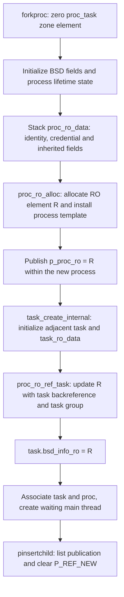
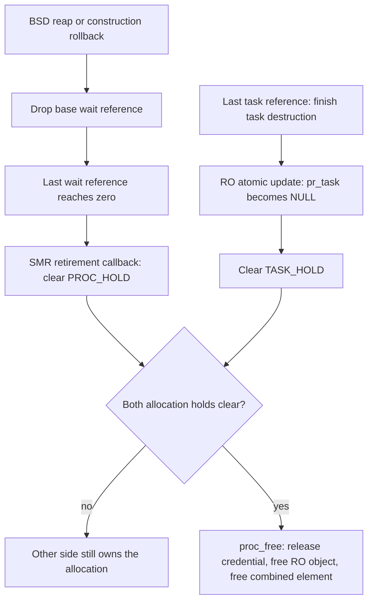

# The process and its protected data

An ordinary BSD process in `xnu-12377.121.6` occupies two allocations: a writable zone element containing `struct proc` and its Mach `task`, and a separate protected `struct proc_ro`. Understanding a process pointer therefore requires more than finding `p_pid`: follow the allocation, the association flags, the protected backreference, and the references that keep these objects alive.

[Key structures](README.md) introduces this section. Continue with [the task and its shared RO data](task-and-shared-ro.md) for the Mach half, and [writing protected object fields](read-only-object-updates.md) for the RO allocator's update mechanisms. The existing [process lifecycle](../subsystems/processes/lifecycle.md), [process transitions](../subsystems/processes/process-transitions.md) and [process inspection](../subsystems/processes/process-inspection-and-snapshots.md) explain the operations built on these structures.

[Thread and thread_ro](thread-and-thread-ro.md) follows the protected process associations reached from current execution. [Credential storage](credentials-and-credential-storage.md) follows the `p_ucred` pointer into its own RO allocation, writable lifetime bookkeeping, replacement and retirement.

## 1. Read the fields by role and protection

`struct proc` is the mutable BSD state. Its embedded objects, pointers and flags have different synchronization rules; `proc_lock()` is not a lock for everything reachable from the process. The declaration's shorthand means PL = process mutex, LL = process-list lock, PUCL = credential-publication mutex, PSL = process spin lock and PGL = process-group lock. These annotations are a starting point; the corresponding operation establishes whether a caller needs a lock, an atomic access or a stronger transition protocol. [Lock legend](../../xnu/bsd/sys/proc_internal.h#L99-L110), [lock wrappers](../../xnu/bsd/kern/kern_fork.c#L1238-L1291).

| Field group | Examples and representation | Access/lifetime distinction |
| --- | --- | --- |
| Process identity and relationships | `p_pid`, `p_ppid`, `p_pptr`, `p_pgrpid`, `p_sessionid`, `p_puniqueid` | PID is a lookup number; parent/list changes use the list protocol. Original-parent identity and process unique/version values live in `proc_ro`. |
| Index and list membership | `p_hash`, `p_list`, `p_sibling`, `p_children`, `p_pglist` | PID hash/list mutation and group membership have separate protections. `p_list` shares a union with the later SMR retirement node. |
| Protected-object association | `p_proc_ro` | A pointer stored in writable `proc`; `proc_get_ro()` validates the pointed-to RO element and its process backreference. |
| Cached credential IDs | `p_uid`, `p_gid`, real and saved UID/GID fields | Derived copies updated by `proc_update_creds_onproc()`; the referenced credential itself is reached through `proc_ro.p_ucred`. |
| Locks and transition flags | `p_mlock`, `p_ucred_mlock`, `p_slock`, `p_lflag`, `p_listflag`, `p_flag` | Local flags use process protocols, list flags use list protocols, and selected flag fields use atomic bit operations. |
| Object-lifetime state | `p_refcount`, `p_waitref`, child/parent reference counters | Ordinary references, transition wait references, family references and combined-allocation holds have distinct meanings. |
| Descriptors and shared resources | Embedded `p_fd`, pointer `p_stats`, SMR pointers `p_limit` and `p_pgrp` | A descriptor table is not a pointer field in this snapshot; process statistics are separately allocated. Descriptor locks and `fileproc`/`fileglob` holdings are separate from a process reference. |
| Signals, threads and timers | Embedded `p_sigacts`, `p_uthlist`, `p_siglist`, interval timers, signal/transition holder fields | Process mutex and spin-lock annotations differ; each Mach thread carries its own BSD `uthread`. |
| Explicit fork-copy group | `p_forkcopy`: arguments/stack metadata, executable vnode, signal dispositions, names, UUID, CPU type | A named subset is copied from the parent; the entire `proc` is not memcpy-cloned. Referenced contents still require their own ownership handling. |
| Async work and event state | AIO queues, `p_klist`, atomic `p_wqptr` and `p_aio_wqptr`, pthread entry/offset fields | Queue and subsystem protocols govern publication and teardown. |
| Resource and exit state | `p_ru`, `p_exit_reason`, crash fields, optional `p_memstat_*` fields | Some fields are conditional. Memorystatus fields have explicit list-lock annotations, with a separate freezer-mutex exception. |

Sources: [identity, relationships, locks and resource fields](../../xnu/bsd/sys/proc_internal.h#L271-L365), [fork-copy and event/work fields](../../xnu/bsd/sys/proc_internal.h#L374-L446), [conditional resource/exit fields](../../xnu/bsd/sys/proc_internal.h#L468-L515), [credential-ID copying](../../xnu/bsd/kern/kern_fork.c#L1294-L1302).

For the fields in the last several rows, follow [descriptors](../subsystems/processes/descriptors-ipc.md), [signals](../subsystems/processes/signal-delivery-and-return.md), [workqueues](../subsystems/processes/pthread-workqueue-lifecycle.md) and [memory-pressure policy](../subsystems/vm/reclaim-and-pressure.md). Their ownership is not supplied merely by retaining the containing process.

## 2. One writable allocation contains both process and task

`proc_struct_size` starts as `sizeof(struct proc)` and `proc_alignment` is `_Alignof(struct proc)`. `task_alignment` is `_Alignof(struct task)`. During task-zone setup, XNU rounds the process size to task alignment, rounds the task size to process alignment, and creates one `ZONE_ID_PROC_TASK` element of the combined size. [Initial size values](../../xnu/bsd/kern/kern_fork.c#L178-L186), [task alignment](../../xnu/osfmk/kern/task.c#L215-L218), [zone construction](../../xnu/osfmk/kern/task.c#L1243-L1252):

<!-- source-excerpt: ../../xnu/osfmk/kern/task.c#L1243-L1252 -->
```c
static inline void
task_zone_init(void)
{
	proc_struct_size = roundup(proc_struct_size, task_alignment);
	task_struct_size = roundup(sizeof(struct task), proc_alignment);
	proc_and_task_size = proc_struct_size + task_struct_size;

	proc_task_zone = zone_create_ext("proc_task", proc_and_task_size,
	    ZC_ZFREE_CLEARMEM | ZC_SEQUESTER, ZONE_ID_PROC_TASK, NULL); /* sequester is needed for proc_rele() */
}
```

The zone has clear-on-free and sequester flags. The `proc_rele()` body explains a concrete use of sequestering: after dropping a reference it may wake an address associated with a draining process, even though the process might already have been freed. That is a narrow allocator/reference-protocol property, not permission to dereference a released process. [Release and wakeup](../../xnu/bsd/kern/kern_proc.c#L1008-L1037).

`forkproc()` allocates the zone element with `Z_WAITOK | Z_ZERO` and treats its start as the process. `proc_get_task_raw(p)` adds the aligned `proc_struct_size`; `task_get_proc_raw(t)` subtracts it. These helpers perform address arithmetic, not lookup or reference acquisition. [Allocation](../../xnu/bsd/kern/kern_fork.c#L933-L943), [raw conversions](../../xnu/bsd/kern/kern_proc.c#L2023-L2033).

### Worked byte layout

For an illustrative build only, suppose `sizeof(struct proc) = 0x918`, process alignment is 8, `sizeof(struct task) = 0x2280`, and task alignment is 16. These hypothetical sizes obey their selected type alignments; they are not measured offsets for this checkout or a shipped kernel.

| Calculation | Result |
| --- | --- |
| Process area: `roundup(0x918, 16)` | `0x920` bytes |
| Task area: `roundup(0x2280, 8)` | `0x2280` bytes |
| Combined zone-element size | `0x920 + 0x2280 = 0x2ba0` bytes |
| If the element begins at kernel virtual address `B` | `proc * = B`; `task * = B + 0x920` |
| End of task area | `B + 0x920 + 0x2280 = B + 0x2ba0` |

```text
Illustrative offsets within one proc_task element, relative to B:
[0x0000, 0x0918)  struct proc
[0x0918, 0x0920)  8 bytes of alignment padding
[0x0920, 0x2ba0)  struct task

Separate allocation R: struct proc_ro
B->p_proc_ro                         = R
(B + 0x920)->bsd_info_ro             = R   (ordinary attached pair)
```

These are byte offsets in a kernel allocation, not physical addresses, page-table indices or userspace addresses. The actual numbers depend on structure definitions, architecture and selected configuration. No kernel build or layout measurement was performed here.

### Storage does not establish an attached task

`proc_task(p)` returns the computed task address only while `P_LHASTASK` is set. `proc_set_task(p, t)` accepts either NULL, which clears that bit, or exactly the task address belonging to the combined allocation; a different task address panics. Conversely, `get_bsdtask_info(t)` computes the process prefix, validates its zone and returns it only when the task's has-proc state permits. `set_bsdtask_info()` changes that association state after checking the expected address. [Process-side access](../../xnu/bsd/kern/kern_proc.c#L2003-L2033), [task-side access and association](../../xnu/osfmk/kern/bsd_kern.c#L98-L104), [task-side setter](../../xnu/osfmk/kern/bsd_kern.c#L159-L170).

Those association checks do not acquire a process or task reference. The allocation can remain present after one side's logical teardown, and the corpse case below has storage at the process offset without an initialized BSD process.

## 3. `proc_ro` is a separate object with grouped fields

`ZONE_ID_PROC_RO` is registered with `ZC_READONLY | ZC_ZFREE_CLEARMEM`. The whole `proc` is not read-only, and the `_ro` suffix does not mean these selected fields never change. Updates use the RO allocator's APIs; their architecture/configuration-dependent enforcement is explained in [writing protected object fields](read-only-object-updates.md). [RO-zone declaration](../../xnu/bsd/kern/kern_proc.c#L230-L231).

The declaration includes process and task backreferences, a process-data group and a task-data group. [Complete RO structure](../../xnu/bsd/sys/proc_ro.h#L69-L93):

<!-- source-excerpt: ../../xnu/bsd/sys/proc_ro.h#L69-L93 -->
```c
struct proc_ro {
	struct proc *pr_proc;
	struct task *pr_task;

	__xnu_struct_group(proc_ro_data, proc_data, {
		uint64_t p_uniqueid;                               /* process unique ID - incremented on fork/spawn/vfork, remains same across exec. */
		int p_idversion;                                   /* version of process identity */
		pid_t p_orig_ppid;                                 /* process's original parent pid, doesn't change if reparented */
		int p_orig_ppidversion;                            /* process's original parent pid version, doesn't change if reparented */
		uint32_t p_csflags;
		SMR_POINTER(struct ucred *) p_ucred;               /* Process owner's identity. (PUCL) */
		uint8_t *__unsafe_indexable syscall_filter_mask;   /* syscall filter bitmask (length: nsysent bits) */
		struct proc_platform_ro_data p_platform_data;
	});

	__xnu_struct_group(task_ro_data, task_data, {
#ifdef CONFIG_MACF
		struct task_filter_ro_data task_filters;
#endif
		uint32_t t_flags_ro;                               /* RO-protected task flags (see osfmk/kern/task.h) */

		/* This is not inherited on fork/exec, must be re-evaluated */
		task_control_port_options_t task_control_port_options;
	});
};
```

`__xnu_struct_group` uses a union of an anonymous structure and a named structure. Consequently `ro->p_idversion` and `ro->proc_data.p_idversion` refer to the same stored field. The named `proc_data` and `task_data` groups support whole-group copying; they are neither duplicate storage nor separate allocations. The same grouping mechanism defines `proc.p_forkcopy`. [C/C++ macro forms](../../xnu/bsd/sys/cdefs.h#L1321-L1338), [fork-copy assignment](../../xnu/bsd/kern/kern_fork.c#L1021-L1028).

The process group contains identity history (`p_uniqueid`, version, original parent/version), signing flags, the SMR credential pointer, syscall filter pointer and platform/SDK values. The task group contains optional MAC filter pointers, task RO flags and control-port options. A stored pointer such as `p_ucred` introduces another object and lifetime protocol; protecting this pointer's storage does not itself describe every object reachable through it. The [task chapter](task-and-shared-ro.md) follows its group in detail.

## 4. Construct a writable template, then install it in the RO element

For ordinary fork/spawn/exec construction, `forkproc()` builds a zero-initialized `struct proc_ro_data` on its stack. A new process receives a new unique ID and identity version; an exec replacement copies the old values. It inherits selected filter/platform/signing fields and obtains a credential holding from the creating thread's effective credential. The source explicitly notes that an assumed thread identity may therefore become the initial child identity. [Identity selection](../../xnu/bsd/kern/kern_fork.c#L933-L1006), [inherited fields and credential](../../xnu/bsd/kern/kern_fork.c#L1036-L1067), [signing inheritance and allocation](../../xnu/bsd/kern/kern_fork.c#L1087-L1097).

The call `proc_ro_alloc(child_proc, &proc_ro_data, NULL, NULL)` initializes the process side only. `proc_ro_alloc()` obtains a zeroed RO zone element and builds a separate writable `struct proc_ro pr_local`. It fills the supplied halves and copies the whole template through `zalloc_ro_update_elem()`. Direct assignments to `pr_local` are ordinary stack writes; the update API writes the protected destination. [Allocator and template](../../xnu/bsd/kern/kern_proc.c#L5581-L5603):

<!-- source-excerpt: ../../xnu/bsd/kern/kern_proc.c#L5581-L5603 -->
```c
proc_ro_alloc(proc_t p, proc_ro_data_t p_data, task_t t, task_ro_data_t t_data)
{
	proc_ro_t pr;
	struct proc_ro pr_local = {};

	pr = (proc_ro_t)zalloc_ro(ZONE_ID_PROC_RO, Z_WAITOK | Z_NOFAIL | Z_ZERO);

	if (p != PROC_NULL) {
		pr_local.pr_proc = p;
		pr_local.proc_data = *p_data;
	}

	if (t != TASK_NULL) {
		pr_local.pr_task = t;
		pr_local.task_data = *t_data;
	}

	if ((p != PROC_NULL) || (t != TASK_NULL)) {
		zalloc_ro_update_elem(ZONE_ID_PROC_RO, pr, &pr_local);
	}

	return pr;
}
```

Task creation follows later. `fork_create_child()` obtains the validated RO pointer, requires its task backreference to be null, computes the task address, and supplies both to `task_create_internal()`. The task constructor builds `task_ro_data` and calls `proc_ro_ref_task()`. That helper checks there is no owning task, copies the existing RO object to a writable local, fills `pr_task` and `task_data`, then updates the same RO element. Despite its name, this helper does not increment a reference counter. The resulting pointer is assigned to `task.bsd_info_ro`. [Child-task caller](../../xnu/bsd/kern/kern_fork.c#L461-L493), [task-side template and attachment](../../xnu/osfmk/kern/task.c#L1621-L1638), [RO task attachment](../../xnu/bsd/kern/kern_proc.c#L5605-L5621).



This diagram selects successful ordinary construction. The process can be inserted in the PID hash while `P_REF_NEW` still prevents normal referenced lookup. `pinsertchild()` later publishes family/allproc membership and clears that bit. An exec shadow remains excluded from ordinary PID selection until the later replacement. Even then, process initialization and userspace runnability are separate: the task's return-wait gates control its new thread. [Early hash insertion](../../xnu/bsd/kern/kern_fork.c#L978-L988), [lookup admission](../../xnu/bsd/kern/kern_proc.c#L886-L898), [list publication](../../xnu/bsd/kern/kern_proc.c#L2912-L2934), [caller and runnable state](../../xnu/bsd/kern/kern_fork.c#L740-L746), [waiting thread](../../xnu/bsd/kern/kern_fork.c#L509-L516).

Failure uses its own construction cleanup. For example, failure to obtain a main thread makes `cloneproc()` call `forkproc_free()`. That function destroys initialized BSD resources, removes the non-shadow hash entry, changes NEW to DEAD, checks outstanding ordinary references and releases the wait reference. It does not simply free the zone element at the failure site. [Construction failure caller](../../xnu/bsd/kern/kern_fork.c#L701-L715), [rollback body](../../xnu/bsd/kern/kern_fork.c#L806-L902).

## 5. Access paths supply different guarantees

### Current process: thread association, without a new reference

`current_proc()` reads `current_thread_ro()->tro_proc` and falls back to `kernproc` if that field is NULL. It neither searches by PID nor increments `p_refcount`. `current_thread_ro()` obtains the current thread's protected record, whose accessor validates the RO zone and owner backreference. [Current process](../../xnu/bsd/kern/bsd_stubs.c#L75-L84), [thread RO accessor](../../xnu/osfmk/kern/bsd_kern.c#L187-L210).

`uthread_init()` initializes the thread RO template with `tro_proc` and `tro_proc_ro`, selecting kernel, ordinary-task and corpse cases separately. Ordinary threads also receive credential pointers, and their uthreads are linked into `p_uthlist` under `proc_lock()`. This cached process association is why the current-process route differs from `proc_task()` or a hash lookup. `proc_self()` is the separate operation that attempts an owned ordinary reference for the current process; that reference still needs `proc_rele()`. [Thread association setup](../../xnu/bsd/kern/kern_fork.c#L1343-L1395), [referenced self lookup](../../xnu/bsd/kern/kern_proc.c#L1046-L1055).

### PID lookup: SMR discovery followed by a reference

`proc_find(pid)` enters `smr_proc_task`, looks up the PID hash and attempts a masked process-reference increment before leaving the read section. NEW and DEAD block the reference attempt. Shadow results are released and retried. If exec requires waiting, the helper temporarily trades the ordinary reference for `p_waitref`, waits, reacquires and rechecks; a completed replacement can force a fresh PID lookup. PID zero has a separate `kernproc` path. [Lookup body](../../xnu/bsd/kern/kern_proc.c#L2520-L2574), [reference predicate](../../xnu/bsd/kern/kern_proc.c#L886-L898), [exec waiting and wait-reference lifetime](../../xnu/bsd/kern/kern_proc.c#L948-L1005).

`proc_find_noref_smr()` is a different interface: it assumes the caller's entered SMR context and returns a lookup result without an ordinary reference. It must not be read as a cheaper way to obtain the `proc_find()` ownership contract. [Unreferenced SMR lookup](../../xnu/bsd/kern/kern_proc.c#L2508-L2517). Zombie lookup is different again; the [inspection chapter](../subsystems/processes/process-inspection-and-snapshots.md#live-lookup-and-zombie-lookup-are-separate-paths) follows its process-list claim.

### RO access: validate the zone and matching owner

`proc_get_ro(p)` checks both the expected RO-zone object and its `pr_proc` backreference. [Validated accessor](../../xnu/bsd/kern/kern_proc.c#L5639-L5649):

<!-- source-excerpt: ../../xnu/bsd/kern/kern_proc.c#L5639-L5649 -->
```c
proc_get_ro(proc_t p)
{
	proc_ro_t ro = p->p_proc_ro;

	zone_require_ro(ZONE_ID_PROC_RO, sizeof(struct proc_ro), ro);
	if (__improbable(ro->pr_proc != p)) {
		panic_proc_ro_proc_backref_mismatch(p, ro);
	}

	return ro;
}
```

The allocator's zone/range check is conditional on `ZSECURITY_CONFIG(READ_ONLY)` and exclusion of the XNU user-mode library build; the backreference check remains in the accessor. [Zone-validation body and fallback](../../xnu/osfmk/kern/zalloc.c#L6818-L6835). Neither check obtains a new reference or locks a field. The caller must already have the process-access context required for the operation. The accessor also does not make every field immutable: `proc_pidversion()` reads a scalar directly, whereas `proc_ucred_smr()` asserts that the caller entered `smr_proc_task`, and `proc_ucred_locked()` asserts ownership of `p_ucred_mlock`. A credential pointer retained beyond those scopes needs the credential reference API. [Version reader](../../xnu/bsd/kern/kern_proc.c#L2109-L2112), [credential accessors](../../xnu/bsd/kern/kern_proc.c#L2057-L2077), [credential acquisition and publication](../subsystems/security/credential-and-policy-lifetimes.md).

## 6. A concrete protected update: the exec identity version

`proc_setpidversion()` obtains the validated RO object and invokes a field-copy update with the address of a local `int`. It does not assign directly through `p_proc_ro`, acquire `proc_lock()` or perform an atomic read-modify-write. Those are different responsibilities. [Version setter](../../xnu/bsd/kern/kern_proc.c#L2114-L2119):

<!-- source-excerpt: ../../xnu/bsd/kern/kern_proc.c#L2114-L2119 -->
```c
void
proc_setpidversion(proc_t p, int idversion)
{
	zalloc_ro_update_field(ZONE_ID_PROC_RO, proc_get_ro(p), p_idversion,
	    &idversion);
}
```

The selected caller is `exec_handle_sugid()`, invoked during Mach-O activation. It obtains its process from the image activation's VFS context, reads the previous version, increments `nextpidversion` until the value differs and invokes this setter. The ordinary exec setup points that VFS context at the replacement thread/process; it is not sufficient to assume `current_proc()` names the object being updated. [Activation caller](../../xnu/bsd/kern/kern_exec.c#L2351-L2358), [context selection](../../xnu/bsd/kern/kern_exec.c#L6117-L6125), [helper's target](../../xnu/bsd/kern/kern_exec.c#L7525-L7532), [version update](../../xnu/bsd/kern/kern_exec.c#L7788-L7797).

The field update is a controlled write to the existing RO element. It is not a replacement allocation and does not, by itself, publish the new process in the PID hash. That occurs in `proc_exec_switch_task()`: after reference drains and liveness checks, it replaces the hash entry under `proc_list_lock`, clears the replacement's SHADOW bit and sets SHADOW on the old process. [Switch admission](../../xnu/bsd/kern/kern_exec.c#L5795-L5821), [hash replacement](../../xnu/bsd/kern/kern_exec.c#L5903-L5935). The [transition chapter](../subsystems/processes/process-transitions.md) explains the surrounding rollback and point-of-no-return decisions.

### Worked access/update/lifetime sequence

Use symbolic allocations `P0/T0/R0` for the old ordinary process/task/RO record and `P1/T1/R1` for its exec replacement. Let the PID be 420, process unique ID 1001 and old version 7007; these values are illustrative.

1. An observer obtains `P0` through `proc_find(420)`, then reads `proc_uniqueid(P0)` and `proc_pidversion(P0)` through the validated RO accessor. It owns one ordinary process reference and must release it. This does not lock all mutable process fields.
2. Exec creates `P1/T1` in another combined zone element and `R1` in another RO element. `P1` copies PID 420, unique ID 1001 and initially version 7007, but is a shadow. Its RO backreferences point to P1 and T1, not to P0 and T0.
3. Activation chooses, for example, version 7008 and `proc_setpidversion(P1, 7008)` writes R1's version field through the RO API. R0 still belongs to P0. Changing a field in R1 does not change `P0->p_proc_ro`.
4. For an ordinary non-init process, final exec switching waits for the outstanding P0 reference to be released. Once switching succeeds, the PID hash selects P1. A later `proc_find(420)` can therefore return a different kernel address with the same process unique ID and a new identity version.
5. P0/T0/R0 are retired through their own process/task lifetimes. The earlier observer must not reuse P0 or R0 after dropping its only ownership merely because PID 420 still exists.

Sources: [new identities versus exec copies](../../xnu/bsd/kern/kern_fork.c#L978-L1006), [unique-ID accessor](../../xnu/bsd/kern/kern_proc.c#L2140-L2147), [exec drain including initproc exception](../../xnu/bsd/kern/kern_proc.c#L1173-L1222), [PID replacement](../../xnu/bsd/kern/kern_exec.c#L5903-L5923). This is one successful ordering, not a guarantee that every failure returns to the old image.

Other protected fields use different update patterns. Credential publication takes `p_ucred_mlock`, checks the previously observed pointer, acquires new credential holdings, and uses an atomic exchange of `p_ucred.__smr_ptr`; cached UID/GID fields are then updated in writable `proc`. Signing-bit helpers instead compute a new scalar value and use the field-copy API. Neither storage placement nor a helper named `set` supplies an automatic whole-operation lock. [Credential publication](../../xnu/bsd/kern/kern_credential.c#L3945-L3957), [signing flag helpers](../../xnu/bsd/kern/kern_proc.c#L2222-L2243). Follow [writing protected object fields](read-only-object-updates.md) for the API contracts and [credential lifetimes](../subsystems/security/credential-and-policy-lifetimes.md) for ownership and retries.

## 7. References, waiters and allocation holds end at different times

The low eight bits of `p_refcount` contain state flags; the ordinary reference count occupies the remaining bits. Two flags, `P_REF_PROC_HOLD` and `P_REF_TASK_HOLD`, track the two owners of the combined allocation. They are not extra ordinary-reference increments, and they are not the task's own reference count. `p_waitref` is another count used to keep process storage available for transition waiters and final retirement. [Bit definitions](../../xnu/bsd/sys/proc_internal.h#L208-L220), [ordinary release arithmetic](../../xnu/bsd/kern/kern_proc.c#L1009-L1021), [wait-reference use](../../xnu/bsd/kern/kern_proc.c#L948-L971).

`forkproc()` initializes ordinary/wait reference state and sets PROC_HOLD. Successful `task_create_internal()` adds TASK_HOLD after inserting the task into the global task list. Clearing either hold frees the shared allocations only if the other hold was already absent. This permits either side's cleanup to finish first. [Process initialization](../../xnu/bsd/kern/kern_fork.c#L937-L943), [task hold acquisition](../../xnu/osfmk/kern/task.c#L1914-L1924), [hold helpers](../../xnu/bsd/kern/kern_proc.c#L1232-L1278).

The ordinary exit/reap path proceeds through several distinct storage boundaries:

| Stage | State change | What remains |
| --- | --- | --- |
| Exit prepares the process | Moves from `allproc` to `zombproc` and sets DEAD | New ordinary PID-reference attempts fail, but process storage remains |
| Exit drains ordinary references | `proc_refdrain()` waits for the base reference | Resource teardown can proceed without those external ordinary users |
| BSD task association ends | Clear `P_LHASTASK`, task has-proc state and exiting thread's `tro_proc` | Raw combined storage and RO ownership can outlive the association |
| Reaping finishes BSD resources | Remove hash/family membership, check dead references, destroy locks and release `p_waitref` | Outstanding transition wait references can still delay retirement |
| Last wait reference is released | Schedule `proc_wait_free()` through `smr_proc_task_call()` | The process allocation hold survives until the deferred callback |
| SMR callback runs | Clear PROC_HOLD | Free only if TASK_HOLD is already clear |
| Final task destruction completes | Clear RO `pr_task`, then clear TASK_HOLD | Free only if PROC_HOLD is already clear |

Sources: [DEAD publication](../../xnu/bsd/kern/kern_exit.c#L2254-L2271), [exit drain](../../xnu/bsd/kern/kern_exit.c#L2362-L2367), [association removal](../../xnu/bsd/kern/kern_exit.c#L2690-L2697), [reap and release](../../xnu/bsd/kern/kern_exit.c#L2967-L3004), [deferred callback](../../xnu/bsd/kern/kern_proc.c#L1090-L1105), [task final release](../../xnu/osfmk/kern/task.c#L2203-L2206).



The diagram combines two independently ordered completion paths. If task destruction finishes first, the later SMR callback frees the allocations. If the process's SMR callback finishes first, the later task release frees them. The ordinary process path has crossed its SMR retirement in either case; there is not an unconditional second SMR callback in `proc_free()`.

`proc_free()` loads the credential association, releases that holding through `kauth_cred_set(&cred, NOCRED)`, frees the RO element and finally frees the combined element. It receives the RO pointer as an argument; the task-side release supplies `task->bsd_info_ro`, which also matters for task-only construction. [Final free body](../../xnu/bsd/kern/kern_proc.c#L1239-L1251):

<!-- source-excerpt: ../../xnu/bsd/kern/kern_proc.c#L1239-L1251 -->
```c
proc_free(proc_t proc, proc_ro_t proc_ro)
{
	kauth_cred_t cred;

	assert(proc_ro != NULL);

	cred = smr_serialized_load(&proc_ro->p_ucred);
	kauth_cred_set(&cred, NOCRED);

	zfree_ro(ZONE_ID_PROC_RO, proc_ro);

	zfree(proc_task_zone, proc);
}
```

These final allocation operations do not replace earlier descriptor, vnode, workqueue or credential-publication cleanup. A process reference is also not a general promise that a logically detached task can still be used through raw address arithmetic.

## 8. Kernel bootstrap and corpses are explicit exceptions

The shared-RO diagrams above describe ordinary BSD fork/spawn/exec pairs. Two source-visible construction paths require separate treatment:

| Variant | What the source constructs | Consequence |
| --- | --- | --- |
| Kernel bootstrap | `task_init()` allocates the combined element for `kernproc` and `kernel_task`, then calls `task_create_internal()` with no supplied `proc_ro`. Its null-input branch allocates a task-only RO object. Later `bsd_init()` separately assigns a new RO object to `kernproc->p_proc_ro`, supplying both kernel backreferences. | Do not assume `kernproc->p_proc_ro == kernel_task->bsd_info_ro` from the ordinary constructor. The shown BSD initialization does not replace the task's RO pointer. |
| Corpse fork | Corpse generation allocates a zeroed combined element, computes its task address and passes NULL `proc_ro` to `task_create_internal()`. It never calls `forkproc()` for that prefix. | The process-sized prefix is not a valid initialized BSD process. Task creation obtains a task-only RO record with no process-side identity/credential initialization. |

Sources: [kernel pair allocation and creation](../../xnu/osfmk/kern/task.c#L1211-L1219), [null-versus-supplied RO branch](../../xnu/osfmk/kern/task.c#L1633-L1638), [kernel process RO setup](../../xnu/bsd/kern/bsd_init.c#L541-L544), [corpse allocation and constructor](../../xnu/osfmk/corpses/corpse.c#L735-L762), [process initialization contract](../../xnu/bsd/sys/proc_internal.h#L265-L269).

The RO header's general shared-object comment names the corpse exception; the separate kernel bootstrap bodies establish the additional boundary above. `set_bsdtask_info(kernel_task, kernproc)` changes the task's has-proc association, not `bsd_info_ro`. Kernel threads explicitly receive `kernproc->p_proc_ro` in their thread RO templates. [Bootstrap association](../../xnu/bsd/kern/bsd_init.c#L522-L544), [association setter](../../xnu/osfmk/kern/bsd_kern.c#L159-L170), [kernel thread template](../../xnu/bsd/kern/kern_fork.c#L1343-L1347).

The word “uninitialized” for a corpse's process area refers to BSD object validity. Its reserved prefix is still used by the combined-allocation hold helpers, which derive it from the task address. It must not be interpreted as an ordinary process with a useful PID, descriptor table or `p_proc_ro`. Final task teardown uses its own RO pointer when releasing that allocation. [Task allocation-hold helpers](../../xnu/bsd/kern/kern_proc.c#L1262-L1278), [task destruction](../../xnu/osfmk/kern/task.c#L2203-L2206). The [task companion](task-and-shared-ro.md) follows corpse-specific task access and references.

## 9. Scope and reading limits

This chapter establishes selected process field groups, aligned combined allocation, RO construction and association validation, current-thread/PID access, one exec-time protected write, publication and final storage reclamation. It does not claim that every `proc` member has been exhaustively audited or that one process lock protects every subsystem. Feature guards alter layouts and operations; symbolic offsets are preferable to hardcoded offsets unless a specific build has been measured.

The RO update helper is only one part of correctness. The caller still supplies a live object, field-specific exclusion and an appropriate operation context. The [update companion](read-only-object-updates.md) separates ordinary copies from atomic updates and follows their backend/configuration boundaries. No kernel source was modified, no kernel/runtime test was executed, and no shipped-kernel structure layout is inferred from this source-only review.

<!-- BEGIN PLATYDOC DOCUMENTATION LICENSE -->
Original Platydoc text and diagrams are licensed under [CC BY 4.0](https://creativecommons.org/licenses/by/4.0/). Quoted source code and third-party material retain their respective licenses.
<!-- END PLATYDOC DOCUMENTATION LICENSE -->
