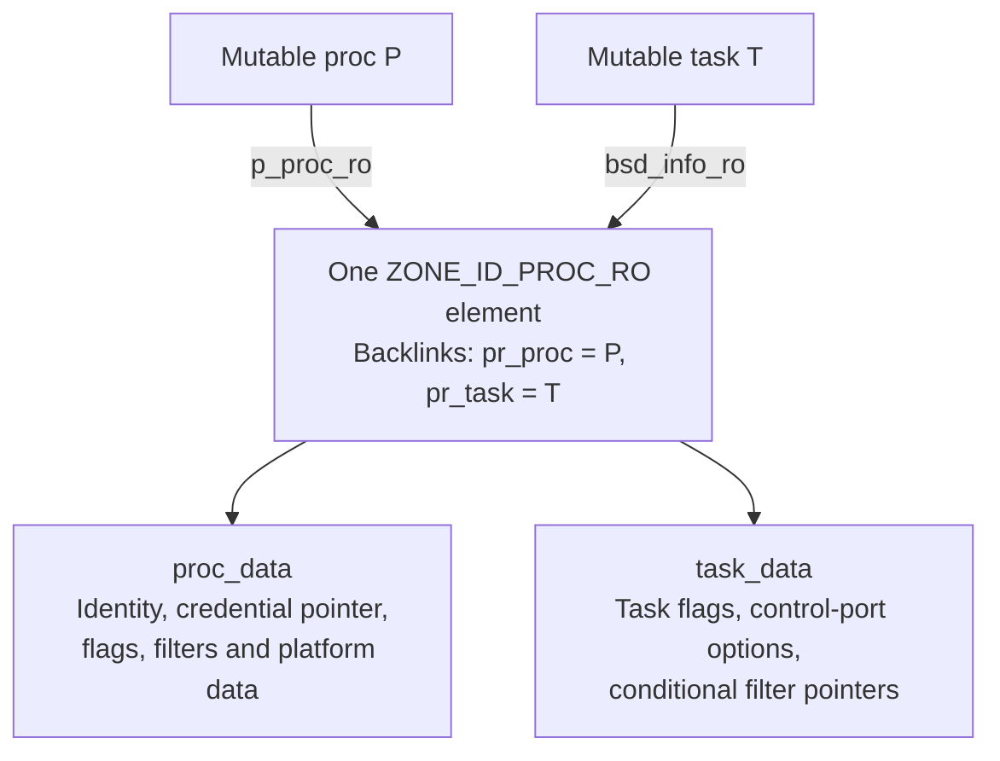
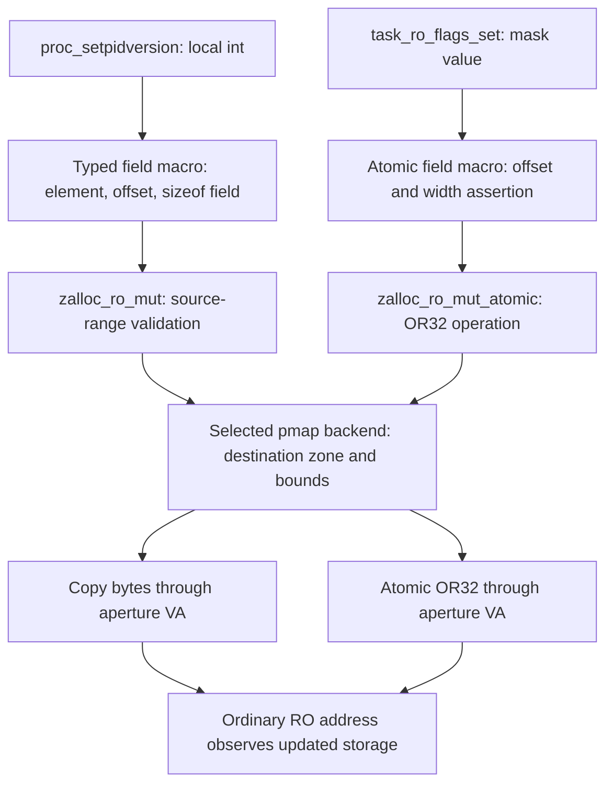
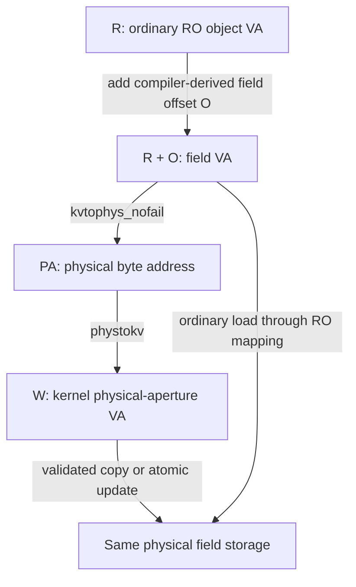

# Updating read-only process and task metadata

[Key structures](README.md) · [Process and proc_ro](proc-and-proc-ro.md) · [Task and shared read-only state](task-and-shared-ro.md) · [Read-only and special zones](../subsystems/vm/read-only-and-special-zones.md)

Read-only metadata can change. In this XNU snapshot, ordinary kernel loads read the `proc_ro` allocation, while selected updates go through typed macros, allocator checks and an architecture-specific write path. This chapter follows two concrete updates: copying a process identity version and atomically setting task flags. It documents `xnu-12377.121.6`, source commit `ac9718fb1af618d5ce8678d0dc6e8a58f252216f`.

The prerequisite [RO-zone chapter](../subsystems/vm/read-only-and-special-zones.md#1-read-only-zone-registration-and-geometry) explains registration, allocator geometry and the other special zone families. Here the focus is the relationship between the actual process/task fields, their update APIs and the ARM64 implementation. Read-only mapping protection, atomicity, object lifetime and permission to perform a particular process operation are separate contracts.

## 1. The ordinary process/task pair shares one RO record

For the ordinary associated pair, `proc.p_proc_ro` and `task.bsd_info_ro` point to the same `struct proc_ro`. That structure contains `pr_proc` and `pr_task` backlinks, a process-data group and a task-data group. There is no separate `struct task_ro` allocation in this path. Bootstrap and task-only/corpse cases require the qualifications in the [task companion](task-and-shared-ro.md). [Process pointer](../../xnu/bsd/sys/proc_internal.h#L277-L277), [task pointer](../../xnu/osfmk/kern/task.h#L375-L375), [shared structure](../../xnu/bsd/sys/proc_ro.h#L57-L97).

`__xnu_struct_group()` overlays each named group with anonymous member access. Thus `ro->t_flags_ro` and `ro->task_data.t_flags_ro` name the same storage; `ro->p_idversion` and `ro->proc_data.p_idversion` do likewise. The groups are not duplicate copies. Their named forms permit copying one logical group during initialization. `CONFIG_MACF` changes fields in the task group, so a byte layout must come from the selected build's C types. [Group macro](../../xnu/bsd/sys/cdefs.h#L1320-L1339), [conditional task fields](../../xnu/bsd/sys/proc_ro.h#L85-L94).



The diagram shows the ordinary paired object. Its arrows identify fields, not independent reference counts for every pointer. For example, keeping the RO allocation alive does not automatically retain everything a field points to.

## 2. Initialization also uses the update API

The reserved zone is declared for `struct proc_ro` with `ZC_READONLY | ZC_ZFREE_CLEARMEM`. `proc_ro_alloc()` requests `Z_WAITOK | Z_NOFAIL | Z_ZERO`, constructs a zero-initialized stack `pr_local`, fills whichever process/task arguments are present, then copies the complete local structure through `zalloc_ro_update_elem()`. It does not temporarily grant ordinary writable access to the returned object for initialization. [Zone declaration](../../xnu/bsd/kern/kern_proc.c#L230-L231), [allocation and initial copy](../../xnu/bsd/kern/kern_proc.c#L5580-L5603).

In the normal creation sequence, process creation builds `proc_ro_data` and assigns the new RO pointer to `child_proc->p_proc_ro`. Task creation later supplies `task_ro_data` to `proc_ro_ref_task()`. Despite its name, this helper does not increment a `proc_ro` reference counter: it checks that `pr_task` is null, copies the current element into a local structure, installs the task backlink/data and writes the whole element back. `new_task->bsd_info_ro` receives that same allocation. [Process-side creation](../../xnu/bsd/kern/kern_fork.c#L1023-L1097), [task-side attachment](../../xnu/osfmk/kern/task.c#L1620-L1643), [whole-element attachment helper](../../xnu/bsd/kern/kern_proc.c#L5605-L5621).

This is staged construction under the creation protocol. A whole-element copy preserves the other fields from the local snapshot, but it is not an atomic publication operation that can safely merge arbitrary concurrent writers. A caller cannot use this initialization pattern as a substitute for a shared object's later synchronization rules.

## 3. Reads validate the relationship and then load normally

`proc_get_ro(p)` reads `p->p_proc_ro`, calls `zone_require_ro(ZONE_ID_PROC_RO, sizeof(struct proc_ro), ro)`, then checks `ro->pr_proc == p`. `task_get_ro(t)` similarly follows `bsd_info_ro` and checks the task backlink. A mismatch panics. These accessors neither acquire a process/task reference nor lock the object. [Process accessor](../../xnu/bsd/kern/kern_proc.c#L5631-L5657), [task accessor](../../xnu/osfmk/kern/task.c#L10352-L10372).

[Task accessor and flag read — `task.c`, lines 10360–10377](../../xnu/osfmk/kern/task.c#L10360-L10377).

<!-- source-excerpt: ../../xnu/osfmk/kern/task.c#L10360-L10377 -->
```c
proc_ro_t
task_get_ro(task_t t)
{
	proc_ro_t ro = (proc_ro_t)t->bsd_info_ro;

	zone_require_ro(ZONE_ID_PROC_RO, sizeof(struct proc_ro), ro);
	if (__improbable(proc_ro_task(ro) != t)) {
		panic_proc_ro_task_backref_mismatch(t, ro);
	}

	return ro;
}

uint32_t
task_ro_flags_get(task_t task)
{
	return task_get_ro(task)->t_flags_ro;
}
```

After validation, `task_ro_flags_get()` is the ordinary C load shown above; `proc_pidversion()` likewise returns `proc_get_ro(p)->p_idversion`. These read paths do not enter PPL, request an SPTM mutation or change page permissions. [Process identity read](../../xnu/bsd/kern/kern_proc.c#L2108-L2112).

With RO checking enabled, `zone_require_ro()` tests membership in the RO virtual-address range, alignment using the protected zone-size parameters, and the exact metadata zone ID. The body uses the recorded parameters; its passed `elem_size` is marked unused. It does not consult an allocation generation or acquire a lifetime reference. A valid zone address and matching backlink are useful identity checks, but the caller still must keep the object alive. When this checking is compiled out, the accessors retain their backlink checks while the allocator range check becomes a no-op. [Validation body and fallback](../../xnu/osfmk/kern/zalloc.c#L6820-L6835).

## 4. Plain field copy: process identity version

During the selected exec identity update, `exec_handle_sugid()` increments the global identity-version source until it differs from the process's previous value, calls `proc_setpidversion()` and then assigns a new task unique ID with `task_set_uniqueid()`. The version update itself is a plain field copy. The global increment being atomic does not make this sequence of process and task updates one atomic transaction. [Exec caller](../../xnu/bsd/kern/kern_exec.c#L7787-L7797), [task unique-ID assignment](../../xnu/osfmk/kern/task.c#L2575-L2578).

[Process setter — `kern_proc.c`, lines 2114–2119](../../xnu/bsd/kern/kern_proc.c#L2114-L2119).

<!-- source-excerpt: ../../xnu/bsd/kern/kern_proc.c#L2114-L2119 -->
```c
void
proc_setpidversion(proc_t p, int idversion)
{
	zalloc_ro_update_field(ZONE_ID_PROC_RO, proc_get_ro(p), p_idversion,
	    &idversion);
}
```

The field macro types the supplied pointer against the actual field, derives its offset from the whole pointed-to element type and copies `sizeof(field)` bytes. The address `&idversion` refers to a local parameter whose bytes remain available during the synchronous call. [Field macro](../../xnu/osfmk/kern/zalloc.h#L872-L876).

[Field macro — `zalloc.h`, lines 872–876](../../xnu/osfmk/kern/zalloc.h#L872-L876).

<!-- source-excerpt: ../../xnu/osfmk/kern/zalloc.h#L872-L876 -->
```c
#define zalloc_ro_update_field(zone_id, elem, field, value)  ({ \
	const typeof((elem)->field) *__value = (value);                        \
	zalloc_ro_mut(zone_id, elem, offsetof(typeof(*(elem)), field),         \
	    __value, sizeof((elem)->field));                                   \
})
```

Conceptually, for `R = proc_get_ro(p)`, the expansion supplies:

| Argument | Selected value |
| --- | --- |
| Zone | `ZONE_ID_PROC_RO` |
| Element base | `R`, the beginning of the shared RO allocation |
| Offset | `offsetof(struct proc_ro, p_idversion)` |
| Source | Address of the local `idversion` value |
| Copy size | `sizeof(R->p_idversion)` |

`zalloc_ro_mut()` asserts a reserved RO ID and, when enforcement is enabled, checks the source range before calling `pmap_ro_zone_memcpy()`. The pmap backend checks the destination and performs the copy. Invalid source/zone/bounds produce panic/assertion behavior in these bodies, not a recoverable setter error; the setter returns `void`. [Allocator copy path](../../xnu/osfmk/kern/zalloc.c#L6714-L6747), [legacy destination checks](../../xnu/osfmk/arm/pmap/pmap.c#L12274-L12334), [SPTM destination checks](../../xnu/osfmk/arm64/sptm/pmap/pmap.c#L11657-L11715).

### Which source buffers are accepted?

The source-side predicate accepts any of the following alternatives: the whole range fits in the current kernel stack; it fits in the RO map and its starting address belongs to the requested zone ID; or it qualifies as constant memory. The stack case permits this setter's local parameter and the whole-element construction temporaries. The same-zone RO-source alternative does not check that the source begins at an element boundary or lies within one live element. [Source predicate](../../xnu/osfmk/kern/zalloc.c#L6698-L6710), [stack bounds](../../xnu/osfmk/kern/zalloc.c#L6596-L6621).

[Accepted source alternatives — `zalloc.c`, lines 6700–6710](../../xnu/osfmk/kern/zalloc.c#L6700-L6710).

<!-- source-excerpt: ../../xnu/osfmk/kern/zalloc.c#L6700-L6710 -->
```c
zalloc_ro_mut_validate_src(zone_id_t zid, void *elem,
    const vm_offset_t src, vm_size_t src_size)
{
	if (from_current_stack(src, src_size) ||
	    (from_ro_map(src, src_size) &&
	    zid == zone_index_from_ptr((void *)src)) ||
	    from_const_memory(src, src_size)) {
		return;
	}
	zalloc_ro_mut_validation_panic(zid, elem, src, src_size);
}
```

The constant-memory alternative depends on configuration. With the listed KTRR/CTRR/PV_CTRR defines, it calls `rorgn_contains()`; otherwise that helper returns true, so the same source-location restriction is not enforced. SPTM's stack case includes the optional mapped stack redzone. The separate AMFI-entitlements exception in `zalloc_ro_mut()` is not selected for `ZONE_ID_PROC_RO`. These are checks on where bytes come from, not on whether a new identity version or policy value is semantically authorized. [Constant-memory variants](../../xnu/osfmk/kern/zalloc.c#L6624-L6642), [AMFI-specific exception](../../xnu/osfmk/kern/zalloc.c#L6724-L6739).

## 5. Atomic field update: task flags

`task_ro_flags_set(task, flags)` passes the shared allocation, `t_flags_ro`, `ZRO_ATOMIC_OR_32` and the value to `zalloc_ro_update_field_atomic()`. Clearing flags uses AND32 with the complemented mask. These are operations on the 32-bit word; neither helper takes the task lock. A concrete caller, `task_set_filter_msg_flag()`, selects set/clear for `TFRO_FILTER_MSG`. [Flag helpers](../../xnu/osfmk/kern/task.c#L10379-L10391), [selected caller](../../xnu/osfmk/kern/task.c#L9823-L9846).

[Task flag setter — `task.c`, lines 10379–10384](../../xnu/osfmk/kern/task.c#L10379-L10384).

<!-- source-excerpt: ../../xnu/osfmk/kern/task.c#L10379-L10384 -->
```c
void
task_ro_flags_set(task_t task, uint32_t flags)
{
	zalloc_ro_update_field_atomic(ZONE_ID_PROC_RO, task_get_ro(task),
	    t_flags_ro, ZRO_ATOMIC_OR_32, flags);
}
```

The atomic macro infers the field's base type, checks at compile time that its size equals the width encoded in the operation's low nibble, and passes the full element base plus `offsetof(struct proc_ro, t_flags_ro)` to `zalloc_ro_mut_atomic()`. OR32 is encoded as `0x10 | 4`, so backend destination validation covers four bytes. There is no source-buffer pointer here: the operand is passed by value. [Operation encoding](../../xnu/osfmk/kern/zalloc.h#L902-L935), [atomic macro](../../xnu/osfmk/kern/zalloc.h#L976-L981), [allocator dispatch](../../xnu/osfmk/kern/zalloc.c#L6749-L6763).

After the selected pmap backend resolves the destination aperture address, `__zalloc_ro_mut_atomic()` dispatches OR32 to `os_atomic_or_orig((uint32_t *)dst, (uint32_t)value, seq_cst)`. That operation returns the old word. The generic macro preserves that return value; `task_ro_flags_set()` ignores it. The destination's ordinary RO address does not become writable for a later unrelated store. [Atomic implementation](../../xnu/osfmk/kern/zalloc_internal.h#L980-L1003).

For illustration, if the word initially contains bits `A`, setting mask `B` performs the one-word operation `old = A; new = A | B`. Two concurrent atomic OR operations update the word through the atomic primitive rather than competing plain read/copy sequences. This says nothing about whether either caller may change the chosen bits or whether associated fields are ready when readers see them.



The two terminal operations correspond to their respective incoming API, not a runtime choice to turn an ordinary copy into an atomic update. The detailed backend branches follow below.

## 6. Object offsets, physical addresses and aperture addresses

Let `R` denote the ordinary kernel virtual address of a live `proc_ro`, `O` the compiler-derived field offset, and `N` the selected copy/atomic width. The target byte range is `[R + O, R + O + N)`. If `E` is the zone's recorded element size, the destination checks require a valid aligned element in this zone and an in-bounds offset/extent. `E` comes from `zone_ro_size_params`, rather than trusting a caller-supplied structure size. [Recorded size parameters](../../xnu/osfmk/kern/zalloc.c#L515-L515), [zone creation](../../xnu/osfmk/kern/zalloc.c#L9167-L9180), [backend bounds](../../xnu/osfmk/arm64/sptm/pmap/pmap.c#L11657-L11690).

The two selected updates differ only in the field-specific arithmetic before dispatch:

| Update | `O` | `N` | Operation |
| --- | --- | --- | --- |
| Process version | `offsetof(struct proc_ro, p_idversion)` | `sizeof(R->p_idversion)` | Copy local value bytes |
| Task flags | `offsetof(struct proc_ro, t_flags_ro)` | 4, checked against the actual field type | Atomic OR32 |
| Whole initial object | 0 | `sizeof(struct proc_ro)` | Copy the local initialized structure |

This symbolic example intentionally does not fix one `sizeof(struct proc_ro)` for every configuration. Group overlays and conditional fields determine the real offsets. It also needs no assumed page size: the allocator's RO geometry confines elements to a single `PAGE_SIZE` chunk. [Whole-element macro](../../xnu/osfmk/kern/zalloc.h#L855-L858), [RO chunk geometry](../../xnu/osfmk/kern/zalloc.c#L8995-L9004).

Both ARM64 backend families translate `R + O` with `kvtophys_nofail()`, producing physical address `PA`. They then obtain `W = phystokv(PA)` and perform the memory operation at `W`. **W is a kernel virtual address in the physical aperture**, not the numeric physical address used as a C pointer. R and W address the same underlying bytes through different mappings. Neither is a userspace address or a device IOVA. [Legacy translation and copy](../../xnu/osfmk/arm/pmap/pmap.c#L12439-L12457), [SPTM translation and copy](../../xnu/osfmk/arm64/sptm/pmap/pmap.c#L11793-L11811).

Legacy `phystokv()` uses the physical-to-virtual table with a base-offset fallback. The SPTM implementation calls the `sptm_phystokv()` translation interface and returns its aperture-address result. That call is evidence of address translation through the supplied interface, not evidence of an SPTM write-permission request for each field mutation. [Legacy aperture translation](../../xnu/osfmk/arm64/arm_vm_init.c#L381-L396), [SPTM aperture translation](../../xnu/osfmk/arm64/sptm/arm_init_sptm.c#L1383-L1392).



The diagram separates address representations. Whether a particular mapping permits writes and which execution context can use that permission are backend properties, not consequences of the arithmetic alone.

## 7. The mapping and mutation mechanisms differ by ARM64 backend

### RO mapping is established before these field updates

When `ZSECURITY_CONFIG(READ_ONLY)` is enabled, RO zone creation selects `Z_SUBMAP_IDX_READ_ONLY`. Zone population supplies `VM_PROT_READ` and `PMAP_MAPPING_TYPE_ROZONE` to VM. The allocation therefore arrives with the ordinary RO mapping discipline already established; `zalloc_ro()` uses the common allocator and validates the result. [Creation configuration](../../xnu/osfmk/kern/zalloc.c#L9167-L9180), [mapping/protection selection](../../xnu/osfmk/kern/zalloc.c#L4781-L4811), [population call](../../xnu/osfmk/kern/zalloc.c#L4997-L5007), [RO allocation](../../xnu/osfmk/kern/zalloc.c#L6574-L6590).

Legacy ARM pmap rejects a non-read-only protection for the kernel RO-zone VA and, after successful mapping, calls `pmap_phys_write_disable()`. With `XNU_MONITOR`, that helper locks down the page with `PVH_FLAG_LOCKDOWN_RO`; without it, the body calls `pmap_page_protect(..., VM_PROT_READ)`. [Mapping validation](../../xnu/osfmk/arm/pmap/pmap.c#L6254-L6261), [post-enter protection](../../xnu/osfmk/arm/pmap/pmap.c#L6665-L6667), [physical protection variants](../../xnu/osfmk/arm/pmap/pmap.c#L12557-L12565).

SPTM associates the RO mapping with its frame type and gives the relevant leaf tables `XNU_PAGE_TABLE_ROZONE` type. The RO submap is aligned to the required twig boundary. These mapping/type operations provide the context for the ordinary address's protection; their existence does not insert a type-changing call into the field-write helper. [RO mapping type](../../xnu/osfmk/arm64/sptm/pmap/pmap.c#L6092-L6100), [RO table typing](../../xnu/osfmk/arm64/sptm/pmap/pmap.c#L7413-L7429), [alignment](../../xnu/osfmk/arm64/sptm/pmap/pmap.c#L11734-L11750).

### Legacy ARM64 with PPL

Under `XNU_MONITOR`, the public copy/atomic wrappers call their `*_ppl` entrypoints. The generated stub puts the RO-copy or atomic operation index into `x15` and branches to `_aprr_ppl_enter`; the handler table associates those indices with the internal RO mutation functions. The available dispatch assembly checks the index/state, switches to the per-CPU PPL stack and selects the handler. [Public wrappers](../../xnu/osfmk/arm/pmap/pmap.c#L12423-L12505), [stub generation](../../xnu/osfmk/arm/pmap/pmap_internal.h#L98-L107), [RO indices and declarations](../../xnu/osfmk/arm/pmap/pmap.c#L1015-L1036), [handler entries](../../xnu/osfmk/arm/pmap/pmap.c#L1386-L1388), [dispatch fragment](../../xnu/osfmk/arm64/locore.s#L2276-L2337).

Inside the mutation function, destination validation precedes the actual store. The physical-page helper takes the page's PV-head lock and, on PPL builds, verifies `PVH_FLAG_LOCKDOWN_RO`. Copy uses `memcpy()` through the aperture; atomic update uses the same aperture with `__zalloc_ro_mut_atomic()`; both then release the PV lock. The lock helper also checks its passed range against a page boundary. [Physical lock/check](../../xnu/osfmk/arm/pmap/pmap.c#L12349-L12393), [copy body](../../xnu/osfmk/arm/pmap/pmap.c#L12438-L12457), [atomic body](../../xnu/osfmk/arm/pmap/pmap.c#L12487-L12506).

PPL's PV locking selects `hw_lock_bit_nopreempt()`: it relies on the protected execution context already having preemption disabled. The visible PPL exit checks and decrements the thread's preemption count. The `_aprr_ppl_enter` body and full protected crossing are absent from this checkout, so this chapter does not invent the missing entry instructions or label PPL unconditionally as an EL2 transition. The [monitor chapter](../subsystems/platform/exception-levels-and-monitors.md#legacy-ppl-read-the-state-machine-recognize-the-missing-crossing) documents the available stack/state fragments. [PV-head locking](../../xnu/osfmk/arm/pmap/pmap_data.h#L316-L335), [preemption-specific lock selection](../../xnu/osfmk/arm/pmap/pmap.h#L864-L884), [disabled-preemption requirement](../../xnu/osfmk/kern/locks.c#L1318-L1328), [visible preemption release](../../xnu/osfmk/arm64/locore.s#L2408-L2424).

### SPTM implementation

The build selects the SPTM pmap source separately from the legacy implementation. Here the public RO wrapper calls the internal helper directly. The helper resolves the target physical address, disables interrupts, validates the destination, calls the prepare hook, updates through `phystokv(PA)`, calls the complete hook and restores the saved interrupt state. The atomic helper uses the same sequence with its encoded access width. [Build selection](../../xnu/osfmk/conf/files.arm64#L10-L25), [copy path](../../xnu/osfmk/arm64/sptm/pmap/pmap.c#L11781-L11811), [atomic path](../../xnu/osfmk/arm64/sptm/pmap/pmap.c#L11827-L11857).

[SPTM atomic operation body — `pmap.c`, lines 11846–11857](../../xnu/osfmk/arm64/sptm/pmap/pmap.c#L11846-L11857).

<!-- source-excerpt: ../../xnu/osfmk/arm64/sptm/pmap/pmap.c#L11846-L11857 -->
```c
	const pmap_paddr_t pa = kvtophys_nofail(va + offset);
	vm_size_t value_size = op & 0xf;
	const boolean_t istate = ml_set_interrupts_enabled(FALSE);

	pmap_ro_zone_validate_element_dst(zid, va, offset, value_size);
	pmap_ro_zone_prepare_write();
	value = __zalloc_ro_mut_atomic(phystokv(pa), op, value);
	pmap_ro_zone_complete_write();
	ml_set_interrupts_enabled(istate);

	return value;
}
```

Both `pmap_ro_zone_prepare_write()` and `pmap_ro_zone_complete_write()` have empty bodies in this checkout. The local path shows neither a permission toggle in those hooks nor an SPTM mutation RPC. It also does not take the legacy PV-head lock or use the PPL entry stub. Interrupt masking protects this local execution interval; it does not make a multi-byte structure copy atomic to another CPU. [Empty hooks](../../xnu/osfmk/arm64/sptm/pmap/pmap.c#L11718-L11732).

### Non-PPL and disabled-feature cases

The legacy backend with `XNU_MONITOR == 0` calls the internal helper directly and uses the regular `hw_lock_bit()`/unlock variants for its PV lock. Those variants disable preemption on lock and enable it on unlock. The PPL-only lockdown-flag check is compiled out. Its visible implementation still validates and writes through the aperture, but it does not have the PPL entry boundary. [Wrapper conditions](../../xnu/osfmk/arm/pmap/pmap.c#L12423-L12436), [lock variants](../../xnu/osfmk/arm/pmap/pmap.h#L864-L884), [conditional lockdown check](../../xnu/osfmk/arm/pmap/pmap.c#L12364-L12373), [lock preemption](../../xnu/osfmk/kern/locks.c#L1304-L1328), [unlock preemption](../../xnu/osfmk/kern/locks.c#L1383-L1400).

With RO enforcement disabled, `zalloc_ro_mut()` uses a direct `memcpy(R + O, source, N)`, and `zalloc_ro_mut_atomic()` calls the atomic helper at `R + O`; the pmap mutation path is bypassed. This checkout selects that mode under `KASAN_CLASSIC`. The source/API shape remains, but its protection boundary differs. The [prerequisite's fallback section](../subsystems/vm/read-only-and-special-zones.md#x86-and-disabled-feature-fallbacks) also covers x86 and the opt-in adoption shim; neither is silently included in the PPL/SPTM examples above. [Feature condition](../../xnu/osfmk/kern/zalloc_internal.h#L446-L454), [copy/atomic fallback](../../xnu/osfmk/kern/zalloc.c#L6743-L6763).

## 8. Checked mutation leaves object synchronization with its callers

The low-level API checks the destination zone/range and, for copies under the applicable configuration, the source range. It does not decide whether a syscall, exec transition or policy component is allowed to change a particular field. Nor does a physical-page lock or interrupt mask automatically acquire `proc_lock`, `task_lock`, credential synchronization or a reference to a pointed-to object.

The process flag helpers demonstrate the distinction. `proc_csflags_set()` reads `p_csflags`, ORs a mask and passes the result to a plain field-copy helper; it is not the task helper's OR32 atomic operation. The selected `CS_OPS_MARKHARD` caller holds `proc_lock()` across that update and related validity check. The caller's lock protects that larger process operation; the RO allocator only supplies the checked write. [Plain process flag helpers](../../xnu/bsd/kern/kern_proc.c#L2222-L2243), [selected locking caller](../../xnu/bsd/kern/kern_proc.c#L3834-L3846).

Likewise, `proc_setplatformdata()` prepares a local three-field `proc_platform_ro_data` and copies it as one field range. The API performs a byte copy, not a three-field atomic snapshot transaction. `task_ro_flags_set()` provides a sequentially consistent atomic update of its one word; that alone does not publish a consistent snapshot with control-port options, filters or process metadata. [Platform-data update](../../xnu/bsd/kern/kern_proc.c#L1560-L1573), [atomic primitive ordering](../../xnu/osfmk/kern/zalloc_internal.h#L983-L1000).

The setters shown here do not promise to lock automatically. The exec version caller runs within the exec lifecycle, task construction initializes private state before normal use, and operations on already shared objects must obey their own locking/publication rules. The [process](proc-and-proc-ro.md) and [task](task-and-shared-ro.md) chapters connect those rules to ownership and visibility. Read-only storage keeps ordinary stores out of the documented write path; it does not replace those protocols.

## 9. Clearing a backlink and freeing the object are different operations

Near final task destruction, `proc_ro_erase_task()` atomically exchanges only `pr_task` with `TASK_NULL` using `ZRO_ATOMIC_XCHG_LONG`; it leaves the process group and the rest of the task data untouched. Task teardown then releases its hold on the combined proc/task allocation. This backlink operation is neither a free of the shared RO record nor a blanket clear of `task_data`. [Backlink erase](../../xnu/bsd/kern/kern_proc.c#L5623-L5628), [task teardown order](../../xnu/osfmk/kern/task.c#L2203-L2206).

The process/task hold protocol determines when `proc_free()` can run. Each release clears its hold bit and frees only when the other hold was already absent. `proc_free()` releases the credential reference, calls `zfree_ro()` for the shared RO record and then frees the combined mutable allocation. The allocation has no independent `proc_ro` reference count to increment with every read. [Hold-release bodies](../../xnu/bsd/kern/kern_proc.c#L1253-L1278), [final free](../../xnu/bsd/kern/kern_proc.c#L1239-L1251).

The public `zfree_ro` macro erases the supplied pointer variable. The underlying function obtains the recorded zone element size, zeroes the whole element through `pmap_ro_zone_bzero()` when enforcement is enabled, then enters ordinary `zfree_ext()` slot retirement. `zalloc_ro_clear()` similarly clears a chosen range through the backend without freeing it. The clear/free operations therefore use the protected write path too; neither repairs other stale pointers or waits for arbitrary readers. [Free macro](../../xnu/osfmk/kern/zalloc.h#L1041-L1047), [whole-element zero and free](../../xnu/osfmk/kern/zalloc.c#L5735-L5751), [range clear](../../xnu/osfmk/kern/zalloc.c#L6765-L6776), [SPTM clear backend](../../xnu/osfmk/arm64/sptm/pmap/pmap.c#L11875-L11898).

## 10. Evidence limits

The selected chains were followed from concrete proc/task accessors and writers through macros, allocator checks, mapping setup and the two ARM64 backend bodies. The checked-in PPL entry/return crossing is incomplete; the production SPTM implementation and translation-library internals are external. Those boundaries prevent reconstructing monitor internals or equating PPL and SPTM enforcement from their common exported API names.

This chapter does not enumerate every writer of every field, infer a single binary layout across configurations, or claim that a source-level `const` view proves immutability. It explains how the selected updates work in this source snapshot. Kernel changes, live-memory manipulation and runtime kernel tests are outside this documentation work.

<!-- BEGIN PLATYDOC DOCUMENTATION LICENSE -->
Original Platydoc text and diagrams are licensed under [CC BY 4.0](https://creativecommons.org/licenses/by/4.0/). Quoted source code and third-party material retain their respective licenses.
<!-- END PLATYDOC DOCUMENTATION LICENSE -->
