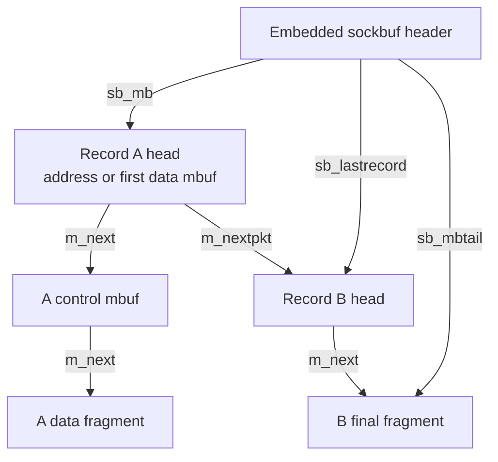
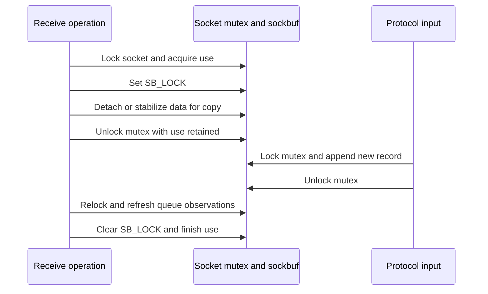
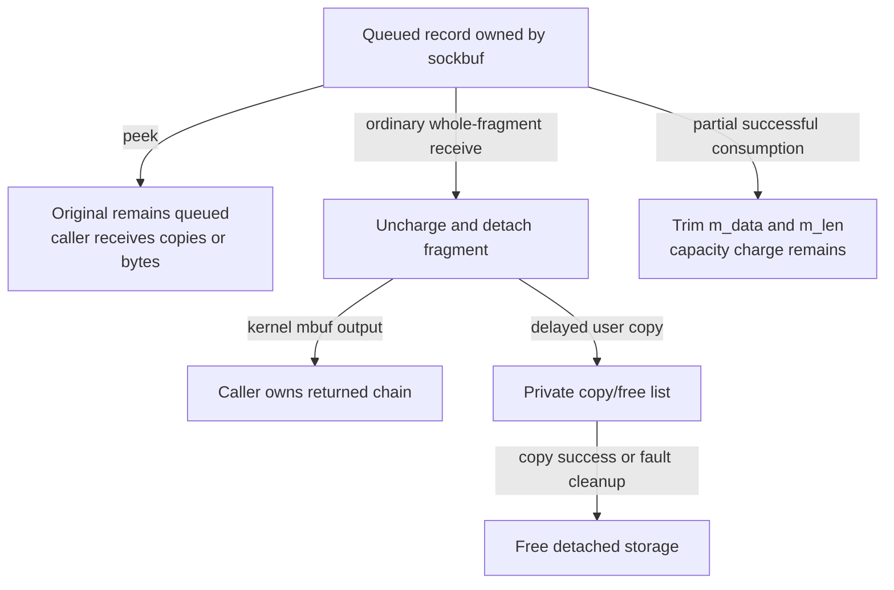
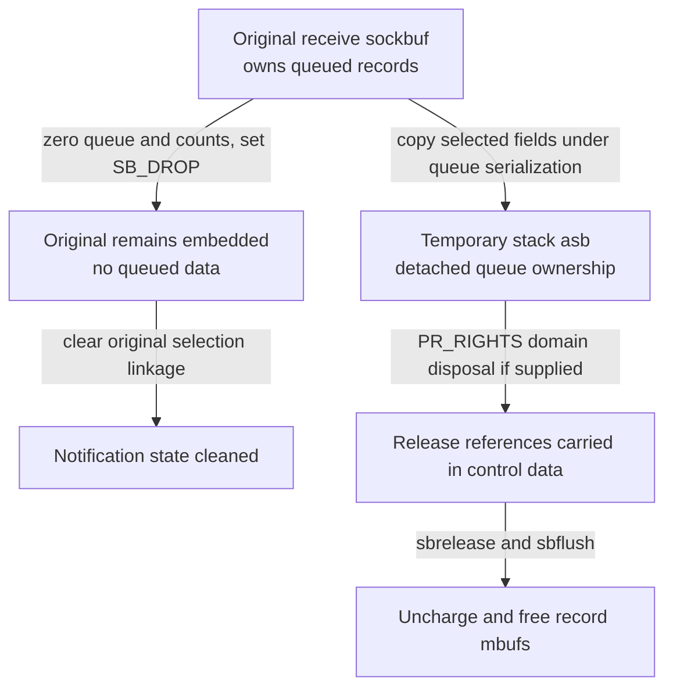

# Socket buffers and record queues

Each socket embeds two `sockbuf` headers. They own linked mbuf records and account separately for buffered bytes, non-data bytes and storage capacity. The headers are not the payload allocation, and their `SB_LOCK` flag is not the socket mutex. This chapter follows queue mutation, references across copy operations, limits and teardown in `xnu-12377.121.6`, commit `ac9718fb1af618d5ce8678d0dc6e8a58f252216f`.

[Key structures](README.md) · [Networking](../subsystems/networking/README.md) · [Sockets and protocol attachments](sockets-and-protocol-attachments.md) · [Mbuf storage](mbufs-and-external-storage.md) · [Internet PCBs](internet-pcbs-and-transport-storage.md)

The existing [socket I/O chapter](../subsystems/networking/socket-lifecycle-and-io.md) explains whole send/receive operations. Here the questions are narrower: which pointer names a record, when a queue owns an mbuf, which counters change when bytes move, and what remains safe while a syscall drops the socket mutex. See [content filtering](../subsystems/networking/socket-content-filtering.md) for queues that retain data outside `so_snd` and `so_rcv`.

Inspect the live [`sockbuf`](layout-browser.md?declaration=sockbuf) layout for the selected source profile.

## 1. Embedded headers, separately allocated records

`struct sockbuf` is declared within `struct socket`, with two instances named `so_rcv` and `so_snd`. The socket's zeroed allocation provides both headers; there is no separate sockbuf zone or independent sockbuf reference count on this path. Construction sets each `sb_so` back-pointer and marks the receive instance with `SB_RECV`. Reserving a buffer later changes limits, not the location of either header. [Layout](../../platydoc-data/xnu/bsd/sys/socketvar.h#L167-L192), [socket allocation](../../platydoc-data/xnu/bsd/kern/uipc_socket.c#L453-L467), [back-pointers](../../platydoc-data/xnu/bsd/kern/uipc_socket.c#L590-L593), [reservation](../../platydoc-data/xnu/bsd/kern/uipc_socket2.c#L806-L825).

Exact queue and accounting fields, [socketvar.h lines 167–180](../../platydoc-data/xnu/bsd/sys/socketvar.h#L167-L180):

<!-- source-excerpt: ../../platydoc-data/xnu/bsd/sys/socketvar.h#L167-L180 -->
```c
	struct sockbuf {
		uint32_t       sb_cc;          /* actual chars in buffer */
		uint32_t       sb_hiwat;       /* max actual char count */
		uint32_t       sb_mbcnt;       /* chars of mbufs used */
		uint32_t       sb_mbmax;       /* max chars of mbufs to use */
		uint32_t       sb_ctl;         /* non-data chars in buffer */
		uint32_t       sb_lowat;       /* low water mark */
		struct mbuf     *sb_mb;         /* the mbuf chain */
		struct mbuf     *sb_mbtail;     /* the last mbuf in the chain */
		struct mbuf     *sb_lastrecord; /* first mbuf of last record */
		struct socket   *sb_so;         /* socket back ptr for kexts */
		struct selinfo  sb_sel;         /* process selecting rd/wr */
		struct timeval  sb_timeo;       /* timeout for read/write */
		uint32_t       sb_flags;       /* flags, see below */
```

Mbufs use two link dimensions. `m_next` joins fragments within a record; `m_nextpkt` joins record heads. `sb_mb` is the first record head, `sb_lastrecord` the first mbuf of the last record, and `sb_mbtail` the final mbuf of that last record. The socket layer must move the next-record link when it consumes a record's first fragment. [Conventions](../../platydoc-data/xnu/bsd/kern/uipc_socket2.c#L731-L750), [append bookkeeping](../../platydoc-data/xnu/bsd/kern/uipc_socket2.c#L1279-L1308), [receive head replacement](../../platydoc-data/xnu/bsd/kern/uipc_socket.c#L3693-L3731).



The address/control nodes are optional. The actual address/control append helpers construct **one record** whose fragments can be address, control and data mbufs. Do not interpret the older convention comment's repeated word “record” as requiring a separate `m_nextpkt` record for each metadata fragment. `sbconcat_mbufs()` links control to payload through `m_next`, then optionally prepends an `MT_SONAME` mbuf; `sbappendchain()` adds that entire chain as one record. [Concatenation](../../platydoc-data/xnu/bsd/kern/uipc_socket2.c#L1211-L1270), [record insertion](../../platydoc-data/xnu/bsd/kern/uipc_socket2.c#L1279-L1308).

Stream sockets still use mbufs, but `sbappendstream()` requires one record: `sb_mb == sb_lastrecord`, and the incoming chain must not already have `m_nextpkt`. Datagram records retain boundaries. A zero-length record can exist, so `sb_cc == 0` alone does not establish an empty queue. [Stream checks](../../platydoc-data/xnu/bsd/kern/uipc_socket2.c#L982-L1001), [zero-length record support](../../platydoc-data/xnu/bsd/kern/uipc_socket2.c#L1166-L1188), [empty invariant](../../platydoc-data/xnu/bsd/kern/uipc_socket2.c#L1755-L1767).

## 2. Field groups and protection domains

| Fields/flags | Meaning | Access or lifetime rule |
| --- | --- | --- |
| `sb_cc`, `sb_ctl` | All buffered bytes; the non-data subset | `sballoc()` charges `m_len`; mbufs outside data/header/OOB-data types also contribute to `sb_ctl`. Thus application payload is not necessarily `sb_cc`. [Charge](../../platydoc-data/xnu/bsd/kern/uipc_socket2.c#L2432-L2442). |
| `sb_mbcnt` | Mbuf header plus external-storage capacity charge | Uses `m_capacity()`, not `m_len`. Partial data consumption normally leaves this charge unchanged until an mbuf leaves the buffer. [Capacity](../../platydoc-data/xnu/bsd/sys/mbuf.h#L1546-L1550), [partial drop](../../platydoc-data/xnu/bsd/kern/uipc_socket2.c#L1880-L1904). |
| `sb_hiwat`, `sb_mbmax` | Byte and storage thresholds | `sbreserve()` sets both; actual buffer space is constrained by the smaller remaining budget, with explicit exceptions. [Reserve](../../platydoc-data/xnu/bsd/kern/uipc_socket2.c#L806-L825), [space](../../platydoc-data/xnu/bsd/kern/uipc_socket2.c#L2298-L2328). |
| `sb_lowat`, `sb_idealsize`, `sb_preconn_hiwat` | Readiness threshold, sizing target and temporary preconnect bound | They are not amounts of already allocated payload. Connection completion clears the preconnect bound. [Fields](../../platydoc-data/xnu/bsd/sys/socketvar.h#L173-L189), [completion](../../platydoc-data/xnu/bsd/kern/uipc_socket2.c#L202-L206). |
| `sb_mb`, `sb_lastrecord`, `sb_mbtail` | First record, last record head and final fragment | Mutations maintain all applicable pointers under the socket protocol. Holding `SB_LOCK` alone does not exclude input appenders. [Address receive comment/body](../../platydoc-data/xnu/bsd/kern/uipc_socket.c#L2837-L2866). |
| `sb_so` | Non-retaining back-pointer to the enclosing socket | Needed for mutex selection, protocol accounting and callbacks. Operations must already have socket lifetime; it is not a standalone retain handle. [Wait lifetime assertions](../../platydoc-data/xnu/bsd/kern/uipc_socket2.c#L537-L556). |
| `SB_LOCK`, `sb_wantlock` | Queue-operation serialization and count of lock waiters | Managed while holding the selected socket mutex; waiting releases/reacquires that mutex. The flag can remain set while a data copy executes unlocked. [Acquire](../../platydoc-data/xnu/bsd/kern/uipc_socket2.c#L2489-L2589). |
| `sb_waiters`, `sb_timeo`, `SB_NOINTR` | Data/space waiters, timeout and interruptibility | `sbwait()` sleeps on `&sb_cc`, independently of the queue-lock wait event. It does not reserve data or space on wakeup. [Wait](../../platydoc-data/xnu/bsd/kern/uipc_socket2.c#L537-L608). |
| `sb_sel`, `SB_SEL`, `SB_ASYNC`, `SB_KNOTE` | Select linkage, asynchronous and knote notification state | Wait-queue linkage cannot be copied into an independent cleanup header and cleared there. Wakeups notify observers; they do not transfer a record. [Wakeup](../../platydoc-data/xnu/bsd/kern/uipc_socket2.c#L625-L648), [flush restriction](../../platydoc-data/xnu/bsd/kern/uipc_socket.c#L4488-L4495). |
| `sb_upcall`, `sb_upcallarg`, `SB_UPCALL`, `SB_UPCALL_LOCK` | Optional kernel callback and invocation mode | The socket's upcall count/close policy governs unlocked callback lifetime. See the [socket companion](sockets-and-protocol-attachments.md#7-upcalls-have-a-separate-close-handshake). [Dispatch](../../platydoc-data/xnu/bsd/kern/uipc_socket2.c#L649-L705). |
| `sb_cfil_thread`, `sb_cfil_refs` | Content-filter owner and nesting | The filter acquisition API sets the thread and `SB_LOCK`; nested calls by that owner preserve ownership. These are not general send/receive recursion counters. [Filter acquire/release](../../platydoc-data/xnu/bsd/net/content_filter.c#L1548-L1647). |
| `sb_sendhead`, `sb_sendoff`, `SB_SENDHEAD` | Cached send traversal position | TCP attach enables the feature. Drop/free invalidate or adjust it; it is distinct from record head/tail. [TCP setup](../../platydoc-data/xnu/bsd/netinet/tcp_usrreq.c#L171-L175), [drop adjustments](../../platydoc-data/xnu/bsd/kern/uipc_socket2.c#L1856-L1901), [free adjustment](../../platydoc-data/xnu/bsd/kern/uipc_socket2.c#L2475-L2481). |
| `SB_DROP`, `SB_UNIX`, `SB_KCTL`, `SB_NOCOMPRESS`, `SB_LIMITED` | Append prohibition and queue/type/limit variants | Read the helper body: UNIX capacity bypasses and control ownership differ; kernel-control space ignores the storage-budget branch; compression can be disabled. [Flags](../../platydoc-data/xnu/bsd/sys/socketvar.h#L197-L214), [space](../../platydoc-data/xnu/bsd/kern/uipc_socket2.c#L2303-L2308), [record append](../../platydoc-data/xnu/bsd/kern/uipc_socket2.c#L1110-L1129). |

The header has no embedded lock that protects all of these fields in isolation. Socket operations use the mutex selected by `so_proto`; `SB_LOCK` adds a separate rule for overlapping operations that may drop that mutex. Protocol/feature helpers may have additional locking or ownership requirements. [Mutex selection](../../platydoc-data/xnu/bsd/kern/uipc_socket.c#L7227-L7255), [sockbuf lock implementation](../../platydoc-data/xnu/bsd/kern/uipc_socket2.c#L2489-L2589).

## 3. Reservation configures budgets; it does not preallocate payload

`sbreserve(sb, cc)` clamps requests above `sb_max`, but returns zero if already at that maximum and the overlarge request would not change it. `SB_LIMITED` prevents growth beyond the current high-water mark. Success sets `sb_hiwat = cc`, `sb_mbmax = cc * sb_efficiency`, clips low-water if necessary and returns one. A zero result is failure for this helper; `soreserve()` translates it into `ENOBUFS`. [Reserve body](../../platydoc-data/xnu/bsd/kern/uipc_socket2.c#L806-L825), [two-buffer wrapper](../../platydoc-data/xnu/bsd/kern/uipc_socket2.c#L760-L790).

Exact budget installation, [uipc_socket2.c lines 818–824](../../platydoc-data/xnu/bsd/kern/uipc_socket2.c#L818-L824):

<!-- source-excerpt: ../../platydoc-data/xnu/bsd/kern/uipc_socket2.c#L818-L824 -->
```c
	sb->sb_hiwat = cc;
	sb->sb_mbmax = cc * sb_efficiency;
	if (sb->sb_lowat > sb->sb_hiwat) {
		sb->sb_lowat = sb->sb_hiwat;
	}
	return 1;
}
```

`soreserve()` reserves send first, then receive, and records each requested ideal size. Receive-reservation failure clears send selection state and releases the send reservation. On success, default receive low-water is one byte; send low-water defaults to `MCLBYTES`, clipped to send high-water. No mbuf chain is allocated by either reservation helper. This is also stated in the surrounding source comment, which says reservation currently enforces limits rather than committing pool storage. [Wrapper/unwind](../../platydoc-data/xnu/bsd/kern/uipc_socket2.c#L760-L790), [comment](../../platydoc-data/xnu/bsd/kern/uipc_socket2.c#L746-L750).

For ordinary buffers, `sbspace()` takes the minimum of byte headroom and storage headroom. `SB_KCTL` uses byte headroom alone. A nonzero preconnect high-water imposes another minimum. Negative intermediate space is clipped to zero, then content-filter pending-space accounting is subtracted with saturation. This is an instantaneous calculation under its caller's synchronization, not a reservation for the next sender. [Space computation](../../platydoc-data/xnu/bsd/kern/uipc_socket2.c#L2298-L2328).

Exact primary space calculation, [uipc_socket2.c lines 2303–2315](../../platydoc-data/xnu/bsd/kern/uipc_socket2.c#L2303-L2315):

<!-- source-excerpt: ../../platydoc-data/xnu/bsd/kern/uipc_socket2.c#L2303-L2315 -->
```c
	if (sb->sb_flags & SB_KCTL) {
		space = (int)(sb->sb_hiwat - sb->sb_cc);
	} else {
		space = imin((int)(sb->sb_hiwat - sb->sb_cc),
		    (int)(sb->sb_mbmax - sb->sb_mbcnt));
	}
	if (sb->sb_preconn_hiwat != 0) {
		space = imin((int)(sb->sb_preconn_hiwat - sb->sb_cc), space);
	}

	if (space < 0) {
		space = 0;
	}
```

The initialized `sb_efficiency` is 8 in this source, with a writable sysctl; the worked example below explicitly selects that value rather than treating it as a permanent runtime constant. Protocols can also resize/autosize buffers. Reducing a threshold does not itself remove already queued bytes, so occupancy and configured limits need not always be ordered as `used <= limit`. [Defaults](../../platydoc-data/xnu/bsd/kern/uipc_socket2.c#L143-L146), [sysctl](../../platydoc-data/xnu/bsd/kern/uipc_socket2.c#L2975-L2978), [reserve assignment](../../platydoc-data/xnu/bsd/kern/uipc_socket2.c#L818-L824).

Read/write readiness adds conditions beyond `sbspace()`: receive readiness can come from low-water bytes, EOF, a completed accept child or an error; write readiness considers shutdown/error, interface feedback, connection state, preconnect data and selected not-sent thresholds. The connected-UNIX case also observes the peer receive-buffer space. A readiness indication is not ownership of bytes or capacity. [Read readiness](../../platydoc-data/xnu/bsd/kern/uipc_socket2.c#L2339-L2348), [write readiness](../../platydoc-data/xnu/bsd/kern/uipc_socket2.c#L2354-L2417).

## 4. Logical bytes and storage charges: a numeric example

`sballoc()` is an accounting helper, despite its name: it does not allocate or link an mbuf. It adds `m_len` to `sb_cc`, adds non-data lengths to `sb_ctl`, and adds `m_capacity(m)` to `sb_mbcnt` and protocol memory accounting. `sbfree()` performs the inverse accounting and selected send-cursor/statistics updates; its caller still owns the actual unlink/free/transfer operation. [Charge/uncharge](../../platydoc-data/xnu/bsd/kern/uipc_socket2.c#L2432-L2481).

Exact charge, [uipc_socket2.c lines 2432–2442](../../platydoc-data/xnu/bsd/kern/uipc_socket2.c#L2432-L2442):

<!-- source-excerpt: ../../platydoc-data/xnu/bsd/kern/uipc_socket2.c#L2432-L2442 -->
```c
sballoc(struct sockbuf *sb, struct mbuf *m)
{
	int mbcnt = m_capacity(m);

	sb->sb_cc += m->m_len;
	if (!m_has_mtype(m, MTF_DATA | MTF_HEADER | MTF_OOBDATA)) {
		sb->sb_ctl += m->m_len;
	}

	sb->sb_mbcnt += mbcnt;
	proto_memacct_add(sb->sb_so->so_proto, mbcnt);
```

The capacity helper counts the mbuf header plus the full external allocation size, if present. It does not count only remaining trailing room or only the referenced payload span. [Capacity helper](../../platydoc-data/xnu/bsd/sys/mbuf.h#L1546-L1550).

Exact capacity expression, [mbuf.h lines 1546–1550](../../platydoc-data/xnu/bsd/sys/mbuf.h#L1546-L1550):

<!-- source-excerpt: ../../platydoc-data/xnu/bsd/sys/mbuf.h#L1546-L1550 -->
```c
static inline int
m_capacity(const struct mbuf *m)
{
	return _MSIZE + ((m->m_flags & M_EXT) ? m->m_ext.ext_size : 0);
}
```

Select `CONFIG_MBUF_MCACHE`, giving `_MSIZE = 256`, and two distinct 2048-byte external allocations for the data fragments. These numbers describe mbuf allocation/accounting, not VM page size or network MTU. Assume no compression, filters or other records, a 4096-byte high-water mark and efficiency 8. [Header-size alternatives](../../platydoc-data/xnu/bsd/sys/mbuf.h#L96-L110).

| Fragment in one record | `m_len` | Contribution to `sb_ctl` | Contribution to `sb_mbcnt` |
| --- | ---: | ---: | ---: |
| `MT_SONAME`, inline | 16 | 16 | 256 |
| `MT_CONTROL`, inline | 32 | 32 | 256 |
| Data, 2048-byte external storage | 1000 | 0 | 2304 |
| Data, separate 2048-byte external storage | 600 | 0 | 2304 |
| Total | 1648 | 48 | 5120 |

Application data contributes 1600 bytes, whereas `sb_cc` is 1648. `sb_mbmax` is 32768, so ordinary `sbspace()` is `min(4096 - 1648, 32768 - 5120) = 2448`, before preconnect or filter adjustments. The queue's accounting charge is not necessarily unique physical memory consumption: two mbufs sharing external backing can each be charged by the capacity expression. External-reference sharing belongs to the [mbuf companion](mbufs-and-external-storage.md).

Now consume metadata and payload in stages:

| Mutation | `sb_cc` | `sb_ctl` | `sb_mbcnt` | Storage consequence |
| --- | ---: | ---: | ---: | --- |
| Initial record | 1648 | 48 | 5120 | Four mbufs accounted |
| Remove both metadata mbufs | 1600 | 0 | 4608 | Two inline headers leave the buffer |
| Consume 300 bytes of first data mbuf | 1300 | 0 | 4608 | Advance `m_data`, shorten `m_len`; both external capacities still charged |
| Consume its remaining 700 bytes | 600 | 0 | 2304 | First data mbuf leaves; header/external charge removed |
| Consume final 600 bytes | 0 | 0 | 0 | Last data mbuf leaves; queue pointers repaired to empty |

These transitions follow metadata removal, partial data trim and full-mbuf uncharge. “Leaves the buffer” may mean freeing, transfer to a kernel caller, or temporary detached ownership; `sb_mbcnt` falling does not alone prove the backing allocation has been physically freed. [Metadata removal](../../platydoc-data/xnu/bsd/kern/uipc_socket.c#L3031-L3057), [full/partial receive](../../platydoc-data/xnu/bsd/kern/uipc_socket.c#L3690-L3762), [drop accounting](../../platydoc-data/xnu/bsd/kern/uipc_socket2.c#L1880-L1910).

## 5. Append helpers differ in capacity checks and failure ownership

An append is not just assigning `sb_mbtail->m_next`. The helper must preserve record links, charge each retained mbuf, maintain end-of-record flags and apply any filter/ownership contract. In particular, several functions return a boolean-like zero after consuming or freeing input. A failed append result does not universally mean the caller still owns its chain. [Common append](../../platydoc-data/xnu/bsd/kern/uipc_socket2.c#L901-L964), [address append](../../platydoc-data/xnu/bsd/kern/uipc_socket2.c#L1320-L1415).

| Helper | Queue mutation | Important boundary |
| --- | --- | --- |
| `sbappend()` | Extends the current final record using `sbcompress()`; starts a new record if the current tail has `M_EOR` | Ordinary failure/drop paths can free input. `_nodrop` variants preserve input on their selected drop/capacity failures; Internet-filter paths assert ordinary ownership. [Body](../../platydoc-data/xnu/bsd/kern/uipc_socket2.c#L901-L976). |
| `sbappendstream()` | Optimized single-record append, then sets `sb_lastrecord = sb_mb` | Rejects incoming record linkage or a multi-record existing queue; it does not itself perform a generic `sbspace()` admission test. [Body](../../platydoc-data/xnu/bsd/kern/uipc_socket2.c#L982-L1041). |
| `sbappendrecord()` | Starts a new record, charges its first mbuf and compresses remaining fragments | Checks aggregate lengths against space except for `SB_UNIX`; permits zero-length records. [Body](../../platydoc-data/xnu/bsd/kern/uipc_socket2.c#L1102-L1195). |
| `sbconcat_mbufs()` | Builds address → control → data fragment chain | Checks space if a sockbuf is supplied. A failed address-header allocation restores control/data separation before returning null. No queue insertion or charge occurs yet. [Body](../../platydoc-data/xnu/bsd/kern/uipc_socket2.c#L1211-L1270). |
| `sbappendchain()` | Charges all fragments and links one new record | The inspected body has no `sbspace()` or `SB_DROP` check, despite a broader nearby comment. Its caller supplies prior admission. [Body](../../platydoc-data/xnu/bsd/kern/uipc_socket2.c#L1279-L1308). |
| `sbappendaddr()` | Filters input, constructs the address/control/data chain, then calls `sbappendchain()` | Failure frees data and ordinarily control; `SB_UNIX` preserves control for its caller's rights-disposal protocol. `EJUSTRETURN` means filter consumption. [Body](../../platydoc-data/xnu/bsd/kern/uipc_socket2.c#L1320-L1415). |
| `sbappendcontrol()` | Filters input, then adds a control-led record through its internal helper | Similar UNIX control-ownership distinction; internal helper checks space except for UNIX buffers. [Internal/wrapper](../../platydoc-data/xnu/bsd/kern/uipc_socket2.c#L1439-L1574). |

Exact record insertion in `sbappendchain()`, [uipc_socket2.c lines 1296–1302](../../platydoc-data/xnu/bsd/kern/uipc_socket2.c#L1296-L1302):

<!-- source-excerpt: ../../platydoc-data/xnu/bsd/kern/uipc_socket2.c#L1296-L1302 -->
```c
	if (sb->sb_lastrecord != NULL) {
		sb->sb_lastrecord->m_nextpkt = m;
	} else {
		sb->sb_mb = m;
	}
	sb->sb_lastrecord = m;
	sb->sb_mbtail = nlast;
```

The filter calls can replace input pointers or retain data outside the sockbuf. On `EJUSTRETURN`, the append helper avoids freeing the consumed chain. `M_SKIPCFIL` lets the applicable reinjection path bypass repeated filtering and is cleared by the helper. These paths are why “append returned zero” and “nothing took ownership” are different statements. [Stream filter handoff](../../platydoc-data/xnu/bsd/kern/uipc_socket2.c#L1004-L1033), [address handoff](../../platydoc-data/xnu/bsd/kern/uipc_socket2.c#L1354-L1392), [filter queue ownership](../subsystems/networking/socket-content-filtering.md#5-multiple-filters-and-a-numeric-example).

### Compression changes storage topology without losing byte accounting

`sbcompress(sb, incoming, tail)` can discard selected zero-length mbufs, merge a small same-type fragment into trailing space, or link an unmerged fragment and call `sballoc()`. It accumulates `M_EOR` and reapplies it to the final retained fragment, while keeping `sb_mbtail` current. The normal whole-fragment merge requires compression enabled, a prior fragment without `M_EOR`, compatible type, enough trailing space and a bounded copy size. [Compression](../../platydoc-data/xnu/bsd/kern/uipc_socket2.c#L1652-L1752).

Exact merged-byte accounting, [uipc_socket2.c lines 1682–1688](../../platydoc-data/xnu/bsd/kern/uipc_socket2.c#L1682-L1688):

<!-- source-excerpt: ../../platydoc-data/xnu/bsd/kern/uipc_socket2.c#L1682-L1688 -->
```c
			bcopy(mtod(m, caddr_t), mtod(n, caddr_t) + n->m_len,
			    (unsigned)m->m_len);
			n->m_len += m->m_len;
			sb->sb_cc += m->m_len;
			if (!m_has_mtype(m, MTF_DATA | MTF_HEADER | MTF_OOBDATA)) {
				sb->sb_ctl += m->m_len;
			}
```

Suppose one already charged inline data mbuf contains 100 bytes and has room for a 60-byte incoming same-type fragment, with the other merge conditions met. The resulting fragment holds 160 bytes; `sb_cc` rises by 60, while `sb_mbcnt` stays at one header's charge. The incoming mbuf is freed without ever receiving its own sockbuf capacity charge. This is not a `sballoc()` followed by `sbfree()` pair for the incoming fragment. [Merge/free](../../platydoc-data/xnu/bsd/kern/uipc_socket2.c#L1678-L1698).

There is also a memory-pressure branch that can copy a prefix into trailing space before linking a remainder. Its own accounting and send-statistic updates must be read directly rather than inferred from the ordinary whole-fragment case. The numeric examples here select the ordinary branch. `SB_NOCOMPRESS` disables the merge/discard decisions while retaining queue insertion/accounting. [Pressure branch and insertion](../../platydoc-data/xnu/bsd/kern/uipc_socket2.c#L1700-L1741).

## 6. Socket mutex, queue ownership and waiting are different operations

`sblock()` expects the caller's socket context and acquires the `SB_LOCK` protocol, not a separate mutex. If busy without `SBL_WAIT`, it returns `EWOULDBLOCK`. Otherwise it waits while the flag is held or another content-filter thread owns the buffer, using the protocol-selected socket mutex in `msleep()`. It tracks `sb_wantlock` around sleep and sets `SB_LOCK` on successful acquisition. Signal/defunct errors can return without ownership. [Acquire](../../platydoc-data/xnu/bsd/kern/uipc_socket2.c#L2489-L2589).

The wait event uses the **real embedded** receive/send `sb_flags` address from `sb_so`, not necessarily the `sb_flags` address of the argument. That matters because receive flush can pass a temporary stack sockbuf containing detached queue state. [Event selection](../../platydoc-data/xnu/bsd/kern/uipc_socket2.c#L2531-L2537).



The diagram shows why `SB_LOCK` is not a freeze on input. Appenders synchronize with the socket mutex and need not acquire `SB_LOCK`. A receiver can serialize against other receivers while still allowing new records. An unlocked copy must preserve its own fragment lifetime and reconsider queue observations after returning. The source states this explicitly in the address-receive path. [Detach-before-unlock explanation](../../platydoc-data/xnu/bsd/kern/uipc_socket.c#L2837-L2866).

`sbwait()` instead waits for data/space on `&sb_cc`, using `sb_timeo` and `SB_NOINTR`. It requires a positive socket use count, records `sb_waiters`, and checks draining/defunct state before and after sleeping. The caller decides whether to retain `SB_LOCK`: the send-capacity path releases queue ownership before waiting and retries admission; receive wait-all can retain its serialization while awaiting more data. [Wait body](../../platydoc-data/xnu/bsd/kern/uipc_socket2.c#L537-L608), [send retry](../../platydoc-data/xnu/bsd/kern/uipc_socket.c#L1950-L1985), [receive wait-all](../../platydoc-data/xnu/bsd/kern/uipc_socket.c#L3778-L3854).

Exact data/space wait, [uipc_socket2.c lines 580–588](../../platydoc-data/xnu/bsd/kern/uipc_socket2.c#L580-L588):

<!-- source-excerpt: ../../platydoc-data/xnu/bsd/kern/uipc_socket2.c#L580-L588 -->
```c
	sb->sb_waiters++;
	VERIFY(sb->sb_waiters != 0);

	error = msleep((caddr_t)&sb->sb_cc, mutex_held,
	    nointr ? PSOCK : PSOCK | PCATCH,
	    nointr ? "sbwait_nointr" : "sbwait", &ts);

	VERIFY(sb->sb_waiters != 0);
	sb->sb_waiters--;
```

`sbunlock(sb, TRUE)` normally clears the queue lock and wakes lock waiters while keeping the socket mutex held. `FALSE` also releases the operation's socket use/mutex through its selected branch. Content-filter ownership is an exception: nested generic calls by `sb_cfil_thread` preserve the flag, with the filter's last-release helper clearing ownership. Read the boolean as “keep the socket locked,” not “keep `SB_LOCK` set.” [Unlock body](../../platydoc-data/xnu/bsd/kern/uipc_socket2.c#L2595-L2668), [filter last release](../../platydoc-data/xnu/bsd/net/content_filter.c#L1617-L1647).

## 7. Receive can borrow, copy, detach or transfer the same mbuf shape

The queue's links do not encode how the caller will consume data. `soreceive()` selects different lifetimes according to `MSG_PEEK`, the presence of an output mbuf pointer, fragment size and delayed-copy eligibility. [Receive loop](../../platydoc-data/xnu/bsd/kern/uipc_socket.c#L3596-L3762).

| Mode | Queued record state | Lifetime outside the mutex |
| --- | --- | --- |
| Immediate user copy | Current fragment remains queued until successful copy handling trims/removes it | Socket use and queue-operation protocol remain held while `uiomove()` runs unlocked. [Copy](../../platydoc-data/xnu/bsd/kern/uipc_socket.c#L3638-L3684). |
| Delayed whole-fragment copy | Fully consumed fragments are uncharged and detached into a private free list | `sodelayed_copy()` copies and frees that detached list while unlocked; error cannot restore already detached records. [Detach](../../platydoc-data/xnu/bsd/kern/uipc_socket.c#L3693-L3731), [copy/free](../../platydoc-data/xnu/bsd/kern/uipc_socket.c#L3962-L3984). |
| Kernel mbuf output | Whole fragments leave the queue and are linked to the caller's output | Ownership transfers rather than immediately freeing the mbuf. A partial fragment uses `m_copym()` and can share external storage according to mbuf rules. [Output branches](../../platydoc-data/xnu/bsd/kern/uipc_socket.c#L3697-L3762). |
| `MSG_PEEK` | Data fragments remain queued; local offsets advance | Returned metadata is duplicated. Peeking is not externalizing UNIX rights into descriptors. [Peek data](../../platydoc-data/xnu/bsd/kern/uipc_socket.c#L3694-L3700), [peek controls](../../platydoc-data/xnu/bsd/kern/uipc_socket.c#L2991-L3030). |

After a delayed copy drops/reacquires the mutex, receive compares its expected fragment with `so_rcv.sb_mb`. A mismatch can mean protocol/reset work changed the stream, so it stops rather than continuing from an old queue assumption. Partial kernel-output copy failure restores the residual count for that attempted copy and leaves those bytes queued. These are different failure contracts. [Revalidation](../../platydoc-data/xnu/bsd/kern/uipc_socket.c#L3656-L3680), [partial-copy failure](../../platydoc-data/xnu/bsd/kern/uipc_socket.c#L3741-L3756).



Metadata has its own detach boundaries. Before an unlocked MAC receive check, `soreceive_addr()` temporarily removes and uncharges the whole record. After the check succeeds and the post-lock defunct recheck passes, it recharges and reinserts the record before records that arrived meanwhile. A denied record is freed; if the socket became defunct while unlocked, the detached record is also freed and the helper returns `ENOTCONN`. `soreceive_ctl()` detaches all leading control fragments before potentially unlocking for rights externalization and refreshes next-record state afterward. [Address detach/reinsert](../../platydoc-data/xnu/bsd/kern/uipc_socket.c#L2837-L2910), [control detach](../../platydoc-data/xnu/bsd/kern/uipc_socket.c#L2983-L3057), [externalization/revalidation](../../platydoc-data/xnu/bsd/kern/uipc_socket.c#L3061-L3121).

For a rights peek, `m_dup()` creates control copies and `sopeek_scm_rights()` clears their internal file-pointer payload; the original remains queued and no descriptor externalization is performed. If duplication fails, copies already created are freed. Final userspace address/control copyout can fail after ordinary payload consumption, so the syscall result is not a transaction over payload and all metadata. [Peek sanitation](../../platydoc-data/xnu/bsd/kern/uipc_socket.c#L2949-L2963), [duplication failure](../../platydoc-data/xnu/bsd/kern/uipc_socket.c#L2991-L3030), [operation discussion](../subsystems/networking/socket-lifecycle-and-io.md#receiving-dequeue-is-separate-from-userspace-copyout).

## 8. Drop and flush repair topology before releasing storage

`sbdrop(sb, len)` consumes bytes from the front, crossing record boundaries as necessary. A partial first surviving mbuf has `m_data` advanced and `m_len`, `sb_cc` and applicable `sb_ctl` reduced; its capacity stays charged. Fully removed mbufs are uncharged, pruned into a free list and freed together. The surviving first fragment inherits the next-record pointer, and the helper repairs empty/last-record state. TCP send-cursor and conditional MPTCP hooks are separate branches. [Drop implementation](../../platydoc-data/xnu/bsd/kern/uipc_socket2.c#L1830-L1937).

`sbdroprecord()` removes the entire first record regardless of its total byte count, uncharges/frees each fragment and applies empty-buffer fixup. This distinction matters for zero-length fragments, datagram truncation and control-bearing records. Neither helper is a public validation wrapper for arbitrary raw pointers; its caller supplies a consistent queue and synchronization. [Record drop](../../platydoc-data/xnu/bsd/kern/uipc_socket2.c#L1944-L1959), [empty fixup](../../platydoc-data/xnu/bsd/sys/socketvar.h#L674-L680).

`sbflush()` acquires queue serialization with wait, noninterruptible and ignore-defunct flags, then repeatedly calls `sbdrop()` while storage remains. Its loop handles zero-length mbufs and ends with `sb_empty_assert()`, which checks zero byte/storage counts and null head/tail/last-record pointers. It releases queue ownership while retaining the socket mutex. `sbrelease()` adds clearing the high-water/storage limits. [Flush](../../platydoc-data/xnu/bsd/kern/uipc_socket2.c#L1772-L1819), [assertion](../../platydoc-data/xnu/bsd/kern/uipc_socket2.c#L1755-L1767), [release](../../platydoc-data/xnu/bsd/kern/uipc_socket2.c#L831-L837).

### Receive flush uses a temporary ownership container

`sorflush()` cannot blindly copy a sockbuf and call cleanup on both copies. It marks receive shutdown, takes queue serialization, then copies only the queue/accounting fields needed by release into a zeroed stack-local `asb`. It excludes select/wait-queue linkage and clears notification/queue-lock bits in the copy. The original's counts, queue pointers, limits and callback fields are reset and `SB_DROP` prevents further appends. [Flush preparation/transfer](../../platydoc-data/xnu/bsd/kern/uipc_socket.c#L4452-L4532).

Exact transfer of queue associations, [uipc_socket.c lines 4502–4508](../../platydoc-data/xnu/bsd/kern/uipc_socket.c#L4502-L4508):

<!-- source-excerpt: ../../platydoc-data/xnu/bsd/kern/uipc_socket.c#L4502-L4508 -->
```c
	asb.sb_mb               = sb->sb_mb;
	asb.sb_mbtail           = sb->sb_mbtail;
	asb.sb_lastrecord       = sb->sb_lastrecord;
	asb.sb_so               = sb->sb_so;
	asb.sb_flags            = sb->sb_flags;
	asb.sb_flags            &= ~(SB_LOCK | SB_SEL | SB_KNOTE | SB_UPCALL);
	asb.sb_flags            |= SB_DROP;
```



After resetting the original, the function clears selection linkage on the **original** `sb_sel`. If the protocol supports rights and supplies `dom_dispose`, it disposes references carried by the detached queue before calling `sbrelease(&asb)`. This is why freeing mbuf storage alone is insufficient for UNIX rights: queued fileglob references require their domain cleanup. [Final flush/disposal](../../platydoc-data/xnu/bsd/kern/uipc_socket.c#L4534-L4551), [fileglob message ownership](fileprocs-and-fileglobs.md#9-unix-messages-and-fileports-keep-fileglobs-without-original-slots).

The temporary `asb` is not a new socket buffer with independent ownership of the same records. It becomes the cleanup container after the original relinquishes those links. Its `sb_so` still routes accounting and waits to the enclosing socket; the real-buffer wait-channel selection in `sblock()`/`sbunlock()` is part of supporting this representation. [Wait-channel rule](../../platydoc-data/xnu/bsd/kern/uipc_socket2.c#L2531-L2537), [unlock wakeup rule](../../platydoc-data/xnu/bsd/kern/uipc_socket2.c#L2635-L2645).

Send flush is simpler: `sowflush()` obtains queue serialization, disables select/upcalls, sets `SB_DROP`, clears callback pointers, releases queue serialization, clears selection linkage and calls `sbrelease()` on the embedded send header. Whole socket teardown invokes both flushes only after its protocol/owner/accept-queue gates permit them. [Send flush](../../platydoc-data/xnu/bsd/kern/uipc_socket.c#L4426-L4449), [socket cleanup gate](../../platydoc-data/xnu/bsd/kern/uipc_socket.c#L1012-L1077).

## 9. Filter-retained data and transport state are additional owners

Data can have left the local send constructor without being linked into `so_snd`, because a content filter retained it. Conversely, TCP send data can remain in `so_snd` after packets have been emitted, because retransmission/acknowledgment processing still needs it. A socket-buffer queue is not an interface transmit queue, and an empty queue is not proof of peer application delivery. [Protocol consumption boundary](../../platydoc-data/xnu/bsd/kern/uipc_socket.c#L2445-L2462), [TCP send](../../platydoc-data/xnu/bsd/netinet/tcp_usrreq.c#L1153-L1218), [transport lifecycle](../subsystems/networking/tcp-connections-and-timers.md).

With content filtering, `sbspace()` subtracts `cfil_sock_data_space()`. For TCP that helper uses the larger of pending logical bytes and pending mbuf-capacity charge; the separate `cfil_sock_data_pending()` uses the smaller and serves different readiness/close decisions. Reinjection by the current filter send owner has an exemption to avoid charging its own data twice. Datagram helpers aggregate flow state. Do not replace these calls with a subtraction of `sb_cc` or treat filter cursors as another sockbuf fragment list. [Space adjustment](../../platydoc-data/xnu/bsd/kern/uipc_socket2.c#L2318-L2326), [filter helpers](../../platydoc-data/xnu/bsd/net/content_filter.c#L5786-L5864), [accounting explanation](../subsystems/networking/socket-content-filtering.md#9-held-bytes-still-consume-socket-capacity).

`SB_LOCK`, content-filter ownership, a socket use, a PCB wanted reference and an external mbuf reference each protect a different thing. The existing [filter lock/reference walkthrough](../subsystems/networking/socket-content-filtering.md#11-lock-ordering-and-references-across-waits) and [PCB companion](internet-pcbs-and-transport-storage.md) explain the additional handoffs when a flow/controller lookup reaches a socket.

## 10. How to follow an unfamiliar queue mutation

1. Identify the enclosing socket and the selected protocol mutex. Establish the socket lifetime across every unlock or wait.
2. Draw `m_next` within each record and `m_nextpkt` between record heads. Mark all three sockbuf queue pointers.
3. Write down logical bytes, non-data bytes and `m_capacity()` charges separately. Account for zero-length and shared-external-storage cases.
4. Identify whether a helper merely computes space, charges an mbuf, links a record, transfers ownership or frees storage. Its name alone is insufficient.
5. Follow every branch returning zero/error, including filters and `_nodrop`/UNIX variants, to determine who still owns each chain and any embedded rights.
6. At a lock drop, distinguish private detached data from queued data and identify the revalidation on return.
7. At teardown, separate notification-link cleanup, domain reference disposal, queue uncharge, mbuf free and the enclosing socket's final zone release.

The examples select the common single-message send/receive representation and stated allocator configuration. Batched receive/send, MPTCP mapping, kernel-control queues, all ancillary formats and provider-specific zero-copy paths have further contracts. The [mbuf companion](mbufs-and-external-storage.md) supplies the external allocation/reference rules; the [socket companion](sockets-and-protocol-attachments.md) supplies the allocation and callback lifetime around these embedded headers.

<!-- BEGIN PLATYDOC DOCUMENTATION LICENSE -->
Original Platydoc text and diagrams are licensed under [CC BY 4.0](https://creativecommons.org/licenses/by/4.0/). Quoted source code and third-party material retain their respective licenses.
<!-- END PLATYDOC DOCUMENTATION LICENSE -->
