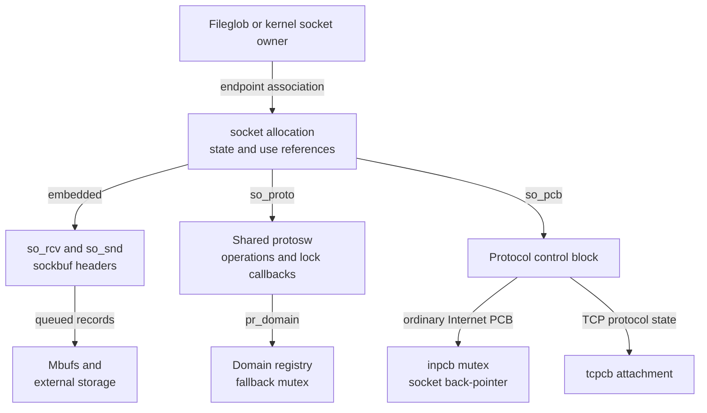
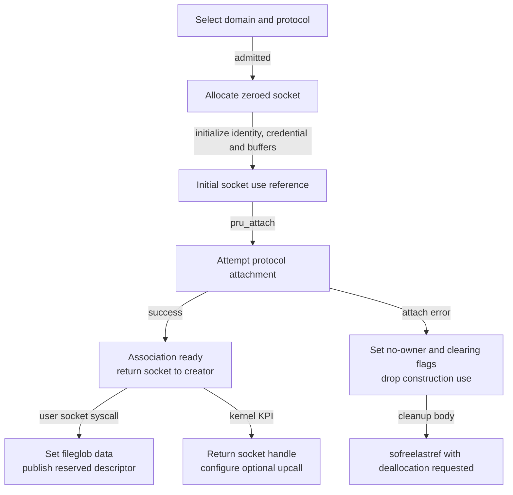
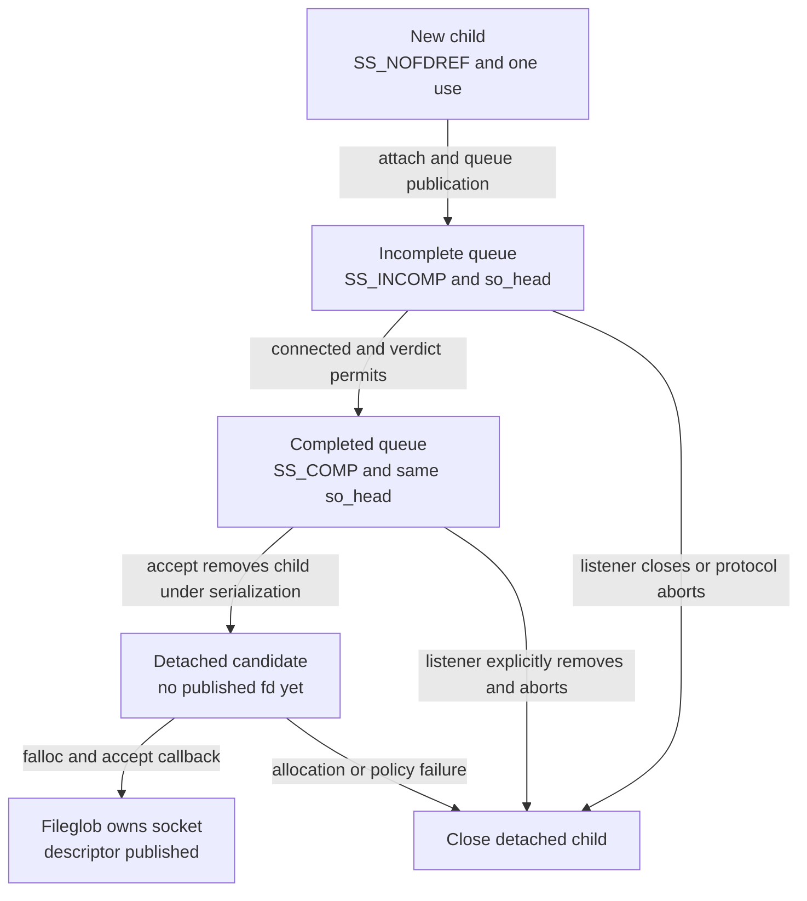
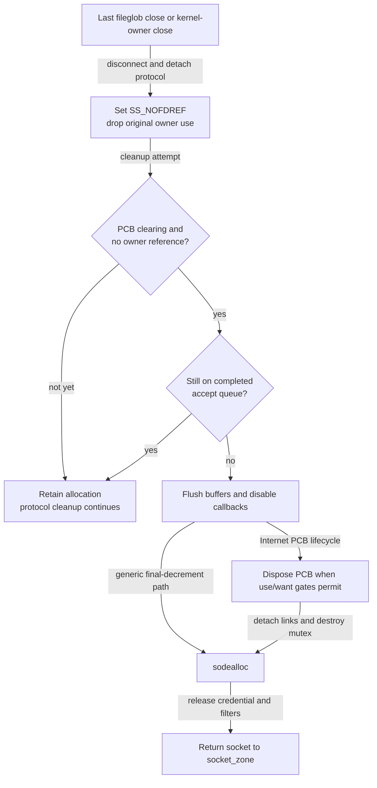

# Sockets and protocol attachments

A socket holds endpoint state, two embedded buffers, connection queues and the association to a protocol implementation. Its descriptor, protocol control blocks and queued data have separate allocations and lifetimes. This chapter follows the socket record through construction, reference acquisition, listener publication and final disposal in `xnu-12377.121.6`, commit `ac9718fb1af618d5ce8678d0dc6e8a58f252216f`.

[Key structures](README.md) · [Networking](../subsystems/networking/README.md) · [Socket buffers](socket-buffers-and-record-queues.md) · [Internet PCBs](internet-pcbs-and-transport-storage.md) · [Fileprocs and fileglobs](fileprocs-and-fileglobs.md)

Use [socket lifetime and I/O](../subsystems/networking/socket-lifecycle-and-io.md) for send/receive algorithms, [TCP connections](../subsystems/networking/tcp-connections-and-timers.md) for handshake/timer transitions, and [content filtering](../subsystems/networking/socket-content-filtering.md) for deferred policy ownership. Here the emphasis is on what a socket pointer owns, which lock a caller actually acquires, and why detach, close and storage release are different events.

## 1. One allocation, several separately owned associations

`struct socket` embeds `so_rcv` and `so_snd`; it contains no universal socket mutex. The protocol's `pr_getlock`/`pr_lock`/`pr_unlock` callbacks select synchronization, or the generic path uses the domain mutex. Protocol-private state is reached through `so_pcb`, while `so_proto` identifies the shared protocol descriptor. [Layout](../../platydoc-data/xnu/bsd/sys/socketvar.h#L131-L192), [lock selection](../../platydoc-data/xnu/bsd/kern/uipc_socket.c#L7227-L7255).



The Internet/TCP branch is one implementation, not the meaning of every `so_pcb`. UNIX-domain sockets use `unpcb`; other protocols have their own attachments. The fileglob arrow is one ownership association even when several descriptor fileprocs share that fileglob. A kernel-created socket can have no user descriptor at all. [UNIX conversion](../../platydoc-data/xnu/bsd/sys/unpcb.h#L125-L129), [kernel creation](../../platydoc-data/xnu/bsd/kern/kpi_socket.c#L1066-L1100), [shared file ownership](fileprocs-and-fileglobs.md).

### Allocation and the historical zone field

This snapshot declares one typed `socket_zone`, with `ZC_ZFREE_CLEARMEM`. `soalloc()` obtains zeroed storage with `Z_WAITOK_ZERO`, returns null on allocation failure, assigns a new generation and increments allocation statistics. It does not initialize a protocol mutex, attach a PCB or create a file descriptor. [Zone](../../platydoc-data/xnu/bsd/kern/uipc_socket.c#L237-L237), [allocator](../../platydoc-data/xnu/bsd/kern/uipc_socket.c#L453-L467).

Exact allocation, [uipc_socket.c lines 453–468](../../platydoc-data/xnu/bsd/kern/uipc_socket.c#L453-L468):

<!-- source-excerpt: ../../platydoc-data/xnu/bsd/kern/uipc_socket.c#L453-L468 -->
```c
soalloc(void)
{
	struct socket *__single so;

	so = zalloc_flags(socket_zone, Z_WAITOK_ZERO);
	if (so != NULL) {
		so->so_gencnt = OSIncrementAtomic64((SInt64 *)&so_gencnt);

		/*
		 * Increment the socket allocation statistics
		 */
		INC_ATOMIC_INT64_LIM(net_api_stats.nas_socket_alloc_total);
	}

	return so;
}
```

`so_zone` is still declared with the comment “zone we were allocated from,” but the inspected allocation/free bodies do not select a zone from that field: `sodealloc()` returns every such record to `socket_zone`. There is no separate socket-cache reuse branch in these bodies. Do not import an older release's socket/PCB cache layout from the field name or from the allocator's historical comment. Internet PCB and mbuf allocator variants are separate subjects in their companions. [Field](../../platydoc-data/xnu/bsd/sys/socketvar.h#L132-L132), [allocator context](../../platydoc-data/xnu/bsd/kern/uipc_socket.c#L445-L467), [free](../../platydoc-data/xnu/bsd/kern/uipc_socket.c#L795-L807).

The record is writable zone storage, not an RO-zone object. `so_gencnt` is changed on allocation and again at deallocation; it supports identity/accounting uses, but merely saving that number does not retain the allocation or provide a safe raw-pointer acquisition protocol. [Generation updates](../../platydoc-data/xnu/bsd/kern/uipc_socket.c#L457-L464), [deallocation](../../platydoc-data/xnu/bsd/kern/uipc_socket.c#L795-L807).

## 2. A field and ownership map

| Fields | Meaning | Access and ownership considerations |
| --- | --- | --- |
| `so_type`, `so_family`, `so_protocol`, `so_proto` | Socket kind and selected protocol implementation | Construction sets these before attach. The protocol table supplies operation and lock callbacks; cached integer identifiers do not retain a PCB. [Setup](../../platydoc-data/xnu/bsd/kern/uipc_socket.c#L554-L606). |
| `so_pcb`, `so_tpcb` | Primary and miscellaneous protocol attachments | Interpret through the selected protocol. Ordinary TCP uses `sotoinpcb()`/`sototcpcb()` and an inpcb mutex; pointer casts are not retain operations. [Fields](../../platydoc-data/xnu/bsd/sys/socketvar.h#L140-L141), [miscellaneous field](../../platydoc-data/xnu/bsd/sys/socketvar.h#L216-L217), [TCP acquisition](../../platydoc-data/xnu/bsd/netinet/tcp_subr.c#L3523-L3573). |
| `so_state` | Connection, shutdown, nonblocking, queue and owner flags | `SS_NOFDREF` describes owner state, `SS_INCOMP`/`SS_COMP` queue membership, and `SS_DRAINING` wakes/aborts descriptor operations. None alone says storage is free. [Definitions](../../platydoc-data/xnu/bsd/sys/socketvar.h#L394-L420), [drain](../../platydoc-data/xnu/bsd/kern/sys_socket.c#L421-L440). |
| `so_options`, `so_linger`, `so_error`, `so_timeo` | Options, close wait, pending error and a connection wait event | Error consumption and waiting belong to the particular operation. Linger sleeps using the protocol-selected mutex and rechecks connected state. [Close wait](../../platydoc-data/xnu/bsd/kern/uipc_socket.c#L1263-L1306). |
| `so_head`, `so_list`, `so_incomp`, `so_comp` | Listener back-pointer, child linkage and two listener queues | Queue membership uses listener/accept-list protection, with child locks when protocols have per-socket mutexes. `so_head` is not an independently retained socket obtained by a plain field read. [Fields](../../platydoc-data/xnu/bsd/sys/socketvar.h#L143-L162), [queue serialization](../../platydoc-data/xnu/bsd/kern/uipc_socket.c#L946-L987). |
| `so_qlen`, `so_incqlen`, `so_qlimit` | Total queued children, incomplete subset and configured backlog | `so_qlen` is maintained as total membership; the admission calculation can subtract the incomplete subset when `soqlencomp` is enabled. [Admission](../../platydoc-data/xnu/bsd/kern/uipc_socket2.c#L339-L365), [insertion](../../platydoc-data/xnu/bsd/kern/uipc_socket2.c#L470-L480). |
| `so_rcv`, `so_snd` | Embedded sockbuf headers | Mbufs are separate allocations. The back-pointer `sb_so` is set during construction; it does not create a reference cycle by retaining the socket. [Initialization](../../platydoc-data/xnu/bsd/kern/uipc_socket.c#L590-L593), [buffer companion](socket-buffers-and-record-queues.md). |
| `so_cred` | Referenced creator credential | New construction uses `kauth_cred_proc_ref()`; accepted children retain the listener credential; `sodealloc()` unreferences it. It is separate from a fileglob credential and current-thread identity. [Creation](../../platydoc-data/xnu/bsd/kern/uipc_socket.c#L585-L588), [child](../../platydoc-data/xnu/bsd/kern/uipc_socket2.c#L381-L388), [release](../../platydoc-data/xnu/bsd/kern/uipc_socket.c#L795-L801). |
| `so_usecount`, `so_retaincnt`, `so_upcallusecount` | Socket uses, explicit kernel retains and active upcalls | Distinct counters with distinct protocols; they are not three interchangeable reference APIs. [Fields](../../platydoc-data/xnu/bsd/sys/socketvar.h#L300-L302), [retain/release](../../platydoc-data/xnu/bsd/kern/kpi_socket.c#L1129-L1187), [upcall](../../platydoc-data/xnu/bsd/kern/uipc_socket2.c#L649-L705). |
| `so_flags`, `so_flags1` | Protocol teardown, defunct state, policy/feature and ownership flags | `SOF_PCBCLEARING` gates cleanup; `SOF1_ACCEPT_LIST_HELD` serializes accept-list operations. A null PCB and a clearing flag are related but not equivalent observations. [Flags](../../platydoc-data/xnu/bsd/sys/socketvar.h#L230-L298), [free gate](../../platydoc-data/xnu/bsd/kern/uipc_socket.c#L1012-L1020). |
| `so_filt`, `so_fd_pcb`, `so_cfil`, `so_flow_db` | Socket filters, flow diversion, conditional content filtering and datagram flow tracking | Each attachment has its own cleanup and reference protocol. Some retain data outside the embedded buffers. [Layout](../../platydoc-data/xnu/bsd/sys/socketvar.h#L229-L229), [attachments](../../platydoc-data/xnu/bsd/sys/socketvar.h#L323-L331), [cleanup calls](../../platydoc-data/xnu/bsd/kern/uipc_socket.c#L996-L1010). |
| PID/unique-ID/UUID fields, `so_persona_id` | Recorded owner/delegation/originator identity | They are values used by accounting/policy, not proc references. Kernel KPI creation clears `last_pid`/`last_upid`; owner updates preserve that convention. [Update](../../platydoc-data/xnu/bsd/kern/uipc_socket.c#L400-L423), [kernel setup](../../platydoc-data/xnu/bsd/kern/kpi_socket.c#L1091-L1096). |
| `so_pgid`, `so_event`, `so_klist`, sockbuf upcalls | Signals, socket events, knotes and buffer notifications | Wakeup dispatch can invoke callbacks with the socket mutex dropped. Callback lifetime needs the explicit protocol described below. [Wakeup](../../platydoc-data/xnu/bsd/kern/uipc_socket2.c#L625-L705). |

The field map deliberately distinguishes identity values, owning references, embedded state and borrowed associations. Acquiring a fileproc I/O reference protects the open-file association; it does not itself lock socket state. Acquiring the socket mutex does not keep the endpoint alive after releasing it unless the caller also owns the relevant use/reference.

## 3. Protocol selection and attachment happen before external publication

`socreate_internal()` first nulls its output. A specified protocol uses `pffindproto(domain, protocol, type)`; otherwise it uses `pffindtype()`. Missing domains, missing protocols and a protocol/type mismatch produce different errors. It also checks the protocol memory hard limit before allocating. These checks precede any endpoint returned to the caller. [Selection/admission](../../platydoc-data/xnu/bsd/kern/uipc_socket.c#L471-L508).

After allocation, construction initializes listener queue heads, type/family/protocol, owner values, referenced credential, protocol pointer, buffer back-pointers and protocol memory accounting. It increments the initial socket use count **before** calling `pru_attach`, because attach can create the protocol's lock and publish the PCB. [Setup and attach](../../platydoc-data/xnu/bsd/kern/uipc_socket.c#L554-L606).

Exact attach ordering, [uipc_socket.c lines 599–606](../../platydoc-data/xnu/bsd/kern/uipc_socket.c#L599-L606):

<!-- source-excerpt: ../../platydoc-data/xnu/bsd/kern/uipc_socket.c#L599-L606 -->
```c
	/*
	 * Attachment will create the per pcb lock if necessary and
	 * increase refcount for creation, make sure it's done before
	 * socket is inserted in lists.
	 */
	so->so_usecount++;

	error = (*prp->pr_usrreqs->pru_attach)(so, proto, p);
```

On success, the function invokes any owner-update callback, increments the domain reference count, initializes socket filters and default traffic class, applies selected background/defunct policy, then stores the result through `*aso`. A successful allocation is therefore earlier than a completed attach, and a completed attach is earlier than return/publication to the creating layer. [Success tail](../../platydoc-data/xnu/bsd/kern/uipc_socket.c#L632-L679).



The diagram omits pre-allocation errors and assumes the protocol attach handler fulfills its unwind contract. Attach failure sets `SS_NOFDREF` and `SOF_PCBCLEARING`, drops the initial use and calls `sofreelastref(so, 1)`. The body explicitly diagnoses a non-null `so_pcb` after attach error; generic cleanup is not a replacement for protocol-specific partial-allocation cleanup. [Failure branch](../../platydoc-data/xnu/bsd/kern/uipc_socket.c#L607-L627).

For ordinary IPv4 TCP, the registered `protosw` selects `tcp_usrreqs` and the TCP lock callbacks. `tcp_usr_attach()` calls `tcp_attach()`, which reserves buffer limits, calls `in_pcballoc()`, initializes IP/autosizing state and creates the TCP control block. `in_pcballoc()` establishes both `inp_socket` and `so_pcb`, initializes `inpcb_mtx` for `PR_PCBLOCK`, then publishes into the PCB list under its table lock. [Registration](../../platydoc-data/xnu/bsd/netinet/in_proto.c#L142-L158), [TCP attach](../../platydoc-data/xnu/bsd/netinet/tcp_usrreq.c#L155-L181), [construction](../../platydoc-data/xnu/bsd/netinet/tcp_usrreq.c#L3094-L3154), [PCB associations/publication](../../platydoc-data/xnu/bsd/netinet/in_pcb.c#L715-L748).

The retained `tcp_newtcpcb()`-returns-null branch in `tcp_attach()` temporarily clears `SS_NOFDREF` around IPv4/IPv6 detach, then restores it, preserving the enclosing constructor's socket ownership. In this snapshot that is a defensive branch: `tcp_newtcpcb()` selects the `tcpcb` embedded in `struct inp_tp` and returns that address. Its optional bandwidth-measurement setup also retains a null-result check that clears the feature flag; the called allocator uses waiting storage and immediately initializes the result, without an explicit null-return path. Follow the [PCB companion](internet-pcbs-and-transport-storage.md) for the combined PCB allocation and disposal. [Defensive unwind](../../platydoc-data/xnu/bsd/netinet/tcp_usrreq.c#L3134-L3147), [embedded selection](../../platydoc-data/xnu/bsd/netinet/tcp_subr.c#L1321-L1334), [optional setup check](../../platydoc-data/xnu/bsd/netinet/tcp_subr.c#L1413-L1420), [bandwidth allocator](../../platydoc-data/xnu/bsd/netinet/tcp_subr.c#L2119-L2125).

## 4. Descriptor access and kernel handles reach the same record differently

`socket_common()` obtains a reserved fileproc/fileglob first, installs `socketops`, then calls `socreate()` or its delegated variant. On creation error it uses `fp_free()` for unpublished open-file cleanup. On success it assigns the socket through `fp_set_data()`, clears the descriptor reservation under the fd mutex and drops the constructor's extra fileproc I/O hold. [Syscall construction](../../platydoc-data/xnu/bsd/kern/uipc_syscalls.c#L270-L329).

Exact descriptor publication, [uipc_syscalls.c lines 311–326](../../platydoc-data/xnu/bsd/kern/uipc_syscalls.c#L311-L326):

<!-- source-excerpt: ../../platydoc-data/xnu/bsd/kern/uipc_syscalls.c#L311-L326 -->
```c
	if (error) {
		fp_free(p, fd, fp);
	} else {
		fp_set_data(fp, so);

		proc_fdlock(p);
		procfdtbl_releasefd(p, fd, NULL);

		if (ENTR_SHOULDTRACE) {
			KERNEL_ENERGYTRACE(kEnTrActKernSocket, DBG_FUNC_START,
			    fd, 0, (int64_t)VM_KERNEL_ADDRPERM(so));
		}
		fp_drop(p, fd, fp, 1);
		proc_fdunlock(p);

		*retval = fd;
```

`file_socket()` performs a typed fileproc lookup and returns its socket data pointer while retaining fileproc I/O. It does not also increment `so_usecount`; the caller owes the matching file-I/O drop. Keeping the raw socket beyond that file hold requires acquiring an independent socket use/reference while the association is valid. The helper's contract explicitly warns about this boundary. [Contract/body](../../platydoc-data/xnu/bsd/kern/kern_descrip.c#L2226-L2253).

| Route | Protection supplied | What remains separate |
| --- | --- | --- |
| `file_socket(fd, &so)` | Fileproc I/O hold for a socket descriptor | Socket mutex and an independent socket use if needed after dropping the file hold |
| `soo_read()` / `soo_write()` | Caller arrives through file-operation ownership | The body selects `pru_soreceive` / `pru_sosend`; those operations establish their own socket lock/use protocol. [Dispatch](../../platydoc-data/xnu/bsd/kern/sys_socket.c#L100-L155). |
| `sock_socket()` | Initial socket ownership returned directly to kernel caller | No descriptor reservation or fileglob is created by this KPI. `sock_close()` invokes socket close. [KPI](../../platydoc-data/xnu/bsd/kern/kpi_socket.c#L1066-L1125). |
| `soreference()` / `sodereference()` | Add/drop a socket use via lock/unlock wrappers | The caller must already have a valid route to the socket when entering the retain operation. [Helpers](../../platydoc-data/xnu/bsd/kern/uipc_socket.c#L7341-L7352). |
| `sock_retain()` / `sock_release()` | Explicit kernel retention recorded in both retain/use counters | Release has owner/close conditions and is not merely an alias for `sodereference()`. [KPI](../../platydoc-data/xnu/bsd/kern/kpi_socket.c#L1129-L1187). |

Kernel creation sets `SOF1_IN_KERNEL_SOCKET`, clears the last-process identity convention and optionally installs callbacks. The architecture condition in the legacy `sock_setupcall()` body is `__arm64__`: that branch installs both read and write callbacks; the other branch installs only read. Its comment describes historical embedded/desktop behavior, but the compiled guard is architectural. `sock_setupcalls()` exposes separate callback arguments. [Kernel setup](../../platydoc-data/xnu/bsd/kern/kpi_socket.c#L1066-L1100), [callback setup](../../platydoc-data/xnu/bsd/kern/kpi_socket.c#L1357-L1436).

## 5. Locking and references must be read together

`socket_getlock()` returns the selected mutex without acquiring it. `socket_lock(so, 1)` locks and requests a use increment; `socket_unlock(so, 1)` unlocks and requests a decrement. Passing zero changes locking without changing that ownership. The generic domain-lock implementation performs these operations itself; callback implementations can add their own lifecycle rules. [Get/lock](../../platydoc-data/xnu/bsd/kern/uipc_socket.c#L7227-L7255), [unlock](../../platydoc-data/xnu/bsd/kern/uipc_socket.c#L7286-L7322).

Exact independent retain helper, [uipc_socket.c lines 7341–7352](../../platydoc-data/xnu/bsd/kern/uipc_socket.c#L7341-L7352):

<!-- source-excerpt: ../../platydoc-data/xnu/bsd/kern/uipc_socket.c#L7341-L7352 -->
```c
soreference(struct socket *so)
{
	socket_lock(so, 1);     /* locks & take one reference on socket */
	socket_unlock(so, 0);   /* unlock only */
}

void
sodereference(struct socket *so)
{
	socket_lock(so, 0);
	socket_unlock(so, 1);
}
```

For ordinary TCP, `tcp_lock()` obtains `inpcb_mtx`, then increments `so_usecount` if requested. MPTCP subflows redirect through the parent socket and recheck whether the relationship changed while waiting for the mutex. `tcp_getlock()` similarly returns either the PCB mutex or parent-selected mutex. This is why a saved mutex address is not a universal socket-lock accessor. [TCP lock](../../platydoc-data/xnu/bsd/netinet/tcp_subr.c#L3523-L3573), [mutex accessor](../../platydoc-data/xnu/bsd/netinet/tcp_subr.c#L3622-L3647).

The generic domain unlock calls `sofreelastref(so, 1)` when its decrement reaches zero. `tcp_unlock()` does **not** perform that final socket deallocation: it decrements and releases the applicable mutex, leaving PCB disposal to the Internet/TCP lifecycle. A zero use count is consequently not a universal instruction to `zfree(socket_zone, so)`. [Generic final decrement](../../platydoc-data/xnu/bsd/kern/uipc_socket.c#L7307-L7321), [TCP unlock](../../platydoc-data/xnu/bsd/netinet/tcp_subr.c#L3576-L3619), [PCB disposal](../../platydoc-data/xnu/bsd/netinet/in_pcb.c#L2076-L2149).

### A count example with explicit assumptions

Select a successfully created non-UNIX socket with initial `so_usecount == 1`, no extra protocol/filter/work references, and one kernel retain. The table describes deltas through the selected wrappers, not all TCP states or connected UNIX peers.

| Event | Use count after event | Retain count | Interpretation |
| --- | --- | --- | --- |
| Successful creation | 1 | 0 | Initial owner remains |
| `socket_lock(so, 1)` for an operation | 2 | 0 | Operation owns one temporary use |
| Drop/reacquire mutex with zero ref arguments | 2 | 0 | The temporary use survives the unlocked work |
| `socket_unlock(so, 1)` | 1 | 0 | Operation completes |
| `sock_retain()` returns | 2 | 1 | Its lock/unlock temporary hold cancels; one persistent use remains |
| Original owner calls `soclose()` | 1 | 1 | Retained branch removes original ownership without full close |
| Final `sock_release()` enters | 2 | 1 initially | Its own temporary use makes the non-UNIX close test see two |
| Final retain release and close complete | 0 | 0 | Close drops retained ownership; final unlock drops temporary use; storage disposition remains protocol-dependent |

The explicit-retain body increments both counters. `sock_release()` decrements `so_retaincnt`, then chooses full close or just dropping the retained use according to count, family, connected state and `SS_NOFDREF`/MPTCP conditions. Connected UNIX peers have an explicit count-three case because a peer connection supplies another use. [Retain/release body](../../platydoc-data/xnu/bsd/kern/kpi_socket.c#L1129-L1187), [retained original close](../../platydoc-data/xnu/bsd/kern/uipc_socket.c#L1337-L1357).

This ledger is distinct from fileproc I/O and `fileglob.fg_count`. Duplicating an fd normally increments the shared fileglob count, not the socket use count for every duplicate; only the final fileglob close dispatches `soo_close()`. [Fileglob ownership](fileprocs-and-fileglobs.md#7-the-reference-ledger-io-holds-are-not-shared-file-owners), [socket close callback](../../platydoc-data/xnu/bsd/kern/sys_socket.c#L405-L418).

## 6. Listener queues publish children before accept publishes descriptors

`sonewconn_internal()` runs from a locked listener. Admission uses queue counts, backlog tunables and protocol memory pressure. It allocates a separate socket, inherits selected identity/credential/options and buffer limits, starts the child with one use, and sets `SS_NOFDREF`. That flag describes a child with no accepted descriptor, not an allocation ready to free. [Admission/construction](../../platydoc-data/xnu/bsd/kern/uipc_socket2.c#L326-L422).

Attachment can drop the listener's per-socket lock. On reacquisition the constructor rechecks `SO_ACCEPTCONN`; if the listener closed, it closes the newly attached child instead of adding it to a dead listener. The successful path takes accept-list serialization, sets `so_head`, marks setup in progress and links the child into incomplete or completed state. [Attach/recheck](../../platydoc-data/xnu/bsd/kern/uipc_socket2.c#L423-L451), [queue publication](../../platydoc-data/xnu/bsd/kern/uipc_socket2.c#L454-L490).

Exact queue accounting, [uipc_socket2.c lines 470–480](../../platydoc-data/xnu/bsd/kern/uipc_socket2.c#L470-L480):

<!-- source-excerpt: ../../platydoc-data/xnu/bsd/kern/uipc_socket2.c#L470-L480 -->
```c
	if (connstatus) {
		TAILQ_INSERT_TAIL(&head->so_comp, so, so_list);
		so->so_state |= SS_COMP;
	} else {
		TAILQ_INSERT_TAIL(&head->so_incomp, so, so_list);
		so->so_state |= SS_INCOMP;
		head->so_incqlen++;
	}
	head->so_qlen++;

	so_release_accept_list(head);
```

`so_acquire_accept_list()` is a flag/wait protocol for per-socket-lock families. It can release a child lock, sleep using the listener mutex, then restore child/listener lock order. Callers must revalidate relationships after it returns. The domain-lock case needs no separate flag acquisition. [Accept-list helpers](../../platydoc-data/xnu/bsd/kern/uipc_socket.c#L946-L987).



For a concrete queue example, a listener with `so_qlen = 5` and `so_incqlen = 3` has two completed children. Promoting one incomplete child yields total 5, incomplete 2 and completed 3. Accepting one completed child yields total 4 and incomplete 2. `soisconnected()` decrements only the incomplete subset when moving queues; accept decrements the total after removal. Admission's optional completed-only calculation changes which value is compared, not how these stored counts are maintained. [Promotion](../../platydoc-data/xnu/bsd/kern/uipc_socket2.c#L210-L227), [accept removal](../../platydoc-data/xnu/bsd/kern/uipc_syscalls.c#L559-L587), [admission calculation](../../platydoc-data/xnu/bsd/kern/uipc_socket2.c#L339-L365).

Accept removes the candidate before allocating its new descriptor because `falloc()` may block. It clears `so_head`/`SS_COMP`, keeps listener ownership across unlocked work, then creates a fileglob and sets its socket data. `soacceptlock()` clears `SS_NOFDREF` and invokes `pru_accept`; it does not perform the handshake. Descriptor-allocation failure closes the detached candidate rather than returning it to the queue. [Dequeue and policy](../../platydoc-data/xnu/bsd/kern/uipc_syscalls.c#L551-L616), [new descriptor/failure](../../platydoc-data/xnu/bsd/kern/uipc_syscalls.c#L618-L665), [accept callback](../../platydoc-data/xnu/bsd/kern/uipc_socket.c#L1390-L1417), [publication](../../platydoc-data/xnu/bsd/kern/uipc_syscalls.c#L695-L712).

A completed child is specially protected by final-free logic: `sofreelastref()` refuses to decommission an object still on `so_comp`, even when ordinary owner/protocol flags permit cleanup. Listener close explicitly removes completed children before aborting them. Queue membership is thus an additional lifecycle gate, not merely a list pointer that can be discarded at count zero. [Completed-child gate](../../platydoc-data/xnu/bsd/kern/uipc_socket.c#L1041-L1057), [listener close](../../platydoc-data/xnu/bsd/kern/uipc_socket.c#L1213-L1235).

## 7. Upcalls have a separate close handshake

Each sockbuf stores callback and argument fields; `SB_UPCALL` enables dispatch and `SB_UPCALL_LOCK` requests invocation while retaining the socket mutex. `sowakeup()` snapshots the callback/argument and increments `so_upcallusecount` before optionally unlocking with refcount zero. After invoking it, the code restores locking, decrements the upcall count and wakes a close waiter when the last callback ends. UNIX peer callbacks additionally protect peer-disconnect state while both locks are temporarily released. [Callback dispatch](../../platydoc-data/xnu/bsd/kern/uipc_socket2.c#L649-L705).

Exact upcall preparation, [uipc_socket2.c lines 649–657](../../platydoc-data/xnu/bsd/kern/uipc_socket2.c#L649-L657):

<!-- source-excerpt: ../../platydoc-data/xnu/bsd/kern/uipc_socket2.c#L649-L657 -->
```c
	if (sb->sb_flags & SB_UPCALL) {
		void (*sb_upcall)(struct socket *, void *, int);
		caddr_t __single sb_upcallarg;
		int lock = !(sb->sb_flags & SB_UPCALL_LOCK);

		sb_upcall = sb->sb_upcall;
		sb_upcallarg = sb->sb_upcallarg;
		/* Let close know that we're about to do an upcall */
		so->so_upcallusecount++;
```

An upcall counter increment is not the same operation as a socket use increment. The surrounding caller must already provide socket lifetime. Close waiting is also conditional: `soclose_wait_locked()` returns immediately if the count is zero **or** `SOF_UPCALLCLOSEWAIT` is absent. When enabled it disables new buffer upcalls, marks `SOF_CLOSEWAIT` and sleeps on the upcall counter with the selected mutex. Do not describe all socket closes as unconditionally joining every callback. [Wait gate/body](../../platydoc-data/xnu/bsd/kern/uipc_socket.c#L1080-L1107), [option update](../../platydoc-data/xnu/bsd/kern/uipc_socket.c#L5101-L5113).

Changing an upcall with `sock_setupcall()` does not wait for an already-running callback; the source explicitly documents that fact. An argument pointer's lifetime therefore comes from the callback owner's synchronization, not merely from replacing the stored pointer. [Setup contract](../../platydoc-data/xnu/bsd/kern/kpi_socket.c#L1388-L1412).

## 8. Close, detach, buffer cleanup and final storage release

`soo_close()` reads the socket from its fileglob, clears the fileglob association first and calls `soclose()`. Fileproc drain is earlier and different: `soo_drain()` sets `SS_DRAINING` and wakes connection/buffer/event waiters so in-progress descriptor I/O can finish. Neither operation can be replaced by freeing a raw socket pointer. [File callbacks](../../platydoc-data/xnu/bsd/kern/sys_socket.c#L405-L440).

Without explicit kernel retains, `soclose()` takes a temporary socket use and calls `soclose_locked()`. That routine notifies filters, optionally waits for upcalls and content filtering, stops new listener children, drains/aborts queued children, disconnects a connected endpoint, applies linger and invokes `pru_detach` if the PCB is present and not already clearing. Protocol detach may arrange later completion. [Close front](../../platydoc-data/xnu/bsd/kern/uipc_socket.c#L1114-L1155), [listener cleanup](../../platydoc-data/xnu/bsd/kern/uipc_socket.c#L1156-L1256), [disconnect/detach](../../platydoc-data/xnu/bsd/kern/uipc_socket.c#L1258-L1318).

The tail sets `SS_NOFDREF`, notifies socket knotes, drops the domain reference and original socket use, and calls `sofree()`. The wrapper later drops its temporary use. Errors from disconnect/linger/detach can be returned after owner state changed; they do not republish the fileglob or reconstruct a descriptor. [Close tail/wrapper](../../platydoc-data/xnu/bsd/kern/uipc_socket.c#L1319-L1357).

`sofree()` has a misleading nearby comment saying it will unlock the socket. The body obtains the selected mutex for an ownership assertion and calls `sofreelastref(so, 0)`; it does not itself unlock or request socket-storage deallocation. Its caller must follow the actual protocol lock/release path. [Body](../../platydoc-data/xnu/bsd/kern/uipc_socket.c#L7324-L7338).

Exact cleanup gate, [uipc_socket.c lines 1012–1020](../../platydoc-data/xnu/bsd/kern/uipc_socket.c#L1012-L1020):

<!-- source-excerpt: ../../platydoc-data/xnu/bsd/kern/uipc_socket.c#L1012-L1020 -->
```c

	if (!(so->so_flags & SOF_PCBCLEARING) || !(so->so_state & SS_NOFDREF)) {
		selthreadclear(&so->so_snd.sb_sel);
		selthreadclear(&so->so_rcv.sb_sel);
		so->so_rcv.sb_flags &= ~(SB_SEL | SB_UPCALL);
		so->so_snd.sb_flags &= ~(SB_SEL | SB_UPCALL);
		so->so_event = sonullevent;
		return;
	}
```

`sofreelastref()` performs selected policy/flow detach calls, then requires both `SOF_PCBCLEARING` and `SS_NOFDREF` before full buffer cleanup. If the gate fails, it clears select/upcall/event notification state and returns. It handles incomplete-list removal, preserves completed-list members, flushes send and receive buffers and disables callbacks. It calls `sodealloc()` only when its `dealloc` argument requests that final step. [Cleanup body](../../platydoc-data/xnu/bsd/kern/uipc_socket.c#L991-L1077).



The two final branches are implementation alternatives. `in_pcbdispose()` requires socket usecount zero and `inp_wantcnt == WNT_STOPUSING`, with exclusive PCB-table ownership. For `PR_PCBLOCK` it performs socket cleanup while the PCB mutex is still usable, then unlocks/destroys that mutex, clears the bidirectional association, releases route/PCB storage and calls `sodealloc()`. Logical `in_pcbdetach()` precedes this and schedules collection; it need not clear `so_pcb` immediately. [Logical detach](../../platydoc-data/xnu/bsd/netinet/in_pcb.c#L2022-L2071), [final disposal](../../platydoc-data/xnu/bsd/netinet/in_pcb.c#L2076-L2149).

Exact final socket storage release, [uipc_socket.c lines 795–807](../../platydoc-data/xnu/bsd/kern/uipc_socket.c#L795-L807):

<!-- source-excerpt: ../../platydoc-data/xnu/bsd/kern/uipc_socket.c#L795-L807 -->
```c
sodealloc(struct socket *so)
{
	proto_memacct_sub(so->so_proto, sizeof(struct socket));

	kauth_cred_unref(&so->so_cred);

	/* Remove any filters */
	sflt_termsock(so);

	so->so_gencnt = OSIncrementAtomic64((SInt64 *)&so_gencnt);

	zfree(socket_zone, so);
}
```

This function subtracts protocol socket-memory accounting, unreferences `so_cred`, terminates socket filters, advances the generation and frees the zone element. It does not discover and dispose arbitrary protocol-private state on its own. Construction errors, completed accept queues, TCP deferred close and explicit kernel retention must reach it through their respective ownership protocols.

## 9. Reading boundaries and next steps

For an unfamiliar caller, first identify whether it owns a file I/O hold, initial kernel handle, socket use or listener/PCB association. Then identify the selected protocol lock and whether a lock drop preserves a use reference. Finally separate changes to connection flags, queue membership, policy attachments, protocol-dead state and physical allocation lifetime.

The common socket record and selected IPv4/TCP paths are documented here. IPv6 shares much of the socket construction while selecting different protocol callbacks; UNIX peer accounting and MPTCP lock redirection are explicitly different cases. Optional policy providers and external socket filters retain their own implementation boundaries. This is a source account, not a claim that every protocol has identical close timing or that a source-level reference ledger proves all possible concurrent schedules.

Continue with [socket buffers and record queues](socket-buffers-and-record-queues.md) for data ownership, [Internet PCB storage](internet-pcbs-and-transport-storage.md) for lookup/transport attachment and deferred disposal, and [mbuf storage](mbufs-and-external-storage.md) for the allocations linked from buffers.

<!-- BEGIN PLATYDOC DOCUMENTATION LICENSE -->
Original Platydoc text and diagrams are licensed under [CC BY 4.0](https://creativecommons.org/licenses/by/4.0/). Quoted source code and third-party material retain their respective licenses.
<!-- END PLATYDOC DOCUMENTATION LICENSE -->
