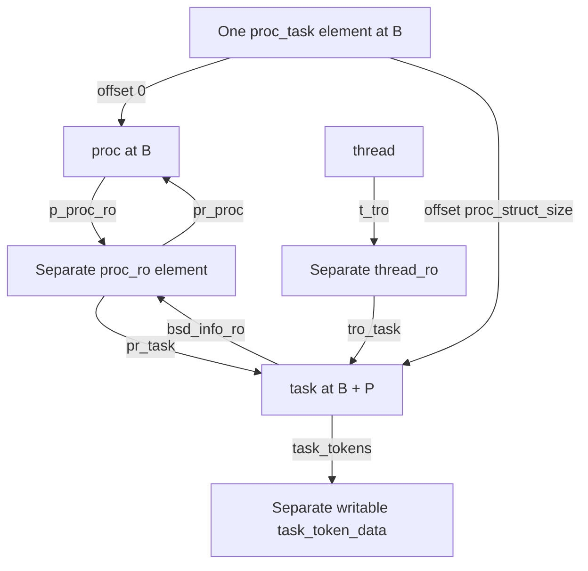
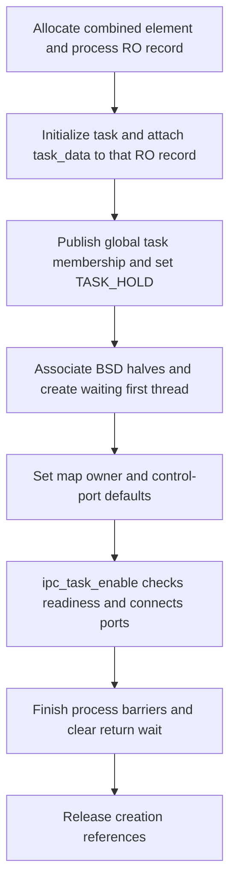
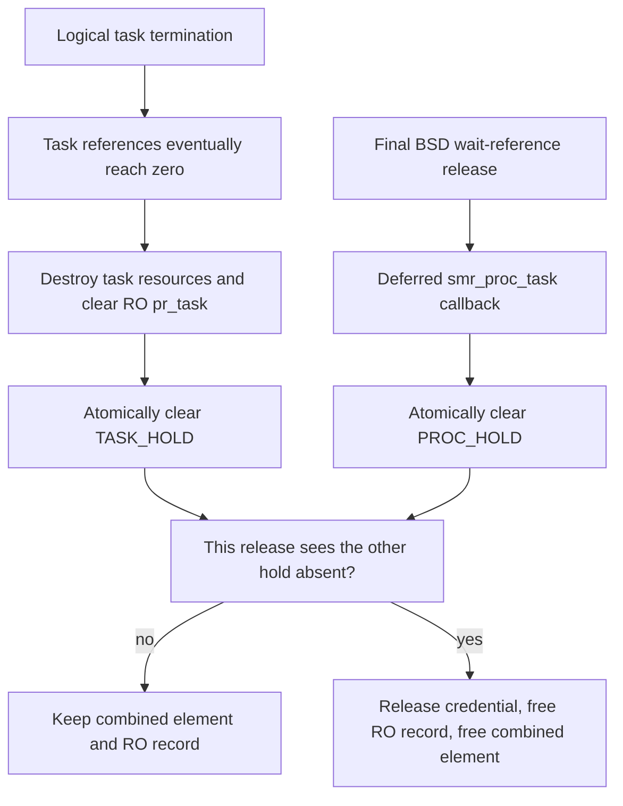

# The task and its shared read-only data

A `task` owns the Mach resources shared by its threads: an address space, IPC namespace, ledgers, policy and thread membership. In this checkout, its writable structure occupies the second part of a combined process/task allocation. Selected task fields instead live in a separate `proc_ro` object, shared with the process on the ordinary BSD creation path. Following those two allocations explains why obtaining a task pointer, validating its protected fields and keeping its storage alive are different operations.

[Key structures](README.md) · [Process and protected data](proc-and-proc-ro.md) · [Writing protected fields](read-only-object-updates.md) · [Runtime objects](../subsystems/runtime/objects-and-lifecycle.md) · [Task capabilities](../subsystems/security/task-and-thread-capabilities.md)

This chapter follows `xnu-12377.121.6`: ordinary process-associated tasks, corpse tasks and the kernel bootstrap exception. The [process transition chapter](../subsystems/processes/process-transitions.md) supplies the surrounding fork, exec, exit and wait protocols; the focus here is storage, access and mutation.

Continue through [thread and thread_ro](thread-and-thread-ro.md) for the thread's task association, [IPC spaces and entries](ipc-spaces-and-entries.md) for `itk_space`, and [ports and kobjects](ipc-ports-and-kobjects.md) for the task's exported capability objects and referenced conversion.

Inspect the live [`task_ro_data`](layout-browser.md?declaration=task_ro_data) layout for the selected source profile.

## 1. Writable task state and the protected companion

[Inspect the task layout](layout-browser.md?declaration=task) in the offline HTML handbook to select a configuration and follow nested field offsets. These offsets describe the task object itself; the combined process/task allocation is explained below.

`struct task` begins with its mutex and reference count. Neither the whole structure nor all of its security-related state is in a read-only zone. Its `bsd_info_ro` member points to `struct proc_ro`; the latter contains a `task_data` group declared with the type name `task_ro_data`. That group is part of the RO allocation, not a separately allocated `task_ro`. [Task declaration](../../platydoc-data/xnu/osfmk/kern/task.h#L266-L350), [RO pointer](../../platydoc-data/xnu/osfmk/kern/task.h#L374-L383), [protected layout](../../platydoc-data/xnu/bsd/sys/proc_ro.h#L69-L97).

| Writable field group | State to recognize | Synchronization or lifetime distinction |
| --- | --- | --- |
| Object state | `lock`, `ref_count`, `active`, `ipc_active`, `halting`, `task_uniqueid` | References protect lifetime. `active` and `ipc_active` describe different readiness/termination stages. The task ID is distinct from the process unique ID. [Fields](../../platydoc-data/xnu/osfmk/kern/task.h#L266-L290). |
| Address space and threads | `map`, `threads`, counts, suspension counts, `pset_hint` | The task mutex protects the selected creation/termination decisions; global list changes use `tasks_threads_lock`. The VM map has its own lifetime and locking. [Fields](../../platydoc-data/xnu/osfmk/kern/task.h#L288-L321), [thread creation](../../platydoc-data/xnu/osfmk/kern/thread.c#L1378-L1437). |
| IPC | `itk_lock_data`, task-port array, exception actions, special rights, `itk_space` | The IPC mutex is separate from the task mutex and coordinates port enable/disable and lazy publication. [Fields](../../platydoc-data/xnu/osfmk/kern/task.h#L323-L348), [enable](../../platydoc-data/xnu/osfmk/kern/ipc_tt.c#L360-L416). |
| Accounting and ownership | `ledger`, Recount state, counters, semaphore list, `task_objq` | Counters and subordinate objects have their own APIs; `task_objq_lock` explicitly protects the owned-object queue. [Fields](../../platydoc-data/xnu/osfmk/kern/task.h#L350-L372), [owned-object queue](../../platydoc-data/xnu/osfmk/kern/task.h#L589-L601). |
| Policy and flags | `t_flags`, `t_procflags`, requested/effective policy, `security_config` | `t_flags` is documented as task-lock protected, while `t_procflags` is proc-lock protected. Initialization writes happen before external readiness. Do not assume every field uses the task mutex. [Flag declarations](../../platydoc-data/xnu/osfmk/kern/task.h#L383-L411), [proc flags](../../platydoc-data/xnu/osfmk/kern/task.h#L485-L494), [policy](../../platydoc-data/xnu/osfmk/kern/task.h#L554-L582), [security configuration](../../platydoc-data/xnu/osfmk/kern/task.h#L671-L681). |
| Coalition membership | `coalition[]`, `task_coalition[]` | Membership is adopted during task creation and unset during final release; the declaration identifies coalition locking rather than the task mutex. [Contract](../../platydoc-data/xnu/osfmk/kern/task.h#L615-L623). |

`task_tokens` is another distinct allocation. It points to `task_token_data`, whose UID and GID pairs are packed into atomic 64-bit fields, with separate atomic audit/PID fields. Its signed pointer and atomic data are not an alternative name for `proc_ro`. Creation allocates and initializes it separately; final task release frees it separately. [Token representation](../../platydoc-data/xnu/osfmk/kern/task.h#L210-L226), [allocation and initialization](../../platydoc-data/xnu/osfmk/kern/task.c#L1593-L1619), [free](../../platydoc-data/xnu/osfmk/kern/task.c#L2203-L2206).

The protected task group is small. Its exact declaration is [proc_ro.h, lines 84–92](../../platydoc-data/xnu/bsd/sys/proc_ro.h#L84-L92):

<!-- source-excerpt: ../../platydoc-data/xnu/bsd/sys/proc_ro.h#L84-L92 -->
```c
	__xnu_struct_group(task_ro_data, task_data, {
#ifdef CONFIG_MACF
		struct task_filter_ro_data task_filters;
#endif
		uint32_t t_flags_ro;                               /* RO-protected task flags (see osfmk/kern/task.h) */

		/* This is not inherited on fork/exec, must be re-evaluated */
		task_control_port_options_t task_control_port_options;
	});
```

`t_flags_ro` includes such state as `TFRO_CORPSE`, `TFRO_PLATFORM`, `TFRO_FILTER_MSG` and `TFRO_FREEZE_EXCEPTION_PORTS`. Some definitions or uses depend on macOS, pointer authentication or Exclaves configuration. The two MAC filter members hold pointers to masks; protecting those pointer fields does not establish the contents or lifetime of the pointed-to masks. [Flag definitions](../../platydoc-data/xnu/osfmk/kern/task.h#L414-L433), [mask types](../../platydoc-data/xnu/bsd/sys/proc_ro.h#L51-L54).

## 2. One combined allocation, two structure addresses

The BSD side defines `proc_struct_size = sizeof(struct proc)` and `proc_alignment = _Alignof(struct proc)`. The Mach side supplies the task alignment and rounds the two portions before creating `proc_task_zone`. The zone's element size is the sum of those rounded portions. [Initial sizes](../../platydoc-data/xnu/bsd/kern/kern_fork.c#L178-L186), [task alignment](../../platydoc-data/xnu/osfmk/kern/task.c#L215-L219).

The allocation geometry is explicit in [task.c, lines 1243–1252](../../platydoc-data/xnu/osfmk/kern/task.c#L1243-L1252):

<!-- source-excerpt: ../../platydoc-data/xnu/osfmk/kern/task.c#L1243-L1252 -->
```c
static inline void
task_zone_init(void)
{
	proc_struct_size = roundup(proc_struct_size, task_alignment);
	task_struct_size = roundup(sizeof(struct task), proc_alignment);
	proc_and_task_size = proc_struct_size + task_struct_size;

	proc_task_zone = zone_create_ext("proc_task", proc_and_task_size,
	    ZC_ZFREE_CLEARMEM | ZC_SEQUESTER, ZONE_ID_PROC_TASK, NULL); /* sequester is needed for proc_rele() */
}
```

For a zone-element base address `B`, let `P` be the rounded `proc_struct_size` and `T` the rounded `task_struct_size`. The process begins at `B`, the task at `B + P`, and the requested element extent is `P + T`. `proc_get_task_raw(p)` adds `P`; `task_get_proc_raw(t)` subtracts it. These are kernel virtual-address calculations, not PID lookup or physical-address translation. The sizes depend on the compiled structures and configuration, so no fixed byte offset is assumed here. [Raw conversion bodies](../../platydoc-data/xnu/bsd/kern/kern_proc.c#L2023-L2033).

The `proc_task` zone is created with clear-on-free and sequestering flags, not `ZC_READONLY`. The separately defined `proc_ro` zone uses `ZC_READONLY | ZC_ZFREE_CLEARMEM`. The `SECURITY_READ_ONLY_LATE` declaration of the **zone handle variable** does not make the combined elements read-only. [Combined-zone handle](../../platydoc-data/xnu/bsd/kern/kern_fork.c#L185-L186), [RO-zone definition](../../platydoc-data/xnu/bsd/kern/kern_proc.c#L230-L231). The [RO-zone guide](../subsystems/vm/read-only-and-special-zones.md) explains configuration-dependent enforcement.



This diagram selects an ordinary live process/task pair; the first two arrows show layout, and the remaining arrows show pointers. A thread also has BSD/credential links in `thread_ro`, omitted here. The kernel and corpse cases below deliberately do not satisfy every association shown. [Thread protected links](../../platydoc-data/xnu/osfmk/kern/thread.h#L176-L211).

Raw arithmetic does not prove that the neighboring process is initialized or logically associated. `proc_task(p)` tests `P_LHASTASK`; `get_bsdtask_info(t)` checks the raw process location and returns it only when `TF_HASPROC` is set. Their setters validate the fixed neighboring address and change association flags. `set_bsdtask_info()` does not assign `bsd_info_ro`. None of these helpers acquires a task or process reference. [Process association](../../platydoc-data/xnu/bsd/kern/kern_proc.c#L2002-L2033), [task-side read](../../platydoc-data/xnu/osfmk/kern/bsd_kern.c#L98-L104), [task-side setter](../../platydoc-data/xnu/osfmk/kern/bsd_kern.c#L159-L171), [flag access](../../platydoc-data/xnu/osfmk/kern/task.h#L476-L483).

## 3. Constructing the task and attaching protected state

`task_create_internal()` initializes a supplied `child_task`. It does not allocate the combined structure itself. The ordinary caller already has a process at the front of an allocated zone element and a process-only RO object: `forkproc()` calls `proc_ro_alloc(child_proc, &proc_ro_data, NULL, NULL)`, then `fork_create_child()` obtains the raw task neighbor and passes that existing RO object to task creation. [Process allocation](../../platydoc-data/xnu/bsd/kern/kern_fork.c#L933-L943), [initial RO object](../../platydoc-data/xnu/bsd/kern/kern_fork.c#L1087-L1097), [task creation call](../../platydoc-data/xnu/bsd/kern/kern_fork.c#L443-L493).

The important construction stages are:

1. Initialize task reference accounting, instantiate the ledger and allocate the fault counter. The ordinary reference model starts with two references: one for the caller and one for being alive. Development/debug reference-group accounting has additional bookkeeping. [Constructor entry](../../platydoc-data/xnu/osfmk/kern/task.c#L1388-L1404), [initial count](../../platydoc-data/xnu/osfmk/kern/task_ref.c#L91-L93), [reference initialization variants](../../platydoc-data/xnu/osfmk/kern/task_ref.c#L434-L465), [ordinary implementation](../../platydoc-data/xnu/osfmk/kern/task_ref.c#L520-L548).
2. Fork the parent map when `inherit_memory` is true and `TF_CORPSE_FORK` is clear; otherwise create a pmap/map and optionally inherit map limits. A null pmap/map path releases the fault counter, ledger and reference bookkeeping before returning `KERN_RESOURCE_SHORTAGE`. The caller still owns the combined allocation; the RO attachment has not happened yet. [Map choice and failure cleanup](../../platydoc-data/xnu/osfmk/kern/task.c#L1416-L1468).
3. Initialize the task mutex, thread queue, counts, active/halting state and flags. Build a writable stack-local `task_ro_data` template. Selected RO flags are copied explicitly from the parent, rather than inheriting all bits. [Initial state and inheritance](../../platydoc-data/xnu/osfmk/kern/task.c#L1470-L1510).
4. Allocate token data, prepare filter pointers and initialize control-port options to `TASK_CONTROL_PORT_OPTIONS_INVALID`. With an existing RO record, attach the task through `proc_ro_ref_task`; without one, allocate a task-only RO record. This happens before IPC/importance initialization. [Tokens, filters and attachment](../../platydoc-data/xnu/osfmk/kern/task.c#L1593-L1642).
5. Complete policy, machine, coalition and resource initialization, link the task into the global task list under `tasks_threads_lock`, and set its allocation hold. Returning success still does not enable user task-port access. [Later initialization](../../platydoc-data/xnu/osfmk/kern/task.c#L1680-L1881), [list publication and hold](../../platydoc-data/xnu/osfmk/kern/task.c#L1915-L1924).

The attachment branch is [task.c, lines 1633–1638](../../platydoc-data/xnu/osfmk/kern/task.c#L1633-L1638):

<!-- source-excerpt: ../../platydoc-data/xnu/osfmk/kern/task.c#L1633-L1638 -->
```c
	/* must set before task_importance_init_from_parent: */
	if (proc_ro != NULL) {
		new_task->bsd_info_ro = proc_ro_ref_task(proc_ro, new_task, &task_ro_data);
	} else {
		new_task->bsd_info_ro = proc_ro_alloc(NULL, NULL, new_task, &task_ro_data);
	}
```

Despite its name, `proc_ro_ref_task()` does not increment a reference count. It rejects a non-null existing `pr_task`, copies the old RO record into a stack-local value, fills `pr_task` and `task_data`, then copies that whole value back with `zalloc_ro_update_elem()`. It preserves the process group while initializing the task group before the new task becomes externally usable. This whole-record update is not a general concurrent field-update protocol. [Attachment body](../../platydoc-data/xnu/bsd/kern/kern_proc.c#L5605-L5621).

`proc_ro_alloc()` similarly starts with a zeroed local record, allocates from `ZONE_ID_PROC_RO`, populates the local record from whichever process/task arguments are supplied, and copies the template through the RO API. A task-only call leaves the process group and `pr_proc` zero. [Allocation body](../../platydoc-data/xnu/bsd/kern/kern_proc.c#L5580-L5603).

### Publication is more than constructor success

IPC initialization allocates the task's IPC space and control/name ports, initially without a task kobject association; read/inspect ports are lazy. On the fork path, the caller subsequently sets up the map owner, resolves control-port policy, enables task IPC, ends process construction barriers and clears the task's return wait. The first thread initially waits in the return protocol. [IPC initialization](../../platydoc-data/xnu/osfmk/kern/ipc_tt.c#L178-L203), [first-thread wait](../../platydoc-data/xnu/bsd/kern/kern_fork.c#L509-L521), [fork completion](../../platydoc-data/xnu/bsd/kern/kern_fork.c#L579-L628).



This is the selected successful fork path, not all rollback branches or a guarantee that the child survives construction. The fork wrapper can terminate the child if the parent died during the operation. `ipc_task_enable()` itself takes the IPC mutex, rejects a task already made inactive, verifies map/control-option setup, marks `ipc_active`, and enables the port associations. Kernel/corpse exceptions appear in those assertions. [Late parent-death branch](../../platydoc-data/xnu/bsd/kern/kern_fork.c#L612-L628), [enable checks](../../platydoc-data/xnu/osfmk/kern/ipc_tt.c#L360-L416).

### Task-only, corpse and kernel variants

| Variant | Allocation and protected-record behavior |
| --- | --- |
| Ordinary BSD child, including the exec-copy construction path | Uses the child's combined allocation and existing process-only RO record. `fork_create_child()` chooses memory inheritance for fork, marks exec copies with `TPF_EXEC_COPY`, and passes return-wait flags. [Caller](../../platydoc-data/xnu/bsd/kern/kern_fork.c#L443-L493). |
| Corpse fork | Allocates a zeroed combined element, obtains its task half and calls task creation with no process RO argument, `TF_CORPSE_FORK` and `TFRO_CORPSE`. The process half is storage, not an initialized BSD process. Even though the caller passes `inherit_memory = TRUE`, the corpse flag selects the fresh-map constructor branch; map/thread duplication follows separately. [Caller and subsequent duplication](../../platydoc-data/xnu/osfmk/corpses/corpse.c#L719-L774), [map predicate](../../platydoc-data/xnu/osfmk/kern/task.c#L1416-L1445). |
| Kernel bootstrap | `task_init()` allocates `kernproc`/`kernel_task` together and passes no RO object, so task creation allocates a task-only record. Later `bsd_init()` separately allocates `kernproc->p_proc_ro` with both backreferences. Its preceding `set_bsdtask_info()` changes association state, not the task's RO pointer. Thus the ordinary shared-record diagram is not universal. [Task bootstrap](../../platydoc-data/xnu/osfmk/kern/task.c#L1211-L1240), [BSD bootstrap](../../platydoc-data/xnu/bsd/kern/bsd_init.c#L522-L544), [setter body](../../platydoc-data/xnu/osfmk/kern/bsd_kern.c#L159-L171). |

The corpse caller explicitly distinguishes raw allocation ownership from initialized-task ownership. Before success it can free `corpse_proc` directly; after task construction and IPC setup it clears that local pointer, and later errors terminate/deallocate the task instead. [Ownership transfer](../../platydoc-data/xnu/osfmk/corpses/corpse.c#L750-L770), [cleanup](../../platydoc-data/xnu/osfmk/corpses/corpse.c#L809-L842). Ordinary task termination asserts that the task is not `kernel_task`; its teardown is not a model for freeing kernel bootstrap records. [Termination entry](../../platydoc-data/xnu/osfmk/kern/task.c#L2981-L2993).

## 4. Obtaining a task and reading its protected fields

| Route | Actual operations | What the caller obtains |
| --- | --- | --- |
| Current execution | `current_task()` calls `get_threadtask(current_thread())`; `get_threadtask()` reads `get_thread_ro(th)->tro_task` | A pointer supplied by the current thread's association, with no new task reference from the accessor. [Current task](../../platydoc-data/xnu/osfmk/kern/task.c#L8075-L8079), [thread-to-task](../../platydoc-data/xnu/osfmk/kern/bsd_kern.c#L833-L837). |
| Referenced thread | `get_thread_ro()` validates the RO zone and `tro_owner` backlink, then `get_threadtask()` returns `tro_task` | The thread's lifetime protects its `thread_ro`. Thread construction takes an internal task reference and final thread destruction releases it. [Validation](../../platydoc-data/xnu/osfmk/kern/bsd_kern.c#L187-L197), [lifetime contract](../../platydoc-data/xnu/osfmk/kern/thread.h#L176-L211), [task retain](../../platydoc-data/xnu/osfmk/kern/thread.c#L1434-L1437), [task release](../../platydoc-data/xnu/osfmk/kern/thread.c#L806-L816). |
| Process association | `proc_task(p)` tests the process association flag and returns the fixed neighbor | No new reference; a caller needing independent task lifetime explicitly takes one before releasing its process reference. [Accessor](../../platydoc-data/xnu/bsd/kern/kern_proc.c#L2002-L2007), [example transfer](../../platydoc-data/xnu/bsd/kern/kern_proc.c#L5926-L5930). |
| Task port conversion | Under the active port's lock, validate its flavor, kobject association, corpse options and applicable policy; the referenced wrapper calls `task_reference_grp()` | A referenced task, or null. The helper ending in `_noref` does not retain it. [Validation and reference wrapper](../../platydoc-data/xnu/osfmk/kern/ipc_tt.c#L2439-L2510). |

The [capability chapter](../subsystems/security/task-and-thread-capabilities.md#5-input-conversion-checks-type-association-and-policy) covers names, flavor compatibility, self fast paths and reference-consuming output conversions. A user port name is not a task address, and a reference obtained from a port conversion is not proof that all task operations remain permitted.

Once the task's lifetime is established, `task_get_ro()` follows `bsd_info_ro`, calls the configuration-dependent RO-zone validator and verifies the backreference. The exact accessor is [task.c, lines 10360–10371](../../platydoc-data/xnu/osfmk/kern/task.c#L10360-L10371):

<!-- source-excerpt: ../../platydoc-data/xnu/osfmk/kern/task.c#L10360-L10371 -->
```c
proc_ro_t
task_get_ro(task_t t)
{
	proc_ro_t ro = (proc_ro_t)t->bsd_info_ro;

	zone_require_ro(ZONE_ID_PROC_RO, sizeof(struct proc_ro), ro);
	if (__improbable(proc_ro_task(ro) != t)) {
		panic_proc_ro_task_backref_mismatch(t, ro);
	}

	return ro;
}
```

This accessor neither takes a reference nor locks a field. It does not check `active`, restore a vanished process association or turn a stale task pointer into a valid one. `task_require()` similarly validates the combined allocation's zone using the raw process base; it is not a lookup-and-retain operation. [Task zone check](../../platydoc-data/xnu/osfmk/kern/task.h#L694-L701). The [protected-update chapter](read-only-object-updates.md) separates zone/backreference checks from lifetime and concurrency guarantees.

`current_task_early()` is a separate boot-time convenience: before the early-boot phase it can return null when the initial thread has no `t_tro`. The ordinary current-task accessor has no such null-bootstrap path. [Early accessor](../../platydoc-data/xnu/osfmk/kern/task.c#L8064-L8079).

## 5. Updating writable fields and RO fields

A normal task-field update can take the task mutex and assign directly. For example, `task_set_thread_limit()` asserts that the task is not `kernel_task`. For a limit within `TASK_MAX_THREAD_LIMIT`, it writes `task_thread_limit` while holding the task lock; an out-of-range value leaves the field unchanged. This helper returns `void`, not a rejection status. [Concrete writable update](../../platydoc-data/xnu/osfmk/kern/task.c#L7958-L7967).

Protected flags use a different operation. `task_ro_flags_set()` and `task_ro_flags_clear()` perform an atomic OR or AND through the RO update API. The exact bodies are [task.c, lines 10379–10391](../../platydoc-data/xnu/osfmk/kern/task.c#L10379-L10391):

<!-- source-excerpt: ../../platydoc-data/xnu/osfmk/kern/task.c#L10379-L10391 -->
```c
void
task_ro_flags_set(task_t task, uint32_t flags)
{
	zalloc_ro_update_field_atomic(ZONE_ID_PROC_RO, task_get_ro(task),
	    t_flags_ro, ZRO_ATOMIC_OR_32, flags);
}

void
task_ro_flags_clear(task_t task, uint32_t flags)
{
	zalloc_ro_update_field_atomic(ZONE_ID_PROC_RO, task_get_ro(task),
	    t_flags_ro, ZRO_ATOMIC_AND_32, ~flags);
}
```

The atomic operation protects the selected word against lost read-modify-write updates; it does not atomically publish a collection of other fields or retain the task. `task_set_filter_msg_flag(task, flag)` selects those helpers for `TFRO_FILTER_MSG`, and the getter tests the same RO word. [Selected public helper](../../platydoc-data/xnu/osfmk/kern/task.c#L9823-L9846).

Control-port options use a field copy, not those bitwise flag helpers. The static setter passes a local `opts` value to `zalloc_ro_update_field()`. Its caller, `task_set_ctrl_port_default()`, asserts that task IPC is not yet active, derives options from the task's IPC policy, the MAC movable-port decision and configured policy bits, stores them, then refreshes task/thread control-port exposure. `ipc_task_enable()` later asserts valid options for ordinary tasks. [Setter](../../platydoc-data/xnu/osfmk/kern/task.c#L10393-L10408), [policy and ordering](../../platydoc-data/xnu/osfmk/kern/task.c#L953-L999), [enable assertion](../../platydoc-data/xnu/osfmk/kern/ipc_tt.c#L388-L400).

Read this ordering as part of the field's meaning. The constructor initializes options to `INVALID`; it does not copy the parent's value. The static setter's comment explains that changing the stored value after startup cannot make already immovable control ports movable again. Therefore a successful RO write is not itself a complete port-policy transition. [Initial value](../../platydoc-data/xnu/osfmk/kern/task.c#L1630-L1631), [non-inheritance declaration](../../platydoc-data/xnu/bsd/sys/proc_ro.h#L90-L91), [setter restriction](../../platydoc-data/xnu/osfmk/kern/task.c#L10399-L10407).

With `CONFIG_MACF`, trap and kobject filter setters copy the **pointer field** using `&mask`; they do not copy the mask's bytes or establish its ownership in these bodies. Constructor inheritance also copies the parent's filter pointers for non-corpse tasks. The MAC provider's mask production/lifetime policy is outside this walkthrough. [Filter accessors](../../platydoc-data/xnu/osfmk/kern/task.c#L7924-L7956), [inheritance](../../platydoc-data/xnu/osfmk/kern/task.c#L1621-L1628).

These calls identify the object, field and operation. Follow [writing protected fields](read-only-object-updates.md) for macro expansion, source/destination checks and the architecture backend. Here, RO means a protected ordinary mapping with controlled mutations when RO enforcement is enabled, not an immutable C object. Configuration can select a different enforcement path; no task API alone proves a particular device's page permissions.

## 6. Logical termination, final task release and shared storage

Three separate ownership mechanisms appear in this path:

| Mechanism | What it keeps alive or delays |
| --- | --- |
| `task->ref_count` and task reference APIs | The task object and resources retained until final release; logical termination can already dismantle operational resources. A new thread and a successful referenced port conversion can add references; callers must release theirs. [Reference implementation](../../platydoc-data/xnu/osfmk/kern/task_ref.c#L520-L548), [termination teardown](../../platydoc-data/xnu/osfmk/kern/task.c#L3097-L3201). |
| BSD process references and `p_waitref` | Process operation/reaping lifetime, with the final wait-reference release scheduling deferred SMR reclamation. They are not acquired merely by holding a task reference. [Process wait release](../../platydoc-data/xnu/bsd/kern/kern_proc.c#L1091-L1105), [explicit corpse-side process lookup](../../platydoc-data/xnu/osfmk/corpses/corpse.c#L707-L716). |
| `P_REF_PROC_HOLD` / `P_REF_TASK_HOLD` in the process half | Whether each side still holds the **combined allocation**. These bits are not the task reference count and are not a reference count inside `proc_ro`. [Bit declarations](../../platydoc-data/xnu/bsd/sys/proc_internal.h#L216-L217), [hold helpers](../../platydoc-data/xnu/bsd/kern/kern_proc.c#L1232-L1278). |

`task_terminate_internal()` holds the task, marks it inactive and disables task IPC, requests termination of its threads, tears down operational resources and moves it to the terminated-task list. It finally releases the task's active reference. Other references can keep the task allocated after this logical death. The VM map and IPC space must exist until the termination function returns, as its comment explicitly requires for port conversions. [Inactive and IPC transition](../../platydoc-data/xnu/osfmk/kern/task.c#L3061-L3095), [remaining teardown/list transfer](../../platydoc-data/xnu/osfmk/kern/task.c#L3097-L3201), [active-reference release](../../platydoc-data/xnu/osfmk/kern/task.c#L3234-L3239).

BSD exit clears both ordinary process/task association flags and the exiting thread's process linkage before later final reclamation. This does not immediately erase `pr_task` from the RO record. [BSD detach](../../platydoc-data/xnu/bsd/kern/kern_exit.c#L2690-L2697).

At zero task references, `task_deallocate_internal()` requires no task threads, no BSD association, an inactive IPC space, an inactive task and zero active threads. It removes terminated-list membership and releases IPC, map, ledger, accounting, coalition and other task resources. The importance-inheritance branch can disconnect its last remaining reference before the count reaches zero. [Last-reference gate and assertions](../../platydoc-data/xnu/osfmk/kern/task.c#L2004-L2050), [resource release](../../platydoc-data/xnu/osfmk/kern/task.c#L2052-L2179).

The final task-side actions free reference bookkeeping and token data, atomically clear the RO record's `pr_task`, and release `P_REF_TASK_HOLD`. Clearing the backreference does not zero the whole task group or free the RO record immediately. [Final task actions](../../platydoc-data/xnu/osfmk/kern/task.c#L2203-L2206), [atomic backlink clear](../../platydoc-data/xnu/bsd/kern/kern_proc.c#L5623-L5628).

On the process side, the last `p_waitref` release schedules `proc_wait_free()` in the `smr_proc_task` domain; that callback releases `P_REF_PROC_HOLD`. Each hold-release helper atomically clears its own bit and checks the old value of the opposite bit. The side that observes no opposite hold calls `proc_free()`, which releases the credential retained by the supplied RO record, frees that RO record, then frees the combined element. [Deferred callback](../../platydoc-data/xnu/bsd/kern/kern_proc.c#L1091-L1105), [two-sided free protocol](../../platydoc-data/xnu/bsd/kern/kern_proc.c#L1232-L1278).



The diagram describes the ordinary shared record. The two releases can occur in either order. Retaining the combined bytes for the process side does not preserve an already destroyed task's locks, map or token data. Conversely, a task reference can preserve the task after its BSD association has disappeared; it does not authorize using the raw process half as a live process. Task-only corpses have no initialized BSD lifetime to await: their task-side release can free the supplied task-only RO record and combined storage when no process hold exists. [Task-side release](../../platydoc-data/xnu/bsd/kern/kern_proc.c#L1262-L1278), [task-only construction](../../platydoc-data/xnu/osfmk/corpses/corpse.c#L735-L752).

## 7. Worked access, mutation and lifetime example

Take an ordinary child task `t`, process `p` and shared record `r`, after construction has completed. Let `B` be the combined allocation base and `P = proc_struct_size`. Then `p = B`, `t = B + P`, `p->p_proc_ro = r` and `t->bsd_info_ro = r`. These are illustrative symbols, not fixed offsets or measured addresses.

1. A thread's `tro_task` points to `t`. `current_task()` returns that pointer through the validated `thread_ro` route; it does not increment `t->ref_count`. A separate caller arriving through the referenced port conversion obtains its own task reference instead. The caller's chosen route must keep `t` alive before reading `r`.
2. `task_get_ro(t)` verifies the RO zone and `r->pr_task == t`. Suppose the selected starting flag word is only `TFRO_PLATFORM`, numerically `0x00000080`. `task_set_filter_msg_flag(t, TRUE)` issues an atomic OR with `TFRO_FILTER_MSG`, `0x00004000`, giving `0x00004080`. Clearing that same flag issues an AND with its complement and restores `0x00000080`. The unrelated platform bit survives both operations. These values illustrate the helpers; they do not claim that those are a running task's only policy flags. [Bits](../../platydoc-data/xnu/osfmk/kern/task.h#L421-L423), [selected setter](../../platydoc-data/xnu/osfmk/kern/task.c#L9823-L9846), [atomic operations](../../platydoc-data/xnu/osfmk/kern/task.c#L10379-L10391).
3. Later, BSD detaches the task and the task terminates. An independent task reference can keep `t` and `r` available during the remaining task lifetime, but cannot make `get_bsdtask_info(t)` return a process again. The final task release destroys its resources, sets `r->pr_task` to null and clears the task allocation hold.
4. If the process hold still exists at that moment, both allocation blocks remain until the process's deferred SMR callback clears it. If the process callback ran first, the task hold kept the blocks allocated, and final task release frees them. In either order, after the last task reference is released, the old `t` must no longer be used—even if the process side temporarily retains the combined allocation.

This example separates ordinary field access, protected mutation and storage retention. A successful backreference check is useful only inside a valid lifetime; an atomic flag update is useful only for the selected field; a retained allocation is not proof that every object previously stored in it remains initialized.

## 8. Source scope and limits

The reviewed bodies cover combined-zone construction, ordinary/corpse/kernel task creation, selected task field groups, thread and port access routes, RO attachment/validation, flag/control-option/filter updates, task termination and the shared allocation's final release. The layout and some fields vary with `MACH_BSD`, `CONFIG_MACF`, development/debug reference tracking, pointer authentication, memory-status features and platform selection. The representation is useful on ARM64/mobile paths without assuming a universal structure size or every optional field.

This is not a field-by-field account of the VM map, IPC space, ledger, coalition, token-update policy or every task operation. External MAC decisions and hardware/trusted-monitor enforcement are separate boundaries. Continue with [task capabilities](../subsystems/security/task-and-thread-capabilities.md), [process transitions](../subsystems/processes/process-transitions.md), [runtime lifecycles](../subsystems/runtime/objects-and-lifecycle.md), [SMR publication](../cross-cutting/smr-and-publication.md) and [RO update backends](read-only-object-updates.md) for those adjoining paths. No kernel execution or runtime behavior was tested for this source walkthrough.

<!-- BEGIN PLATYDOC DOCUMENTATION LICENSE -->
Original Platydoc text and diagrams are licensed under [CC BY 4.0](https://creativecommons.org/licenses/by/4.0/). Quoted source code and third-party material retain their respective licenses.
<!-- END PLATYDOC DOCUMENTATION LICENSE -->
