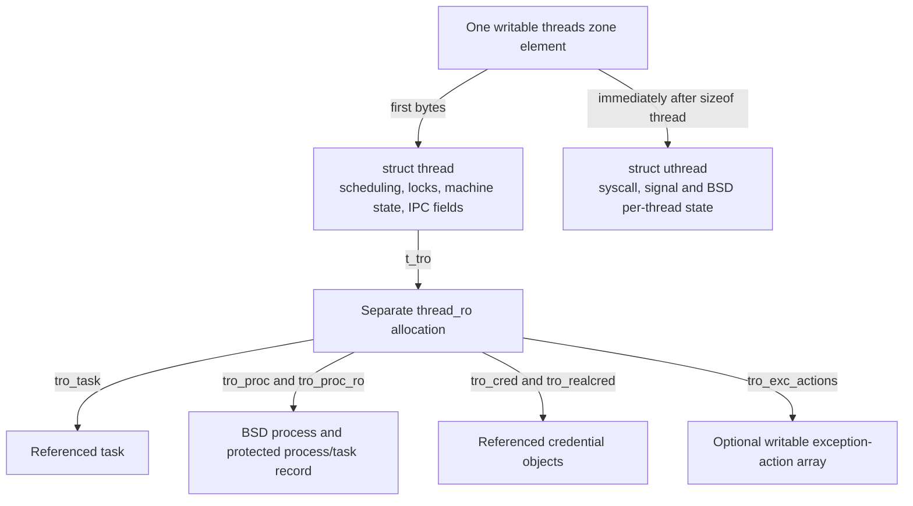
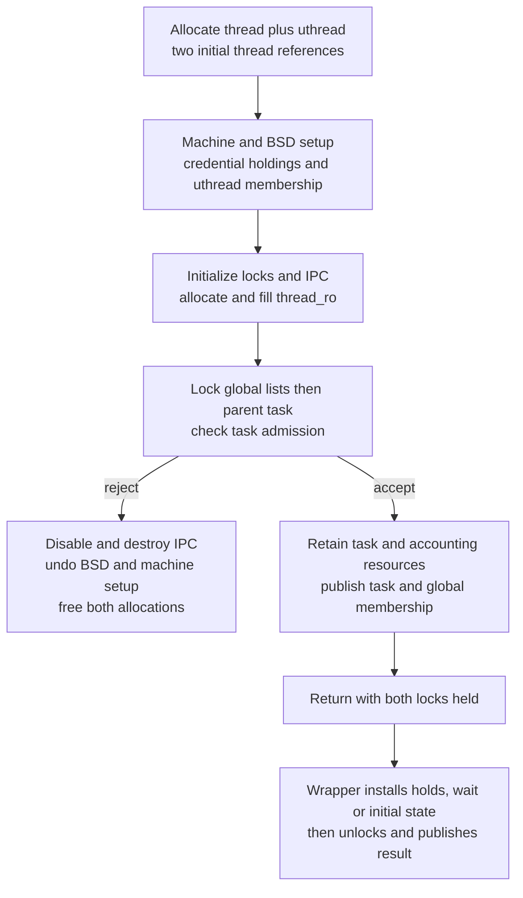
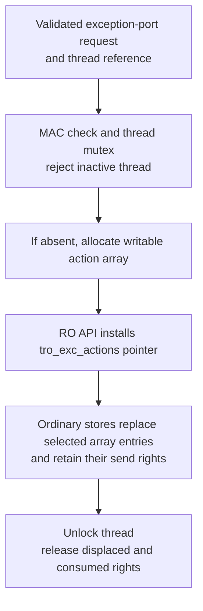
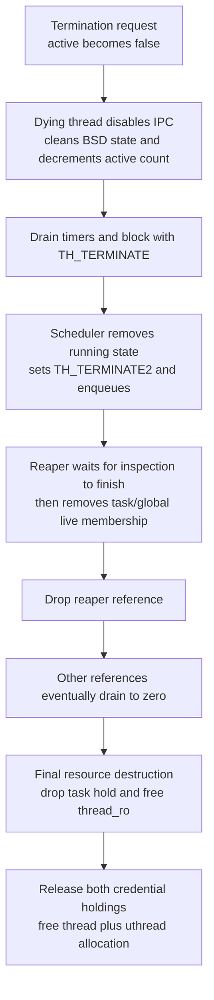

# The thread, its BSD extension and protected associations

A thread combines execution state, BSD syscall state and protected links to the objects that supply its identity. In `xnu-12377.121.6`, `struct thread` and `struct uthread` occupy one writable allocation, while a separate `struct thread_ro` contains credentials and task/process associations. This chapter follows their construction, access, controlled updates and eventual destruction so that a field declaration can be read together with the code that owns it.

[Key structures](README.md) · [Task and shared RO data](task-and-shared-ro.md) · [Credential storage](credentials-and-credential-storage.md) · [Protected object updates](read-only-object-updates.md)

Use [runtime objects](../subsystems/runtime/objects-and-lifecycle.md) for the larger lifecycle, [task/thread capabilities](../subsystems/security/task-and-thread-capabilities.md) for admission policy, and [suspension and stopping](../subsystems/runtime/suspension-stop-and-abort.md) for execution control. This chapter keeps a thread pointer, a thread reference, a scheduler hold and a thread-port right distinct.

Inspect the live [`thread`](layout-browser.md?declaration=thread), [`thread_ro`](layout-browser.md?declaration=thread_ro), [`uthread`](layout-browser.md?declaration=uthread), [`machine_thread`](layout-browser.md?declaration=machine_thread) and [`arm_saved_state64`](layout-browser.md?declaration=arm_saved_state64) layouts for the selected source profile.

## 1. Three structures, two allocations and several additional resources

The `threads` zone supplies an element whose requested size is `sizeof(struct thread) + roundup(uthread_size, _Alignof(struct thread))` when BSD support is compiled in. `uthread_size` is the BSD compilation unit's `sizeof(struct uthread)`. The rounding contributes to the total allocation size; the BSD extension itself starts immediately after `sizeof(struct thread)`, as the accessors below establish. [Zone construction](../../xnu/osfmk/kern/thread.c#L256-L269), [BSD size](../../xnu/bsd/kern/kern_fork.c#L173-L174).

The zone uses `ZC_SEQUESTER | ZC_ZFREE_CLEARMEM`, has reserved `ZONE_ID_THREAD`, and is not an RO zone. Separately, `ZONE_ID_THREAD_RO` names the `threads_ro` zone of `struct thread_ro` elements with `ZC_READONLY`. `SECURITY_READ_ONLY_LATE` on the zone variable or static constructor template does not put each allocated thread in protected storage. [Zone declarations](../../xnu/osfmk/kern/thread.c#L185-L186), [static template](../../xnu/osfmk/kern/thread.c#L225-L241), [zone flags](../subsystems/vm/zone-allocator.md).

The exact allocator geometry is [thread.c, lines 259–268](../../xnu/osfmk/kern/thread.c#L259-L268):

<!-- source-excerpt: ../../xnu/osfmk/kern/thread.c#L259-L268 -->
```c
thread_zone_startup(void)
{
	size_t size = sizeof(struct thread);

#ifdef MACH_BSD
	size += roundup(uthread_size, _Alignof(struct thread));
#endif
	thread_zone = zone_create_ext("threads", size,
	    ZC_SEQUESTER | ZC_ZFREE_CLEARMEM, ZONE_ID_THREAD, NULL);
}
```



The first two edges describe layout; the others describe pointers. `thread_ro` additionally stores `tro_owner`, pointing back to the thread. Its task association is kept alive by a task reference acquired later in successful construction. The credential fields each own a reference, even when both point to the same credential. The process pointers are associations, not independent process references acquired by the accessors. [RO declaration](../../xnu/osfmk/kern/thread.h#L176-L211), [credential initialization](../../xnu/bsd/kern/kern_fork.c#L1343-L1370), [task reference](../../xnu/osfmk/kern/thread.c#L1434-L1437).

The diagram does not enumerate every subordinate allocation. A thread can separately own a kernel stack, timer calls, ledgers, a turnstile, IPC ports, I/O accounting, debug state and architecture-specific register storage. On ARM64, `machine_thread_create()` allocates `arm_context_t` from `user_ss_zone` for a non-kernel task. `machine.contextData` owns that context, while `upcb` and `uNeon` point to fields within it; their saved-state flavors depend on the task's data width. Kernel threads instead initialize those three pointers to null. [ARM64 allocation and aliases](../../xnu/osfmk/arm64/pcb.c#L574-L649).

The 64-bit register record stores `x[29]`, `fp`, `lr`, `sp`, `pc`, status and exception information, plus `jophash` when `HAS_APPLE_PAC` is enabled. Its offsets are relative to the saved-state record. The embedded machine structure holds the pointers used to reach allocated context storage. Compare the [ARM64 machine fields](../../xnu/osfmk/arm/thread.h#L105-L128) with the [saved-state declaration](../../xnu/osfmk/mach/arm/thread_status.h#L416-L430).

An illustrative address walk, with no assumed numeric structure sizes, is:

```text
B = base of a threads-zone element
thread  = B
uthread = B + sizeof(struct thread)
RO      = thread->t_tro                  (a different allocation)
task    = get_thread_ro(thread)->tro_task (not adjacent thread storage)
```

Unlike the `proc`/`task` pair, a thread and its task are not neighbors in one allocation. Many separately allocated threads can point to the same task and process RO record.

## 2. Read the writable fields by their protocol

The large `struct thread` declaration is easier to navigate by field families than by offset. A pointer's representation does not identify the lock needed to read everything reachable through it.

| Field family | Important members | Meaning and access rule |
| --- | --- | --- |
| Lifetime and identifiers | `ref_count`, `thread_id`, `ctid` | References keep the object alive; system-wide thread IDs and compact IDs identify it under different lookup rules. Neither numeric ID is a Mach capability. [Reference field](../../xnu/osfmk/kern/thread.h#L606-L606), [IDs](../../xnu/osfmk/kern/thread.h#L952-L953). |
| Wait/run/daemon membership | `runq_links`, `wait_links`, `mpsc_links`, `wait_prioq_links`; `__runq`, `waitq`, `wait_event` | The links share a union and represent different phases. Read them only knowing the current queue/state protocol. Run-queue access has its own lock handoff. [Declaration and rule](../../xnu/osfmk/kern/thread.h#L406-L434). |
| Scheduler state | `sched_lock`, `state`, `sched_flags`, priorities, `continuation`, `parameter` | `thread_lock()` is the scheduling lock, used with the required scheduler interrupt level; it is different from `thread_mtx_lock()`. A continuation is where execution resumes, not a separate thread object. [Fields](../../xnu/osfmk/kern/thread.h#L475-L544), [state transitions](../subsystems/runtime/scheduler-execution.md). |
| Stop/activation/IPC gates | `wake_lock`, `mutex`, `active`, `ipc_active`, `started`, `inspection`, `corpse_dup`, stop counts | Different bits govern operation admission, port conversions, startup and crash inspection. The mutex protects the annotated bit group; stopping another executing thread additionally requires the stop protocol. [Gate fields](../../xnu/osfmk/kern/thread.h#L780-L837). |
| Address space and machine state | `map`, `machine`, `kernel_stack`, `reserved_stack` | `map` caches the task map; the task hold and operation protocol matter. The embedded machine structure can point to separately allocated saved-state storage. A stack pointer is not the start of `struct thread`. [Machine/stack fields](../../xnu/osfmk/kern/thread.h#L512-L517), [map field](../../xnu/osfmk/kern/thread.h#L803-L812), [constructor](../../xnu/osfmk/kern/thread.c#L1451-L1467). |
| Port exposure and RPC state | `thread_ports[]`, `thread_resume_port`, `ith_special_reply_port`, `ith_kernel_reply_port`, `ith_messages` | A control/read/inspect port association is not a permanent reference on the thread. Some other fields explicitly own rights or references. The declaration marks `thread_ports` as “no right.” [Port fields](../../xnu/osfmk/kern/thread.h#L785-L841), [disable contract](../../xnu/osfmk/kern/ipc_tt.c#L885-L900). |
| Task/global membership and accounting | `task_threads`, `threads`, `t_ledger`, `t_threadledger`, `th_recount` | Membership, activity accounting and object lifetime end at different stages. Task membership uses the task lock; global membership uses `tasks_threads_lock`. [Publication](../../xnu/osfmk/kern/thread.c#L1508-L1526), [removal](../../xnu/osfmk/kern/thread.c#L1027-L1060). |

The run-queue rule is unusually explicit: when `__runq.runq` is null, the thread scheduling lock protects it; when non-null, the associated run-queue lock protects it. Setting null to non-null requires both locks, while clearing can occur without the thread lock. Use the `thread_get/set/clear_runq*()` helpers. A reference alone cannot make that union or queue pointer a consistent snapshot. [Declared rule](../../xnu/osfmk/kern/thread.h#L406-L417), [helpers](../../xnu/osfmk/kern/thread.c#L3813-L3868).

`struct uthread` holds the BSD portion of the same thread:

| BSD fields | How to read them |
| --- | --- |
| `uu_arg[8]`, `uu_rval[2]`, `syscall_code`, `uu_userstate` | Per-thread syscall arguments/results and saved user-state linkage; inspect the architecture's syscall path before interpreting argument widths. [Declaration](../../xnu/bsd/sys/user.h#L123-L136), [ARM syscall entry](../../xnu/bsd/dev/arm/systemcalls.c#L94-L126). |
| `uu_save` | A union of continuation-specific contexts for select, kevent, waits, workqueues, ulocks, pthread termination and exec. Only the active operation determines which member is meaningful. [Union](../../xnu/bsd/sys/user.h#L141-L202). |
| `uu_sigmask`, `uu_oldmask`, `uu_siglist`, `uu_sigreturn_token`, `uu_sigreturn_diversifier` | Signal state and return validation data. Creation inherits or replaces the mask while holding the process lock; ARM64 signal restoration has additional machine-state rules. [Fields](../../xnu/bsd/sys/user.h#L214-L222), [initial mask](../../xnu/bsd/kern/kern_fork.c#L1372-L1384), [signal-state conversion](../subsystems/security/arm64-thread-state-conversion.md). |
| `uu_list`, `uu_cdir`, select state, `uu_kqr_bound` | Process-list membership and owned BSD resources. Cleanup removes membership only for the matching current task/process association, releases the current-directory vnode and dismantles select/workloop state. [Fields](../../xnu/bsd/sys/user.h#L205-L225), [workqueue fields](../../xnu/bsd/sys/user.h#L254-L295), [cleanup](../../xnu/bsd/kern/kern_fork.c#L1453-L1528). |
| `uu_proc_refcount` and optional `uu_proc_ref_info` | Per-thread process-reference tracking. They are not the thread reference count, and the `uthread` does not have a separate reference-counted allocation. [Fields](../../xnu/bsd/sys/user.h#L325-L328), [tracking setup/destruction](../../xnu/bsd/kern/kern_proc.c#L772-L795). |

The workqueue field comments distinguish self-only access, idle-thread updates under the workqueue lock, and updates requiring both thread mutex and workqueue lock. There is no universal “the uthread lock” protecting the whole extension. [Workqueue synchronization annotations](../../xnu/bsd/sys/user.h#L260-L295).

## 3. Protected fields are links and reference holdings

`thread_ro` is small enough to read as a complete object. `__xnu_struct_group(thread_ro_creds, tro_creds, ...)` exposes a named credential pair and direct member aliases for the same bytes; it does not duplicate those pointers. [Group macro](../../xnu/bsd/sys/cdefs.h#L1320-L1339), [thread RO fields](../../xnu/osfmk/kern/thread.h#L187-L211).

| Protected member | What it represents | Changes and lifetime |
| --- | --- | --- |
| `tro_owner` | Backreference to this allocation's `struct thread` | Filled during construction; checked by `get_thread_ro()`. It is not a reference-count increment. |
| `tro_task` | The thread's owning task | Filled at construction; successful creation separately retains the task. Final thread destruction releases that task reference. |
| `tro_proc` | BSD process associated with this thread | Set for live ordinary/kernel threads, absent for corpse-only construction; BSD exit can clear it with the RO clear API. A non-null load is not `proc_ref()`. |
| `tro_proc_ro` | Protected process/task record used by the thread | Copied from the appropriate creator/task/kernel route. Clearing `tro_proc` does not clear this pointer. The record's lifetime follows its process/task holders. |
| `tro_cred` | Effective thread credential, possibly an assumed identity | Owns a credential reference; current-thread identity changes replace this field through the RO API. |
| `tro_realcred` | Cached process credential | Owns a separate credential reference. Refresh preserves an independently assumed `tro_cred`. “Realcred” means the cached credential object here, not merely its real UID field. |
| `tro_exc_actions` | Optional pointer to an allocated array of exception actions | Initially null; lazily installed with a field copy. Array entries remain ordinary writable state under their operation's mutex protocol. |

Construction/update bodies below substantiate these relationships. For the strongest local lifetime statement, the header says a thread reference permits dereferencing its `thread_ro`. That does not promise that a process association remains operational, an exception port remains valid, or every mutable object behind an RO pointer can be read without synchronization. [Lifetime contract](../../xnu/osfmk/kern/thread.h#L176-L185), [association clearing](../../xnu/osfmk/kern/bsd_kern.c#L212-L218), [task destruction order](../../xnu/osfmk/kern/thread.c#L806-L835).

## 4. Construction has several publication boundaries

### Allocate and prepare before task membership

`thread_create_internal()` allocates the writable element with `Z_WAITOK | Z_NOFAIL`, prepares a zeroed stack `struct thread_ro tro_tpl`, copies the static thread template and initializes **two** thread references. One supports the created thread's lifetime through reaping; the returned reference belongs to the caller. Wrappers either hand it to their caller or release it on failure. [Entry and allocation](../../xnu/osfmk/kern/thread.c#L1255-L1280), [initial references and machine initialization](../../xnu/osfmk/kern/thread.c#L1305-L1323), [wrapper failure release](../../xnu/osfmk/kern/thread.c#L1777-L1784), [reaper release](../../xnu/osfmk/kern/thread.c#L1088-L1089).

The template starts in `TH_WAIT | TH_UNINT`; allocating a thread does not make it runnable. `init_thread_from_template()` copies only `sizeof(struct thread)`. Its comment explains why this specific copy is allowed despite potentially diversified pointers in machine state: those template pointers are null. This is not permission to clone arbitrary live threads with `memcpy`. [Initial state](../../xnu/osfmk/kern/thread.c#L225-L241), [copy rationale](../../xnu/osfmk/kern/thread.c#L335-L353).

Next, machine setup allocates architecture state, `uthread_init()` initializes the BSD extension and fills credential/process fields in the stack template, the code initializes thread locks and IPC, and `thread_ro_create()` installs the protected record. [Order](../../xnu/osfmk/kern/thread.c#L1316-L1340).

The exact installation is [thread.c, lines 355–365](../../xnu/osfmk/kern/thread.c#L355-L365):

<!-- source-excerpt: ../../xnu/osfmk/kern/thread.c#L355-L365 -->
```c
static void
thread_ro_create(task_t parent_task, thread_t th, thread_ro_t tro_tpl)
{
#if __x86_64__
	th->t_task = parent_task;
#endif
	tro_tpl->tro_owner = th;
	tro_tpl->tro_task  = parent_task;
	th->t_tro = zalloc_ro(ZONE_ID_THREAD_RO, Z_WAITOK | Z_ZERO | Z_NOFAIL);
	zalloc_ro_update_elem(ZONE_ID_THREAD_RO, th->t_tro, tro_tpl);
}
```

`tro_tpl` is writable stack storage. `th->t_tro` is the allocated destination in `ZONE_ID_THREAD_RO`; `zalloc_ro_update_elem()` copies the whole template through the checked mutation path. The x86 compatibility `t_task` store is separate from the portable `tro_task` association. Follow [protected updates](read-only-object-updates.md) for destination/source checks and PPL/SPTM backend differences.

`ipc_thread_init()` already creates the control port with its thread kobject association, sets `ipc_active = true`, and initializes IPC queues. Read/inspect ports remain lazy. This differs from task IPC construction, where enabling task associations is a distinct later operation. An associated kernel port allocated during initialization still does not imply the constructor has exposed a usable thread to a caller. [Thread IPC initialization](../../xnu/osfmk/kern/ipc_tt.c#L794-L825), [task comparison](task-and-shared-ro.md#publication-is-more-than-constructor-success).

### Credential and BSD initialization depend on the creation route

| Parent/creator relationship | Credential pair and BSD links installed by `uthread_init()` |
| --- | --- |
| Kernel task | Both credential fields retain `vfs_context0.vc_ucred`; `tro_proc = kernproc`, `tro_proc_ro = kernproc->p_proc_ro`. The first such thread also becomes the kernel VFS context's thread. |
| Live target task equals the creator's task, ordinary new thread | Retain the creator's `tro_realcred` and `tro_cred` separately; inherit its `tro_proc_ro`. An assumed thread identity can therefore be inherited. |
| Same task, workqueue or AIO workqueue thread | Both fields use the creator's cached process credential, `tro_realcred`; the worker does not inherit the creator's assumed credential. |
| Live target task differs from creator's task | Obtain a referenced target-process credential using `kauth_cred_proc_ref(p)`, install two holdings, release the temporary reference, and use `task_get_ro(task)` for the RO association. |
| Corpse task | Set `tro_proc_ro = task_get_ro(task)`; the zeroed template leaves `tro_proc` and both credentials null. No live-process uthread-list insertion occurs in this branch. |

[Kernel and live credential branches](../../xnu/bsd/kern/kern_fork.c#L1343-L1370), [process membership and corpse branch](../../xnu/bsd/kern/kern_fork.c#L1372-L1395), [worker-option selection](../../xnu/osfmk/kern/thread.c#L1321-L1323).

For live non-kernel tasks, `uthread_init()` also chooses the initial signal mask and inserts the extension in `p->p_uthlist` under `proc_lock(p)`, **before** the Mach constructor's final parent-task admission check. Worker threads get the workqueue mask rather than the creator's mask. This early partial publication is why the constructor's later failure path must call BSD cleanup. [Mask and list insertion](../../xnu/bsd/kern/kern_fork.c#L1372-L1384), [rollback](../../xnu/osfmk/kern/thread.c#L1568-L1581).

The comment immediately above these branches still says a new thread can have null credentials for lazy assignment. The bodies actually install both holdings on the live-task routes, and `thread_create_internal()` asserts non-null `tro_cred` and `tro_proc` for non-corpses. Read that comment as historical intent rather than the constructor's current behavior. [Comment and implemented branches](../../xnu/bsd/kern/kern_fork.c#L1335-L1370), [assertion](../../xnu/osfmk/kern/thread.c#L1324-L1330).

### Admit the task, publish membership, then let the wrapper finish

The constructor acquires `tasks_threads_lock`, then the parent task lock. It rejects an inactive or halting task, a suspended task when `TH_OPTION_NOSUSP` was requested, and a non-kernel task at `task_threadmax`. The separate development/debug soft-limit notification earlier in the function is not this hard admission test. [Notification](../../xnu/osfmk/kern/thread.c#L1382-L1398), [locked admission](../../xnu/osfmk/kern/thread.c#L1406-L1427).

After admission it assigns the system-wide thread ID, registers a compact ID, inherits task-wide machine state and takes `TASK_GRP_INTERNAL` ownership of the parent task. It creates/retains ledgers, caches the task map, allocates wait/depression timers and initializes scheduling/policy/thread-group state. Only then does it insert task/global list links, increment `thread_count` and `active_thread_count`, set `active`, initialize inspection state and allocate the turnstile. [Resources](../../xnu/osfmk/kern/thread.c#L1429-L1467), [policy and membership](../../xnu/osfmk/kern/thread.c#L1469-L1530).



The success contract explicitly returns **both task lock and `tasks_threads_lock` held**. This explains apparently unmatched unlocks in the wrappers and prevents reading the constructor as an ordinary unlocked allocator. [Contract](../../xnu/osfmk/kern/thread.c#L1255-L1261), [success return](../../xnu/osfmk/kern/thread.c#L1533-L1585).

| Wrapper | State after successful wrapper completion |
| --- | --- |
| `thread_create_with_options_internal()` | Creates a user-stopped thread: sets user/legacy stop counts to one, adds a hold, adds the task-suspension hold when applicable, unlocks and returns the reference. Remote userspace creation first passes the MAC hook. [Body](../../xnu/osfmk/kern/thread.c#L1587-L1629). |
| `thread_create_waiting_internal()` | Creates a started thread waiting on a selected event, without the ordinary user-stop count/hold. Main-thread waiting uses an uninterruptible wait; workqueue/AIO paths initialize their queue association while arranging the wait. [Body](../../xnu/osfmk/kern/thread.c#L1664-L1725). |
| `thread_create_running_internal2()` | Converts user register state when requested, installs machine state, starts the thread and returns. If conversion/installation fails after construction, it unlocks, terminates and drops the creation reference; it does not directly free the initialized object. [Body](../../xnu/osfmk/kern/thread.c#L1738-L1802). |
| `kernel_thread_create()` / start wrapper | Uses `kernel_task`, releases constructor locks, explicitly allocates a kernel stack and conditionally reserves it; the start wrapper calls `thread_start()` under the thread mutex. [Bodies](../../xnu/osfmk/kern/thread.c#L1892-L1948). |

`TH_OPTION_NOSUSP` is selected for AIO workers and workqueue workers that are not permanently bound, so those creations can fail because the task is suspended. The permanently bound workqueue path deliberately omits that option pending delayed-creation support. Port pinning is deferred until the workqueue copyout/setup path; the creation comments explain why publishing a pinned port earlier is not equivalent. [Worker wrappers](../../xnu/osfmk/kern/thread.c#L1837-L1883).

### Failure ownership and early boot

On the common constructor rejection, the code unlocks the task/global locks, disables and terminates the newly created IPC state, frees I/O statistics and destroys the mutex. It then removes BSD partial state through `uthread_cleanup(ut, &tro_tpl)`, destroys remaining uthread state and machine allocations, destroys the protected record, and frees the combined element. The task reference, compact ID and membership published after admission have not yet been acquired. [Rejection](../../xnu/osfmk/kern/thread.c#L1413-L1427), [cleanup](../../xnu/osfmk/kern/thread.c#L1568-L1581).

The very first boot thread is exceptional. `thread_bootstrap()` initially returns static `init_thread`; the first real construction recognizes that current thread, copies its bootstrap state into zone storage, records the new object as `vm_pageout_scan_thread`, and initializes the compact-ID table. This transition makes subsequent zone-provenance checks possible. It is not the ordinary template-copy path, and the static object should not be used to infer normal destruction. [Bootstrap](../../xnu/osfmk/kern/thread.c#L384-L405), [handoff construction](../../xnu/osfmk/kern/thread.c#L1281-L1313).

## 5. Obtaining a pointer does not always obtain a reference

### Current execution and fixed-offset BSD access

On ARM64, `current_thread()` delegates to `current_thread_fast()`, whose inline implementation reads `TPIDR_EL1`. This produces a kernel thread pointer, not a userspace TLS value or thread-port name. The volatile variant is intended for the context-switch window in which the active pointer changes. Neither form increments the thread reference count. [Wrapper](../../xnu/osfmk/arm64/machine_routines.c#L2856-L2860), [register read and volatile distinction](../../xnu/osfmk/arm/cpu_data.h#L52-L104).

`get_bsdthread_info(th)` adds `sizeof(struct thread)`; `get_machthread(uth)` subtracts it. Neither lookup validates an independently supplied address, takes a reference, or allocates another object. The exact pair is [bsd_kern.c, lines 220–230](../../xnu/osfmk/kern/bsd_kern.c#L220-L230):

<!-- source-excerpt: ../../xnu/osfmk/kern/bsd_kern.c#L220-L230 -->
```c
struct uthread *
get_bsdthread_info(thread_t th)
{
	return (struct uthread *)((uintptr_t)th + sizeof(struct thread));
}

thread_t
get_machthread(struct uthread *uth)
{
	return (struct thread *)((uintptr_t)uth - sizeof(struct thread));
}
```

`get_thread_ro()` instead follows `t_tro`, validates its zone under the selected RO configuration and checks `tro_owner == th`. The unchecked variant only returns `t_tro`. Both depend on an already valid thread lifetime. [Accessors](../../xnu/osfmk/kern/bsd_kern.c#L181-L209).

The exact checked body is [bsd_kern.c, lines 187–198](../../xnu/osfmk/kern/bsd_kern.c#L187-L198):

<!-- source-excerpt: ../../xnu/osfmk/kern/bsd_kern.c#L187-L198 -->
```c
thread_ro_t
get_thread_ro(thread_t th)
{
	thread_ro_t tro = th->t_tro;

	zone_require_ro(ZONE_ID_THREAD_RO, sizeof(struct thread_ro), tro);
	if (tro->tro_owner != th) {
		__thread_ro_circularity_panic(th, tro);
	}
	return tro;
}

```

The commonly used chains are:

| Desired association | Actual route | Extra lifetime obtained by this route |
| --- | --- | --- |
| Current thread's task | `get_threadtask(th)` → `get_thread_ro(th)->tro_task` | No new task reference. Successful construction already owns one for the thread's lifetime. [Body](../../xnu/osfmk/kern/bsd_kern.c#L832-L837). |
| Thread's BSD process | `get_bsdthreadtask_info(th)` → `tro_proc` | No new process reference; can be null after detachment. [Body](../../xnu/osfmk/kern/bsd_kern.c#L150-L154). |
| Thread's current effective credential | `kauth_cred_get()` → `current_thread_ro()->tro_cred` | Borrowed credential from this current-thread context. Use the explicit `_with_ref` interface if independent ownership is required. [Borrowed](../../xnu/bsd/kern/kern_credential.c#L3443-L3447), [referenced](../../xnu/bsd/kern/kern_credential.c#L3535-L3542). |
| Current thread's cached process credential | `current_cached_proc_cred(p)` → `tro_realcred` | Borrowed credential after checking the supplied process association unless `p == PROC_NULL`. The `_ref` wrapper explicitly retains it. [Bodies](../../xnu/bsd/kern/kern_credential.c#L3467-L3494). |

`thread_reference()` validates the writable zone then performs `os_ref_retain_raw()`. That is a retain of an already live object, not a safe lookup of an arbitrary stale address. `thread_require()` performs only the provenance check. [Bodies](../../xnu/osfmk/kern/thread.c#L3332-L3346).

### Port conversion establishes a referenced object

The general port-to-thread conversion locks an active port, verifies that its kobject type is compatible with the requested control/read/inspect flavor, resolves the thread association and applies the wrapper's conversion options. These can prohibit current-thread access, require membership in the current task, reject corpse tasks or invoke task conversion policy. Only then does it call `thread_reference(thread)`. The outer helper unlocks and returns either the referenced object or null. [Locked conversion](../../xnu/osfmk/kern/ipc_tt.c#L2944-L2997), [outer lock and dispatch](../../xnu/osfmk/kern/ipc_tt.c#L3013-L3037).

A thread-port right is therefore not the thread reference held by the invoked implementation. It is also not the task reference retained inside the thread. The [IPC structures](ipc-ports-and-kobjects.md) and [capability chapter](../subsystems/security/task-and-thread-capabilities.md) trace name lookup, flavor selection and MIG ownership declarations.

Output conversion is the reverse ownership direction: `convert_thread_to_port_with_flavor()` takes the thread mutex, checks policy/`ipc_active`, creates a send right or lazy read/inspect port as needed, unlocks and **consumes the supplied thread reference** with `thread_deallocate()`. A failed/dead output can still consume that reference. Lazy ports do not donate a permanent thread reference to their kobject association. [Output conversion](../../xnu/osfmk/kern/ipc_tt.c#L3100-L3188).

The read/inspect no-senders callback shows how that non-owning association is safely used: under the port lock, check notification make-send count and acquire a temporary thread reference; then take the thread mutex and port lock, revalidate the current slot and notification, clear the slot and deallocate the port. Stale notifications or a changed slot leave the current port alone. The temporary thread reference is released on each relevant exit. [Callback](../../xnu/osfmk/kern/thread.c#L3980-L4042).

### Compact IDs are a separate internal lookup mechanism

`thread_id` comes from the global monotonic counter under `tasks_threads_lock`; `ctid` is a mangled compact-table index. `ctid_get_thread()` resolves the table and asserts consistency, but does not take a reference. Its header explicitly requires the caller to prevent thread exit while using the compact ID, which can be recycled. The `_unsafe` variant adds range/slab checks for callers unable to guarantee liveness; it still does not make its result a retained thread. [ID assignment](../../xnu/osfmk/kern/thread.c#L1429-L1434), [documented lifetime](../../xnu/osfmk/kern/thread.h#L1928-L1950), [table operations](../../xnu/osfmk/kern/thread.c#L4126-L4189).

## 6. Credential refresh updates protected pointers, not credential contents

At an ordinary user SVC entry on ARM64, `handle_svc()` calls `current_cached_proc_cred_update()` before dispatching negative Mach traps or nonnegative BSD calls; the earlier platform-syscall branch is separate. This is a concrete refresh boundary, not a claim that every interrupt or kernel entry refreshes credentials. [Dispatch ordering](../../xnu/osfmk/arm64/sleh.c#L2743-L2787).

The fast refresh compares `tro_realcred` with the process's current published credential, excluding kernel-task threads. A difference invokes `kauth_cred_thread_update_slow()`, which obtains a stable referenced process credential and copies the protected pair into a writable stack `struct thread_ro_creds`. If the old pair was equal, it replaces both holdings; if the thread was assuming another identity, it replaces only `tro_realcred`. It then copies the **pair of pointers** back through `zalloc_ro_update_field()` and releases the temporary process-credential reference. [Fast predicate](../../xnu/bsd/kern/kern_credential.c#L3523-L3533).

The exact slow path is [kern_credential.c, lines 3497–3513](../../xnu/bsd/kern/kern_credential.c#L3497-L3513):

<!-- source-excerpt: ../../xnu/bsd/kern/kern_credential.c#L3497-L3513 -->
```c
__attribute__((noinline))
static void
kauth_cred_thread_update_slow(thread_ro_t tro, proc_t proc)
{
	struct ucred *cred = kauth_cred_proc_ref(proc);
	struct thread_ro_creds my_creds = tro->tro_creds;

	if (my_creds.tro_realcred != cred) {
		if (my_creds.tro_realcred == my_creds.tro_cred) {
			kauth_cred_set(&my_creds.tro_cred, cred);
		}
		kauth_cred_set(&my_creds.tro_realcred, cred);
		zalloc_ro_update_field(ZONE_ID_THREAD_RO,
		    tro, tro_creds, &my_creds);
	}
	kauth_cred_unref(&cred);
}
```

`kauth_cred_set()` adjusts reference holdings while replacing a pointer; the local snapshot is a way to apply those changes before the protected field copy. Its macro authenticates signed pointer storage into a local and writes the result back with the appropriate signing. Copying the pair does not imply a hardware-atomic two-pointer publication or a general foreign-thread credential snapshot API. The reviewed callers run this cache/identity protocol on the current thread; other paths need their own lifetime and synchronization contract. [Credential setter](../../xnu/bsd/kern/kern_credential.c#L4435-L4453), [pointer wrapper](../../xnu/bsd/sys/kauth.h#L554-L566), [current-thread slow-path caller](../../xnu/bsd/kern/kern_credential.c#L3523-L3533), [credential companion](credentials-and-credential-storage.md).

For `settid`, `kern_settid()` performs the MAC check when configured, requires `proc_suser(p) == 0`, rejects assuming a second identity or reverting when no identity is assumed, and derives the selected credential. `kern_settid_assume_cred()` updates only the `tro_cred` holding through the RO API. The process credential and `tro_realcred` are not overwritten by this helper. The source's introductory “current real UID” wording is broader than the unconditional superuser check actually present in this body. [Admission and derivation](../../xnu/bsd/kern/kern_prot.c#L1180-L1233).

The field-write helper is [kern_prot.c, lines 1163–1170](../../xnu/bsd/kern/kern_prot.c#L1163-L1170):

<!-- source-excerpt: ../../xnu/bsd/kern/kern_prot.c#L1163-L1170 -->
```c
static void
kern_settid_assume_cred(thread_ro_t tro, kauth_cred_t tmp)
{
	kauth_cred_t cred = tro->tro_cred;

	kauth_cred_set(&cred, tmp);
	zalloc_ro_update_field(ZONE_ID_THREAD_RO, tro, tro_cred, &cred);
}
```

An illustrative pointer-value timeline makes the distinction concrete. `C0` and `C1` are two process credential objects; `A` is an assumed identity:

| Event | Published process credential | `tro_realcred` | `tro_cred` |
| --- | --- | --- | --- |
| Ordinary thread after initial binding | `C0` | `C0` | `C0` |
| Successful assumption of `A` | `C0` | `C0` | `A` |
| Another thread publishes `C1` for the process | `C1` | `C0` until refresh | `A` |
| This thread next passes the refresh boundary | `C1` | `C1` | `A` |
| This thread successfully reverts its identity | `C1` | `C1` | `C1` |

Each equal pair still represents two holdings. A worker created by the assumed thread uses the cached process credential for both fields; an ordinary same-task thread can inherit `A`. Process publication and this thread's cache refresh are different operations, explained in [credential storage](credentials-and-credential-storage.md) and [credential-policy lifetimes](../subsystems/security/credential-and-policy-lifetimes.md#5-thread-identity-caches-preserve-assumed-identity).

## 7. Exception actions demonstrate the limit of pointer protection

The protected `tro_exc_actions` field points to a **writable** array allocated as `struct thread_init_exc_actions`, containing `EXC_TYPES_COUNT` entries. It is lazy: the constructor's zero template has no array, and the exception-port setter allocates it only when needed. With MAC enabled, initialization creates/associates a label for each action before installing the array pointer. [Allocation and installation](../../xnu/osfmk/kern/ipc_tt.c#L827-L848).

The pointer publication statement is [ipc_tt.c, line 847](../../xnu/osfmk/kern/ipc_tt.c#L847-L847):

<!-- source-excerpt: ../../xnu/osfmk/kern/ipc_tt.c#L847-L847 -->
```c
	zalloc_ro_update_field(ZONE_ID_THREAD_RO, tro, tro_exc_actions, &actions);
```

`thread_set_exception_ports_internal()` assumes argument validation was already performed by its caller. It runs the MAC admission hook, obtains `thread_ro`, and holds the thread mutex while checking `active`, initializing the array and changing selected entries. For each accepted exception it saves the old port, copies a send right to `new_port`, and writes behavior, state flavor, privileged status and hardened status directly to the ordinary array. MAC action-label update can leave an individual entry unchanged. After unlocking, it releases displaced send rights, temporary label state and, on success, the supplied new-port right. [Mutation and cleanup](../../xnu/osfmk/kern/ipc_tt.c#L4029-L4101), [validated wrapper contract](../../xnu/osfmk/kern/ipc_tt.c#L4104-L4123).



The diagram selects the allowed path; policy, liveness and per-action MAC decisions can prevent changes. Only the pointer installation uses the thread RO allocator. A protected pointer does not protect every byte of its pointee, and the RO update API does not copy or retain the exception ports for the caller.

Delivery loads this thread-level array and uses the thread mutex in the exception machinery; failure to handle at thread level can fall through to task and host actions, protected by different locks. The [exception chapter](../subsystems/ipc/kernel-rpc-and-exceptions.md) follows send rights, delivery and reply processing. [Thread/task/host selection](../../xnu/osfmk/kern/exception.c#L770-L805).

`ipc_thread_reset()` is another ordinary array writer: during the selected sugid/corpsification paths it replaces thread-port exposure and removes nonprivileged exception ports while retaining privileged ones. This is reset/revocation, not final thread destruction. [Reset gate and port replacement](../../xnu/osfmk/kern/ipc_tt.c#L1050-L1102), [action reset](../../xnu/osfmk/kern/ipc_tt.c#L1104-L1143).

At final IPC destruction, the code releases the stored exception send rights, destroys MAC action labels, clears the protected pointer with `zalloc_ro_clear_field()`, and frees the writable array. Clearing the pointer and freeing its allocation are explicit separate steps. [Right release](../../xnu/osfmk/kern/ipc_tt.c#L978-L986), [array destruction](../../xnu/osfmk/kern/ipc_tt.c#L851-L867).

## 8. A live reference does not make every thread operation admissible

Several state checks answer different questions:

| State/protocol | What it controls |
| --- | --- |
| `ref_count > 0` | Whether a caller's established reference can keep the object and its RO companion allocated. It does not imply user execution or active ports. |
| `active` | Whether ordinary active-thread operations can proceed. Termination marks it false before final storage reclamation. |
| `ipc_active` | Whether port output conversion/lazy creation remains enabled. It is turned off before the thread's last reference can disappear. |
| `started` | Whether startup already occurred; termination can start a never-started thread so it can execute its own cleanup. |
| `inspection` | Crash-inspection lifetime/state access; inactive inspection threads have a selected read-state exception, and their reaping can be postponed. |
| `TH_TERMINATE` / `TH_TERMINATE2` | Self-termination's final wait and the later off-CPU scheduling/reap boundary. They are not synonyms for `active == false`. |
| `thread_hold()` and stop state | Execution control: prevent/coordinate running and wait for another CPU to stop the thread. This is separate from `thread_reference()`. |

[Gate declarations](../../xnu/osfmk/kern/thread.h#L819-L837), [scheduler state bits](../../xnu/osfmk/kern/thread.h#L527-L544), [termination request](../../xnu/osfmk/kern/thread_act.c#L285-L321), [inspection reaping](../../xnu/osfmk/kern/thread.c#L1007-L1023).

For a concrete read, `thread_get_state_internal()` takes the thread mutex and checks `active`. For another active thread, it takes an execution hold, drops the mutex, calls `thread_stop(thread, FALSE)`, reacquires the mutex and either reads machine state or reports `KERN_ABORTED`; it then releases the execution hold. For the current thread it reads directly under the mutex. An inactive thread is readable here only when `inspection` is set; otherwise the result is `KERN_TERMINATED`. Optional userspace conversion follows a successful read. [Read-state body](../../xnu/osfmk/kern/thread_act.c#L832-L881).

Writing state adds `thread_set_state_allowed()`, user-state conversion and a stronger `thread_stop(thread, TRUE)` path for a foreign thread. It has no corresponding inactive-inspection write branch. Machine conversion can reject before the actual state setter, and an unsuccessful stop produces `KERN_ABORTED`. Reading the RO link to the task does not bypass these gates. [Write-state body](../../xnu/osfmk/kern/thread_act.c#L920-L988), [userspace wrapper flags](../../xnu/osfmk/kern/thread_act.c#L1009-L1018), [ARM64 conversion detail](../subsystems/security/arm64-thread-state-conversion.md).

Corpse duplication constructs new thread objects in a corpse task, initially marks them for inspection, and copies selected machine/resource/name state through dedicated helpers. It does not duplicate `struct thread` wholesale or install live BSD credentials. The source's `corpse_dup` handling must be read at its concrete setter rather than inferred from the field name. [Constructor inspection flag](../../xnu/osfmk/kern/thread.c#L1518-L1526), [duplication loop](../../xnu/osfmk/kern/task.c#L2909-L2939).

## 9. Termination removes operations before freeing storage

### Request and self-cleanup

`thread_terminate_internal()` locks the mutex, sets `active = false`, requests an abort, and either clears an interruptible wait or starts a never-started thread. It unpins the control port and, for a different thread, waits for the stop protocol after unlocking. An already inactive thread returns `KERN_TERMINATED`. The public kernel routine refuses to terminate another kernel thread; a kernel thread must cooperate and run its own AST cleanup. The userspace wrapper additionally rejects pthread-managed threads. [Internal request](../../xnu/osfmk/kern/thread_act.c#L285-L321), [kernel and userspace distinctions](../../xnu/osfmk/kern/thread_act.c#L324-L384).

On the dying thread, `thread_terminate_self()` disables thread IPC while holding the mutex, resets scheduler/work-interval/policy state and calls `uthread_cleanup()`. That BSD phase releases per-thread operational resources and conditionally removes `p_uthlist` membership; it deliberately does **not** release the credential holdings or free the combined extension. [Self cleanup](../../xnu/osfmk/kern/thread.c#L462-L526), [BSD cleanup body](../../xnu/bsd/kern/kern_fork.c#L1448-L1528).

Next it decrements `task->active_thread_count`. The source explicitly prohibits subsequent BSD-association access by non-last exiting threads: the last active thread can perform `proc_exit()`, which detaches the process/task relationship and clears that exiting thread's protected `tro_proc`. This explains why retaining a terminated thread does not preserve a live BSD process association. [Last-thread protocol](../../xnu/osfmk/kern/thread.c#L537-L582), [BSD detach](../../xnu/bsd/kern/kern_exit.c#L2690-L2697).

The clear helper changes only `tro_proc`; it does not clear `tro_task`, `tro_proc_ro` or credentials. Its exact body is [bsd_kern.c, lines 212–218](../../xnu/osfmk/kern/bsd_kern.c#L212-L218):

<!-- source-excerpt: ../../xnu/osfmk/kern/bsd_kern.c#L212-L218 -->
```c
void
clear_thread_ro_proc(thread_t th)
{
	thread_ro_t tro = get_thread_ro(th);

	zalloc_ro_clear_field(ZONE_ID_THREAD_RO, tro, tro_proc);
}
```

Self-termination also cancels/drains timer activity, releases a reserved stack if present, sets `TH_TERMINATE`, marks an uninterruptible wait and blocks permanently. The wait/depression timer objects are freed later; draining current callbacks is a separate lifetime step. [Timer drain and final wait](../../xnu/osfmk/kern/thread.c#L605-L714).

### Off-CPU transition and reaper ownership

The scheduler notices `TH_TERMINATE` without `TH_TERMINATE2` during final dispatch, sets the second bit, clears running state, finishes the off-core transition and enqueues the thread for termination. The code warns against using the thread after enqueue because the daemon can take over. [Scheduling boundary](../../xnu/osfmk/kern/sched_prim.c#L3695-L3754).

`thread_terminate_queue_invoke()` first checks `inspection` under the task lock. An inspection thread is parked on the crashed-thread queue without normal reaping. Otherwise it rolls accounting into the task, removes task membership/decrements `thread_count`, then moves global membership to `terminated_threads` under `tasks_threads_lock`. For the tagged pthread join path it updates the user join word and wakes the joiner after the thread no longer counts against the task limit. Finally it drops the reaper's thread reference. Other references can still postpone final destruction. [Reaper body](../../xnu/osfmk/kern/thread.c#L999-L1089).



This diagram follows eventual successful reclamation, omitting optional subsystem callbacks and the deferred-finalizer queue. It intentionally separates the two task counts: `active_thread_count` decreases in self-cleanup; `thread_count` decreases when the reaper removes membership.

### Zero references and final storage release

`thread_deallocate()` decrements `ref_count` and invokes `thread_deallocate_complete()` only for the last reference. `thread_deallocate_safe()` uses the same decrement, but queues finalization rather than doing a `zfree` in the caller's context. It is a daemon handoff, not the process allocation's SMR grace-period protocol. [Reference release and safe variant](../../xnu/osfmk/kern/thread.c#L718-L745), [deallocation daemon](../../xnu/osfmk/kern/thread.c#L1092-L1100), [enqueue](../../xnu/osfmk/kern/thread.c#L1120-L1130).

The finalizer requires zero references and `TH_TERMINATE2`, no run-queue assignment and no waking transition. It then performs the following ownership releases, with configuration-specific additions in the body:

1. Destroy thread IPC exposure and exception actions, then remaining QoS/BSD extension state. `ipc_thread_terminate()` asserts IPC was already disabled; it clears port slots under the mutex and deallocates port objects after unlocking. [Finalizer entry](../../xnu/osfmk/kern/thread.c#L749-L777), [IPC cleanup](../../xnu/osfmk/kern/ipc_tt.c#L932-L1017).
2. Release task/thread ledger holdings, the reusable turnstile and compact turnstile ID, voucher, I/O statistics, remaining stack and accounting state. [Resources](../../xnu/osfmk/kern/thread.c#L779-L811).
3. Destroy the mutex and machine state, then release the thread's `TASK_GRP_INTERNAL` reference. On ARM64, machine cleanup nulls the saved-state aliases before freeing `user_ss_zone` storage and cleans optional matrix/debug state. [Task release order](../../xnu/osfmk/kern/thread.c#L812-L816), [ARM64 cleanup](../../xnu/osfmk/arm64/pcb.c#L755-L792).
4. Remove terminated-list membership, free timer objects and return the compact thread ID. [Remaining membership and IDs](../../xnu/osfmk/kern/thread.c#L823-L832).
5. Read both credential pointers from the still-valid RO record, free that record, release each credential holding, then free the combined writable element. [Final calls](../../xnu/osfmk/kern/thread.c#L834-L835), [RO destructor](../../xnu/osfmk/kern/thread.c#L367-L381).

The exact RO destructor is [thread.c, lines 367–381](../../xnu/osfmk/kern/thread.c#L367-L381):

<!-- source-excerpt: ../../xnu/osfmk/kern/thread.c#L367-L381 -->
```c
static void
thread_ro_destroy(thread_t th)
{
	thread_ro_t tro = get_thread_ro(th);
#if MACH_BSD
	struct ucred *cred = tro->tro_cred;
	struct ucred *rcred = tro->tro_realcred;
#endif
	zfree_ro(ZONE_ID_THREAD_RO, tro);
#if MACH_BSD
	uthread_cred_free(cred);
	uthread_cred_free(rcred);
#endif
}

```

The code saves credential pointers before `zfree_ro()` because the protected element is no longer available afterward. `uthread_cred_free()` delegates to `kauth_cred_set(..., NOCRED)`, so it also handles a null corpse credential. Equal credential pointers are released twice because initialization retained two holdings. The destructor does not dereference `tro_task` or `tro_proc_ro` after the task reference has been dropped. [Credential release helper](../../xnu/bsd/kern/kern_fork.c#L1538-L1542).

Despite its historical comment saying it frees the uthread structure, `uthread_destroy()` only destroys extension-owned state such as reference-tracking storage, tombstones, optional syscall rejection masks, the throttle lock and thread name. The storage remains part of the thread element until final `zfree(thread_zone, thread)`. [Actual body](../../xnu/bsd/kern/kern_fork.c#L1544-L1572).

## 10. Worked source-reading routes and boundaries

For a new ordinary same-task thread, read these bodies in order: `thread_create_from_user()` → `thread_create_with_options_internal()` → `thread_create_internal()` → `uthread_init()` → `thread_ro_create()` → the wrapper's holds/unlocks. Record that the BSD extension is already linked before the constructor's task admission, the credential pair has two holdings, the task reference is acquired only after admission, and success returns a stopped thread plus a caller reference. The [constructor sections above](#4-construction-has-several-publication-boundaries) identify the exact source passages and failure exits.

For a source read such as `get_threadtask(thread)`, first establish the thread lifetime: current execution, a task-list walk under the required lock with a retain, or successful port conversion. Then follow the RO validation/backreference and the task pointer. Determine separately whether the operation requires active state, IPC activity, execution stop or a task reference outliving the thread. A successful zone check supplies none of those operation-specific facts by itself.

For an RO write, identify the actual destination and ownership operation: refresh copies `tro_creds`, identity assumption copies `tro_cred`, lazy exception setup copies `tro_exc_actions`, and BSD detach clears `tro_proc`. These operations share the checked RO backend but have different synchronization, reference and policy contracts. None of them makes the entire thread read-only, and none requires direct assignment through the protected mapping. [RO API and backend walkthrough](read-only-object-updates.md).

The reviewed paths cover storage geometry, ordinary/kernel/workqueue/corpse construction, selected current/port/compact-ID access, credential cache and assumption, lazy exception arrays, state-operation gates and termination through final release. They do not claim every machine-state flavor, every scheduler queue interleaving, all pthread/workqueue operations, every optional resource field or external MAC-policy behavior. Layout depends on `MACH_BSD`, architecture, pointer authentication and feature configuration; use the selected source definitions instead of fixed offsets from another release. This source study did not build or execute the kernel.

Continue with [credentials](credentials-and-credential-storage.md), [MAC labels](mac-label-storage.md), [IPC spaces and entries](ipc-spaces-and-entries.md), [ports and kobjects](ipc-ports-and-kobjects.md), [scheduler execution](../subsystems/runtime/scheduler-execution.md), [wait/turnstile protocols](../subsystems/runtime/wait-and-turnstile-protocols.md) and [thread groups](../subsystems/runtime/thread-group-accounting-and-cluster-migration.md) for the objects and protocols reached from this structure.

<!-- BEGIN PLATYDOC DOCUMENTATION LICENSE -->
Original Platydoc text and diagrams are licensed under [CC BY 4.0](https://creativecommons.org/licenses/by/4.0/). Quoted source code and third-party material retain their respective licenses.
<!-- END PLATYDOC DOCUMENTATION LICENSE -->
