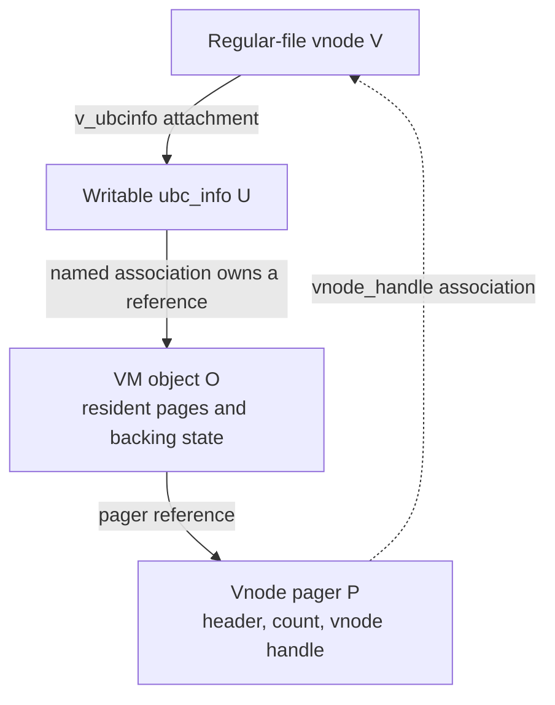
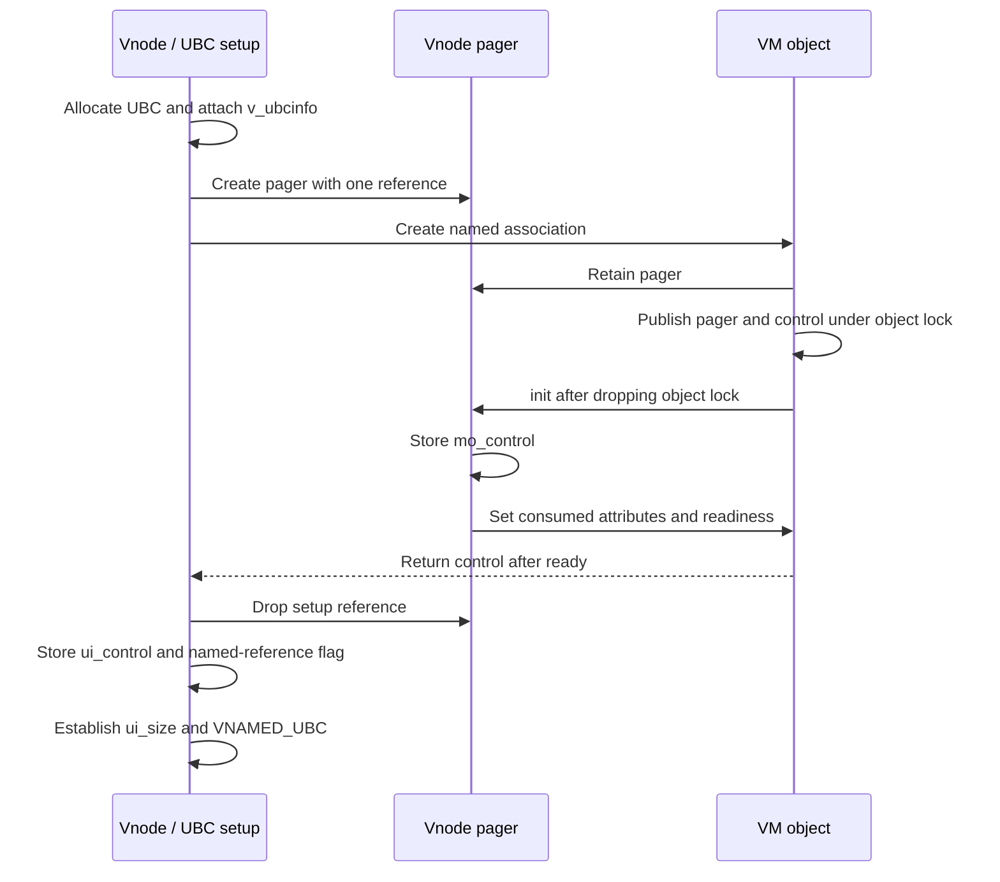
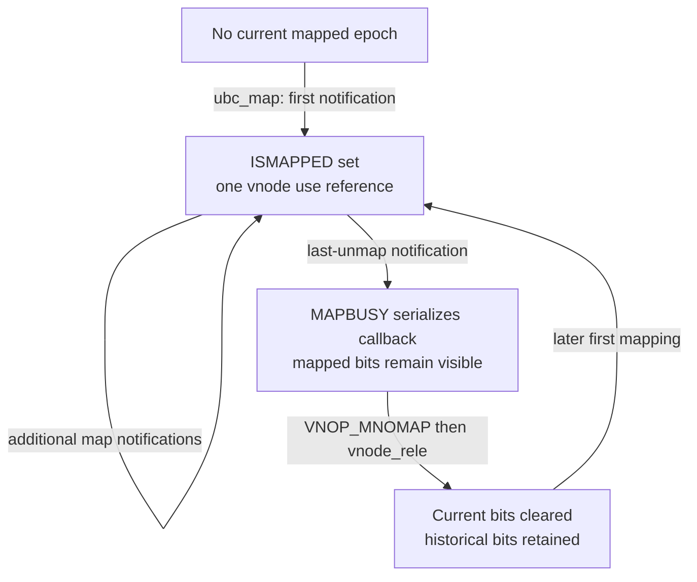
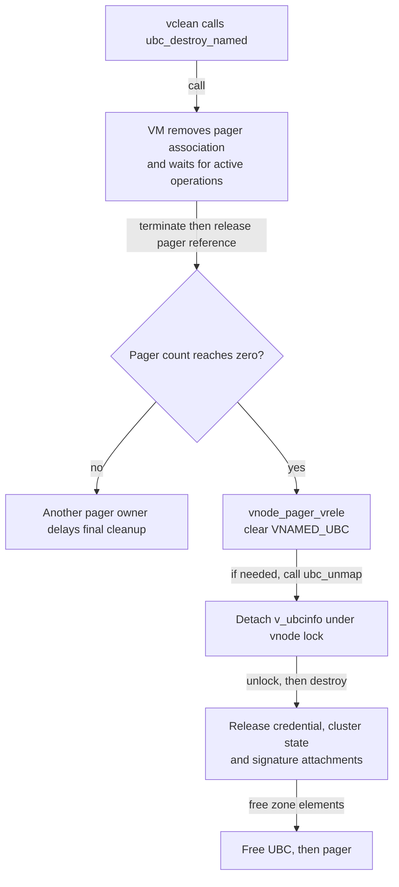

# UBC information and vnode pagers

A regular-file vnode connects filesystem identity to VM backing through `ubc_info` and a vnode pager. The UBC allocation stores the file's size, association pointers, paging credential, cluster contexts and signature attachments; the pager supplies the VM operation table and its own reference count. This companion follows their allocation, access, publication and destruction in `xnu-12377.121.6`.

[Structure guide](README.md) · [Vnode identity](vnodes-and-vnode-identity.md) · [VM objects](vm-objects-and-backing.md) · [Code-signature storage](code-signature-blob-storage.md)

Read [file data and cached reads](../subsystems/vfs/file-data-cache-and-read-path.md), [pagers and UPLs](../subsystems/vm/pagers-and-upl.md) and [clustered writeback](../subsystems/vfs/clustered-writeback.md) alongside this chapter for the complete I/O algorithms. Here the central questions are what a pointer represents, which reference keeps it valid, and which operation changes the association.

Inspect the live [`ubc_info`](layout-browser.md?declaration=ubc_info) and [`vnode_pager`](layout-browser.md?declaration=vnode_pager) layouts for the selected source profile.

## 1. Four structures, several different kinds of ownership

The vnode's `v_un` union uses its `vu_ubcinfo` member for `VREG`; other vnode types use the same storage for mounted-filesystem, socket, special-device or FIFO state. `v_ubcinfo` is the macro spelling of this member. `UBCINFOEXISTS()` checks only that the vnode is non-null, has type `VREG`, and has a non-null UBC pointer. It neither locks nor retains anything, and does not test completion of initialization. [Vnode union](../../platydoc-data/xnu/bsd/sys/vnode_internal.h#L175-L185), [member alias](../../platydoc-data/xnu/bsd/sys/vnode_internal.h#L238), [existence predicate](../../platydoc-data/xnu/bsd/kern/ubc_subr.c#L3025-L3029).



Solid arrows show an attachment or an owned reference as labeled. The dotted backlink is an association: assigning `vnode_handle` does not call `vnode_ref()`. The named association accounts for an ordinary VM-object reference, while the cached `ui_control` value is simply a pointer to that object. The additional pointer aliases omitted from the diagram are `U.ui_pager → P`, `P.mo_control → O`, and `U.ui_vnode → V`. They do not each add another reference. [UBC setup and reference transfer](../../platydoc-data/xnu/bsd/kern/ubc_subr.c#L1148-L1176), [pager constructor](../../platydoc-data/xnu/osfmk/vm/bsd_vm.c#L926-L949), [control representation](../../platydoc-data/xnu/osfmk/vm/memory_object.c#L1844-L1864).

The core UBC fields are small enough to read directly. [Source: `bsd/sys/ubc_internal.h`, lines 171–181](../../platydoc-data/xnu/bsd/sys/ubc_internal.h#L171-L181).

<!-- source-excerpt: ../../platydoc-data/xnu/bsd/sys/ubc_internal.h#L171-L181 -->
```c
struct ubc_info {
	memory_object_t         ui_pager;       /* pager */
	memory_object_control_t ui_control;     /* VM control for the pager */
	vnode_t                 XNU_PTRAUTH_SIGNED_PTR("ubc_info.ui_vnode") ui_vnode;       /* vnode for this ubc_info */
	kauth_cred_t            ui_ucred;       /* holds credentials for NFS paging */
	off_t                   ui_size;        /* file size for the vnode */
	uint32_t                ui_flags;       /* flags */
	uint32_t                cs_add_gen;     /* generation count when csblob was validated */

	struct  cl_readahead   *cl_rahead;      /* cluster read ahead context */
	struct  cl_writebehind *cl_wbehind;     /* cluster write behind context */
```

These are metadata fields. File bytes reside in VM pages or filesystem backing, not in `ubc_info` or the pager. `cl_rahead` and `cl_wbehind` point to scheduling/tracking state. `cs_blobs` points to signature metadata, which has a different allocator and protection model. [Remaining UBC fields](../../platydoc-data/xnu/bsd/sys/ubc_internal.h#L183-L195), [resident-page storage](vm-pages-and-resident-storage.md), [signature storage](code-signature-blob-storage.md).

### Storage, references and protection

| Allocation or value | Placement and owner | What keeps it valid; how it is released |
| --- | --- | --- |
| `struct ubc_info` | Typed `ubc_info_zone`, defined with `ZC_ZFREE_CLEARMEM`; allocated with `Z_WAITOK | Z_ZERO`. The vnode attaches this separate writable allocation. | Vnode/pager lifecycle synchronization keeps the attachment usable. Final pager release detaches it under the vnode lock and calls `ubc_info_deallocate()` outside that lock. There is no per-UBC reference count in its declaration. |
| `struct vnode_pager` | Typed `vnode_pager_zone`, defined with `ZC_NOENCRYPT`; allocated with `Z_WAITOK | Z_NOFAIL`. Ordinary writable storage. | Atomic pager references. The last release runs `vnode_pager_vrele()` and then frees the pager zone element. |
| `ui_control`, `mo_control` | Values of `memory_object_control_t`, a typedef of `struct vm_object *`. No separate control allocation on this path. | `memory_object_control_reference()` and `_deallocate()` are no-ops here. Object lifetime comes from the named association, map/copy owners and VM's other reference/operation protocols. |
| Named VM-object reference | The newly associated external object is marked `named`; UBC records `UI_HASOBJREF`. | `ubc_destroy_named()` reaches `vm_object_destroy()`, whose pager-present path consumes the caller's named object reference after releasing the association. |
| `ui_ucred` | A retained credential selected by `ubc_setcred()`. Credential storage has its own RO/writable split. | First valid assignment takes `kauth_cred_ref()`; UBC destruction calls `kauth_cred_unref()`. |
| Cluster contexts and sparse map | Separate writable allocations, lazily attached to UBC. | `cluster_release()` destroys context locks, releases a remaining sparse map and frees context zone elements. |
| Signature list, optional supplement and bitmap | Owned attachments reached through writable UBC fields; published `cs_blob` wrappers use a separate RO zone. | Signature-specific detach and destruction rules; see [code-signature storage](code-signature-blob-storage.md). |

Allocator evidence: [UBC and distinct RO signature zones](../../platydoc-data/xnu/bsd/kern/ubc_subr.c#L107-L117), [pager zone](../../platydoc-data/xnu/osfmk/vm/bsd_vm.c#L133-L134), [pager allocation](../../platydoc-data/xnu/osfmk/vm/bsd_vm.c#L926-L949), [control typedef](../../platydoc-data/xnu/osfmk/mach/memory_object_types.h#L110-L136), [no-op control helpers](../../platydoc-data/xnu/osfmk/vm/memory_object.c#L1882-L1906), [named-reference consumption](../../platydoc-data/xnu/osfmk/vm/vm_object.c#L2242-L2253), [UBC destructor](../../platydoc-data/xnu/bsd/kern/ubc_subr.c#L1198-L1213).

The pointer-authentication annotations on `v_ubcinfo`, `ui_vnode` and signature pointers do not put the surrounding structures in an RO zone. Ordinary stores in initialization, size updates and mapping flags demonstrate their writable use. Conversely, updating a signature wrapper's protected fields requires the mechanisms explained in the signature companion. Protection, reference ownership and mutual exclusion are separate properties.

## 2. Construction publishes an association in stages

For ordinary regular-file creation, `vnode_create_internal()` sets `v_type`, `v_op` and the filesystem's `v_data`, then calls `ubc_info_init_withsize()` for `VREG`. The later `*vpp` assignment and insertion into the mount/name cache make the new vnode discoverable through those routes. This is an initialization context, not an arbitrary concurrent lazy-install operation. [Creation and UBC call](../../platydoc-data/xnu/bsd/vfs/vfs_subr.c#L7031-L7084), [filesystem pointer and external publication](../../platydoc-data/xnu/bsd/vfs/vfs_subr.c#L7187-L7224).

`ubc_info_init_internal()` allocates if necessary, initializes the vnode backlink, flags and credential, then stores `vp->v_ubcinfo`. It does not acquire the vnode lock internally or compare-and-swap competing UBC candidates. Its reuse branch accepts an existing UBC allocation, but still constructs a new pager; do not treat this routine as a general idempotent “get or initialize” accessor. [Complete setup body](../../platydoc-data/xnu/bsd/kern/ubc_subr.c#L1096-L1179).

[Source: `bsd/kern/ubc_subr.c`, lines 1110–1121](../../platydoc-data/xnu/bsd/kern/ubc_subr.c#L1110-L1121).

<!-- source-excerpt: ../../platydoc-data/xnu/bsd/kern/ubc_subr.c#L1110-L1121 -->
```c
	if (uip == UBC_INFO_NULL) {
		uip = zalloc_flags(ubc_info_zone, Z_WAITOK | Z_ZERO);

		uip->ui_vnode = vp;
		uip->ui_flags = UI_INITED;
		uip->ui_ucred = NOCRED;
	}
	assert(uip->ui_flags != UI_NONE);
	assert(uip->ui_vnode == vp);

	/* now set this ubc_info in the vnode */
	vp->v_ubcinfo = uip;
```

The next steps establish the relationship:

1. `vnode_pager_setup()` creates a pager. Its second argument, the old cached pager pointer, is ignored. The constructor installs the operation table, null control, zero last-unmap thread ID, an initial reference count and `vnode_handle`. [Setup](../../platydoc-data/xnu/osfmk/vm/bsd_vm.c#L383-L394), [constructor](../../platydoc-data/xnu/osfmk/vm/bsd_vm.c#L926-L949).
2. UBC sets `UI_HASPAGER`, then stores `ui_pager`. `memory_object_create_named()` asks VM to allocate and associate an external object with this pager. VM retains the pager and installs `object->pager` and `object->pager_control` under the object lock. [UBC ordering](../../platydoc-data/xnu/bsd/kern/ubc_subr.c#L1133-L1158), [VM association](../../platydoc-data/xnu/osfmk/vm/vm_object.c#L4516-L4549).
3. VM drops the object lock before calling `memory_object_init()`. The vnode pager stores its `mo_control` backlink and requests attributes, which make the external object ready. VM later marks initialization complete. The association call explicitly ignores the `init` return value; the vnode implementation panics if its attribute request fails. [Callback boundary](../../platydoc-data/xnu/osfmk/vm/vm_object.c#L4551-L4573), [vnode initialization](../../platydoc-data/xnu/osfmk/vm/bsd_vm.c#L400-L439).
4. Named-object creation waits for readiness and returns the control. UBC drops the temporary pager reference returned by setup, stores `ui_control`, records `UI_HASOBJREF`, establishes `ui_size`, and finally sets `VNAMED_UBC` on the vnode. [Named creation](../../platydoc-data/xnu/osfmk/vm/vm_object.c#L5858-L5894), [UBC completion](../../platydoc-data/xnu/bsd/kern/ubc_subr.c#L1156-L1178).



The diagram shows calls and publication order, not additional ownership edges. During initialization `v_ubcinfo != NULL` precedes both the usable control and final size; a bare existence predicate cannot establish readiness. The callback is synchronous in the displayed path, but the generic named-creation body still contains the readiness wait.

The reference transfer is explicit. [Source: `bsd/kern/ubc_subr.c`, lines 1156–1165](../../platydoc-data/xnu/bsd/kern/ubc_subr.c#L1156-L1165).

<!-- source-excerpt: ../../platydoc-data/xnu/bsd/kern/ubc_subr.c#L1156-L1165 -->
```c
	kret = memory_object_create_named(pager,
	    (memory_object_size_t)uip->ui_size, &control);
	vnode_pager_deallocate(pager);
	if (kret != KERN_SUCCESS) {
		panic("ubc_info_init: memory_object_create_named returned %d", kret);
	}

	assert(control);
	uip->ui_control = control;      /* cache the value of the mo control */
	SET(uip->ui_flags, UI_HASOBJREF);       /* with a named reference */
```

### Attributes: follow the receiving implementation

`vnode_pager_init()` fills `copy_strategy = MEMORY_OBJECT_COPY_DELAY`, `cluster_size = PAGE_SIZE`, `may_cache_object = TRUE` and `temporary = TRUE` in its argument. In this snapshot, the receiving `MEMORY_OBJECT_ATTRIBUTE_INFO` switch reads **only** `copy_strategy` and `may_cache_object`. The common setter installs the copy strategy and `can_persist`, marks the pager ready and wakes waiters under the object lock. Consequently, these assignments do not establish that `cluster_size` or `temporary` changed an object field. Fault clustering is calculated separately in `vnode_pager_data_request()`. [Supplied attributes](../../platydoc-data/xnu/osfmk/vm/bsd_vm.c#L420-L436), [consumed fields](../../platydoc-data/xnu/osfmk/vm/memory_object.c#L1191-L1205), [actual object updates](../../platydoc-data/xnu/osfmk/vm/memory_object.c#L1035-L1085), [cluster selection](../../platydoc-data/xnu/osfmk/vm/bsd_vm.c#L647-L675).

### Partial initialization and failure

The `withsize` route stores the size supplied by the filesystem. The plain `ubc_info_init()` route delays `vnode_size()` until after pager/control association, because the source warns that filesystem attribute retrieval can reenter buffer invalidation. If this query fails, it sets `ui_size = 0`, still sets `VNAMED_UBC`, and returns the error. It does not undo the association. A caller must therefore distinguish a failed size query from “nothing was allocated.” The regular-file creator's `withsize` route contains an error branch that marks its vnode dead and releases it, but does not execute this late size query. [Entry variants](../../platydoc-data/xnu/bsd/kern/ubc_subr.c#L1042-L1063), [reentry rationale and size result](../../platydoc-data/xnu/bsd/kern/ubc_subr.c#L1140-L1178), [creator error path](../../platydoc-data/xnu/bsd/vfs/vfs_subr.c#L7067-L7079).

Named-association failure is a panic in UBC initialization, not a normal errno rollback. The pager constructor uses a no-fail allocation, and the UBC allocation requests waiting zeroed storage. Do not invent a candidate-free-and-retry path analogous to the lazy cluster-context installers described below.

## 3. The pager header identifies a provider, not a task-local port name

The vnode pager embeds the generic `memory_object` header first. On the configuration where `MEMORY_OBJECT_HAS_REFCOUNT` is true it uses the header's count; otherwise its own declaration supplies a count. The generic header includes the operation table, control backlink and `mo_last_unmap_ctid`. It is not an `ipc_port` allocation with a send-right namespace. The first-word `IKOT_MEMORY_OBJECT` tag preserves the raw-object discrimination required by APIs that historically accepted both forms. [Header and configuration](../../platydoc-data/xnu/osfmk/mach/memory_object_types.h#L80-L87), [generic layout](../../platydoc-data/xnu/osfmk/mach/memory_object_types.h#L107-L136), [constructor explanation](../../platydoc-data/xnu/osfmk/vm/bsd_vm.c#L933-L946).

[Source: `osfmk/vm/bsd_vm.c`, lines 89–100](../../platydoc-data/xnu/osfmk/vm/bsd_vm.c#L89-L100).

<!-- source-excerpt: ../../platydoc-data/xnu/osfmk/vm/bsd_vm.c#L89-L100 -->
```c
typedef struct vnode_pager {
	/* mandatory generic header */
	struct memory_object vn_pgr_hdr;

	/*  pager-specific */
#if MEMORY_OBJECT_HAS_REFCOUNT
#define vn_pgr_hdr_ref      vn_pgr_hdr.mo_ref
#else
	os_ref_atomic_t         vn_pgr_hdr_ref;
#endif
	struct vnode            *vnode_handle;  /* vnode handle              */
} *vnode_pager_t;
```

| Pager field | Read/access path | Mutation and lifetime rule |
| --- | --- | --- |
| `mo_ikot` | Raw memory-object discrimination | Written by construction; not an IPC name or receiver right. |
| `mo_pager_ops` | Generic memory-object dispatch; `vnode_pager_lookup()` asserts equality with `vnode_pager_ops` | Constructor installs the constant operation table. Lookup is a cast and identity assertion, not a lookup table or retain. |
| `vn_pgr_hdr_ref` | Atomic pager reference count | `vnode_pager_reference()` retains; `_deallocate()` releases and performs final cleanup at zero. |
| `mo_control` | Cluster-size and pager-to-object conversion paths | Initially null; initialized to the VM-object control. Calling the nominal control retain does not increment an object count in this snapshot. |
| `mo_last_unmap_ctid` | VM destruction's check for reentry from the same last-unmap callback | VM sets it around the callback while holding mapping serialization, drops the object lock for the callback, then reloads the current pager before resetting it. |
| `vnode_handle` | Page-in/out and mapping callbacks; `vnode_pager_lookup_vnode()` | Constructor stores a vnode pointer without an independent `vnode_ref()`. Callback entry uses the pager/vnode lifecycle protocol and pager-specific iocount functions. |

Evidence: [lookup helpers](../../platydoc-data/xnu/osfmk/vm/bsd_vm.c#L955-L977), [reference operations](../../platydoc-data/xnu/osfmk/vm/bsd_vm.c#L682-L710), [last-unmap thread bookkeeping](../../platydoc-data/xnu/osfmk/vm/vm_object.c#L794-L835), [destroy-side reentry check](../../platydoc-data/xnu/osfmk/vm/vm_object.c#L2212-L2237).

A useful count trace, assuming no other pager retain, is: constructor gives **1**; VM association retains to **2**; UBC releases the setup result to **1**; final release of the VM object's pager association reaches **0**. `ui_pager` continues to hold the same address during the middle interval without contributing another count. A mapped epoch can hold an additional **vnode use reference**, described below; that is a different counter on a different structure.

## 4. Accessors borrow the association

| Accessor | Result and missing-state value | Work it does not perform |
| --- | --- | --- |
| `UBCINFOEXISTS(vp)` | Predicate on pointer, vnode type and attached UBC pointer | No retain, lock, initialization wait or reclaim-state validation. |
| `ubc_getpager(vp)` | `ui_pager`, or zero | No pager retain. |
| `ubc_getobject(vp, flags)` | `ui_control`, or `MEMORY_OBJECT_CONTROL_NULL` | No object reference; `flags` is unused. |
| `ubc_getsize(vp)` | `ui_size`, or zero | No size lock and no distinction between absent UBC and an empty file. |
| `ubc_getcred(vp)` | `ui_ucred`, or `NOCRED` | No credential retain. |
| `ubc_is_mapped*()` / `ubc_was_mapped()` | Current-epoch / historical mapped and writable flag information | No count of individual mappings and no lock acquisition. |
| `vnode_pager_lookup_vnode(pager)` | Vnode handle if the operation table matches, otherwise null | No vnode iocount or use reference. |

Read the short bodies before relying on a name: [pager getter](../../platydoc-data/xnu/bsd/kern/ubc_subr.c#L1573-L1580), [size getter](../../platydoc-data/xnu/bsd/kern/ubc_subr.c#L1370-L1379), [credential getter](../../platydoc-data/xnu/bsd/kern/ubc_subr.c#L1444-L1451), [mapping predicates](../../platydoc-data/xnu/bsd/kern/ubc_subr.c#L3042-L3069), [vnode lookup](../../platydoc-data/xnu/osfmk/vm/bsd_vm.c#L967-L977).

[Source: `bsd/kern/ubc_subr.c`, lines 1607–1614](../../platydoc-data/xnu/bsd/kern/ubc_subr.c#L1607-L1614).

<!-- source-excerpt: ../../platydoc-data/xnu/bsd/kern/ubc_subr.c#L1607-L1614 -->
```c
ubc_getobject(struct vnode *vp, __unused int flags)
{
	if (UBCINFOEXISTS(vp)) {
		return vp->v_ubcinfo->ui_control;
	}

	return MEMORY_OBJECT_CONTROL_NULL;
}
```

The defined flag `UBC_HOLDOBJECT` and calls that pass it retain historical spelling; they do not override this body. The preceding comment explicitly describes the old hold/reactivation behavior as deprecated. A borrowed pointer is usable only within the caller's existing vnode/VM lifetime protocol. For example, `mmap` has acquired the vnode and checks the returned control, while pager callbacks enter with VM paging or mapping synchronization and acquire a pager-specific iocount. [Deprecated flags](../../platydoc-data/xnu/bsd/kern/ubc_subr.c#L1591-L1604), [mapping-side use](../../platydoc-data/xnu/bsd/kern/kern_mman.c#L832-L850), [page-in context](../../platydoc-data/xnu/bsd/vm/vnode_pager.c#L631-L661), [mapping context](../../platydoc-data/xnu/bsd/kern/ubc_subr.c#L1977-L1996).

### Field protection follows the operation

`ubc_info` does not contain one mutex protecting all its members. The following is an operation-specific matrix; the existence/getter functions above do not acquire these protections for the reader.

| Field or relationship | Principal updater shown here | Protection / validation to follow |
| --- | --- | --- |
| Vnode's `v_ubcinfo` attachment | Initial setup; final `vnode_pager_vrele()` | Creation context before ordinary publication; final detach under `v_lock`. |
| `ui_pager`, `ui_control`, `ui_vnode` | Association construction | Setup protocol and VM-object association locking, not per-field accessor locks. Destruction first disables the object-side association and waits for ongoing activity. |
| `ui_size` | Initial setup and `ubc_setsize_ex()` | The helper does not serialize filesystem size changes itself. Follow the filesystem caller's size/operation protocol and the UPL/VM operations used to synchronize cached pages. |
| `ui_ucred` | `ubc_setcred()` | `vnode_lock()` protects the first-valid-credential decision and publication. The stored reference is released during final UBC cleanup. |
| Current and historical mapping bits, `UI_MAPBUSY`, `UI_MAPWAITING` | `ubc_map()` / `ubc_unmap()` | Vnode lock for transitions; busy/wait protocol spans provider calls made without that lock. VM mapping serialization protects the broader pager lifetime. |
| `cl_rahead`, `cl_wbehind` | Lazy cluster-context creation | Vnode lock decides the winner and publishes the context. The context's own mutex protects its mutable state afterward. |
| Signature attachments and invalidation bits | Signature add/invalidate/detach paths | Vnode and code-signature-specific lifetime rules; RO wrapper mutation is separate from changing the writable UBC list head. |

Evidence: [size updater](../../platydoc-data/xnu/bsd/kern/ubc_subr.c#L1250-L1341), [credential publication](../../platydoc-data/xnu/bsd/kern/ubc_subr.c#L1533-L1555), [map serialization](../../platydoc-data/xnu/bsd/kern/ubc_subr.c#L1998-L2046), [cluster publication](../../platydoc-data/xnu/bsd/vfs/vfs_cluster.c#L503-L580), [final detach](../../platydoc-data/xnu/bsd/vfs/vfs_subr.c#L4422-L4453), [signature lifetime](../subsystems/security/vnode-signature-lifecycle.md).

## 5. Credentials, prediction and writeback tracking own separate storage

### The paging credential is retained once

`ubc_setcred()` returns zero if no UBC exists. Otherwise it locks the vnode, retains and stores the supplied credential only if `ui_ucred` is not already valid, unlocks, and returns one. A subsequent successful call can therefore leave the original credential unchanged. This is not the process credential replacement algorithm. [Setter](../../platydoc-data/xnu/bsd/kern/ubc_subr.c#L1533-L1555), [credential storage and references](credentials-and-credential-storage.md).

[Source: `bsd/kern/ubc_subr.c`, lines 1546–1554](../../platydoc-data/xnu/bsd/kern/ubc_subr.c#L1546-L1554).

<!-- source-excerpt: ../../platydoc-data/xnu/bsd/kern/ubc_subr.c#L1546-L1554 -->
```c
	vnode_lock(vp);
	uip = vp->v_ubcinfo;
	if (!IS_VALID_CRED(uip->ui_ucred)) {
		kauth_cred_ref(ucred);
		uip->ui_ucred = ucred;
	}
	vnode_unlock(vp);

	return 1;
```

`ubc_setthreadcred()` asserts that its process and thread arguments are current, then passes `kauth_cred_get()` to that setter. The file mapping path calls it after retrieving the control. Successful `VT_NFS` writes also call `ubc_setcred()` using the VFS context credential. The stored reference survives those callers and is released by UBC destruction. [Current-credential wrapper](../../platydoc-data/xnu/bsd/kern/ubc_subr.c#L1503-L1510), [`mmap` call](../../platydoc-data/xnu/bsd/kern/kern_mman.c#L843-L850), [NFS write call](../../platydoc-data/xnu/bsd/vfs/vfs_vnops.c#L1485-L1490), [destructor](../../platydoc-data/xnu/bsd/kern/ubc_subr.c#L1198-L1205).

This field is separate from the vnode's `v_cred` authorization cache and from a fileglob's open-time credential. `v_cred` accompanies authorized-action and cache-generation fields protected by the name-cache lock; `ui_ucred` retains a paging credential through UBC lifetime. Its declaration describes NFS paging, but the NFS **client** vnode provider that would consume this policy is absent from this checkout. Included NFS server code is a different implementation boundary. [Vnode authorization fields](../../platydoc-data/xnu/bsd/sys/vnode_internal.h#L189-L197), [fileglob companion](fileprocs-and-fileglobs.md), [NFS availability](../subsystems/vfs/filesystems-and-nfs.md#lockd-gssd-and-missing-client-code).

### Lazy contexts have an allocation race that UBC setup does not

`cl_readahead` contains its mutex and three prediction fields: the last requested block, maximum prefetched block and last prefetch length. `cl_writebehind` contains its own mutex, recent-write coordinates, packed extent records, an optional sparse tracking map and counters for pushes running outside the lock. The two contexts come from separate ordinary zones. [Context layouts](../../platydoc-data/xnu/bsd/sys/ubc_internal.h#L77-L100), [context zones](../../platydoc-data/xnu/bsd/vfs/vfs_cluster.c#L166-L170).

`cluster_get_rap()` allocates and initializes a candidate without holding the vnode lock. Under the vnode lock it either attaches that candidate or destroys/frees it and adopts the already-published winner. It then **tries** `cl_lockr`; failure returns null so that the read can proceed without that predictor. `cluster_get_wbp()` uses the same publication competition, but can decline allocation unless `CLW_ALLOCATE` is requested and can acquire `cl_lockw` with a blocking lock when `CLW_RETURNLOCKED` is set. Neither helper acquires a separate UBC reference. [Read-ahead installation](../../platydoc-data/xnu/bsd/vfs/vfs_cluster.c#L503-L531), [write-behind installation](../../platydoc-data/xnu/bsd/vfs/vfs_cluster.c#L548-L580).

The sparse map describes dirty regions; it is not their page data. During `cluster_push_ext()`, a pusher moves `cl_scmap` into a local pointer, clears the field, increments `cl_sparse_pushes` and drops `cl_lockw` before pushing. New writes can install another tracking map during that interval. On relock, the pusher decrements the counter and resolves an error according to whether another map now exists. One branch frees the old tracking map while leaving dirty pages intact; another restores the old map. Synchronous push uses `cl_sparse_wait` and waits for existing sparse pushes. [Wait and ownership transfer](../../platydoc-data/xnu/bsd/vfs/vfs_cluster.c#L6577-L6624), [error reconciliation](../../platydoc-data/xnu/bsd/vfs/vfs_cluster.c#L6626-L6658).

At teardown, `cluster_release()` destroys a remaining sparse map through `vfs_drt_control(..., 0)`, destroys both context mutexes, frees their zone elements and nulls the UBC pointers. This destructor has no independent wait-for-I/O loop; it runs within the surrounding vnode/VM teardown protocol. [Context destructor](../../platydoc-data/xnu/bsd/vfs/vfs_cluster.c#L6703-L6728), [sparse-map destruction](../../platydoc-data/xnu/bsd/vfs/vfs_cluster.c#L8330-L8357).

## 6. Mapping bits describe a shared epoch, not individual VM entries

| Bit / marker | Meaning in the displayed implementation |
| --- | --- |
| `UI_INITED`, `UI_HASPAGER`, `UI_HASOBJREF` | Construction milestones. The last records the named VM-object association; none is a reference counter. |
| `VNAMED_UBC` in `v_lflag` | Vnode-side association marker set after UBC setup and cleared during final pager release. It is not a unit in `v_usecount`. |
| `UI_ISMAPPED` | UBC currently holds the mapped-epoch state and associated vnode use reference. |
| `UI_MAPPEDWRITE` | A writable map notification occurred in this epoch; cleared at last unmap. It does not count writable VM entries or prove a write happened. |
| `UI_WASMAPPED`, `UI_WASMAPPEDWRITE` | Historical mapping observations retained after current-epoch bits clear. |
| `UI_MAPBUSY`, `UI_MAPWAITING` | Serialization across mapping/unmapping callbacks; waiters sleep on the flags with the vnode mutex. |
| `UI_CSBLOBINVALID` | Signature invalidation state handled by the signature lifecycle, independently of current mappings. |

[Flag definitions](../../platydoc-data/xnu/bsd/sys/ubc_internal.h#L198-L209), [setup marker](../../platydoc-data/xnu/bsd/kern/ubc_subr.c#L1164-L1176), [map changes](../../platydoc-data/xnu/bsd/kern/ubc_subr.c#L2025-L2054), [unmap changes](../../platydoc-data/xnu/bsd/kern/ubc_subr.c#L2319-L2338), [association-marker removal](../../platydoc-data/xnu/bsd/vfs/vfs_subr.c#L4426-L4448).

`ubc_map()` first obtains a pager-specific iocount. The source ties its safety to VM's mapping-in-progress synchronization. With UBC present it waits for `UI_MAPBUSY`, sets that bit, and drops the vnode lock before calling `VNOP_MMAP`. It then sets `error = 0` unconditionally: the provider's return is not an admission decision propagated through this route. If this starts a mapped epoch, it sets the current/historical bits and subsequently takes one `vnode_ref_ext(..., VNODE_REF_FORCE)` use reference. Repeated map notifications while `UI_ISMAPPED` remains set do not each take that use reference. A missing UBC during reclaim also returns success here, leaving the VM caller responsible for recognizing that its pager disappeared. [Entry and callback](../../platydoc-data/xnu/bsd/kern/ubc_subr.c#L1970-L2023), [flags and reference](../../platydoc-data/xnu/bsd/kern/ubc_subr.c#L2025-L2054).



This diagram shows the UBC state transitions, not a count of address ranges. Setting `UI_MAPBUSY` does not mean the vnode mutex stays held across `VNOP_MMAP` or `VNOP_MNOMAP`. On initial mapping, root-filesystem or reliable-media classification can also mark the VM object `pager_trusted`. That is a backing-consistency/copy-policy property, separate from a file's code-signature state. [Trusted-backing decision](../../platydoc-data/xnu/bsd/kern/ubc_subr.c#L2071-L2078).

### What triggers last unmap

When `vm_object_deallocate()` sees two ordinary references on a named object, dropping the non-named one may leave only the named association. It waits for prior mapping activity, **rechecks** the count, named flag and pager, begins mapping serialization, stores the current thread ID in the pager, drops the object lock, and calls `memory_object_last_unmap()`. It reloads `object->pager` after the callback because that callback can cause destruction; the old local pointer is no longer assumed valid. [Full branch](../../platydoc-data/xnu/osfmk/vm/vm_object.c#L794-L837).

The vnode pager's operation calls `ubc_unmap()`. That routine takes the pager-specific iocount and busy protocol, but calls `VNOP_MNOMAP` while `UI_ISMAPPED` / `UI_MAPPEDWRITE` are still visible: the provider may query them. It then drops the mapped-epoch vnode use reference and clears the current bits. Under `CONFIG_FSE`, a writable epoch can generate a conservative modification event even if no write occurred. This is a provider notification and lifetime transition; `ubc_unmap()` itself is not the page-table removal routine. [Pager callback](../../platydoc-data/xnu/osfmk/vm/bsd_vm.c#L755-L765), [unmap ordering](../../platydoc-data/xnu/bsd/kern/ubc_subr.c#L2269-L2343).

### No-senders belongs to a different object

A VM object being **named** here is not the same thing as a `vm_named_entry` exported through a Mach memory-entry port. Neither the vnode pager's operation table nor its refcount is a memory-entry no-senders notification. If a file-backed object is carried by a memory-entry capability, that separate capability has its own ownership and final-send-right cleanup. Follow [memory-entry capability destruction](memory-entries-and-vm-copies.md#4-final-send-right-release-does-not-remove-existing-mappings) for that path. Its release can drop an object reference, but does not turn `ui_control` into an IPC send right. [Vnode operation table](../../platydoc-data/xnu/osfmk/vm/bsd_vm.c#L75-L87), [control typedef](../../platydoc-data/xnu/osfmk/mach/memory_object_types.h#L112).

## 7. File-size updates change the validity boundary before VM cleanup

`ui_size` is the cached file length in bytes. It is not the fileglob's current I/O offset, the number of resident pages, or the size interpretation of every `vm_object` union. `ubc_setsize_ex()` rejects negative sizes and absent UBC. `UBC_SETSIZE_NO_FS_REENTRY` rejects shrinking with `EAGAIN` before the update. Otherwise it writes the new size **before** touching cached pages. Growth can post `NOTE_EXTEND` and return without allocating all newly covered pages. [Size validation and update](../../platydoc-data/xnu/bsd/kern/ubc_subr.c#L1250-L1284), [object unions](vm-objects-and-backing.md#fields-whose-interpretation-changes-with-the-object), [file offsets](fileprocs-and-fileglobs.md).

[Source: `bsd/kern/ubc_subr.c`, lines 1269–1284](../../platydoc-data/xnu/bsd/kern/ubc_subr.c#L1269-L1284).

<!-- source-excerpt: ../../platydoc-data/xnu/bsd/kern/ubc_subr.c#L1269-L1284 -->
```c
	if (ISSET(opts, UBC_SETSIZE_NO_FS_REENTRY) && nsize < osize) {
		return EAGAIN;
	}

	/*
	 * Update the size before flushing the VM
	 */
	uip->ui_size = nsize;

	if (nsize >= osize) {   /* Nothing more to do */
		if (nsize > osize) {
			lock_vnode_and_post(vp, NOTE_EXTEND);
		}

		return 0;
	}
```

For shrink, the helper calculates the page containing the new EOF and the old rounded-up end. If EOF is inside a page, it creates a one-page lite UPL, zeroes the tail **if that page is valid in the UPL**, and releases the UPL range. It then flushes the remaining full pages beyond EOF through `memory_object_lock_request()` with `MEMORY_OBJECT_RETURN_NONE` and a flush flag. UPL creation failure panics here; invalidation failure prints a diagnostic and becomes the returned BSD error. There is no restoration of the old `ui_size`. The older `ubc_setsize()` wrapper returns a boolean success result rather than that errno. [Tail and full-page cleanup](../../platydoc-data/xnu/bsd/kern/ubc_subr.c#L1286-L1348).

### Worked coordinates: one file object and a truncation

Select a **16 KiB kernel page size** (`PAGE_SIZE = 0x4000`) and an ordinary file-backed object with `paging_offset = 0`. Suppose a map entry begins at CPU virtual address `0x100000` and maps object/file offset `0x8000`. This is an illustrative coordinate example; it does not select a physical frame or filesystem block layout.

| Value | Calculation | Meaning |
| --- | --- | --- |
| CPU virtual address | `0x104120` | A process access within the entry. |
| Displacement in the entry | `0x104120 - 0x100000 = 0x4120` | Distance from the entry start. |
| Object/file byte offset | `0x8000 + 0x4120 = 0xc120` | Byte in the file-backed object's offset namespace. |
| Demand page offset | `0xc120 & ~0x3fff = 0xc000` | Page-aligned offset supplied to the pager for this demand. |
| Byte within the page | `0x120` | Offset within resident physical bytes once supplied. |

Map-to-object translation is described in [maps and entries](vm-maps-and-entries.md). The external UPL path explicitly rejects an external object with nonzero `paging_offset`; the vnode pager requires the demand offset to be page-aligned and can choose a larger cluster containing it. A cluster base, a file byte offset, a page-list index and a physical address remain different coordinates. [External offset invariant](../../platydoc-data/xnu/osfmk/vm/vm_pageout.c#L6604-L6619), [pager demand and cluster coordinates](../../platydoc-data/xnu/osfmk/vm/bsd_vm.c#L647-L675).

Now shrink the file from `ui_size = 0x19000` to `0x9123`:

1. Publish `ui_size = 0x9123`.
2. The last partial page begins at `0x8000`; EOF is `0x1123` bytes into it. If that page is present, zero `0x4000 - 0x1123 = 0x2edd` bytes in its tail.
3. The old rounded-up end is `0x1c000`. Full-page invalidation begins after the partial page, at `0xc000`.
4. Flush the interval `[0xc000, 0x1c000)`: `0x10000` bytes, or four 16 KiB pages. The previously illustrated byte at offset `0xc120` is now beyond EOF.

The helper already exposes the new size if a later invalidation operation fails. Whether a particular filesystem permits a concurrent read or mapping operation during this transition depends on its own serialization; the UBC helper alone does not document the absent filesystem implementation.

## 8. The operation table crosses into filesystem callbacks

The vnode pager's `memory_object_pager_ops` is the concrete generic-to-vnode dispatch table. It contains no backing-object callback, and its `data_initialize` implementation panics rather than supplying a general provider operation. [Operation table](../../platydoc-data/xnu/osfmk/vm/bsd_vm.c#L75-L87), [unsupported initialization body](../../platydoc-data/xnu/osfmk/vm/bsd_vm.c#L468-L475).

| Generic callback | Vnode-pager implementation | Association and failure detail |
| --- | --- | --- |
| `data_request` | Chooses a cluster and calls `vnode_pager_cluster_read()` → `vnode_pagein()` | The incoming length/access arguments are unused. Cluster selection must still include the demanded page. Follow page-in/UPL completion rather than interpreting a request as already resident bytes. |
| `data_return` | Calls `vnode_pager_cluster_write()` → `vnode_pageout()` | Uses residual/error outputs where applicable; the immediate wrapper returns `KERN_SUCCESS`, so that return alone is not a complete disk-I/O result. |
| `map` | `ubc_map()` | Mapping lifetime notification with the error normalization described above. |
| `last_unmap` | `ubc_unmap()` | Drops the mapped-epoch vnode reference, not the named association itself. Callback effects can still trigger wider reclaim. |
| `terminate` | `vnode_pager_terminate()` | Returns success without detaching UBC or freeing the pager. |
| `deallocate` | `vnode_pager_deallocate()` | Final reference drop triggers UBC detachment and pager storage release. |

Evidence: [request](../../platydoc-data/xnu/osfmk/vm/bsd_vm.c#L647-L675), [return wrapper](../../platydoc-data/xnu/osfmk/vm/bsd_vm.c#L446-L465), [cluster read and page-in](../../platydoc-data/xnu/osfmk/vm/bsd_vm.c#L855-L920), [cluster write](../../platydoc-data/xnu/osfmk/vm/bsd_vm.c#L774-L848), [map/unmap](../../platydoc-data/xnu/osfmk/vm/bsd_vm.c#L731-L765), [termination and deallocation](../../platydoc-data/xnu/osfmk/vm/bsd_vm.c#L695-L725).

The BSD `vnode_pagein()` / `vnode_pageout()` layer obtains a pager-specific iocount. Its comments distinguish VM paging-in-progress synchronization from calls already holding an iocount, such as explicit synchronization or swap-file I/O. Missing UBC becomes an error and, where that path owns completion, aborts the supplied UPL range. For `VFC_VFSVNOP_PAGEINV2`, the filesystem receives a null UPL and is responsible for obtaining the range after taking its own necessary locks; the demanded page is identified by `f_offset + upl_offset`. Other paths construct/use a UPL before provider dispatch. [Pageout entry and missing UBC](../../platydoc-data/xnu/bsd/vm/vnode_pager.c#L323-L357), [page-in context and PAGEINV2 contract](../../platydoc-data/xnu/bsd/vm/vnode_pager.c#L631-L694), [completion/error handling](../../platydoc-data/xnu/bsd/vm/vnode_pager.c#L827-L850).

`vnode_put_from_pager()` also matters at exit: when final iocount processing sees a vnode marked for termination, the pager route queues asynchronous reclaim instead of synchronously reentering reclaim and deadlocking with its own paging activity. The source rechecks state after an unlocked `VNOP_INACTIVE` callback. [Pager put wrapper](../../platydoc-data/xnu/bsd/vfs/vfs_subr.c#L6507-L6518), [retry and asynchronous reclaim](../../platydoc-data/xnu/bsd/vfs/vfs_subr.c#L6443-L6484). The [vnode companion](vnodes-and-vnode-identity.md) explains the wider iocount/usecount/reclaim protocol.

## 9. Cached pages, UBC storage and open-file lifetime can end separately

When the first use reference is acquired for an eligible regular vnode, `vnode_ref_ext()` calls `memory_object_mark_used()`; when its use count falls to zero, the release path can call `memory_object_mark_unused()`. Those VM helpers remove/add the external object from/to VM's object cache. Cache insertion requires resident pages and excludes ledger-owned objects whose union fields have another interpretation. This cache linkage lives in the VM object, not in a separate array of bytes inside UBC. [Mark used](../../platydoc-data/xnu/bsd/vfs/vfs_subr.c#L2388-L2392), [mark unused](../../platydoc-data/xnu/bsd/vfs/vfs_subr.c#L2789-L2793), [VM helpers](../../platydoc-data/xnu/osfmk/vm/memory_object.c#L1615-L1649), [cache insertion](../../platydoc-data/xnu/osfmk/vm/vm_object.c#L1099-L1131).

Closing one descriptor, ending the last mapped epoch, reclaiming a clean page and destroying the named association are therefore different events. Resident pages may disappear while the vnode, UBC and pager remain attached; the next fault can still request the same file offset. The same object can be reached by multiple file handles and mapping owners. Follow [fileproc/fileglob ownership](fileprocs-and-fileglobs.md), [VM object ownership](vm-objects-and-backing.md) and [page recycling](vm-pages-and-resident-storage.md) for those separate releases.

## 10. Reclaim disables VM backing before freeing the UBC allocation

`vclean()` starts with vnode locking, marks termination and drops the vnode lock for filesystem callbacks. With `DOCLOSE` it performs filesystem/buffer synchronization and asks UBC to push and invalidate cached pages. It then selects a destroy reason and calls `ubc_destroy_named()` before `VNOP_RECLAIM`. The filesystem callback is an external dispatch boundary; its implementation is not supplied merely by this generic order. [Termination and synchronization](../../platydoc-data/xnu/bsd/vfs/vfs_subr.c#L3029-L3104), [destroy reason and reclaim order](../../platydoc-data/xnu/bsd/vfs/vfs_subr.c#L3129-L3168).

`ubc_destroy_named()` retrieves the borrowed control, even though the call passes the deprecated `UBC_HOLDOBJECT` flag, and calls `memory_object_destroy()`. VM clears the named/cacheable state, removes `object->pager`, disables the object's `pager_control` field, and waits for in-progress paging, page-list requests and mapping callbacks. Its special same-thread last-unmap check prevents waiting for itself. The `alive = FALSE` assignment visible nearby is under `#if 00` and is not executed. [UBC destroy](../../platydoc-data/xnu/bsd/kern/ubc_subr.c#L2115-L2133), [VM association removal and waits](../../platydoc-data/xnu/osfmk/vm/vm_object.c#L2190-L2237).

Disabling `object->pager_control` sets that particular pointer slot to null. It does not find and null every alias stored in `ui_control` or the pager header. Their safety comes from the ordered teardown and wait protocol, not a self-invalidating control handle. After dropping the object lock, VM calls `memory_object_terminate()` and then releases its pager reference; the vnode `terminate` method itself only returns success. VM subsequently consumes the named reference on the object. An object retained by other owners can outlive the removed filesystem pager. [Control disable](../../platydoc-data/xnu/osfmk/vm/memory_object.c#L1900-L1906), [terminate then release](../../platydoc-data/xnu/osfmk/vm/vm_object.c#L2110-L2123), [named-reference release](../../platydoc-data/xnu/osfmk/vm/vm_object.c#L2237-L2254).



Arrows describe calls and teardown order. The VM object has its own remaining-reference lifetime; its final storage release is not a required endpoint of this diagram. On the ordinary path, the VM association supplies the remaining pager reference counted earlier. The nonzero-count branch describes reference-count behavior, not permission for a pager holder to bypass vnode reclaim synchronization.

The final pager-release condition is short. [Source: `osfmk/vm/bsd_vm.c`, lines 704–708](../../platydoc-data/xnu/osfmk/vm/bsd_vm.c#L704-L708).

<!-- source-excerpt: ../../platydoc-data/xnu/osfmk/vm/bsd_vm.c#L704-L708 -->
```c
	if (os_ref_release_raw(&vnode_object->vn_pgr_hdr_ref, NULL) == 0) {
		if (vnode_object->vnode_handle != NULL) {
			vnode_pager_vrele(vnode_object->vnode_handle);
		}
		zfree(vnode_pager_zone, vnode_object);
```

`vnode_pager_vrele()` clears `VNAMED_UBC` under the vnode lock. If `v_usecount` is nonzero it drops the lock and calls `ubc_unmap()` before detaching UBC. The count is a hint: `ubc_unmap()` releases a mapped-epoch hold only if that state exists. This handles forced unmount, where the pager can be released before the usual last-unmap notification. The routine then detaches UBC under the vnode lock and destroys it after unlocking. [Final vnode-side release](../../platydoc-data/xnu/bsd/vfs/vfs_subr.c#L4422-L4453).

[Source: `bsd/vfs/vfs_subr.c`, lines 4447–4453](../../platydoc-data/xnu/bsd/vfs/vfs_subr.c#L4447-L4453).

<!-- source-excerpt: ../../platydoc-data/xnu/bsd/vfs/vfs_subr.c#L4447-L4453 -->
```c
	uip = vp->v_ubcinfo;
	vp->v_ubcinfo = UBC_INFO_NULL;

	vnode_unlock(vp);

	ubc_info_deallocate(uip);
}
```

`ubc_info_free()` releases the credential, invokes the no-op control deallocator, releases cluster contexts, destroys code-signature attachments, and finally frees the UBC zone element. It does **not** drop another pager reference through `ui_pager`; the final pager reference is what called this destructor. After it returns, `vnode_pager_deallocate()` frees the pager. [UBC destructor](../../platydoc-data/xnu/bsd/kern/ubc_subr.c#L1198-L1213), [pager destructor](../../platydoc-data/xnu/osfmk/vm/bsd_vm.c#L695-L710).

### Signature detachment does not always mean UBC destruction

UBC owns the regular signature list, optional supplemental attachment and optional validation bitmap. Final `ubc_cs_free()` destroys these attachments as part of UBC destruction. There is also an earlier invalid-signature path: `ubc_cs_free_and_vnode_unlock()` detaches invalid signature state under the vnode lock and frees detached wrappers after unlocking, while the UBC allocation itself can remain. It is called from vnode inactivation processing. This distinction prevents conflating “signature list no longer attached” with “file lost its VM object.” [Invalid-signature detachment](../../platydoc-data/xnu/bsd/kern/ubc_subr.c#L5539-L5580), [final signature cleanup](../../platydoc-data/xnu/bsd/kern/ubc_subr.c#L5585-L5611), [inactivation caller](../../platydoc-data/xnu/bsd/vfs/vfs_subr.c#L6443-L6452).

Follow [code-signature storage](code-signature-blob-storage.md) for the RO wrapper, raw allocation, borrowed interior views, entitlement and monitor ownership; use [vnode-signature lifecycle](../subsystems/security/vnode-signature-lifecycle.md#8-destruction-waits-for-the-vnode-lifecycle-and-respects-monitor-ownership) for attachment/invalidation algorithms and callback constraints.

## 11. Source-reading route and boundaries

For a concrete file, begin with the vnode's type and creation path, then identify `v_ubcinfo`, the pager operation-table identity and the control's VM object. Track the named object reference, pager references, ordinary vnode use references and temporary iocounts separately. Before a getter or callback, locate the caller's lifetime protection; before a free, locate the detach and wait that made it permissible. A field declaration or pointer-authentication annotation cannot supply those obligations by itself.

The inspected path covers ordinary regular-file UBC/pager association, selected cluster-context ownership, size updates, mapping notifications and generic reclaim. APFS allocation, transaction, block mapping and filesystem-specific size serialization are outside this checkout. NFS client credential/page-in policy is likewise not supplied by the included NFS server. The generic VM/provider and `VNOP_*` boundaries are visible; the complete provider implementation is not implied by their declarations. Device pagers, compressor backing, swap-file providers and specialized executable-file pagers have different storage and lifetime rules; continue through [pagers and UPLs](../subsystems/vm/pagers-and-upl.md), [objects and backing](vm-objects-and-backing.md) and the [VFS guide](../subsystems/vfs/README.md) for those routes.

<!-- BEGIN PLATYDOC DOCUMENTATION LICENSE -->
Original Platydoc text and diagrams are licensed under [CC BY 4.0](https://creativecommons.org/licenses/by/4.0/). Quoted source code and third-party material retain their respective licenses.
<!-- END PLATYDOC DOCUMENTATION LICENSE -->
