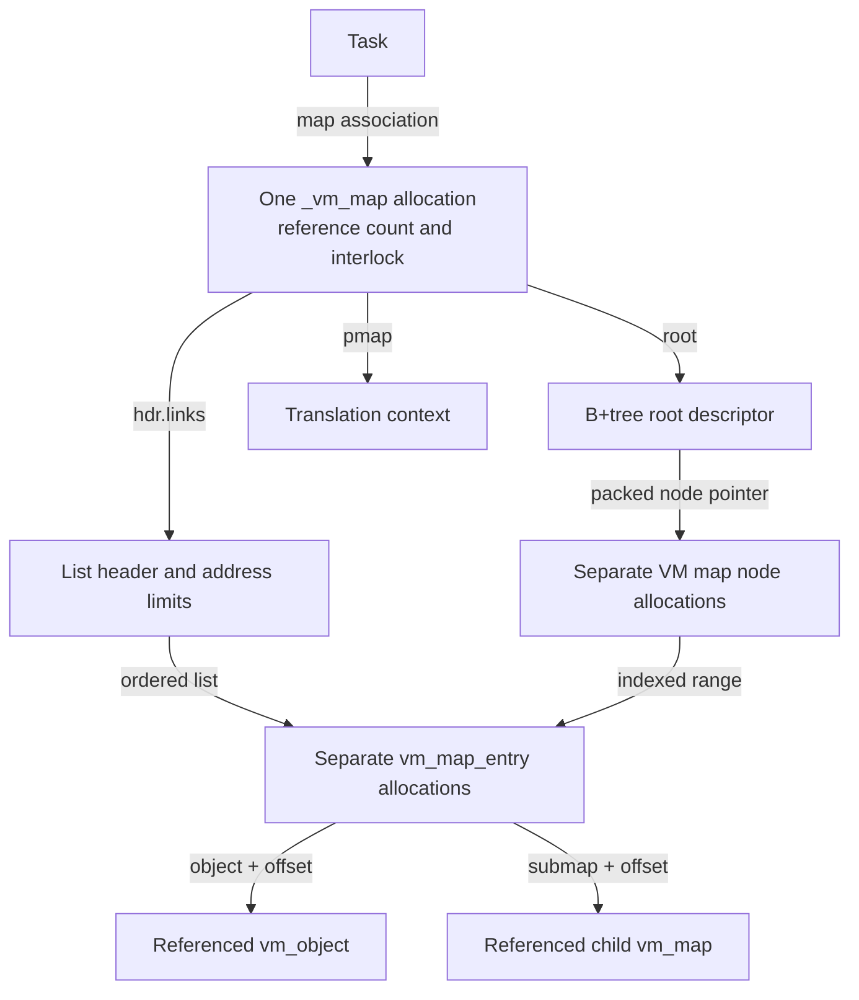
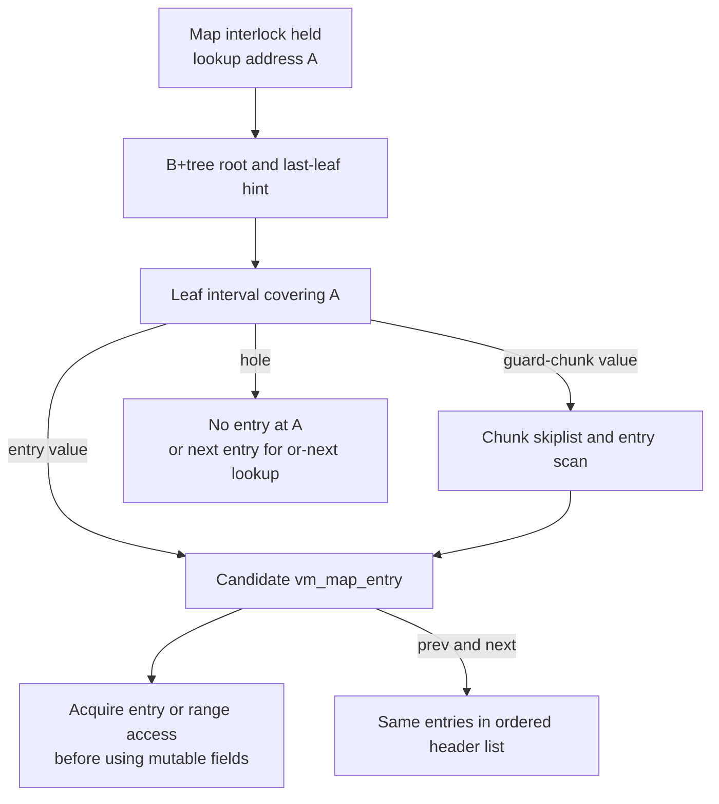
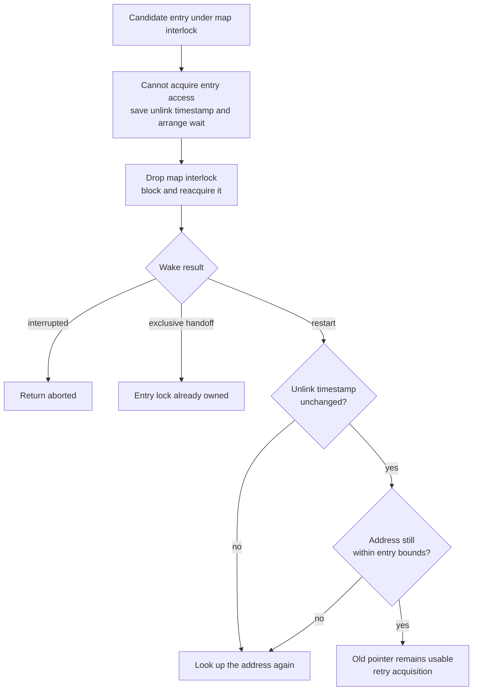
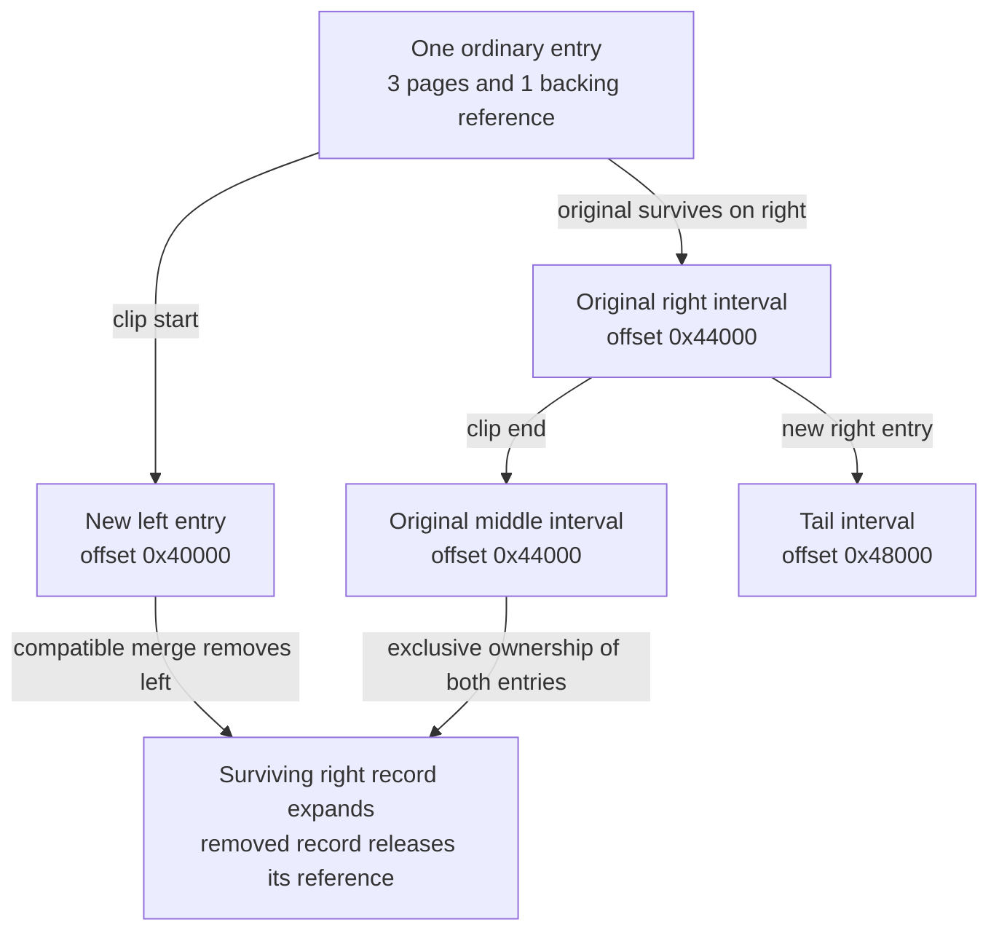
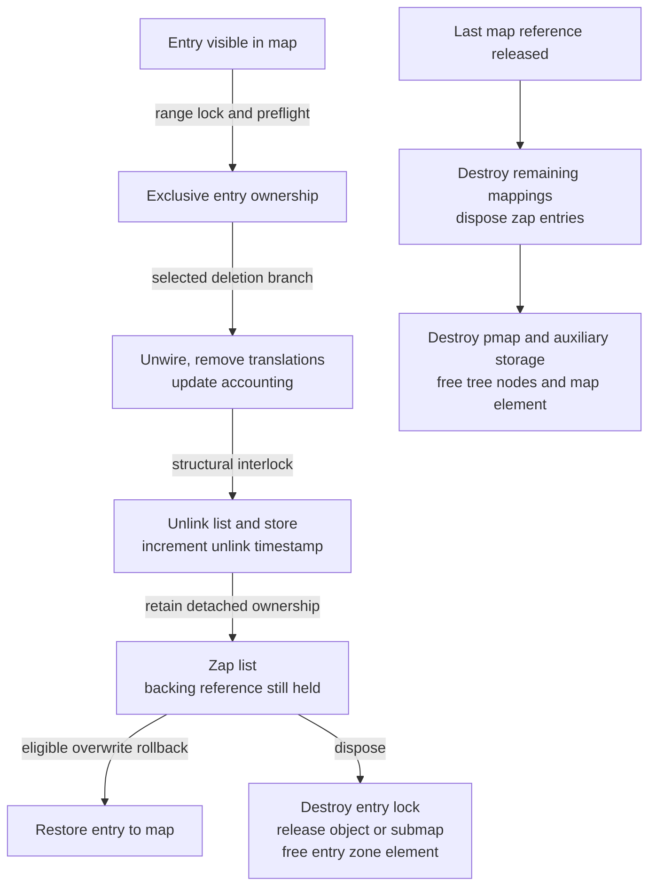

# VM maps, entries and the storage behind an address range

A `vm_map` owns the description of an address space. Its `vm_map_entry` records describe intervals, permissions and the object or submap reached through each interval; the map's `pmap` supplies the hardware translation context. This chapter follows those records from allocation through publication, locking, splitting and final release in `xnu-12377.121.6`, so that an entry pointer in an implementation can be read together with its storage and ownership contract.

[Key structures](README.md) · [Virtual memory guide](../subsystems/vm/README.md) · [Task and shared RO data](task-and-shared-ro.md) · [VM objects](vm-objects-and-backing.md) · [Resident pages](vm-pages-and-resident-storage.md) · [Pmap storage](pmap-and-translation-storage.md)

The operation-oriented [virtual address maps](../subsystems/vm/virtual-address-maps.md) chapter explains placement, protection and range APIs. Use [argument validation](../subsystems/vm/api-argument-validation.md) for user input, [fault resolution](../subsystems/vm/fault-resolution.md) for contents and translations, and [memory entries and map copies](memory-entries-and-vm-copies.md) for exported capabilities and transfer containers. Here the main questions are what a field represents, who owns a reference, and when a pointer remains usable.

## 1. The map is a container, an entry is a range record

`vm_map_t` refers to `struct _vm_map`. It embeds a `vm_map_header` and a B+tree root, but its individual entries and tree nodes are separate allocations. An ordinary entry identifies a half-open virtual interval `[vme_start, vme_end)`, an object and an object offset. A submap entry instead identifies another map and an offset in that map. Neither case embeds a physical page or a page-table entry. [Map declaration](../../xnu/osfmk/vm/vm_map_xnu.h#L594-L720), [entry declaration](../../xnu/osfmk/vm/vm_map_xnu.h#L320-L445).



The object/submap arrows are alternatives selected by `is_sub_map`. The task arrow describes an association whose acquisition protocol matters; it is not permission to fetch any task's map without synchronization. The diagram omits guard-object chunks, which can sit between a tree leaf and the entries it indexes.

There are four quantities to keep separate while reading a map:

| Quantity | Stored or derived from | What it does not establish |
| --- | --- | --- |
| Virtual coverage | Entry bounds; `map->size` counts inserted non-sentinel entry lengths | Resident physical bytes, available backing or installed translations |
| Entry count | `map->hdr.nentries` | Number of objects or pages; clipping increases this count without adding mapped bytes |
| Map lifetime | `map_refcnt` | Stable entry membership or stable entry fields |
| Entry access | Structural interlock plus entry/range-lock protocol | An independently retained entry object; entries have no map-style reference counter |

Insertion and removal update virtual size explicitly, while the header helpers count and link entries. [Size on insertion](../../xnu/osfmk/vm/vm_map_store.c#L2716-L2731), [size on removal](../../xnu/osfmk/vm/vm_map_store.c#L2798-L2818), [header insertion/removal](../../xnu/osfmk/vm/vm_map_store.c#L2605-L2677).

## 2. Map fields and their distinct contracts

The field layout is common VM code, with several configuration-dependent members. The table groups fields by how a reader should obtain and interpret them; it does not replace an operation's lock assertions.

| Fields | Meaning | Access and lifetime considerations |
| --- | --- | --- |
| `ilock`, `unlink_timestamp` | Structural reader/writer interlock and entry-unlink generation | Use the interlock to traverse mutable structure. An unchanged generation after dropping/reacquiring it permits the documented entry-pointer revalidation; entry bounds can still have changed. [Declaration](../../xnu/osfmk/vm/vm_map_xnu.h#L594-L603). |
| `hdr`, `root` | Ordered entry list, count, page shift, and indexed lookup | List and B+tree describe the same map. Insertion/removal/clip helpers update them together under the structural contract. [Fields](../../xnu/osfmk/vm/vm_map_xnu.h#L604-L607), [store insertion](../../xnu/osfmk/vm/vm_map_store.c#L2704-L2794). |
| `min_offset`, `max_offset` | Macros for `hdr.links.start/end` | Inclusive lower and exclusive upper map bounds; these are header values, not an ordinary mapping. [Aliases](../../xnu/osfmk/vm/vm_map_xnu.h#L606-L607). |
| `pmap` | Associated translation context | The constructor stores its argument without retaining it. Final map destruction calls `pmap_destroy()` when non-null. Normal task creation supplies a newly created pmap; special kernel/submap callers have their own ownership setup. [Construction](../../xnu/osfmk/vm/vm_map.c#L2197-L2206), [task caller](../../xnu/osfmk/kern/task.c#L1416-L1458), [destruction](../../xnu/osfmk/vm/vm_map.c#L2433-L2435). |
| `size`, `size_limit`, `data_limit`, `user_wire_limit`, `user_wire_size` | Virtual coverage and address-space/wiring limits or accounting | These are not interchangeable with pmap resident/physical-footprint counters. [Fields](../../xnu/osfmk/vm/vm_map_xnu.h#L609-L613). |
| `map_refcnt` | Atomic map reference count | A retained map can survive task-map detachment or logical termination; individual mappings remain mutable. [Field](../../xnu/osfmk/vm/vm_map_xnu.h#L618-L618), [retain/release](../../xnu/osfmk/vm/vm_map.c#L19304-L19331). |
| `extra_ranges`, `default_range`, `data_range`, `large_file_range` | Optional placement ranges under `CONFIG_MAP_RANGES` | Read with the range-placement code; they are not another list of present mappings. Extra-range storage is freed separately. [Fields](../../xnu/osfmk/vm/vm_map_xnu.h#L620-L628), [free](../../xnu/osfmk/vm/vm_map.c#L2443-L2446). |
| `highest_entry_end` / `lowest_unnestable_start` | A union used for disabled entry-address reuse or nested-map unnesting | Select the meaning from map mode. The declaration describes both alternatives. [Union](../../xnu/osfmk/vm/vm_map_xnu.h#L632-L645). |
| `terminated`, `corpse_source`, `vmmap_sealed`, `never_faults` and policy bits | Lifecycle, diagnostics, mutability, fault and execution policy | A terminated map is still an allocated object. A sealed map has special access/destruction rules. The flags are not one universal active/dead test. [Fields](../../xnu/osfmk/vm/vm_map_xnu.h#L649-L682). |
| `owning_task` | Weak back-reference | Setup takes no task reference. To acquire one through this field, hold the map interlock, check non-null and obtain the task reference before releasing the lock. Termination clears it under that lock. [Declared contract](../../xnu/osfmk/vm/vm_map_xnu.h#L683-L689), [setup/termination](../../xnu/osfmk/vm/vm_map.c#L9057-L9105). |
| `serial_id` | Pointer-typed generation/domain identifier | It receives pointer authentication as a pointer type, but is conceptually an ID. A forked map deliberately shares the parent's ID; it is not unique map-object identity. [Declaration](../../xnu/osfmk/vm/vm_map_xnu.h#L691-L698), [construction policy](../../xnu/osfmk/vm/vm_map.c#L2208-L2218). |
| `async_fault` | Asynchronous tag/guard-fault delivery state | The declaration explicitly requires a map reference and atomic accesses, not the map interlock. [Contract](../../xnu/osfmk/vm/vm_map_xnu.h#L700-L719). |

`owning_task` is especially useful when comparing this structure with the task chapter: the task's map association does not create a reference cycle through an owning task reference. A map reference also does not authorize dereferencing a saved `owning_task` after the lock protecting the weak association has been released.

## 3. Allocation and initialization before publication

`vm_map_init()` creates separate reserved-ID zones for maps, entries and B+tree nodes. Their common `VM_MAP_ZFLAGS` is `ZC_NOENCRYPT | ZC_VM`; `ZC_VM` places these zones in the VM submap. These are writable structures, not RO-zone records. Entry and node zones receive element reserves of `32 * cpus` and `8 * cpus`, with `cpus = ml_early_cpu_max_number() + 1`. The same initializer creates copy and guard-chunk zones and crams stolen bootstrap storage into the principal zones. [Flags](../../xnu/osfmk/vm/vm_map.c#L1192-L1192), [flag meaning](../../xnu/osfmk/kern/zalloc.h#L189-L189), [zone initialization](../../xnu/osfmk/vm/vm_map.c#L1782-L1825).

The map and entry zones are established by [vm_map.c, lines 1792–1802](../../xnu/osfmk/vm/vm_map.c#L1792-L1802):

<!-- source-excerpt: ../../xnu/osfmk/vm/vm_map.c#L1792-L1802 -->
```c
	zone_create_ext(VM_MAP_ZONE_NAME, sizeof(struct _vm_map),
	    VM_MAP_ZFLAGS, ZONE_ID_VM_MAP, NULL);

	/*
	 * Don't quarantine because we always need elements available
	 * Disallow GC on this zone... to aid the GC.
	 */
	zone_create_ext(VM_MAP_ENTRY_ZONE_NAME, sizeof(struct vm_map_entry),
	    VM_MAP_ZFLAGS, ZONE_ID_VM_MAP_ENTRY, ^(zone_t z) {
		z->z_elems_rsv = 32 * cpus;
	});
```

The constructor `vm_map_create_with_page_shift()` uses a zeroed, waiting, no-fail map allocation, initializes store state, sets unlimited initial limits, initializes one map reference and records the supplied pmap. It rounds the lower map bound up and the upper bound down using the selected map page mask. `VM_MAP_CREATE_NEVER_FAULTS` requires `kernel_pmap`; the corpse-footprint option sets a separate accounting flag. It initializes the interlock after private field initialization, explicitly noting that no other observer has the map yet. [Constructor](../../xnu/osfmk/vm/vm_map.c#L2174-L2237).

The initial ownership is visible in [vm_map.c, lines 2197–2206](../../xnu/osfmk/vm/vm_map.c#L2197-L2206):

<!-- source-excerpt: ../../xnu/osfmk/vm/vm_map.c#L2197-L2206 -->
```c
	result = zalloc_id(ZONE_ID_VM_MAP, Z_WAITOK | Z_NOFAIL | Z_ZERO);

	vm_map_store_init(result, pageshift);

	result->size_limit      = RLIM_INFINITY;        /* default unlimited */
	result->data_limit      = RLIM_INFINITY;        /* default unlimited */
	result->user_wire_limit = MACH_VM_MAX_ADDRESS;  /* default limit is unlimited */
	os_ref_init_count_raw(&result->map_refcnt, &map_refgrp, 1);

	result->pmap = pmap;
```

There is no static full-map template copied here. Zero allocation plus constructor assignments establish the initial state. `vm_map_create_options()` selects the system `PAGE_SHIFT`; the explicit page-shift constructor supports maps whose granularity must be specified. The older external constructor's `pageable` parameter is ignored in this implementation. [Wrappers](../../xnu/osfmk/vm/vm_map.c#L2011-L2018), [default page shift](../../xnu/osfmk/vm/vm_map.c#L2240-L2247).

Store initialization gives the embedded header a circular empty list: both links point back to the header cast as an entry. It records the page shift and sets `is_vm_map_copy = false`, then initializes the B+tree root. A copy header uses the same header initializer with `is_vm_map_copy = true`, but does not acquire a map's tree through that operation. [Header/root initialization](../../xnu/osfmk/vm/vm_map_store.c#L796-L844).

The header initialization is [vm_map_store.c, lines 823–830](../../xnu/osfmk/vm/vm_map_store.c#L823-L830):

<!-- source-excerpt: ../../xnu/osfmk/vm/vm_map_store.c#L823-L830 -->
```c
vm_map_hdr_store_init(struct vm_map_header *hdr, uint32_t pageshift, bool cpy)
{
	hdr->links.prev     = CAST_TO_VM_MAP_ENTRY(hdr);
	hdr->links.next     = CAST_TO_VM_MAP_ENTRY(hdr);
	hdr->page_shift     = (uint16_t)pageshift;
	hdr->is_vm_map_copy = cpy;
	vm_map_header_init_invalid_lock(hdr);
}
```

The header lock is deliberately invalid with the map-header reason. `vm_map_to_entry(map)` returns this header-shaped list terminator, not a separately allocated entry with an object field. Always test the end condition before reading full-entry fields. [Header definition](../../xnu/osfmk/vm/vm_map_xnu.h#L457-L466), [end helpers](../../xnu/osfmk/vm/vm_map_xnu.h#L724-L734), [invalid lock initialization](../../xnu/osfmk/vm/vm_entry_lock.c#L1290-L1301).

For a task map, `vm_map_setup()` installs `owning_task` under the interlock before task IPC enablement. Its comment identifies why this order is publication-sensitive: once task ports admit VM calls, other threads can look up the map. Constructor return, owner setup and external accessibility are distinct events. [Setup requirement and implementation](../../xnu/osfmk/vm/vm_map.c#L9057-L9081).

Bootstrap has an additional storage-relocation phase: early map, entry and tree-node pointers must be rewritten when stolen storage is relocated. Those bootstrap fixups explain why a packed-pointer definition can have relocation users unrelated to ordinary allocation. They are not the steady-state creation path above. [Early relocation](../../xnu/osfmk/vm/vm_map.c#L2040-L2145).

## 4. Entry fields: backing, coordinates and policy

The first member of `vm_map_entry` is `vm_map_links`, which contains previous/next links, virtual bounds, the entry lock and an optional packed guard-chunk association. The backing union follows; ordinary field accesses should use the `VME_*` helpers because the representation is packed and has special alternatives. [Links](../../xnu/osfmk/vm/vm_map_xnu.h#L311-L318), [entry geometry](../../xnu/osfmk/vm/vm_map_xnu.h#L320-L357).

| Entry field or helper | Interpretation | Important boundary |
| --- | --- | --- |
| `vme_start`, `vme_end`, `VME_SIZE()` | Parent-map virtual interval and byte length | These are not object offsets or physical addresses. [Size helper](../../xnu/osfmk/vm/vm_map_xnu.h#L513-L517). |
| `is_sub_map`, `VME_SUBMAP()` | Packed child-map pointer, decoded by shifting left `VME_SUBMAP_SHIFT` | Use only for the submap alternative. `VME_SUBMAP_SET()` stores the pointer and discriminator; it does not acquire a map reference. [Accessors](../../xnu/osfmk/vm/vm_map_xnu.h#L472-L489). |
| `VME_OBJECT()`, `vme_kernel_object` | Ordinary packed object, or the appropriate global kernel-object variant | The raw union word is not generally a `vm_object_t`. Kernel-object storage can instead carry delta/debug metadata; the accessor selects the object. [Decoder](../../xnu/osfmk/vm/vm_map_xnu.h#L492-L509), [union alternatives](../../xnu/osfmk/vm/vm_map_xnu.h#L329-L357). |
| `VME_OFFSET()`, `vme_offset` | Byte offset in object or child-map coordinates | Stored shifted right by 12; decoded by shifting left by 12. This representational granularity is distinct from a 16 KiB map page. [Constants](../../xnu/osfmk/vm/vm_map_xnu.h#L166-L172), [getter](../../xnu/osfmk/vm/vm_map_xnu.h#L520-L525), [setter](../../xnu/osfmk/vm/vm_map_internal.h#L457-L463). |
| `vme_atomic`, `vme_context` | Entry splitting/coalescing restriction and context for the selected special representation | `vme_atomic` does not mean every entry field is an atomic variable. [Union](../../xnu/osfmk/vm/vm_map_xnu.h#L329-L355), [setter](../../xnu/osfmk/vm/vm_map_internal.h#L394-L410). |
| `protection`, `max_protection` | Current mapping access and permitted ceiling | Store insertion asserts current bits are a subset of maximum. Actual PTE permissions can be more restrictive, for example while enforcing COW. ARM64e uses three current-protection bits plus `used_for_tpro`; other layouts reserve four current-protection bits. [Fields](../../xnu/osfmk/vm/vm_map_xnu.h#L374-L388), [assertion](../../xnu/osfmk/vm/vm_map_store.c#L2716-L2718). |
| `inheritance`, `is_shared`, `needs_copy` | Fork inheritance, sharing state and deferred-copy work | A `needs_copy` entry can still point to an existing object. Resolving it changes the backing relationship under the entry preparation protocol. [Fields](../../xnu/osfmk/vm/vm_map_xnu.h#L363-L388), [preparation modes](../../xnu/osfmk/vm/vm_map_lock_internal.h#L355-L370). |
| `use_pmap` | Nested-pmap state for a submap; pmap footprint accounting for an object | It does not uniformly mean “this range has hardware translations.” Initial insertion defaults it to false for submaps and true for objects. [Declaration](../../xnu/osfmk/vm/vm_map_xnu.h#L390-L398), [initializer](../../xnu/osfmk/vm/vm_map.c#L15420-L15427). |
| `wired_count`, `user_wired_count` | Total and user wiring state | Counts are not page references or map references. Unwiring and pmap/page changes precede entry disposal. [Fields](../../xnu/osfmk/vm/vm_map_xnu.h#L420-L421), [delete wiring handling](../../xnu/osfmk/vm/vm_map.c#L8372-L8403). |
| `vme_alias`, behavior/cache bits | VM accounting tag and paging/cache choices | The alias setter has a specific shared-lock update allowance; avoid assuming every entry bit has exactly the same write protocol. [Alias rule](../../xnu/osfmk/vm/vm_map_internal.h#L465-L478). |
| Permanent, JIT, TPRO, CSM, MTE, resilient/debug and translated-execute fields | Mapping policy and backend associations | They participate in compatibility checks and cleanup. Presence or interpretation depends on architecture/configuration. [Flags](../../xnu/osfmk/vm/vm_map_xnu.h#L363-L418). |

`VME_OBJECT_SET()` is a representation update, not a generic reference-assignment operation. It asserts writable entry fields, chooses the packed/global-object form, and resets `vme_resilient_codesign` and `used_for_jit`; `VM_OBJECT_SET_KEEP_JIT()` explicitly preserves the latter. A caller replacing backing must arrange the old/new object references itself. Likewise, copying the pointer bits is not enough to create another owned backing relationship. [Object setters](../../xnu/osfmk/vm/vm_map_internal.h#L394-L453).

The offset setter makes the exact representation constraint visible in [vm_map_internal.h, lines 457–463](../../xnu/osfmk/vm/vm_map_internal.h#L457-L463):

<!-- source-excerpt: ../../xnu/osfmk/vm/vm_map_internal.h#L457-L463 -->
```c
VME_OFFSET_SET(
	vm_map_entry_t entry,
	vm_object_offset_t offset)
{
	entry->vme_offset = offset >> VME_OFFSET_SHIFT;
	assert3u(VME_OFFSET(entry), ==, offset);
}
```

An entry can validly have a null object, notably before anonymous backing is materialized. Range preparation can allocate an object of `VME_SIZE(entry)`, assign the map's provenance ID and set offset zero. Consequently, an address-range record can precede both its object and its physical pages. [Allocation helper](../../xnu/osfmk/vm/vm_map_lock.c#L154-L164).

There are also **two different sentinels**. The embedded header is the list terminator and is not a full entry. A locked-hole sentinel is a real entry allocation with `sentinel_object`; range locking uses it to reserve a hole. `VME_IS_SENTINEL()` identifies this latter kind, which does not contribute its length to `map->size`. [Sentinel creation](../../xnu/osfmk/vm/vm_map.c#L718-L729), [predicate](../../xnu/osfmk/vm/vm_map_xnu.h#L527-L531), [size exclusion](../../xnu/osfmk/vm/vm_map_store.c#L2729-L2731).

## 5. Constructing, cloning and publishing an entry

`_vm_map_entry_create()` obtains zeroed storage from `ZONE_ID_VM_MAP_ENTRY` with `Z_WAITOK_ZERO_NOFAIL`, assigns default inheritance and bounds, and relies on zero being the default behavior value. The public internal wrapper `vm_map_entry_create_locked()` then initializes the entry lock already held exclusively. New-entry ownership therefore begins before list/tree publication. [Allocation/defaults](../../xnu/osfmk/vm/vm_map.c#L583-L612), [locked wrapper](../../xnu/osfmk/vm/vm_map.c#L699-L715).

`vm_map_entry_create_locked_and_insert()` is a compact worked construction path:

1. Require the map interlock exclusively; assert nonempty page-aligned bounds and non-overflowing backing extent.
2. Allocate an exclusively locked entry and choose object versus submap storage.
3. Set offset, tag, copy/inheritance/protection state, accounting and mapping flags.
4. Call `vm_map_store_insert()` and return the still-locked entry.

The object/submap setters in this helper do not retain backing. Its caller must supply the ownership required by the mapping operation. [Complete helper](../../xnu/osfmk/vm/vm_map.c#L15382-L15448).

Entry cloning makes the reference accounting explicit. `_vm_map_entry_copy(original, own_obj)` optionally retains the object or submap, copies the record, clears chunk/list membership, and leaves lock reinitialization to its wrapper. The ordinary locked-copy wrapper passes `true` and creates a fresh exclusive lock. A separate no-object-ownership wrapper exists for callers with a different contract; its name must not be ignored. [Copy backend](../../xnu/osfmk/vm/vm_map.c#L626-L660), [owning and non-owning wrappers](../../xnu/osfmk/vm/vm_map.c#L741-L775).

The reference and membership separation is [vm_map.c, lines 646–658](../../xnu/osfmk/vm/vm_map.c#L646-L658):

<!-- source-excerpt: ../../xnu/osfmk/vm/vm_map.c#L646-L658 -->
```c
	if (own_obj) {
		if (original->is_sub_map) {
			vm_map_reference(VME_SUBMAP(original));
		} else if (!VME_IS_SENTINEL(original)) {
			vm_object_reference(VME_OBJECT(original));
		}
	}

	*copy = *original;
	copy->vme_chunk = VMS_POINTER_NULL;
	copy->vme_prev  = VM_MAP_ENTRY_NULL;
	copy->vme_next  = VM_MAP_ENTRY_NULL;
	/* caller will init the lock properly */
```

| Storage state | Backing ownership | Membership and lock state |
| --- | --- | --- |
| New regular entry | Set by constructor caller; null backing may be valid | Unlinked, exclusively locked before publication |
| Ordinary cloned entry | Additional object/submap reference | Unlinked copy with a newly initialized exclusive lock |
| Entry in a live map | Owns its mapping's backing reference | In ordered list and indexed store; entry/range locks regulate field access |
| Entry-list copy element | Owning or explicitly non-owning according to helper | Uses copy-container list rules; lock is invalid with `COPY_ENTRY` reason |
| Detached entry on a zap list | Still owns backing until disposal or restoration | Removed from map store; exclusive ownership retained; `vme_next` reused by zap list |
| Freed entry | Owned backing released first | Lock destroyed; zone storage returned |

Copy-container entries come from the same entry zone but intentionally lack a valid ordinary map-entry lock. Treat `hdr.is_vm_map_copy` and the helper family as part of the representation contract. Their complete transfer/discard path belongs to [memory entries and map copies](memory-entries-and-vm-copies.md). [Copy-entry initialization](../../xnu/osfmk/vm/vm_map.c#L785-L811), [invalid reasons](../../xnu/osfmk/vm/vm_map_xnu.h#L182-L189).

Publication is more than setting `vme_next`. `vm_map_store_insert()` requires both exclusive map interlock and exclusive entry ownership; checks protection compatibility and submap page-shift compatibility; adds non-sentinel length to map size; optionally associates code-signing-monitor state; and updates the list plus tree or guard-chunk index. Readers finding that new entry through the map must still acquire the appropriate entry access before using mutable fields. [Insertion body](../../xnu/osfmk/vm/vm_map_store.c#L2704-L2794).

## 6. How a caller reaches a map and keeps it alive

| Access route | Result | Lifetime rule |
| --- | --- | --- |
| `current_map()` / `current_map_fast()` | Current thread's `map` pointer | A contextual access, not a new map reference. Because kernel execution can switch maps, this is not universally identical to fetching `current_task()->map`. [Function](../../xnu/osfmk/vm/vm_map.c#L19293-L19296), [macro](../../xnu/osfmk/vm/vm_map_xnu.h#L59-L60). |
| `get_task_map(task)` | Raw task-map pointer | The source limits use to the current task's context or a caller holding the task lock; the association can be switched and freed. [Contract/body](../../xnu/osfmk/kern/bsd_kern.c#L406-L415). |
| `get_task_map_reference(task)` | Referenced map or null | Lock task, reject inactive task, retain its current map, unlock task. Caller eventually uses `vm_map_deallocate()`. [Body](../../xnu/osfmk/kern/bsd_kern.c#L418-L435). |
| Task-port conversion | Referenced map after task-flavor admission | Port lock and task-IPC disable ordering protect reference acquisition; the return is not just a borrowed `task->map`. [Conversion](../../xnu/osfmk/kern/ipc_tt.c#L2823-L2870). |
| Submap entry access | `VME_SUBMAP(entry)` | Entry owns a submap reference, but a reader must first stabilize entry access. Taking a separate map reference allows the map object to outlive that entry's ownership. [Decoder](../../xnu/osfmk/vm/vm_map_xnu.h#L472-L489), [copy/free references](../../xnu/osfmk/vm/vm_map.c#L646-L683). |
| Named memory-entry conversion | Submap-derived map subject to capability checks | This is a different kobject route from a task port. Follow the memory-entry lock/permission/conversion path. [Conversion](../../xnu/osfmk/vm/vm_map.c#L19244-L19285), [companion](memory-entries-and-vm-copies.md). |

The task-port path is worth reading precisely. `convert_port_to_map_with_flavor()` locks the port, obtains a permitted task association without taking a task reference, checks `task->active`, then references the map before unlocking. The accompanying comment explicitly says the active check is an optimization: lifetime rests on successful conversion under the port lock proving `ipc_task_disable()` has not completed, and map teardown occurring afterward. It also rejects exposing `kernel_pmap` through this path. Task inspect/name flavors are not supported map conversions here. [Ordering and checks](../../xnu/osfmk/kern/ipc_tt.c#L2831-L2866), [capability policy](../subsystems/security/task-and-thread-capabilities.md).

The map reference API is null-tolerant and checks the map zone before updating the atomic reference count. `vm_map_deallocate()` destroys the map only when release returns zero; its documented contract is an unlocked map. A map reference does not pin the list, tree, a particular address mapping, or a saved entry pointer. [Reference/deallocation implementation](../../xnu/osfmk/vm/vm_map.c#L19304-L19331).

## 7. Two indexes, one set of entries

The ordered list supports neighboring-range operations. The B+tree supports locating the range covering an address and finding suitable holes. Its nodes have a count, leaf/inner discriminator and packed sibling link. Inner nodes hold keys, child pointers and hole-class information; leaves hold keys and values. The root descriptor contains a packed root, depth and last-leaf hint. In this snapshot the declared node capacities are 15 inner slots and 20 leaf slots. [Capacities](../../xnu/osfmk/vm/vm_map_store_internal.h#L70-L71), [node layout](../../xnu/osfmk/vm/vm_map_store_internal.h#L109-L126), [root](../../xnu/osfmk/vm/vm_map_store_internal.h#L139-L143).



The hint is a search optimization, not an entry lifetime reference. Lookup first tries a suitable last leaf, otherwise descends from the root. `vm_map_store_lookup_entry()` requires the map interlock, except for a sealed map; it handles direct entry and guard-chunk cases, and its `or_next` form can return the next entry or the map-end marker when the address lies in a hole. A non-null returned pointer therefore does not by itself establish that the requested address lies within an entry. [Node search](../../xnu/osfmk/vm/vm_map_store.c#L1385-L1406), [entry lookup](../../xnu/osfmk/vm/vm_map_store.c#L1410-L1438).

Guard-object chunks reserve and index groups of address slots. Their bitmap and skiplist do not describe resident pages. An entry's `vme_chunk` connects it to this alternative store representation, and insertion/removal updates chunk bookkeeping rather than treating every leaf as a direct entry pointer. [Chunk representation](../../xnu/osfmk/vm/vm_map_store_internal.h#L178-L250), [chunk insertion](../../xnu/osfmk/vm/vm_map_store.c#L2761-L2780), [chunk removal](../../xnu/osfmk/vm/vm_map_store.c#L2820-L2881).

The header insertion helper checks aligned non-overlapping bounds and neighboring-list consistency, increments `nentries` and links both directions. Removal decrements the count, reconnects neighbors and clears the removed entry's list links. Whole-map insertion/removal additionally updates size, tree/chunk state and, on removal, `unlink_timestamp`. A low-level header operation is therefore insufficient to remove a live map entry. [Header operations](../../xnu/osfmk/vm/vm_map_store.c#L2605-L2677), [map removal](../../xnu/osfmk/vm/vm_map_store.c#L2798-L2891).

Removal can either free the entry immediately or leave it exclusively owned and detached. In the latter case, it clears chunk membership and invalidates waiting threads so they re-evaluate their lookup. Invalidating waiters is not the same as destroying the entry lock or freeing the object. [Removal tail](../../xnu/osfmk/vm/vm_map_store.c#L2886-L2891), [waiter invalidation](../../xnu/osfmk/vm/vm_entry_lock.c#L1269-L1285).

## 8. Interlocks, entry locks and range contexts

| Mechanism | Protects or establishes | What a caller must still do |
| --- | --- | --- |
| Map reference | Map allocation lifetime | Lock or otherwise stabilize mutable map/entry state |
| Shared/exclusive map interlock | Structural traversal or mutation | Acquire entry access for the operation; exclusive structural ownership is required by insert/remove/clip helpers |
| Shared/exclusive entry lock | Access to the selected entry's state; exclusive update ownership | Keep coordinates and map association consistent with the range context; honor special field contracts |
| `vm_map_lock_ctx` | Range bounds, current map/entry, lock mode, iteration state and submap coordinate context | Use context bounds, handle returned errors, and unlock using the matching API |
| Object lock/reference | Backing-object state/lifetime | Does not protect map membership or make a stale entry valid |

`vm_entry_lock` is an embedded atomic state representation, not a second object reference count. It contains valid/exclusive/read-count state, waiter flags and coalescing/unwire metadata. The source warns that the read count is meaningful for shared ownership; transient optimistic shared increments can leave a nonzero count during exclusive ownership. Invalid states identify copy entries, sealed-submap entries, destroyed entries, headers and fake entries. Read the discriminant before interpreting overlaid bits. [State contract](../../xnu/osfmk/vm/vm_map_xnu.h#L194-L252), [layout](../../xnu/osfmk/vm/vm_map_xnu.h#L253-L290), [invalid reasons](../../xnu/osfmk/vm/vm_map_xnu.h#L182-L189).

The range context carries requested bounds, current map/entry, preflight callback, flags and lock progress. Streaming mode records its last processed position and first error; atomic mode tracks its held interval and first entry. Parent-map, parent-entry and offset fields preserve coordinate relationships during submap descent. This is working operation state, not another persistent address-space object. [Context declaration](../../xnu/osfmk/vm/vm_map_lock_internal.h#L613-L682).

| Mode | Coverage and progress |
| --- | --- |
| `VMRL_STREAM` | Advance through entries, allowing holes; concurrent coalescing can make successive returned entry bounds overlap already processed addresses |
| `VMRL_STREAM_NO_HOLES` | Stream, but fail when encountering a hole |
| `VMRL_ATOMIC` | Hold the entire covered range for the operation; reject holes |
| `VMRL_ATOMIC_ALLOW_HOLES` | Exclusive range locking with real sentinel entries reserving holes; intended for enter/delete overwrite machinery |

Shared/exclusive ownership is a separate choice from streaming/atomic coverage. “Atomic” here names the range-lock contract; it does not promise transaction rollback for every later VM operation. Streaming callers must use `vm_map_lock_ctx_bounds()` or equivalent to identify the portion still belonging to their operation. [Mode contract](../../xnu/osfmk/vm/vm_map_lock_internal.h#L307-L352).

Preparation flags can allocate a missing object or resolve object/submap COW before returning the entry. The preparation implementation may unnest and clip, then drop the map interlock while retaining entry ownership to perform backing work; it can return an error from that work. Follow the actual lock state at each return rather than assuming the structural interlock is held for the whole range operation. [Preparation flags](../../xnu/osfmk/vm/vm_map_lock_internal.h#L355-L374), [preparation implementation](../../xnu/osfmk/vm/vm_map_lock.c#L2194-L2300).

### Waiting does not preserve an unclaimed entry pointer

The contended entry-lock path saves `map->unlink_timestamp`, releases the map interlock, blocks and reacquires the interlock. It then distinguishes an interrupt, exclusive lock handoff, and a restart requiring revalidation. A handoff returning `KERN_LOCK_OWNED` has a different proof from a wake-all restart. [Blocking implementation](../../xnu/osfmk/vm/vm_entry_lock.c#L407-L478).



The critical non-handoff test is [vm_entry_lock.c, lines 467–478](../../xnu/osfmk/vm/vm_entry_lock.c#L467-L478):

<!-- source-excerpt: ../../xnu/osfmk/vm/vm_entry_lock.c#L467-L478 -->
```c
	/*
	 * The unlink_timestamp being unchanged tells us no entries have been
	 * removed from the map. That means we can safely dereference the old
	 * entry pointer and look to see if the address we want to lock is within
	 * the bounds of the entry.
	 */
	if (timestamp == map->unlink_timestamp &&
	    entry->vme_start <= addr && addr < entry->vme_end) {
		return KERN_SUCCESS;
	}

	return VMRL_ERR_RELOOKUP;
```

The order is significant: only an unchanged unlink generation permits dereferencing the old pointer for its bounds check. Unchanged generation alone does not prove that the original address still belongs to that record. This is the concrete reason a map reference and a saved entry pointer cannot replace the range-lock retry protocol.

## 9. Clipping and coalescing with a worked offset example

Clipping divides representation while preserving the meaning of each address. `vm_map_store_clip_start()` and `vm_map_store_clip_end()` require the map interlock and entry exclusively, clone the entry with another backing reference, and update the list plus tree/chunk representation. They do not add virtual coverage. The original record survives as the right side of a start clip and as the left side of an end clip; the new record is also exclusively locked. [Map clip wrappers](../../xnu/osfmk/vm/vm_map_store.c#L3013-L3081).

The start-clip backend sets the new left interval, advances the original entry's start and adds that displacement to its backing offset. End clipping creates a right interval whose offset is the original offset plus the left interval's length. [Start arithmetic](../../xnu/osfmk/vm/vm_map_store.c#L2922-L2942), [end arithmetic](../../xnu/osfmk/vm/vm_map_store.c#L2958-L2977).

Consider an illustrative ordinary object mapping in a **16 KiB map**, with no special atomic, wired or submap state. Its single entry is `[0x100000, 0x10c000)` and starts at object offset `0x40000`. Split at `0x104000` and then `0x108000`:

| Stage | Entry intervals and decoded offsets | Entries / entry-owned object references |
| --- | --- | --- |
| Initial | Original `[0x100000, 0x10c000)`, offset `0x40000` | 1 / 1 |
| Clip original start at `0x104000` | New left `[0x100000, 0x104000)`, offset `0x40000`; original right `[0x104000, 0x10c000)`, offset `0x44000` | 2 / 2 |
| Clip surviving original end at `0x108000` | Left unchanged; original middle `[0x104000, 0x108000)`, offset `0x44000`; new tail `[0x108000, 0x10c000)`, offset `0x48000` | 3 / 3 |

The reference column counts only references owned by these entries; other object owners may exist. `map->size` remains `0xc000`. For address `0x105234`, both before and after clipping the object byte is:

```text
before: 0x40000 + (0x105234 - 0x100000) = 0x45234
after:  0x44000 + (0x105234 - 0x104000) = 0x45234
stored middle vme_offset: 0x44000 >> 12 = 0x44
```

These operations create entry records and references. They do not themselves allocate three sets of physical pages or install three new PTEs. A higher-level operation can still need unnesting or translation changes before clipping a special mapping; the example deliberately uses an ordinary object entry.

Coalescing is conditional. `vm_map_simplify_entry_with_prev_locked()` checks adjacency, same chunk and backing representation, continuous offsets, matching protection/inheritance/cache/accounting/security/wiring state, and exclusions including atomic entries and superpages. It keeps the **right** entry, extends it left, removes the left entry from the store and frees the left entry, dropping that entry's backing reference. Numeric continuity alone is insufficient. [Compatibility and merge](../../xnu/osfmk/vm/vm_map_lock.c#L1207-L1284), [store merge](../../xnu/osfmk/vm/vm_map_store.c#L3137-L3200).



The diagram shows representation identity, not a compulsory sequence of later merges. If a neighboring entry cannot be locked, simplification can defer work by recording coalescing state. A successful attempt with the next entry can also replace the caller's current entry pointer. Read the returned/current pointer rather than assuming the original record survived. [Neighbor locking and pointer update](../../xnu/osfmk/vm/vm_map_lock.c#L1290-L1381).

In this implementation simplification frees the removed left entry while holding the map interlock; the source labels delayed zap disposal as a future improvement. Do not generalize the deferred-delete pattern to every entry free. `vm_map_simplify_range()` requests `VMRL_EX_ATOMIC | VMRL_EX_SIMPLIFY | VMRL_EX_NO_PMAP_UNNEST`; simplification happens as the range unlocks. [Immediate free](../../xnu/osfmk/vm/vm_map_lock.c#L1271-L1282), [range caller](../../xnu/osfmk/vm/vm_map.c#L14304-L14335).

There is a second coalescing opportunity in anonymous `vm_map_enter()` growth: it checks a suitable previous entry, obtains exclusive access, tests compatible attributes and calls `vm_object_coalesce()` before extending the entry. This can change backing-object extent and is distinct from simply merging two existing entry records pointing to continuous portions of the same backing. [Enter-time coalescing](../../xnu/osfmk/vm/vm_map.c#L3584-L3647), [object companion](vm-objects-and-backing.md).

## 10. Submap pointers change the coordinate system

For an ordinary entry, `VME_OFFSET(entry) + (address - vme_start)` is an object byte offset. For a submap entry, the same arithmetic produces a child-map virtual address. Only after finding the child's entry can the reader derive an object offset. An entry's parent virtual address, child virtual address and object byte offset must not be interchanged. [Submap contract and coordinate rule](../../xnu/osfmk/vm/vm_map_lock_internal.h#L68-L104), [submap storage](../../xnu/osfmk/vm/vm_map_xnu.h#L472-L489).

The range-lock implementation distinguishes constant and transparent submaps. Constant submaps are sealed, allowing their entries to be read without ordinary entry locks; clients traverse them through the parent protocol, and direct range locking of a sealed submap is not the ordinary supported route. Transparent submaps are kernel-only, share `kernel_pmap`, have one parent mapping, and use matching parent/submap coordinates with atomic permanent parent entries. The documented model does not allow submaps within submaps. [Explicit restrictions](../../xnu/osfmk/vm/vm_map_lock_internal.h#L68-L104).

An illustrative constant-submap entry `[0x400000, 0x408000)` with child offset `0x100000` translates parent address `0x405234` to child address `0x105234`. If the child entry begins at `0x104000` with object offset `0x44000`, the object byte is `0x45234`. This coordinate example does not imply the child has the parent's pmap, or that its permissions and COW state can be skipped. See [submaps in map operations](../subsystems/vm/virtual-address-maps.md) and [copy/remap coordinates](../subsystems/vm/copy-overwrite-and-remap.md).

`use_pmap` marks nested-pmap state for a submap. Removing or preparing such a mapping can unnest translations before changing entries. Holding a reference to the child map preserves the child allocation; it does not replace the parent's entry lock, its coordinate bounds, or the selected nested-pmap cleanup. [Preparation](../../xnu/osfmk/vm/vm_map_lock.c#L2194-L2300), [submap removal](../../xnu/osfmk/vm/vm_map.c#L8550-L8605).

## 11. Removal, deferred disposal and final map release

Removal has several separate obligations: revoke or adjust translations, unwind wiring/accounting, remove the entry from the store, release owned backing and free the record. The order explains why an entry may be absent from lookup while still holding its object reference.

`vm_map_delete_and_iunlock_internal()` normally uses an exclusive atomic range lock allowing holes, with preflight checks and sentinel reservations. For a terminated map, unless preparing an overwrite, it selects streaming removal with bounds checks relaxed. Interruptible removal is explicitly disallowed for the kernel-map case. A live `corpse_source` map can skip ordinary removal and return success to preserve diagnostic state. [Mode selection and early exit](../../xnu/osfmk/vm/vm_map.c#L8696-L8800).

`vm_map_delete_handle_entry()` starts with exclusive entry ownership and without the structural interlock. Its cleanup depends on representation:

| Entry condition | Removal work before ordinary disposal |
| --- | --- |
| Wired mapping | Collapse user wiring as required, decrement wiring state, remove/protect kernel-object translations where necessary, and call the VM fault unwire path; unexpected remaining wiring is an error invariant |
| Hole sentinel | No physical translations to remove |
| Submap | Remove non-nested translations, or unnest a nested pmap; the terminated-map case uses cleanup-oriented unnest options |
| Object mapped in other pmaps | Use object-aware pmap protection/removal when the map/reference conditions require it |
| Ordinary object mapping | Remove the range from the map's pmap, subject to kernel/compressor special cases |
| Retained permanent entry | Set current and maximum protection to none and return without ordinary unlinking when policy says it must remain |

[Wiring handler](../../xnu/osfmk/vm/vm_map.c#L8372-L8403), [entry deletion body](../../xnu/osfmk/vm/vm_map.c#L8517-L8693). These branches are not a universal `pmap_remove()` call followed by `free()`. The page/object and pmap companions explain the resources reached by unwiring and translation removal.

After those steps, the handler reacquires the map interlock for structural removal or overwrite-sentinel replacement, then releases it. The surrounding delete loop frees hole sentinels directly and appends ordinary removed entries to a `vm_map_zap` list. That list holds exclusively owned, detached entries and reuses their `vme_next` link. It can preserve old entries for overwrite rollback, as well as defer destruction. [Unlink phase](../../xnu/osfmk/vm/vm_map.c#L8670-L8693), [delete loop](../../xnu/osfmk/vm/vm_map.c#L8801-L8854), [zap representation](../../xnu/osfmk/vm/vm_map.c#L943-L1012).



The diagram shows ordinary removable entries; retained permanent entries and immediate sentinel frees take the branches described above. `vm_map_remove_and_iunlock()` disposes its zap list after the deletion routine has released the interlock. `vm_map_zap_dispose()` pops each entry, clearing the temporary list link, then calls `vm_map_entry_free_locked()`. The latter destroys the exclusive lock and calls the owning free backend; the backend releases the submap or non-sentinel object reference, drops optional debug backtrace references and returns the entry to its zone. [Remove wrapper](../../xnu/osfmk/vm/vm_map.c#L9011-L9030), [zap disposal](../../xnu/osfmk/vm/vm_map.c#L970-L1012), [locked free](../../xnu/osfmk/vm/vm_map.c#L778-L782), [owning free](../../xnu/osfmk/vm/vm_map.c#L672-L695).

The backing release is explicit in [vm_map.c, lines 672–683](../../xnu/osfmk/vm/vm_map.c#L672-L683):

<!-- source-excerpt: ../../xnu/osfmk/vm/vm_map.c#L672-L683 -->
```c
_vm_map_entry_free(vm_map_entry_t entry, bool own_obj)
{
	assert(entry->vme_next == VM_MAP_ENTRY_NULL &&
	    entry->vme_prev == VM_MAP_ENTRY_NULL);

	if (own_obj) {
		if (entry->is_sub_map) {
			vm_map_deallocate(VME_SUBMAP(entry));
		} else if (!VME_IS_SENTINEL(entry)) {
			vm_object_deallocate(VME_OBJECT(entry));
		}
	}
```

### Logical termination and reference-counted destruction

`vm_map_terminate()` holds the interlock, marks the map terminated, clears the weak owning-task link and removes the normal map extent. It does not free the `vm_map` allocation or consume every outstanding map reference. The implementation ignores the remove return and reports `KERN_SUCCESS`. [Termination](../../xnu/osfmk/vm/vm_map.c#L9089-L9105).

The state transition is [vm_map.c, lines 9095–9101](../../xnu/osfmk/vm/vm_map.c#L9095-L9101):

<!-- source-excerpt: ../../xnu/osfmk/vm/vm_map.c#L9095-L9101 -->
```c
	vm_map_ilk_lock(map);

	map->terminated = true;
	map->owning_task = NULL;

	(void)vm_map_remove_and_iunlock(map, map->min_offset, map->max_offset,
	    VM_MAP_REMOVE_NO_FLAGS, KMEM_GUARD_NONE);
```

When `vm_map_deallocate()` releases the final reference, `vm_map_destroy_options()` handles the remaining lifetime:

1. Acquire the interlock allowing sealed maps, mark terminated, unseal or cancel the pending-seal state, and destroy corpse-footprint data.
2. Delete the broad address extent used by the finalizer, assert success and zero remaining entries, then dispose the zap list.
3. Destroy the associated pmap if present, destroy guard-object slabs and verify no remaining user guard chunk.
4. Destroy the interlock, free optional extra-range storage, destroy the store's tree nodes, and free the map zone element.

There is an optional development/debug transparent-submap cleanup branch; it is not the unconditional production path. [Finalizer](../../xnu/osfmk/vm/vm_map.c#L2397-L2451), [store destruction](../../xnu/osfmk/vm/vm_map_store.c#L846-L849), [reference release](../../xnu/osfmk/vm/vm_map.c#L19321-L19331).

A caller must not infer from `terminated` that all entry-storage behavior is frozen. The guard-chunk removal body deliberately preserves certain delegated slots during termination to accommodate racing overwrite callers, while avoiding new chunks. The actual branch matters more than treating termination as a universal admission rule. [Terminated guard-slot handling](../../xnu/osfmk/vm/vm_map_store.c#L2854-L2875).

## 12. Failure paths and source-reading walks

The entry and map allocation helpers above use no-fail zone allocation, but an operation using them can still fail from invalid coordinates, policy, unavailable address space, backing/COW work, wiring, interruption or changed map state. The allocation flag is not a guarantee that `vm_map_enter()` or a range operation succeeds.

| Situation | Consequence to trace |
| --- | --- |
| Waiting entry changed or disappeared | Re-lookup the address after the unlink/bounds test; do not continue from a saved entry pointer. [Retry](../../xnu/osfmk/vm/vm_entry_lock.c#L407-L478). |
| Range preparation fails | Backing work may have run after dropping the interlock; inspect context cleanup and returned lock state. [Preparation](../../xnu/osfmk/vm/vm_map_lock.c#L2194-L2300). |
| New mapping published, then interlock dropped | Another thread may remove that mapping and release its backing reference. `vm_map_enter()` takes an extra reference to preserve its return/error ownership contract. [Temporary reference](../../xnu/osfmk/vm/vm_map.c#L4018-L4039). |
| Late enter failure after overwrite | Remove new entries and attempt restoration of old ones only if the relevant range is still available. A concurrent replacement can prevent restoration. [Rollback](../../xnu/osfmk/vm/vm_map.c#L4070-L4177). |
| Enter success or failure after temporary backing retain | On success release the temporary reference because the mapping owns the transferred caller reference; on failure use it to satisfy the caller's retained-reference expectation. Publish the resulting address only on success. [Final ownership/output](../../xnu/osfmk/vm/vm_map.c#L4189-L4223). |
| Interrupted streaming deletion | Earlier entries can already have been removed; return the interruption after range cleanup. [Partial progress](../../xnu/osfmk/vm/vm_map.c#L8808-L8854). |
| Empty terminated range or a deletion gap | Empty terminated streaming deletion can be rewritten to success. Gap policy can produce `KERN_INVALID_VALUE`, or a guard exception and success; inspect the flags. [Error translation](../../xnu/osfmk/vm/vm_map.c#L8859-L8881). |

Three compact reading exercises connect field definitions to the actual bodies:

1. **Follow one new anonymous mapping.** Start at the sanitized API route in [argument validation](../subsystems/vm/api-argument-validation.md), then locate the reservation/entry construction in `vm_map_enter()`. Track zero backing versus allocated object, exclusive entry ownership, insertion into list/tree, the temporary extra backing reference before any interlock drop, and final address publication. Later follow [fault resolution](../subsystems/vm/fault-resolution.md) to see when contents and translations appear.
2. **Follow one middle-range change.** Mark the map page size and original entry's decoded offset. Follow range locking and the two clip helpers, reproduce the offset arithmetic above, then inspect the requested protection/inheritance update and simplification at unlock. Count entry-owned object references before and after each split/merge.
3. **Follow one removal through final storage release.** Begin at `vm_map_remove_guard()` and its locked wrapper, follow preflight and the selected pmap/unwire branch, then separate store unlink from zap disposal. Finally release the map reference and compare logical termination with `vm_map_destroy_options()`. [Remove entry point](../../xnu/osfmk/vm/vm_map.c#L9038-L9051).

The reviewed scope covers common map/entry storage, selected access paths, structural and range-lock lifetime, clipping/coalescing, submap representation, ordinary removal and map finalization. ARM64e TPRO, MTE, code-signing-monitor associations, map ranges, debug metadata and kernel/submap callers retain their visible configuration boundaries. It does not claim every allocation policy, tree rebalance interleaving, map-copy flavor, pager implementation or architecture's pmap algorithm. This is a source study; no kernel was built or executed.

Continue with [VM objects and backing](vm-objects-and-backing.md), [resident-page storage](vm-pages-and-resident-storage.md), [pmap storage](pmap-and-translation-storage.md) and [memory-entry/copy ownership](memory-entries-and-vm-copies.md) to follow the objects reached through these records.

<!-- BEGIN PLATYDOC DOCUMENTATION LICENSE -->
Original Platydoc text and diagrams are licensed under [CC BY 4.0](https://creativecommons.org/licenses/by/4.0/). Quoted source code and third-party material retain their respective licenses.
<!-- END PLATYDOC DOCUMENTATION LICENSE -->
